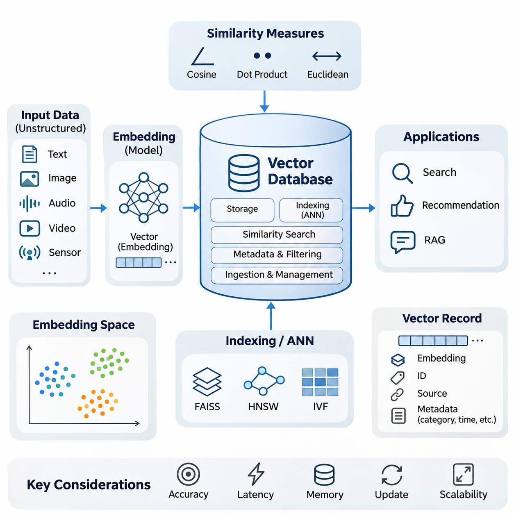
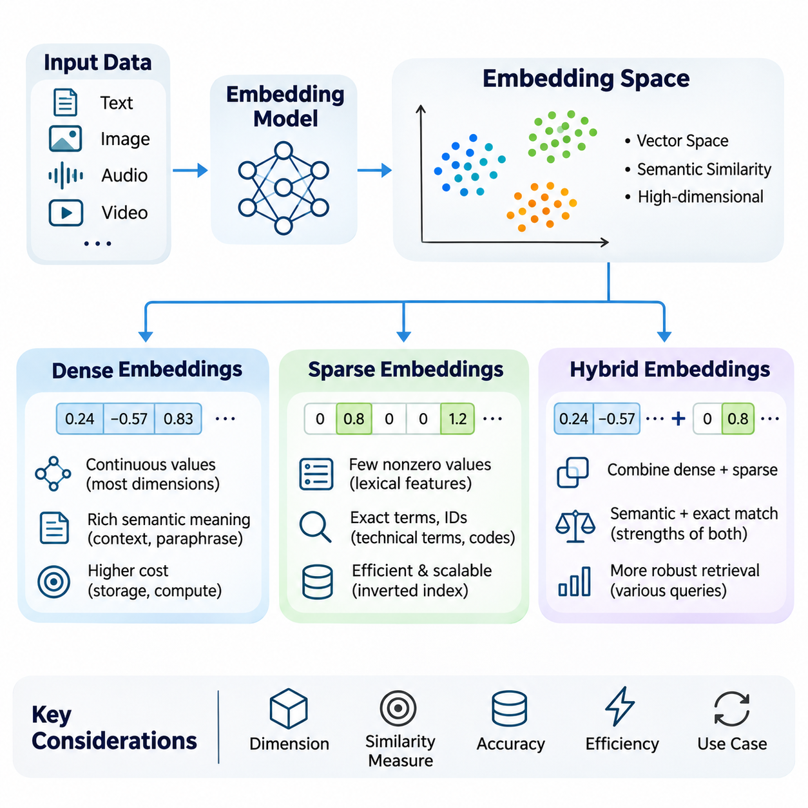
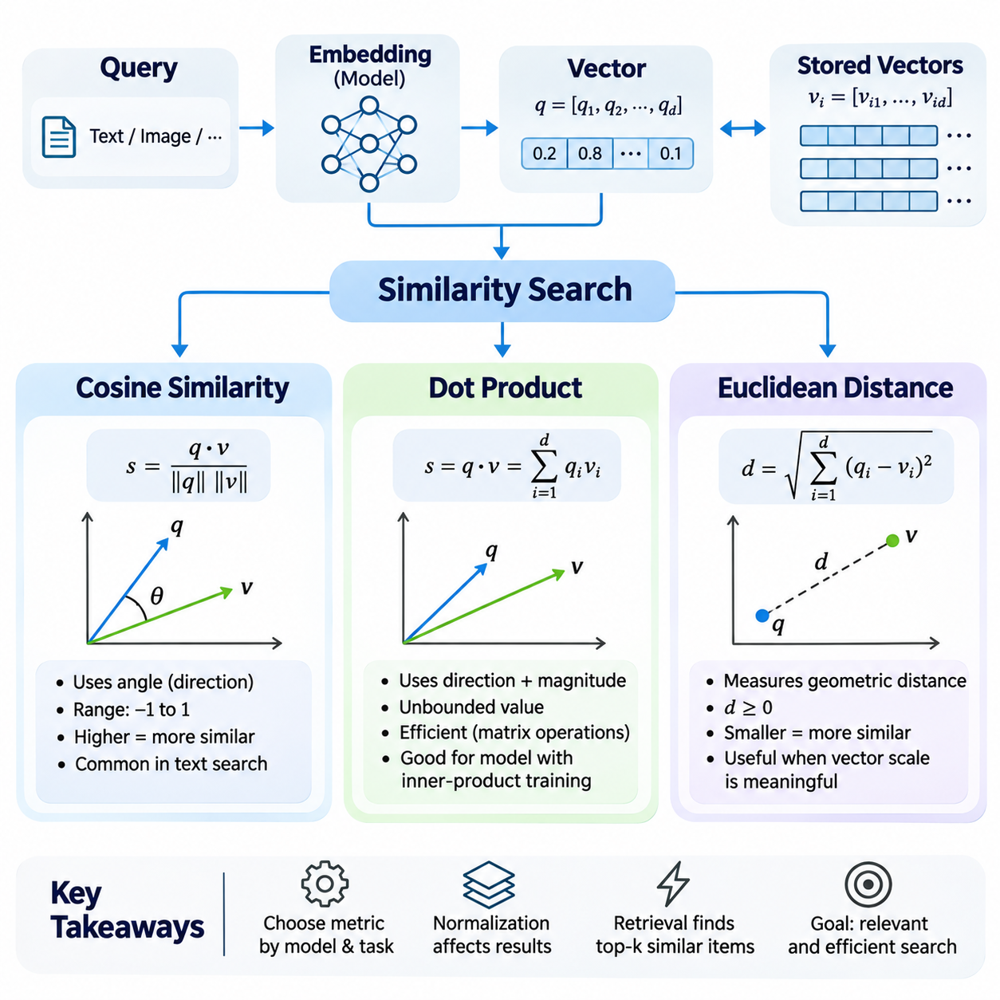
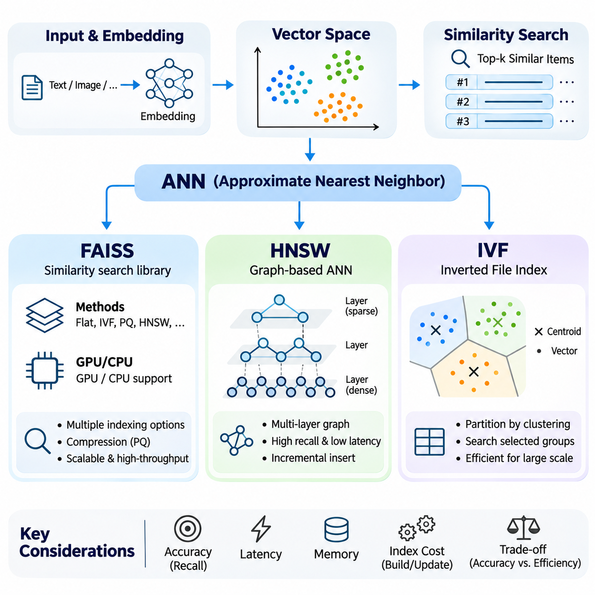
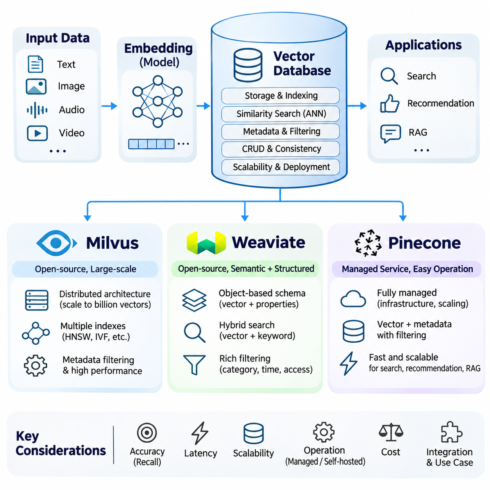
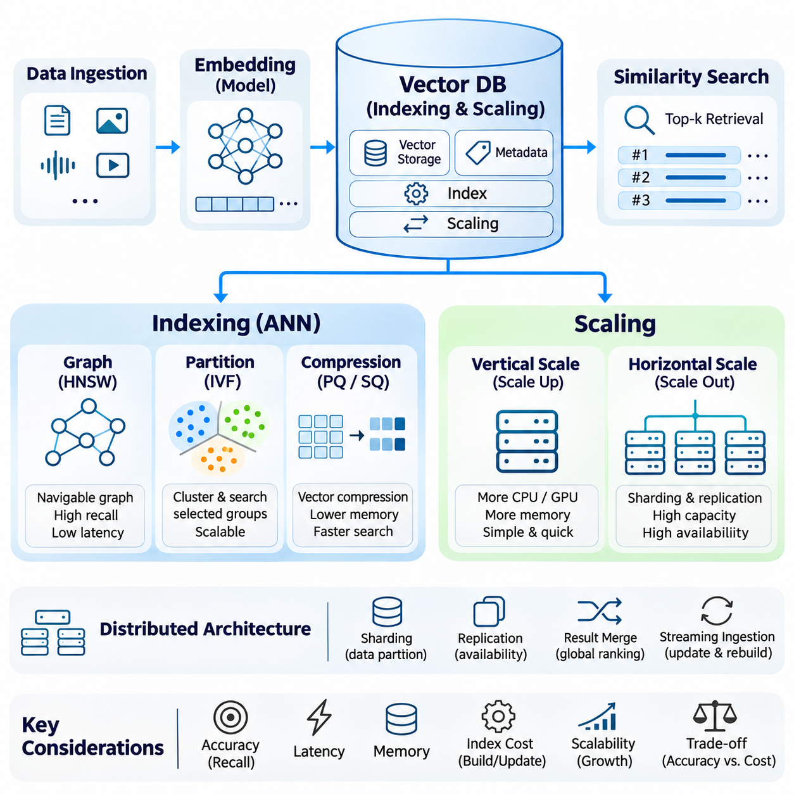
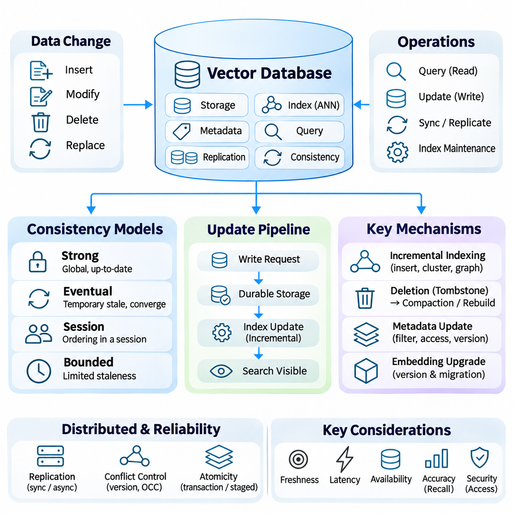
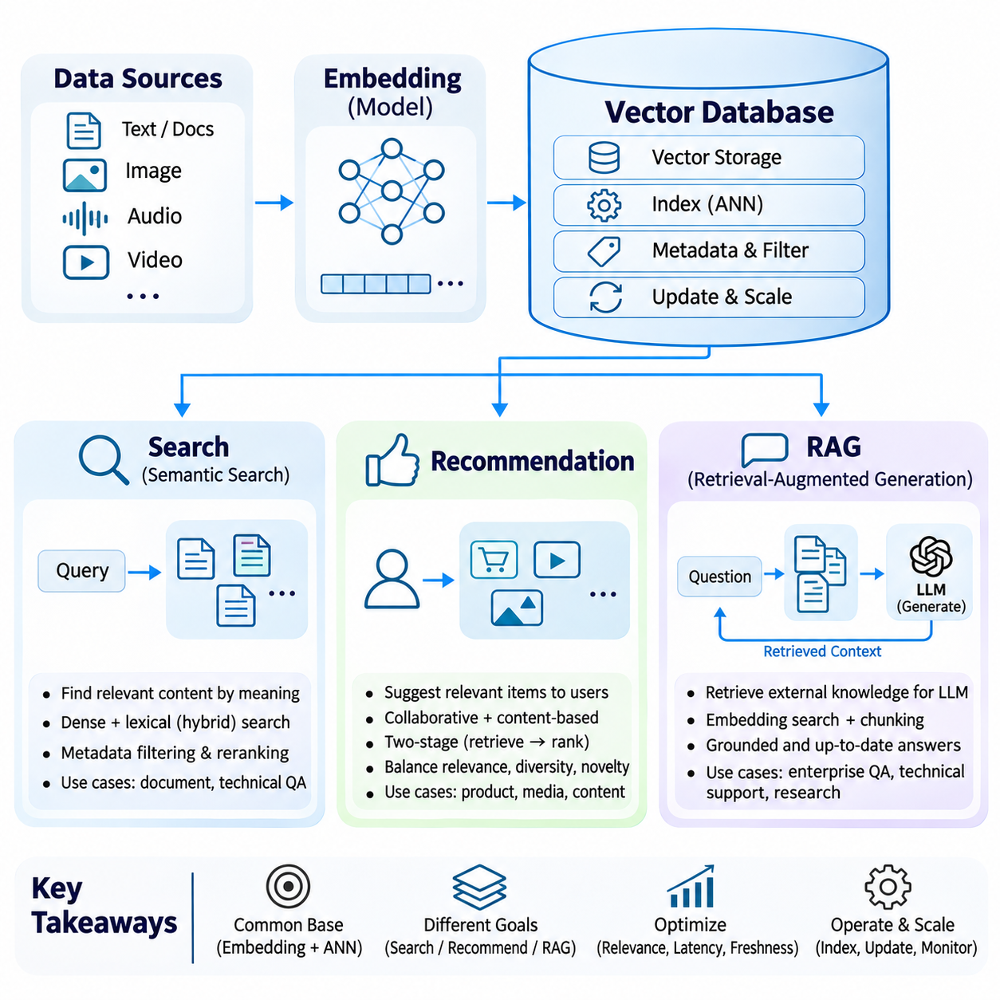

**Volume 37. Memory and Knowledge Systems**

# 01. Vector Database

## 01.00 Overview

{width="7.268055555555556in" height="7.268055555555556in"}

A vector database is a specialized data management system designed to store, index, retrieve, and manage high-dimensional numerical representations of information. Unlike traditional relational databases that primarily organize structured records, vector databases support similarity-based retrieval, enabling artificial intelligence systems to discover relationships between data objects according to their semantic or statistical characteristics.

Modern artificial intelligence applications increasingly process unstructured information such as documents, images, audio recordings, videos, and sensor measurements. These data types cannot always be searched effectively through exact keyword matching or conventional database queries. Vector databases address this limitation by organizing learned representations that preserve meaningful relationships between different information objects.

The fundamental concept underlying vector databases is the embedding, a numerical representation generated by a machine learning model. An embedding maps an input object into a multidimensional vector space where geometric relationships can approximate semantic similarity. For example, two documents discussing similar technical concepts may produce nearby vectors even when their vocabulary differs substantially.

An embedding space provides the mathematical foundation for organizing and comparing vector representations. Dense embeddings typically contain continuous numerical values across many dimensions, while sparse embeddings represent information through relatively few nonzero components. Hybrid embeddings or retrieval strategies combine complementary representations to capture both semantic relationships and explicit lexical characteristics.

The effectiveness of vector retrieval depends strongly on the quality of the embedding model. Models trained on different datasets or objectives may organize identical information into substantially different geometric structures. Consequently, selecting an appropriate embedding model requires consideration of domain relevance, language coverage, dimensionality, computational requirements, and compatibility between stored vectors and incoming queries.

Similarity search is the primary retrieval operation performed by a vector database. Instead of searching for exact matches, the system identifies stored vectors that are closest to a query representation according to a selected mathematical measure. This capability enables semantic document search, image retrieval, recommendation systems, and knowledge discovery across large collections of heterogeneous information.

Common similarity measures include cosine similarity, dot product, and Euclidean distance. Cosine similarity evaluates the angular relationship between vectors, emphasizing directional alignment rather than magnitude. Dot product incorporates both direction and vector length, while Euclidean distance measures geometric separation. Their suitability depends on embedding normalization, model training objectives, and retrieval requirements.

A straightforward similarity search compares a query vector against every stored vector and selects the nearest candidates. Although exact search provides a useful reference for retrieval accuracy, its computational cost increases with collection size and dimensionality. Large-scale applications therefore frequently require specialized indexing methods that reduce the number of comparisons performed during retrieval.

Approximate Nearest Neighbor algorithms address this challenge by trading a controlled degree of retrieval accuracy for substantial improvements in search efficiency. Rather than examining every vector, these algorithms exploit geometric partitions, neighborhood relationships, or compressed representations. Their practical objective is to identify highly relevant candidates while maintaining acceptable latency, memory consumption, and computational cost.

Several established approaches illustrate different strategies for approximate vector search. FAISS provides optimized similarity-search and indexing capabilities, including methods suitable for CPU and GPU execution. Hierarchical Navigable Small World graphs organize vectors through navigable neighborhood connections, while Inverted File indexes partition vector collections into groups that restrict the search space.

Index selection involves balancing search accuracy, query latency, index construction time, memory consumption, and update complexity. Graph-based methods may provide strong retrieval performance but require significant memory resources. Partition-based approaches can support large collections efficiently, although their effectiveness depends on parameters such as the number of clusters examined during each query.

A complete vector database extends beyond similarity-search algorithms by providing persistent storage, metadata management, filtering, data ingestion, indexing, and operational interfaces. Vector records commonly include numerical embeddings, unique identifiers, source references, and descriptive attributes. These additional fields allow applications to combine semantic similarity with structured constraints and trace retrieved information back to its origin.

Metadata filtering is particularly important in enterprise and industrial environments where retrieval must respect document categories, timestamps, equipment identifiers, geographic regions, or access permissions. A query may first restrict the eligible dataset and then perform similarity search within the permitted records. The execution strategy influences both retrieval accuracy and computational efficiency.

Vector database platforms provide different architectural approaches to these requirements. Milvus emphasizes scalable vector search through distributed infrastructure, while Weaviate integrates vector retrieval with structured data capabilities. Pinecone provides a managed vector database service intended to simplify operational deployment. Platform selection depends on workload characteristics, integration requirements, governance, and infrastructure constraints.

Indexing and scaling become increasingly important as vector collections grow from thousands to millions or billions of records. Distributed architectures may partition data across multiple nodes and replicate selected information to improve availability or throughput. Effective scaling requires coordinated management of storage, index placement, network communication, query routing, and resource utilization.

The dimensionality of embeddings directly influences storage and computational requirements. A collection containing millions of high-dimensional vectors may consume substantial memory before indexing overhead and metadata are considered. Compression, quantization, dimensionality reduction, and tiered storage can reduce resource consumption, although these techniques may introduce approximation errors or additional processing complexity.

Vector databases must also support continuous data modification. New documents, updated knowledge, deleted records, and changing embedding models require coordinated ingestion and index maintenance. Depending on the database architecture, recently inserted vectors may become searchable immediately or after a processing interval. Understanding update visibility is essential for applications that depend on current information.

Consistency describes how reliably database operations expose changes across storage components, indexes, replicas, and query services. Stronger consistency guarantees can simplify application reasoning but may impose synchronization overhead. More relaxed consistency models can improve availability or performance while allowing temporary differences between replicas or delayed visibility of recently modified records.

Embedding model updates introduce another form of consistency challenge. Vectors produced by incompatible model versions generally should not be compared as though they belonged to the same representation space. Production systems therefore benefit from explicit model versioning, controlled re-embedding procedures, index migration strategies, and validation of retrieval behavior before replacing existing representations.

Vector databases play a central role in modern information retrieval systems because they enable searches based on meaning rather than exact wording alone. A user can submit a natural-language question, convert it into an embedding, and retrieve documents containing related concepts. The retrieved candidates may subsequently be filtered, reranked, or combined with lexical search results to improve relevance.

Recommendation systems apply similar principles to users, products, content, or behavioral patterns. Embeddings can represent preferences and item characteristics within compatible vector spaces, allowing nearest-neighbor retrieval to identify potentially relevant candidates. However, recommendation quality also depends on behavioral signals, contextual constraints, diversity, freshness, and downstream ranking mechanisms.

Retrieval-Augmented Generation uses vector databases to provide external information to large language models. Documents are divided into manageable segments, transformed into embeddings, and indexed for retrieval. When a question arrives, relevant segments are retrieved and supplied as context for generation, allowing the language model to incorporate information beyond its internal parameters.

The quality of a retrieval-augmented system depends on more than the vector database itself. Document segmentation, embedding selection, query formulation, metadata filtering, candidate ranking, and context construction all influence the information presented to the language model. Inaccurate retrieval can produce incomplete or misleading responses even when the generation model is otherwise capable.

Vector databases also provide useful infrastructure for long-term memory in intelligent agents. Previous interactions, observations, task outcomes, and learned facts can be embedded and stored for subsequent retrieval. An agent may recover relevant experiences when solving new problems, although reliable memory requires additional mechanisms for temporal ordering, conflict resolution, importance estimation, and controlled updating.

In robotics and autonomous systems, vector representations can support retrieval of previous observations, environmental descriptions, operational incidents, and maintenance knowledge. A robot may compare current observations against stored representations to identify related situations. Nevertheless, vector similarity alone does not establish physical location, causal relationships, or operational safety, so additional verification remains necessary.

The integration of vector databases with knowledge graphs and structured databases enables more comprehensive knowledge management. Vector search can identify semantically relevant entities or documents, while graph traversal and structured queries establish explicit relationships and constraints. Combining these capabilities supports intelligent systems that require both flexible information discovery and interpretable knowledge organization.

Security and privacy are fundamental considerations when vector databases contain proprietary or sensitive information. Although embeddings are numerical representations, they should not automatically be considered anonymous or immune to information leakage. Appropriate safeguards include authentication, authorization, encryption, tenant isolation, retention policies, and access controls applied consistently throughout the retrieval pipeline.

Operational reliability requires continuous monitoring of retrieval latency, throughput, memory usage, index health, ingestion delays, and service availability. Retrieval quality should also be measured using representative queries and relevance judgments. Metrics such as recall at a selected cutoff, precision, and ranking effectiveness help distinguish infrastructure performance from the semantic quality of retrieved results.

The design of a successful vector database system ultimately requires coordinated decisions across representation learning, similarity measurement, indexing algorithms, database architecture, and application integration. No single configuration is optimal for every workload. System designers must evaluate accuracy, scalability, consistency, cost, and operational complexity against the requirements of the intended application.

As artificial intelligence systems increasingly depend on external knowledge and persistent memory, vector databases provide an important foundation for connecting learned representations with accessible information. Their greatest value emerges when efficient similarity retrieval is integrated with reliable data management, knowledge validation, and application-specific reasoning, enabling intelligent systems to retrieve and use relevant information effectively.

## 01.01 Embedding Space

{width="7.268055555555556in" height="7.268055555555556in"}

An embedding space is a mathematical representation in which data objects are mapped into numerical vectors that capture meaningful characteristics and relationships. Text, images, audio, and other information types can be transformed into vectors through learned encoding functions. The resulting geometry enables artificial intelligence systems to compare objects according to semantic similarity rather than relying exclusively on exact symbolic matches.

The structure of an embedding space depends on the representation model, training objective, data distribution, and similarity metric. Objects with related meanings are generally expected to occupy nearby regions when the model has been trained for semantic similarity. However, geometric proximity does not automatically establish factual equivalence, causal relationships, or conceptual identity, making representation quality essential for reliable retrieval.

Embedding dimensionality determines the number of numerical components used to represent each object. Higher-dimensional spaces may encode complex patterns and subtle distinctions, but they also increase storage requirements and computational costs. Lower-dimensional representations reduce resource consumption while potentially losing useful information. Effective dimensionality selection balances expressiveness, generalization, retrieval accuracy, and operational efficiency.

Dense embeddings represent information using vectors in which most dimensions contain meaningful continuous numerical values. These representations are commonly produced by neural networks trained through supervised learning, contrastive learning, or self-supervised objectives. Dense vectors capture distributed semantic characteristics, allowing conceptually related objects to exhibit similar representations even when they share few explicit features.

Transformer-based language models frequently generate dense text embeddings by processing tokens through contextual representation layers. Pooling mechanisms or specialized embedding heads convert token-level information into fixed-dimensional vectors. Sentence and document embeddings can consequently represent contextual meaning, semantic relationships, and domain-specific characteristics within a unified numerical space.

Dense embeddings are particularly effective when retrieval requires recognizing paraphrases, conceptual similarities, and relationships that cannot be expressed through exact keyword matching. A query concerning vehicle battery degradation may retrieve documents describing capacity loss or electrochemical aging. Such behavior depends on the embedding model\'s training distribution and its ability to generalize across different linguistic expressions.

The mathematical properties of dense vectors influence similarity computation. Cosine similarity emphasizes directional alignment, while dot product incorporates vector magnitude unless normalization is applied. Euclidean distance measures geometric separation. When vectors are normalized to unit length, these measures exhibit related ranking behavior, although their practical interpretation depends on the embedding model and retrieval objective.

Dense representation learning commonly employs contrastive objectives that encourage related examples to occupy nearby regions while separating unrelated examples. Positive pairs may consist of questions and relevant passages, alternative descriptions of the same concept, or aligned image-text examples. Negative sampling strategies strongly influence the learned geometry and the model\'s ability to distinguish semantically similar but incorrect candidates.

Despite their semantic capabilities, dense embeddings have limitations. They may fail to preserve exact identifiers, numerical values, rare terminology, or specialized technical expressions. A model may recognize general relationships between industrial components while overlooking a specific part number. These limitations become important in applications where exact terminology and semantic interpretation must both contribute to retrieval.

Sparse embeddings represent information through high-dimensional vectors containing relatively few nonzero values. Individual dimensions often correspond to vocabulary terms, learned lexical features, or other interpretable indicators. Because most components are zero, sparse representations can be stored and processed efficiently through specialized data structures that avoid explicitly representing every dimension.

Traditional sparse representations include term frequency, TF-IDF, and bag-of-words models. These approaches assign numerical weights to vocabulary features according to their occurrence patterns and statistical importance. Although they do not inherently capture deep contextual semantics, they provide effective mechanisms for identifying documents containing distinctive terminology, technical identifiers, and explicitly requested expressions.

Modern learned sparse representations extend traditional lexical approaches through neural models that estimate term importance and perform vocabulary expansion. Systems such as SPLADE generate sparse lexical representations using transformer-based predictions and sparsity-inducing objectives. This approach introduces learned semantic relationships while retaining compatibility with inverted indexing and term-oriented retrieval infrastructure.

Sparse retrieval is particularly valuable when queries contain exact product identifiers, equipment names, error codes, chemical formulas, or specialized terminology. In engineering environments, distinguishing between similar component numbers may be more important than identifying general conceptual similarity. Sparse representations preserve explicit lexical evidence that dense semantic models may otherwise weaken or overlook.

The efficiency of sparse embeddings depends on vocabulary size, sparsity level, indexing strategy, and query characteristics. Inverted indexes organize documents according to their active terms, allowing retrieval systems to examine relevant posting lists rather than entire collections. However, vocabulary expansion and learned sparse representations can increase index size and processing costs if sparsity is not adequately controlled.

Sparse representations also exhibit limitations when semantically equivalent information is expressed through different words. A query about autonomous navigation may fail to retrieve a relevant document describing self-driving route planning if lexical overlap is insufficient. Learned sparse models can reduce this limitation, but their effectiveness remains dependent on vocabulary coverage, training objectives, and the quality of lexical expansion.

Dense and sparse embeddings therefore provide complementary perspectives on information representation. Dense vectors emphasize distributed semantic relationships, whereas sparse vectors emphasize selected features and lexical evidence. Neither approach is universally superior because retrieval requirements vary across natural language understanding, technical documentation, multilingual information, and domain-specific knowledge systems.

Hybrid embeddings combine dense and sparse representations to exploit their complementary strengths. Rather than relying exclusively on semantic proximity or lexical correspondence, hybrid systems integrate evidence from both representation types. The combination can improve retrieval robustness when user queries contain natural-language concepts alongside exact technical terms, identifiers, or specialized expressions.

Hybrid retrieval can be implemented through separate dense and sparse indexes followed by score fusion or rank fusion. Each retrieval component independently generates candidate documents and relevance estimates. A fusion mechanism combines these outputs into a unified ranking, allowing semantic similarity and lexical matching to influence the final retrieval results according to the application\'s requirements.

Weighted score fusion combines normalized retrieval scores using configurable coefficients. Dense retrieval may receive greater emphasis for conceptual questions, while sparse retrieval may receive greater emphasis for exact terminology. Because different retrieval methods produce scores with different distributions, normalization and calibration are important for preventing one component from dominating the combined ranking unintentionally.

Rank-based fusion provides an alternative when score distributions are difficult to compare directly. Reciprocal Rank Fusion combines ranked result lists according to candidate positions rather than raw similarity scores. This approach can integrate heterogeneous retrieval systems without requiring their numerical scores to share an identical interpretation, although fusion parameters still influence the final ranking.

Hybrid embedding architectures may also use models that produce dense and sparse representations from the same input. Such models can share underlying encoders while generating separate output components optimized for complementary retrieval objectives. The resulting system may simplify representation management, but indexing, similarity calculation, and resource allocation must still accommodate the characteristics of each representation.

In retrieval-augmented generation, hybrid embeddings help identify documents that satisfy both semantic intent and precise information requirements. A question about a particular battery management system may require conceptual explanations of state estimation while preserving exact model identifiers. Combining dense and sparse retrieval can improve the likelihood that relevant technical passages appear among the retrieved candidates.

Hybrid retrieval is also useful in enterprise knowledge systems containing heterogeneous documents, including engineering specifications, operational procedures, maintenance records, and research reports. These collections often combine ordinary language with abbreviations, numerical specifications, and domain-specific vocabulary. A hybrid representation strategy supports broader semantic discovery while maintaining sensitivity to exact technical references.

The selection of dense, sparse, or hybrid embeddings should be guided by representative retrieval experiments rather than assumptions about model complexity. Evaluation datasets should include semantic paraphrases, exact-match queries, ambiguous terminology, and domain-specific expressions. Metrics such as Recall\\@K, Mean Reciprocal Rank, and normalized Discounted Cumulative Gain can reveal differences in retrieval effectiveness.

Embedding model updates require careful management because changes in representation geometry may invalidate existing indexes or similarity relationships. Dense and sparse components may evolve independently, creating additional compatibility requirements in hybrid systems. Version tracking, controlled re-indexing, and regression testing help maintain consistent retrieval behavior throughout the lifecycle of a knowledge system.

Practical embedding-space design also requires attention to multilingual support, domain adaptation, numerical precision, memory consumption, and inference latency. Quantization can reduce dense-vector storage costs, while sparse pruning can limit index expansion. These optimizations must be evaluated against retrieval accuracy because aggressive compression or feature elimination may remove information necessary for reliable matching.

Ultimately, embedding spaces provide the representational foundation for modern vector databases and intelligent retrieval systems. Dense embeddings support semantic generalization, sparse embeddings preserve explicit feature evidence, and hybrid embeddings integrate both capabilities. Their effective combination enables scalable information access while supporting the accuracy, flexibility, and domain awareness required by advanced artificial intelligence applications.

## 01.02 Similarity Search

{width="7.268055555555556in" height="7.268055555555556in"}

Similarity search is a fundamental operation in vector databases that identifies data objects according to their proximity within a multidimensional embedding space. Instead of requiring exact matches between queries and stored records, similarity search evaluates mathematical relationships between numerical vectors. This approach enables semantic retrieval across documents, images, audio, and other forms of information represented through machine learning models.

The effectiveness of similarity search depends on the embedding model, vector normalization, distance metric, and indexing strategy. An embedding model determines how information is represented geometrically, while a similarity measure defines how relationships between vectors are evaluated. Selecting an inappropriate metric can produce misleading rankings even when the underlying embeddings contain meaningful information.

A typical similarity search begins by converting an input query into a vector using the same embedding model employed for indexed data. The resulting query vector is compared with stored representations, and candidates are ranked according to similarity scores or distances. The system returns the highest-ranked results, often using approximate nearest neighbor algorithms to reduce computational requirements.

Cosine similarity measures the angular relationship between two vectors rather than their absolute magnitudes. It is calculated by dividing the dot product of the vectors by the product of their Euclidean norms. The resulting value ranges from negative one to positive one for nonzero real-valued vectors, with higher values indicating stronger directional alignment.

When cosine similarity approaches positive one, two vectors point in nearly the same direction, indicating strong alignment within the embedding space. A value near zero represents approximate orthogonality, while a value near negative one indicates opposing directions. However, these geometric relationships should not automatically be interpreted as semantic equivalence or contradiction without considering the embedding model.

Cosine similarity is widely used in natural language processing because vector magnitude may vary independently of the semantic relationships that an application seeks to measure. By emphasizing direction, cosine similarity can compare documents of different lengths or representations with different scales. Its effectiveness nevertheless depends on whether the embedding model has learned meaningful angular relationships.

For example, a query describing autonomous vehicle navigation may produce an embedding direction similar to documents discussing path planning and environmental perception. Cosine similarity can identify these relationships even when the query and documents contain different terminology. However, the quality of retrieval depends on the model\'s training data, domain coverage, and ability to distinguish related but technically different concepts.

Cosine similarity requires careful numerical handling because vectors with zero magnitude have undefined angular similarity. Implementations commonly reject zero vectors or apply explicit safeguards during normalization. Pre-normalizing stored embeddings can reduce repeated computation, although normalization introduces additional preprocessing requirements and may discard magnitude information that some models intentionally encode.

Dot product similarity evaluates the relationship between two vectors by multiplying corresponding components and summing the resulting values. Unlike cosine similarity, the raw dot product incorporates both directional alignment and vector magnitude. Consequently, two vectors with similar directions may receive different similarity scores when their lengths differ substantially.

The dot product can be interpreted geometrically as the product of vector magnitudes and the cosine of the angle between them. This relationship explains why dot product and cosine similarity produce equivalent rankings when all candidate vectors have identical norms for a fixed query. Unit normalization therefore allows dot product computation to reproduce cosine similarity rankings.

Dot product similarity is particularly useful for embedding models trained with inner-product objectives. In such models, vector magnitude may contain information relevant to ranking, confidence, or learned representation strength, depending on the training procedure. Removing magnitude through normalization may therefore change retrieval behavior and should not be performed automatically without examining model requirements.

Large-scale retrieval systems frequently employ dot product calculations because they map efficiently onto matrix multiplication and vectorized numerical operations. Modern CPUs and GPUs can evaluate many query-document similarities through optimized linear algebra libraries. This computational compatibility makes inner-product search attractive for high-throughput recommendation systems and dense retrieval applications.

However, raw dot product similarity can favor vectors with larger magnitudes even when their angular alignment is weaker. This characteristic may be desirable when magnitude carries useful learned information, but problematic when vector length reflects irrelevant variation. Effective system design therefore requires understanding how embedding norms are distributed and whether they contribute positively to ranking quality.

Euclidean distance measures the straight-line geometric separation between two points in a multidimensional vector space. It is calculated as the square root of the sum of squared differences between corresponding vector components. Unlike cosine similarity and dot product, Euclidean distance is a dissimilarity measure, meaning smaller values indicate greater geometric proximity.

Euclidean distance considers both direction and magnitude because changes in either property can alter the separation between vectors. Two vectors pointing in the same direction may still have substantial Euclidean distance when their magnitudes differ. This behavior makes Euclidean distance appropriate when absolute positions within the embedding space carry meaningful information.

Euclidean distance is commonly used in clustering, nearest neighbor classification, anomaly detection, and geometric representation learning. Its suitability for semantic retrieval depends on whether the embedding model has been trained to organize related objects according to Euclidean proximity. Models optimized for angular similarity may not produce equivalent rankings when evaluated using unnormalized Euclidean distances.

Squared Euclidean distance is often used when only candidate ranking is required because the square root operation does not change distance ordering. This optimization reduces unnecessary computation while preserving nearest-neighbor relationships. Nevertheless, applications requiring actual geometric distances must distinguish squared distances from their square-root equivalents when interpreting thresholds.

For unit-normalized vectors, squared Euclidean distance equals two minus twice their cosine similarity. This mathematical relationship means minimizing Euclidean distance, maximizing cosine similarity, and maximizing dot product produce identical rankings when all compared vectors have unit length. Without consistent normalization, however, these metrics may produce substantially different retrieval results.

High-dimensional embedding spaces introduce additional challenges for distance-based retrieval. As dimensionality increases, distance distributions may become less discriminative under certain statistical conditions, contributing to the curse of dimensionality. The practical impact depends on data geometry, feature correlations, normalization, and the learned structure of the embedding space rather than dimensionality alone.

Metric selection must therefore be aligned with the embedding model\'s training objective and intended application. Cosine similarity is often appropriate for directional semantic comparisons, dot product for learned inner-product representations, and Euclidean distance for geometrically meaningful embeddings. These are useful tendencies rather than universal rules, and empirical evaluation remains necessary.

Similarity metrics also influence approximate nearest neighbor indexing. Graph-based indexes, partition-based methods, and quantization techniques may support different distance functions or require specific transformations. A metric supported efficiently by one indexing architecture may incur additional computational overhead in another, making index compatibility an important deployment consideration.

In retrieval-augmented generation, similarity search identifies document segments relevant to a user\'s question before they are supplied to a language model. The selected metric affects candidate ordering and therefore influences the information available during generation. Poorly matched metrics may exclude important evidence, reducing answer completeness and increasing the risk of unsupported responses.

Industrial applications frequently combine semantic retrieval with strict technical constraints. A query concerning a particular sensor model may require both conceptual similarity and exact identifier matching. Cosine, dot product, and Euclidean measures operate on numerical representations and cannot independently guarantee exact symbolic correspondence, making metadata filtering or hybrid retrieval valuable complements.

Similarity scores should not automatically be interpreted as calibrated probabilities of relevance. A cosine similarity of a particular value does not universally indicate a fixed probability that two documents are related. Score distributions vary across embedding models, datasets, domains, and query types, requiring task-specific validation before similarity thresholds are used for automated decisions.

Evaluation should consider both retrieval effectiveness and computational performance. Metrics such as Recall\\@K, Mean Reciprocal Rank, and normalized Discounted Cumulative Gain measure different aspects of ranking quality. Latency, throughput, memory consumption, and index construction cost provide complementary operational measurements that help determine whether a similarity configuration is suitable for production deployment.

Reliable experiments should compare similarity metrics using identical datasets, compatible embeddings, consistent candidate sets, and clearly defined relevance judgments. Normalized and unnormalized representations should be evaluated separately when magnitude may influence ranking. Such comparisons help determine whether performance differences arise from the metric itself, preprocessing decisions, or indexing approximations.

Ultimately, cosine similarity, dot product, and Euclidean distance provide complementary mathematical mechanisms for evaluating relationships within embedding spaces. Their effectiveness depends on how vector representations encode information and how retrieval systems interpret geometric proximity. Understanding these distinctions enables the development of accurate, scalable, and reliable vector database systems for modern artificial intelligence applications.

## 01.03 ANN Algorithms

{width="7.268055555555556in" height="7.268055555555556in"}

Approximate Nearest Neighbor (ANN) algorithms provide efficient methods for retrieving similar vectors from large, high-dimensional datasets. Exact nearest neighbor search compares a query against every stored vector, producing reliable results but requiring substantial computation as collections grow. ANN methods reduce this burden by exploring selected regions or relationships within the embedding space while accepting a controlled possibility of missing the exact nearest candidates.

The primary objective of ANN indexing is to balance retrieval accuracy, query latency, memory consumption, and indexing cost. Performance depends on dataset size, dimensionality, vector distribution, similarity metric, and hardware architecture. ANN systems are commonly evaluated using recall against exact search results, together with throughput and latency measurements under representative workloads.

ANN techniques generally organize vectors through graph structures, spatial partitions, compressed representations, or combinations of these approaches. Graph methods navigate connections between nearby vectors, while partition-based methods restrict searching to selected regions. Quantization reduces storage and distance-computation costs by approximating vector representations, although compression may introduce additional retrieval errors.

FAISS, or Facebook AI Similarity Search, is an open-source library designed for efficient similarity search and clustering of dense vectors. Rather than representing one specific ANN algorithm, FAISS provides multiple indexing strategies with different performance characteristics. Its implementations support exact search, approximate search, vector compression, and hardware-accelerated operations for large-scale retrieval applications.

FAISS includes flat indexes that perform exhaustive similarity calculations without approximation. These indexes provide useful accuracy references for evaluating ANN configurations. Although exhaustive search becomes expensive as datasets expand, optimized numerical operations and GPU acceleration can make flat indexing practical for moderate collections, batch processing, or workloads requiring exact nearest neighbor results.

Approximate indexing in FAISS includes inverted-file structures, product quantization, graph-based methods, and combinations of indexing techniques. These configurations allow developers to trade memory usage and search latency against retrieval accuracy. Index selection depends on whether the application prioritizes high recall, limited memory consumption, rapid updates, or efficient processing of large query batches.

FAISS supports similarity calculations based on Euclidean distance and inner product, while cosine similarity can be implemented through appropriate vector normalization. Its optimized CPU and GPU implementations enable high-throughput similarity computations. However, hardware support and available operations vary across index types, making compatibility testing necessary before selecting a deployment configuration.

Product Quantization (PQ) is an important compression technique frequently used with FAISS. It divides vectors into lower-dimensional subvectors and approximates each subvector using learned codebooks. Compact codes replace full-precision representations, reducing memory requirements and enabling approximate distance calculations. The resulting accuracy depends on codebook quality, compression settings, and data distribution.

Hierarchical Navigable Small World (HNSW) is a graph-based ANN algorithm that organizes vectors through multiple layers of proximity connections. Its structure is inspired by navigable small-world graphs, where local relationships and longer-range links support efficient traversal. The hierarchy enables search to approach promising regions quickly before refining candidate selection near the query vector.

HNSW typically begins searching at a sparse upper layer and progressively descends toward denser layers. At each stage, graph navigation identifies candidates that improve proximity to the query. The lowest layer contains the full indexed collection, allowing the algorithm to perform a more detailed neighborhood search after upper layers have guided exploration toward relevant regions.

HNSW performance is strongly influenced by graph construction and search parameters. The parameter M controls the approximate number of connections maintained for graph navigation, while efConstruction determines the candidate exploration effort during index building. The efSearch parameter controls search-time exploration, allowing applications to increase recall at the expense of additional computations and latency.

A major advantage of HNSW is its ability to achieve strong recall and low query latency across many high-dimensional retrieval workloads. Its graph structure can support incremental insertion without rebuilding the entire index. However, maintaining neighbor connections requires additional memory, and deletion or extensive modification may require specialized maintenance procedures depending on the implementation.

The memory requirements of HNSW include both stored vector representations and graph connectivity information. Increasing graph connectivity can improve navigability but also expands memory consumption and construction costs. Consequently, HNSW is particularly attractive when sufficient memory is available and low-latency, high-recall retrieval is more important than achieving maximum storage compression.

Inverted File Index (IVF) is a partition-based indexing method that divides a vector collection into groups represented by coarse centroids. A clustering procedure, commonly based on k-means, assigns vectors to partitions according to proximity. During retrieval, the query is compared with partition centroids, and only selected partitions are searched for nearest neighbor candidates.

The principal advantage of IVF is reducing the number of vectors examined during each query. Instead of scanning the entire dataset, the search process focuses on partitions considered most relevant to the query. This approach can provide substantial computational savings when the collection is large and the partitioning structure successfully separates candidate neighborhoods.

IVF performance depends on the number of partitions and the number of partitions examined during retrieval. The nlist parameter specifies the number of coarse clusters, while nprobe determines how many clusters are searched for each query. Increasing nprobe generally improves recall by examining more candidates, but it also increases computation and query latency.

IVF indexing requires an initial training stage to determine representative centroids. The quality of this training depends on whether sampled vectors reflect the overall data distribution. Poorly balanced clusters or substantial distribution changes can reduce search efficiency. Periodic retraining or index reconstruction may become necessary when newly inserted vectors differ significantly from the original training population.

IVF can be combined with Product Quantization to create compressed indexing structures such as IVF-PQ. The coarse partitioning stage narrows the search region, while quantized representations reduce storage requirements and accelerate approximate comparisons. This combination is useful for collections that exceed available memory budgets, although aggressive compression may reduce recall.

FAISS, HNSW, and IVF should not be interpreted as three mutually exclusive algorithms. FAISS is a similarity search library that can implement HNSW, IVF, and other index families. HNSW describes a graph-based search architecture, whereas IVF describes a coarse-partition indexing strategy. Understanding these distinctions prevents confusion when comparing software frameworks with underlying algorithmic methods.

Selecting an ANN configuration requires examining workload characteristics rather than relying on a universal performance ranking. HNSW may be advantageous for memory-resident collections requiring low latency and high recall. IVF-based methods can provide flexible partitioning and compression for very large collections. FAISS supplies implementations that enable these alternatives to be evaluated under consistent experimental conditions.

ANN indexing also affects operational requirements such as insertion throughput, deletion handling, persistence, and index rebuilding. Frequently changing datasets may favor structures with efficient incremental maintenance, while relatively static collections can tolerate expensive offline construction. Distributed deployments introduce additional considerations involving data sharding, replica management, network latency, and coordinated search execution.

Evaluation should compare ANN results with exact nearest neighbor ground truth using identical embeddings and similarity metrics. Recall\\@K measures how many true nearest candidates appear among approximate results. Latency percentiles, queries per second, index construction time, and memory consumption reveal complementary performance characteristics. Testing should include realistic query distributions and concurrent workloads.

Parameter tuning should consider the entire retrieval pipeline rather than isolated index benchmarks. Candidate generation may be followed by metadata filtering, reranking, and retrieval-augmented generation. An index configuration that returns candidates extremely quickly but sacrifices important evidence may reduce downstream answer quality. Increasing candidate coverage can improve later ranking stages while increasing computational expense.

Ultimately, ANN algorithms enable vector databases to scale beyond the practical limits of exhaustive similarity search. FAISS provides a flexible implementation ecosystem, HNSW offers efficient hierarchical graph navigation, and IVF reduces search complexity through coarse partitioning. Their effective deployment requires careful coordination of embedding geometry, indexing parameters, hardware resources, and application-specific accuracy requirements.

## 01.04 Vector DB Systems

{width="7.268055555555556in" height="7.268055555555556in"}

Vector database systems provide specialized infrastructure for storing, indexing, managing, and retrieving high-dimensional embeddings generated by artificial intelligence models. Unlike conventional databases optimized primarily for exact matching and structured transactions, vector databases emphasize similarity-based retrieval. Their architecture integrates vector indexing, metadata management, query execution, persistence, and scalability to support modern intelligent applications.

The selection of a vector database depends on retrieval accuracy, query latency, deployment flexibility, operational complexity, and integration requirements. Different platforms implement similar conceptual functions through distinct architectural approaches. Milvus emphasizes scalable open-source vector infrastructure, Weaviate integrates semantic retrieval with structured object management, and Pinecone provides managed vector search services.

Milvus is an open-source vector database designed for large-scale similarity search across high-dimensional datasets. Its architecture supports efficient vector indexing, distributed query execution, and persistent storage. Milvus can serve applications ranging from semantic document retrieval to recommendation systems and multimodal artificial intelligence, where collections may contain millions or billions of embedding vectors.

The Milvus architecture separates important processing responsibilities across storage, query execution, and data management components. Distributed configurations allow resources to scale according to workload requirements. This separation helps systems manage large collections and concurrent queries, although actual performance depends on infrastructure configuration, index selection, and the characteristics of stored vectors.

Milvus supports multiple vector indexing strategies, including graph-based and inverted-file approaches, depending on the deployed version and configuration. Index selection allows developers to balance recall, memory consumption, and search latency. Metadata filtering can further restrict candidate results according to structured attributes, enabling semantic retrieval to operate alongside application-specific constraints.

Data ingestion in Milvus involves organizing vector records into collections with defined schemas and associated fields. Insertions, deletions, and updates interact with persistence and indexing mechanisms that maintain searchable representations. Applications requiring recently modified information must consider consistency settings, data visibility, and the operational behavior of index maintenance.

Milvus can be deployed through different configurations suited to local development, standalone operation, or distributed production environments. Its open-source foundation offers infrastructure control and customization opportunities. However, self-managed deployments require attention to capacity planning, monitoring, upgrades, backup procedures, and the operational dependencies of distributed services.

Weaviate is an open-source vector database that combines semantic search with structured object storage and metadata-aware retrieval. Its data model organizes information into collections containing objects, properties, and vector representations. This architecture enables applications to manage descriptive attributes and semantic embeddings within a unified retrieval environment.

Weaviate supports vector search alongside keyword-oriented retrieval and hybrid search capabilities. Dense vector similarity can identify conceptually related information, while lexical retrieval preserves exact terminology. Hybrid ranking combines complementary evidence, making the platform useful for knowledge systems containing both natural-language descriptions and specialized technical expressions.

Vector generation in Weaviate can be integrated with supported model providers or managed externally by applications. This flexibility allows organizations to choose embedding models according to language requirements, domain characteristics, and infrastructure constraints. External vectorization is particularly valuable when models must be trained or adapted for proprietary engineering documents.

Weaviate also provides filtering mechanisms that combine vector similarity with structured conditions. Applications can restrict retrieval according to document categories, timestamps, ownership attributes, or operational metadata. Such capabilities are important in enterprise retrieval systems where semantic relevance must coexist with authorization boundaries and precise information selection.

Weaviate deployment options include self-managed infrastructure and managed cloud offerings, subject to available service configurations. Organizations can select deployment models according to governance, scalability, and maintenance requirements. Operational planning must account for index memory, replication, data distribution, backup strategies, and the performance implications of hybrid retrieval.

Pinecone is a managed vector database platform designed to simplify the operational deployment of similarity search applications. Its service-oriented architecture abstracts much of the infrastructure management associated with indexing, storage, and query execution. Developers interact with vector collections through supported APIs while the platform manages underlying operational resources.

Pinecone supports storing vectors together with identifiers and metadata, allowing applications to retrieve semantically related records under defined filtering conditions. This structure is suitable for document search, recommendation, and retrieval-augmented generation. The specific indexing and execution mechanisms are managed by the service and may vary across product configurations.

Managed infrastructure can reduce the engineering effort required for provisioning, scaling, monitoring, and maintaining vector search services. Pinecone is therefore attractive when development teams prioritize application functionality over direct database infrastructure management. However, organizations must evaluate service pricing, network dependencies, regional availability, and operational control requirements.

Pinecone applications typically generate embeddings through external models before submitting vectors for storage and retrieval. This separation allows embedding pipelines to evolve independently from database operations. Nevertheless, changes to embedding models require coordinated migration because vectors generated by incompatible representations should not be compared as though they occupied the same semantic space.

Milvus, Weaviate, and Pinecone share essential vector database capabilities but differ in deployment philosophy and operational responsibilities. Milvus provides extensive infrastructure control through open-source deployment, Weaviate emphasizes integrated object and semantic retrieval, and Pinecone emphasizes managed operational simplicity. These distinctions influence engineering effort, flexibility, governance, and total ownership cost.

Performance comparisons between these systems must account for index configuration, vector dimensionality, dataset distribution, metadata filtering, and concurrent workload characteristics. A platform demonstrating low latency on a small benchmark may behave differently under production-scale ingestion and complex queries. Meaningful evaluation requires identical datasets, comparable retrieval objectives, and realistic infrastructure conditions.

Scalability involves more than increasing the number of stored vectors. Production systems must accommodate query concurrency, ingestion throughput, metadata growth, replication, and failure recovery. Distributed architectures introduce coordination overhead, while managed services shift some operational responsibility to the provider. Both approaches require careful capacity planning and performance monitoring.

Security and governance are equally important when vector databases contain proprietary documents or sensitive operational information. Authentication, authorization, encryption, access isolation, and retention policies should protect both vector representations and associated metadata. Embeddings should not automatically be considered anonymous because they may retain information about their source content.

Integration with retrieval-augmented generation requires coordinated document processing, embedding generation, indexing, retrieval, and context assembly. Vector databases supply relevant candidates, but final answer quality also depends on chunking strategies, reranking, prompt construction, and source verification. Database selection should therefore consider compatibility with the complete retrieval pipeline rather than isolated search speed.

Enterprise knowledge applications may require exact technical identifiers alongside semantic relationships. Hybrid retrieval, metadata filtering, and external reranking can improve precision when documents contain equipment specifications, maintenance procedures, or engineering terminology. The availability and implementation of these functions differ across platforms, making application-specific testing essential.

Operational evaluation should include Recall\\@K, query latency percentiles, throughput, index construction time, ingestion visibility, and memory or storage consumption. Cost analysis should incorporate infrastructure resources, managed service charges, network transfer, engineering maintenance, and anticipated growth. These measurements provide a more reliable basis for platform selection than feature comparisons alone.

Ultimately, Milvus, Weaviate, and Pinecone represent different approaches to building scalable vector retrieval infrastructure. Their suitability depends on whether an organization prioritizes open-source control, integrated semantic data management, or managed deployment convenience. Effective selection aligns database capabilities with embedding models, retrieval workloads, governance requirements, and the long-term architecture of intelligent knowledge systems.

## 01.05 Indexing and Scaling [w/Code]

{width="7.268055555555556in" height="7.268055555555556in"}

Indexing and scaling are fundamental engineering processes that enable vector databases to retrieve relevant information efficiently as collections grow in size and complexity. Indexing organizes high-dimensional embeddings into searchable structures, while scaling expands storage and computational capacity to accommodate increasing workloads. Together, these mechanisms determine whether similarity search can maintain acceptable accuracy, latency, and throughput in production environments.

A vector index reduces the computational effort required to identify nearest neighbors within an embedding space. Without indexing, exhaustive search compares each query vector against every stored representation, producing exact results at a cost that grows with collection size. Approximate indexing techniques organize vectors through graphs, partitions, or compressed codes, allowing retrieval systems to examine selected candidates rather than the entire dataset.

Index design begins with understanding the characteristics of stored embeddings, including dimensionality, numerical precision, similarity metric, and data distribution. These properties influence memory requirements and search efficiency. Indexes optimized for cosine similarity, inner product, or Euclidean distance may behave differently, making alignment between embedding generation and indexing configuration essential for reliable retrieval.

Graph-based indexing methods such as Hierarchical Navigable Small World construct navigable connections between neighboring vectors. Search algorithms traverse these connections to locate promising candidates without performing exhaustive comparisons. Graph connectivity and exploration parameters influence recall, construction time, and memory consumption, requiring careful tuning according to application latency and accuracy requirements.

Partition-based indexing divides vector collections into smaller regions using clustering or related techniques. Inverted File Index structures assign vectors to coarse partitions and restrict queries to selected clusters. Increasing the number of examined partitions generally improves recall but also increases computational cost. Effective partitioning depends on representative training data and balanced distribution across clusters.

Vector compression provides another important mechanism for scaling retrieval infrastructure. Product Quantization represents vectors through compact codes derived from learned subvector codebooks. Scalar quantization reduces numerical precision to decrease storage requirements. These techniques can substantially reduce memory consumption, although aggressive compression may distort distances and lower retrieval accuracy.

Index construction introduces computational and operational costs beyond storing embeddings. Some methods require clustering, graph generation, or codebook training before efficient search becomes available. Construction time can become significant for large datasets, especially when indexes must be rebuilt. Systems should therefore distinguish initial index creation from incremental maintenance and periodic optimization.

Memory planning must consider vector storage, index structures, metadata, temporary query buffers, and replication overhead. A collection containing millions of high-dimensional vectors can require substantial resources even before indexing is considered. Capacity estimates should incorporate numerical precision, index connectivity, compression ratios, and expected growth rather than relying exclusively on raw embedding dimensions.

Scaling begins with vertical expansion, where additional CPU capacity, GPU acceleration, memory, or storage bandwidth is assigned to an existing database instance. Vertical scaling can improve performance without introducing distributed coordination. However, hardware limits and increasing infrastructure costs eventually constrain this approach, making horizontal scaling necessary for sufficiently large collections.

Horizontal scaling distributes vector data and query processing across multiple machines or service instances. Sharding partitions collections into subsets that can be stored and searched independently. A query coordinator may distribute requests across relevant shards and merge their results into a unified ranking. This architecture increases capacity but introduces network communication and coordination overhead.

Shard design influences retrieval quality, workload balance, and operational flexibility. Uniform partitioning can distribute storage approximately evenly, while semantic or metadata-aware partitioning may reduce unnecessary searches. However, uneven query popularity or changing data distributions can create hotspots. Effective sharding requires balancing data placement, query routing, and the cost of cross-shard result aggregation.

Replication maintains multiple copies of data or indexes to improve availability and increase query-serving capacity. Replicas can distribute read traffic and provide redundancy when nodes fail. Nevertheless, replication increases storage costs and introduces synchronization requirements. Systems must define how updates propagate and when newly inserted or modified vectors become visible across replicas.

Distributed similarity search requires careful aggregation of candidate results. Each shard may return its highest-ranked vectors, after which a coordinator merges candidates using comparable similarity scores. Insufficient candidate retrieval from individual shards can reduce global recall. Therefore, shard-level search depth and global result limits must be configured together to preserve ranking quality.

Data ingestion presents additional scaling challenges because new embeddings must be stored, indexed, and made searchable while queries continue executing. Streaming ingestion pipelines can buffer incoming records and process updates asynchronously. However, indexing delays and background maintenance may affect freshness. Applications should define acceptable visibility delays and monitor the time between ingestion and successful retrieval.

Frequent updates and deletions can gradually reduce index efficiency. Graph structures may require connection maintenance, while partition-based indexes can become unbalanced as data distributions evolve. Deleted records may remain represented internally until cleanup procedures execute. Periodic compaction, rebuilding, or retraining can restore efficiency but consumes computational resources and may affect service availability.

GPU acceleration can improve indexing and similarity computation through parallel numerical processing. Large batches of distance calculations are particularly suitable for GPU execution, while some index structures benefit more from CPU memory access patterns. GPU deployment must consider device memory, transfer overhead, concurrency, and compatibility with selected indexing algorithms rather than assuming universal acceleration.

Storage architecture also influences scalability. Frequently accessed vectors and indexes may reside in memory, while less active data can be maintained on persistent storage. Tiered storage strategies balance cost and retrieval latency by moving information between memory and disk. Their effectiveness depends on access patterns, caching policies, and the frequency of index loading or eviction.

Metadata filtering must remain efficient as vector collections expand. Filtering before similarity search can reduce the candidate space, while filtering after retrieval may discard highly ranked results and require additional searches. The optimal strategy depends on filter selectivity, index organization, and query execution capabilities. Hybrid retrieval systems must also coordinate vector indexing with lexical or structured indexes.

Performance evaluation should measure recall, query latency percentiles, throughput, memory consumption, index construction time, and ingestion visibility. Benchmark results should reflect realistic vector distributions, query concurrency, and metadata constraints. Testing only average latency or isolated nearest-neighbor operations may conceal bottlenecks that emerge under production workloads.

Scaling strategies should also account for operational reliability and cost efficiency. Automatic resource allocation can respond to changing demand, but excessive scaling may increase expenses without proportional performance gains. Monitoring should identify resource saturation, shard imbalance, indexing backlogs, and query failures. Capacity planning should include expected growth, failure scenarios, and maintenance windows.

Retrieval-augmented generation places additional requirements on indexing infrastructure because search quality directly affects the evidence supplied to language models. Fast retrieval is insufficient when approximate indexes omit important documents. Candidate generation, reranking, metadata constraints, and context assembly must be evaluated as an integrated pipeline to balance response quality against computational expense.

Ultimately, indexing and scaling transform vector search from a mathematical operation into a dependable production service. Graph indexing, partitioning, compression, sharding, replication, and hardware acceleration provide complementary mechanisms for managing growth. Effective engineering combines these techniques with continuous evaluation, resource planning, and operational controls to maintain accurate, efficient, and scalable knowledge retrieval.

## 01.06 Update and Consistency

{width="7.268055555555556in" height="7.268055555555556in"}

Update and consistency mechanisms are essential for maintaining reliable vector databases as information changes over time. Unlike static similarity search benchmarks, production systems continuously receive new embeddings, modified metadata, and deletion requests. These operations must preserve retrieval correctness while minimizing service interruption. Effective update management coordinates persistent storage, vector indexes, query execution, and distributed replicas.

Vector database updates generally include insertion, modification, deletion, and replacement of stored representations. An insertion introduces a new vector and its associated metadata, while modification may change either descriptive attributes or embedding values. Replacement often requires regenerating embeddings when source content changes. Each operation affects the relationship between stored information and the searchable index.

Data consistency describes the guarantees provided when concurrent operations access changing information. A query may execute while another process inserts or modifies vectors, creating uncertainty about which version should be visible. Consistency models define acceptable visibility behavior and ordering constraints. Their selection influences retrieval freshness, system availability, synchronization overhead, and application correctness.

Strong consistency requires operations to observe a sufficiently coordinated view of committed data according to the system\'s defined guarantees. In systems offering linearizable behavior, completed writes become visible to subsequent reads in a globally consistent order. Such guarantees simplify reasoning about updates but may introduce coordination delays, especially when data is distributed across multiple nodes or geographic regions.

Eventual consistency permits replicas or indexing components to temporarily expose different versions of information. If updates stop and communication continues, these components are expected to converge toward the same state. This model can improve availability and reduce coordination costs, but applications must tolerate temporary stale results. It is appropriate when immediate visibility is less important than throughput and operational flexibility.

Some vector databases provide intermediate consistency options, including session consistency or bounded staleness. Session consistency can preserve relevant ordering guarantees for operations performed within a client session. Bounded staleness limits how far reads may lag behind committed updates under specified conditions. The precise meaning and availability of these guarantees depend on the database implementation.

Update processing frequently separates durable data storage from searchable index maintenance. A newly inserted record may be persisted before it becomes accessible through an optimized ANN index. Systems can use mutable buffers, growing segments, or auxiliary indexes to bridge this interval. Consequently, write acknowledgment, durable persistence, and search visibility should be treated as distinct operational events.

Incremental indexing allows new vectors to become searchable without reconstructing the entire collection. Graph-based structures may insert nodes and establish neighborhood connections dynamically, while partition-based structures assign incoming vectors to existing clusters. However, repeated incremental changes can degrade index organization. Background optimization may be necessary to maintain stable recall and query performance.

Deletion introduces additional complexity because removing a vector from persistent storage does not always immediately remove its representation from every index. Many implementations use logical deletion markers, often called tombstones, to exclude deleted records from search results. Physical removal occurs later through compaction or rebuilding. This separation improves write efficiency but requires careful management of storage reclamation.

Metadata updates may be less computationally expensive than embedding replacement, but they still affect filtering correctness. Changes to document ownership, access permissions, timestamps, or classification labels must propagate to searchable metadata structures. Stale authorization attributes can create security risks even when vector similarity remains correct. Critical metadata may therefore require stronger visibility guarantees.

Distributed vector databases replicate data to improve availability and support concurrent queries. Replication introduces the challenge of propagating updates across nodes while preserving the selected consistency model. Synchronous replication can provide stronger acknowledgment guarantees, whereas asynchronous replication may reduce write latency. The tradeoff depends on failure tolerance, network conditions, and application requirements.

Concurrent writes require conflict management when multiple clients modify the same vector record. Version numbers, timestamps, optimistic concurrency control, or transactional mechanisms can prevent unintended overwrites when supported. Applications should define whether updates replace complete records or modify selected fields. Explicit conflict policies become especially important in distributed ingestion pipelines.

Atomicity determines whether related modifications appear as a single indivisible operation. For example, changing an embedding and its metadata independently may temporarily expose inconsistent combinations. Transactional support varies among vector database systems, so applications cannot assume conventional relational database guarantees. Where atomic multi-record updates are unavailable, versioned records or staged publication can reduce inconsistencies.

Embedding model upgrades represent a particularly significant update challenge. Vectors generated by different embedding models may occupy incompatible semantic spaces, even when their dimensions are identical. Mixing these representations within a single similarity index can produce misleading rankings. A controlled migration should preserve model version information and rebuild affected indexes using compatible embeddings.

A common migration strategy creates a new vector collection while the existing collection continues serving queries. Updated embeddings are generated, validated, and indexed independently before traffic is redirected. During migration, dual writing or synchronization may be necessary to capture ongoing source changes. This approach reduces service interruption but temporarily increases storage and computational requirements.

Consistency also applies to the relationship between source documents and derived embeddings. When documents are revised, their chunks, vectors, metadata, and retrieval references should be updated coherently. Otherwise, search results may contain outdated passages or references to deleted content. Versioned document identifiers and traceable ingestion records help maintain alignment across the retrieval pipeline.

Streaming ingestion systems must handle duplicate events, delayed messages, and out-of-order updates. Idempotent operations allow repeated processing without producing unintended duplicate records. Sequence numbers or source versions can prevent older events from overwriting newer information. Reliable pipelines also require retry policies and failure recovery procedures that preserve the intended update order.

Monitoring update consistency requires metrics beyond conventional query latency and throughput. Important measurements include ingestion-to-search visibility delay, replication lag, indexing backlog, deletion propagation time, and update failure rates. These indicators reveal whether recently changed information is available to retrieval applications. Service objectives should specify acceptable freshness and recovery behavior.

Consistency testing should include concurrent reads and writes, node failures, network interruptions, and index rebuilding operations. Tests can verify whether acknowledged updates become visible within expected limits and whether deleted records remain excluded from results. Recovery experiments should also examine duplicate ingestion and partial failures. Such testing identifies problems that static retrieval benchmarks cannot reveal.

Retrieval-augmented generation systems are especially sensitive to stale or inconsistent knowledge. A language model may generate an apparently credible response from outdated retrieved evidence. Applications involving operational procedures, regulatory information, or safety-critical instructions require carefully defined freshness requirements. Retrieval pipelines should preserve source versions and validate access permissions before supplying context.

The appropriate consistency strategy depends on the consequences of stale information. Recommendation systems may tolerate brief delays, while access-control changes or critical operational updates may require immediate enforcement. Stronger guarantees can increase coordination costs and reduce availability during failures. Engineering decisions should therefore distinguish ordinary content freshness from correctness and security requirements.

Ultimately, update and consistency mechanisms determine whether vector databases remain trustworthy as knowledge evolves. Incremental indexing, replication, version control, compaction, and controlled migration provide complementary tools for managing change. Reliable deployment requires explicit visibility guarantees, measurable freshness objectives, and coordinated maintenance across storage, indexing, and retrieval components.

## 01.07 Applications

{width="7.268055555555556in" height="7.268055555555556in"}

Vector databases support intelligent applications by transforming complex information into searchable numerical representations. Their primary applications include semantic search, recommendation systems, and Retrieval-Augmented Generation (RAG). Although these applications share embedding generation and similarity retrieval, they differ in objectives, ranking strategies, interaction patterns, and evaluation criteria. Their effectiveness depends on aligning vector representations with application requirements.

Semantic search retrieves information according to conceptual meaning rather than relying exclusively on exact keyword matches. Documents and queries are transformed into embeddings that occupy a shared vector space. Similarity measures identify representations that are close to the query, allowing retrieval of relevant content even when different terminology is used. This capability is particularly valuable for natural-language questions and heterogeneous document collections.

A typical semantic search pipeline begins with document ingestion, text extraction, segmentation, and embedding generation. Each document segment is stored with its vector representation and associated metadata. When a user submits a query, the system generates a query embedding and retrieves nearby vectors through an approximate nearest neighbor index. Retrieved segments are then ranked and presented according to relevance.

Embedding quality strongly influences semantic search performance because vector geometry determines which documents appear related. General-purpose embedding models provide broad language understanding, but specialized domains may require adaptation. Technical documents containing equipment identifiers, abbreviations, or uncommon terminology can benefit from domain-specific training, hybrid retrieval, and metadata-aware filtering.

Hybrid search combines dense vector retrieval with lexical matching methods such as BM25. Dense embeddings capture semantic relationships, while lexical methods preserve exact terms, identifiers, and rare expressions. Combining their results through score normalization or rank fusion can improve retrieval robustness. This approach is especially useful when user queries contain both conceptual descriptions and precise technical constraints.

Search systems must also manage relevance, latency, and freshness simultaneously. Approximate indexing reduces computational costs, but aggressive search acceleration can exclude important documents. Metadata filters restrict results by category, date, ownership, or access permission. Regular index updates ensure newly added content becomes discoverable, while reranking models can improve the ordering of initially retrieved candidates.

Recommendation systems use vector representations to identify products, documents, media, or other items that match user interests. Instead of retrieving content solely from explicit queries, recommendation engines estimate relevance from historical interactions, contextual information, and learned preferences. Vector similarity enables efficient candidate generation across large item catalogs where exhaustive scoring would be computationally expensive.

Collaborative filtering represents users and items through latent factors learned from interaction patterns. Users with similar behavioral characteristics may receive recommendations for related items even when their descriptive attributes differ. Modern embedding-based recommenders extend this concept through neural networks that learn representations from clicks, purchases, viewing histories, and other feedback signals.

Content-based recommendation constructs item embeddings from descriptions, images, audio, or structured attributes. A user preference vector can be derived from previously selected items or an explicitly stated interest. Similarity search identifies candidates with related characteristics. This method can recommend newly introduced items without extensive interaction histories, although personalization may remain limited when user preferences are poorly understood.

Two-stage recommendation architectures commonly separate candidate retrieval from detailed ranking. A vector database rapidly identifies a manageable set of potentially relevant items, after which a ranking model evaluates additional features. These may include user context, item popularity, interaction history, and business constraints. This separation supports scalable retrieval while preserving flexibility in final recommendation decisions.

Recommendation quality requires balancing relevance with diversity, novelty, and coverage. Repeatedly selecting only the nearest embeddings can produce overly similar suggestions and reinforce existing preferences. Diversity-aware reranking and exploration strategies introduce alternative candidates. Evaluation should therefore consider engagement and satisfaction alongside retrieval recall, ranking accuracy, and recommendation diversity.

Retrieval-Augmented Generation integrates external information retrieval with generative language models. Instead of depending exclusively on knowledge encoded during model training, RAG retrieves relevant evidence from an external collection and incorporates it into the generation context. Vector databases provide scalable semantic retrieval, enabling language models to access domain-specific documents and frequently updated information.

A typical RAG pipeline begins by collecting documents, extracting content, dividing text into meaningful chunks, and generating embeddings. The resulting vectors are indexed together with document identifiers and metadata. At inference time, a user question is converted into a query embedding, and the retrieval system selects relevant chunks. These passages are supplied to a language model as supporting context.

Chunking strategy significantly influences RAG performance because retrieved segments must contain sufficient information without introducing excessive irrelevant text. Small chunks can improve retrieval precision but may fragment important relationships. Large chunks preserve context but increase token consumption and reduce retrieval specificity. Overlapping segments and structure-aware segmentation can help maintain continuity across document boundaries.

RAG retrieval quality can be improved through query rewriting, hybrid search, reranking, and contextual filtering. Query rewriting clarifies ambiguous questions or expands technical terminology. Hybrid retrieval combines semantic and lexical evidence, while reranking evaluates candidates more precisely. Metadata constraints ensure that retrieved passages satisfy document scope, version, and authorization requirements.

Grounded generation requires the language model to distinguish retrieved evidence from unsupported assumptions. Retrieved documents may be incomplete, outdated, or contradictory, so similarity alone does not establish factual correctness. Source attribution and evidence verification help users evaluate generated responses. Systems should also recognize when available documents do not contain enough information to answer a question reliably.

RAG architectures can support enterprise knowledge assistants, technical troubleshooting, scientific research, and operational decision support. Engineering applications may retrieve equipment manuals, maintenance records, inspection reports, and design specifications. The resulting answers can connect relevant evidence across documents, provided that access controls, document versions, and retrieval quality are maintained.

Search, recommendation, and RAG share a common dependency on embedding quality and vector index performance. However, their optimization objectives differ. Search emphasizes relevant document discovery, recommendation prioritizes user-item relevance and engagement, while RAG emphasizes evidence quality and grounded answer generation. A retrieval configuration effective for one application may not produce equivalent results in another.

Evaluation must therefore reflect the intended application rather than relying on similarity benchmarks alone. Search systems commonly measure Recall\\@K, Mean Reciprocal Rank, and normalized discounted cumulative gain. Recommendation systems examine ranking quality, coverage, diversity, and behavioral outcomes. RAG evaluation additionally considers answer correctness, faithfulness to retrieved evidence, and citation accuracy.

Production deployment introduces shared engineering requirements involving ingestion, indexing, scalability, consistency, security, and monitoring. Changing embeddings or document content requires coordinated index maintenance. Distributed retrieval must preserve acceptable latency under concurrent workloads. Monitoring should identify retrieval failures, stale information, resource saturation, and changes in relevance caused by evolving data distributions.

Ultimately, vector database applications transform numerical similarity into practical intelligence capabilities. Semantic search enables meaning-oriented information discovery, recommendation systems connect users with relevant items, and RAG grounds generative models in external knowledge. Their successful implementation requires coordinated embedding design, retrieval optimization, evaluation, and operational governance across the complete application pipeline.
