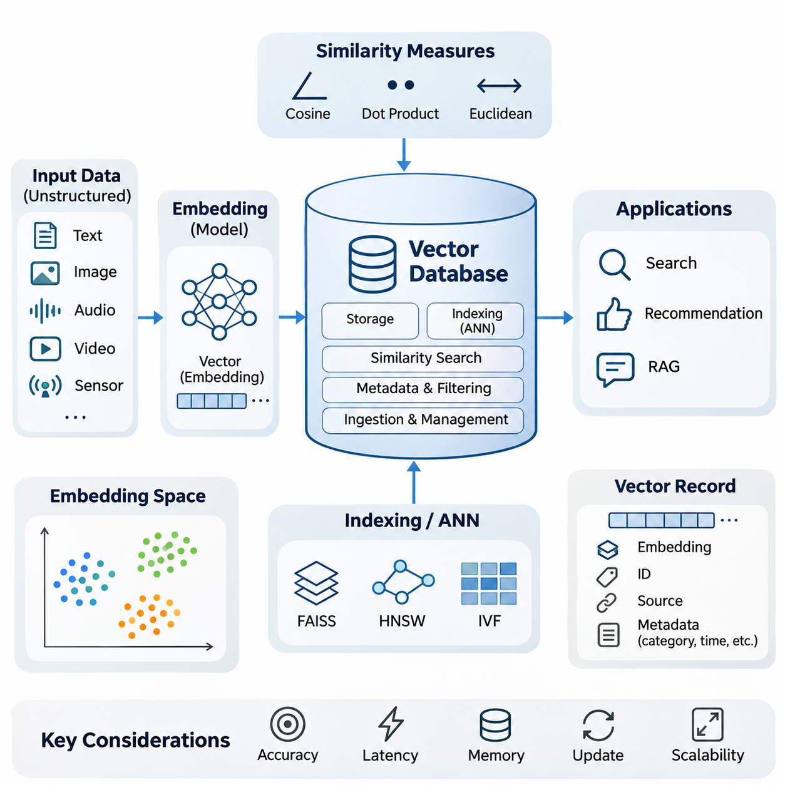
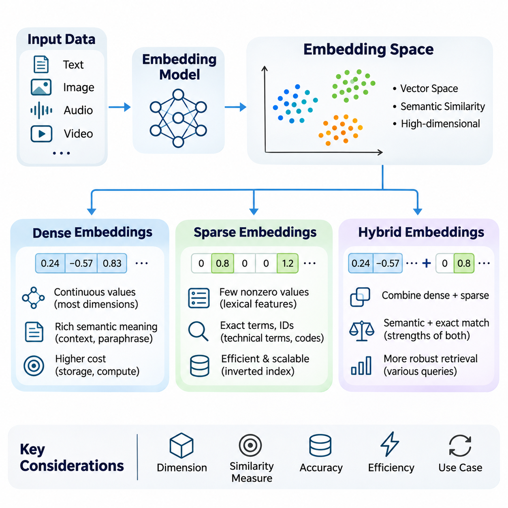
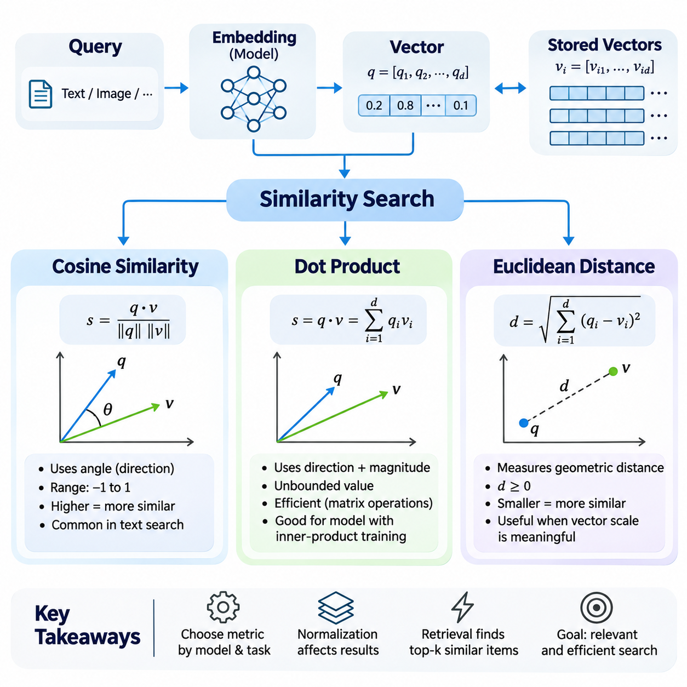
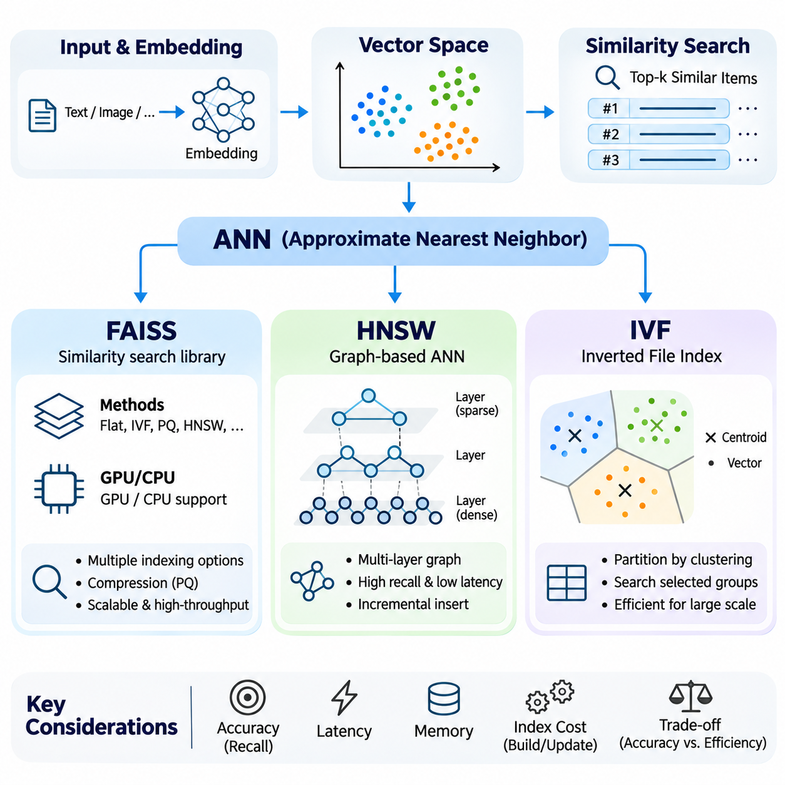
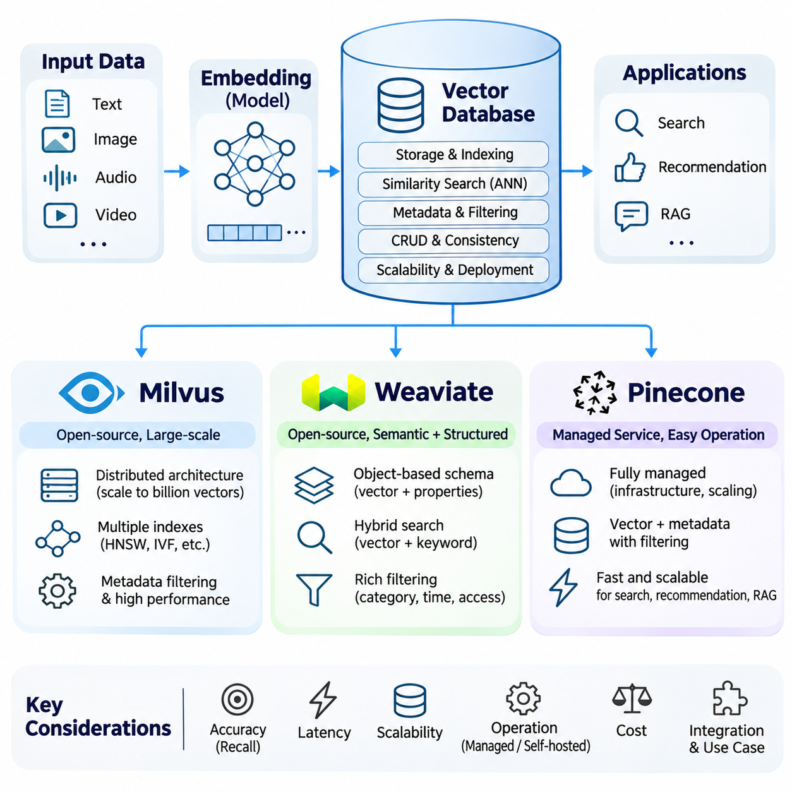
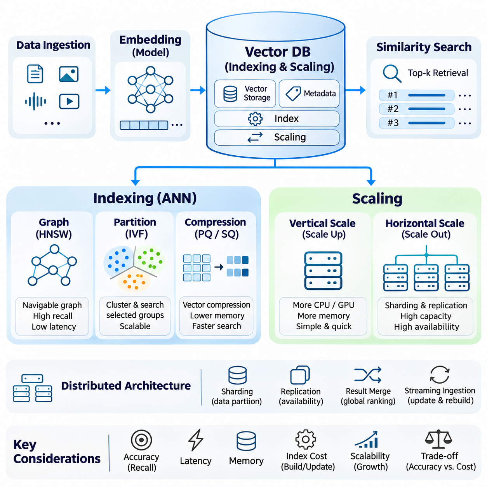
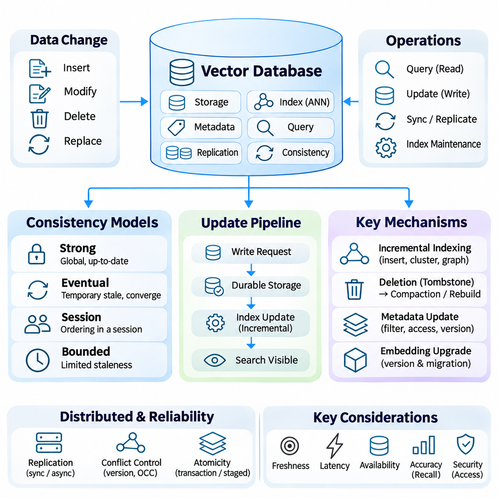
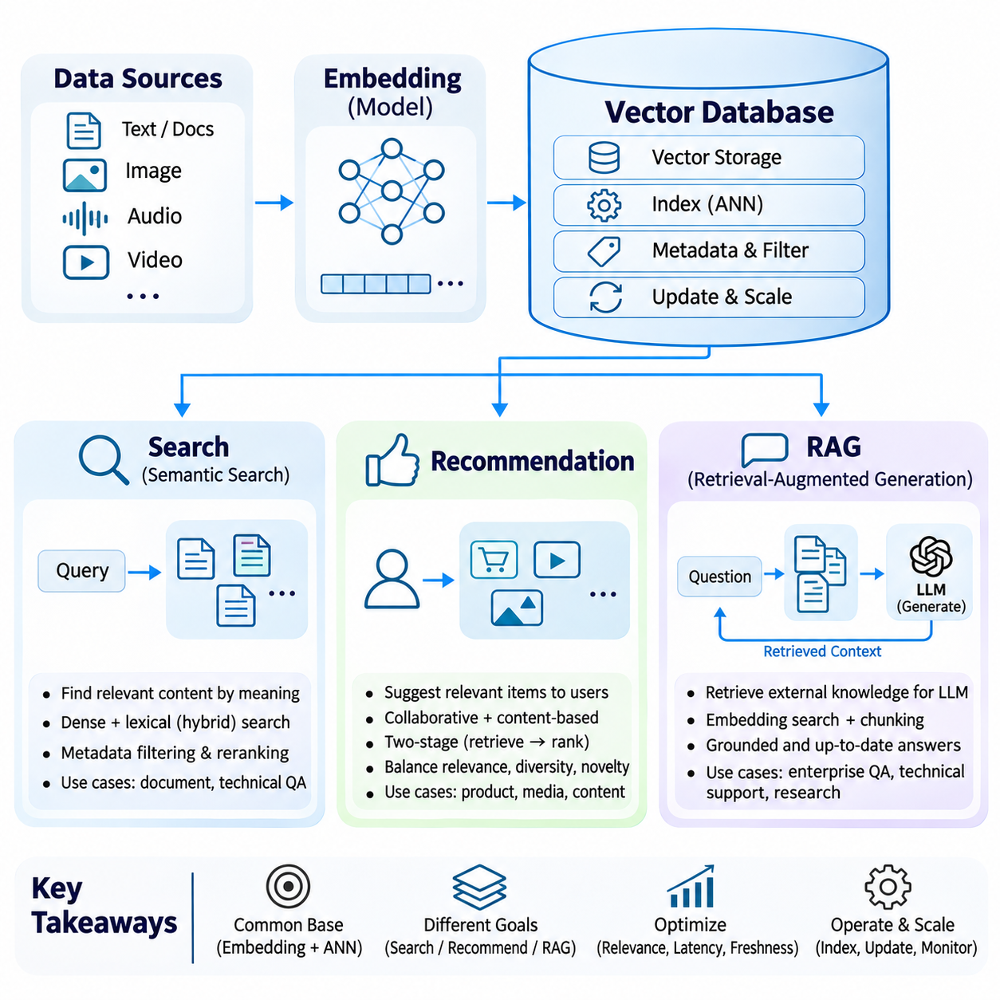

**Volume 37. Memory and Knowledge Systems**

# 01. Vector Database

## 01.00 Overview

{width="7.268055555555556in" height="7.268055555555556in"}

벡터 데이터베이스(Vector Database)는 정보의 고차원 수치 표현(High-Dimensional Numerical Representation)을 저장, 인덱싱(Indexing), 검색(Retrieval) 및 관리하도록 설계된 특수한 데이터 관리 시스템(Data Management System)이다. 구조화된 레코드(Structured Record)를 중심으로 정보를 구성하는 기존 관계형 데이터베이스(Relational Database)와 달리, 벡터 데이터베이스는 유사도 기반 검색(Similarity-Based Retrieval)을 지원하여 인공지능(Artificial Intelligence) 시스템이 데이터 객체의 의미적 또는 통계적 특성에 따라 관계를 발견할 수 있도록 한다.

현대 인공지능 응용 시스템은 문서, 이미지, 오디오 녹음, 비디오 및 센서 측정값과 같은 비정형 정보(Unstructured Information)를 점점 더 많이 처리하고 있다. 이러한 데이터 유형은 정확한 키워드 일치(Exact Keyword Matching)나 기존 데이터베이스 질의(Database Query)만으로 효과적으로 검색하기 어렵다. 벡터 데이터베이스는 서로 다른 정보 객체 사이의 의미 있는 관계를 보존하는 학습된 표현(Learned Representation)을 구성함으로써 이러한 한계를 해결한다.

벡터 데이터베이스의 기본 개념은 기계학습 모델(Machine Learning Model)이 생성하는 수치 표현인 임베딩(Embedding)이다. 임베딩은 입력 객체를 다차원 벡터 공간(Multidimensional Vector Space)에 매핑(Mapping)하며, 이 공간에서 기하학적 관계(Geometric Relationship)는 의미적 유사도(Semantic Similarity)를 근사적으로 나타낸다. 예를 들어 유사한 기술 개념을 설명하는 두 문서는 사용된 어휘가 상당히 다르더라도 벡터 공간에서 가까운 위치에 배치될 수 있다.

임베딩 공간(Embedding Space)은 벡터 표현을 구성하고 비교하기 위한 수학적 기반(Mathematical Foundation)을 제공한다. 밀집 임베딩(Dense Embedding)은 일반적으로 여러 차원에 걸쳐 연속적인 수치값을 포함하며, 희소 임베딩(Sparse Embedding)은 상대적으로 적은 수의 0이 아닌 성분(Nonzero Component)을 통해 정보를 표현한다. 하이브리드 임베딩(Hybrid Embedding) 또는 하이브리드 검색 전략(Hybrid Retrieval Strategy)은 상호 보완적인 표현을 결합하여 의미적 관계와 명시적인 어휘적 특성을 함께 포착한다.

벡터 검색(Vector Retrieval)의 효과는 임베딩 모델(Embedding Model)의 품질에 크게 의존한다. 서로 다른 데이터셋(Dataset)이나 학습 목적(Objective)으로 훈련된 모델은 동일한 정보를 상당히 다른 기하학적 구조로 구성할 수 있다. 따라서 적절한 임베딩 모델을 선정할 때는 도메인 관련성(Domain Relevance), 언어 지원 범위(Language Coverage), 차원 수(Dimensionality), 계산 요구사항(Computational Requirements), 저장 벡터와 입력 질의 사이의 호환성(Compatibility)을 고려해야 한다.

유사도 검색(Similarity Search)은 벡터 데이터베이스에서 수행하는 핵심 검색 연산(Retrieval Operation)이다. 정확히 일치하는 데이터를 찾는 대신, 시스템은 선택된 수학적 척도(Mathematical Measure)에 따라 질의 표현(Query Representation)과 가장 가까운 저장 벡터를 식별한다. 이러한 기능은 의미 기반 문서 검색(Semantic Document Search), 이미지 검색(Image Retrieval), 추천 시스템(Recommendation System) 및 대규모 이종 정보(Heterogeneous Information)의 지식 발견(Knowledge Discovery)을 가능하게 한다.

대표적인 유사도 측정 방법(Similarity Measure)에는 코사인 유사도(Cosine Similarity), 내적(Dot Product), 유클리드 거리(Euclidean Distance)가 있다. 코사인 유사도는 벡터의 크기보다 방향의 정렬 정도를 강조하며, 내적은 방향과 벡터 크기를 모두 반영한다. 유클리드 거리는 벡터 사이의 기하학적 거리를 측정한다. 각 방법의 적합성은 임베딩 정규화(Embedding Normalization), 모델 학습 목적 및 검색 요구사항에 따라 달라진다.

가장 단순한 유사도 검색 방식은 질의 벡터(Query Vector)를 저장된 모든 벡터와 비교하고 가장 가까운 후보를 선택하는 것이다. 이러한 정확 검색(Exact Search)은 검색 정확도(Retrieval Accuracy)를 평가하는 기준으로 유용하지만, 데이터 집합의 크기와 차원 수가 증가할수록 계산 비용(Computational Cost)이 커진다. 따라서 대규모 응용 시스템에서는 검색 과정의 비교 연산 수를 줄이기 위한 특수 인덱싱 방법(Indexing Method)이 필요하다.

근사 최근접 이웃(Approximate Nearest Neighbor, ANN) 알고리즘은 검색 정확도의 일부를 통제 가능한 수준에서 절충하는 대신 검색 효율(Search Efficiency)을 크게 향상시킨다. 모든 벡터를 검사하는 대신 기하학적 분할(Geometric Partition), 이웃 관계(Neighborhood Relationship), 압축 표현(Compressed Representation)을 활용한다. 실제 목적은 허용 가능한 지연시간(Latency), 메모리 사용량(Memory Consumption), 계산 비용을 유지하면서 관련성이 높은 후보를 식별하는 것이다.

대표적인 근사 벡터 검색(Approximate Vector Search) 기술은 서로 다른 검색 전략을 보여준다. FAISS는 CPU와 GPU 실행에 적합한 방법을 포함하여 최적화된 유사도 검색 및 인덱싱 기능을 제공한다. 계층적 탐색 가능 소규모 세계 그래프(Hierarchical Navigable Small World, HNSW)는 탐색 가능한 이웃 연결을 통해 벡터를 구성하며, 역파일 인덱스(Inverted File Index, IVF)는 벡터 집합을 여러 그룹으로 분할하여 검색 공간을 제한한다.

인덱스 선택(Index Selection)에는 검색 정확도, 질의 지연시간(Query Latency), 인덱스 구축 시간(Index Construction Time), 메모리 사용량 및 갱신 복잡도(Update Complexity) 사이의 균형이 필요하다. 그래프 기반 방법(Graph-Based Method)은 우수한 검색 성능을 제공할 수 있지만 상당한 메모리 자원을 요구할 수 있다. 분할 기반 방법(Partition-Based Method)은 대규모 데이터 집합을 효율적으로 처리할 수 있으나, 검색 과정에서 조사하는 클러스터(Cluster) 수와 같은 매개변수에 따라 성능이 달라진다.

완전한 벡터 데이터베이스는 유사도 검색 알고리즘을 넘어 영구 저장(Persistent Storage), 메타데이터 관리(Metadata Management), 필터링(Filtering), 데이터 수집(Data Ingestion), 인덱싱 및 운영 인터페이스(Operational Interface)를 제공한다. 벡터 레코드(Vector Record)는 일반적으로 수치 임베딩, 고유 식별자(Unique Identifier), 원본 참조(Source Reference), 설명 속성(Descriptive Attribute)을 포함한다. 이러한 추가 필드는 의미적 유사도와 구조화된 제약조건(Structured Constraint)을 결합하고 검색 결과의 출처를 추적할 수 있도록 한다.

메타데이터 필터링(Metadata Filtering)은 문서 범주, 타임스탬프(Timestamp), 장비 식별자, 지리적 영역 또는 접근 권한을 준수해야 하는 기업 및 산업 환경에서 특히 중요하다. 질의는 먼저 검색 가능한 데이터 집합을 제한한 다음 허용된 레코드에 대해 유사도 검색을 수행할 수 있다. 이러한 실행 전략(Execution Strategy)은 검색 정확도와 계산 효율 모두에 영향을 미친다.

벡터 데이터베이스 플랫폼(Vector Database Platform)은 이러한 요구사항을 충족하기 위해 서로 다른 아키텍처 접근법(Architectural Approach)을 제공한다. Milvus는 분산 인프라(Distributed Infrastructure)를 통한 확장 가능한 벡터 검색에 중점을 두며, Weaviate는 벡터 검색과 구조화된 데이터 기능을 통합한다. Pinecone은 운영 배포(Operational Deployment)를 단순화하기 위한 관리형 벡터 데이터베이스 서비스(Managed Vector Database Service)를 제공한다. 플랫폼 선정은 작업 부하 특성(Workload Characteristics), 통합 요구사항, 거버넌스(Governance), 인프라 제약조건에 따라 결정된다.

벡터 집합이 수천 개에서 수백만 또는 수십억 개의 레코드로 증가하면 인덱싱과 확장성(Scalability)이 더욱 중요해진다. 분산 아키텍처(Distributed Architecture)는 데이터를 여러 노드(Node)에 분할하고 일부 정보를 복제(Replication)하여 가용성(Availability)이나 처리량(Throughput)을 개선할 수 있다. 효과적인 확장에는 저장 공간, 인덱스 배치(Index Placement), 네트워크 통신, 질의 라우팅(Query Routing), 자원 활용(Resource Utilization)의 통합 관리가 필요하다.

임베딩의 차원 수(Dimensionality)는 저장 공간과 계산 요구사항에 직접적인 영향을 미친다. 수백만 개의 고차원 벡터(High-Dimensional Vector)를 포함하는 데이터 집합은 인덱싱 오버헤드(Indexing Overhead)와 메타데이터를 고려하기 전에도 상당한 메모리를 소비할 수 있다. 압축(Compression), 양자화(Quantization), 차원 축소(Dimensionality Reduction), 계층형 저장(Tiered Storage)은 자원 사용량을 줄일 수 있지만 근사 오차(Approximation Error)나 추가 처리 복잡성을 발생시킬 수 있다.

벡터 데이터베이스는 지속적인 데이터 수정(Data Modification)도 지원해야 한다. 새로운 문서, 갱신된 지식, 삭제된 레코드, 변경된 임베딩 모델은 데이터 수집과 인덱스 유지관리(Index Maintenance)의 조정이 필요하다. 데이터베이스 아키텍처에 따라 새로 삽입된 벡터는 즉시 검색 가능해지거나 일정한 처리 시간이 지난 후 검색 가능해질 수 있다. 갱신 가시성(Update Visibility)을 이해하는 것은 최신 정보에 의존하는 응용 시스템에서 필수적이다.

일관성(Consistency)은 데이터베이스 연산을 통해 발생한 변경사항이 저장 구성요소, 인덱스, 복제본(Replica), 질의 서비스 전반에 얼마나 안정적으로 반영되는지를 나타낸다. 강한 일관성 보장(Strong Consistency Guarantee)은 응용 시스템의 동작을 이해하기 쉽게 하지만 동기화 오버헤드(Synchronization Overhead)를 발생시킬 수 있다. 완화된 일관성 모델(Relaxed Consistency Model)은 가용성이나 성능을 개선하는 대신 복제본 사이의 일시적인 차이나 최근 수정된 레코드의 가시성 지연을 허용할 수 있다.

임베딩 모델의 갱신은 또 다른 형태의 일관성 문제를 발생시킨다. 서로 호환되지 않는 모델 버전(Model Version)에서 생성된 벡터는 일반적으로 동일한 표현 공간(Representation Space)에 속하는 것처럼 비교해서는 안 된다. 따라서 운영 시스템(Production System)은 명시적인 모델 버전 관리(Model Versioning), 통제된 재임베딩(Re-Embedding) 절차, 인덱스 마이그레이션(Index Migration) 전략, 기존 표현을 교체하기 전 검색 동작 검증(Retrieval Behavior Validation)을 수행하는 것이 바람직하다.

벡터 데이터베이스는 정확한 단어 일치가 아니라 의미를 기반으로 검색할 수 있도록 하므로 현대 정보 검색 시스템(Information Retrieval System)에서 핵심적인 역할을 수행한다. 사용자는 자연어 질문(Natural Language Question)을 입력하고 이를 임베딩으로 변환하여 관련 개념을 포함한 문서를 검색할 수 있다. 검색된 후보는 이후 필터링, 재순위화(Re-Ranking), 어휘 기반 검색(Lexical Search) 결과와의 결합을 통해 관련성을 높일 수 있다.

추천 시스템(Recommendation System)은 사용자, 제품, 콘텐츠 또는 행동 패턴(Behavioral Pattern)에 유사한 원리를 적용한다. 임베딩은 서로 호환되는 벡터 공간에서 선호도(Preference)와 항목 특성(Item Characteristics)을 표현하며, 최근접 이웃 검색(Nearest Neighbor Retrieval)을 통해 잠재적으로 관련성이 높은 후보를 식별한다. 그러나 추천 품질은 행동 신호(Behavioral Signal), 상황적 제약조건(Contextual Constraint), 다양성(Diversity), 최신성(Freshness), 후속 순위화(Downstream Ranking)에도 영향을 받는다.

검색 증강 생성(Retrieval-Augmented Generation, RAG)은 벡터 데이터베이스를 활용하여 대규모 언어 모델(Large Language Model, LLM)에 외부 정보를 제공한다. 문서는 처리 가능한 크기의 세그먼트(Segment)로 분할되고 임베딩으로 변환된 다음 검색을 위해 인덱싱된다. 질문이 입력되면 관련 세그먼트를 검색하여 생성 과정의 문맥(Context)으로 제공함으로써 언어 모델이 내부 매개변수(Internal Parameter)에 저장된 지식 이외의 정보를 활용할 수 있도록 한다.

검색 증강 시스템(Retrieval-Augmented System)의 품질은 벡터 데이터베이스 자체의 성능만으로 결정되지 않는다. 문서 분할(Document Segmentation), 임베딩 선택, 질의 구성(Query Formulation), 메타데이터 필터링, 후보 순위화(Candidate Ranking), 문맥 구성(Context Construction)은 모두 언어 모델에 제공되는 정보에 영향을 미친다. 부정확한 검색은 생성 모델 자체의 성능이 우수하더라도 불완전하거나 잘못된 응답을 발생시킬 수 있다.

벡터 데이터베이스는 지능형 에이전트(Intelligent Agent)의 장기 기억(Long-Term Memory)을 위한 유용한 인프라도 제공한다. 이전 상호작용(Interaction), 관측(Observation), 작업 결과(Task Outcome), 학습된 사실(Learned Fact)을 임베딩하여 저장하고 이후 검색할 수 있다. 에이전트는 새로운 문제를 해결할 때 관련 경험을 복원할 수 있지만, 신뢰할 수 있는 기억을 구현하려면 시간적 순서(Temporal Ordering), 충돌 해결(Conflict Resolution), 중요도 평가(Importance Estimation), 통제된 갱신을 위한 추가 메커니즘이 필요하다.

로보틱스(Robotics)와 자율 시스템(Autonomous System)에서 벡터 표현은 이전 관측, 환경 설명(Environmental Description), 운영 사고(Operational Incident), 유지보수 지식(Maintenance Knowledge)의 검색을 지원할 수 있다. 로봇은 현재 관측과 저장된 표현을 비교하여 관련 상황을 식별할 수 있다. 그러나 벡터 유사도만으로 물리적 위치(Physical Location), 인과관계(Causal Relationship), 운영 안전성(Operational Safety)이 확립되는 것은 아니므로 추가적인 검증이 필요하다.

벡터 데이터베이스를 지식 그래프(Knowledge Graph) 및 구조화된 데이터베이스(Structured Database)와 통합하면 더욱 포괄적인 지식 관리(Knowledge Management)가 가능해진다. 벡터 검색은 의미적으로 관련된 개체(Entity)나 문서를 식별하고, 그래프 탐색(Graph Traversal)과 구조화된 질의(Structured Query)는 명시적인 관계와 제약조건을 확인한다. 이러한 기능의 결합은 유연한 정보 발견과 해석 가능한 지식 구성(Interpretable Knowledge Organization)을 동시에 요구하는 지능형 시스템을 지원한다.

보안(Security)과 개인정보 보호(Privacy)는 벡터 데이터베이스에 독점 정보(Proprietary Information)나 민감한 정보(Sensitive Information)가 포함될 때 반드시 고려해야 하는 요소이다. 임베딩이 수치 표현이라는 이유만으로 익명성(Anonymity)이 보장되거나 정보 유출(Information Leakage)에 안전하다고 판단해서는 안 된다. 적절한 보호 조치에는 인증(Authentication), 인가(Authorization), 암호화(Encryption), 테넌트 격리(Tenant Isolation), 데이터 보존 정책(Retention Policy), 검색 파이프라인 전반에 일관되게 적용되는 접근 제어(Access Control)가 포함된다.

운영 신뢰성(Operational Reliability)을 확보하려면 검색 지연시간, 처리량, 메모리 사용량, 인덱스 상태(Index Health), 데이터 수집 지연(Ingestion Delay), 서비스 가용성을 지속적으로 모니터링(Monitoring)해야 한다. 검색 품질 또한 대표적인 질의와 관련성 판단(Relevance Judgment)을 사용하여 평가해야 한다. 특정 검색 결과 개수에서의 재현율(Recall at a Selected Cutoff), 정밀도(Precision), 순위화 효과(Ranking Effectiveness)와 같은 지표는 인프라 성능과 검색 결과의 의미적 품질을 구분하는 데 도움이 된다.

성공적인 벡터 데이터베이스 시스템을 설계하려면 표현 학습(Representation Learning), 유사도 측정, 인덱싱 알고리즘, 데이터베이스 아키텍처, 응용 시스템 통합(Application Integration)에 대한 의사결정을 조정해야 한다. 모든 작업 부하에 최적인 단일 구성은 존재하지 않는다. 시스템 설계자는 대상 응용 시스템의 요구사항에 따라 정확도, 확장성, 일관성, 비용, 운영 복잡도(Operational Complexity)를 종합적으로 평가해야 한다.

인공지능 시스템이 외부 지식(External Knowledge)과 영구 기억(Persistent Memory)에 점점 더 많이 의존함에 따라 벡터 데이터베이스는 학습된 표현과 접근 가능한 정보를 연결하는 중요한 기반을 제공한다. 벡터 데이터베이스의 가장 큰 가치는 효율적인 유사도 검색을 신뢰할 수 있는 데이터 관리, 지식 검증(Knowledge Validation), 응용 분야별 추론(Application-Specific Reasoning)과 통합할 때 나타나며, 이를 통해 지능형 시스템은 관련 정보를 효과적으로 검색하고 활용할 수 있다.

## 01.01 Embedding Space

{width="7.268055555555556in" height="7.268055555555556in"}

임베딩 공간(Embedding Space)은 데이터 객체(Data Object)를 의미 있는 특성과 관계를 포착하는 수치 벡터(Numerical Vector)로 매핑(Mapping)하는 수학적 표현(Mathematical Representation)이다. 텍스트, 이미지, 오디오 및 기타 정보 유형은 학습된 인코딩 함수(Encoding Function)를 통해 벡터로 변환될 수 있다. 이렇게 형성된 기하학적 구조(Geometry)는 인공지능(Artificial Intelligence) 시스템이 정확한 기호 일치(Symbolic Match)에만 의존하지 않고 의미적 유사도(Semantic Similarity)에 따라 객체를 비교할 수 있도록 한다.

임베딩 공간의 구조는 표현 모델(Representation Model), 학습 목적(Training Objective), 데이터 분포(Data Distribution), 유사도 척도(Similarity Metric)에 따라 결정된다. 모델이 의미적 유사도를 학습하도록 훈련되었다면 관련된 의미를 가진 객체는 일반적으로 가까운 영역에 배치될 것으로 기대된다. 그러나 기하학적 근접성(Geometric Proximity)이 반드시 사실적 동등성(Factual Equivalence), 인과관계(Causal Relationship), 개념적 동일성(Conceptual Identity)을 의미하는 것은 아니므로 신뢰할 수 있는 검색을 위해서는 표현 품질(Representation Quality)이 중요하다.

임베딩 차원 수(Embedding Dimensionality)는 각 객체를 표현하는 데 사용되는 수치 성분(Numerical Component)의 개수를 결정한다. 고차원 공간(High-Dimensional Space)은 복잡한 패턴과 미세한 차이를 인코딩(Encoding)할 수 있지만 저장 공간 요구량과 계산 비용(Computational Cost)도 증가시킨다. 저차원 표현(Low-Dimensional Representation)은 자원 소비를 줄이는 대신 유용한 정보를 손실할 가능성이 있다. 효과적인 차원 선택(Dimensionality Selection)은 표현력(Expressiveness), 일반화(Generalization), 검색 정확도(Retrieval Accuracy), 운영 효율성(Operational Efficiency) 사이의 균형을 요구한다.

밀집 임베딩(Dense Embedding)은 대부분의 차원이 의미 있는 연속 수치값(Continuous Numerical Value)을 포함하는 벡터를 사용하여 정보를 표현한다. 이러한 표현은 일반적으로 지도학습(Supervised Learning), 대조학습(Contrastive Learning), 자기지도학습(Self-Supervised Learning)을 통해 훈련된 신경망(Neural Network)에서 생성된다. 밀집 벡터(Dense Vector)는 분산된 의미적 특성(Distributed Semantic Characteristics)을 포착하므로 명시적인 특징을 거의 공유하지 않는 객체도 개념적으로 관련되어 있다면 유사한 표현을 가질 수 있다.

트랜스포머 기반 언어 모델(Transformer-Based Language Model)은 문맥적 표현 계층(Contextual Representation Layer)을 통해 토큰(Token)을 처리하여 밀집 텍스트 임베딩(Dense Text Embedding)을 생성하는 경우가 많다. 풀링 메커니즘(Pooling Mechanism)이나 특수 임베딩 헤드(Embedding Head)는 토큰 수준의 정보(Token-Level Information)를 고정 차원 벡터(Fixed-Dimensional Vector)로 변환한다. 이를 통해 문장 및 문서 임베딩(Sentence and Document Embedding)은 문맥적 의미, 의미적 관계, 도메인별 특성(Domain-Specific Characteristics)을 통합된 수치 공간에서 표현할 수 있다.

밀집 임베딩은 정확한 키워드 일치(Exact Keyword Matching)만으로 표현하기 어려운 바꿔 말하기(Paraphrase), 개념적 유사성(Conceptual Similarity), 의미적 관계를 인식해야 하는 검색에서 특히 효과적이다. 예를 들어 차량 배터리 성능 저하(Vehicle Battery Degradation)에 관한 질의는 용량 감소(Capacity Loss)나 전기화학적 노화(Electrochemical Aging)를 설명하는 문서를 검색할 수 있다. 이러한 동작은 임베딩 모델의 학습 분포(Training Distribution)와 서로 다른 언어적 표현에 대한 일반화 능력에 의존한다.

밀집 벡터의 수학적 특성(Mathematical Properties)은 유사도 계산(Similarity Computation)에 영향을 미친다. 코사인 유사도(Cosine Similarity)는 방향의 정렬 정도(Directional Alignment)를 강조하며, 내적(Dot Product)은 정규화(Normalization)가 적용되지 않은 경우 벡터 크기(Vector Magnitude)도 반영한다. 유클리드 거리(Euclidean Distance)는 기하학적 거리(Geometric Separation)를 측정한다. 벡터가 단위 길이(Unit Length)로 정규화되면 이러한 척도는 서로 관련된 순위화 동작(Ranking Behavior)을 보이지만 실제 해석은 임베딩 모델과 검색 목적에 따라 달라진다.

밀집 표현 학습(Dense Representation Learning)은 관련된 예제를 가까운 영역에 배치하고 관련성이 낮은 예제를 분리하도록 유도하는 대조 목적 함수(Contrastive Objective)를 사용하는 경우가 많다. 양성 쌍(Positive Pair)은 질문과 관련 문단, 동일한 개념의 서로 다른 설명 또는 정렬된 이미지와 텍스트로 구성될 수 있다. 음성 샘플링 전략(Negative Sampling Strategy)은 학습된 기하학적 구조와 의미적으로 유사하지만 잘못된 후보를 구분하는 모델의 능력에 큰 영향을 미친다.

밀집 임베딩은 의미적 표현 능력이 우수하지만 여러 한계도 가지고 있다. 정확한 식별자(Exact Identifier), 수치값(Numerical Value), 희귀 용어(Rare Terminology), 전문 기술 표현(Specialized Technical Expression)을 충분히 보존하지 못할 수 있다. 모델이 산업용 부품 사이의 일반적인 관계를 인식하더라도 특정 부품 번호(Part Number)를 놓칠 수 있다. 이러한 한계는 정확한 용어와 의미적 해석이 모두 검색에 기여해야 하는 응용 분야에서 중요하게 작용한다.

희소 임베딩(Sparse Embedding)은 상대적으로 적은 수의 0이 아닌 값(Nonzero Value)을 포함하는 고차원 벡터(High-Dimensional Vector)를 통해 정보를 표현한다. 개별 차원은 어휘 항목(Vocabulary Term), 학습된 어휘 특징(Learned Lexical Feature), 기타 해석 가능한 지표(Interpretable Indicator)에 대응하는 경우가 많다. 대부분의 성분이 0이므로 희소 표현(Sparse Representation)은 모든 차원을 명시적으로 저장하지 않는 특수 자료구조(Specialized Data Structure)를 통해 효율적으로 저장하고 처리할 수 있다.

전통적인 희소 표현에는 단어 빈도(Term Frequency), TF-IDF, 단어 가방 모델(Bag-of-Words Model)이 포함된다. 이러한 방법은 어휘 특징(Vocabulary Feature)의 출현 패턴(Occurrence Pattern)과 통계적 중요도(Statistical Importance)에 따라 수치 가중치(Numerical Weight)를 부여한다. 본질적으로 깊은 문맥적 의미(Deep Contextual Semantics)를 포착하지는 못하지만, 특징적인 용어, 기술 식별자(Technical Identifier), 명시적으로 요청된 표현을 포함하는 문서를 식별하는 데 효과적이다.

현대의 학습 기반 희소 표현(Learned Sparse Representation)은 용어 중요도(Term Importance)를 추정하고 어휘 확장(Vocabulary Expansion)을 수행하는 신경망 모델(Neural Model)을 통해 전통적인 어휘 기반 접근법을 확장한다. SPLADE와 같은 시스템은 트랜스포머 기반 예측(Transformer-Based Prediction)과 희소성 유도 목적 함수(Sparsity-Inducing Objective)를 사용하여 희소 어휘 표현(Sparse Lexical Representation)을 생성한다. 이러한 접근법은 역인덱싱(Inverted Indexing) 및 용어 중심 검색 인프라(Term-Oriented Retrieval Infrastructure)와의 호환성을 유지하면서 학습된 의미적 관계를 도입한다.

희소 검색(Sparse Retrieval)은 질의에 정확한 제품 식별자(Product Identifier), 장비 이름, 오류 코드(Error Code), 화학식(Chemical Formula), 전문 용어(Specialized Terminology)가 포함된 경우 특히 유용하다. 엔지니어링 환경에서는 일반적인 개념적 유사성을 식별하는 것보다 서로 비슷한 부품 번호를 구분하는 것이 더 중요할 수 있다. 희소 표현은 밀집 의미 모델(Dense Semantic Model)이 약화시키거나 놓칠 수 있는 명시적인 어휘적 근거(Lexical Evidence)를 보존한다.

희소 임베딩의 효율성은 어휘 크기(Vocabulary Size), 희소성 수준(Sparsity Level), 인덱싱 전략(Indexing Strategy), 질의 특성(Query Characteristics)에 따라 달라진다. 역인덱스(Inverted Index)는 활성 용어(Active Term)를 기준으로 문서를 구성하여 검색 시스템이 전체 데이터 집합 대신 관련 포스팅 리스트(Posting List)를 조사하도록 한다. 그러나 어휘 확장과 학습 기반 희소 표현은 희소성이 적절하게 제어되지 않으면 인덱스 크기(Index Size)와 처리 비용을 증가시킬 수 있다.

희소 표현은 의미적으로 동일한 정보가 서로 다른 단어로 표현될 때도 한계를 보인다. 자율 내비게이션(Autonomous Navigation)에 관한 질의는 어휘적 중복(Lexical Overlap)이 충분하지 않으면 자율주행 경로 계획(Self-Driving Route Planning)을 설명하는 관련 문서를 검색하지 못할 수 있다. 학습 기반 희소 모델은 이러한 한계를 줄일 수 있지만 그 효과는 어휘 범위(Vocabulary Coverage), 학습 목적, 어휘 확장 품질에 계속 의존한다.

따라서 밀집 임베딩과 희소 임베딩은 정보 표현(Information Representation)에 대해 상호 보완적인 관점을 제공한다. 밀집 벡터는 분산된 의미적 관계(Distributed Semantic Relationship)를 강조하는 반면, 희소 벡터는 선택된 특징(Selected Feature)과 어휘적 근거를 강조한다. 검색 요구사항은 자연어 이해(Natural Language Understanding), 기술 문서(Technical Documentation), 다국어 정보(Multilingual Information), 도메인별 지식 시스템(Domain-Specific Knowledge System)에 따라 달라지므로 어느 한 접근법이 모든 상황에서 우월한 것은 아니다.

하이브리드 임베딩(Hybrid Embedding)은 밀집 표현과 희소 표현을 결합하여 두 방식의 상호 보완적인 장점을 활용한다. 의미적 근접성(Semantic Proximity)이나 어휘적 일치(Lexical Correspondence)에만 의존하는 대신, 하이브리드 시스템(Hybrid System)은 두 표현 유형에서 얻은 근거를 통합한다. 이러한 결합은 사용자 질의에 자연어 개념과 정확한 기술 용어, 식별자 또는 전문 표현이 함께 포함된 경우 검색의 견고성(Retrieval Robustness)을 개선할 수 있다.

하이브리드 검색(Hybrid Retrieval)은 별도의 밀집 인덱스(Dense Index)와 희소 인덱스(Sparse Index)를 구성한 후 점수 융합(Score Fusion)이나 순위 융합(Rank Fusion)을 수행하는 방식으로 구현할 수 있다. 각 검색 구성요소(Retrieval Component)는 독립적으로 후보 문서와 관련성 추정값(Relevance Estimate)을 생성한다. 융합 메커니즘(Fusion Mechanism)은 이러한 결과를 통합된 순위(Unified Ranking)로 결합하여 응용 시스템의 요구사항에 따라 의미적 유사도와 어휘적 일치가 최종 검색 결과에 영향을 미치도록 한다.

가중 점수 융합(Weighted Score Fusion)은 설정 가능한 계수(Configurable Coefficient)를 사용하여 정규화된 검색 점수(Normalized Retrieval Score)를 결합한다. 개념적 질문에는 밀집 검색(Dense Retrieval)에 더 높은 가중치를 부여하고, 정확한 용어 검색에는 희소 검색에 더 높은 가중치를 부여할 수 있다. 서로 다른 검색 방법은 각기 다른 점수 분포(Score Distribution)를 생성하므로 특정 구성요소가 의도하지 않게 통합 순위를 지배하지 않도록 정규화와 보정(Calibration)이 중요하다.

순위 기반 융합(Rank-Based Fusion)은 원시 유사도 점수(Raw Similarity Score)를 직접 비교하기 어려운 경우 사용할 수 있는 대안이다. 역순위 융합(Reciprocal Rank Fusion, RRF)은 원시 점수 대신 후보의 순위 위치(Rank Position)를 기준으로 정렬된 결과 목록을 결합한다. 이러한 접근법은 수치 점수가 동일한 의미를 가질 필요 없이 이종 검색 시스템(Heterogeneous Retrieval System)을 통합할 수 있지만, 융합 매개변수(Fusion Parameter)는 여전히 최종 순위에 영향을 미친다.

하이브리드 임베딩 아키텍처(Hybrid Embedding Architecture)는 동일한 입력에서 밀집 표현과 희소 표현을 동시에 생성하는 모델을 사용할 수도 있다. 이러한 모델은 기본 인코더(Encoder)를 공유하면서 상호 보완적인 검색 목적에 최적화된 별도의 출력 구성요소(Output Component)를 생성할 수 있다. 이 방식은 표현 관리(Representation Management)를 단순화할 수 있지만 인덱싱, 유사도 계산, 자원 할당(Resource Allocation)은 여전히 각 표현의 특성을 수용해야 한다.

검색 증강 생성(Retrieval-Augmented Generation, RAG)에서 하이브리드 임베딩은 의미적 의도(Semantic Intent)와 정확한 정보 요구사항(Precise Information Requirement)을 모두 충족하는 문서를 식별하는 데 도움이 된다. 특정 배터리 관리 시스템(Battery Management System)에 관한 질문은 상태 추정(State Estimation)에 대한 개념적 설명과 정확한 모델 식별자를 동시에 요구할 수 있다. 밀집 검색과 희소 검색을 결합하면 관련 기술 문단이 검색 후보에 포함될 가능성을 높일 수 있다.

하이브리드 검색은 엔지니어링 사양서(Engineering Specification), 운영 절차서(Operational Procedure), 유지보수 기록(Maintenance Record), 연구 보고서(Research Report)와 같은 이종 문서(Heterogeneous Document)를 포함하는 기업 지식 시스템(Enterprise Knowledge System)에서도 유용하다. 이러한 문서 집합은 일반 언어와 약어(Abbreviation), 수치 사양(Numerical Specification), 도메인별 어휘를 함께 포함하는 경우가 많다. 하이브리드 표현 전략(Hybrid Representation Strategy)은 정확한 기술 참조(Technical Reference)에 대한 민감성을 유지하면서 폭넓은 의미적 정보 발견(Semantic Discovery)을 지원한다.

밀집 임베딩, 희소 임베딩, 하이브리드 임베딩의 선택은 모델 복잡도(Model Complexity)에 대한 가정보다 대표적인 검색 실험(Retrieval Experiment)을 기반으로 이루어져야 한다. 평가 데이터셋(Evaluation Dataset)에는 의미적 바꿔 말하기(Semantic Paraphrase), 정확 일치 질의(Exact-Match Query), 모호한 용어(Ambiguous Terminology), 도메인별 표현이 포함되어야 한다. Recall\\@K, 평균 역순위(Mean Reciprocal Rank, MRR), 정규화된 할인 누적 이득(Normalized Discounted Cumulative Gain, NDCG)과 같은 지표는 검색 효과(Retrieval Effectiveness)의 차이를 보여줄 수 있다.

임베딩 모델의 갱신은 표현 공간의 기하학적 구조(Representation Geometry)가 변경되면서 기존 인덱스나 유사도 관계(Similarity Relationship)가 더 이상 유효하지 않을 수 있으므로 신중하게 관리해야 한다. 밀집 구성요소와 희소 구성요소는 독립적으로 발전할 수 있으며, 이로 인해 하이브리드 시스템에는 추가적인 호환성 요구사항(Compatibility Requirement)이 발생한다. 버전 추적(Version Tracking), 통제된 재인덱싱(Controlled Re-Indexing), 회귀 테스트(Regression Testing)는 지식 시스템의 수명주기(Lifecycle) 전반에 걸쳐 일관된 검색 동작을 유지하는 데 도움이 된다.

실용적인 임베딩 공간 설계(Embedding Space Design)에서는 다국어 지원(Multilingual Support), 도메인 적응(Domain Adaptation), 수치 정밀도(Numerical Precision), 메모리 사용량, 추론 지연시간(Inference Latency)도 고려해야 한다. 양자화(Quantization)는 밀집 벡터의 저장 비용을 줄일 수 있으며, 희소 가지치기(Sparse Pruning)는 인덱스 확장을 제한할 수 있다. 그러나 과도한 압축(Compression)이나 특징 제거(Feature Elimination)는 신뢰할 수 있는 일치 판단에 필요한 정보를 손실시킬 수 있으므로 이러한 최적화는 검색 정확도와 함께 평가해야 한다.

궁극적으로 임베딩 공간은 현대 벡터 데이터베이스(Vector Database)와 지능형 검색 시스템(Intelligent Retrieval System)의 표현 기반(Representational Foundation)을 제공한다. 밀집 임베딩은 의미적 일반화(Semantic Generalization)를 지원하고, 희소 임베딩은 명시적인 특징 근거(Explicit Feature Evidence)를 보존하며, 하이브리드 임베딩은 두 기능을 통합한다. 이러한 표현을 효과적으로 결합하면 고급 인공지능 응용 시스템(Advanced Artificial Intelligence Application)에 필요한 정확성, 유연성(Flexibility), 도메인 인식(Domain Awareness)을 지원하면서 확장 가능한 정보 접근(Scalable Information Access)을 구현할 수 있다.

## 01.02 Similarity Search

{width="7.268055555555556in" height="7.268055555555556in"}

유사도 검색(Similarity Search)은 다차원 임베딩 공간(Multidimensional Embedding Space)에서 데이터 객체(Data Object)의 근접성을 기준으로 정보를 식별하는 벡터 데이터베이스(Vector Database)의 핵심 연산이다. 질의(Query)와 저장된 레코드(Stored Record) 사이의 정확한 일치를 요구하는 대신, 수치 벡터(Numerical Vector) 사이의 수학적 관계(Mathematical Relationship)를 평가한다. 이러한 접근법은 기계학습 모델(Machine Learning Model)을 통해 표현된 문서, 이미지, 오디오 및 기타 정보에 대한 의미 기반 검색(Semantic Retrieval)을 가능하게 한다.

유사도 검색의 효과는 임베딩 모델(Embedding Model), 벡터 정규화(Vector Normalization), 거리 척도(Distance Metric), 인덱싱 전략(Indexing Strategy)에 따라 달라진다. 임베딩 모델은 정보가 기하학적으로 표현되는 방식을 결정하며, 유사도 척도(Similarity Measure)는 벡터 사이의 관계를 평가하는 방법을 정의한다. 부적절한 척도를 선택하면 임베딩 자체에 의미 있는 정보가 포함되어 있더라도 잘못된 순위화 결과(Misleading Ranking)를 생성할 수 있다.

일반적인 유사도 검색은 입력 질의를 인덱싱된 데이터에 사용된 것과 동일한 임베딩 모델로 벡터화하는 과정에서 시작된다. 생성된 질의 벡터(Query Vector)는 저장된 표현(Stored Representation)과 비교되며, 후보들은 유사도 점수(Similarity Score) 또는 거리(Distance)에 따라 순위가 결정된다. 시스템은 상위 검색 결과를 반환하며, 계산 요구량을 줄이기 위해 근사 최근접 이웃(Approximate Nearest Neighbor, ANN) 알고리즘을 사용하는 경우가 많다.

코사인 유사도(Cosine Similarity)는 두 벡터의 절대적인 크기(Absolute Magnitude)가 아니라 벡터 사이의 각도 관계(Angular Relationship)를 측정한다. 두 벡터의 내적(Dot Product)을 각각의 유클리드 노름(Euclidean Norm)의 곱으로 나누어 계산한다. 0이 아닌 실수 벡터(Nonzero Real-Valued Vector)에 대해 결과값은 -1에서 +1 사이이며, 값이 클수록 방향 정렬(Directional Alignment)이 강하다는 것을 의미한다.

코사인 유사도가 +1에 가까우면 두 벡터가 거의 동일한 방향을 가리키며, 임베딩 공간에서 높은 정렬 정도를 나타낸다. 0에 가까운 값은 대략적인 직교 관계(Orthogonality)를 의미하고, -1에 가까운 값은 서로 반대 방향을 나타낸다. 그러나 이러한 기하학적 관계를 임베딩 모델의 특성을 고려하지 않고 의미적 동등성(Semantic Equivalence)이나 의미적 모순(Semantic Contradiction)으로 직접 해석해서는 안 된다.

코사인 유사도는 벡터 크기가 응용 시스템에서 측정하려는 의미적 관계와 독립적으로 달라질 수 있기 때문에 자연어 처리(Natural Language Processing, NLP)에서 널리 사용된다. 방향을 강조함으로써 서로 다른 길이의 문서나 서로 다른 크기의 표현을 비교할 수 있다. 그러나 그 효과는 임베딩 모델이 의미 있는 각도 관계(Angular Relationship)를 학습했는지에 따라 달라진다.

예를 들어 자율주행 차량의 내비게이션(Autonomous Vehicle Navigation)을 설명하는 질의는 경로 계획(Path Planning)과 환경 인식(Environmental Perception)을 다루는 문서와 유사한 임베딩 방향을 가질 수 있다. 코사인 유사도는 질의와 문서에서 서로 다른 용어를 사용하더라도 이러한 관계를 식별할 수 있다. 그러나 검색 품질은 모델의 학습 데이터(Training Data), 도메인 지원 범위(Domain Coverage), 관련성이 있지만 기술적으로 다른 개념을 구분하는 능력에 의존한다.

코사인 유사도는 크기가 0인 벡터(Zero Vector)에 대해 각도 유사도가 정의되지 않으므로 신중한 수치 처리(Numerical Handling)가 필요하다. 구현 과정에서는 일반적으로 영벡터를 거부하거나 정규화 과정에 명시적인 보호 장치(Safeguard)를 적용한다. 저장된 임베딩을 사전 정규화(Pre-Normalization)하면 반복 계산을 줄일 수 있지만, 추가적인 전처리(Preprocessing)가 필요하며 일부 모델이 의도적으로 인코딩한 크기 정보를 제거할 수 있다.

내적 유사도(Dot Product Similarity)는 두 벡터에서 대응하는 성분을 곱한 후 그 결과를 모두 더하여 관계를 평가한다. 코사인 유사도와 달리 원시 내적(Raw Dot Product)은 방향 정렬과 벡터 크기를 모두 반영한다. 따라서 방향이 유사한 두 벡터라도 길이가 크게 다르면 서로 다른 유사도 점수를 받을 수 있다.

내적은 기하학적으로 두 벡터 크기의 곱과 두 벡터 사이 각도의 코사인값을 곱한 것으로 해석할 수 있다. 이러한 관계는 고정된 질의 벡터에 대해 모든 후보 벡터의 노름(Norm)이 동일할 때 내적과 코사인 유사도가 동일한 순위화 결과를 생성하는 이유를 설명한다. 따라서 단위 정규화(Unit Normalization)를 적용하면 내적 계산으로 코사인 유사도와 동일한 순위를 재현할 수 있다.

내적 유사도는 내적 기반 목적 함수(Inner-Product Objective)로 학습된 임베딩 모델에 특히 유용하다. 이러한 모델에서는 학습 절차에 따라 벡터 크기가 순위화, 신뢰도(Confidence), 학습된 표현 강도(Representation Strength)와 관련된 정보를 포함할 수 있다. 따라서 정규화를 통해 크기 정보를 제거하면 검색 동작이 달라질 수 있으며, 모델 요구사항을 검토하지 않고 자동으로 정규화를 적용해서는 안 된다.

대규모 검색 시스템(Large-Scale Retrieval System)은 내적 계산이 행렬 곱셈(Matrix Multiplication)과 벡터화된 수치 연산(Vectorized Numerical Operation)에 효율적으로 대응하기 때문에 이를 자주 사용한다. 최신 CPU와 GPU는 최적화된 선형대수 라이브러리(Linear Algebra Library)를 통해 많은 질의와 문서 사이의 유사도를 계산할 수 있다. 이러한 계산상의 호환성은 높은 처리량(High Throughput)이 필요한 추천 시스템과 밀집 검색(Dense Retrieval)에 내적 검색을 유용하게 만든다.

그러나 원시 내적 유사도는 방향 정렬이 상대적으로 약하더라도 크기가 큰 벡터에 더 높은 점수를 부여할 수 있다. 벡터 크기가 유용한 학습 정보를 포함한다면 이러한 특성이 바람직할 수 있지만, 벡터 길이가 관련 없는 변동을 반영한다면 문제가 될 수 있다. 따라서 효과적인 시스템 설계를 위해서는 임베딩 노름 분포(Embedding Norm Distribution)를 이해하고 벡터 크기가 순위화 품질(Ranking Quality)에 긍정적으로 기여하는지 확인해야 한다.

유클리드 거리(Euclidean Distance)는 다차원 벡터 공간에서 두 점 사이의 직선 기하학적 거리(Straight-Line Geometric Separation)를 측정한다. 대응하는 벡터 성분 사이의 차이를 제곱하고 모두 합한 다음 제곱근(Square Root)을 취하여 계산한다. 코사인 유사도와 내적과 달리 유클리드 거리는 비유사도 척도(Dissimilarity Measure)이므로 값이 작을수록 기하학적 근접성이 높다는 것을 의미한다.

유클리드 거리는 방향과 크기를 모두 고려하므로 어느 한쪽의 변화도 벡터 사이의 거리를 바꿀 수 있다. 동일한 방향을 가리키는 두 벡터라도 크기가 다르면 상당한 유클리드 거리를 가질 수 있다. 이러한 특성은 임베딩 공간 내 절대적 위치(Absolute Position)가 의미 있는 정보를 포함하는 경우 유클리드 거리를 적합한 측정 방법으로 만든다.

유클리드 거리는 군집화(Clustering), 최근접 이웃 분류(Nearest Neighbor Classification), 이상 탐지(Anomaly Detection), 기하학적 표현 학습(Geometric Representation Learning)에서 일반적으로 사용된다. 의미 기반 검색에 대한 적합성은 임베딩 모델이 유클리드 근접성(Euclidean Proximity)에 따라 관련 객체를 구성하도록 학습되었는지에 달려 있다. 각도 유사도(Angular Similarity)에 최적화된 모델은 정규화되지 않은 유클리드 거리를 사용할 경우 동일한 순위화 결과를 생성하지 않을 수 있다.

제곱 유클리드 거리(Squared Euclidean Distance)는 후보 순위만 필요한 경우 자주 사용되는데, 제곱근 연산이 거리의 순서를 변경하지 않기 때문이다. 이러한 최적화(Optimization)는 최근접 이웃 관계(Nearest-Neighbor Relationship)를 유지하면서 불필요한 계산을 줄인다. 그러나 실제 기하학적 거리가 필요한 응용 시스템에서는 임계값(Threshold)을 해석할 때 제곱 거리와 제곱근을 적용한 거리를 구분해야 한다.

단위 정규화된 벡터(Unit-Normalized Vector)에 대해 제곱 유클리드 거리는 2에서 코사인 유사도의 두 배를 뺀 값과 같다. 이러한 수학적 관계는 비교되는 모든 벡터의 길이가 1일 때 유클리드 거리 최소화, 코사인 유사도 최대화, 내적 최대화가 동일한 순위화 결과를 생성한다는 것을 의미한다. 그러나 일관된 정규화가 적용되지 않으면 이러한 척도는 상당히 다른 검색 결과를 생성할 수 있다.

고차원 임베딩 공간(High-Dimensional Embedding Space)은 거리 기반 검색(Distance-Based Retrieval)에 추가적인 문제를 발생시킨다. 차원 수가 증가하면 특정 통계적 조건에서 거리 분포(Distance Distribution)의 구별력이 감소할 수 있으며, 이는 차원의 저주(Curse of Dimensionality)와 관련된다. 실제 영향은 차원 수 자체뿐 아니라 데이터의 기하학적 구조(Data Geometry), 특징 상관관계(Feature Correlation), 정규화, 임베딩 공간의 학습된 구조에 따라 달라진다.

따라서 유사도 척도 선택(Metric Selection)은 임베딩 모델의 학습 목적과 대상 응용 시스템에 맞추어야 한다. 코사인 유사도는 방향 중심의 의미적 비교(Directional Semantic Comparison)에, 내적은 학습된 내적 표현(Learned Inner-Product Representation)에, 유클리드 거리는 기하학적으로 의미 있는 임베딩(Geometrically Meaningful Embedding)에 적합한 경우가 많다. 그러나 이러한 경향은 보편적인 규칙이 아니며 실험적 평가(Empirical Evaluation)가 필요하다.

유사도 척도는 근사 최근접 이웃 인덱싱(Approximate Nearest Neighbor Indexing)에도 영향을 미친다. 그래프 기반 인덱스(Graph-Based Index), 분할 기반 방법(Partition-Based Method), 양자화 기법(Quantization Technique)은 서로 다른 거리 함수(Distance Function)를 지원하거나 특정 변환(Transformation)을 요구할 수 있다. 한 인덱싱 아키텍처(Indexing Architecture)에서 효율적으로 지원되는 척도가 다른 아키텍처에서는 추가적인 계산 부담을 발생시킬 수 있으므로 인덱스 호환성(Index Compatibility)은 중요한 배포 고려사항이다.

검색 증강 생성(Retrieval-Augmented Generation, RAG)에서 유사도 검색은 사용자 질문과 관련된 문서 세그먼트(Document Segment)를 식별한 후 언어 모델(Language Model)에 제공한다. 선택된 척도는 후보 순위에 영향을 미치며, 결과적으로 생성 과정에서 활용할 수 있는 정보도 달라진다. 부적절한 척도는 중요한 근거(Evidence)를 검색 결과에서 제외하여 응답의 완전성(Answer Completeness)을 낮추고 근거가 부족한 응답의 위험을 증가시킬 수 있다.

산업용 응용 시스템(Industrial Application)은 의미 기반 검색과 엄격한 기술적 제약조건(Technical Constraint)을 결합하는 경우가 많다. 특정 센서 모델(Sensor Model)에 관한 질의는 개념적 유사성과 정확한 식별자 일치(Exact Identifier Matching)를 모두 요구할 수 있다. 코사인, 내적, 유클리드 척도는 수치 표현에 대해 동작하며 정확한 기호적 일치(Symbolic Correspondence)를 독립적으로 보장할 수 없으므로 메타데이터 필터링(Metadata Filtering)이나 하이브리드 검색(Hybrid Retrieval)이 유용한 보완 수단이 된다.

유사도 점수를 관련성에 대한 보정된 확률(Calibrated Probability of Relevance)로 자동 해석해서는 안 된다. 특정 코사인 유사도 값이 두 문서가 관련되어 있을 고정된 확률을 보편적으로 의미하지는 않는다. 점수 분포(Score Distribution)는 임베딩 모델, 데이터셋(Dataset), 도메인(Domain), 질의 유형(Query Type)에 따라 달라지므로 자동화된 의사결정(Automated Decision)에 유사도 임계값(Similarity Threshold)을 사용하기 전에 작업별 검증(Task-Specific Validation)이 필요하다.

평가(Evaluation)에서는 검색 효과(Retrieval Effectiveness)와 계산 성능(Computational Performance)을 모두 고려해야 한다. Recall\\@K, 평균 역순위(Mean Reciprocal Rank, MRR), 정규화된 할인 누적 이득(Normalized Discounted Cumulative Gain, NDCG)과 같은 지표는 순위화 품질의 서로 다른 측면을 측정한다. 지연시간(Latency), 처리량(Throughput), 메모리 사용량(Memory Consumption), 인덱스 구축 비용(Index Construction Cost)은 유사도 검색 구성이 실제 운영 환경(Production Deployment)에 적합한지 판단하는 보완적인 운영 지표를 제공한다.

신뢰할 수 있는 실험(Reliable Experiment)을 위해서는 동일한 데이터셋, 호환 가능한 임베딩(Compatible Embedding), 일관된 후보 집합(Candidate Set), 명확하게 정의된 관련성 판단(Relevance Judgment)을 사용하여 유사도 척도를 비교해야 한다. 벡터 크기가 순위에 영향을 미칠 수 있는 경우 정규화된 표현과 정규화되지 않은 표현을 별도로 평가해야 한다. 이러한 비교는 성능 차이가 척도 자체, 전처리 결정(Preprocessing Decision), 인덱싱 근사(Indexing Approximation) 중 어디에서 발생하는지 파악하는 데 도움이 된다.

궁극적으로 코사인 유사도, 내적, 유클리드 거리는 임베딩 공간에서 관계를 평가하기 위한 상호 보완적인 수학적 메커니즘(Mathematical Mechanism)을 제공한다. 각 척도의 효과는 벡터 표현이 정보를 인코딩하는 방식과 검색 시스템이 기하학적 근접성을 해석하는 방식에 따라 달라진다. 이러한 차이를 이해하면 현대 인공지능 응용 시스템을 위한 정확하고 확장 가능하며 신뢰할 수 있는 벡터 데이터베이스 시스템을 개발할 수 있다.

## 01.03 ANN Algorithms

{width="7.268055555555556in" height="7.268055555555556in"}

근사 최근접 이웃(Approximate Nearest Neighbor, ANN) 알고리즘은 대규모 고차원 데이터셋(High-Dimensional Dataset)에서 유사한 벡터를 효율적으로 검색하기 위한 방법을 제공한다. 정확 최근접 이웃 검색(Exact Nearest Neighbor Search)은 질의를 저장된 모든 벡터와 비교하여 신뢰할 수 있는 결과를 생성하지만, 데이터 집합이 증가할수록 상당한 계산량이 필요하다. ANN 방법은 임베딩 공간(Embedding Space)에서 선택된 영역이나 관계만 탐색함으로써 이러한 부담을 줄이며, 실제 최근접 후보를 놓칠 가능성을 통제된 수준에서 허용한다.

ANN 인덱싱(ANN Indexing)의 주요 목적은 검색 정확도(Retrieval Accuracy), 질의 지연시간(Query Latency), 메모리 사용량(Memory Consumption), 인덱싱 비용(Indexing Cost) 사이의 균형을 유지하는 것이다. 성능은 데이터셋 크기, 차원 수(Dimensionality), 벡터 분포(Vector Distribution), 유사도 척도(Similarity Metric), 하드웨어 아키텍처(Hardware Architecture)에 따라 달라진다. ANN 시스템은 일반적으로 정확 검색(Exact Search) 결과를 기준으로 재현율(Recall)을 측정하고, 대표적인 작업 부하(Workload)에서 처리량(Throughput)과 지연시간을 함께 평가한다.

ANN 기술은 일반적으로 그래프 구조(Graph Structure), 공간 분할(Spatial Partition), 압축 표현(Compressed Representation) 또는 이러한 접근법의 조합을 통해 벡터를 구성한다. 그래프 기반 방법(Graph-Based Method)은 인접한 벡터 사이의 연결을 탐색하는 반면, 분할 기반 방법(Partition-Based Method)은 검색을 선택된 영역으로 제한한다. 양자화(Quantization)는 벡터 표현을 근사화하여 저장 공간과 거리 계산 비용(Distance Computation Cost)을 줄이지만, 압축 과정에서 추가적인 검색 오차(Retrieval Error)가 발생할 수 있다.

FAISS(Facebook AI Similarity Search)는 밀집 벡터(Dense Vector)의 효율적인 유사도 검색(Similarity Search)과 군집화(Clustering)를 위해 설계된 오픈소스 라이브러리(Open-Source Library)이다. FAISS는 하나의 특정 ANN 알고리즘을 의미하는 것이 아니라 서로 다른 성능 특성을 가진 다양한 인덱싱 전략(Indexing Strategy)을 제공한다. 대규모 검색 응용 시스템을 위해 정확 검색, 근사 검색(Approximate Search), 벡터 압축(Vector Compression), 하드웨어 가속 연산(Hardware-Accelerated Operation)을 지원한다.

FAISS에는 근사화 없이 모든 벡터에 대해 유사도를 계산하는 플랫 인덱스(Flat Index)가 포함되어 있다. 이러한 인덱스는 ANN 구성을 평가하기 위한 정확도 기준(Accuracy Reference)을 제공한다. 데이터셋이 커질수록 전수 검색(Exhaustive Search)의 계산 비용이 증가하지만, 최적화된 수치 연산(Optimized Numerical Operation)과 GPU 가속(GPU Acceleration)을 활용하면 중간 규모의 데이터 집합, 배치 처리(Batch Processing), 정확한 최근접 이웃 결과가 필요한 작업에서 실용적으로 사용할 수 있다.

FAISS의 근사 인덱싱(Approximate Indexing)에는 역파일 구조(Inverted-File Structure), 곱 양자화(Product Quantization), 그래프 기반 방법, 여러 인덱싱 기술의 조합이 포함된다. 이러한 구성은 개발자가 메모리 사용량과 검색 지연시간을 검색 정확도와 절충할 수 있도록 한다. 인덱스 선택(Index Selection)은 높은 재현율, 제한된 메모리 사용량, 빠른 갱신(Rapid Update), 대규모 질의 배치(Large Query Batch)의 효율적인 처리 중 무엇을 우선하는지에 따라 결정된다.

FAISS는 유클리드 거리(Euclidean Distance)와 내적(Inner Product)을 기반으로 유사도 계산을 지원하며, 코사인 유사도(Cosine Similarity)는 적절한 벡터 정규화(Vector Normalization)를 통해 구현할 수 있다. 최적화된 CPU 및 GPU 구현은 높은 처리량의 유사도 계산을 가능하게 한다. 그러나 하드웨어 지원 범위와 사용 가능한 연산은 인덱스 유형(Index Type)에 따라 다르므로 배포 구성(Deployment Configuration)을 선택하기 전에 호환성 테스트(Compatibility Testing)가 필요하다.

곱 양자화(Product Quantization, PQ)는 FAISS에서 자주 사용되는 중요한 압축 기술(Compression Technique)이다. 벡터를 저차원 부분 벡터(Lower-Dimensional Subvector)로 분할하고, 학습된 코드북(Codebook)을 사용하여 각 부분 벡터를 근사화한다. 압축된 코드(Compact Code)는 전체 정밀도 표현(Full-Precision Representation)을 대체하여 메모리 요구량을 줄이고 근사 거리 계산(Approximate Distance Calculation)을 가능하게 한다. 결과적인 정확도는 코드북 품질, 압축 설정, 데이터 분포에 따라 달라진다.

계층적 탐색 가능 소규모 세계(Hierarchical Navigable Small World, HNSW)는 여러 계층의 근접 연결(Proximity Connection)을 통해 벡터를 구성하는 그래프 기반 ANN 알고리즘이다. 이 구조는 지역적 관계(Local Relationship)와 장거리 연결(Long-Range Link)이 효율적인 탐색을 지원하는 탐색 가능 소규모 세계 그래프(Navigable Small-World Graph)에서 영감을 받았다. 계층 구조(Hierarchy)를 통해 유망한 영역에 빠르게 접근한 다음 질의 벡터(Query Vector) 주변에서 후보 선택을 정교화할 수 있다.

HNSW는 일반적으로 희소한 상위 계층(Sparse Upper Layer)에서 검색을 시작하여 점차 밀도가 높은 하위 계층(Dense Lower Layer)으로 내려간다. 각 단계에서 그래프 탐색(Graph Navigation)은 질의와의 근접성을 개선하는 후보를 식별한다. 최하위 계층(Lowest Layer)은 인덱싱된 전체 데이터 집합을 포함하므로, 상위 계층이 관련 영역으로 탐색을 유도한 후 보다 상세한 이웃 검색(Neighborhood Search)을 수행할 수 있다.

HNSW 성능은 그래프 구축(Graph Construction) 및 검색 매개변수(Search Parameter)의 영향을 크게 받는다. 매개변수 M은 그래프 탐색을 위해 유지되는 연결 수의 대략적인 규모를 제어하며, efConstruction은 인덱스 구축 중 후보 탐색에 투입되는 작업량을 결정한다. efSearch 매개변수는 검색 시점의 탐색 범위를 제어하므로 추가적인 계산과 지연시간을 감수하는 대신 재현율을 높일 수 있다.

HNSW의 주요 장점은 다양한 고차원 검색 작업에서 높은 재현율과 낮은 질의 지연시간을 달성할 수 있다는 점이다. 그래프 구조는 전체 인덱스를 다시 구축하지 않고도 점진적 삽입(Incremental Insertion)을 지원할 수 있다. 그러나 이웃 연결(Neighbor Connection)을 유지하려면 추가적인 메모리가 필요하며, 삭제(Deletion)나 광범위한 수정(Extensive Modification)은 구현 방식에 따라 특수한 유지관리 절차(Maintenance Procedure)를 요구할 수 있다.

HNSW의 메모리 요구량에는 저장된 벡터 표현뿐 아니라 그래프 연결 정보(Graph Connectivity Information)도 포함된다. 그래프 연결성(Graph Connectivity)을 높이면 탐색 가능성(Navigability)이 개선될 수 있지만 메모리 사용량과 구축 비용도 증가한다. 따라서 HNSW는 충분한 메모리를 사용할 수 있고 최대한의 저장 공간 압축보다 낮은 지연시간과 높은 재현율이 중요한 환경에서 특히 유용하다.

역파일 인덱스(Inverted File Index, IVF)는 벡터 집합을 거친 중심점(Coarse Centroid)으로 표현되는 여러 그룹으로 나누는 분할 기반 인덱싱 방법이다. 일반적으로 K-평균 군집화(K-Means Clustering)를 사용하는 군집화 절차(Clustering Procedure)를 통해 벡터를 근접성에 따라 각 분할 영역(Partition)에 할당한다. 검색 과정에서는 질의를 분할 중심점(Partition Centroid)과 비교한 후 선택된 분할 영역에서만 최근접 이웃 후보를 탐색한다.

IVF의 주요 장점은 각 질의에서 조사해야 하는 벡터 수를 줄이는 것이다. 전체 데이터셋을 탐색하는 대신 검색 과정은 질의와 가장 관련성이 높다고 판단되는 분할 영역에 집중한다. 이러한 접근법은 데이터 집합이 크고 분할 구조(Partitioning Structure)가 후보 이웃 영역(Candidate Neighborhood)을 효과적으로 구분할 때 상당한 계산 비용 절감(Computational Savings)을 제공할 수 있다.

IVF 성능은 분할 영역의 개수와 검색 과정에서 조사하는 분할 영역의 수에 따라 달라진다. nlist 매개변수는 거친 클러스터(Coarse Cluster)의 개수를 지정하며, nprobe는 각 질의에서 검색하는 클러스터의 수를 결정한다. nprobe를 증가시키면 더 많은 후보를 조사하므로 일반적으로 재현율이 향상되지만 계산량과 질의 지연시간도 증가한다.

IVF 인덱싱은 대표적인 중심점(Representative Centroid)을 결정하기 위한 초기 학습 단계(Initial Training Stage)가 필요하다. 학습 품질은 표본 벡터(Sampled Vector)가 전체 데이터 분포를 얼마나 잘 반영하는지에 따라 달라진다. 균형이 맞지 않는 클러스터(Unbalanced Cluster)나 상당한 데이터 분포 변화(Distribution Change)는 검색 효율을 떨어뜨릴 수 있다. 새로 삽입되는 벡터가 초기 학습 데이터와 크게 달라지면 주기적인 재학습(Retraining)이나 인덱스 재구축(Index Reconstruction)이 필요할 수 있다.

IVF는 곱 양자화와 결합하여 IVF-PQ와 같은 압축 인덱싱 구조(Compressed Indexing Structure)를 구성할 수 있다. 거친 분할 단계(Coarse Partitioning Stage)는 검색 영역을 좁히고, 양자화된 표현(Quantized Representation)은 저장 공간 요구량을 줄이며 근사 비교 연산(Approximate Comparison)을 가속한다. 이러한 조합은 사용 가능한 메모리 예산(Memory Budget)을 초과하는 대규모 데이터 집합에 유용하지만, 과도한 압축은 재현율을 감소시킬 수 있다.

FAISS, HNSW, IVF를 서로 배타적인 세 가지 알고리즘으로 해석해서는 안 된다. FAISS는 HNSW, IVF 및 기타 인덱스 계열(Index Family)을 구현할 수 있는 유사도 검색 라이브러리이다. HNSW는 그래프 기반 검색 아키텍처(Graph-Based Search Architecture)를 설명하는 반면, IVF는 거친 분할 인덱싱 전략(Coarse-Partition Indexing Strategy)을 의미한다. 이러한 차이를 이해하면 소프트웨어 프레임워크(Software Framework)와 기반 알고리즘(Underlying Algorithm)을 비교할 때 발생하는 혼동을 방지할 수 있다.

ANN 구성을 선택할 때는 보편적인 성능 순위(Universal Performance Ranking)에 의존하기보다 작업 부하 특성(Workload Characteristics)을 검토해야 한다. HNSW는 낮은 지연시간과 높은 재현율이 필요한 메모리 상주형 데이터 집합(Memory-Resident Collection)에 유리할 수 있다. IVF 기반 방법은 매우 큰 데이터 집합에 유연한 분할과 압축을 제공할 수 있다. FAISS는 이러한 대안들을 일관된 실험 조건(Experimental Conditions)에서 평가할 수 있는 구현 환경을 제공한다.

ANN 인덱싱은 삽입 처리량(Insertion Throughput), 삭제 처리(Deletion Handling), 영속성(Persistence), 인덱스 재구축과 같은 운영 요구사항(Operational Requirements)에도 영향을 미친다. 자주 변경되는 데이터셋은 효율적인 점진적 유지관리(Incremental Maintenance)가 가능한 구조에 적합할 수 있으며, 비교적 정적인 데이터 집합은 비용이 높은 오프라인 구축(Offline Construction)을 허용할 수 있다. 분산 배포(Distributed Deployment)에서는 데이터 샤딩(Data Sharding), 복제본 관리(Replica Management), 네트워크 지연시간(Network Latency), 조정된 검색 실행(Coordinated Search Execution)도 고려해야 한다.

평가(Evaluation)에서는 동일한 임베딩과 유사도 척도를 사용하여 ANN 결과를 정확 최근접 이웃 정답(Exact Nearest Neighbor Ground Truth)과 비교해야 한다. Recall\\@K는 근사 검색 결과에 실제 최근접 후보가 얼마나 포함되는지를 측정한다. 지연시간 백분위수(Latency Percentile), 초당 질의 수(Queries Per Second), 인덱스 구축 시간(Index Construction Time), 메모리 사용량은 상호 보완적인 성능 특성을 보여준다. 테스트에는 현실적인 질의 분포(Query Distribution)와 동시 작업 부하(Concurrent Workload)가 포함되어야 한다.

매개변수 튜닝(Parameter Tuning)은 개별 인덱스 벤치마크(Index Benchmark)뿐 아니라 전체 검색 파이프라인(Retrieval Pipeline)을 고려해야 한다. 후보 생성(Candidate Generation) 이후에는 메타데이터 필터링(Metadata Filtering), 재순위화(Reranking), 검색 증강 생성(Retrieval-Augmented Generation, RAG)이 수행될 수 있다. 후보를 매우 빠르게 반환하지만 중요한 근거를 누락하는 인덱스 구성은 후속 응답 품질(Downstream Answer Quality)을 떨어뜨릴 수 있다. 후보 포함 범위(Candidate Coverage)를 넓히면 후속 순위화 단계의 성능을 개선할 수 있지만 계산 비용도 증가한다.

궁극적으로 ANN 알고리즘은 벡터 데이터베이스(Vector Database)가 전수 유사도 검색(Exhaustive Similarity Search)의 실용적인 한계를 넘어 확장될 수 있도록 한다. FAISS는 유연한 구현 생태계(Implementation Ecosystem)를 제공하고, HNSW는 효율적인 계층적 그래프 탐색(Hierarchical Graph Navigation)을 지원하며, IVF는 거친 분할(Coarse Partitioning)을 통해 검색 복잡도(Search Complexity)를 줄인다. 이러한 기술을 효과적으로 배포하려면 임베딩 공간의 기하학적 구조(Embedding Geometry), 인덱싱 매개변수(Indexing Parameter), 하드웨어 자원(Hardware Resource), 응용 분야별 정확도 요구사항(Application-Specific Accuracy Requirement)을 신중하게 조정해야 한다.

## 01.04 Vector DB Systems

{width="7.268055555555556in" height="7.268055555555556in"}

벡터 데이터베이스 시스템(Vector Database System)은 인공지능(Artificial Intelligence) 모델이 생성한 고차원 임베딩(High-Dimensional Embedding)을 저장, 인덱싱(Indexing), 관리 및 검색하기 위한 특수 인프라(Infrastructure)를 제공한다. 정확한 일치(Exact Matching)와 구조화된 트랜잭션(Structured Transaction)에 주로 최적화된 기존 데이터베이스와 달리, 벡터 데이터베이스는 유사도 기반 검색(Similarity-Based Retrieval)을 강조한다. 이러한 아키텍처(Architecture)는 벡터 인덱싱(Vector Indexing), 메타데이터 관리(Metadata Management), 질의 실행(Query Execution), 영속성(Persistence), 확장성(Scalability)을 통합하여 현대 지능형 응용 시스템을 지원한다.

벡터 데이터베이스의 선택은 검색 정확도(Retrieval Accuracy), 질의 지연시간(Query Latency), 배포 유연성(Deployment Flexibility), 운영 복잡도(Operational Complexity), 통합 요구사항(Integration Requirements)에 따라 결정된다. 서로 다른 플랫폼은 유사한 개념적 기능을 각기 다른 아키텍처 접근법(Architectural Approach)으로 구현한다. Milvus는 확장 가능한 오픈소스 벡터 인프라(Open-Source Vector Infrastructure)를 강조하고, Weaviate는 의미 기반 검색(Semantic Retrieval)과 구조화된 객체 관리(Structured Object Management)를 통합하며, Pinecone은 관리형 벡터 검색 서비스(Managed Vector Search Service)를 제공한다.

Milvus는 고차원 데이터셋(High-Dimensional Dataset)에 대한 대규모 유사도 검색(Large-Scale Similarity Search)을 위해 설계된 오픈소스 벡터 데이터베이스(Open-Source Vector Database)이다. 이 아키텍처는 효율적인 벡터 인덱싱, 분산 질의 실행(Distributed Query Execution), 영구 저장(Persistent Storage)을 지원한다. Milvus는 수백만 또는 수십억 개의 임베딩 벡터(Embedding Vector)를 포함할 수 있는 의미 기반 문서 검색(Semantic Document Retrieval), 추천 시스템(Recommendation System), 멀티모달 인공지능(Multimodal Artificial Intelligence) 등 다양한 응용 분야에 활용될 수 있다.

Milvus 아키텍처는 저장(Storage), 질의 실행(Query Execution), 데이터 관리(Data Management) 구성요소 사이에서 중요한 처리 책임을 분리한다. 분산 구성(Distributed Configuration)을 사용하면 작업 부하 요구사항(Workload Requirement)에 따라 자원을 확장할 수 있다. 이러한 분리는 대규모 데이터 집합과 동시 질의(Concurrent Query)를 관리하는 데 도움이 되지만, 실제 성능은 인프라 구성(Infrastructure Configuration), 인덱스 선택(Index Selection), 저장된 벡터의 특성에 따라 달라진다.

Milvus는 배포 버전(Deployed Version)과 구성에 따라 그래프 기반(Graph-Based) 및 역파일 기반(Inverted-File-Based) 접근법을 포함한 여러 벡터 인덱싱 전략(Vector Indexing Strategy)을 지원한다. 인덱스 선택을 통해 개발자는 재현율(Recall), 메모리 사용량(Memory Consumption), 검색 지연시간(Search Latency) 사이의 균형을 조정할 수 있다. 메타데이터 필터링(Metadata Filtering)은 구조화된 속성(Structured Attribute)에 따라 후보 결과를 추가로 제한하여 의미 기반 검색이 응용 분야별 제약조건(Application-Specific Constraint)과 함께 동작하도록 한다.

Milvus의 데이터 수집(Data Ingestion)은 정의된 스키마(Schema)와 관련 필드(Field)를 가진 컬렉션(Collection)에 벡터 레코드(Vector Record)를 구성하는 과정을 포함한다. 삽입(Insertion), 삭제(Deletion), 갱신(Update)은 검색 가능한 표현(Searchable Representation)을 유지하는 영속성 및 인덱싱 메커니즘(Indexing Mechanism)과 상호작용한다. 최근 수정된 정보가 필요한 응용 시스템은 일관성 설정(Consistency Setting), 데이터 가시성(Data Visibility), 인덱스 유지관리(Index Maintenance)의 운영 동작을 고려해야 한다.

Milvus는 로컬 개발(Local Development), 독립 실행(Standalone Operation), 분산 운영 환경(Distributed Production Environment)에 적합한 다양한 구성으로 배포할 수 있다. 오픈소스 기반 구조는 인프라 제어(Infrastructure Control)와 사용자 정의(Customization)의 기회를 제공한다. 그러나 자체 관리형 배포(Self-Managed Deployment)에서는 용량 계획(Capacity Planning), 모니터링(Monitoring), 업그레이드(Upgrade), 백업 절차(Backup Procedure), 분산 서비스의 운영 의존성(Operational Dependency)에 주의를 기울여야 한다.

Weaviate는 의미 기반 검색(Semantic Search)을 구조화된 객체 저장(Structured Object Storage) 및 메타데이터 인식 검색(Metadata-Aware Retrieval)과 결합하는 오픈소스 벡터 데이터베이스이다. 데이터 모델(Data Model)은 객체(Object), 속성(Property), 벡터 표현(Vector Representation)을 포함하는 컬렉션으로 정보를 구성한다. 이러한 아키텍처는 응용 시스템이 설명 속성(Descriptive Attribute)과 의미적 임베딩(Semantic Embedding)을 통합된 검색 환경(Unified Retrieval Environment)에서 관리할 수 있도록 한다.

Weaviate는 벡터 검색(Vector Search)과 함께 키워드 중심 검색(Keyword-Oriented Retrieval) 및 하이브리드 검색(Hybrid Search) 기능을 지원한다. 밀집 벡터 유사도(Dense Vector Similarity)는 개념적으로 관련된 정보를 식별하며, 어휘 기반 검색(Lexical Retrieval)은 정확한 용어를 보존한다. 하이브리드 순위화(Hybrid Ranking)는 상호 보완적인 근거를 결합하므로 자연어 설명(Natural-Language Description)과 전문 기술 표현(Specialized Technical Expression)을 모두 포함하는 지식 시스템(Knowledge System)에 유용하다.

Weaviate의 벡터 생성(Vector Generation)은 지원되는 모델 제공업체(Model Provider)와 통합하거나 응용 시스템에서 외부적으로 관리할 수 있다. 이러한 유연성은 조직이 언어 요구사항(Language Requirement), 도메인 특성(Domain Characteristic), 인프라 제약조건(Infrastructure Constraint)에 따라 임베딩 모델(Embedding Model)을 선택할 수 있도록 한다. 외부 벡터화(External Vectorization)는 독점 엔지니어링 문서(Proprietary Engineering Document)에 맞게 모델을 학습하거나 적응시켜야 하는 경우 특히 유용하다.

Weaviate는 벡터 유사도와 구조화된 조건(Structured Condition)을 결합하는 필터링 메커니즘(Filtering Mechanism)도 제공한다. 응용 시스템은 문서 범주(Document Category), 타임스탬프(Timestamp), 소유권 속성(Ownership Attribute), 운영 메타데이터(Operational Metadata)에 따라 검색 범위를 제한할 수 있다. 이러한 기능은 의미적 관련성(Semantic Relevance)이 접근 권한 경계(Authorization Boundary) 및 정확한 정보 선택(Precise Information Selection)과 함께 유지되어야 하는 기업 검색 시스템(Enterprise Retrieval System)에서 중요하다.

Weaviate의 배포 옵션(Deployment Option)에는 제공되는 서비스 구성에 따라 자체 관리형 인프라(Self-Managed Infrastructure)와 관리형 클라우드 서비스(Managed Cloud Offering)가 포함된다. 조직은 거버넌스(Governance), 확장성, 유지관리 요구사항(Maintenance Requirement)에 따라 배포 모델(Deployment Model)을 선택할 수 있다. 운영 계획(Operational Planning)에서는 인덱스 메모리(Index Memory), 복제(Replication), 데이터 분산(Data Distribution), 백업 전략(Backup Strategy), 하이브리드 검색의 성능 영향을 고려해야 한다.

Pinecone은 유사도 검색 응용 시스템(Similarity Search Application)의 운영 배포(Operational Deployment)를 단순화하도록 설계된 관리형 벡터 데이터베이스 플랫폼(Managed Vector Database Platform)이다. 서비스 지향 아키텍처(Service-Oriented Architecture)는 인덱싱, 저장, 질의 실행과 관련된 인프라 관리의 상당 부분을 추상화(Abstraction)한다. 개발자는 지원되는 API(Application Programming Interface)를 통해 벡터 컬렉션(Vector Collection)과 상호작용하며, 플랫폼은 기반 운영 자원(Underlying Operational Resource)을 관리한다.

Pinecone은 식별자(Identifier) 및 메타데이터와 함께 벡터를 저장하는 기능을 지원하여 응용 시스템이 정의된 필터링 조건(Filtering Condition)에 따라 의미적으로 관련된 레코드를 검색할 수 있도록 한다. 이러한 구조는 문서 검색(Document Search), 추천(Recommendation), 검색 증강 생성(Retrieval-Augmented Generation, RAG)에 적합하다. 구체적인 인덱싱 및 실행 메커니즘(Execution Mechanism)은 서비스에서 관리하며 제품 구성(Product Configuration)에 따라 달라질 수 있다.

관리형 인프라(Managed Infrastructure)는 벡터 검색 서비스를 프로비저닝(Provisioning), 확장(Scaling), 모니터링, 유지관리하는 데 필요한 엔지니어링 작업을 줄일 수 있다. 따라서 Pinecone은 데이터베이스 인프라를 직접 관리하는 것보다 응용 기능(Application Functionality)을 우선하는 개발팀에 매력적이다. 그러나 조직은 서비스 가격(Service Pricing), 네트워크 의존성(Network Dependency), 지역별 가용성(Regional Availability), 운영 제어 요구사항(Operational Control Requirement)을 평가해야 한다.

Pinecone 응용 시스템은 일반적으로 외부 모델(External Model)을 통해 임베딩을 생성한 후 벡터를 저장 및 검색을 위해 제출한다. 이러한 분리는 임베딩 파이프라인(Embedding Pipeline)이 데이터베이스 운영(Database Operation)과 독립적으로 발전할 수 있도록 한다. 그러나 임베딩 모델을 변경할 때는 서로 호환되지 않는 표현(Incompatible Representation)으로 생성된 벡터를 동일한 의미 공간(Semantic Space)에 속한 것처럼 비교해서는 안 되므로 조정된 마이그레이션(Coordinated Migration)이 필요하다.

Milvus, Weaviate, Pinecone은 필수적인 벡터 데이터베이스 기능(Essential Vector Database Capability)을 공유하지만 배포 철학(Deployment Philosophy)과 운영 책임(Operational Responsibility)에서 차이가 있다. Milvus는 오픈소스 배포를 통한 폭넓은 인프라 제어를 제공하고, Weaviate는 통합된 객체 및 의미 기반 검색(Integrated Object and Semantic Retrieval)을 강조하며, Pinecone은 관리형 운영의 단순성(Managed Operational Simplicity)을 강조한다. 이러한 차이는 엔지니어링 작업량, 유연성, 거버넌스, 총소유비용(Total Cost of Ownership)에 영향을 미친다.

이러한 시스템의 성능 비교(Performance Comparison)에서는 인덱스 구성(Index Configuration), 벡터 차원 수(Vector Dimensionality), 데이터셋 분포(Dataset Distribution), 메타데이터 필터링, 동시 작업 부하 특성(Concurrent Workload Characteristic)을 고려해야 한다. 소규모 벤치마크(Benchmark)에서 낮은 지연시간을 보인 플랫폼도 운영 규모의 데이터 수집(Production-Scale Ingestion)과 복잡한 질의에서는 다르게 동작할 수 있다. 의미 있는 평가를 위해서는 동일한 데이터셋, 비교 가능한 검색 목적(Retrieval Objective), 현실적인 인프라 조건(Infrastructure Condition)이 필요하다.

확장성(Scalability)은 저장된 벡터의 수를 늘리는 것 이상의 의미를 가진다. 운영 시스템(Production System)은 질의 동시성(Query Concurrency), 데이터 수집 처리량(Ingestion Throughput), 메타데이터 증가(Metadata Growth), 복제, 장애 복구(Failure Recovery)를 수용해야 한다. 분산 아키텍처(Distributed Architecture)는 조정 오버헤드(Coordination Overhead)를 발생시키는 반면, 관리형 서비스는 운영 책임의 일부를 서비스 제공업체(Service Provider)에 이전한다. 두 접근법 모두 신중한 용량 계획과 성능 모니터링(Performance Monitoring)이 필요하다.

보안(Security)과 거버넌스는 벡터 데이터베이스에 독점 문서(Proprietary Document)나 민감한 운영 정보(Sensitive Operational Information)가 포함된 경우에도 중요하다. 인증(Authentication), 인가(Authorization), 암호화(Encryption), 접근 격리(Access Isolation), 데이터 보존 정책(Retention Policy)은 벡터 표현과 관련 메타데이터를 모두 보호해야 한다. 임베딩은 원본 콘텐츠(Source Content)에 관한 정보를 유지할 수 있으므로 자동으로 익명화된 정보(Anonymous Information)로 간주해서는 안 된다.

검색 증강 생성과의 통합(Integration)은 문서 처리(Document Processing), 임베딩 생성(Embedding Generation), 인덱싱, 검색, 문맥 구성(Context Assembly)의 조정이 필요하다. 벡터 데이터베이스는 관련 후보(Relevant Candidate)를 제공하지만 최종 응답 품질(Final Answer Quality)은 청킹 전략(Chunking Strategy), 재순위화(Reranking), 프롬프트 구성(Prompt Construction), 출처 검증(Source Verification)에도 영향을 받는다. 따라서 데이터베이스 선택에서는 개별 검색 속도보다 전체 검색 파이프라인(Complete Retrieval Pipeline)과의 호환성을 고려해야 한다.

기업 지식 응용 시스템(Enterprise Knowledge Application)은 의미적 관계(Semantic Relationship)와 함께 정확한 기술 식별자(Exact Technical Identifier)를 요구할 수 있다. 하이브리드 검색, 메타데이터 필터링, 외부 재순위화(External Reranking)는 장비 사양(Equipment Specification), 유지보수 절차(Maintenance Procedure), 엔지니어링 용어(Engineering Terminology)를 포함하는 문서에서 정밀도(Precision)를 향상시킬 수 있다. 이러한 기능의 제공 범위와 구현 방식은 플랫폼마다 다르므로 응용 분야별 테스트(Application-Specific Testing)가 필수적이다.

운영 평가(Operational Evaluation)에는 Recall\\@K, 질의 지연시간 백분위수(Query Latency Percentile), 처리량, 인덱스 구축 시간(Index Construction Time), 데이터 수집 가시성(Ingestion Visibility), 메모리 또는 저장 공간 사용량(Storage Consumption)이 포함되어야 한다. 비용 분석(Cost Analysis)은 인프라 자원(Infrastructure Resource), 관리형 서비스 요금(Managed Service Charge), 네트워크 전송(Network Transfer), 엔지니어링 유지관리(Engineering Maintenance), 예상 성장 규모(Anticipated Growth)를 반영해야 한다. 이러한 측정값은 단순한 기능 비교보다 플랫폼 선택을 위한 신뢰할 수 있는 근거를 제공한다.

궁극적으로 Milvus, Weaviate, Pinecone은 확장 가능한 벡터 검색 인프라(Scalable Vector Retrieval Infrastructure)를 구축하기 위한 서로 다른 접근법을 나타낸다. 각 플랫폼의 적합성은 조직이 오픈소스 제어(Open-Source Control), 통합된 의미적 데이터 관리(Integrated Semantic Data Management), 관리형 배포 편의성(Managed Deployment Convenience) 중 무엇을 우선하는지에 따라 달라진다. 효과적인 선택은 데이터베이스 기능(Database Capability)을 임베딩 모델, 검색 작업 부하(Retrieval Workload), 거버넌스 요구사항, 지능형 지식 시스템(Intelligent Knowledge System)의 장기 아키텍처(Long-Term Architecture)와 일치시키는 것이다.

## 01.05 Indexing and Scaling [w/Code]

{width="7.268055555555556in" height="7.268055555555556in"}

인덱싱(Indexing)과 확장(Scaling)은 데이터 집합의 크기와 복잡성이 증가하더라도 벡터 데이터베이스(Vector Database)가 관련 정보를 효율적으로 검색할 수 있도록 하는 핵심 엔지니어링 프로세스(Engineering Process)이다. 인덱싱은 고차원 임베딩(High-Dimensional Embedding)을 검색 가능한 구조(Searchable Structure)로 구성하며, 확장은 증가하는 작업 부하(Workload)를 처리하기 위해 저장 용량(Storage Capacity)과 계산 자원(Computational Capacity)을 확대한다. 이러한 메커니즘은 운영 환경(Production Environment)에서 유사도 검색(Similarity Search)이 허용 가능한 정확도(Accuracy), 지연시간(Latency), 처리량(Throughput)을 유지할 수 있는지를 결정한다.

벡터 인덱스(Vector Index)는 임베딩 공간(Embedding Space)에서 최근접 이웃(Nearest Neighbor)을 식별하는 데 필요한 계산량을 줄인다. 인덱싱이 없으면 전수 검색(Exhaustive Search)은 각 질의 벡터(Query Vector)를 저장된 모든 벡터 표현(Vector Representation)과 비교하므로 정확한 결과를 제공하지만, 데이터 집합의 크기에 따라 계산 비용이 증가한다. 근사 인덱싱(Approximate Indexing) 기술은 그래프(Graph), 분할 영역(Partition), 압축 코드(Compressed Code)를 통해 벡터를 구성하여 전체 데이터셋 대신 선택된 후보만 조사할 수 있도록 한다.

인덱스 설계(Index Design)는 저장된 임베딩의 차원 수(Dimensionality), 수치 정밀도(Numerical Precision), 유사도 척도(Similarity Metric), 데이터 분포(Data Distribution)를 이해하는 것에서 시작한다. 이러한 특성은 메모리 요구량(Memory Requirement)과 검색 효율(Search Efficiency)에 영향을 미친다. 코사인 유사도(Cosine Similarity), 내적(Inner Product), 유클리드 거리(Euclidean Distance)에 최적화된 인덱스는 서로 다른 동작 특성을 보일 수 있으므로, 신뢰할 수 있는 검색을 위해서는 임베딩 생성(Embedding Generation)과 인덱싱 구성(Indexing Configuration)의 일치가 필수적이다.

계층적 탐색 가능 소규모 세계(Hierarchical Navigable Small World, HNSW)와 같은 그래프 기반 인덱싱(Graph-Based Indexing) 방법은 인접한 벡터 사이에 탐색 가능한 연결(Navigable Connection)을 구성한다. 검색 알고리즘(Search Algorithm)은 이러한 연결을 따라 이동하면서 전수 비교 없이 유망한 후보를 찾는다. 그래프 연결성(Graph Connectivity)과 탐색 매개변수(Exploration Parameter)는 재현율(Recall), 구축 시간(Construction Time), 메모리 사용량(Memory Consumption)에 영향을 미치므로 응용 시스템의 지연시간 및 정확도 요구사항에 따라 신중하게 조정해야 한다.

분할 기반 인덱싱(Partition-Based Indexing)은 군집화(Clustering) 또는 관련 기술을 사용하여 벡터 데이터 집합을 더 작은 영역으로 나눈다. 역파일 인덱스(Inverted File Index, IVF) 구조는 벡터를 거친 분할 영역(Coarse Partition)에 할당하고 질의 검색을 선택된 클러스터(Cluster)로 제한한다. 조사하는 분할 영역의 수를 늘리면 일반적으로 재현율이 향상되지만 계산 비용도 증가한다. 효과적인 분할은 대표성 있는 학습 데이터(Representative Training Data)와 클러스터 사이의 균형 잡힌 분포(Balanced Distribution)에 따라 달라진다.

벡터 압축(Vector Compression)은 검색 인프라(Retrieval Infrastructure)를 확장하기 위한 또 다른 중요한 메커니즘이다. 곱 양자화(Product Quantization)는 학습된 부분 벡터 코드북(Subvector Codebook)에서 생성된 압축 코드(Compact Code)를 통해 벡터를 표현한다. 스칼라 양자화(Scalar Quantization)는 수치 정밀도를 낮추어 저장 공간 요구량을 줄인다. 이러한 기술은 메모리 사용량을 상당히 감소시킬 수 있지만, 과도한 압축(Aggressive Compression)은 거리 계산을 왜곡하고 검색 정확도(Retrieval Accuracy)를 떨어뜨릴 수 있다.

인덱스 구축(Index Construction)은 임베딩을 저장하는 것 외에도 계산 및 운영 비용(Computational and Operational Cost)을 발생시킨다. 일부 방법은 효율적인 검색이 가능해지기 전에 군집화, 그래프 생성(Graph Generation), 코드북 학습(Codebook Training)을 요구한다. 특히 인덱스를 다시 구축해야 하는 대규모 데이터셋에서는 구축 시간이 상당히 증가할 수 있다. 따라서 시스템은 초기 인덱스 생성(Initial Index Creation), 점진적 유지관리(Incremental Maintenance), 주기적 최적화(Periodic Optimization)를 구분해야 한다.

메모리 계획(Memory Planning)에서는 벡터 저장(Vector Storage), 인덱스 구조(Index Structure), 메타데이터(Metadata), 임시 질의 버퍼(Temporary Query Buffer), 복제 오버헤드(Replication Overhead)를 고려해야 한다. 수백만 개의 고차원 벡터를 포함하는 데이터 집합은 인덱싱을 고려하기 전에도 상당한 자원을 요구할 수 있다. 용량 추정(Capacity Estimation)은 원시 임베딩 차원(Raw Embedding Dimension)에만 의존하지 않고 수치 정밀도, 인덱스 연결성(Index Connectivity), 압축률(Compression Ratio), 예상 데이터 증가량(Expected Growth)을 반영해야 한다.

확장은 기존 데이터베이스 인스턴스(Database Instance)에 추가적인 CPU 자원, GPU 가속(GPU Acceleration), 메모리 또는 저장 대역폭(Storage Bandwidth)을 할당하는 수직 확장(Vertical Scaling)에서 시작한다. 수직 확장은 분산 조정(Distributed Coordination)을 도입하지 않고도 성능을 개선할 수 있다. 그러나 하드웨어 한계(Hardware Limit)와 증가하는 인프라 비용(Infrastructure Cost)이 결국 이러한 접근법을 제한하므로 충분히 큰 데이터 집합에서는 수평 확장(Horizontal Scaling)이 필요해진다.

수평 확장은 벡터 데이터와 질의 처리를 여러 컴퓨터 또는 서비스 인스턴스(Service Instance)에 분산한다. 샤딩(Sharding)은 데이터 집합을 독립적으로 저장하고 검색할 수 있는 하위 집합(Subset)으로 분할한다. 질의 조정기(Query Coordinator)는 관련 샤드(Shard)에 요청을 분산하고 결과를 통합된 순위(Unified Ranking)로 병합할 수 있다. 이러한 아키텍처는 처리 용량을 증가시키지만 네트워크 통신(Network Communication)과 조정 오버헤드(Coordination Overhead)를 발생시킨다.

샤드 설계(Shard Design)는 검색 품질(Retrieval Quality), 작업 부하 균형(Workload Balance), 운영 유연성(Operational Flexibility)에 영향을 미친다. 균등 분할(Uniform Partitioning)은 저장 공간을 대체로 고르게 분산할 수 있으며, 의미 기반 분할(Semantic Partitioning)이나 메타데이터 인식 분할(Metadata-Aware Partitioning)은 불필요한 검색을 줄일 수 있다. 그러나 질의 인기도(Query Popularity)의 불균형이나 데이터 분포 변화는 부하 집중 지점(Hotspot)을 발생시킬 수 있다. 효과적인 샤딩을 위해서는 데이터 배치(Data Placement), 질의 라우팅(Query Routing), 샤드 간 결과 집계(Cross-Shard Result Aggregation) 비용의 균형이 필요하다.

복제(Replication)는 가용성(Availability)을 높이고 질의 처리 용량(Query-Serving Capacity)을 증가시키기 위해 데이터 또는 인덱스의 여러 사본을 유지한다. 복제본(Replica)은 읽기 트래픽(Read Traffic)을 분산하고 노드 장애(Node Failure)가 발생했을 때 중복성(Redundancy)을 제공할 수 있다. 그러나 복제는 저장 비용(Storage Cost)을 증가시키고 동기화 요구사항(Synchronization Requirement)을 발생시킨다. 시스템은 갱신 내용이 어떻게 전파되는지, 새로 삽입되거나 수정된 벡터가 언제 모든 복제본에서 조회 가능해지는지를 정의해야 한다.

분산 유사도 검색(Distributed Similarity Search)에서는 후보 결과(Candidate Result)를 신중하게 집계해야 한다. 각 샤드는 자체적으로 가장 높은 순위를 가진 벡터를 반환하고, 이후 조정기(Coordinator)가 비교 가능한 유사도 점수(Similarity Score)를 사용하여 후보를 병합할 수 있다. 개별 샤드에서 충분한 후보를 검색하지 않으면 전체 재현율(Global Recall)이 감소할 수 있다. 따라서 순위 품질(Ranking Quality)을 유지하려면 샤드 수준의 검색 깊이(Shard-Level Search Depth)와 전체 결과 제한(Global Result Limit)을 함께 설정해야 한다.

데이터 수집(Data Ingestion)은 새로운 임베딩을 저장하고 인덱싱하며 검색 가능한 상태로 만드는 동안 기존 질의도 계속 처리해야 하므로 추가적인 확장 문제를 발생시킨다. 스트리밍 데이터 수집 파이프라인(Streaming Ingestion Pipeline)은 입력 레코드(Incoming Record)를 버퍼링(Buffering)하고 갱신을 비동기적으로 처리(Asynchronous Processing)할 수 있다. 그러나 인덱싱 지연(Indexing Delay)과 백그라운드 유지관리(Background Maintenance)는 데이터 최신성(Data Freshness)에 영향을 미칠 수 있다. 응용 시스템은 허용 가능한 가시성 지연(Visibility Delay)을 정의하고 데이터 수집부터 성공적인 검색까지의 시간을 모니터링해야 한다.

빈번한 갱신(Update)과 삭제(Deletion)는 시간이 지남에 따라 인덱스 효율(Index Efficiency)을 점진적으로 감소시킬 수 있다. 그래프 구조는 연결 유지관리(Connection Maintenance)가 필요할 수 있으며, 분할 기반 인덱스는 데이터 분포가 변화함에 따라 불균형해질 수 있다. 삭제된 레코드는 정리 절차(Cleanup Procedure)가 실행될 때까지 내부적으로 남아 있을 수 있다. 주기적인 압축 정리(Compaction), 재구축(Rebuilding), 재학습(Retraining)은 효율을 회복할 수 있지만 계산 자원을 소비하고 서비스 가용성(Service Availability)에 영향을 미칠 수 있다.

GPU 가속은 병렬 수치 처리(Parallel Numerical Processing)를 통해 인덱싱과 유사도 계산의 성능을 개선할 수 있다. 대규모 거리 계산 배치(Large Batch of Distance Calculations)는 GPU 실행에 특히 적합하지만, 일부 인덱스 구조는 CPU 메모리 접근 패턴(CPU Memory Access Pattern)에서 더 큰 이점을 얻는다. GPU 배포(GPU Deployment)에서는 모든 작업이 가속된다고 가정하기보다 장치 메모리(Device Memory), 데이터 전송 오버헤드(Transfer Overhead), 동시성(Concurrency), 선택한 인덱싱 알고리즘과의 호환성을 고려해야 한다.

저장 아키텍처(Storage Architecture)도 확장성에 영향을 미친다. 자주 접근하는 벡터와 인덱스는 메모리에 배치할 수 있으며, 사용 빈도가 낮은 데이터는 영구 저장장치(Persistent Storage)에 유지할 수 있다. 계층형 저장 전략(Tiered Storage Strategy)은 메모리와 디스크 사이에서 정보를 이동시켜 비용과 검색 지연시간의 균형을 조정한다. 이러한 전략의 효과는 접근 패턴(Access Pattern), 캐싱 정책(Caching Policy), 인덱스 적재(Index Loading) 또는 제거(Eviction) 빈도에 따라 달라진다.

메타데이터 필터링(Metadata Filtering)은 벡터 데이터 집합이 확장되더라도 효율적으로 유지되어야 한다. 유사도 검색 전에 필터링을 수행하면 후보 공간(Candidate Space)을 줄일 수 있지만, 검색 이후 필터링을 수행하면 높은 순위의 결과가 제외되어 추가 검색이 필요할 수 있다. 최적의 전략은 필터 선택도(Filter Selectivity), 인덱스 구성(Index Organization), 질의 실행 기능(Query Execution Capability)에 따라 달라진다. 하이브리드 검색 시스템(Hybrid Retrieval System)은 벡터 인덱싱을 어휘 기반 인덱스(Lexical Index) 또는 구조화된 인덱스(Structured Index)와 조정해야 한다.

성능 평가(Performance Evaluation)에서는 재현율, 질의 지연시간 백분위수(Query Latency Percentile), 처리량, 메모리 사용량, 인덱스 구축 시간, 데이터 수집 가시성(Ingestion Visibility)을 측정해야 한다. 벤치마크 결과(Benchmark Result)는 현실적인 벡터 분포(Vector Distribution), 질의 동시성(Query Concurrency), 메타데이터 제약조건(Metadata Constraint)을 반영해야 한다. 평균 지연시간(Average Latency)이나 개별 최근접 이웃 연산(Isolated Nearest-Neighbor Operation)만 테스트하면 운영 작업 부하(Production Workload)에서 발생하는 병목 현상(Bottleneck)을 발견하지 못할 수 있다.

확장 전략(Scaling Strategy)은 운영 신뢰성(Operational Reliability)과 비용 효율성(Cost Efficiency)도 고려해야 한다. 자동 자원 할당(Automatic Resource Allocation)은 변화하는 수요에 대응할 수 있지만, 과도한 확장은 성능 향상에 비례하지 않는 비용 증가를 초래할 수 있다. 모니터링은 자원 포화(Resource Saturation), 샤드 불균형(Shard Imbalance), 인덱싱 작업 적체(Indexing Backlog), 질의 실패(Query Failure)를 식별해야 한다. 용량 계획에는 예상 성장률(Expected Growth), 장애 시나리오(Failure Scenario), 유지보수 시간대(Maintenance Window)가 포함되어야 한다.

검색 증강 생성(Retrieval-Augmented Generation, RAG)은 검색 품질이 언어 모델(Language Model)에 제공되는 근거 정보(Evidence)에 직접적인 영향을 미치므로 인덱싱 인프라에 추가적인 요구사항을 부과한다. 근사 인덱스(Approximate Index)가 중요한 문서를 누락한다면 빠른 검색만으로는 충분하지 않다. 응답 품질(Response Quality)과 계산 비용(Computational Expense)의 균형을 맞추기 위해 후보 생성(Candidate Generation), 재순위화(Reranking), 메타데이터 제약조건, 문맥 구성(Context Assembly)을 통합된 파이프라인(Integrated Pipeline)으로 평가해야 한다.

궁극적으로 인덱싱과 확장은 벡터 검색(Vector Search)을 수학적 연산(Mathematical Operation)에서 신뢰할 수 있는 운영 서비스(Dependable Production Service)로 발전시킨다. 그래프 인덱싱(Graph Indexing), 분할(Partitioning), 압축(Compression), 샤딩, 복제, 하드웨어 가속(Hardware Acceleration)은 데이터 증가를 관리하기 위한 상호 보완적인 메커니즘을 제공한다. 효과적인 엔지니어링은 이러한 기술을 지속적인 평가(Continuous Evaluation), 자원 계획(Resource Planning), 운영 제어(Operational Control)와 결합하여 정확하고 효율적이며 확장 가능한 지식 검색(Knowledge Retrieval)을 유지하는 것이다.

## 01.06 Update and Consistency

{width="7.268055555555556in" height="7.268055555555556in"}

갱신(Update)과 일관성(Consistency) 메커니즘은 시간이 지남에 따라 정보가 변화하는 환경에서 벡터 데이터베이스(Vector Database)의 신뢰성을 유지하기 위한 필수 요소이다. 정적인 유사도 검색 벤치마크(Static Similarity Search Benchmark)와 달리, 운영 시스템(Production System)은 새로운 임베딩(Embedding), 수정된 메타데이터(Metadata), 삭제 요청(Deletion Request)을 지속적으로 수신한다. 이러한 작업은 서비스 중단(Service Interruption)을 최소화하면서 검색 정확성(Retrieval Correctness)을 유지해야 한다. 효과적인 갱신 관리(Update Management)는 영구 저장(Persistent Storage), 벡터 인덱스(Vector Index), 질의 실행(Query Execution), 분산 복제본(Distributed Replica)을 조정한다.

벡터 데이터베이스의 갱신 작업은 일반적으로 저장된 표현(Stored Representation)의 삽입(Insertion), 수정(Modification), 삭제(Deletion), 교체(Replacement)를 포함한다. 삽입은 새로운 벡터와 관련 메타데이터를 추가하며, 수정은 설명 속성(Descriptive Attribute)이나 임베딩 값을 변경할 수 있다. 원본 콘텐츠(Source Content)가 변경되면 교체 과정에서 임베딩을 다시 생성해야 하는 경우가 많다. 각 작업은 저장된 정보와 검색 가능한 인덱스(Searchable Index) 사이의 관계에 영향을 미친다.

데이터 일관성(Data Consistency)은 동시 작업(Concurrent Operation)이 변화하는 정보에 접근할 때 제공되는 보장 수준(Guarantee)을 설명한다. 다른 프로세스가 벡터를 삽입하거나 수정하는 동안 질의가 실행되면 어떤 버전(Version)이 조회되어야 하는지 불확실성이 발생할 수 있다. 일관성 모델(Consistency Model)은 허용 가능한 데이터 가시성(Visibility)과 작업 순서 제약조건(Ordering Constraint)을 정의한다. 이러한 모델의 선택은 검색 최신성(Retrieval Freshness), 시스템 가용성(System Availability), 동기화 오버헤드(Synchronization Overhead), 응용 시스템의 정확성(Application Correctness)에 영향을 미친다.

강한 일관성(Strong Consistency)은 시스템이 정의한 보장 수준에 따라 작업들이 충분히 조정된 커밋 데이터(Committed Data)의 상태를 관찰하도록 요구한다. 선형화 가능성(Linearizability)을 제공하는 시스템에서는 완료된 쓰기 작업(Write Operation)이 전역적으로 일관된 순서(Globally Consistent Order)에 따라 이후 읽기 작업(Read Operation)에 반영된다. 이러한 보장은 갱신 동작을 이해하기 쉽게 하지만, 특히 데이터가 여러 노드(Node)나 지리적 지역(Geographic Region)에 분산되어 있을 때 조정 지연(Coordination Delay)을 발생시킬 수 있다.

최종 일관성(Eventual Consistency)은 복제본이나 인덱싱 구성요소(Indexing Component)가 일시적으로 서로 다른 버전의 정보를 제공하는 것을 허용한다. 갱신이 중단되고 통신이 지속되면 이러한 구성요소는 동일한 상태로 수렴(Convergence)할 것으로 기대된다. 이 모델은 가용성을 높이고 조정 비용(Coordination Cost)을 줄일 수 있지만, 응용 시스템은 일시적으로 오래된 검색 결과(Stale Result)를 허용해야 한다. 즉각적인 데이터 가시성(Immediate Visibility)보다 처리량(Throughput)과 운영 유연성(Operational Flexibility)이 중요한 환경에 적합하다.

일부 벡터 데이터베이스는 세션 일관성(Session Consistency)이나 제한된 비최신성(Bounded Staleness)을 포함한 중간 수준의 일관성 옵션(Intermediate Consistency Option)을 제공한다. 세션 일관성은 클라이언트 세션(Client Session) 내에서 수행된 작업에 대해 필요한 순서 보장(Ordering Guarantee)을 유지할 수 있다. 제한된 비최신성은 지정된 조건에서 읽기 작업이 커밋된 갱신보다 얼마나 뒤처질 수 있는지를 제한한다. 이러한 보장의 정확한 의미와 지원 여부는 데이터베이스 구현(Database Implementation)에 따라 달라진다.

갱신 처리(Update Processing)는 영속적 데이터 저장(Durable Data Storage)과 검색 가능한 인덱스 유지관리(Searchable Index Maintenance)를 분리하는 경우가 많다. 새로 삽입된 레코드(Record)는 최적화된 근사 최근접 이웃 인덱스(Approximate Nearest Neighbor Index, ANN Index)를 통해 검색할 수 있게 되기 전에 먼저 영구 저장될 수 있다. 시스템은 이러한 시간 간격을 보완하기 위해 변경 가능한 버퍼(Mutable Buffer), 증가 중인 세그먼트(Growing Segment), 보조 인덱스(Auxiliary Index)를 사용할 수 있다. 따라서 쓰기 승인(Write Acknowledgment), 영구 저장(Durable Persistence), 검색 가시성(Search Visibility)은 서로 구분되는 운영 이벤트(Operational Event)로 취급해야 한다.

점진적 인덱싱(Incremental Indexing)은 전체 데이터 집합을 다시 구축하지 않고 새로운 벡터를 검색 가능하게 한다. 그래프 기반 구조(Graph-Based Structure)는 노드(Node)를 동적으로 삽입하고 이웃 연결(Neighborhood Connection)을 구성할 수 있으며, 분할 기반 구조(Partition-Based Structure)는 입력 벡터를 기존 클러스터(Cluster)에 할당한다. 그러나 반복적인 점진적 변경은 인덱스 구성(Index Organization)의 품질을 저하시킬 수 있다. 안정적인 재현율(Recall)과 질의 성능(Query Performance)을 유지하려면 백그라운드 최적화(Background Optimization)가 필요할 수 있다.

삭제는 영구 저장장치(Persistent Storage)에서 벡터를 제거하더라도 모든 인덱스에서 해당 표현이 즉시 제거되는 것은 아니므로 추가적인 복잡성을 발생시킨다. 많은 구현에서는 삭제된 레코드를 검색 결과에서 제외하기 위해 툼스톤(Tombstone)이라고 하는 논리적 삭제 표시(Logical Deletion Marker)를 사용한다. 물리적 제거(Physical Removal)는 이후 압축 정리(Compaction)나 재구축(Rebuilding)을 통해 수행된다. 이러한 분리는 쓰기 효율(Write Efficiency)을 개선하지만 저장 공간 회수(Storage Reclamation)에 대한 신중한 관리가 필요하다.

메타데이터 갱신(Metadata Update)은 임베딩 교체(Embedding Replacement)보다 계산 비용이 적게 들 수 있지만, 필터링 정확성(Filtering Correctness)에는 여전히 영향을 미친다. 문서 소유권(Document Ownership), 접근 권한(Access Permission), 타임스탬프(Timestamp), 분류 레이블(Classification Label)의 변경은 검색 가능한 메타데이터 구조(Searchable Metadata Structure)에 전파되어야 한다. 오래된 인가 속성(Stale Authorization Attribute)은 벡터 유사도(Vector Similarity)가 정확하더라도 보안 위험(Security Risk)을 발생시킬 수 있다. 따라서 중요한 메타데이터에는 더 강한 가시성 보장(Visibility Guarantee)이 필요할 수 있다.

분산 벡터 데이터베이스(Distributed Vector Database)는 가용성을 높이고 동시 질의(Concurrent Query)를 지원하기 위해 데이터를 복제한다. 복제(Replication)는 선택한 일관성 모델을 유지하면서 여러 노드에 갱신 내용을 전파해야 하는 문제를 발생시킨다. 동기식 복제(Synchronous Replication)는 더 강한 쓰기 승인 보장(Acknowledgment Guarantee)을 제공할 수 있는 반면, 비동기식 복제(Asynchronous Replication)는 쓰기 지연시간(Write Latency)을 줄일 수 있다. 이러한 절충 관계(Trade-Off)는 장애 허용 수준(Failure Tolerance), 네트워크 조건(Network Condition), 응용 시스템 요구사항에 따라 달라진다.

동시 쓰기(Concurrent Write)는 여러 클라이언트(Client)가 동일한 벡터 레코드를 수정할 때 충돌 관리(Conflict Management)를 필요로 한다. 버전 번호(Version Number), 타임스탬프, 낙관적 동시성 제어(Optimistic Concurrency Control), 트랜잭션 메커니즘(Transactional Mechanism)은 지원되는 경우 의도하지 않은 덮어쓰기(Unintended Overwrite)를 방지할 수 있다. 응용 시스템은 갱신이 전체 레코드를 교체하는지 또는 선택된 필드만 수정하는지를 정의해야 한다. 명시적인 충돌 정책(Conflict Policy)은 분산 데이터 수집 파이프라인(Distributed Ingestion Pipeline)에서 특히 중요하다.

원자성(Atomicity)은 관련된 수정 작업이 하나의 분할할 수 없는 작업(Indivisible Operation)으로 나타나는지를 결정한다. 예를 들어 임베딩과 메타데이터를 독립적으로 변경하면 일시적으로 일관되지 않은 조합(Inconsistent Combination)이 노출될 수 있다. 트랜잭션 지원(Transactional Support)은 벡터 데이터베이스 시스템마다 다르므로 응용 시스템이 기존 관계형 데이터베이스(Relational Database)의 보장 수준을 그대로 가정해서는 안 된다. 원자적 다중 레코드 갱신(Atomic Multi-Record Update)을 사용할 수 없는 경우 버전이 부여된 레코드(Versioned Record)나 단계적 게시(Staged Publication)를 통해 불일치를 줄일 수 있다.

임베딩 모델 업그레이드(Embedding Model Upgrade)는 특히 중요한 갱신 문제를 나타낸다. 서로 다른 임베딩 모델에서 생성된 벡터는 차원 수가 동일하더라도 호환되지 않는 의미 공간(Incompatible Semantic Space)에 속할 수 있다. 이러한 표현을 하나의 유사도 인덱스(Similarity Index)에 혼합하면 잘못된 순위 결과(Misleading Ranking)가 발생할 수 있다. 통제된 마이그레이션(Controlled Migration)에서는 모델 버전 정보(Model Version Information)를 유지하고 호환 가능한 임베딩을 사용하여 영향을 받는 인덱스를 재구축해야 한다.

일반적인 마이그레이션 전략(Migration Strategy)은 기존 컬렉션(Collection)이 계속 질의를 처리하는 동안 새로운 벡터 컬렉션(Vector Collection)을 생성하는 것이다. 갱신된 임베딩은 검색 트래픽(Search Traffic)을 전환하기 전에 독립적으로 생성, 검증(Validation), 인덱싱된다. 마이그레이션 중에는 지속적으로 발생하는 원본 데이터 변경(Source Change)을 반영하기 위해 이중 쓰기(Dual Writing) 또는 동기화(Synchronization)가 필요할 수 있다. 이러한 접근법은 서비스 중단을 줄이지만 일시적으로 저장 공간과 계산 자원 요구량을 증가시킨다.

일관성은 원본 문서(Source Document)와 파생된 임베딩(Derived Embedding) 사이의 관계에도 적용된다. 문서가 수정되면 해당 청크(Chunk), 벡터, 메타데이터, 검색 참조(Retrieval Reference)가 일관되게 갱신되어야 한다. 그렇지 않으면 검색 결과에 오래된 문서 구간(Outdated Passage)이나 삭제된 콘텐츠를 가리키는 참조가 포함될 수 있다. 버전이 부여된 문서 식별자(Versioned Document Identifier)와 추적 가능한 데이터 수집 기록(Traceable Ingestion Record)은 검색 파이프라인(Retrieval Pipeline) 전체의 정합성(Alignment)을 유지하는 데 도움이 된다.

스트리밍 데이터 수집 시스템(Streaming Ingestion System)은 중복 이벤트(Duplicate Event), 지연된 메시지(Delayed Message), 순서가 뒤바뀐 갱신(Out-of-Order Update)을 처리해야 한다. 멱등 연산(Idempotent Operation)은 반복 처리하더라도 의도하지 않은 중복 레코드가 생성되지 않도록 한다. 시퀀스 번호(Sequence Number)나 원본 버전(Source Version)은 오래된 이벤트가 최신 정보를 덮어쓰는 것을 방지할 수 있다. 신뢰할 수 있는 파이프라인에는 의도한 갱신 순서를 유지하는 재시도 정책(Retry Policy)과 장애 복구 절차(Failure Recovery Procedure)도 필요하다.

갱신 일관성(Update Consistency)을 모니터링하려면 일반적인 질의 지연시간(Query Latency)과 처리량 외의 추가 지표(Metric)가 필요하다. 중요한 측정 항목에는 데이터 수집부터 검색 가능 상태까지의 가시성 지연(Ingestion-to-Search Visibility Delay), 복제 지연(Replication Lag), 인덱싱 작업 적체(Indexing Backlog), 삭제 전파 시간(Deletion Propagation Time), 갱신 실패율(Update Failure Rate)이 포함된다. 이러한 지표는 최근 변경된 정보가 검색 응용 시스템(Retrieval Application)에서 사용 가능한지를 보여준다. 서비스 목표(Service Objective)는 허용 가능한 최신성(Freshness)과 복구 동작(Recovery Behavior)을 명시해야 한다.

일관성 테스트(Consistency Testing)에는 동시 읽기 및 쓰기(Concurrent Reads and Writes), 노드 장애(Node Failure), 네트워크 중단(Network Interruption), 인덱스 재구축 작업(Index Rebuilding Operation)이 포함되어야 한다. 테스트는 승인된 갱신이 예상한 시간 범위 내에서 조회 가능해지는지, 삭제된 레코드가 검색 결과에서 계속 제외되는지를 검증할 수 있다. 복구 실험(Recovery Experiment)에서는 중복 데이터 수집(Duplicate Ingestion)과 부분 장애(Partial Failure)도 조사해야 한다. 이러한 테스트는 정적인 검색 벤치마크(Static Retrieval Benchmark)로 발견할 수 없는 문제를 식별한다.

검색 증강 생성(Retrieval-Augmented Generation, RAG) 시스템은 오래되거나 일관되지 않은 지식(Stale or Inconsistent Knowledge)에 특히 민감하다. 언어 모델(Language Model)은 오래된 검색 근거(Retrieved Evidence)를 바탕으로 겉보기에는 신뢰할 수 있는 응답을 생성할 수 있다. 운영 절차(Operational Procedure), 규제 정보(Regulatory Information), 안전 필수 지침(Safety-Critical Instruction)을 다루는 응용 시스템에는 명확하게 정의된 최신성 요구사항(Freshness Requirement)이 필요하다. 검색 파이프라인은 언어 모델에 문맥(Context)을 제공하기 전에 원본 버전(Source Version)을 유지하고 접근 권한을 검증해야 한다.

적절한 일관성 전략(Consistency Strategy)은 오래된 정보가 초래하는 결과에 따라 달라진다. 추천 시스템(Recommendation System)은 짧은 지연을 허용할 수 있지만, 접근 제어 변경(Access-Control Change)이나 중요한 운영 갱신(Critical Operational Update)은 즉각적인 적용(Immediate Enforcement)이 필요할 수 있다. 더 강한 일관성 보장은 조정 비용을 증가시키고 장애 발생 시 가용성을 감소시킬 수 있다. 따라서 엔지니어링 의사결정(Engineering Decision)에서는 일반적인 콘텐츠 최신성(Content Freshness)과 정확성 및 보안 요구사항(Correctness and Security Requirement)을 구분해야 한다.

궁극적으로 갱신 및 일관성 메커니즘은 지식이 변화하는 상황에서도 벡터 데이터베이스가 신뢰할 수 있는 상태를 유지하는지를 결정한다. 점진적 인덱싱(Incremental Indexing), 복제(Replication), 버전 제어(Version Control), 압축 정리(Compaction), 통제된 마이그레이션(Controlled Migration)은 변경을 관리하기 위한 상호 보완적인 도구를 제공한다. 신뢰할 수 있는 배포(Reliable Deployment)를 위해서는 명시적인 가시성 보장(Visibility Guarantee), 측정 가능한 최신성 목표(Measurable Freshness Objective), 저장·인덱싱·검색 구성요소(Storage, Indexing, and Retrieval Component) 전반의 조정된 유지관리(Coordinated Maintenance)가 필요하다.

## 01.07 Applications

{width="7.268055555555556in" height="7.268055555555556in"}

벡터 데이터베이스(Vector Database)는 복잡한 정보를 검색 가능한 수치 표현(Numerical Representation)으로 변환하여 지능형 응용 시스템(Intelligent Application)을 지원한다. 주요 응용 분야에는 의미 기반 검색(Semantic Search), 추천 시스템(Recommendation System), 검색 증강 생성(Retrieval-Augmented Generation, RAG)이 포함된다. 이러한 응용 시스템은 임베딩 생성(Embedding Generation)과 유사도 검색(Similarity Retrieval)을 공통적으로 사용하지만, 목적(Objective), 순위화 전략(Ranking Strategy), 상호작용 패턴(Interaction Pattern), 평가 기준(Evaluation Criteria)에서는 차이가 있다. 효과적인 구현을 위해서는 벡터 표현을 응용 시스템의 요구사항과 일치시켜야 한다.

의미 기반 검색(Semantic Search)은 정확한 키워드 일치(Exact Keyword Match)에만 의존하지 않고 개념적 의미(Conceptual Meaning)에 따라 정보를 검색한다. 문서와 질의(Query)는 공유 벡터 공간(Shared Vector Space)에 위치하는 임베딩으로 변환된다. 유사도 척도(Similarity Measure)는 질의와 가까운 표현을 식별하여 서로 다른 용어가 사용되더라도 관련 콘텐츠를 검색할 수 있도록 한다. 이러한 기능은 자연어 질문(Natural-Language Question)과 이질적인 문서 집합(Heterogeneous Document Collection)에서 특히 유용하다.

일반적인 의미 기반 검색 파이프라인(Semantic Search Pipeline)은 문서 수집(Document Ingestion), 텍스트 추출(Text Extraction), 분할(Segmentation), 임베딩 생성으로 시작한다. 각 문서 세그먼트(Document Segment)는 벡터 표현 및 관련 메타데이터(Metadata)와 함께 저장된다. 사용자가 질의를 제출하면 시스템은 질의 임베딩(Query Embedding)을 생성하고 근사 최근접 이웃 인덱스(Approximate Nearest Neighbor Index)를 통해 가까운 벡터를 검색한다. 검색된 세그먼트는 관련성(Relevance)에 따라 순위가 결정되고 사용자에게 제공된다.

임베딩 품질(Embedding Quality)은 벡터 공간의 기하학적 구조(Vector Geometry)가 어떤 문서를 서로 관련된 것으로 판단할지 결정하므로 의미 기반 검색 성능에 큰 영향을 미친다. 범용 임베딩 모델(General-Purpose Embedding Model)은 폭넓은 언어 이해(Language Understanding)를 제공하지만, 전문 분야(Specialized Domain)에서는 모델 적응(Model Adaptation)이 필요할 수 있다. 장비 식별자(Equipment Identifier), 약어(Abbreviation), 드문 전문 용어(Uncommon Terminology)를 포함하는 기술 문서(Technical Document)는 도메인 특화 학습(Domain-Specific Training), 하이브리드 검색(Hybrid Retrieval), 메타데이터 인식 필터링(Metadata-Aware Filtering)을 통해 성능을 개선할 수 있다.

하이브리드 검색(Hybrid Search)은 밀집 벡터 검색(Dense Vector Retrieval)과 BM25 같은 어휘 기반 일치 방법(Lexical Matching Method)을 결합한다. 밀집 임베딩(Dense Embedding)은 의미적 관계(Semantic Relationship)를 포착하는 반면, 어휘 기반 방법은 정확한 용어, 식별자, 희귀 표현(Rare Expression)을 보존한다. 점수 정규화(Score Normalization) 또는 순위 융합(Rank Fusion)을 통해 결과를 결합하면 검색의 강건성(Retrieval Robustness)을 개선할 수 있다. 이러한 접근법은 사용자 질의에 개념적 설명과 정확한 기술적 제약조건(Technical Constraint)이 함께 포함된 경우 특히 유용하다.

검색 시스템(Search System)은 관련성, 지연시간(Latency), 최신성(Freshness)을 동시에 관리해야 한다. 근사 인덱싱(Approximate Indexing)은 계산 비용(Computational Cost)을 줄이지만, 지나치게 공격적인 검색 가속(Search Acceleration)은 중요한 문서를 제외할 수 있다. 메타데이터 필터(Metadata Filter)는 범주(Category), 날짜(Date), 소유권(Ownership), 접근 권한(Access Permission)에 따라 결과를 제한한다. 정기적인 인덱스 갱신(Index Update)은 새로 추가된 콘텐츠를 검색 가능하게 하며, 재순위화 모델(Reranking Model)은 초기에 검색된 후보의 순서를 개선할 수 있다.

추천 시스템(Recommendation System)은 벡터 표현(Vector Representation)을 사용하여 사용자 관심사(User Interest)에 적합한 제품(Product), 문서(Document), 미디어(Media), 기타 항목(Item)을 식별한다. 명시적인 질의만으로 콘텐츠를 검색하는 대신, 추천 엔진(Recommendation Engine)은 과거 상호작용(Historical Interaction), 문맥 정보(Contextual Information), 학습된 선호도(Learned Preference)를 통해 관련성을 추정한다. 벡터 유사도(Vector Similarity)는 모든 항목을 전수 평가(Exhaustive Scoring)하기에 계산 비용이 높은 대규모 항목 목록(Item Catalog)에서 효율적인 후보 생성(Candidate Generation)을 가능하게 한다.

협업 필터링(Collaborative Filtering)은 상호작용 패턴(Interaction Pattern)에서 학습된 잠재 요인(Latent Factor)을 통해 사용자와 항목을 표현한다. 행동 특성(Behavioral Characteristic)이 유사한 사용자는 항목의 설명 속성(Descriptive Attribute)이 서로 다르더라도 관련 항목을 추천받을 수 있다. 현대적인 임베딩 기반 추천 시스템(Embedding-Based Recommender)은 클릭(Click), 구매(Purchase), 시청 기록(Viewing History), 기타 피드백 신호(Feedback Signal)로부터 표현을 학습하는 신경망(Neural Network)을 통해 이러한 개념을 확장한다.

콘텐츠 기반 추천(Content-Based Recommendation)은 설명(Description), 이미지(Image), 오디오(Audio), 구조화된 속성(Structured Attribute)으로부터 항목 임베딩(Item Embedding)을 구성한다. 사용자 선호 벡터(User Preference Vector)는 이전에 선택한 항목이나 명시적으로 표현한 관심사에서 도출할 수 있다. 유사도 검색은 관련 특성을 가진 후보를 식별한다. 이 방법은 충분한 상호작용 기록이 없는 신규 항목(New Item)도 추천할 수 있지만, 사용자 선호도가 충분히 파악되지 않은 경우 개인화(Personalization)에 한계가 있을 수 있다.

2단계 추천 아키텍처(Two-Stage Recommendation Architecture)는 일반적으로 후보 검색(Candidate Retrieval)과 상세 순위화(Detailed Ranking)를 분리한다. 벡터 데이터베이스는 잠재적으로 관련성이 있는 관리 가능한 규모의 항목 집합을 빠르게 식별하고, 이후 순위화 모델(Ranking Model)이 추가 특징(Feature)을 평가한다. 이러한 특징에는 사용자 문맥(User Context), 항목 인기도(Item Popularity), 상호작용 기록, 비즈니스 제약조건(Business Constraint)이 포함될 수 있다. 이러한 분리는 확장 가능한 검색을 지원하면서 최종 추천 결정(Final Recommendation Decision)의 유연성을 유지한다.

추천 품질(Recommendation Quality)은 관련성뿐 아니라 다양성(Diversity), 참신성(Novelty), 포괄성(Coverage) 사이의 균형을 필요로 한다. 가장 가까운 임베딩만 반복적으로 선택하면 지나치게 유사한 추천이 생성되고 기존 선호도가 강화될 수 있다. 다양성 인식 재순위화(Diversity-Aware Reranking)와 탐색 전략(Exploration Strategy)은 대안 후보(Alternative Candidate)를 도입한다. 따라서 평가에서는 검색 재현율(Retrieval Recall), 순위 정확도(Ranking Accuracy), 추천 다양성(Recommendation Diversity)과 함께 참여도(Engagement)와 만족도(Satisfaction)를 고려해야 한다.

검색 증강 생성(Retrieval-Augmented Generation, RAG)은 외부 정보 검색(External Information Retrieval)을 생성형 언어 모델(Generative Language Model)과 통합한다. 모델 학습 과정에서 내재화된 지식(Encoded Knowledge)에만 의존하는 대신, RAG는 외부 데이터 집합에서 관련 근거(Evidence)를 검색하여 생성 문맥(Generation Context)에 포함한다. 벡터 데이터베이스는 확장 가능한 의미 기반 검색을 제공하여 언어 모델이 도메인 특화 문서(Domain-Specific Document)와 자주 갱신되는 정보(Frequently Updated Information)에 접근할 수 있도록 한다.

일반적인 RAG 파이프라인(RAG Pipeline)은 문서를 수집하고 콘텐츠를 추출한 다음 텍스트를 의미 있는 청크(Chunk)로 분할하고 임베딩을 생성하는 과정으로 시작한다. 생성된 벡터는 문서 식별자(Document Identifier) 및 메타데이터와 함께 인덱싱된다. 추론 시점(Inference Time)에 사용자 질문은 질의 임베딩으로 변환되며, 검색 시스템은 관련 청크를 선택한다. 이러한 문서 구간(Passage)은 언어 모델에 근거 문맥(Supporting Context)으로 제공된다.

청킹 전략(Chunking Strategy)은 검색된 세그먼트가 지나치게 많은 무관한 텍스트(Irrelevant Text)를 포함하지 않으면서 충분한 정보를 제공해야 하므로 RAG 성능에 상당한 영향을 미친다. 작은 청크(Small Chunk)는 검색 정밀도(Retrieval Precision)를 개선할 수 있지만 중요한 관계를 분리할 수 있다. 큰 청크(Large Chunk)는 문맥을 보존하지만 토큰 소비량(Token Consumption)을 증가시키고 검색의 구체성(Retrieval Specificity)을 감소시킨다. 중첩 세그먼트(Overlapping Segment)와 구조 인식 분할(Structure-Aware Segmentation)은 문서 경계(Document Boundary)를 넘어 문맥의 연속성(Contextual Continuity)을 유지하는 데 도움이 된다.

RAG 검색 품질은 질의 재작성(Query Rewriting), 하이브리드 검색, 재순위화, 문맥 기반 필터링(Contextual Filtering)을 통해 개선할 수 있다. 질의 재작성은 모호한 질문(Ambiguous Question)을 명확하게 하거나 기술 용어(Technical Terminology)를 확장한다. 하이브리드 검색은 의미적 근거(Semantic Evidence)와 어휘적 근거(Lexical Evidence)를 결합하며, 재순위화는 후보를 더욱 정밀하게 평가한다. 메타데이터 제약조건(Metadata Constraint)은 검색된 문서 구간이 문서 범위(Document Scope), 버전(Version), 인가 요구사항(Authorization Requirement)을 충족하도록 한다.

근거 기반 생성(Grounded Generation)은 언어 모델이 검색된 근거와 뒷받침되지 않는 가정(Unsupported Assumption)을 구분하도록 요구한다. 검색된 문서는 불완전하거나 오래되었거나 서로 모순될 수 있으므로 유사도만으로 사실적 정확성(Factual Correctness)이 보장되지는 않는다. 출처 표시(Source Attribution)와 근거 검증(Evidence Verification)은 사용자가 생성된 응답을 평가하는 데 도움이 된다. 또한 시스템은 이용 가능한 문서에 질문에 신뢰성 있게 답변할 충분한 정보가 없는 경우 이를 인식해야 한다.

RAG 아키텍처(RAG Architecture)는 기업 지식 비서(Enterprise Knowledge Assistant), 기술 문제 해결(Technical Troubleshooting), 과학 연구(Scientific Research), 운영 의사결정 지원(Operational Decision Support)을 지원할 수 있다. 엔지니어링 응용 시스템(Engineering Application)은 장비 매뉴얼(Equipment Manual), 유지보수 기록(Maintenance Record), 검사 보고서(Inspection Report), 설계 사양서(Design Specification)를 검색할 수 있다. 접근 제어(Access Control), 문서 버전(Document Version), 검색 품질이 유지된다면 생성된 응답은 여러 문서에 걸친 관련 근거를 연결할 수 있다.

검색(Search), 추천(Recommendation), RAG는 임베딩 품질과 벡터 인덱스 성능(Vector Index Performance)에 공통적으로 의존한다. 그러나 최적화 목적(Optimization Objective)은 서로 다르다. 검색은 관련 문서 발견(Relevant Document Discovery)을 강조하고, 추천은 사용자와 항목 사이의 관련성(User-Item Relevance) 및 참여도를 우선하며, RAG는 근거 품질(Evidence Quality)과 근거에 기반한 응답 생성(Grounded Answer Generation)을 강조한다. 한 응용 분야에서 효과적인 검색 구성(Retrieval Configuration)이 다른 분야에서도 동일한 결과를 제공하는 것은 아니다.

따라서 평가(Evaluation)는 유사도 벤치마크(Similarity Benchmark)에만 의존하지 않고 의도된 응용 분야를 반영해야 한다. 검색 시스템은 일반적으로 Recall\\@K, 평균 역순위(Mean Reciprocal Rank, MRR), 정규화 할인 누적 이득(Normalized Discounted Cumulative Gain, NDCG)을 측정한다. 추천 시스템은 순위 품질(Ranking Quality), 포괄성, 다양성, 행동 결과(Behavioral Outcome)를 평가한다. RAG 평가에서는 추가적으로 응답 정확성(Answer Correctness), 검색된 근거에 대한 충실도(Faithfulness), 인용 정확도(Citation Accuracy)를 고려한다.

운영 배포(Production Deployment)에서는 데이터 수집(Ingestion), 인덱싱(Indexing), 확장성(Scalability), 일관성(Consistency), 보안(Security), 모니터링(Monitoring)과 관련된 공통 엔지니어링 요구사항(Engineering Requirement)이 발생한다. 임베딩이나 문서 콘텐츠가 변경되면 조정된 인덱스 유지관리(Coordinated Index Maintenance)가 필요하다. 분산 검색(Distributed Retrieval)은 동시 작업 부하(Concurrent Workload)에서도 허용 가능한 지연시간을 유지해야 한다. 모니터링은 검색 실패(Retrieval Failure), 오래된 정보(Stale Information), 자원 포화(Resource Saturation), 변화하는 데이터 분포로 인한 관련성 변동(Relevance Change)을 식별해야 한다.

궁극적으로 벡터 데이터베이스 응용 시스템(Vector Database Application)은 수치적 유사도(Numerical Similarity)를 실용적인 지능형 기능(Intelligence Capability)으로 전환한다. 의미 기반 검색은 의미 중심의 정보 발견(Meaning-Oriented Information Discovery)을 가능하게 하고, 추천 시스템은 사용자를 관련 항목과 연결하며, RAG는 생성형 모델(Generative Model)이 외부 지식(External Knowledge)에 근거하여 응답하도록 한다. 성공적인 구현을 위해서는 전체 응용 파이프라인(Application Pipeline)에 걸쳐 임베딩 설계(Embedding Design), 검색 최적화(Retrieval Optimization), 평가, 운영 거버넌스(Operational Governance)를 체계적으로 조정해야 한다.
