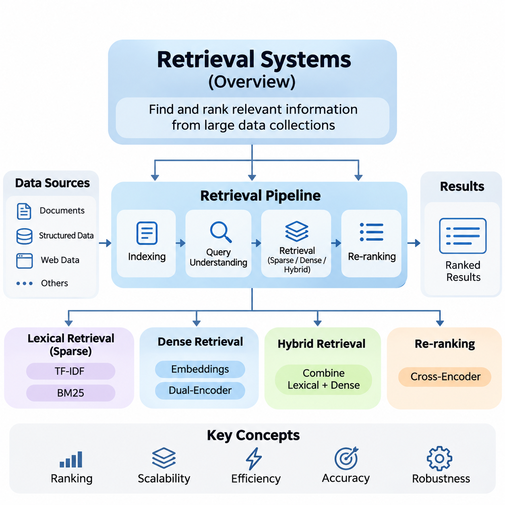
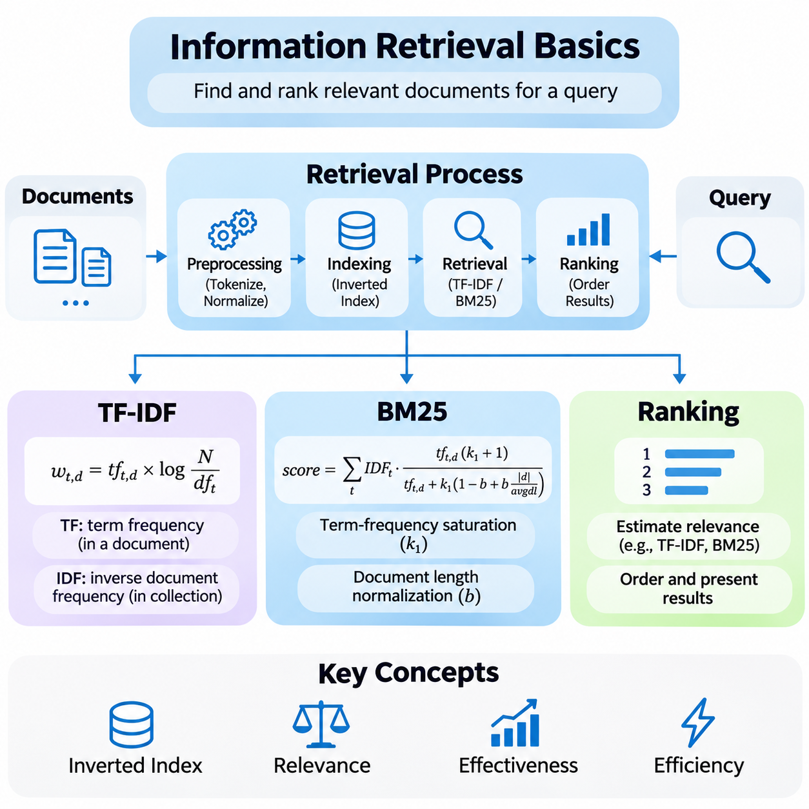
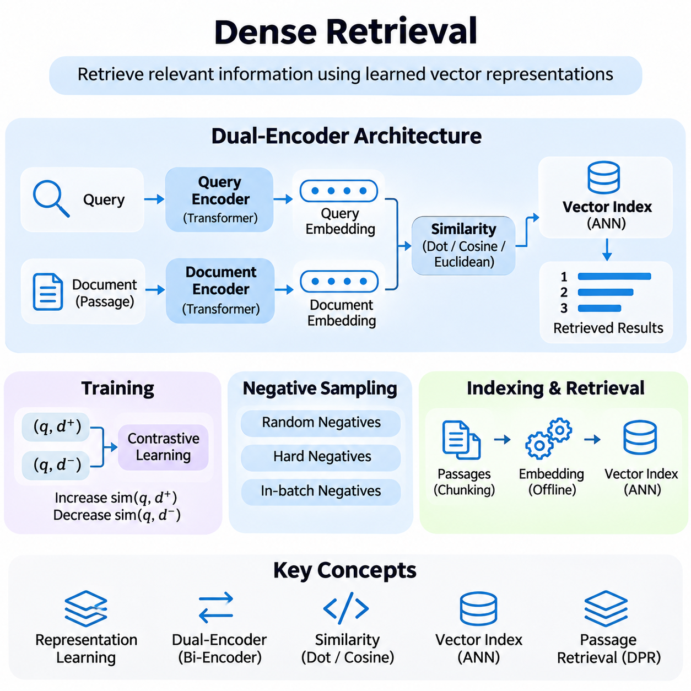
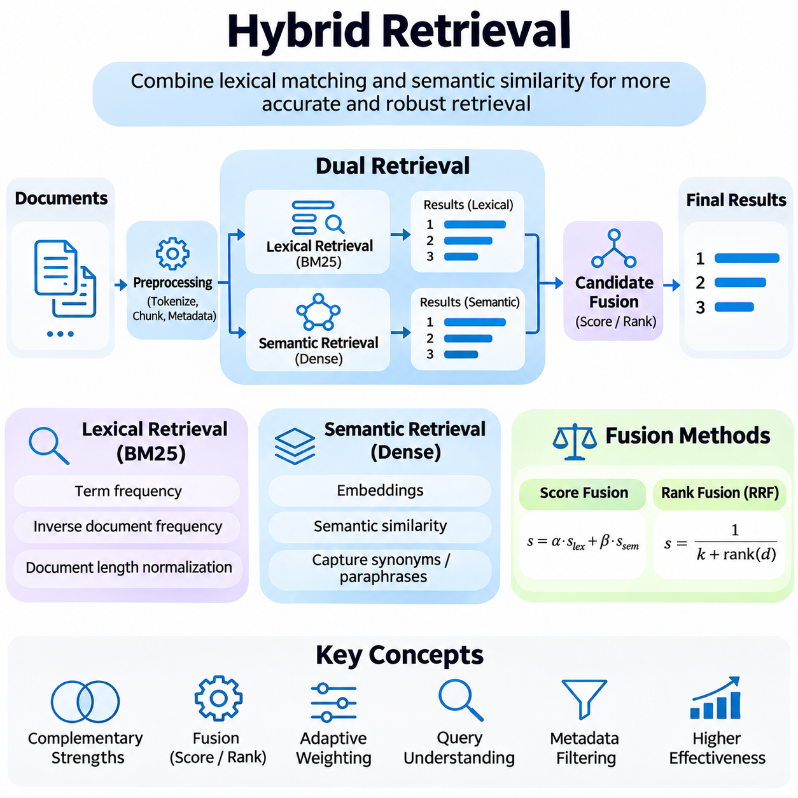
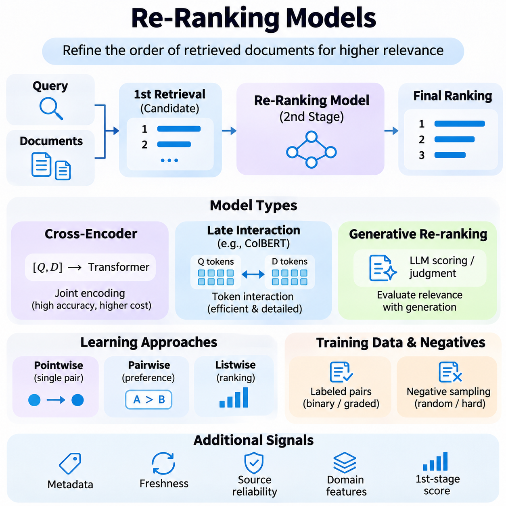
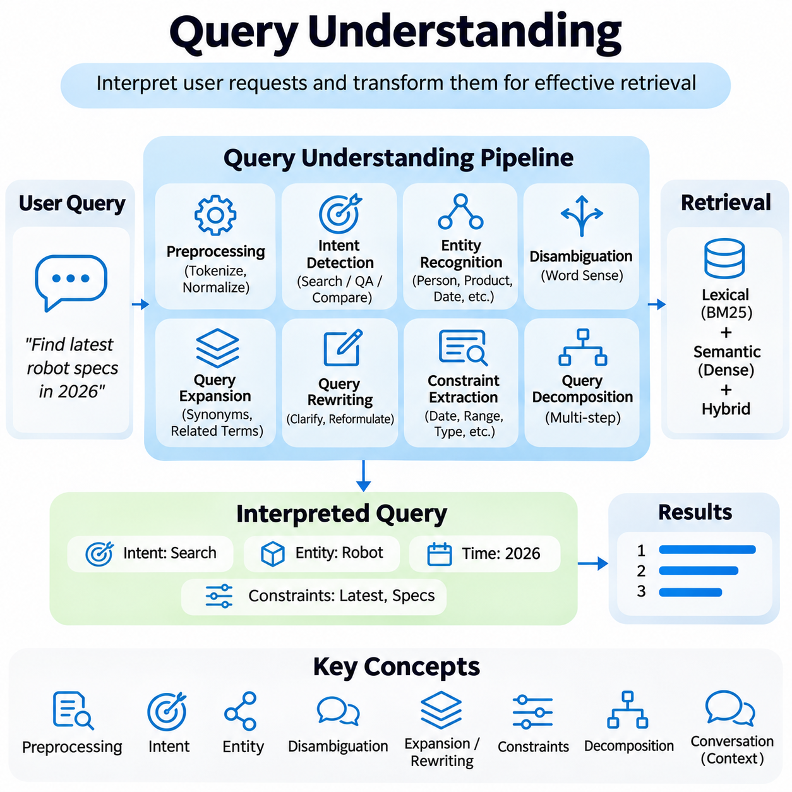
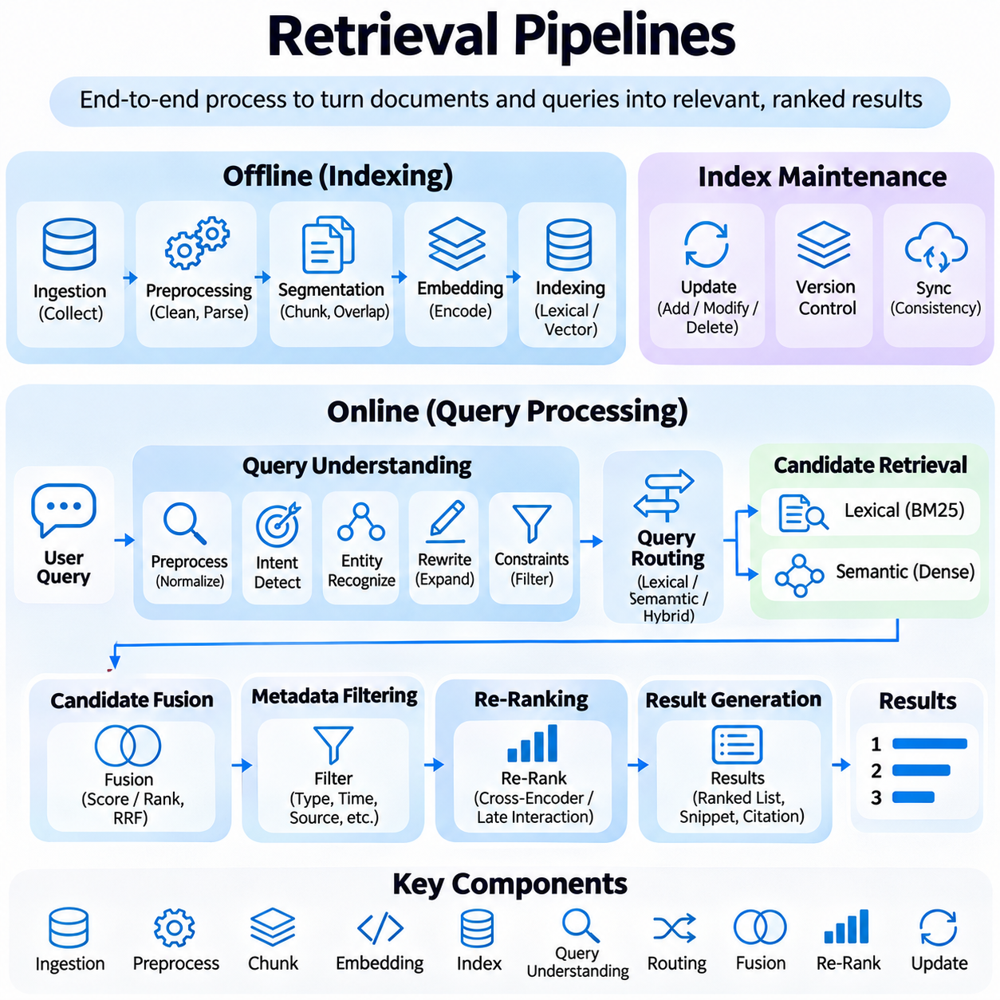
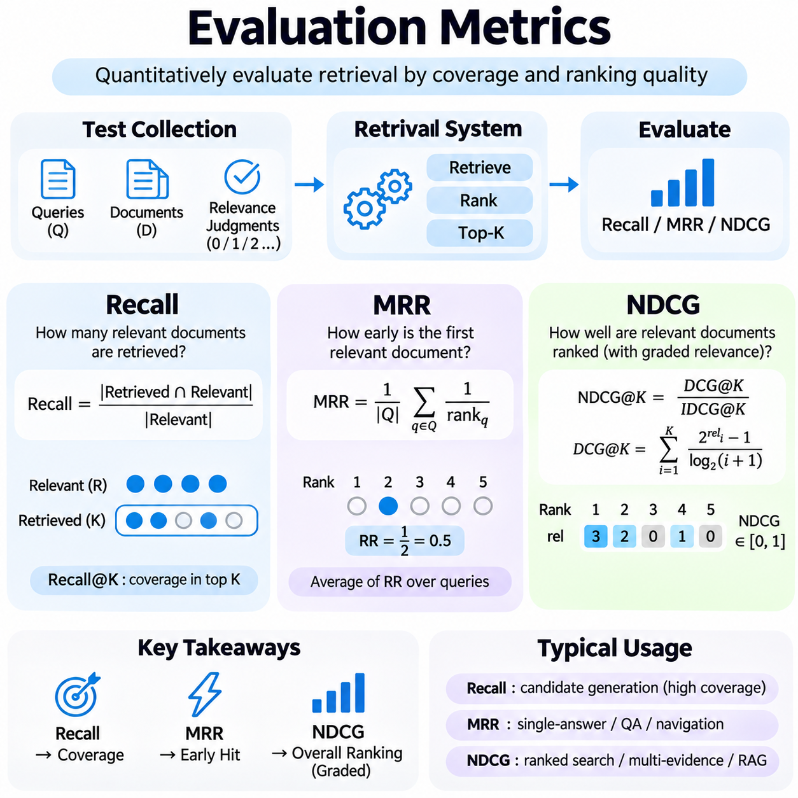
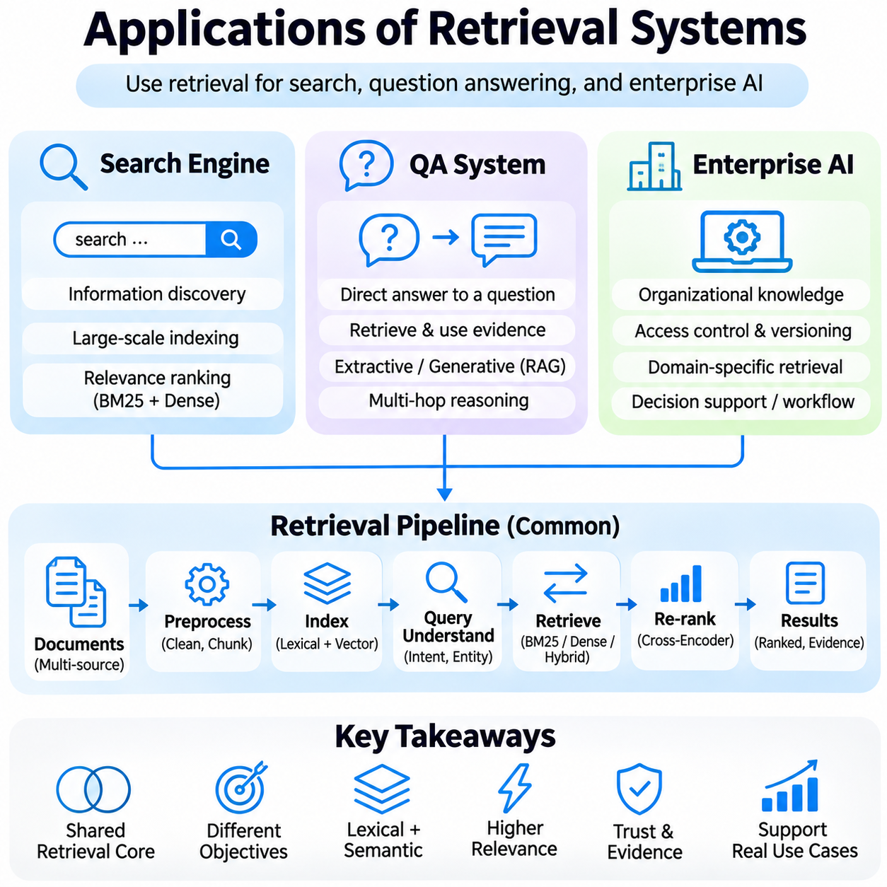

**Volume 37. Memory and Knowledge Systems**

# 02. Retrieval Systems

## 02.00 Overview

{width="7.268055555555556in" height="7.268055555555556in"}

Retrieval systems are fundamental components of modern artificial intelligence architectures, enabling efficient access to relevant information from large and continuously expanding collections of data. Rather than relying exclusively on knowledge encoded within model parameters, retrieval systems dynamically identify external information that supports search, reasoning, question answering, and knowledge-intensive applications.

The primary objective of information retrieval is to identify and rank documents, passages, or structured records according to their relevance to a user query. A retrieval system transforms an information need into a computational search operation, evaluates candidate resources, and returns an ordered collection of results. Its effectiveness depends on retrieval accuracy, computational efficiency, scalability, and responsiveness.

Traditional information retrieval methods rely primarily on lexical relationships between queries and documents. Techniques such as Term Frequency--Inverse Document Frequency (TF-IDF) and Best Matching 25 (BM25) estimate relevance using term occurrences, document statistics, and normalization mechanisms. These approaches remain important because they provide efficient, interpretable, and reliable foundations for large-scale search applications.

TF-IDF represents documents through weighted terms that reflect their importance within individual documents and across an entire collection. Frequently occurring terms receive greater local importance, while terms appearing throughout the collection receive reduced discriminative weight. This statistical representation supports document comparison, keyword matching, and the construction of traditional search engines.

BM25 extends probabilistic information retrieval principles by combining term frequency saturation, inverse document frequency, and document length normalization. Its scoring mechanism balances the contribution of matching terms against document characteristics. BM25 remains widely used as a strong retrieval baseline, particularly when exact terminology, technical identifiers, or domain-specific expressions are important.

Ranking mechanisms determine how retrieved documents are ordered according to estimated relevance. A ranking function may incorporate lexical similarity, semantic relationships, document authority, contextual information, and user preferences. Effective ranking improves the probability that the most useful information appears near the beginning of the result list, reducing the effort required to locate relevant knowledge.

Dense retrieval introduces neural representation learning into information retrieval systems. Instead of representing documents exclusively through sparse term statistics, dense retrieval encodes queries and documents as continuous numerical vectors. These embeddings capture learned semantic relationships, allowing retrieval systems to identify conceptually related information even when queries and documents use different vocabulary.

Modern dense retrieval architectures frequently employ dual-encoder models that independently transform queries and documents into vector representations. Document embeddings can be generated in advance and stored within vector databases, while query embeddings are computed during retrieval. Similarity functions then identify candidate documents whose representations are closest to the query in the learned embedding space.

Dense retrieval provides substantial advantages for semantic matching, paraphrase recognition, and natural-language question answering. However, its effectiveness depends on embedding quality, training data, domain alignment, and indexing strategies. Dense models may also overlook exact identifiers or specialized terminology, demonstrating why semantic similarity alone cannot guarantee complete retrieval accuracy.

Hybrid retrieval combines lexical and dense retrieval methods to exploit their complementary strengths. Sparse retrieval preserves precise keyword matching, while dense retrieval captures broader semantic relationships. By integrating candidate sets or combining relevance scores, hybrid architectures can improve robustness across heterogeneous queries, technical documents, multilingual information, and enterprise knowledge repositories.

Hybrid systems require careful normalization and fusion of relevance signals because lexical and semantic scoring functions may operate on different numerical scales. Rank-based fusion and weighted score combination provide practical mechanisms for integrating results. The appropriate strategy depends on query characteristics, document diversity, retrieval objectives, and the relative reliability of individual retrieval models.

Re-ranking models refine the ordering of documents produced during initial retrieval. A first-stage retriever rapidly identifies a manageable candidate set, while a more computationally intensive model evaluates those candidates in greater detail. Cross-encoder architectures are particularly useful because they jointly process query-document pairs and estimate relevance through richer contextual interactions.

The separation between candidate retrieval and re-ranking establishes an important architectural tradeoff between efficiency and precision. Initial retrieval prioritizes broad coverage and low latency, whereas re-ranking concentrates computational resources on improving result quality. The number of candidates passed between stages directly influences processing cost, response time, and the probability of retaining relevant documents.

Query understanding provides the linguistic and semantic interpretation required to transform user requests into effective retrieval operations. Queries may contain ambiguous terminology, incomplete descriptions, implicit constraints, or multiple information needs. Processing mechanisms such as query classification, entity recognition, expansion, rewriting, and intent detection help identify the underlying information requirements.

Query expansion introduces related expressions or alternative terminology to improve candidate discovery, while query rewriting produces formulations better suited to available indexes. These transformations can improve retrieval performance when user vocabulary differs from document terminology. Nevertheless, excessive expansion may introduce irrelevant concepts, making controlled reformulation and relevance preservation essential.

A retrieval pipeline integrates document ingestion, preprocessing, indexing, query interpretation, candidate generation, ranking, and result delivery into a coordinated workflow. During ingestion, documents may be normalized, divided into passages, enriched with metadata, and transformed into searchable representations. During inference, queries activate retrieval stages that identify and prioritize relevant information.

Document segmentation plays an important role in retrieval quality because the unit of indexing determines the granularity of returned evidence. Large documents preserve broader context but may dilute specific information, while smaller passages support precise matching but can lose surrounding meaning. Effective segmentation therefore considers semantic boundaries, document structure, and the intended downstream application.

Metadata filtering further improves retrieval by restricting candidate documents according to attributes such as creation time, source, language, category, or access permissions. Combining structured filtering with semantic and lexical search allows retrieval systems to satisfy both contextual constraints and information relevance. This capability is especially important in enterprise environments containing heterogeneous and sensitive resources.

Retrieval systems must also manage changing information collections. New documents are continuously introduced, existing records are modified, and obsolete information must be removed or deprioritized. Index maintenance, synchronization, version management, and update policies ensure that search results reflect the intended state of the underlying knowledge repository without compromising operational consistency.

Evaluation provides the quantitative foundation for comparing retrieval algorithms and identifying system weaknesses. Retrieval quality cannot be determined solely by whether a relevant document appears somewhere in the result set. The position of relevant documents, the completeness of candidate discovery, and the consistency of rankings across different queries all influence practical usefulness.

Recall measures the proportion of relevant documents successfully retrieved from the available collection. High recall is particularly important in candidate-generation stages because documents excluded during initial retrieval cannot be recovered by subsequent re-ranking. Recall-oriented evaluation therefore helps determine whether retrieval architectures provide sufficient coverage before more selective ranking mechanisms are applied.

Mean Reciprocal Rank (MRR) evaluates how early the first relevant result appears across a collection of queries. It is particularly appropriate for tasks where users primarily need one correct document or answer-bearing passage. Normalized Discounted Cumulative Gain (NDCG), in contrast, evaluates ranking quality while accounting for result positions and potentially different degrees of relevance.

NDCG is especially valuable when multiple documents provide varying levels of usefulness. Highly relevant documents contribute more to the evaluation score when placed near the top of the ranking. Together, Recall, MRR, and NDCG provide complementary perspectives on retrieval completeness, first-result accessibility, and overall ranking effectiveness.

Evaluation should also consider operational properties such as retrieval latency, throughput, memory consumption, indexing cost, and computational scalability. A model producing excellent relevance scores may be unsuitable for real-time applications if its resource requirements exceed deployment constraints. Practical system evaluation therefore combines information retrieval metrics with infrastructure and service-level measurements.

Search engines represent one of the most established applications of retrieval technology. They organize extensive document collections and respond to user information needs through indexing, candidate retrieval, and ranking. Modern search engines may integrate lexical methods, semantic embeddings, contextual signals, and re-ranking mechanisms to support both precise keyword queries and complex natural-language requests.

Question-answering systems depend on retrieval to identify evidence that supports the generation or extraction of answers. Rather than searching exclusively for complete documents, these systems frequently retrieve passages containing relevant facts. Retrieval quality directly influences answer completeness, factual grounding, and the ability to associate generated responses with identifiable information sources.

Retrieval-Augmented Generation (RAG) extends this principle by connecting retrieval systems with large language models. Retrieved passages provide external context that supplements the model\'s internal knowledge during response generation. This architecture supports knowledge updates without requiring complete model retraining, although retrieved evidence must still be evaluated for relevance, reliability, and consistency.

Enterprise AI systems use retrieval to connect organizational documents, technical manuals, operational records, policies, and internal knowledge bases. Such systems must address document diversity, access control, information freshness, and organizational terminology. Hybrid retrieval and metadata-aware ranking are particularly useful when users require both exact technical references and semantically related knowledge.

The engineering of production retrieval systems involves balancing relevance, latency, scalability, maintainability, and security. Distributed indexes, caching mechanisms, parallel retrieval, and optimized inference can improve performance under substantial query workloads. Monitoring retrieval outcomes and collecting relevance feedback further support systematic improvements as document collections and user requirements evolve.

Retrieval systems ultimately serve as the connection between stored knowledge and intelligent computation. Their development progresses from statistical keyword matching toward semantic representation learning, hybrid search, contextual re-ranking, and integrated retrieval pipelines. Understanding these foundations enables the design of reliable search engines, knowledge-aware AI applications, and scalable memory-supported intelligent systems.

## 02.01 Information Retrieval Basics

{width="7.268055555555556in" height="7.268055555555556in"}

Information retrieval is the computational process of identifying relevant information from large collections of documents in response to user queries. Its fundamental objective is to transform an information need into a ranked set of useful results. Classical retrieval systems achieve this through document representation, term statistics, relevance estimation, and ranking algorithms that balance retrieval effectiveness with computational efficiency.

The foundations of information retrieval rely on representing documents and queries in forms that support systematic comparison. Text preprocessing commonly includes tokenization, normalization, stop-word handling, and optional stemming or lemmatization. These operations reduce linguistic variation and establish consistent indexing units, although excessive normalization may remove distinctions that are important for technical terminology or specialized domains.

An inverted index is a fundamental data structure used in traditional retrieval systems. Instead of scanning every document for each query, the index maps individual terms to lists of documents containing those terms. Posting lists may additionally store term frequencies, positions, and document identifiers. This organization enables efficient candidate discovery and provides the statistical information required by lexical ranking algorithms.

Term Frequency--Inverse Document Frequency, commonly known as TF-IDF, is a statistical weighting method that estimates the importance of terms within documents relative to an entire collection. Its central assumption is that terms occurring frequently in a particular document but infrequently across the collection provide stronger evidence of document relevance than terms appearing in nearly every document.

Term Frequency measures how often a term appears within a document, while Inverse Document Frequency measures how uncommon that term is across the document collection. Their combination assigns larger weights to distinctive terms and smaller weights to widely distributed expressions. Different TF-IDF formulations may apply logarithmic scaling, normalization, or smoothing to control the influence of document length and term repetition.

A common TF-IDF formulation multiplies a term-frequency component by the logarithm of the ratio between the total number of documents and the number containing the term. This produces a weighted vector representation for each document. Queries can be represented using compatible vectors, allowing relevance to be estimated through vector similarity measures such as cosine similarity.

Cosine similarity measures the angular relationship between query and document vectors rather than their absolute magnitudes. This normalization reduces the direct influence of document length and emphasizes the distribution of weighted terms. However, conventional TF-IDF remains primarily lexical because semantically equivalent expressions may occupy different dimensions when they do not share the same vocabulary.

TF-IDF is computationally efficient, interpretable, and suitable for document classification, keyword search, similarity analysis, and baseline retrieval experiments. Nevertheless, its effectiveness can decline when queries contain synonyms, paraphrases, or ambiguous terminology. It also requires careful preprocessing because tokenization decisions and vocabulary construction directly influence the resulting document representations.

BM25, commonly associated with the Okapi information retrieval framework, is a probabilistic ranking function designed to estimate document relevance using lexical evidence. It improves upon simple term-frequency weighting by introducing saturation effects and document length normalization. BM25 has become a widely adopted baseline for information retrieval because it provides strong ranking performance without requiring neural network training.

The BM25 scoring function combines inverse document frequency, normalized term frequency, and adjustable parameters that control term saturation and document length effects. For each query term, the algorithm estimates its contribution to document relevance and accumulates these contributions into a final score. Documents containing more informative query terms generally receive higher relevance estimates.

Term-frequency saturation is an important characteristic of BM25. Repeated occurrences of a query term increase its relevance contribution, but the additional benefit gradually decreases. This reflects the observation that encountering a term several times may provide useful evidence, while excessive repetition should not produce unlimited increases in ranking scores or dominate the contributions of other terms.

Document length normalization addresses differences between short and long documents. Longer documents naturally contain more words and may exhibit higher raw term frequencies even when they are not more relevant. BM25 adjusts term contributions according to document length relative to the average length of the collection, helping reduce systematic advantages associated with unusually long documents.

The BM25 parameter k1 controls the degree of term-frequency saturation, while parameter b determines the strength of document length normalization. Common experimental configurations use k1 values around 1.2 to 2.0 and b near 0.75, although optimal settings depend on document characteristics. Parameter tuning should consider collection size, document length distribution, query patterns, and evaluation results.

BM25 is particularly effective when exact terminology carries substantial meaning, including technical documentation, legal records, scientific publications, and enterprise knowledge repositories. Its lexical precision makes it useful for retrieving product identifiers, error codes, and specialized expressions. However, like TF-IDF, BM25 cannot inherently recognize semantic equivalence between unrelated surface forms without additional retrieval mechanisms.

The distinction between TF-IDF and BM25 lies primarily in their weighting assumptions and treatment of document characteristics. TF-IDF typically represents documents as weighted vectors, whereas BM25 directly computes probabilistically motivated relevance scores. BM25 explicitly models term-frequency saturation and length normalization, while TF-IDF implementations vary in how they incorporate these effects through weighting and vector normalization.

Ranking is the process of ordering retrieved documents according to their estimated usefulness for a particular query. A ranking function assigns relevance scores based on available evidence, including term overlap, statistical importance, semantic similarity, and contextual information. The quality of ranking determines whether relevant documents appear prominently enough to satisfy user information needs efficiently.

Classical ranking methods rely on deterministic scoring functions derived from document statistics and query characteristics. TF-IDF and BM25 are representative approaches because their scoring behavior can be inspected and interpreted. Their relatively low computational requirements make them suitable for large document collections, particularly when inverted indexes support efficient candidate generation and score calculation.

Modern ranking systems increasingly incorporate learning-to-rank techniques that estimate relevance functions from training data. Pointwise methods predict individual document relevance, pairwise methods learn preferences between document pairs, and listwise methods optimize properties of entire ranked lists. These approaches can integrate multiple relevance signals and adapt ranking behavior to specific application requirements.

Ranking pipelines frequently separate candidate retrieval from subsequent relevance refinement. An initial lexical retriever rapidly identifies potentially useful documents, while a second-stage ranking model performs more detailed comparisons. This architecture balances retrieval coverage, ranking accuracy, and response latency, allowing computationally expensive methods to operate on a smaller candidate set rather than the complete collection.

Relevance assessment is essential for evaluating ranking algorithms. Human judgments, annotated datasets, or carefully validated behavioral signals can establish which documents satisfy particular queries. Evaluation methods must account for incomplete judgments, ambiguous information needs, and differences in relevance intensity. Reliable assessment requires representative queries and consistent annotation criteria across the document collection.

Precision measures the proportion of retrieved documents that are relevant, while Recall measures the proportion of all relevant documents successfully retrieved. These metrics describe complementary aspects of retrieval quality. Precision emphasizes result usefulness, whereas Recall emphasizes completeness. Their relative importance depends on whether an application prioritizes highly accurate results or comprehensive information discovery.

Ranking-sensitive metrics provide additional information about result ordering. Mean Reciprocal Rank evaluates the position of the first relevant result, while Normalized Discounted Cumulative Gain accounts for relevance grades and ranking positions. Precision at K and Recall at K evaluate retrieval behavior within a specified result cutoff, helping determine how effectively a system serves users who inspect only the highest-ranked documents.

Practical retrieval performance also depends on indexing efficiency, query latency, memory consumption, and collection updates. Large-scale systems must support document additions, modifications, and deletions while preserving consistent search behavior. Efficient posting-list traversal, score pruning, caching, and distributed indexing can reduce computational overhead without fundamentally changing the relevance models used by the retrieval engine.

The selection of a retrieval method should reflect the characteristics of the target information environment. TF-IDF offers transparent vector-based weighting, BM25 provides robust lexical ranking, and learning-based methods support more complex relevance estimation. No single approach performs optimally across every collection, making empirical evaluation and domain-specific configuration essential for reliable deployment.

Traditional information retrieval remains a foundational component of modern knowledge systems despite advances in dense embeddings and neural retrieval. Lexical methods provide exact matching capabilities, efficient indexing, and interpretable scoring that complement semantic search. Understanding BM25, TF-IDF, and ranking principles establishes the technical basis for hybrid retrieval, re-ranking architectures, and retrieval-augmented artificial intelligence systems.

## 02.02 Dense Retrieval [w/Code]

{width="7.268055555555556in" height="7.268055555555556in"}

Dense retrieval is a neural information retrieval approach that represents queries and documents as continuous numerical vectors within a shared embedding space. Unlike traditional lexical methods that depend primarily on exact term matching, dense retrieval captures learned semantic relationships between expressions. This capability allows retrieval systems to identify relevant information even when queries and documents contain different vocabulary.

The central principle of dense retrieval is representation learning, where neural networks transform textual information into compact vectors that preserve meaningful semantic characteristics. Documents discussing similar concepts are expected to occupy nearby regions of the embedding space. The quality of this representation determines how effectively a retrieval system distinguishes relevant information from unrelated content across diverse queries.

Dense retrieval architectures commonly employ Transformer-based encoders that generate contextual representations of natural-language inputs. These encoders process sequences of tokens and combine their contextual information into fixed-dimensional embeddings. Pooling strategies, including mean pooling and special-token representations, determine how token-level information is aggregated into vectors suitable for similarity computation and indexing.

A widely adopted architecture is the dual-encoder model, also called a bi-encoder, which independently processes queries and documents through neural encoding functions. The query encoder produces a query embedding, while the document encoder generates document embeddings. Both representations are mapped into compatible vector spaces, allowing relevance to be estimated through efficient similarity calculations.

Dual-encoder architectures provide an important computational advantage because document embeddings can be generated before queries arrive. These vectors are stored in specialized indexes or vector databases, enabling rapid candidate retrieval during inference. Only the incoming query requires real-time encoding, substantially reducing the computational cost compared with architectures that jointly process every query-document pair.

Similarity functions establish the mathematical relationship between query embeddings and document embeddings. Common choices include dot product, cosine similarity, and Euclidean distance. Dot product measures vector alignment while incorporating magnitude, cosine similarity emphasizes angular relationships, and Euclidean distance measures geometric separation. Their effectiveness depends on embedding normalization and the training objective.

Dense retrieval models are frequently trained using contrastive learning, which encourages relevant query-document pairs to receive higher similarity scores than unrelated pairs. Positive examples represent relevant relationships, while negative examples provide contrasting information. By optimizing the relative positions of embeddings, the model learns a representation space that supports semantic discrimination and efficient retrieval.

Negative sampling is particularly important because the difficulty and diversity of negative examples influence retrieval performance. Random negatives may be easy to distinguish, while hard negatives contain semantically similar but irrelevant information. Training with carefully selected hard negatives improves discrimination among closely related documents, although mislabeled negatives can introduce contradictory supervision and reduce model quality.

In-batch negatives provide an efficient training strategy by treating positive documents associated with other queries in the same batch as negative candidates. This increases the number of comparisons without requiring separate negative-document generation for every query. However, the method assumes that these documents are not relevant to the current query, an assumption that may fail when multiple queries share valid answers.

Dense Passage Retrieval, commonly abbreviated as DPR, demonstrates how independently trained query and passage encoders can support open-domain question answering. DPR uses supervised query-passage relationships to learn semantic representations and retrieves passages through vector similarity. Its architecture illustrates the broader transition from manually engineered lexical relevance functions toward learned neural retrieval mechanisms.

The training objective of dense retrieval typically maximizes similarity between relevant pairs while minimizing similarity with competing candidates. Contrastive losses often use temperature-scaled similarity scores and probabilistic normalization across candidate documents. Temperature controls the concentration of the resulting distribution, influencing gradient behavior and the model\'s sensitivity to difficult distinctions.

Document preprocessing strongly influences retrieval effectiveness because neural encoders operate within finite input-length constraints. Long documents are commonly divided into smaller passages or semantic chunks before embedding generation. Chunk size and overlap affect contextual preservation, retrieval granularity, storage requirements, and the probability that relevant evidence remains sufficiently complete within an indexed unit.

Embedding generation is generally performed as an offline indexing operation for relatively stable document collections. Each passage is encoded into a numerical vector and associated with metadata such as document identifiers, source information, timestamps, and access permissions. These embeddings are then inserted into a vector index that supports similarity-based candidate discovery during online retrieval.

Exact nearest-neighbor search compares query embeddings against all indexed vectors, providing a direct similarity-based ranking but becoming computationally expensive for large collections. Approximate Nearest Neighbor search addresses this limitation by reducing the number of comparisons required. It sacrifices some retrieval completeness in exchange for substantially improved latency, memory efficiency, or throughput.

Approximate search techniques include graph-based methods such as Hierarchical Navigable Small World, clustering-based approaches such as Inverted File indexes, and vector compression mechanisms. These methods organize embedding spaces to accelerate candidate discovery. Their configuration requires balancing recall, indexing time, memory consumption, and query latency according to application requirements.

Vector databases provide infrastructure for storing embeddings, maintaining similarity indexes, and retrieving semantically related information. Systems such as FAISS, Milvus, Weaviate, and Pinecone illustrate different approaches to vector search infrastructure. Although their operational models differ, they support the fundamental process of identifying candidate vectors that are close to an encoded query.

A complete dense retrieval pipeline integrates query preprocessing, neural encoding, vector similarity search, candidate selection, and result reconstruction. The incoming query is transformed into an embedding using the query encoder, after which the vector index returns matching document identifiers and similarity scores. The system then retrieves the corresponding content and metadata for downstream processing.

Dense retrieval is especially valuable when users express information needs through natural language rather than precise keywords. A query describing a technical problem may retrieve documents containing different terminology but similar underlying concepts. This semantic flexibility supports question answering, recommendation, enterprise knowledge discovery, and retrieval-augmented generation across heterogeneous information sources.

Despite its advantages, dense retrieval can struggle with exact identifiers, numerical constraints, rare terminology, and out-of-domain expressions. Embedding similarity does not necessarily preserve every factual distinction contained in the original text. Consequently, semantically similar passages may receive high scores even when they differ in critical details, requiring additional validation or complementary lexical retrieval.

Domain adaptation can improve retrieval performance when general-purpose embedding models encounter specialized vocabulary or document structures. Fine-tuning with domain-specific query-document pairs helps align representations with relevant concepts and terminology. However, adaptation requires representative training data, reliable relevance labels, and evaluation procedures that detect overfitting or degradation on broader retrieval tasks.

Evaluation of dense retrieval commonly emphasizes Recall at K, Mean Reciprocal Rank, and Normalized Discounted Cumulative Gain. These metrics measure candidate coverage and ranking quality from different perspectives. Operational evaluation additionally considers embedding generation cost, index size, query encoding latency, search throughput, and the effects of approximate nearest-neighbor configurations.

Dense retrieval forms a foundational component of modern retrieval-augmented artificial intelligence systems by connecting neural language understanding with scalable information access. Its effectiveness emerges from the coordinated design of embedding models, contrastive training, document segmentation, vector indexing, and evaluation. Understanding these mechanisms provides the basis for hybrid retrieval, neural re-ranking, and knowledge-aware AI architectures.

## 02.03 Hybrid Retrieval

{width="7.268055555555556in" height="7.268055555555556in"}

Hybrid retrieval is an information retrieval approach that combines lexical matching and semantic similarity to improve the accuracy, robustness, and coverage of search results. Traditional lexical retrieval identifies documents through shared terms, while dense retrieval captures relationships between concepts expressed with different vocabulary. By integrating these complementary mechanisms, hybrid retrieval supports more reliable information discovery across diverse document collections.

The fundamental motivation for hybrid retrieval arises from the limitations of individual retrieval methods. Lexical algorithms such as BM25 perform effectively when queries contain exact terminology, identifiers, or specialized expressions, but they may overlook semantically equivalent passages. Dense retrieval can identify conceptual similarities, yet it may fail to preserve precise numerical values or technical distinctions. Combining both approaches reduces dependence on either representation.

A hybrid retrieval architecture typically maintains separate lexical and vector indexes over the same document collection. The lexical index organizes terms through inverted posting lists, while the vector index stores neural embeddings generated from documents or passages. At query time, both retrieval mechanisms produce candidate results, which are subsequently combined through score fusion, rank fusion, or additional relevance estimation.

Document preprocessing must maintain consistency between the lexical and semantic retrieval branches. Text normalization, document segmentation, metadata extraction, and identifier assignment should produce compatible representations of the underlying information. Although lexical tokenization and neural encoding require different processing operations, both indexes should preserve mappings to the same source documents and retrieval units.

The lexical retrieval branch commonly uses BM25 to estimate relevance from term frequency, inverse document frequency, and document length normalization. This mechanism provides strong performance for exact matches, including product codes, scientific terminology, legal references, and named entities. Its transparent scoring behavior also makes it useful for investigating retrieval failures and establishing interpretable baseline performance.

The semantic retrieval branch uses neural embedding models to transform queries and documents into continuous vector representations. Similarity functions identify candidates whose learned representations are close to the query embedding. This approach improves retrieval when relevant documents use synonyms, paraphrases, or alternative descriptions, extending search beyond the vocabulary explicitly present in the original query.

Candidate fusion is the central operation that connects lexical and semantic retrieval results. Each retrieval branch independently returns a ranked list of documents or passages, and the fusion mechanism constructs a unified candidate set. Documents discovered by both methods may receive stronger relevance evidence, while documents retrieved by only one branch can still contribute valuable information that the other method overlooked.

Score-based fusion combines numerical relevance scores generated by different retrieval models. A weighted formulation assigns coefficients to lexical and semantic scores before calculating a combined value. However, BM25 scores and embedding similarity scores may have different distributions and numerical ranges, making direct addition unreliable without appropriate calibration or normalization.

Score normalization techniques include min-max scaling, standardization, and transformations based on observed score distributions. These procedures attempt to make heterogeneous relevance signals more comparable before fusion. Their effectiveness depends on the stability of score distributions, candidate selection, and query characteristics. Poorly calibrated normalization can amplify noise or suppress useful evidence from one retrieval branch.

Rank-based fusion avoids direct comparison of numerical scores by combining the positions of documents in independently generated ranked lists. Reciprocal Rank Fusion, commonly abbreviated as RRF, assigns contributions according to the reciprocal of each document\'s rank plus a smoothing constant. This approach is widely used because it is simple, relatively robust, and does not require scores from different retrieval models to share a common scale.

Reciprocal Rank Fusion rewards documents that appear prominently across multiple retrieval lists while retaining candidates found by a single method. Its behavior depends on the rank constant, retrieval depth, and number of contributing lists. Although RRF often provides strong practical performance, it does not explicitly model the magnitude of relevance differences between documents and may require further refinement for specialized applications.

Hybrid retrieval systems can also employ adaptive weighting, where the relative importance of lexical and semantic signals changes according to query characteristics. Queries containing identifiers, exact quotations, or numerical constraints may benefit from stronger lexical weighting. Conversely, descriptive questions and concept-oriented queries may benefit from greater semantic influence. Reliable adaptation requires query analysis and empirical validation.

Query understanding contributes to hybrid retrieval by identifying user intent, linguistic ambiguity, domain terminology, and structural constraints. Query rewriting and expansion can improve both retrieval branches, although transformations should preserve the original information need. A system may maintain the original query for exact matching while generating an alternative semantic representation to improve conceptual coverage.

Metadata filtering provides an additional mechanism for controlling hybrid retrieval results. Document attributes such as source, timestamp, language, category, and access permissions can constrain candidate generation or subsequent ranking. Applying filters consistently across retrieval branches is important because mismatched filtering behavior may produce incomplete results, inconsistent rankings, or unintended exposure of restricted information.

The number of candidates retrieved from each branch significantly influences hybrid retrieval effectiveness. Small candidate pools reduce latency and computational cost but may exclude relevant documents before fusion. Larger pools improve potential coverage while increasing processing requirements. Candidate allocation should therefore reflect retrieval recall, expected query complexity, downstream ranking capacity, and service latency constraints.

Re-ranking models can refine the unified candidate set after lexical and semantic fusion. Cross-encoder architectures jointly examine queries and candidate passages to estimate contextual relevance more precisely than independent embedding similarity alone. This creates a multi-stage pipeline in which efficient retrieval maximizes candidate coverage, fusion integrates complementary evidence, and re-ranking improves the final ordering.

Hybrid retrieval is particularly valuable for retrieval-augmented generation because language models require both semantically relevant context and accurate factual evidence. Lexical retrieval helps preserve exact terminology and identifiers, while dense retrieval broadens conceptual coverage. Combining these mechanisms can improve the likelihood that retrieved passages contain sufficient grounding information for reliable answer generation.

Enterprise knowledge systems frequently contain heterogeneous documents, including technical manuals, engineering specifications, operational records, policies, and unstructured reports. Hybrid retrieval can accommodate both exact reference searches and natural-language information requests. Its effectiveness is especially important when users alternate between highly specific identifiers and broad questions about processes, requirements, or organizational knowledge.

Evaluation of hybrid retrieval should examine the performance of lexical retrieval, dense retrieval, and their combined configuration independently. Recall at K measures candidate coverage, Mean Reciprocal Rank evaluates early relevant results, and Normalized Discounted Cumulative Gain assesses ranking quality. Ablation studies help determine whether improvements originate from fusion, query processing, candidate depth, or subsequent re-ranking.

Operational evaluation must additionally consider index storage, embedding generation costs, query latency, throughput, and synchronization overhead. Maintaining two retrieval indexes increases infrastructure complexity and requires consistent updates when documents are added, modified, or deleted. Caching, parallel execution, incremental indexing, and monitoring can reduce overhead while maintaining retrieval consistency across both branches.

Hybrid retrieval does not guarantee superior performance under every condition. Poor embedding quality, inappropriate fusion weights, inconsistent document segmentation, or redundant candidate lists may reduce its advantages. Effective deployment therefore requires representative evaluation datasets, carefully selected retrieval configurations, and continuous monitoring of relevance and operational behavior.

Hybrid retrieval represents a practical integration of statistical information retrieval and neural representation learning. By combining lexical precision with semantic generalization, it establishes a flexible foundation for modern search engines, question-answering systems, and knowledge-aware artificial intelligence. Its continued development emphasizes adaptive fusion, efficient multi-stage ranking, and reliable integration with large-scale retrieval infrastructure.

## 02.04 Re Ranking Models [w/Code]

{width="7.268055555555556in" height="7.268055555555556in"}

Re-ranking models are advanced information retrieval components that refine the ordering of documents produced by an initial retrieval system. While first-stage retrievers prioritize efficient candidate discovery, re-ranking models perform more detailed relevance estimation using richer interactions between queries and documents. This separation improves ranking precision without requiring expensive neural computations across an entire document collection.

The primary objective of re-ranking is to place the most relevant evidence near the beginning of a retrieved result list. Initial retrieval methods such as BM25, dense retrieval, and hybrid retrieval generate candidate documents using relatively efficient matching mechanisms. A re-ranking model subsequently examines these candidates and assigns new relevance scores, allowing the final ordering to reflect deeper contextual relationships.

A typical re-ranking architecture operates as the second stage of a multi-stage retrieval pipeline. The first stage selects a limited number of potentially relevant passages, often ranging from several dozen to several hundred candidates. The second stage evaluates each query-passage pair and produces a refined ranking. This design balances candidate coverage, computational complexity, response latency, and the quality of final search results.

Cross-encoder models represent one of the most widely used neural re-ranking architectures. Unlike dual encoders that process queries and documents independently, cross-encoders jointly process both inputs through a Transformer network. Self-attention mechanisms allow tokens from the query to interact directly with document tokens, enabling detailed analysis of terminology, contextual relationships, and semantic relevance.

A cross-encoder typically combines the query and candidate passage into a single token sequence with appropriate separators. The Transformer generates contextual representations across the combined input, and a prediction head produces a relevance score. Because every query-document pair requires a separate forward pass, cross-encoders generally provide more expressive matching at a substantially higher computational cost than bi-encoders.

The relevance prediction head of a re-ranking model may produce a continuous score, a probability, or a classification output. Regression-based scoring estimates the strength of relevance directly, while classification-based approaches distinguish relevant and irrelevant candidates. Some architectures generate ordinal relevance grades, allowing the model to represent different levels of usefulness rather than a simple binary decision.

Training re-ranking models requires examples connecting queries with relevant and irrelevant documents. Supervised datasets commonly contain query-document pairs with binary labels, graded relevance judgments, or preference relationships. The training process adjusts model parameters so that relevant documents receive higher scores than less useful alternatives, improving discrimination among candidates that may appear superficially similar.

Pointwise learning treats each query-document pair as an independent prediction problem. The model estimates relevance using classification or regression losses, such as cross-entropy or mean squared error. This formulation is straightforward to implement and supports explicit relevance labels, although independent predictions do not necessarily optimize the relative ordering of documents within the same query.

Pairwise learning directly models preferences between two candidate documents associated with the same query. The training objective encourages a relevant document to receive a higher score than a less relevant alternative. Pairwise logistic losses and margin-based ranking losses are common approaches. These methods focus on relative ordering and can improve ranking behavior when absolute relevance scores are difficult to calibrate.

Listwise learning considers multiple candidate documents together and optimizes ranking properties across an entire result list. Its objectives may approximate ranking metrics or model probability distributions over document orderings. Listwise approaches can align training more closely with retrieval evaluation, but they often require more complex optimization and careful handling of variable candidate sets.

Negative sampling strongly influences the effectiveness of re-ranking training. Random negative documents are usually easy to distinguish from relevant passages, whereas hard negatives share vocabulary or semantic characteristics with the query. Hard negatives encourage models to recognize subtle factual distinctions and contextual constraints. However, incorrectly labeled negatives may introduce conflicting supervision and reduce reliability.

Re-ranking models may incorporate additional features beyond the textual content of queries and documents. Metadata, document freshness, source reliability, domain-specific attributes, and first-stage retrieval scores can provide useful relevance signals. Feature integration must be carefully designed because inappropriate weighting may introduce systematic bias or cause the model to favor superficial correlations over genuine information relevance.

Late-interaction architectures provide an intermediate approach between independent embedding retrieval and full cross-encoder processing. Models such as ColBERT preserve token-level representations and compute fine-grained interactions during matching. By separating document encoding from interaction-based scoring, these architectures can offer improved retrieval efficiency while retaining more detailed matching information than single-vector representations.

Generative re-ranking approaches use language models to assess candidate relevance through conditional generation or structured relevance judgments. A model may evaluate whether a passage answers a question or compare candidate documents according to specified criteria. Such approaches offer flexible reasoning capabilities, but their computational requirements, output variability, and calibration challenges must be considered before production deployment.

The number of candidates passed to a re-ranking model directly affects both effectiveness and latency. Larger candidate sets increase the likelihood that relevant documents survive initial retrieval, but they also require more neural inference operations. Smaller candidate sets reduce computational demand while risking the exclusion of important evidence. Candidate depth should therefore be selected through empirical evaluation rather than fixed assumptions.

Inference optimization is essential when deploying neural re-ranking in real-time systems. Batching, mixed-precision computation, model quantization, sequence-length control, and efficient accelerator utilization can reduce processing costs. Passage truncation must be handled carefully because important evidence may occur beyond the model\'s input limit, potentially producing incorrect relevance estimates despite otherwise accurate model behavior.

Re-ranking is particularly valuable in retrieval-augmented generation, where the ordering and quality of retrieved passages influence the context supplied to a language model. By prioritizing passages containing directly relevant evidence, re-ranking can improve answer grounding and reduce irrelevant context. Nevertheless, high relevance scores do not independently guarantee factual correctness, source trustworthiness, or complete evidence coverage.

Enterprise search systems benefit from re-ranking when documents contain overlapping terminology but differ in technical applicability. Engineering specifications, operational procedures, regulatory documents, and maintenance records may appear similar under lexical or embedding-based retrieval. Context-aware re-ranking can distinguish passages according to specific constraints, component relationships, and the information requested by users.

Evaluation of re-ranking models commonly uses Mean Reciprocal Rank, Normalized Discounted Cumulative Gain, and Precision at K. These metrics measure whether relevant documents move toward higher positions after re-ranking. Comparisons should use consistent candidate pools to isolate ranking improvements from differences in first-stage retrieval. Additional experiments should examine robustness across query categories and document domains.

Operational evaluation must consider inference latency, memory requirements, throughput, accelerator utilization, and the cost of processing multiple candidates. A model that improves ranking metrics may still be unsuitable for applications with strict response-time constraints. Production systems therefore require coordinated optimization of first-stage retrieval, candidate selection, re-ranking capacity, and downstream processing.

Re-ranking models provide a practical mechanism for combining efficient information retrieval with sophisticated neural relevance estimation. Cross-encoders, learning-to-rank objectives, late-interaction architectures, and generative models offer different tradeoffs between precision and computational cost. Their effective integration enables more reliable search, question answering, and knowledge-aware artificial intelligence systems.

## 02.05 Query Understanding

{width="7.268055555555556in" height="7.268055555555556in"}

Query understanding is a fundamental component of information retrieval systems that interprets user requests and transforms them into representations suitable for effective searching. Users frequently express information needs through incomplete phrases, ambiguous terminology, or natural-language questions. Query understanding bridges the gap between human communication and retrieval mechanisms by identifying intent, relevant concepts, and contextual constraints.

The primary objective of query understanding is to determine what information a user actually seeks rather than relying exclusively on the literal words appearing in a query. This requires linguistic analysis, semantic interpretation, and contextual reasoning. A retrieval system must distinguish important concepts from incidental expressions while preserving the specific requirements that determine whether a document satisfies the information need.

Query preprocessing establishes a consistent representation of incoming requests before retrieval begins. Common operations include tokenization, case normalization, punctuation handling, spelling correction, and language identification. These transformations reduce superficial variations between queries and indexed documents. However, preprocessing must preserve meaningful distinctions involving technical identifiers, numerical values, abbreviations, and domain-specific terminology.

Intent detection identifies the underlying purpose of a query and helps determine the most appropriate retrieval strategy. Queries may request factual information, procedural instructions, document navigation, comparisons, or analytical explanations. Classification models can assign intent categories using linguistic features and learned semantic representations. Accurate intent recognition improves candidate selection and enables retrieval pipelines to adapt to different information needs.

Entity recognition identifies meaningful references such as people, organizations, products, locations, dates, and technical components within a query. Named Entity Recognition models detect these expressions and classify their semantic categories. Entity linking further connects recognized mentions to canonical entries in a knowledge base, reducing ambiguity when multiple entities share similar names or when alternative names refer to the same object.

Query ambiguity occurs when words or expressions support multiple interpretations. A technical term may refer to different concepts depending on the application domain, while a short query may omit essential contextual details. Word sense disambiguation and contextual interpretation help select plausible meanings. When uncertainty remains significant, interactive clarification can prevent the retrieval system from committing to an unsupported interpretation.

Query expansion improves retrieval coverage by introducing related terms, synonyms, abbreviations, or conceptually associated expressions. Traditional approaches use dictionaries, thesauri, and relevance feedback, while neural approaches employ embeddings and language models. Expansion can retrieve documents that express the same information using different terminology, but uncontrolled additions may introduce irrelevant topics and reduce precision.

Query rewriting transforms an original request into a form that better matches the capabilities of the retrieval system. Rewriting may resolve abbreviations, correct grammatical inconsistencies, clarify references, or reformulate conversational questions as standalone searches. Unlike unrestricted expansion, effective rewriting seeks to preserve the original information need while improving compatibility with lexical, dense, or hybrid retrieval mechanisms.

Conversational search introduces additional challenges because individual queries often depend on previous dialogue. Pronouns, omitted subjects, and references to earlier results require conversational context resolution. A context-aware query understanding component can reconstruct a complete search request from dialogue history. This capability supports multi-turn question answering and interactive knowledge exploration without forcing users to repeat information.

Semantic parsing converts natural-language requests into structured representations of meaning. Depending on the application, these representations may include entities, relations, logical constraints, or executable database queries. Structured interpretation is particularly valuable when users request information involving multiple conditions. Accurate parsing helps distinguish the requested information from the filters and relationships required to retrieve it.

Constraint extraction identifies explicit requirements such as dates, numerical ranges, categories, document types, and access restrictions. These constraints can be translated into metadata filters or structured search conditions. Preserving their logical meaning is essential because a semantically similar document may still be irrelevant if it violates a critical requirement, such as a specified version, location, or operating condition.

Query decomposition addresses complex requests that contain multiple questions or reasoning steps. A system may divide a broad query into smaller retrieval tasks, retrieve evidence independently, and combine the results for subsequent analysis. This approach is useful for comparative questions and multi-hop information needs, where answering the original request requires connecting facts distributed across several documents.

Neural language models have expanded query understanding through contextual embeddings and instruction-based interpretation. Transformer architectures can recognize semantic relationships, infer implicit intent, and generate alternative search formulations. Large language models can also extract constraints and decompose complex requests. However, generated interpretations require validation because models may introduce assumptions not supported by the original query.

Query understanding interacts closely with lexical and dense retrieval. Lexical search benefits from precise term normalization, spelling correction, and entity preservation, while dense retrieval benefits from semantically coherent reformulations. Hybrid systems can maintain multiple query representations simultaneously, allowing exact identifiers to remain available for lexical matching while expanded descriptions support semantic candidate discovery.

Relevance feedback provides a mechanism for improving query interpretation using evidence from retrieved results. Explicit feedback includes user judgments about document usefulness, while implicit feedback may involve clicks, reading behavior, or subsequent reformulations. These signals can guide query expansion and ranking adjustments, although behavioral observations must be interpreted cautiously because user actions do not always indicate true relevance.

Domain-specific query understanding requires specialized treatment of terminology, abbreviations, and relationships. Medical, legal, scientific, and engineering documents often contain expressions whose meanings differ from everyday language. Domain-adapted models, controlled vocabularies, and knowledge graphs can improve interpretation. Maintaining consistency between query terminology and indexed document representations is particularly important for technical retrieval.

Multilingual query understanding enables users to search information collections containing documents in different languages. Language identification, cross-lingual embeddings, machine translation, and multilingual entity linking can connect equivalent concepts across linguistic boundaries. Effective systems must account for translation ambiguity, specialized terminology, and differences in grammatical structure while preserving the user\'s intended constraints.

Evaluation of query understanding examines whether transformations improve retrieval effectiveness without changing the intended information need. Intent classification accuracy, entity recognition performance, constraint extraction quality, and query rewriting fidelity provide component-level measurements. End-to-end evaluation uses retrieval metrics such as Recall at K, Mean Reciprocal Rank, and Normalized Discounted Cumulative Gain to assess practical impact.

Robust query understanding must also address adversarial inputs, misleading instructions, and malformed queries. User-supplied text may contain irrelevant directives or attempts to override retrieval constraints. Systems should separate query content from operational instructions and enforce authorization independently of language-model interpretation. These safeguards are especially important when retrieval accesses confidential enterprise knowledge or external tools.

Operational deployment requires balancing interpretation accuracy with latency, computational cost, and system complexity. Lightweight preprocessing and classification may be sufficient for simple requests, while complex queries may justify language-model-based rewriting or decomposition. Adaptive pipelines can select processing depth according to query characteristics, enabling efficient retrieval without applying expensive reasoning to every request.

Query understanding connects natural-language communication with the structured and semantic operations required by modern retrieval systems. Through intent detection, entity recognition, query expansion, rewriting, constraint extraction, and contextual interpretation, it improves the alignment between user needs and retrieved evidence. Its effective integration establishes a foundation for intelligent search, conversational question answering, and retrieval-augmented artificial intelligence.

## 02.06 Retrieval Pipelines [w/Code]

{width="7.268055555555556in" height="7.268055555555556in"}

Retrieval pipelines are integrated processing architectures that transform information collections and user queries into relevant, ranked search results. They coordinate document ingestion, preprocessing, indexing, query interpretation, candidate retrieval, and relevance refinement. A well-designed pipeline balances retrieval accuracy, computational efficiency, scalability, and reliability while maintaining consistent access to evolving knowledge resources.

The architecture of a retrieval pipeline is commonly divided into offline indexing and online query processing. Offline operations prepare documents for efficient retrieval, while online operations interpret incoming requests and identify relevant evidence. Separating these workflows allows expensive document transformations to occur before queries arrive, reducing response latency and improving resource utilization during inference.

Document ingestion establishes the foundation of the retrieval pipeline by collecting information from databases, file repositories, websites, and enterprise applications. Source connectors extract content and associated metadata while preserving document identifiers and provenance. Reliable ingestion mechanisms must handle heterogeneous formats, duplicate records, incomplete files, and changing source systems without compromising information consistency.

Preprocessing converts ingested documents into representations suitable for indexing and retrieval. Typical operations include text extraction, encoding normalization, tokenization, structural analysis, and removal of irrelevant formatting. Document-specific processing may preserve headings, tables, timestamps, and technical identifiers. Excessive normalization should be avoided when exact terminology or numerical relationships are essential to relevance.

Document segmentation divides large information resources into smaller retrieval units, often called passages or chunks. Segmentation strategies may use fixed token windows, paragraph boundaries, semantic similarity, or document hierarchy. Smaller chunks improve retrieval granularity but may lose surrounding context, while larger chunks preserve relationships at the expense of matching precision and increased processing requirements.

Chunk overlap and contextual enrichment can reduce information loss at segmentation boundaries. Overlapping passages preserve continuity between adjacent sections, while metadata enrichment associates chunks with document titles, section identifiers, and source references. These mechanisms improve evidence reconstruction and allow downstream systems to connect retrieved passages with their original documents and broader context.

Index construction organizes processed content for efficient candidate discovery. Lexical retrieval systems build inverted indexes containing term statistics and posting lists, while dense retrieval systems generate embeddings and construct vector indexes. Hybrid pipelines maintain both representations. Index design must account for document volume, update frequency, memory requirements, and expected query patterns.

Embedding generation transforms document chunks into dense numerical vectors using neural encoding models. These representations capture learned semantic relationships and support similarity-based retrieval. Consistency between indexing and query-time embedding configurations is essential because incompatible models or preprocessing procedures can distort similarity measurements and reduce retrieval effectiveness.

Index maintenance ensures that retrieval results reflect changes in the underlying information collection. New documents require ingestion and indexing, modified records require updates, and deleted content must be removed from searchable structures. Incremental indexing, version control, and synchronization procedures reduce unnecessary recomputation while maintaining consistency between stored documents, metadata, and retrieval indexes.

Online query processing begins when a user submits a request to the retrieval system. Query preprocessing may normalize text, identify language, resolve spelling variations, and extract important terms. More advanced pipelines apply intent detection, entity recognition, query rewriting, and constraint extraction. These operations translate natural-language requests into representations compatible with the available retrieval mechanisms.

Query routing determines which retrieval methods should process an incoming request. Exact identifiers and specialized terminology may favor lexical search, while descriptive questions may benefit from semantic retrieval. Hybrid pipelines can execute both approaches and combine their results. Adaptive routing improves efficiency when different query categories require different retrieval strategies or computational resources.

Candidate generation identifies a manageable set of potentially relevant documents from large indexed collections. BM25 uses lexical statistics, while dense retrieval relies on vector similarity and nearest-neighbor search. The initial retrieval stage generally prioritizes recall and efficiency rather than perfect ranking precision. Relevant documents excluded at this stage cannot be recovered by subsequent re-ranking alone.

Candidate fusion integrates results from multiple retrieval branches into a unified set. Score-based fusion combines calibrated relevance values, while rank-based methods such as Reciprocal Rank Fusion use relative document positions. Duplicate candidates must be resolved through stable identifiers, and retrieval provenance should be preserved. Effective fusion improves coverage without unnecessarily increasing downstream processing costs.

Metadata filtering applies structural constraints to candidate retrieval or ranking. Filters may restrict results by document category, language, timestamp, source, or access permissions. Authorization constraints must be enforced independently of semantic relevance and should not depend solely on model-generated interpretations. Consistent filtering prevents restricted or outdated information from appearing in inappropriate retrieval contexts.

Re-ranking refines candidate ordering using more computationally intensive relevance models. Cross-encoders jointly analyze queries and candidate passages, enabling detailed contextual matching that is unavailable to independent embedding comparisons. Multi-stage ranking pipelines allocate inexpensive operations to broad candidate discovery and expensive operations to a smaller set of promising documents.

Context assembly prepares retrieved evidence for downstream applications such as question answering and retrieval-augmented generation. Selected passages may be deduplicated, ordered, and grouped according to relevance, source, or document structure. Context construction must respect token limits while preserving essential evidence, source attribution, and relationships between passages that support accurate interpretation.

Retrieval pipelines increasingly incorporate iterative retrieval when an initial search does not provide sufficient evidence. A system may reformulate the query, retrieve additional passages, or decompose complex requests into smaller searches. Iterative strategies can improve multi-hop reasoning and evidence coverage, but uncontrolled repetition increases latency and may introduce irrelevant or contradictory information.

Caching improves retrieval efficiency by reusing previously computed query embeddings, candidate results, or processed document representations. Cache policies must consider document updates, authorization changes, and query-specific constraints. Stale or incorrectly shared cache entries can produce inconsistent results or expose information across access boundaries, making cache invalidation and isolation important operational requirements.

Distributed retrieval architectures support large document collections by partitioning indexes and executing searches across multiple computing nodes. Parallel processing can improve throughput and reduce latency, although result aggregation introduces coordination overhead. Load balancing, replication, fault recovery, and consistency management are necessary to maintain predictable performance under changing workloads.

Pipeline orchestration coordinates dependencies between ingestion, indexing, retrieval, filtering, re-ranking, and result delivery. Workflow managers and service interfaces can separate components into independently maintainable modules. Clear data contracts, versioned interfaces, and error-handling procedures improve reliability and allow retrieval models or indexing strategies to evolve without requiring complete system reconstruction.

Evaluation should examine individual pipeline stages and overall retrieval effectiveness. Recall at K measures candidate coverage, Mean Reciprocal Rank evaluates the position of early relevant results, and Normalized Discounted Cumulative Gain assesses ranking quality. Stage-level measurements reveal whether performance limitations originate from preprocessing, indexing, candidate generation, fusion, or re-ranking.

Operational monitoring complements relevance evaluation by tracking latency, throughput, memory utilization, index freshness, error rates, and infrastructure costs. Query logs and relevance feedback can reveal changing information needs and systematic retrieval failures. Monitoring should also detect embedding drift, synchronization problems, and differences between expected and observed retrieval behavior across document categories.

Security and governance are essential when retrieval pipelines access confidential or regulated information. Document-level permissions, encryption, audit logging, and source provenance support controlled information access. Retrieved content should be treated as untrusted data rather than executable instructions, particularly when passages are supplied to language models or automated agents capable of interacting with external systems.

Retrieval pipelines provide the operational foundation connecting information storage, semantic search, ranking, and knowledge-aware artificial intelligence. Their effectiveness depends on coordinated decisions across ingestion, segmentation, indexing, query processing, candidate retrieval, and evaluation. Modular, observable, and scalable pipeline designs enable reliable search and retrieval-augmented applications as information collections and user requirements evolve.

## 02.07 Evaluation Metrics

{width="7.268055555555556in" height="7.268055555555556in"}

Evaluation metrics provide quantitative methods for measuring how effectively information retrieval systems identify and rank relevant documents. Retrieval performance cannot be characterized by a single accuracy value because systems must balance candidate coverage, ranking quality, and user expectations. Recall, Mean Reciprocal Rank, and Normalized Discounted Cumulative Gain represent complementary perspectives on retrieval effectiveness and support systematic comparison across retrieval architectures.

Reliable evaluation begins with a test collection containing queries, documents, and relevance judgments. Each query is associated with documents considered relevant according to predefined assessment criteria. These judgments may be binary or graded, depending on the evaluation objective. Representative datasets should reflect realistic information needs, document diversity, query difficulty, and the operating conditions expected in production environments.

Recall measures the proportion of relevant documents successfully retrieved from the complete set of relevant documents for a query. It is calculated by dividing the number of retrieved relevant documents by the total number of relevant documents. A recall value of 1 indicates that every known relevant document has been retrieved. Recall emphasizes coverage rather than the ordering of results, making it particularly useful for evaluating candidate generation stages.

Recall at K, commonly written as Recall\\@K, evaluates the proportion of relevant documents appearing within the first K retrieved results. If a query has ten relevant documents and six appear among the top twenty results, Recall\\@20 equals 0.6. This metric helps determine whether an initial retriever provides sufficient relevant candidates for downstream re-ranking. Its interpretation depends on the completeness and consistency of relevance judgments.

Recall is especially important in multi-stage retrieval pipelines because later ranking models cannot recover documents excluded during candidate generation. Sparse retrieval, dense retrieval, and hybrid retrieval can therefore be compared using Recall\\@K before applying expensive re-ranking models. Increasing K often improves coverage, but it also increases memory consumption, processing latency, and the computational cost of subsequent ranking operations.

Although recall measures retrieval coverage, it does not directly describe how prominently relevant documents appear in the result list. A system may achieve high Recall\\@100 while placing the most useful document near the bottom of those results. Such behavior may be acceptable for exhaustive evidence collection but unsuitable for interactive search. Consequently, recall should be interpreted alongside ranking-sensitive metrics rather than used as the sole evaluation criterion.

Mean Reciprocal Rank, abbreviated MRR, evaluates how early the first relevant document appears in a ranked result list. For each query, Reciprocal Rank is calculated as the inverse of the rank position of the first relevant result. If the first relevant document appears at rank one, the score is 1; at rank two, it is 0.5; and at rank five, it is 0.2. MRR averages these reciprocal ranks across all evaluation queries.

MRR is particularly appropriate for tasks where users need one correct or sufficiently relevant answer. Question answering, navigational search, and technical document lookup often benefit from placing the first useful result near the top. MRR strongly rewards early success, making it sensitive to improvements in the highest ranking positions. Queries without a relevant retrieved result receive a reciprocal rank of zero under the standard evaluation convention.

The principal limitation of MRR is that it considers only the first relevant result for each query. Additional relevant documents appearing later in the ranking do not improve the score once the first relevant result has been found. Therefore, MRR may inadequately represent tasks requiring multiple supporting documents, diverse evidence, or comprehensive information coverage. Such applications benefit from evaluation metrics that consider relevance throughout the ranked list.

Normalized Discounted Cumulative Gain, abbreviated NDCG, evaluates ranking quality by considering both the relevance grades of retrieved documents and their positions. It extends beyond binary relevance by allowing documents to receive different usefulness levels. Highly relevant documents contribute more than marginally relevant documents, while position-based discounting assigns greater importance to results appearing near the beginning of the ranking.

Discounted Cumulative Gain, or DCG, accumulates relevance gains across ranked positions while reducing the contribution of lower-ranked results through logarithmic discounting. A common formulation uses a gain of two raised to the relevance grade minus one, divided by the base-two logarithm of the rank position plus one. Alternative gain conventions exist, so evaluation studies must specify the exact formulation to ensure reproducibility.

NDCG normalizes the observed DCG by the Ideal Discounted Cumulative Gain, or IDCG, obtained from an ideal ordering of the assessed documents. This normalization produces values between zero and one when nonnegative relevance grades are used and the ideal gain is positive. A value of 1 represents an ideal ranking under the selected relevance judgments. When IDCG is zero, the evaluation convention must explicitly define how the query is handled.

NDCG at K, written as NDCG\\@K, evaluates ranking quality within the first K results. It is particularly valuable for search interfaces and retrieval-augmented generation systems where only a limited number of documents can be displayed or supplied as context. By rewarding highly relevant evidence near the top, NDCG captures ranking improvements that Recall\\@K and MRR may overlook. Its reliability depends on consistent relevance grading.

Recall, MRR, and NDCG measure distinct aspects of retrieval effectiveness and should not be treated as interchangeable. Recall emphasizes how much relevant information is retrieved, MRR emphasizes the position of the first relevant result, and NDCG evaluates the distribution of graded relevance across ranked positions. A system may improve one metric while reducing another, reflecting different optimization objectives rather than necessarily indicating an evaluation error.

Evaluation depth must be selected according to the intended retrieval application. Recall\\@100 may be appropriate for measuring candidate generation before re-ranking, while MRR\\@10 may characterize interactive question answering. NDCG\\@10 is useful when users examine a short ranked list containing documents of varying relevance. Reporting multiple cutoff values reveals whether improvements occur primarily at the highest positions or throughout deeper retrieval results.

Incomplete relevance judgments introduce uncertainty into retrieval evaluation because unjudged documents may actually contain useful information. Treating every unjudged document as irrelevant can unfairly penalize systems that retrieve previously unassessed evidence. Evaluation collections should therefore document their judgment coverage and assessment procedures. Pooling results from diverse retrieval systems can improve coverage, although it does not eliminate all assessment bias.

Aggregating metrics across queries requires attention to differences in query difficulty and information needs. Macro-averaging gives each query equal weight, whereas alternative aggregation schemes may emphasize query frequency or business importance. Evaluations should examine performance across short and long queries, specialized terminology, ambiguous requests, and different document categories. Aggregate improvements may conceal substantial degradation within important query groups.

Statistical analysis helps determine whether observed metric differences reflect meaningful improvements rather than random variation across evaluation queries. Paired bootstrap procedures, randomization tests, and confidence intervals can quantify uncertainty in system comparisons. Evaluation reports should disclose dataset composition, cutoff values, relevance scales, and statistical procedures. Repeated experimentation against the same benchmark may also produce overfitting to its particular characteristics.

Retrieval evaluation should consider operational performance alongside relevance metrics. Increasing candidate depth or deploying larger re-ranking models may improve Recall or NDCG while increasing inference latency, memory usage, and infrastructure cost. Production decisions therefore require comparisons under realistic response-time and resource constraints. Quality improvements are most valuable when they remain compatible with the application\'s service requirements.

For retrieval-augmented generation, ranking metrics evaluate the evidence retrieval stage but do not directly measure the factual accuracy of generated answers. A highly ranked passage may be relevant yet incomplete, outdated, or misleading. End-to-end assessment should therefore complement retrieval metrics with evidence attribution, answer correctness, and groundedness evaluation. This distinction prevents retrieval improvements from being mistaken for guaranteed improvements in generated responses.

A comprehensive evaluation framework combines Recall, MRR, and NDCG with representative relevance judgments, consistent experimental settings, and operational measurements. Recall establishes whether important evidence is discovered, MRR measures how quickly the first useful result appears, and NDCG assesses the quality of the ranked evidence distribution. Together, these metrics provide a rigorous foundation for developing, comparing, and optimizing reliable retrieval systems.

## 02.08 Applications

{width="7.268055555555556in" height="7.268055555555556in"}

Retrieval systems provide essential capabilities for search engines, question answering systems, and enterprise artificial intelligence applications. Although these applications share mechanisms for indexing, query interpretation, candidate retrieval, and ranking, they differ in their objectives and operational requirements. Search engines prioritize information discovery, question answering systems emphasize evidence-based responses, and enterprise AI integrates retrieval with organizational knowledge and workflows.

Search engines transform large document collections into searchable information resources through structured indexing and relevance ranking. Their architectures typically include document acquisition, content preprocessing, index construction, query processing, and result presentation. Modern search engines combine lexical matching, semantic representations, and contextual ranking to identify documents that satisfy diverse user information needs.

Traditional search engines rely heavily on inverted indexes and statistical ranking algorithms such as BM25. These methods efficiently match query terms with indexed documents and remain effective when exact terminology is important. However, lexical matching may overlook relevant documents expressed through different vocabulary. Dense retrieval complements these methods by identifying semantic relationships between queries and document content.

Hybrid search engines combine sparse and dense retrieval to improve candidate coverage and ranking effectiveness. Sparse retrieval preserves exact keyword matches, while dense retrieval discovers conceptually related documents. Candidate fusion mechanisms integrate both result sets, and neural re-ranking models refine their ordering. This architecture supports diverse queries without requiring expensive semantic comparisons across the entire document collection.

Search engine performance depends on interpreting user intent and adapting retrieval strategies accordingly. Navigational queries seek particular resources, informational queries request knowledge, and transactional queries express intentions to perform actions. Query understanding components identify entities, constraints, and contextual relationships. These interpretations help determine whether exact matching, semantic retrieval, filtering, or specialized ranking should receive priority.

Search result presentation also influences the effectiveness of retrieval systems. Ranked documents may include titles, snippets, highlighted terms, source information, and structured metadata. Effective presentation helps users evaluate relevance before opening documents. Search engines must also manage duplicate results, outdated content, and source quality while ensuring that ranking mechanisms remain responsive to changing information collections.

Question answering systems extend retrieval beyond document discovery by producing direct responses to natural-language questions. Rather than requiring users to examine multiple documents independently, these systems identify relevant evidence and use it to construct answers. Retrieval-based question answering architectures generally combine query understanding, passage retrieval, evidence selection, and answer extraction or generation.

Extractive question answering identifies answer spans directly within retrieved passages. A language understanding model evaluates the relationship between a question and supporting text, then predicts the most appropriate answer boundaries. This approach is suitable when answers appear explicitly in source documents. Its limitations become apparent when questions require synthesis, comparison, or reasoning across multiple passages.

Generative question answering uses language models to formulate responses based on retrieved evidence. Retrieval-augmented generation connects a retriever with a generative model, allowing external knowledge to supplement information encoded in model parameters. Retrieved passages provide contextual evidence that can improve factual grounding, although generation quality depends on retrieval completeness, evidence reliability, and appropriate interpretation.

Multi-hop question answering requires combining information distributed across multiple documents or knowledge sources. A system may decompose a complex question into smaller retrieval tasks, identify intermediate entities, and connect evidence through successive reasoning steps. Iterative retrieval can improve evidence coverage, but each additional stage introduces computational overhead and opportunities for error propagation.

Evidence attribution is essential for trustworthy question answering. Systems should preserve document identifiers, passage references, and source metadata so that generated claims can be traced to supporting information. Citation mechanisms allow users to inspect the original evidence and assess its relevance. However, citations alone do not guarantee correctness unless the referenced passages actually support the associated statements.

Enterprise AI applies retrieval technologies to organizational documents, operational records, technical knowledge, and internal business processes. Unlike general-purpose search, enterprise retrieval must account for access permissions, document ownership, version control, and domain-specific terminology. Its objective is not merely to locate information but to make authorized organizational knowledge available for decision support and workflow execution.

Enterprise knowledge collections often contain heterogeneous resources such as engineering specifications, maintenance manuals, contracts, meeting records, and database entries. Retrieval pipelines must extract and normalize information from these sources while preserving their original structure and provenance. Metadata enrichment and hierarchical segmentation help maintain relationships between documents, sections, technical identifiers, and operational contexts.

Enterprise retrieval systems frequently integrate structured and unstructured knowledge. Structured databases provide precise records and relationships, while unstructured documents contain explanations, procedures, and contextual details. Hybrid retrieval can combine keyword matching, vector search, metadata filtering, and knowledge graph traversal. This integration enables users to retrieve information requiring both exact constraints and semantic interpretation.

Domain-specific retrieval is particularly important in engineering and industrial AI applications. Technical queries may reference component identifiers, equipment configurations, operating conditions, and maintenance histories. Exact matching is necessary for identifiers and numerical specifications, while semantic retrieval helps locate related procedures and explanations. Re-ranking models can prioritize evidence that satisfies the complete technical context of a request.

Enterprise AI assistants use retrieved organizational knowledge to support employees in documentation, troubleshooting, analysis, and operational planning. A retrieval-augmented assistant can locate relevant procedures, summarize technical reports, and explain relationships between internal records. When connected to workflow tools, such assistants may also prepare structured outputs, but retrieval permissions and action authorization must remain independently enforced.

Security and governance impose additional requirements on enterprise retrieval architectures. Document-level access control, identity verification, encryption, audit logging, and retention policies help protect confidential information. Retrieved content must be treated as untrusted data, especially when supplied to language models capable of invoking tools. Authorization filtering should prevent restricted information from entering downstream generation contexts.

Knowledge freshness is another critical concern for enterprise applications. Organizational documents evolve through revisions, approvals, and operational updates, making outdated information potentially misleading. Incremental indexing and synchronization mechanisms maintain consistency between source repositories and retrieval indexes. Version-aware retrieval can prioritize approved documents while preserving historical records when explicitly required.

Evaluation strategies should reflect the objectives of each application. Search engines commonly emphasize Recall, Mean Reciprocal Rank, and Normalized Discounted Cumulative Gain. Question answering systems additionally measure answer correctness, evidence grounding, and citation accuracy. Enterprise AI evaluation must consider access-control compliance, domain-specific relevance, document freshness, and the practical usefulness of retrieved information.

Operational deployment requires balancing retrieval quality with latency, scalability, reliability, and infrastructure cost. Search engines must support high query volumes, question answering systems must coordinate retrieval and generation, and enterprise platforms must integrate multiple protected information sources. Monitoring, caching, distributed indexing, and adaptive retrieval strategies help maintain predictable performance as workloads and knowledge collections grow.

Search engines, question answering systems, and enterprise AI demonstrate how retrieval technologies support increasingly sophisticated information services. Their common foundation includes indexing, semantic matching, candidate fusion, re-ranking, and evidence management. By adapting these capabilities to application-specific requirements, retrieval systems enable efficient knowledge discovery, grounded language generation, and reliable organizational intelligence.
