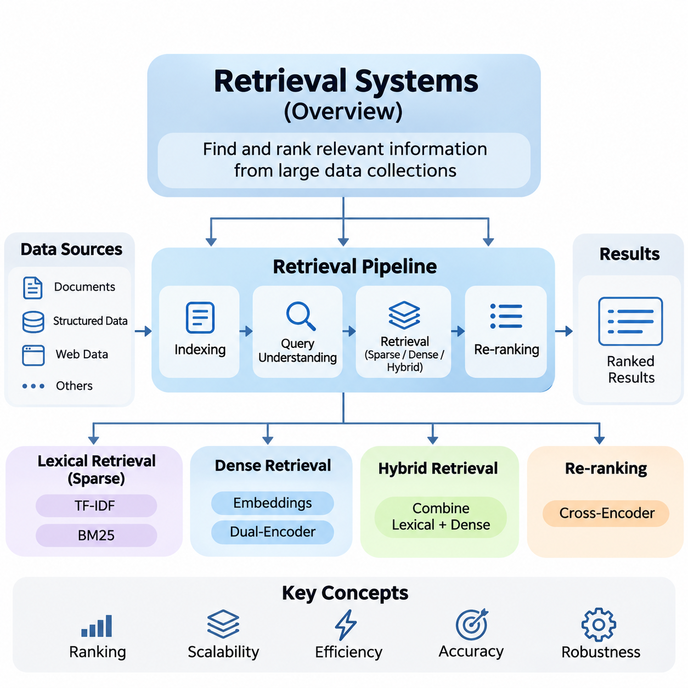
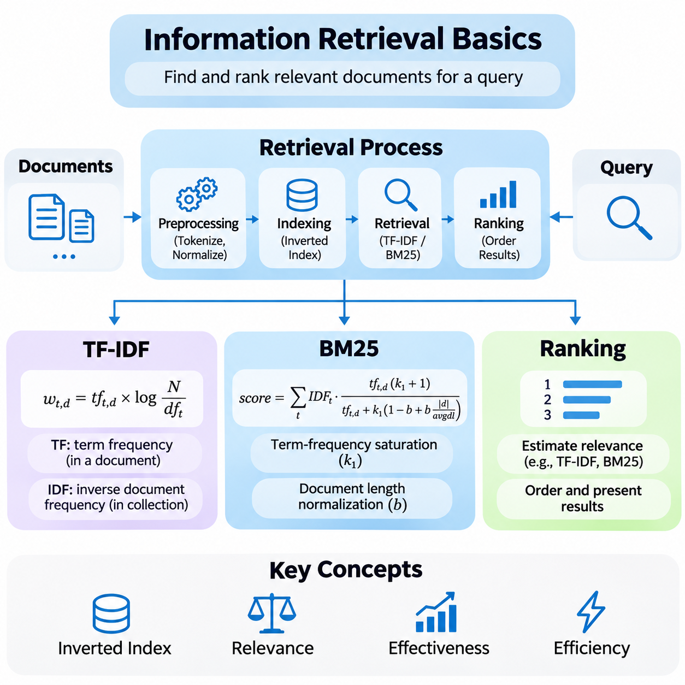
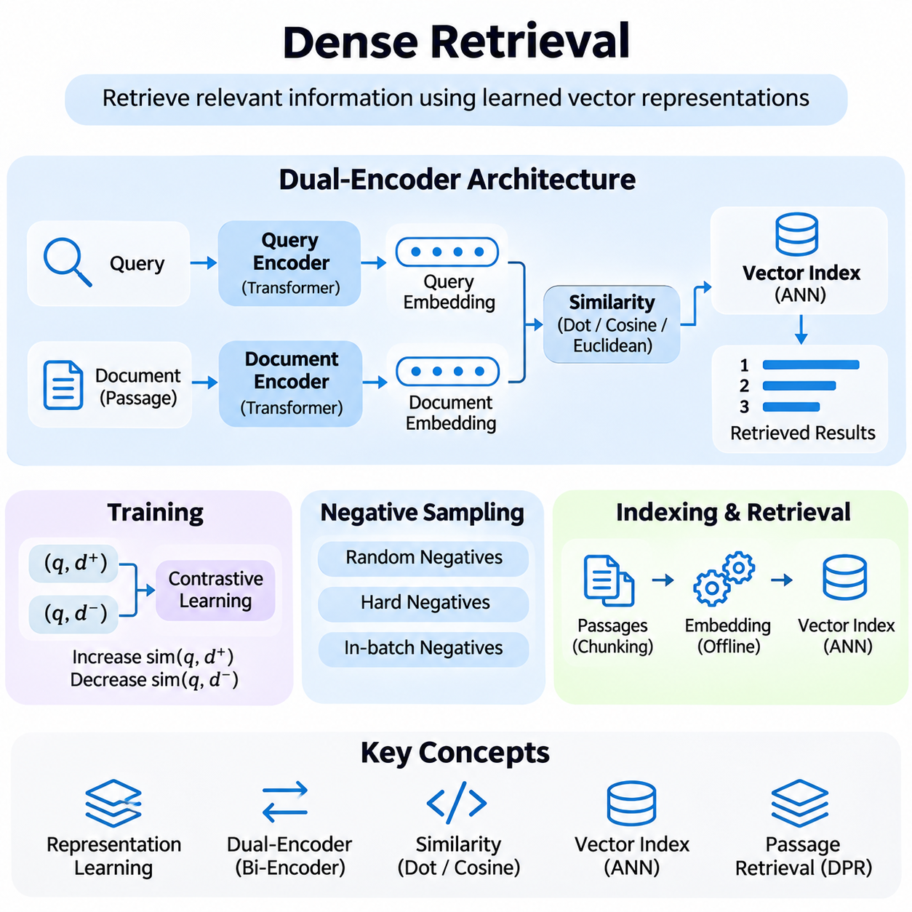
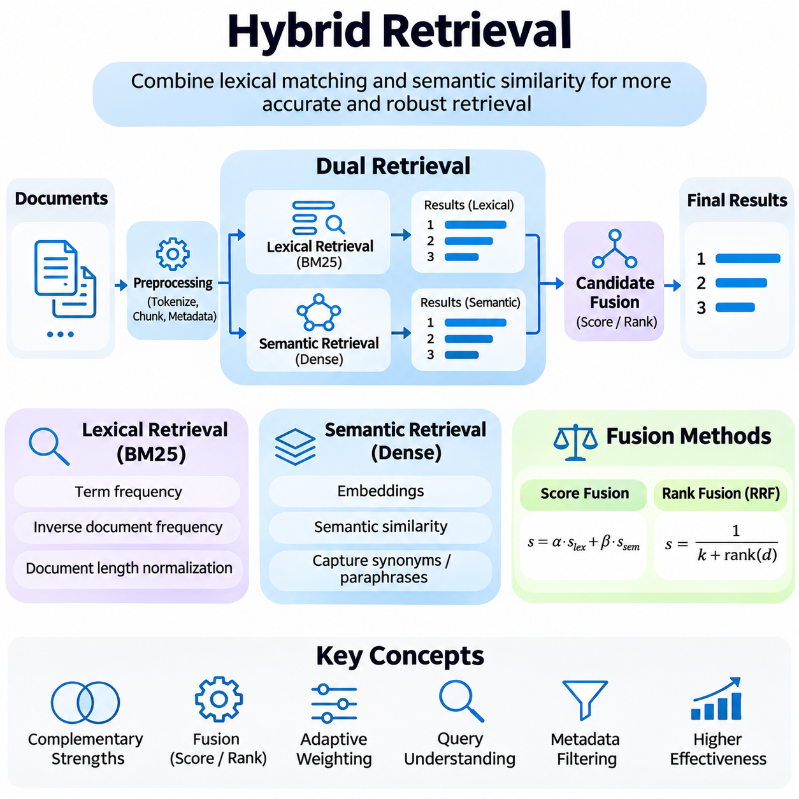
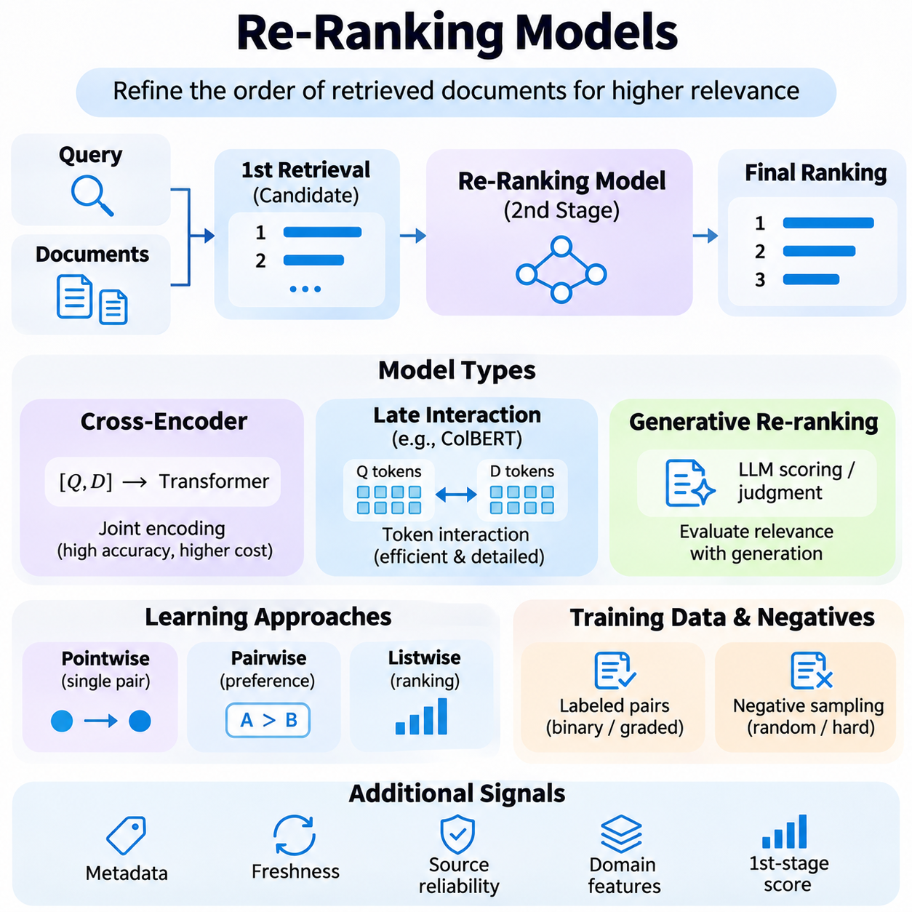
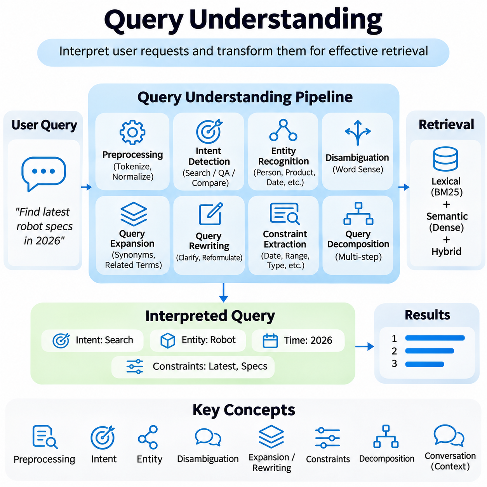
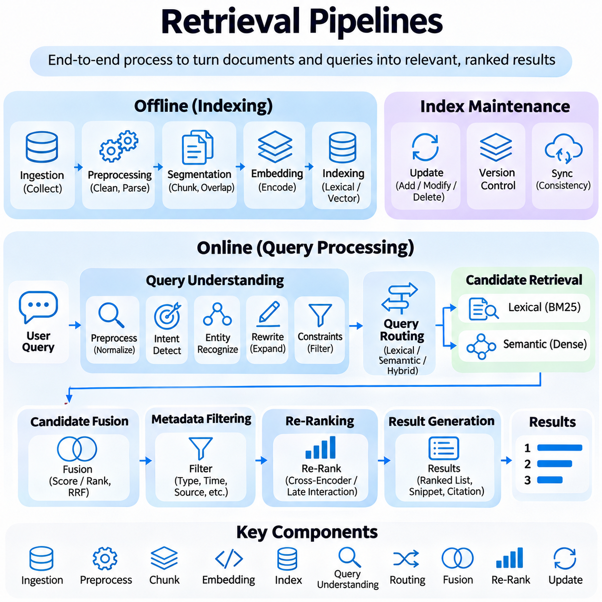
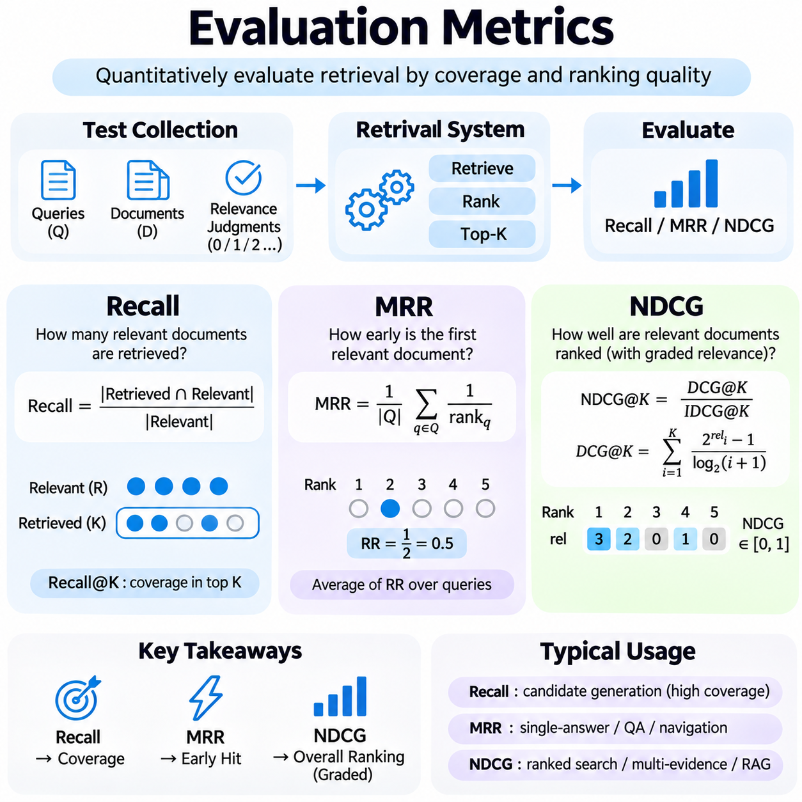
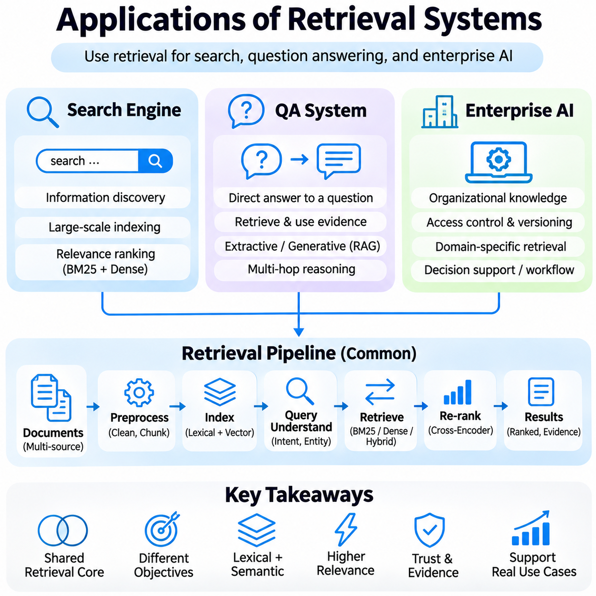

**Volume 37. Memory and Knowledge Systems**

# 02. Retrieval Systems

## 02.00 Overview

{width="7.268055555555556in" height="7.268055555555556in"}

검색 시스템(Retrieval Systems)은 현대 인공지능(Artificial Intelligence) 아키텍처의 핵심 구성 요소로, 대규모로 지속적으로 확장되는 데이터 집합에서 관련 정보를 효율적으로 검색하고 접근할 수 있도록 지원한다. 검색 시스템은 모델 매개변수(Model Parameters)에 저장된 지식에만 의존하지 않고, 검색(Search), 추론(Reasoning), 질의응답(Question Answering), 지식 집약적 응용(Knowledge-Intensive Applications)을 지원하는 외부 정보를 동적으로 식별한다.

정보 검색(Information Retrieval)의 주요 목적은 사용자 질의(User Query)와의 관련성(Relevance)에 따라 문서(Documents), 문서 구간(Passages), 구조화된 레코드(Structured Records)를 식별하고 순위를 결정하는 것이다. 검색 시스템은 정보 요구(Information Need)를 계산 가능한 검색 작업으로 변환하고, 후보 자원을 평가한 다음, 순서가 지정된 결과 집합을 반환한다. 시스템의 효과는 검색 정확도, 계산 효율성, 확장성, 응답성에 의해 결정된다.

전통적인 정보 검색(Traditional Information Retrieval) 방법은 주로 질의와 문서 사이의 어휘적 관계(Lexical Relationships)에 의존한다. 단어 빈도-역문서 빈도(Term Frequency--Inverse Document Frequency, TF-IDF)와 BM25(Best Matching 25)는 단어 출현 빈도, 문서 통계, 정규화 메커니즘을 이용하여 관련성을 추정한다. 이러한 방법은 효율적이고 해석 가능하며 신뢰할 수 있는 대규모 검색의 기반을 제공한다.

TF-IDF는 개별 문서와 전체 문서 집합에서 단어의 중요도를 반영하는 가중치를 사용하여 문서를 표현한다. 특정 문서에서 자주 등장하는 단어에는 높은 지역적 중요도를 부여하고, 전체 문서 집합에서 광범위하게 등장하는 단어에는 낮은 구별력을 부여한다. 이러한 통계적 표현(Statistical Representation)은 문서 비교, 키워드 매칭(Keyword Matching), 전통적인 검색 엔진(Search Engine)의 구축을 지원한다.

BM25는 단어 빈도 포화(Term Frequency Saturation), 역문서 빈도(Inverse Document Frequency), 문서 길이 정규화(Document Length Normalization)를 결합하여 확률적 정보 검색(Probabilistic Information Retrieval) 원리를 확장한다. 이 점수 계산 메커니즘은 일치하는 단어의 기여도와 문서 특성 사이의 균형을 조정한다. BM25는 정확한 용어, 기술 식별자, 도메인 특화 표현이 중요한 환경에서 강력한 검색 기준 모델로 활용된다.

순위 결정 메커니즘(Ranking Mechanisms)은 추정된 관련성에 따라 검색된 문서의 순서를 결정한다. 순위 함수(Ranking Function)는 어휘적 유사성, 의미적 관계, 문서 권위도, 문맥 정보, 사용자 선호도를 통합할 수 있다. 효과적인 순위 결정은 가장 유용한 정보가 검색 결과의 상위에 나타날 가능성을 높여 사용자가 필요한 지식을 찾는 데 소요되는 노력을 줄인다.

밀집 검색(Dense Retrieval)은 정보 검색 시스템에 신경망 기반 표현 학습(Neural Representation Learning)을 도입한다. 문서를 희소한 단어 통계(Sparse Term Statistics)로만 표현하는 대신, 질의와 문서를 연속적인 수치 벡터(Continuous Numerical Vectors)로 인코딩한다. 이러한 임베딩(Embeddings)은 학습된 의미적 관계를 포착하여 질의와 문서가 서로 다른 어휘를 사용하더라도 개념적으로 관련된 정보를 검색할 수 있도록 한다.

현대적인 밀집 검색 아키텍처는 질의와 문서를 독립적으로 벡터 표현(Vector Representations)으로 변환하는 이중 인코더(Dual-Encoder) 모델을 자주 사용한다. 문서 임베딩은 사전에 생성하여 벡터 데이터베이스(Vector Database)에 저장하고, 질의 임베딩은 검색 시점에 계산한다. 이후 유사도 함수(Similarity Functions)를 이용하여 학습된 임베딩 공간(Embedding Space)에서 질의와 가장 가까운 후보 문서를 식별한다.

밀집 검색은 의미적 매칭(Semantic Matching), 의역 인식(Paraphrase Recognition), 자연어 질의응답(Natural-Language Question Answering)에서 상당한 이점을 제공한다. 그러나 성능은 임베딩 품질, 학습 데이터, 도메인 정합성(Domain Alignment), 인덱싱 전략(Indexing Strategies)에 의존한다. 또한 정확한 식별자나 전문 용어를 놓칠 수 있으므로 의미적 유사성만으로 완전한 검색 정확도를 보장할 수는 없다.

하이브리드 검색(Hybrid Retrieval)은 어휘 기반 검색(Lexical Retrieval)과 밀집 검색을 결합하여 두 방법의 상호 보완적인 장점을 활용한다. 희소 검색(Sparse Retrieval)은 정확한 키워드 매칭을 유지하고, 밀집 검색은 폭넓은 의미적 관계를 포착한다. 후보 집합을 통합하거나 관련성 점수를 결합하면 다양한 질의, 기술 문서, 다국어 정보, 기업 지식 저장소에서 검색의 강건성(Robustness)을 향상시킬 수 있다.

하이브리드 시스템은 어휘적 점수와 의미적 점수가 서로 다른 수치 범위를 가질 수 있으므로 관련성 신호(Relevance Signals)의 정규화와 융합을 신중하게 수행해야 한다. 순위 기반 융합(Rank-Based Fusion)과 가중 점수 결합(Weighted Score Combination)은 결과를 통합하는 실용적인 방법이다. 적절한 전략은 질의 특성, 문서 다양성, 검색 목표, 개별 검색 모델의 상대적 신뢰성에 따라 달라진다.

재순위화 모델(Re-Ranking Models)은 초기 검색 단계에서 생성된 문서의 순서를 정교하게 조정한다. 첫 번째 단계의 검색기(First-Stage Retriever)는 관리 가능한 규모의 후보 집합을 신속하게 식별하고, 이후 계산 비용이 더 높은 모델이 후보를 상세하게 평가한다. 교차 인코더(Cross-Encoder)는 질의와 문서 쌍을 공동으로 처리하여 풍부한 문맥적 상호작용을 기반으로 관련성을 추정하므로 특히 유용하다.

후보 검색(Candidate Retrieval)과 재순위화(Re-Ranking)를 분리하는 구조는 효율성과 정밀도 사이의 중요한 아키텍처적 절충 관계(Architectural Tradeoff)를 형성한다. 초기 검색은 폭넓은 검색 범위와 낮은 지연시간을 우선하고, 재순위화는 결과 품질을 향상시키는 데 계산 자원을 집중한다. 단계 사이에 전달되는 후보 수는 처리 비용, 응답시간, 관련 문서 유지 가능성에 직접적인 영향을 미친다.

질의 이해(Query Understanding)는 사용자 요청을 효과적인 검색 작업으로 변환하는 데 필요한 언어적·의미적 해석을 제공한다. 질의에는 모호한 용어, 불완전한 설명, 암묵적 제약조건, 복수의 정보 요구가 포함될 수 있다. 질의 분류(Query Classification), 개체명 인식(Entity Recognition), 질의 확장(Query Expansion), 질의 재작성(Query Rewriting), 의도 탐지(Intent Detection)는 근본적인 정보 요구를 식별하도록 지원한다.

질의 확장은 후보 문서 발견을 개선하기 위해 관련 표현이나 대체 용어를 추가하며, 질의 재작성은 사용 가능한 인덱스(Index)에 더 적합한 형태로 질의를 변환한다. 이러한 변환은 사용자의 어휘와 문서의 용어가 서로 다를 때 검색 성능을 개선할 수 있다. 그러나 과도한 확장은 관련 없는 개념을 도입할 수 있으므로 통제된 재구성과 관련성 보존(Relevance Preservation)이 필수적이다.

검색 파이프라인(Retrieval Pipeline)은 문서 수집(Document Ingestion), 전처리(Preprocessing), 인덱싱(Indexing), 질의 해석(Query Interpretation), 후보 생성(Candidate Generation), 순위 결정, 결과 전달을 하나의 조정된 작업 흐름(Workflow)으로 통합한다. 문서 수집 단계에서는 정규화, 구간 분할, 메타데이터(Metadata) 보강, 검색 가능한 표현으로의 변환을 수행하며, 추론 단계에서는 질의를 이용해 관련 정보를 식별하고 우선순위를 결정한다.

문서 분할(Document Segmentation)은 인덱싱 단위가 반환되는 근거 정보의 세분성(Granularity)을 결정하므로 검색 품질에 중요한 역할을 한다. 큰 문서는 넓은 문맥을 보존하지만 특정 정보를 희석할 수 있으며, 작은 문서 구간은 정밀한 매칭을 지원하지만 주변 의미를 잃을 수 있다. 효과적인 분할은 의미적 경계(Semantic Boundaries), 문서 구조, 후속 응용(Downstream Application)의 목적을 함께 고려한다.

메타데이터 필터링(Metadata Filtering)은 생성 시점, 출처, 언어, 범주, 접근 권한과 같은 속성에 따라 후보 문서를 제한하여 검색을 개선한다. 구조화된 필터링(Structured Filtering)을 의미 검색 및 어휘 검색과 결합하면 문맥적 제약조건과 정보 관련성을 동시에 충족할 수 있다. 이러한 기능은 이질적이고 민감한 자원을 포함하는 기업 환경에서 특히 중요하다.

검색 시스템은 지속적으로 변화하는 정보 집합도 관리해야 한다. 새로운 문서가 계속 추가되고, 기존 레코드가 수정되며, 오래된 정보는 제거하거나 우선순위를 낮추어야 한다. 인덱스 유지관리(Index Maintenance), 동기화(Synchronization), 버전 관리(Version Management), 갱신 정책(Update Policies)은 운영 일관성(Operational Consistency)을 유지하면서 검색 결과가 기반 지식 저장소의 의도된 상태를 반영하도록 보장한다.

평가(Evaluation)는 검색 알고리즘을 비교하고 시스템의 약점을 식별하기 위한 정량적 기반을 제공한다. 관련 문서가 결과 집합 어딘가에 존재하는지만으로는 검색 품질을 판단할 수 없다. 관련 문서의 순위, 후보 발견의 완전성, 서로 다른 질의에서 나타나는 순위의 일관성은 모두 실제 활용성에 영향을 미친다.

재현율(Recall)은 전체 관련 문서 중 검색에 성공한 문서의 비율을 측정한다. 높은 재현율은 후보 생성 단계에서 특히 중요한데, 초기 검색에서 제외된 문서는 후속 재순위화 단계에서 복구할 수 없기 때문이다. 따라서 재현율 중심 평가(Recall-Oriented Evaluation)는 더 선택적인 순위 결정 메커니즘을 적용하기 전에 검색 아키텍처가 충분한 범위를 제공하는지 판단하는 데 도움이 된다.

평균 역순위(Mean Reciprocal Rank, MRR)는 여러 질의에서 첫 번째 관련 결과가 얼마나 상위에 나타나는지를 평가한다. 이는 사용자가 주로 하나의 정확한 문서나 답변이 포함된 구간을 필요로 하는 작업에 적합하다. 반면 정규화 할인 누적 이득(Normalized Discounted Cumulative Gain, NDCG)은 결과 위치와 서로 다른 관련성 수준을 고려하여 전체 순위 품질을 평가한다.

NDCG는 여러 문서가 서로 다른 수준의 유용성을 제공하는 경우 특히 가치가 있다. 관련성이 높은 문서가 상위에 배치될수록 평가 점수에 더 크게 기여한다. 재현율, MRR, NDCG는 함께 검색 완전성(Retrieval Completeness), 첫 번째 관련 결과에 대한 접근성(First-Result Accessibility), 전체 순위 효과성(Overall Ranking Effectiveness)을 상호 보완적으로 평가한다.

평가에서는 검색 지연시간(Retrieval Latency), 처리량(Throughput), 메모리 사용량(Memory Consumption), 인덱싱 비용(Indexing Cost), 계산 확장성(Computational Scalability)과 같은 운영 특성도 고려해야 한다. 관련성 점수가 우수한 모델이라도 자원 요구량이 배포 제약조건을 초과하면 실시간 응용에 적합하지 않을 수 있다. 따라서 실제 시스템 평가는 정보 검색 지표와 인프라 및 서비스 수준 측정값을 결합한다.

검색 엔진(Search Engines)은 검색 기술이 가장 확립된 응용 분야 중 하나이다. 검색 엔진은 방대한 문서 집합을 체계화하고 인덱싱, 후보 검색, 순위 결정을 통해 사용자의 정보 요구에 응답한다. 현대적인 검색 엔진은 어휘 기반 방법, 의미적 임베딩(Semantic Embeddings), 문맥 신호(Contextual Signals), 재순위화 메커니즘을 통합하여 정확한 키워드 질의와 복잡한 자연어 요청을 모두 지원할 수 있다.

질의응답 시스템(Question-Answering Systems)은 답변의 생성 또는 추출을 지원하는 근거를 식별하기 위해 검색에 의존한다. 이러한 시스템은 전체 문서만 검색하는 대신 관련 사실이 포함된 문서 구간을 자주 검색한다. 검색 품질은 답변의 완전성, 사실적 근거(Factual Grounding), 생성된 응답을 식별 가능한 정보 출처와 연결하는 능력에 직접적인 영향을 미친다.

검색 증강 생성(Retrieval-Augmented Generation, RAG)은 검색 시스템을 대규모 언어 모델(Large Language Models, LLMs)과 연결하여 이러한 원리를 확장한다. 검색된 문서 구간은 응답 생성 과정에서 모델 내부 지식을 보완하는 외부 문맥(External Context)을 제공한다. 이 아키텍처는 전체 모델을 재학습하지 않고도 지식을 갱신할 수 있도록 지원하지만, 검색된 근거의 관련성, 신뢰성, 일관성은 여전히 평가해야 한다.

기업 인공지능 시스템(Enterprise AI Systems)은 검색을 활용하여 조직의 문서, 기술 매뉴얼, 운영 기록, 정책, 내부 지식 저장소를 연결한다. 이러한 시스템은 문서 다양성, 접근 제어(Access Control), 정보 최신성(Information Freshness), 조직별 전문 용어를 처리해야 한다. 하이브리드 검색과 메타데이터 인식 순위 결정(Metadata-Aware Ranking)은 정확한 기술 참조와 의미적으로 관련된 지식을 동시에 요구하는 환경에서 특히 유용하다.

상용 검색 시스템(Production Retrieval Systems)의 엔지니어링은 관련성, 지연시간, 확장성, 유지관리성(Maintainability), 보안(Security) 사이의 균형을 요구한다. 분산 인덱스(Distributed Indexes), 캐싱 메커니즘(Caching Mechanisms), 병렬 검색(Parallel Retrieval), 최적화된 추론(Optimized Inference)은 대규모 질의 작업에서 성능을 개선할 수 있다. 검색 결과 모니터링과 관련성 피드백(Relevance Feedback) 수집은 문서와 사용자 요구의 변화에 따른 체계적인 개선을 지원한다.

궁극적으로 검색 시스템은 저장된 지식(Stored Knowledge)과 지능형 계산(Intelligent Computation)을 연결하는 역할을 수행한다. 검색 기술은 통계적 키워드 매칭에서 의미적 표현 학습(Semantic Representation Learning), 하이브리드 검색, 문맥 기반 재순위화(Contextual Re-Ranking), 통합 검색 파이프라인으로 발전하고 있다. 이러한 기반을 이해하면 신뢰할 수 있는 검색 엔진, 지식 인식 인공지능 응용(Knowledge-Aware AI Applications), 확장 가능한 메모리 지원 지능형 시스템(Memory-Supported Intelligent Systems)을 설계할 수 있다.

## 02.01 Information Retrieval Basics

{width="7.268055555555556in" height="7.268055555555556in"}

정보 검색(Information Retrieval)은 사용자 질의(User Query)에 응답하여 대규모 문서 집합에서 관련 정보를 식별하는 계산 과정이다. 정보 검색의 기본 목적은 정보 요구(Information Need)를 유용한 결과의 순위화된 집합으로 변환하는 것이다. 전통적인 검색 시스템(Classical Retrieval Systems)은 문서 표현(Document Representation), 단어 통계(Term Statistics), 관련성 추정(Relevance Estimation), 순위 결정 알고리즘(Ranking Algorithms)을 활용하여 검색 효과성과 계산 효율성 사이의 균형을 유지한다.

정보 검색의 기초는 문서와 질의를 체계적으로 비교할 수 있는 형태로 표현하는 데 있다. 텍스트 전처리(Text Preprocessing)에는 일반적으로 토큰화(Tokenization), 정규화(Normalization), 불용어 처리(Stop-Word Handling), 선택적인 어간 추출(Stemming) 또는 표제어 추출(Lemmatization)이 포함된다. 이러한 작업은 언어적 변동성을 줄이고 일관된 인덱싱 단위(Indexing Units)를 설정하지만, 과도한 정규화는 기술 용어나 전문 분야에서 중요한 구별을 제거할 수 있다.

역색인(Inverted Index)은 전통적인 검색 시스템에서 사용하는 기본적인 자료구조(Data Structure)이다. 역색인은 질의마다 모든 문서를 검색하는 대신 개별 단어를 해당 단어가 포함된 문서 목록에 연결한다. 포스팅 리스트(Posting Lists)에는 단어 빈도, 위치, 문서 식별자(Document Identifiers)가 추가로 저장될 수 있다. 이러한 구조는 효율적인 후보 문서 탐색(Candidate Discovery)을 지원하고 어휘 기반 순위 결정 알고리즘에 필요한 통계 정보를 제공한다.

일반적으로 TF-IDF라고 하는 단어 빈도-역문서 빈도(Term Frequency--Inverse Document Frequency)는 전체 문서 집합을 기준으로 개별 문서에서 단어의 중요도를 추정하는 통계적 가중치 부여 방법(Statistical Weighting Method)이다. 핵심 가정은 특정 문서에서 자주 등장하지만 전체 문서 집합에서는 드물게 등장하는 단어가 거의 모든 문서에 나타나는 단어보다 문서 관련성을 판단하는 데 더 강력한 근거를 제공한다는 것이다.

단어 빈도(Term Frequency, TF)는 특정 문서에서 단어가 얼마나 자주 등장하는지를 측정하며, 역문서 빈도(Inverse Document Frequency, IDF)는 전체 문서 집합에서 해당 단어가 얼마나 드물게 등장하는지를 측정한다. 두 값을 결합하면 구별력이 높은 단어에는 큰 가중치를, 널리 분포된 표현에는 작은 가중치를 부여한다. TF-IDF의 다양한 공식은 로그 스케일링(Logarithmic Scaling), 정규화, 평활화(Smoothing)를 적용하여 문서 길이와 단어 반복의 영향을 조절할 수 있다.

일반적인 TF-IDF 공식은 단어 빈도 성분과 전체 문서 수를 해당 단어가 포함된 문서 수로 나눈 비율의 로그값을 곱한다. 이를 통해 각 문서에 대한 가중 벡터 표현(Weighted Vector Representation)을 생성한다. 질의 역시 호환 가능한 벡터로 표현할 수 있으며, 코사인 유사도(Cosine Similarity)와 같은 벡터 유사도 측정(Vector Similarity Measures)을 이용하여 관련성을 추정할 수 있다.

코사인 유사도는 질의 벡터와 문서 벡터의 절대적인 크기보다 두 벡터 사이의 각도 관계(Angular Relationship)를 측정한다. 이러한 정규화는 문서 길이의 직접적인 영향을 줄이고 가중치가 부여된 단어의 분포를 강조한다. 그러나 전통적인 TF-IDF는 동일한 어휘를 공유하지 않는 의미적으로 동등한 표현이 서로 다른 차원에 배치될 수 있으므로 기본적으로 어휘 기반(Lexical) 검색 방법에 해당한다.

TF-IDF는 계산 효율성이 높고 해석 가능성이 우수하며 문서 분류(Document Classification), 키워드 검색(Keyword Search), 유사도 분석(Similarity Analysis), 기준 검색 실험(Baseline Retrieval Experiments)에 적합하다. 그러나 질의에 동의어(Synonyms), 의역(Paraphrases), 모호한 용어(Ambiguous Terminology)가 포함되면 효과가 감소할 수 있다. 또한 토큰화 방식과 어휘 집합(Vocabulary) 구성에 따라 문서 표현이 달라지므로 신중한 전처리가 필요하다.

BM25는 일반적으로 오카피 정보 검색 프레임워크(Okapi Information Retrieval Framework)와 관련된 확률적 순위 결정 함수(Probabilistic Ranking Function)로, 어휘적 근거를 이용하여 문서 관련성을 추정하도록 설계되었다. BM25는 단어 빈도 포화 효과(Term-Frequency Saturation Effects)와 문서 길이 정규화(Document Length Normalization)를 도입하여 단순한 단어 빈도 가중치 방식을 개선한다. 신경망 학습 없이도 우수한 순위 결정 성능을 제공하므로 널리 사용되는 기준 모델이다.

BM25 점수 함수(BM25 Scoring Function)는 역문서 빈도, 정규화된 단어 빈도(Normalized Term Frequency), 단어 포화도와 문서 길이 효과를 제어하는 조정 가능한 매개변수(Adjustable Parameters)를 결합한다. 알고리즘은 각 질의 단어가 문서 관련성에 기여하는 정도를 추정하고, 이러한 기여도를 누적하여 최종 점수를 계산한다. 일반적으로 정보량이 높은 질의 단어를 많이 포함하는 문서는 더 높은 관련성 점수를 받는다.

단어 빈도 포화(Term-Frequency Saturation)는 BM25의 중요한 특징이다. 질의 단어가 반복적으로 등장하면 관련성에 대한 기여도가 증가하지만, 추가적인 증가 효과는 점차 감소한다. 이는 단어가 여러 번 등장하는 것이 유용한 근거를 제공할 수 있지만, 과도한 반복이 순위 점수를 무제한으로 증가시키거나 다른 단어의 기여도를 압도해서는 안 된다는 관찰을 반영한다.

문서 길이 정규화(Document Length Normalization)는 짧은 문서와 긴 문서 사이의 차이를 조정한다. 긴 문서는 자연스럽게 더 많은 단어를 포함하므로 실제 관련성이 높지 않더라도 원시 단어 빈도(Raw Term Frequency)가 높게 나타날 수 있다. BM25는 전체 문서 집합의 평균 길이에 대한 개별 문서 길이를 기준으로 단어의 기여도를 조정하여 비정상적으로 긴 문서가 체계적인 이점을 얻는 현상을 줄인다.

BM25의 매개변수 k1은 단어 빈도 포화 정도를 제어하고, 매개변수 b는 문서 길이 정규화의 강도를 결정한다. 일반적인 실험 설정에서는 k1을 약 1.2\\\~2.0, b를 약 0.75로 사용하지만 최적값은 문서 특성에 따라 달라진다. 매개변수 튜닝(Parameter Tuning)에서는 문서 집합 크기, 문서 길이 분포, 질의 패턴(Query Patterns), 평가 결과를 함께 고려해야 한다.

BM25는 기술 문서(Technical Documentation), 법률 기록(Legal Records), 과학 논문(Scientific Publications), 기업 지식 저장소(Enterprise Knowledge Repositories)와 같이 정확한 용어가 중요한 환경에서 특히 효과적이다. 어휘적 정밀도(Lexical Precision)가 높아 제품 식별자, 오류 코드(Error Codes), 전문 표현을 검색하는 데 유용하다. 그러나 TF-IDF와 마찬가지로 추가적인 검색 메커니즘 없이는 표면적 표현이 다른 단어 사이의 의미적 동등성을 본질적으로 인식하지 못한다.

TF-IDF와 BM25의 차이는 주로 가중치 부여에 대한 가정과 문서 특성을 처리하는 방식에 있다. TF-IDF는 일반적으로 문서를 가중 벡터(Weighted Vectors)로 표현하는 반면, BM25는 확률적 원리에 기반한 관련성 점수를 직접 계산한다. BM25는 단어 빈도 포화와 길이 정규화를 명시적으로 모델링하지만, TF-IDF 구현에서는 가중치 부여와 벡터 정규화를 통해 이러한 효과를 반영하는 방식이 다양하다.

순위 결정(Ranking)은 특정 질의에 대해 검색된 문서를 추정된 유용성에 따라 정렬하는 과정이다. 순위 함수(Ranking Function)는 단어 중복(Term Overlap), 통계적 중요도(Statistical Importance), 의미적 유사성(Semantic Similarity), 문맥 정보(Contextual Information) 등 이용 가능한 근거를 기반으로 관련성 점수를 부여한다. 순위 결정의 품질은 관련 문서가 사용자 정보 요구를 효율적으로 충족할 만큼 상위에 배치되는지를 결정한다.

전통적인 순위 결정 방법(Classical Ranking Methods)은 문서 통계와 질의 특성에서 도출된 결정론적 점수 함수(Deterministic Scoring Functions)에 의존한다. TF-IDF와 BM25는 점수 계산 과정을 조사하고 해석할 수 있다는 점에서 대표적인 방법이다. 계산 요구량이 상대적으로 낮기 때문에 대규모 문서 집합에 적합하며, 특히 역색인이 효율적인 후보 생성과 점수 계산을 지원하는 환경에서 유용하다.

현대적인 순위 결정 시스템은 학습 데이터를 이용하여 관련성 함수를 추정하는 순위 학습(Learning-to-Rank) 기법을 점차 통합하고 있다. 점별 방법(Pointwise Methods)은 개별 문서의 관련성을 예측하고, 쌍별 방법(Pairwise Methods)은 문서 쌍 사이의 선호 관계를 학습하며, 목록별 방법(Listwise Methods)은 전체 순위 목록의 특성을 최적화한다. 이러한 방법은 여러 관련성 신호를 통합하고 특정 응용 요구사항에 맞게 순위 결정 동작을 조정할 수 있다.

순위 결정 파이프라인(Ranking Pipelines)은 후보 검색(Candidate Retrieval)과 후속 관련성 정제(Relevance Refinement)를 분리하는 경우가 많다. 초기 어휘 검색기(Initial Lexical Retriever)는 잠재적으로 유용한 문서를 빠르게 식별하고, 두 번째 단계의 순위 결정 모델(Second-Stage Ranking Model)은 더 상세한 비교를 수행한다. 이러한 아키텍처는 계산 비용이 높은 방법을 전체 문서 집합이 아닌 작은 후보 집합에 적용하여 검색 범위, 순위 정확도, 응답 지연시간 사이의 균형을 유지한다.

관련성 평가(Relevance Assessment)는 순위 결정 알고리즘을 평가하는 데 필수적이다. 사람의 판단(Human Judgments), 주석이 부여된 데이터셋(Annotated Datasets), 신중하게 검증된 행동 신호(Behavioral Signals)를 통해 특정 질의를 충족하는 문서를 결정할 수 있다. 평가 방법은 불완전한 판단, 모호한 정보 요구, 관련성 강도의 차이를 고려해야 한다. 신뢰할 수 있는 평가를 위해서는 대표성 있는 질의와 문서 집합 전반에 걸쳐 일관된 주석 기준(Annotation Criteria)이 필요하다.

정밀도(Precision)는 검색된 문서 중 관련 문서의 비율을 측정하고, 재현율(Recall)은 전체 관련 문서 중 성공적으로 검색된 문서의 비율을 측정한다. 두 지표는 검색 품질의 상호 보완적인 측면을 설명한다. 정밀도는 결과의 유용성을 강조하고, 재현율은 검색의 완전성을 강조한다. 상대적인 중요도는 응용 시스템이 높은 정확도의 결과를 우선하는지, 포괄적인 정보 탐색을 우선하는지에 따라 달라진다.

순위 민감형 평가 지표(Ranking-Sensitive Metrics)는 검색 결과의 순서에 관한 추가 정보를 제공한다. 평균 역순위(Mean Reciprocal Rank, MRR)는 첫 번째 관련 결과의 위치를 평가하고, 정규화 할인 누적 이득(Normalized Discounted Cumulative Gain, NDCG)은 관련성 등급과 순위 위치를 고려한다. 상위 K개 정밀도(Precision at K)와 상위 K개 재현율(Recall at K)은 지정된 결과 범위에서 검색 성능을 평가하여 상위 문서만 확인하는 사용자에게 시스템이 얼마나 효과적인지 판단하도록 지원한다.

실제 검색 성능은 인덱싱 효율성(Indexing Efficiency), 질의 지연시간(Query Latency), 메모리 사용량(Memory Consumption), 문서 집합 갱신(Collection Updates)에도 영향을 받는다. 대규모 시스템은 일관된 검색 동작을 유지하면서 문서 추가, 수정, 삭제를 지원해야 한다. 효율적인 포스팅 리스트 탐색(Posting-List Traversal), 점수 기반 가지치기(Score Pruning), 캐싱(Caching), 분산 인덱싱(Distributed Indexing)은 검색 엔진의 관련성 모델을 근본적으로 변경하지 않으면서 계산 부담을 줄일 수 있다.

검색 방법의 선택은 대상 정보 환경(Target Information Environment)의 특성을 반영해야 한다. TF-IDF는 투명한 벡터 기반 가중치 부여(Vector-Based Weighting)를 제공하고, BM25는 강건한 어휘 기반 순위 결정(Robust Lexical Ranking)을 지원하며, 학습 기반 방법(Learning-Based Methods)은 더 복잡한 관련성 추정을 가능하게 한다. 모든 문서 집합에서 최적으로 작동하는 단일 방법은 없으므로 신뢰할 수 있는 배포를 위해서는 실증적 평가(Empirical Evaluation)와 도메인별 설정(Domain-Specific Configuration)이 필수적이다.

전통적인 정보 검색(Traditional Information Retrieval)은 밀집 임베딩(Dense Embeddings)과 신경망 검색(Neural Retrieval)의 발전에도 불구하고 현대 지식 시스템(Modern Knowledge Systems)의 핵심 기반으로 남아 있다. 어휘 기반 방법은 의미 검색(Semantic Search)을 보완하는 정확한 매칭 기능, 효율적인 인덱싱, 해석 가능한 점수 계산을 제공한다. BM25, TF-IDF, 순위 결정 원리를 이해하는 것은 하이브리드 검색(Hybrid Retrieval), 재순위화 아키텍처(Re-Ranking Architectures), 검색 증강 인공지능 시스템(Retrieval-Augmented Artificial Intelligence Systems)을 설계하기 위한 기술적 토대가 된다.

## 02.02 Dense Retrieval [w/Code]

{width="7.268055555555556in" height="7.268055555555556in"}

밀집 검색(Dense Retrieval)은 질의(Query)와 문서(Document)를 공유 임베딩 공간(Shared Embedding Space) 내의 연속적인 수치 벡터(Continuous Numerical Vectors)로 표현하는 신경망 기반 정보 검색(Neural Information Retrieval) 방법이다. 정확한 단어 일치에 주로 의존하는 전통적인 어휘 기반 검색(Lexical Retrieval)과 달리, 밀집 검색은 표현 사이의 학습된 의미적 관계(Semantic Relationships)를 포착한다. 이를 통해 질의와 문서가 서로 다른 어휘를 사용하더라도 관련 정보를 식별할 수 있다.

밀집 검색의 핵심 원리는 표현 학습(Representation Learning)으로, 신경망(Neural Networks)을 이용하여 텍스트 정보를 의미적 특성을 보존하는 압축된 벡터(Compact Vectors)로 변환한다. 유사한 개념을 설명하는 문서들은 임베딩 공간(Embedding Space)에서 서로 가까운 영역에 위치하도록 학습된다. 이러한 표현의 품질은 다양한 질의에서 관련 정보와 관련 없는 내용을 얼마나 효과적으로 구별할 수 있는지를 결정한다.

밀집 검색 아키텍처(Dense Retrieval Architectures)는 일반적으로 자연어 입력의 문맥적 표현(Contextual Representations)을 생성하는 트랜스포머 기반 인코더(Transformer-Based Encoders)를 사용한다. 인코더는 토큰 시퀀스(Token Sequences)를 처리하고 문맥 정보를 고정 차원 임베딩(Fixed-Dimensional Embeddings)으로 통합한다. 평균 풀링(Mean Pooling)과 특수 토큰 표현(Special-Token Representations) 등의 풀링 전략(Pooling Strategies)은 토큰 수준 정보를 유사도 계산과 인덱싱에 적합한 벡터로 집계하는 방법을 결정한다.

널리 사용되는 아키텍처는 이중 인코더(Dual-Encoder) 모델이며, 바이 인코더(Bi-Encoder)라고도 한다. 이 모델은 질의와 문서를 각각 독립적인 신경망 인코딩 함수(Neural Encoding Functions)를 통해 처리한다. 질의 인코더(Query Encoder)는 질의 임베딩(Query Embedding)을 생성하고, 문서 인코더(Document Encoder)는 문서 임베딩(Document Embedding)을 생성한다. 두 표현은 호환 가능한 벡터 공간(Vector Spaces)에 매핑되어 효율적인 유사도 계산을 통해 관련성을 추정할 수 있다.

이중 인코더 아키텍처는 질의가 입력되기 전에 문서 임베딩을 미리 생성할 수 있다는 중요한 계산상의 장점을 제공한다. 이러한 벡터는 특수 인덱스(Specialized Indexes) 또는 벡터 데이터베이스(Vector Databases)에 저장되어 추론(Inference) 과정에서 신속한 후보 검색(Candidate Retrieval)을 가능하게 한다. 실시간 인코딩은 새로 입력되는 질의에 대해서만 수행되므로 모든 질의-문서 쌍을 공동 처리하는 아키텍처보다 계산 비용을 크게 줄일 수 있다.

유사도 함수(Similarity Functions)는 질의 임베딩과 문서 임베딩 사이의 수학적 관계를 정의한다. 대표적인 방법에는 내적(Dot Product), 코사인 유사도(Cosine Similarity), 유클리드 거리(Euclidean Distance)가 있다. 내적은 벡터 크기를 반영하면서 정렬 정도를 측정하고, 코사인 유사도는 각도 관계를 강조하며, 유클리드 거리는 기하학적 거리(Geometric Separation)를 측정한다. 각 방법의 효과는 임베딩 정규화(Embedding Normalization)와 학습 목적 함수(Training Objective)에 따라 달라진다.

밀집 검색 모델은 관련된 질의-문서 쌍이 관련 없는 쌍보다 높은 유사도 점수를 갖도록 유도하는 대조 학습(Contrastive Learning)을 통해 학습되는 경우가 많다. 양성 예제(Positive Examples)는 관련성 있는 관계를 나타내고, 음성 예제(Negative Examples)는 비교 대상이 되는 정보를 제공한다. 모델은 임베딩 사이의 상대적 위치를 최적화하여 의미적 구별(Semantic Discrimination)과 효율적인 검색을 지원하는 표현 공간(Representation Space)을 학습한다.

음성 샘플링(Negative Sampling)은 음성 예제의 난이도와 다양성이 검색 성능에 영향을 미치기 때문에 특히 중요하다. 무작위 음성 예제(Random Negatives)는 쉽게 구별될 수 있지만, 어려운 음성 예제(Hard Negatives)는 의미적으로 유사하면서도 관련성이 없는 정보를 포함한다. 신중하게 선정된 어려운 음성 예제를 활용하면 밀접하게 관련된 문서 사이의 구별 능력이 향상되지만, 잘못된 음성 레이블은 모순된 지도 신호(Contradictory Supervision)를 발생시켜 모델 품질을 저하시킬 수 있다.

배치 내 음성 예제(In-Batch Negatives)는 동일한 배치(Batch)에서 다른 질의에 연결된 양성 문서를 현재 질의의 음성 후보로 사용하는 효율적인 학습 전략이다. 이를 통해 각 질의에 대해 별도의 음성 문서를 생성하지 않고도 비교 대상의 수를 늘릴 수 있다. 그러나 이 방법은 다른 문서가 현재 질의와 관련이 없다고 가정하며, 여러 질의가 동일한 유효 답변을 공유하는 경우에는 이러한 가정이 성립하지 않을 수 있다.

일반적으로 DPR이라고 하는 밀집 문서 구간 검색(Dense Passage Retrieval)은 독립적으로 학습된 질의 인코더와 문서 구간 인코더(Passage Encoder)가 개방형 도메인 질의응답(Open-Domain Question Answering)을 지원하는 방식을 보여준다. DPR은 지도 학습 기반 질의-문서 구간 관계(Supervised Query-Passage Relationships)를 이용하여 의미적 표현을 학습하고 벡터 유사도를 통해 관련 구간을 검색한다. 이러한 구조는 수작업으로 설계된 어휘적 관련성 함수에서 학습 기반 신경망 검색으로 발전하는 흐름을 보여준다.

밀집 검색의 학습 목적(Training Objective)은 일반적으로 관련된 쌍 사이의 유사도를 최대화하고 경쟁 후보와의 유사도를 최소화하는 것이다. 대조 손실(Contrastive Losses)은 후보 문서 사이에서 온도 매개변수로 조정된 유사도 점수(Temperature-Scaled Similarity Scores)와 확률적 정규화(Probabilistic Normalization)를 사용하는 경우가 많다. 온도(Temperature)는 결과 분포의 집중도를 제어하며, 기울기 변화(Gradient Behavior)와 어려운 구별에 대한 모델의 민감도에 영향을 미친다.

문서 전처리(Document Preprocessing)는 신경망 인코더가 제한된 입력 길이(Input-Length Constraints) 내에서 작동하기 때문에 검색 효과에 큰 영향을 미친다. 긴 문서는 일반적으로 임베딩 생성 전에 작은 문서 구간(Passages) 또는 의미적 청크(Semantic Chunks)로 분할된다. 청크 크기(Chunk Size)와 중첩(Overlap)은 문맥 보존(Contextual Preservation), 검색 세분성(Retrieval Granularity), 저장 요구량, 관련 근거가 인덱싱 단위 안에서 충분히 완전하게 유지될 가능성에 영향을 미친다.

임베딩 생성(Embedding Generation)은 비교적 안정적인 문서 집합에 대해 일반적으로 오프라인 인덱싱 작업(Offline Indexing Operation)으로 수행된다. 각 문서 구간은 수치 벡터로 인코딩되며 문서 식별자(Document Identifiers), 출처 정보(Source Information), 타임스탬프(Timestamps), 접근 권한(Access Permissions) 등의 메타데이터(Metadata)와 연결된다. 이후 이러한 임베딩은 온라인 검색(Online Retrieval) 과정에서 유사도 기반 후보 탐색을 지원하는 벡터 인덱스(Vector Index)에 삽입된다.

정확한 최근접 이웃 검색(Exact Nearest-Neighbor Search)은 질의 임베딩을 인덱싱된 모든 벡터와 비교하여 직접적인 유사도 기반 순위를 제공하지만, 대규모 문서 집합에서는 계산 비용이 높아진다. 근사 최근접 이웃 검색(Approximate Nearest Neighbor Search, ANN)은 필요한 비교 횟수를 줄여 이러한 한계를 해결한다. 이 방법은 검색 완전성(Retrieval Completeness)의 일부를 희생하는 대신 지연시간, 메모리 효율성 또는 처리량(Throughput)을 크게 개선한다.

근사 검색 기법(Approximate Search Techniques)에는 계층적 탐색 가능 소규모 세계(Hierarchical Navigable Small World, HNSW)와 같은 그래프 기반 방법(Graph-Based Methods), 역파일 인덱스(Inverted File Indexes, IVF)와 같은 군집 기반 접근법(Clustering-Based Approaches), 벡터 압축 메커니즘(Vector Compression Mechanisms)이 포함된다. 이러한 방법은 임베딩 공간을 체계적으로 구성하여 후보 탐색을 가속한다. 설정 과정에서는 응용 요구사항에 따라 재현율(Recall), 인덱싱 시간(Indexing Time), 메모리 사용량, 질의 지연시간 사이의 균형을 조정해야 한다.

벡터 데이터베이스(Vector Databases)는 임베딩 저장, 유사도 인덱스(Similarity Indexes) 유지관리, 의미적으로 관련된 정보 검색을 위한 인프라를 제공한다. FAISS, Milvus, Weaviate, Pinecone과 같은 시스템은 서로 다른 벡터 검색 인프라(Vector Search Infrastructure) 접근법을 보여준다. 운영 모델은 서로 다르지만, 인코딩된 질의와 가까운 후보 벡터를 식별하는 기본적인 검색 과정을 지원한다.

완전한 밀집 검색 파이프라인(Dense Retrieval Pipeline)은 질의 전처리(Query Preprocessing), 신경망 인코딩(Neural Encoding), 벡터 유사도 검색(Vector Similarity Search), 후보 선택(Candidate Selection), 결과 재구성(Result Reconstruction)을 통합한다. 입력된 질의는 질의 인코더를 통해 임베딩으로 변환되며, 이후 벡터 인덱스가 일치하는 문서 식별자와 유사도 점수를 반환한다. 시스템은 후속 처리를 위해 해당 문서의 내용과 메타데이터를 검색한다.

밀집 검색은 사용자가 정확한 키워드 대신 자연어(Natural Language)로 정보 요구를 표현하는 경우 특히 유용하다. 기술적 문제를 설명하는 질의는 서로 다른 용어를 사용하지만 근본적인 개념이 유사한 문서를 검색할 수 있다. 이러한 의미적 유연성(Semantic Flexibility)은 이질적인 정보 출처(Heterogeneous Information Sources)를 대상으로 하는 질의응답, 추천(Recommendation), 기업 지식 탐색(Enterprise Knowledge Discovery), 검색 증강 생성(Retrieval-Augmented Generation, RAG)을 지원한다.

밀집 검색은 여러 장점에도 불구하고 정확한 식별자(Exact Identifiers), 수치적 제약조건(Numerical Constraints), 희귀 용어(Rare Terminology), 도메인 외 표현(Out-of-Domain Expressions)을 처리하는 데 어려움을 겪을 수 있다. 임베딩 유사도(Embedding Similarity)가 원본 텍스트의 모든 사실적 차이를 반드시 보존하는 것은 아니다. 따라서 의미적으로 유사한 문서 구간이라도 중요한 세부 사항이 다를 수 있으며, 이러한 경우 추가 검증이나 상호 보완적인 어휘 기반 검색이 필요하다.

도메인 적응(Domain Adaptation)은 범용 임베딩 모델(General-Purpose Embedding Models)이 전문 용어나 특수한 문서 구조를 처리할 때 검색 성능을 개선할 수 있다. 도메인 특화 질의-문서 쌍(Domain-Specific Query-Document Pairs)을 이용한 미세 조정(Fine-Tuning)은 표현을 관련 개념과 용어에 맞게 정렬하도록 지원한다. 그러나 적응 과정에는 대표성 있는 학습 데이터, 신뢰할 수 있는 관련성 레이블(Relevance Labels), 과적합(Overfitting)이나 일반적인 검색 작업에서의 성능 저하를 탐지하는 평가 절차가 필요하다.

밀집 검색의 평가(Evaluation)는 일반적으로 상위 K개 재현율(Recall at K), 평균 역순위(Mean Reciprocal Rank, MRR), 정규화 할인 누적 이득(Normalized Discounted Cumulative Gain, NDCG)을 강조한다. 이러한 지표는 서로 다른 관점에서 후보 검색 범위(Candidate Coverage)와 순위 품질(Ranking Quality)을 측정한다. 운영 평가(Operational Evaluation)에서는 임베딩 생성 비용, 인덱스 크기, 질의 인코딩 지연시간(Query Encoding Latency), 검색 처리량(Search Throughput), 근사 최근접 이웃 설정의 영향도 함께 고려한다.

밀집 검색은 신경망 언어 이해(Neural Language Understanding)와 확장 가능한 정보 접근(Scalable Information Access)을 연결함으로써 현대적인 검색 증강 인공지능 시스템(Retrieval-Augmented Artificial Intelligence Systems)의 핵심 구성 요소가 된다. 그 효과는 임베딩 모델, 대조 학습, 문서 분할, 벡터 인덱싱, 평가의 통합적인 설계에서 나타난다. 이러한 메커니즘을 이해하는 것은 하이브리드 검색(Hybrid Retrieval), 신경망 재순위화(Neural Re-Ranking), 지식 인식 인공지능 아키텍처(Knowledge-Aware AI Architectures)를 설계하기 위한 기반이 된다.

## 02.03 Hybrid Retrieval

{width="7.268055555555556in" height="7.268055555555556in"}

하이브리드 검색(Hybrid Retrieval)은 어휘적 일치(Lexical Matching)와 의미적 유사성(Semantic Similarity)을 결합하여 검색 결과의 정확도(Accuracy), 강건성(Robustness), 검색 범위(Coverage)를 향상시키는 정보 검색(Information Retrieval) 방법이다. 전통적인 어휘 기반 검색(Lexical Retrieval)은 공통 단어를 통해 문서를 식별하는 반면, 밀집 검색(Dense Retrieval)은 서로 다른 어휘로 표현된 개념 사이의 관계를 포착한다. 이러한 상호 보완적인 메커니즘을 통합하면 다양한 문서 집합에서 더욱 신뢰할 수 있는 정보 탐색이 가능해진다.

하이브리드 검색의 근본적인 필요성은 개별 검색 방법이 가지는 한계에서 비롯된다. BM25와 같은 어휘 기반 알고리즘(Lexical Algorithms)은 질의에 정확한 용어, 식별자 또는 전문 표현이 포함된 경우 효과적으로 작동하지만, 의미적으로 동등한 문서 구간을 놓칠 수 있다. 밀집 검색은 개념적 유사성을 식별할 수 있지만 정확한 수치나 기술적 차이를 보존하지 못할 수 있다. 두 접근법을 결합하면 어느 한 표현 방식에 대한 의존도를 줄일 수 있다.

하이브리드 검색 아키텍처(Hybrid Retrieval Architecture)는 일반적으로 동일한 문서 집합에 대해 별도의 어휘 인덱스(Lexical Index)와 벡터 인덱스(Vector Index)를 유지한다. 어휘 인덱스는 역색인 포스팅 리스트(Inverted Posting Lists)를 통해 단어를 구성하고, 벡터 인덱스는 문서 또는 문서 구간에서 생성된 신경망 임베딩(Neural Embeddings)을 저장한다. 질의 처리 시 두 검색 메커니즘은 각각 후보 결과를 생성하며, 이후 점수 융합(Score Fusion), 순위 융합(Rank Fusion), 추가 관련성 추정(Relevance Estimation)을 통해 통합된다.

문서 전처리(Document Preprocessing)는 어휘 기반 검색 분기(Lexical Retrieval Branch)와 의미 기반 검색 분기(Semantic Retrieval Branch) 사이의 일관성을 유지해야 한다. 텍스트 정규화(Text Normalization), 문서 분할(Document Segmentation), 메타데이터 추출(Metadata Extraction), 식별자 할당(Identifier Assignment)은 기본 정보에 대해 호환 가능한 표현을 생성해야 한다. 어휘적 토큰화(Lexical Tokenization)와 신경망 인코딩(Neural Encoding)은 서로 다른 처리 과정을 필요로 하지만, 두 인덱스는 동일한 원본 문서와 검색 단위에 대한 연결 관계를 유지해야 한다.

어휘 기반 검색 분기는 일반적으로 BM25를 사용하여 단어 빈도(Term Frequency), 역문서 빈도(Inverse Document Frequency), 문서 길이 정규화(Document Length Normalization)를 바탕으로 관련성을 추정한다. 이 메커니즘은 제품 코드, 과학 용어, 법률 참조, 개체명(Named Entities)과 같은 정확한 일치 검색에서 우수한 성능을 제공한다. 또한 투명한 점수 계산 방식은 검색 실패 원인을 분석하고 해석 가능한 기준 성능(Baseline Performance)을 설정하는 데 유용하다.

의미 기반 검색 분기는 신경망 임베딩 모델(Neural Embedding Models)을 사용하여 질의와 문서를 연속적인 벡터 표현(Continuous Vector Representations)으로 변환한다. 유사도 함수(Similarity Functions)는 학습된 표현이 질의 임베딩(Query Embedding)에 가까운 후보를 식별한다. 이 접근법은 관련 문서가 동의어(Synonyms), 의역(Paraphrases), 대체 설명(Alternative Descriptions)을 사용하는 경우 검색 성능을 개선하며, 원래 질의에 명시적으로 포함된 어휘를 넘어 검색 범위를 확장한다.

후보 융합(Candidate Fusion)은 어휘 기반 검색 결과와 의미 기반 검색 결과를 연결하는 핵심 작업이다. 각 검색 분기는 독립적으로 순위가 지정된 문서 또는 문서 구간 목록을 반환하며, 융합 메커니즘(Fusion Mechanism)은 이를 통합된 후보 집합(Unified Candidate Set)으로 구성한다. 두 방법에서 모두 발견된 문서는 더 강력한 관련성 근거를 가질 수 있으며, 한쪽 분기에서만 검색된 문서도 다른 방법이 놓친 중요한 정보를 제공할 수 있다.

점수 기반 융합(Score-Based Fusion)은 서로 다른 검색 모델이 생성한 수치적 관련성 점수(Numerical Relevance Scores)를 결합한다. 가중치 기반 공식(Weighted Formulation)은 어휘 점수와 의미 점수에 각각 계수를 부여한 후 결합된 값을 계산한다. 그러나 BM25 점수와 임베딩 유사도 점수(Embedding Similarity Scores)는 분포와 수치 범위가 다를 수 있으므로 적절한 보정(Calibration)이나 정규화(Normalization) 없이 직접 더하는 것은 신뢰하기 어렵다.

점수 정규화 기법(Score Normalization Techniques)에는 최소-최대 스케일링(Min-Max Scaling), 표준화(Standardization), 관측된 점수 분포(Observed Score Distributions)를 기반으로 하는 변환 방법이 포함된다. 이러한 과정은 서로 다른 관련성 신호(Relevance Signals)를 융합하기 전에 비교 가능한 형태로 조정한다. 효과는 점수 분포의 안정성, 후보 선택, 질의 특성에 따라 달라진다. 잘못 보정된 정규화는 잡음(Noise)을 증폭하거나 특정 검색 분기의 유용한 근거를 약화시킬 수 있다.

순위 기반 융합(Rank-Based Fusion)은 수치 점수를 직접 비교하는 대신 독립적으로 생성된 순위 목록에서 문서의 위치를 결합한다. 일반적으로 RRF라고 하는 역순위 융합(Reciprocal Rank Fusion)은 각 문서의 순위에 평활화 상수(Smoothing Constant)를 더한 값의 역수를 이용하여 기여도를 계산한다. 이 접근법은 단순하고 비교적 강건하며, 서로 다른 검색 모델의 점수가 동일한 척도를 가질 필요가 없기 때문에 널리 사용된다.

역순위 융합은 여러 검색 목록에서 높은 순위에 등장하는 문서에 유리한 점수를 부여하면서 단일 검색 방법에서만 발견된 후보도 유지한다. 동작 방식은 순위 상수(Rank Constant), 검색 깊이(Retrieval Depth), 결합되는 목록의 수에 따라 달라진다. RRF는 실제 환경에서 우수한 성능을 제공하는 경우가 많지만, 문서 사이의 관련성 차이 크기를 명시적으로 모델링하지 않으므로 전문 응용에서는 추가적인 정제가 필요할 수 있다.

하이브리드 검색 시스템은 질의 특성에 따라 어휘적 신호와 의미적 신호의 상대적 중요도를 변경하는 적응형 가중치(Adaptive Weighting)를 사용할 수도 있다. 식별자, 정확한 인용문, 수치적 제약조건(Numerical Constraints)을 포함하는 질의는 어휘적 가중치를 높이는 것이 유리할 수 있다. 반대로 설명형 질문이나 개념 중심 질의(Concept-Oriented Queries)는 의미적 신호의 비중을 높이는 것이 효과적일 수 있다. 신뢰할 수 있는 적응을 위해서는 질의 분석(Query Analysis)과 실증적 검증(Empirical Validation)이 필요하다.

질의 이해(Query Understanding)는 사용자 의도(User Intent), 언어적 모호성(Linguistic Ambiguity), 도메인 용어(Domain Terminology), 구조적 제약조건(Structural Constraints)을 식별하여 하이브리드 검색에 기여한다. 질의 재작성(Query Rewriting)과 질의 확장(Query Expansion)은 두 검색 분기의 성능을 개선할 수 있지만, 변환 과정에서 원래의 정보 요구를 보존해야 한다. 시스템은 정확한 일치를 위해 원본 질의를 유지하면서 개념적 검색 범위를 넓히기 위한 대체 의미 표현(Alternative Semantic Representation)을 생성할 수 있다.

메타데이터 필터링(Metadata Filtering)은 하이브리드 검색 결과를 제어하는 추가적인 메커니즘을 제공한다. 출처(Source), 타임스탬프(Timestamp), 언어(Language), 범주(Category), 접근 권한(Access Permissions)과 같은 문서 속성은 후보 생성 또는 후속 순위 결정 과정에 제약조건으로 적용될 수 있다. 검색 분기 사이에서 필터를 일관되게 적용하는 것은 중요하며, 필터링 동작이 서로 다르면 불완전한 결과, 일관되지 않은 순위 또는 제한된 정보의 의도하지 않은 노출이 발생할 수 있다.

각 검색 분기에서 가져오는 후보의 수는 하이브리드 검색의 효과에 상당한 영향을 미친다. 작은 후보 집합(Candidate Pools)은 지연시간(Latency)과 계산 비용을 줄이지만, 융합 이전에 관련 문서를 제외할 수 있다. 큰 후보 집합은 잠재적인 검색 범위를 넓히는 대신 처리 요구량을 증가시킨다. 따라서 후보 할당(Candidate Allocation)은 검색 재현율(Retrieval Recall), 예상 질의 복잡도(Query Complexity), 후속 순위 결정 용량(Downstream Ranking Capacity), 서비스 지연시간 제약조건을 고려해야 한다.

재순위화 모델(Re-Ranking Models)은 어휘 기반 검색과 의미 기반 검색을 융합한 후 통합된 후보 집합을 정교하게 조정할 수 있다. 교차 인코더 아키텍처(Cross-Encoder Architectures)는 질의와 후보 문서 구간을 공동으로 분석하여 독립적인 임베딩 유사도보다 문맥적 관련성(Contextual Relevance)을 정밀하게 추정한다. 이를 통해 효율적인 검색은 후보 범위를 최대화하고, 융합은 상호 보완적인 근거를 통합하며, 재순위화는 최종 결과 순서를 개선하는 다단계 파이프라인(Multi-Stage Pipeline)이 형성된다.

하이브리드 검색은 언어 모델(Language Models)이 의미적으로 관련된 문맥과 정확한 사실적 근거(Factual Evidence)를 모두 필요로 하기 때문에 검색 증강 생성(Retrieval-Augmented Generation, RAG)에서 특히 중요하다. 어휘 기반 검색은 정확한 용어와 식별자를 보존하는 데 도움이 되고, 밀집 검색은 개념적 검색 범위를 확장한다. 이러한 메커니즘을 결합하면 검색된 문서 구간이 신뢰할 수 있는 답변 생성(Answer Generation)에 필요한 충분한 근거 정보(Grounding Information)를 포함할 가능성을 높일 수 있다.

기업 지식 시스템(Enterprise Knowledge Systems)은 기술 매뉴얼(Technical Manuals), 엔지니어링 사양서(Engineering Specifications), 운영 기록(Operational Records), 정책 문서(Policies), 비정형 보고서(Unstructured Reports) 등 이질적인 문서를 포함하는 경우가 많다. 하이브리드 검색은 정확한 참조 검색(Exact Reference Search)과 자연어 정보 요청(Natural-Language Information Requests)을 모두 처리할 수 있다. 사용자가 구체적인 식별자 검색과 프로세스, 요구사항, 조직 지식에 관한 광범위한 질문을 번갈아 수행하는 환경에서 특히 효과적이다.

하이브리드 검색의 평가(Evaluation)는 어휘 기반 검색, 밀집 검색, 결합된 검색 구성을 각각 독립적으로 검토해야 한다. 상위 K개 재현율(Recall at K)은 후보 검색 범위를 측정하고, 평균 역순위(Mean Reciprocal Rank, MRR)는 상위 관련 결과의 위치를 평가하며, 정규화 할인 누적 이득(Normalized Discounted Cumulative Gain, NDCG)은 순위 품질을 평가한다. 절제 연구(Ablation Studies)는 성능 개선이 융합, 질의 처리, 후보 검색 깊이 또는 후속 재순위화 중 어느 요소에서 발생했는지 판단하는 데 도움이 된다.

운영 평가(Operational Evaluation)에서는 인덱스 저장 공간(Index Storage), 임베딩 생성 비용(Embedding Generation Costs), 질의 지연시간(Query Latency), 처리량(Throughput), 동기화 부담(Synchronization Overhead)도 고려해야 한다. 두 개의 검색 인덱스를 유지하면 인프라 복잡성이 증가하며, 문서가 추가, 수정, 삭제될 때 일관된 갱신이 필요하다. 캐싱(Caching), 병렬 실행(Parallel Execution), 증분 인덱싱(Incremental Indexing), 모니터링(Monitoring)은 두 검색 분기 사이의 일관성을 유지하면서 운영 부담을 줄일 수 있다.

하이브리드 검색이 모든 조건에서 더 우수한 성능을 보장하는 것은 아니다. 낮은 임베딩 품질(Embedding Quality), 부적절한 융합 가중치(Fusion Weights), 일관되지 않은 문서 분할(Document Segmentation), 중복된 후보 목록(Redundant Candidate Lists)은 하이브리드 검색의 장점을 감소시킬 수 있다. 따라서 효과적인 배포를 위해서는 대표성 있는 평가 데이터셋(Evaluation Datasets), 신중하게 선정된 검색 설정(Retrieval Configurations), 관련성과 운영 동작에 대한 지속적인 모니터링이 필요하다.

하이브리드 검색은 통계적 정보 검색(Statistical Information Retrieval)과 신경망 표현 학습(Neural Representation Learning)을 실용적으로 통합한 접근법이다. 어휘적 정밀도(Lexical Precision)와 의미적 일반화(Semantic Generalization)를 결합하여 현대적인 검색 엔진(Search Engines), 질의응답 시스템(Question-Answering Systems), 지식 인식 인공지능(Knowledge-Aware Artificial Intelligence)의 유연한 기반을 제공한다. 향후 발전 방향은 적응형 융합(Adaptive Fusion), 효율적인 다단계 순위 결정(Multi-Stage Ranking), 대규모 검색 인프라(Large-Scale Retrieval Infrastructure)와의 신뢰성 높은 통합에 중점을 둔다.

## 02.04 Re Ranking Models [w/Code]

{width="7.268055555555556in" height="7.268055555555556in"}

재순위화 모델(Re-Ranking Models)은 초기 검색 시스템(Initial Retrieval System)이 생성한 문서의 순서를 정교하게 조정하는 고급 정보 검색(Information Retrieval) 구성 요소이다. 1단계 검색기(First-Stage Retrievers)는 효율적인 후보 탐색(Candidate Discovery)을 우선하는 반면, 재순위화 모델은 질의와 문서 사이의 풍부한 상호작용을 활용하여 더욱 상세한 관련성 추정(Relevance Estimation)을 수행한다. 이러한 단계적 분리는 전체 문서 집합에 고비용 신경망 계산을 적용하지 않고도 순위 정확도를 향상시킨다.

재순위화(Re-Ranking)의 주요 목적은 가장 관련성이 높은 근거 정보를 검색 결과 목록의 상위에 배치하는 것이다. BM25, 밀집 검색(Dense Retrieval), 하이브리드 검색(Hybrid Retrieval)과 같은 초기 검색 방법은 비교적 효율적인 매칭 메커니즘(Matching Mechanisms)을 이용하여 후보 문서를 생성한다. 이후 재순위화 모델은 이러한 후보를 검토하고 새로운 관련성 점수(Relevance Scores)를 부여하여 최종 순서가 더욱 깊은 문맥적 관계(Contextual Relationships)를 반영하도록 한다.

일반적인 재순위화 아키텍처(Re-Ranking Architecture)는 다단계 검색 파이프라인(Multi-Stage Retrieval Pipeline)의 두 번째 단계로 작동한다. 첫 번째 단계에서는 잠재적으로 관련성이 있는 문서 구간(Passages)을 제한된 수만큼 선택하며, 일반적으로 수십 개에서 수백 개의 후보가 사용된다. 두 번째 단계에서는 각 질의-문서 구간 쌍(Query-Passage Pair)을 평가하여 정교한 순위를 생성한다. 이러한 설계는 후보 검색 범위(Candidate Coverage), 계산 복잡도(Computational Complexity), 응답 지연시간(Response Latency), 최종 검색 결과의 품질 사이의 균형을 유지한다.

교차 인코더 모델(Cross-Encoder Models)은 가장 널리 사용되는 신경망 재순위화(Neural Re-Ranking) 아키텍처 중 하나이다. 질의와 문서를 독립적으로 처리하는 이중 인코더(Dual Encoders)와 달리, 교차 인코더는 두 입력을 트랜스포머 네트워크(Transformer Network)를 통해 공동으로 처리한다. 자기 주의집중 메커니즘(Self-Attention Mechanisms)을 통해 질의 토큰과 문서 토큰이 직접 상호작용할 수 있으므로 용어, 문맥적 관계, 의미적 관련성(Semantic Relevance)을 상세하게 분석할 수 있다.

교차 인코더는 일반적으로 질의와 후보 문서 구간을 적절한 구분자(Separators)와 함께 하나의 토큰 시퀀스(Token Sequence)로 결합한다. 트랜스포머는 결합된 입력 전체에 대한 문맥적 표현(Contextual Representations)을 생성하고, 예측 헤드(Prediction Head)는 관련성 점수를 출력한다. 모든 질의-문서 쌍에 대해 별도의 순전파(Forward Pass)가 필요하므로 교차 인코더는 일반적으로 바이 인코더(Bi-Encoders)보다 표현력이 높은 매칭을 제공하지만 계산 비용도 상당히 높다.

재순위화 모델의 관련성 예측 헤드(Relevance Prediction Head)는 연속적인 점수(Continuous Score), 확률(Probability), 분류 출력(Classification Output)을 생성할 수 있다. 회귀 기반 점수화(Regression-Based Scoring)는 관련성의 강도를 직접 추정하고, 분류 기반 접근법(Classification-Based Approaches)은 관련 후보와 관련 없는 후보를 구별한다. 일부 아키텍처는 순서형 관련성 등급(Ordinal Relevance Grades)을 생성하여 단순한 이진 판단(Binary Decision)보다 다양한 수준의 유용성을 표현할 수 있다.

재순위화 모델을 학습하려면 질의와 관련 문서 및 비관련 문서를 연결하는 예제가 필요하다. 지도 학습 데이터셋(Supervised Datasets)에는 일반적으로 이진 레이블(Binary Labels), 등급화된 관련성 판단(Graded Relevance Judgments), 선호 관계(Preference Relationships)가 포함된 질의-문서 쌍이 사용된다. 학습 과정은 관련 문서가 유용성이 낮은 대안보다 높은 점수를 받도록 모델 매개변수(Model Parameters)를 조정하여 표면적으로 유사한 후보 사이의 구별 능력을 향상시킨다.

점별 학습(Pointwise Learning)은 각 질의-문서 쌍을 독립적인 예측 문제로 취급한다. 모델은 교차 엔트로피(Cross-Entropy) 또는 평균 제곱 오차(Mean Squared Error)와 같은 분류 또는 회귀 손실(Classification or Regression Losses)을 이용하여 관련성을 추정한다. 이 방식은 구현이 간단하고 명시적인 관련성 레이블을 지원하지만, 독립적인 예측이 동일한 질의에 속한 문서들의 상대적인 순서를 반드시 최적화하는 것은 아니다.

쌍별 학습(Pairwise Learning)은 동일한 질의와 관련된 두 후보 문서 사이의 선호 관계를 직접 모델링한다. 학습 목적(Training Objective)은 관련성이 높은 문서가 관련성이 낮은 문서보다 높은 점수를 받도록 유도한다. 쌍별 로지스틱 손실(Pairwise Logistic Losses)과 마진 기반 순위 손실(Margin-Based Ranking Losses)이 대표적인 방법이다. 이러한 방법은 상대적 순서(Relative Ordering)에 집중하므로 절대적인 관련성 점수를 보정하기 어려운 경우 순위 결정 성능을 개선할 수 있다.

목록별 학습(Listwise Learning)은 여러 후보 문서를 함께 고려하고 전체 결과 목록에 대한 순위 특성(Ranking Properties)을 최적화한다. 목적 함수(Objective Functions)는 순위 평가 지표(Ranking Metrics)를 근사하거나 문서 순서에 대한 확률 분포(Probability Distributions)를 모델링할 수 있다. 목록별 접근법은 학습 목표를 검색 평가와 더욱 밀접하게 정렬할 수 있지만, 일반적으로 복잡한 최적화(Optimization)와 크기가 가변적인 후보 집합(Variable Candidate Sets)에 대한 신중한 처리가 필요하다.

음성 샘플링(Negative Sampling)은 재순위화 학습의 효과에 큰 영향을 미친다. 무작위 음성 문서(Random Negative Documents)는 일반적으로 관련 문서 구간과 쉽게 구별되지만, 어려운 음성 예제(Hard Negatives)는 질의와 어휘 또는 의미적 특성을 공유한다. 어려운 음성 예제는 모델이 미묘한 사실적 차이(Factual Distinctions)와 문맥적 제약조건(Contextual Constraints)을 인식하도록 유도한다. 그러나 잘못된 음성 레이블은 상충하는 지도 신호(Conflicting Supervision)를 발생시켜 신뢰성을 저하시킬 수 있다.

재순위화 모델은 질의와 문서의 텍스트 내용 외에도 추가적인 특징(Features)을 통합할 수 있다. 메타데이터(Metadata), 문서 최신성(Document Freshness), 출처 신뢰성(Source Reliability), 도메인 특화 속성(Domain-Specific Attributes), 1단계 검색 점수(First-Stage Retrieval Scores)는 유용한 관련성 신호(Relevance Signals)를 제공할 수 있다. 특징 통합(Feature Integration)은 부적절한 가중치가 체계적인 편향(Systematic Bias)을 유발하거나 실제 정보 관련성보다 표면적인 상관관계(Superficial Correlations)를 우선하도록 만들 수 있으므로 신중하게 설계해야 한다.

후기 상호작용 아키텍처(Late-Interaction Architectures)는 독립적인 임베딩 검색(Independent Embedding Retrieval)과 완전한 교차 인코더 처리(Full Cross-Encoder Processing) 사이의 중간 접근법을 제공한다. ColBERT와 같은 모델은 토큰 수준 표현(Token-Level Representations)을 보존하고 매칭 과정에서 세밀한 상호작용(Fine-Grained Interactions)을 계산한다. 문서 인코딩과 상호작용 기반 점수화(Interaction-Based Scoring)를 분리함으로써 단일 벡터 표현보다 상세한 매칭 정보를 유지하면서 검색 효율성을 개선할 수 있다.

생성형 재순위화 접근법(Generative Re-Ranking Approaches)은 언어 모델(Language Models)을 이용하여 조건부 생성(Conditional Generation) 또는 구조화된 관련성 판단(Structured Relevance Judgments)을 통해 후보의 관련성을 평가한다. 모델은 문서 구간이 질문에 답변하는지 판단하거나 지정된 기준에 따라 후보 문서를 비교할 수 있다. 이러한 접근법은 유연한 추론 능력(Reasoning Capabilities)을 제공하지만, 실제 운영 환경에 배포하기 전에 계산 요구량, 출력 변동성(Output Variability), 점수 보정 문제(Calibration Challenges)를 고려해야 한다.

재순위화 모델에 전달되는 후보의 수는 검색 효과와 지연시간에 직접적인 영향을 미친다. 후보 집합이 커지면 초기 검색에서 관련 문서가 유지될 가능성이 높아지지만, 더 많은 신경망 추론 연산(Neural Inference Operations)이 필요하다. 작은 후보 집합은 계산 요구량을 줄이는 대신 중요한 근거를 제외할 위험이 있다. 따라서 후보 검색 깊이(Candidate Depth)는 고정된 가정보다 실증적 평가(Empirical Evaluation)를 통해 결정해야 한다.

실시간 시스템(Real-Time Systems)에 신경망 재순위화를 배포할 때는 추론 최적화(Inference Optimization)가 필수적이다. 배치 처리(Batching), 혼합 정밀도 계산(Mixed-Precision Computation), 모델 양자화(Model Quantization), 시퀀스 길이 제어(Sequence-Length Control), 효율적인 가속기 활용(Accelerator Utilization)은 처리 비용을 줄일 수 있다. 문서 구간 절단(Passage Truncation)은 중요한 근거가 모델의 입력 길이 제한(Input Limit) 이후에 위치할 수 있으므로 신중하게 처리해야 하며, 그렇지 않으면 모델 자체가 정확하더라도 잘못된 관련성 추정이 발생할 수 있다.

재순위화는 검색된 문서 구간의 순서와 품질이 언어 모델에 제공되는 문맥(Context)에 영향을 미치는 검색 증강 생성(Retrieval-Augmented Generation, RAG)에서 특히 중요하다. 직접적으로 관련된 근거를 포함하는 문서 구간을 우선 배치하면 답변의 근거 정합성(Answer Grounding)을 개선하고 불필요한 문맥을 줄일 수 있다. 그러나 높은 관련성 점수만으로 사실적 정확성(Factual Correctness), 출처 신뢰성(Source Trustworthiness), 완전한 근거 범위(Evidence Coverage)가 보장되는 것은 아니다.

기업 검색 시스템(Enterprise Search Systems)은 문서들이 유사한 용어를 포함하지만 기술적 적용 가능성(Technical Applicability)이 서로 다른 경우 재순위화의 이점을 얻는다. 엔지니어링 사양서(Engineering Specifications), 운영 절차서(Operational Procedures), 규제 문서(Regulatory Documents), 유지보수 기록(Maintenance Records)은 어휘 기반 검색이나 임베딩 기반 검색에서 유사하게 나타날 수 있다. 문맥 인식 재순위화(Context-Aware Re-Ranking)는 특정 제약조건, 구성 요소 관계, 사용자가 요청한 정보에 따라 문서 구간을 구별할 수 있다.

재순위화 모델의 평가(Evaluation)에는 일반적으로 평균 역순위(Mean Reciprocal Rank, MRR), 정규화 할인 누적 이득(Normalized Discounted Cumulative Gain, NDCG), 상위 K개 정밀도(Precision at K)가 사용된다. 이러한 지표는 재순위화 이후 관련 문서가 더 높은 위치로 이동하는지를 측정한다. 순위 개선 효과를 1단계 검색의 차이와 분리하여 평가하려면 동일한 후보 집합(Consistent Candidate Pools)을 사용해야 한다. 추가 실험에서는 질의 범주(Query Categories)와 문서 도메인(Document Domains)에 따른 강건성(Robustness)을 검토해야 한다.

운영 평가(Operational Evaluation)에서는 추론 지연시간(Inference Latency), 메모리 요구량(Memory Requirements), 처리량(Throughput), 가속기 활용률(Accelerator Utilization), 다수 후보 처리 비용을 고려해야 한다. 순위 평가 지표가 개선된 모델이라도 엄격한 응답시간 제약조건(Response-Time Constraints)이 있는 응용에는 적합하지 않을 수 있다. 따라서 상용 시스템(Production Systems)은 1단계 검색, 후보 선택(Candidate Selection), 재순위화 처리 용량(Re-Ranking Capacity), 후속 처리(Downstream Processing)를 통합적으로 최적화해야 한다.

재순위화 모델은 효율적인 정보 검색과 정교한 신경망 관련성 추정(Neural Relevance Estimation)을 결합하는 실용적인 메커니즘을 제공한다. 교차 인코더(Cross-Encoders), 순위 학습 목적 함수(Learning-to-Rank Objectives), 후기 상호작용 아키텍처(Late-Interaction Architectures), 생성형 모델(Generative Models)은 정확도와 계산 비용 사이에서 서로 다른 절충 관계(Tradeoffs)를 제공한다. 이러한 기술을 효과적으로 통합하면 더욱 신뢰할 수 있는 검색(Search), 질의응답(Question Answering), 지식 인식 인공지능 시스템(Knowledge-Aware Artificial Intelligence Systems)을 구현할 수 있다.

## 02.05 Query Understanding

{width="7.268055555555556in" height="7.268055555555556in"}

질의 이해(Query Understanding)는 사용자 요청을 해석하고 효과적인 검색에 적합한 표현으로 변환하는 정보 검색 시스템(Information Retrieval Systems)의 핵심 구성 요소이다. 사용자는 불완전한 문구, 모호한 용어 또는 자연어 질문(Natural-Language Questions)을 통해 정보 요구를 표현하는 경우가 많다. 질의 이해는 의도(Intent), 관련 개념(Relevant Concepts), 문맥적 제약조건(Contextual Constraints)을 식별하여 인간의 의사소통과 검색 메커니즘(Retrieval Mechanisms) 사이의 간극을 연결한다.

질의 이해의 주요 목적은 질의에 나타난 문자 그대로의 단어에만 의존하지 않고 사용자가 실제로 어떤 정보를 원하는지 판단하는 것이다. 이를 위해 언어 분석(Linguistic Analysis), 의미 해석(Semantic Interpretation), 문맥적 추론(Contextual Reasoning)이 필요하다. 검색 시스템은 문서가 정보 요구를 충족하는지 결정하는 구체적인 요구사항을 보존하면서 중요한 개념과 부수적인 표현을 구별해야 한다.

질의 전처리(Query Preprocessing)는 검색이 시작되기 전에 입력 요청을 일관된 형태로 표현하는 과정이다. 일반적인 작업에는 토큰화(Tokenization), 대소문자 정규화(Case Normalization), 구두점 처리(Punctuation Handling), 철자 교정(Spelling Correction), 언어 식별(Language Identification)이 포함된다. 이러한 변환은 질의와 인덱싱된 문서 사이의 표면적인 차이를 줄인다. 그러나 기술 식별자(Technical Identifiers), 수치(Numerical Values), 약어(Abbreviations), 도메인 특화 용어(Domain-Specific Terminology)와 관련된 중요한 차이는 보존해야 한다.

의도 탐지(Intent Detection)는 질의의 근본적인 목적을 식별하고 가장 적절한 검색 전략(Retrieval Strategy)을 결정하도록 지원한다. 질의는 사실 정보(Factual Information), 절차적 지침(Procedural Instructions), 문서 탐색(Document Navigation), 비교(Comparisons), 분석적 설명(Analytical Explanations)을 요청할 수 있다. 분류 모델(Classification Models)은 언어적 특징(Linguistic Features)과 학습된 의미 표현(Semantic Representations)을 이용하여 의도 범주(Intent Categories)를 할당할 수 있다. 정확한 의도 인식(Intent Recognition)은 후보 선택(Candidate Selection)을 개선하고 검색 파이프라인(Retrieval Pipelines)이 다양한 정보 요구에 적응하도록 한다.

개체명 인식(Entity Recognition)은 질의에 포함된 사람, 조직, 제품, 위치, 날짜, 기술 구성 요소(Technical Components)와 같은 의미 있는 참조 대상을 식별한다. 개체명 인식 모델(Named Entity Recognition Models)은 이러한 표현을 탐지하고 의미적 범주(Semantic Categories)로 분류한다. 개체 연결(Entity Linking)은 인식된 표현을 지식베이스(Knowledge Base)의 표준 항목(Canonical Entries)에 연결하여 여러 개체가 유사한 이름을 공유하거나 서로 다른 명칭이 동일한 대상을 가리킬 때 발생하는 모호성을 줄인다.

질의 모호성(Query Ambiguity)은 단어나 표현이 여러 해석을 허용할 때 발생한다. 기술 용어는 응용 도메인(Application Domain)에 따라 서로 다른 개념을 의미할 수 있으며, 짧은 질의에는 필수적인 문맥 정보(Contextual Details)가 생략될 수 있다. 단어 의미 중의성 해소(Word Sense Disambiguation)와 문맥 해석(Contextual Interpretation)은 가능한 의미를 선택하도록 지원한다. 불확실성이 여전히 큰 경우에는 대화형 명확화(Interactive Clarification)를 통해 검색 시스템이 근거 없는 해석을 확정하는 것을 방지할 수 있다.

질의 확장(Query Expansion)은 관련 용어(Related Terms), 동의어(Synonyms), 약어(Abbreviations), 개념적으로 연관된 표현(Conceptually Associated Expressions)을 추가하여 검색 범위를 개선한다. 전통적인 접근법은 사전(Dictionaries), 시소러스(Thesauri), 관련성 피드백(Relevance Feedback)을 사용하며, 신경망 기반 접근법은 임베딩(Embeddings)과 언어 모델(Language Models)을 활용한다. 질의 확장은 서로 다른 용어로 동일한 정보를 표현한 문서를 검색할 수 있지만, 통제되지 않은 확장은 관련 없는 주제를 도입하여 정밀도(Precision)를 낮출 수 있다.

질의 재작성(Query Rewriting)은 원래 요청을 검색 시스템의 기능에 더 적합한 형태로 변환한다. 재작성 과정에서는 약어를 해석하고, 문법적 불일치(Grammatical Inconsistencies)를 수정하며, 참조 관계(References)를 명확하게 하거나 대화형 질문을 독립적인 검색 질의(Standalone Search Queries)로 재구성할 수 있다. 제한 없는 질의 확장과 달리 효과적인 재작성은 원래의 정보 요구(Information Need)를 보존하면서 어휘 기반 검색(Lexical Retrieval), 밀집 검색(Dense Retrieval), 하이브리드 검색(Hybrid Retrieval) 메커니즘과의 호환성을 개선하는 것을 목표로 한다.

대화형 검색(Conversational Search)은 개별 질의가 이전 대화에 의존하는 경우가 많기 때문에 추가적인 과제를 발생시킨다. 대명사(Pronouns), 생략된 주어(Omitted Subjects), 이전 결과에 대한 참조(References to Earlier Results)는 대화 문맥 해소(Conversational Context Resolution)를 필요로 한다. 문맥 인식 질의 이해 구성 요소(Context-Aware Query Understanding Component)는 대화 이력(Dialogue History)에서 완전한 검색 요청을 재구성할 수 있다. 이러한 기능은 사용자가 정보를 반복해서 입력하지 않고도 다중 턴 질의응답(Multi-Turn Question Answering)과 대화형 지식 탐색(Interactive Knowledge Exploration)을 수행하도록 지원한다.

의미 구문 분석(Semantic Parsing)은 자연어 요청을 의미에 대한 구조화된 표현(Structured Representations)으로 변환한다. 응용 분야에 따라 이러한 표현에는 개체(Entities), 관계(Relations), 논리적 제약조건(Logical Constraints), 실행 가능한 데이터베이스 질의(Executable Database Queries)가 포함될 수 있다. 구조화된 해석(Structured Interpretation)은 사용자가 여러 조건을 포함하는 정보를 요청할 때 특히 유용하다. 정확한 구문 분석은 요청된 정보와 해당 정보를 검색하는 데 필요한 필터 및 관계를 구별하도록 지원한다.

제약조건 추출(Constraint Extraction)은 날짜(Dates), 수치 범위(Numerical Ranges), 범주(Categories), 문서 유형(Document Types), 접근 제한(Access Restrictions)과 같은 명시적인 요구사항을 식별한다. 이러한 제약조건은 메타데이터 필터(Metadata Filters) 또는 구조화된 검색 조건(Structured Search Conditions)으로 변환할 수 있다. 논리적 의미(Logical Meaning)를 보존하는 것은 필수적이다. 의미적으로 유사한 문서라도 지정된 버전(Version), 위치(Location), 운영 조건(Operating Condition)과 같은 핵심 요구사항을 위반하면 관련성이 없는 문서가 될 수 있기 때문이다.

질의 분해(Query Decomposition)는 여러 질문이나 추론 단계(Reasoning Steps)를 포함하는 복잡한 요청을 처리한다. 시스템은 광범위한 질의를 더 작은 검색 작업(Retrieval Tasks)으로 나누고, 각 작업에 대한 근거를 독립적으로 검색한 후 후속 분석을 위해 결과를 결합할 수 있다. 이러한 접근법은 비교 질문(Comparative Questions)과 다중 홉 정보 요구(Multi-Hop Information Needs)에 유용하며, 원래 요청에 답변하기 위해 여러 문서에 분산된 사실을 연결해야 하는 경우 특히 효과적이다.

신경망 언어 모델(Neural Language Models)은 문맥적 임베딩(Contextual Embeddings)과 지시 기반 해석(Instruction-Based Interpretation)을 통해 질의 이해의 기능을 확장하였다. 트랜스포머 아키텍처(Transformer Architectures)는 의미적 관계를 인식하고 암묵적인 의도(Implicit Intent)를 추론하며 대체 검색 표현(Alternative Search Formulations)을 생성할 수 있다. 대규모 언어 모델(Large Language Models, LLMs)은 제약조건을 추출하고 복잡한 요청을 분해할 수도 있다. 그러나 모델이 원래 질의에서 뒷받침되지 않는 가정을 추가할 수 있으므로 생성된 해석은 검증이 필요하다.

질의 이해는 어휘 기반 검색과 밀집 검색 모두와 밀접하게 상호작용한다. 어휘 기반 검색은 정확한 용어 정규화(Term Normalization), 철자 교정, 개체 보존(Entity Preservation)의 이점을 얻는 반면, 밀집 검색은 의미적으로 일관된 재구성(Semantically Coherent Reformulations)의 이점을 얻는다. 하이브리드 시스템(Hybrid Systems)은 여러 질의 표현(Query Representations)을 동시에 유지할 수 있으며, 정확한 식별자는 어휘적 매칭(Lexical Matching)에 사용하고 확장된 설명은 의미 기반 후보 탐색(Semantic Candidate Discovery)에 활용할 수 있다.

관련성 피드백(Relevance Feedback)은 검색 결과에서 얻은 근거를 이용하여 질의 해석을 개선하는 메커니즘을 제공한다. 명시적 피드백(Explicit Feedback)에는 문서의 유용성에 대한 사용자 판단이 포함되며, 암묵적 피드백(Implicit Feedback)에는 클릭(Clicks), 읽기 행동(Reading Behavior), 후속 질의 재구성(Subsequent Reformulations)이 포함될 수 있다. 이러한 신호는 질의 확장과 순위 조정(Ranking Adjustments)을 지원할 수 있지만, 사용자 행동이 항상 실제 관련성을 나타내는 것은 아니므로 신중하게 해석해야 한다.

도메인 특화 질의 이해(Domain-Specific Query Understanding)는 전문 용어, 약어, 관계에 대한 특수한 처리를 필요로 한다. 의료(Medical), 법률(Legal), 과학(Scientific), 엔지니어링(Engineering) 문서에는 일상 언어와 의미가 다른 표현이 포함되는 경우가 많다. 도메인 적응 모델(Domain-Adapted Models), 통제 어휘(Controlled Vocabularies), 지식 그래프(Knowledge Graphs)는 해석을 개선할 수 있다. 특히 기술 정보 검색(Technical Retrieval)에서는 질의 용어와 인덱싱된 문서 표현 사이의 일관성을 유지하는 것이 중요하다.

다국어 질의 이해(Multilingual Query Understanding)는 서로 다른 언어로 작성된 문서를 포함하는 정보 집합에서 사용자가 검색할 수 있도록 지원한다. 언어 식별(Language Identification), 교차 언어 임베딩(Cross-Lingual Embeddings), 기계 번역(Machine Translation), 다국어 개체 연결(Multilingual Entity Linking)은 언어적 경계를 넘어 동등한 개념을 연결할 수 있다. 효과적인 시스템은 사용자가 의도한 제약조건을 보존하면서 번역 모호성(Translation Ambiguity), 전문 용어, 문법 구조의 차이를 고려해야 한다.

질의 이해의 평가(Evaluation)는 변환 과정이 원래의 정보 요구를 변경하지 않으면서 검색 효과성(Retrieval Effectiveness)을 개선하는지 검토한다. 의도 분류 정확도(Intent Classification Accuracy), 개체 인식 성능(Entity Recognition Performance), 제약조건 추출 품질(Constraint Extraction Quality), 질의 재작성 충실도(Query Rewriting Fidelity)는 구성 요소 수준의 측정값을 제공한다. 종단 간 평가(End-to-End Evaluation)는 상위 K개 재현율(Recall at K), 평균 역순위(Mean Reciprocal Rank, MRR), 정규화 할인 누적 이득(Normalized Discounted Cumulative Gain, NDCG)과 같은 검색 지표를 사용하여 실제 영향을 평가한다.

강건한 질의 이해(Robust Query Understanding)는 적대적 입력(Adversarial Inputs), 오도하는 지시(Misleading Instructions), 잘못 구성된 질의(Malformed Queries)도 처리해야 한다. 사용자가 제공한 텍스트에는 관련 없는 지시나 검색 제약조건을 우회하려는 시도가 포함될 수 있다. 시스템은 질의 내용(Query Content)과 운영 지시(Operational Instructions)를 분리하고 언어 모델의 해석과 독립적으로 접근 권한(Authorization)을 적용해야 한다. 이러한 보호 조치(Safeguards)는 기밀 기업 지식(Confidential Enterprise Knowledge)이나 외부 도구(External Tools)에 접근하는 검색 시스템에서 특히 중요하다.

운영 환경 배포(Operational Deployment)에서는 해석 정확도(Interpretation Accuracy), 지연시간(Latency), 계산 비용(Computational Cost), 시스템 복잡도(System Complexity) 사이의 균형이 필요하다. 간단한 요청에는 경량 전처리(Lightweight Preprocessing)와 분류(Classification)만으로 충분할 수 있지만, 복잡한 질의에는 언어 모델 기반 재작성(Language-Model-Based Rewriting)이나 질의 분해가 필요할 수 있다. 적응형 파이프라인(Adaptive Pipelines)은 질의 특성에 따라 처리 깊이(Processing Depth)를 선택하여 모든 요청에 고비용 추론을 적용하지 않고도 효율적인 검색을 가능하게 한다.

질의 이해는 자연어 의사소통(Natural-Language Communication)을 현대적인 검색 시스템에 필요한 구조적·의미적 작업(Structured and Semantic Operations)과 연결한다. 의도 탐지(Intent Detection), 개체 인식(Entity Recognition), 질의 확장(Query Expansion), 질의 재작성(Query Rewriting), 제약조건 추출(Constraint Extraction), 문맥 해석(Contextual Interpretation)을 통해 사용자 요구와 검색된 근거(Retrieved Evidence) 사이의 정합성을 개선한다. 이러한 기능을 효과적으로 통합하면 지능형 검색(Intelligent Search), 대화형 질의응답(Conversational Question Answering), 검색 증강 인공지능(Retrieval-Augmented Artificial Intelligence)을 위한 기반을 구축할 수 있다.

## 02.06 Retrieval Pipelines [w/Code]

{width="7.268055555555556in" height="7.268055555555556in"}

검색 파이프라인(Retrieval Pipelines)은 정보 집합(Information Collections)과 사용자 질의(User Queries)를 관련성이 높은 순위화된 검색 결과(Ranked Search Results)로 변환하는 통합 처리 아키텍처(Integrated Processing Architectures)이다. 검색 파이프라인은 문서 수집(Document Ingestion), 전처리(Preprocessing), 인덱싱(Indexing), 질의 해석(Query Interpretation), 후보 검색(Candidate Retrieval), 관련성 정교화(Relevance Refinement)를 조정한다. 잘 설계된 파이프라인은 지속적으로 변화하는 지식 자원(Knowledge Resources)에 대한 일관된 접근을 유지하면서 검색 정확도, 계산 효율성, 확장성, 신뢰성 사이의 균형을 확보한다.

검색 파이프라인의 아키텍처는 일반적으로 오프라인 인덱싱(Offline Indexing)과 온라인 질의 처리(Online Query Processing)로 구분된다. 오프라인 작업은 효율적인 검색을 위해 문서를 준비하고, 온라인 작업은 입력 요청을 해석하여 관련 근거를 식별한다. 이러한 작업 흐름(Workflows)을 분리하면 질의가 도착하기 전에 계산 비용이 높은 문서 변환을 수행할 수 있으므로 응답 지연시간(Response Latency)을 줄이고 추론(Inference) 과정에서 자원 활용률(Resource Utilization)을 개선할 수 있다.

문서 수집(Document Ingestion)은 데이터베이스(Databases), 파일 저장소(File Repositories), 웹사이트(Websites), 기업용 애플리케이션(Enterprise Applications)에서 정보를 수집하여 검색 파이프라인의 기반을 구축한다. 소스 커넥터(Source Connectors)는 문서 식별자(Document Identifiers)와 출처 정보(Provenance)를 보존하면서 콘텐츠와 관련 메타데이터(Metadata)를 추출한다. 신뢰할 수 있는 수집 메커니즘은 정보의 일관성을 훼손하지 않으면서 이질적인 파일 형식, 중복 기록, 불완전한 파일, 변경되는 원천 시스템을 처리해야 한다.

전처리(Preprocessing)는 수집된 문서를 인덱싱과 검색에 적합한 표현으로 변환한다. 일반적인 작업에는 텍스트 추출(Text Extraction), 인코딩 정규화(Encoding Normalization), 토큰화(Tokenization), 구조 분석(Structural Analysis), 불필요한 서식 제거(Removal of Irrelevant Formatting)가 포함된다. 문서별 처리 과정에서는 제목, 표, 타임스탬프(Timestamps), 기술 식별자(Technical Identifiers)를 보존할 수 있다. 정확한 용어나 수치적 관계가 관련성 판단에 필수적인 경우에는 과도한 정규화를 피해야 한다.

문서 분할(Document Segmentation)은 대규모 정보 자원을 문서 구간(Passages) 또는 청크(Chunks)라고 하는 작은 검색 단위로 나눈다. 분할 전략(Segmentation Strategies)은 고정 토큰 윈도우(Fixed Token Windows), 문단 경계(Paragraph Boundaries), 의미적 유사도(Semantic Similarity), 문서 계층구조(Document Hierarchy)를 활용할 수 있다. 작은 청크는 검색 세분성(Retrieval Granularity)을 개선하지만 주변 문맥을 잃을 수 있으며, 큰 청크는 관계 정보를 보존하는 대신 매칭 정밀도(Matching Precision)가 낮아지고 처리 요구량이 증가할 수 있다.

청크 중첩(Chunk Overlap)과 문맥 정보 보강(Contextual Enrichment)은 분할 경계에서 발생하는 정보 손실을 줄일 수 있다. 중첩된 문서 구간(Overlapping Passages)은 인접한 섹션 사이의 연속성을 유지하고, 메타데이터 보강(Metadata Enrichment)은 청크를 문서 제목, 섹션 식별자(Section Identifiers), 출처 참조(Source References)와 연결한다. 이러한 메커니즘은 근거 재구성(Evidence Reconstruction)을 개선하고 후속 시스템(Downstream Systems)이 검색된 문서 구간을 원본 문서 및 더 넓은 문맥과 연결하도록 지원한다.

인덱스 구축(Index Construction)은 효율적인 후보 탐색(Candidate Discovery)을 위해 처리된 콘텐츠를 체계적으로 구성한다. 어휘 기반 검색 시스템(Lexical Retrieval Systems)은 용어 통계(Term Statistics)와 포스팅 리스트(Posting Lists)를 포함하는 역색인(Inverted Indexes)을 구축하고, 밀집 검색 시스템(Dense Retrieval Systems)은 임베딩(Embeddings)을 생성하여 벡터 인덱스(Vector Indexes)를 구성한다. 하이브리드 파이프라인(Hybrid Pipelines)은 두 표현을 모두 유지한다. 인덱스 설계는 문서 규모, 갱신 빈도, 메모리 요구량, 예상 질의 패턴을 고려해야 한다.

임베딩 생성(Embedding Generation)은 신경망 인코딩 모델(Neural Encoding Models)을 이용하여 문서 청크를 밀집 수치 벡터(Dense Numerical Vectors)로 변환한다. 이러한 표현은 학습된 의미적 관계(Semantic Relationships)를 포착하고 유사도 기반 검색(Similarity-Based Retrieval)을 지원한다. 인덱싱 단계와 질의 처리 단계의 임베딩 설정(Embedding Configurations) 사이에서 일관성을 유지하는 것은 필수적이다. 호환되지 않는 모델이나 전처리 절차는 유사도 측정(Similarity Measurements)을 왜곡하고 검색 효과성을 저하시킬 수 있기 때문이다.

인덱스 유지관리(Index Maintenance)는 검색 결과가 기반 정보 집합의 변경 사항을 반영하도록 보장한다. 새로운 문서는 수집과 인덱싱이 필요하고, 수정된 기록은 갱신해야 하며, 삭제된 콘텐츠는 검색 가능한 구조에서 제거해야 한다. 증분 인덱싱(Incremental Indexing), 버전 관리(Version Control), 동기화 절차(Synchronization Procedures)는 불필요한 재계산을 줄이면서 저장된 문서, 메타데이터, 검색 인덱스 사이의 일관성을 유지한다.

온라인 질의 처리(Online Query Processing)는 사용자가 검색 시스템에 요청을 제출하면 시작된다. 질의 전처리(Query Preprocessing)는 텍스트를 정규화하고, 언어를 식별하며, 철자 변형을 해결하고, 중요한 용어를 추출할 수 있다. 더욱 발전된 파이프라인은 의도 탐지(Intent Detection), 개체명 인식(Entity Recognition), 질의 재작성(Query Rewriting), 제약조건 추출(Constraint Extraction)을 적용한다. 이러한 작업은 자연어 요청을 사용 가능한 검색 메커니즘과 호환되는 표현으로 변환한다.

질의 라우팅(Query Routing)은 입력 요청을 어떤 검색 방법으로 처리할지 결정한다. 정확한 식별자(Exact Identifiers)와 전문 용어(Specialized Terminology)는 어휘 기반 검색(Lexical Search)에 적합할 수 있으며, 설명형 질문(Descriptive Questions)은 의미 기반 검색(Semantic Retrieval)의 이점을 얻을 수 있다. 하이브리드 파이프라인은 두 접근법을 모두 실행하고 결과를 결합할 수 있다. 적응형 라우팅(Adaptive Routing)은 질의 범주마다 서로 다른 검색 전략이나 계산 자원이 필요한 경우 효율성을 개선한다.

후보 생성(Candidate Generation)은 대규모 인덱싱된 문서 집합에서 잠재적으로 관련성이 있는 관리 가능한 수의 문서를 식별한다. BM25는 어휘 통계(Lexical Statistics)를 사용하고, 밀집 검색은 벡터 유사도(Vector Similarity)와 최근접 이웃 검색(Nearest-Neighbor Search)에 의존한다. 초기 검색 단계(Initial Retrieval Stage)는 일반적으로 완벽한 순위 정밀도보다 재현율(Recall)과 효율성을 우선한다. 이 단계에서 제외된 관련 문서는 후속 재순위화(Re-Ranking)만으로 복구할 수 없다.

후보 융합(Candidate Fusion)은 여러 검색 분기(Retrieval Branches)의 결과를 하나의 통합된 집합으로 결합한다. 점수 기반 융합(Score-Based Fusion)은 보정된 관련성 값(Calibrated Relevance Values)을 결합하고, 역순위 융합(Reciprocal Rank Fusion, RRF)과 같은 순위 기반 방법(Rank-Based Methods)은 문서의 상대적인 위치를 활용한다. 중복 후보는 안정적인 식별자(Stable Identifiers)를 통해 해결해야 하며, 검색 출처 정보(Retrieval Provenance)는 보존해야 한다. 효과적인 융합은 후속 처리 비용을 불필요하게 증가시키지 않으면서 검색 범위를 개선한다.

메타데이터 필터링(Metadata Filtering)은 후보 검색이나 순위 결정에 구조적 제약조건(Structural Constraints)을 적용한다. 필터는 문서 범주(Document Category), 언어(Language), 타임스탬프(Timestamp), 출처(Source), 접근 권한(Access Permissions)에 따라 결과를 제한할 수 있다. 접근 권한 제약조건(Authorization Constraints)은 의미적 관련성과 독립적으로 적용해야 하며, 모델이 생성한 해석에만 의존해서는 안 된다. 일관된 필터링은 제한된 정보나 오래된 정보가 부적절한 검색 문맥에 나타나는 것을 방지한다.

재순위화(Re-Ranking)는 계산 비용이 더 높은 관련성 모델(Relevance Models)을 사용하여 후보의 순서를 정교하게 조정한다. 교차 인코더(Cross-Encoders)는 질의와 후보 문서 구간을 공동으로 분석하여 독립적인 임베딩 비교(Independent Embedding Comparisons)에서는 얻기 어려운 상세한 문맥적 매칭(Contextual Matching)을 수행한다. 다단계 순위화 파이프라인(Multi-Stage Ranking Pipelines)은 광범위한 후보 탐색에 저비용 연산을 사용하고, 유망한 소수의 문서에 고비용 연산을 적용한다.

문맥 구성(Context Assembly)은 질의응답(Question Answering)과 검색 증강 생성(Retrieval-Augmented Generation, RAG)과 같은 후속 응용을 위해 검색된 근거를 준비한다. 선택된 문서 구간은 중복 제거(Deduplication), 정렬(Ordering), 관련성이나 출처 또는 문서 구조에 따른 그룹화(Grouping)를 거칠 수 있다. 문맥 구성 과정에서는 정확한 해석을 지원하는 핵심 근거(Essential Evidence), 출처 표시(Source Attribution), 문서 구간 사이의 관계를 보존하면서 토큰 제한(Token Limits)을 준수해야 한다.

검색 파이프라인은 초기 검색이 충분한 근거를 제공하지 못하는 경우 반복 검색(Iterative Retrieval)을 점차 더 많이 활용하고 있다. 시스템은 질의를 재구성하거나 추가 문서 구간을 검색하고, 복잡한 요청을 더 작은 검색 작업으로 분해할 수 있다. 반복적 전략(Iterative Strategies)은 다중 홉 추론(Multi-Hop Reasoning)과 근거 포괄성(Evidence Coverage)을 개선할 수 있지만, 통제되지 않은 반복은 지연시간을 증가시키고 관련 없는 정보나 상충하는 정보를 도입할 수 있다.

캐싱(Caching)은 이전에 계산한 질의 임베딩(Query Embeddings), 후보 결과(Candidate Results), 처리된 문서 표현(Processed Document Representations)을 재사용하여 검색 효율성을 개선한다. 캐시 정책(Cache Policies)은 문서 갱신, 접근 권한 변경, 질의별 제약조건을 고려해야 한다. 오래되었거나 잘못 공유된 캐시 항목(Cache Entries)은 일관되지 않은 결과를 생성하거나 접근 경계를 넘어 정보를 노출할 수 있으므로 캐시 무효화(Cache Invalidation)와 격리(Isolation)는 중요한 운영 요구사항이다.

분산 검색 아키텍처(Distributed Retrieval Architectures)는 인덱스를 분할하고 여러 컴퓨팅 노드(Computing Nodes)에서 검색을 실행하여 대규모 문서 집합을 지원한다. 병렬 처리(Parallel Processing)는 처리량(Throughput)을 개선하고 지연시간(Latency)을 줄일 수 있지만, 결과 집계(Result Aggregation)에는 조정 오버헤드(Coordination Overhead)가 발생한다. 변화하는 작업 부하(Workloads)에서도 예측 가능한 성능을 유지하려면 부하 분산(Load Balancing), 복제(Replication), 장애 복구(Fault Recovery), 일관성 관리(Consistency Management)가 필요하다.

파이프라인 오케스트레이션(Pipeline Orchestration)은 문서 수집, 인덱싱, 검색, 필터링, 재순위화, 결과 전달 사이의 의존 관계(Dependencies)를 조정한다. 워크플로 관리자(Workflow Managers)와 서비스 인터페이스(Service Interfaces)는 구성 요소를 독립적으로 유지관리할 수 있는 모듈로 분리할 수 있다. 명확한 데이터 계약(Data Contracts), 버전이 관리되는 인터페이스(Versioned Interfaces), 오류 처리 절차(Error-Handling Procedures)는 신뢰성을 높이고 전체 시스템을 재구축하지 않고도 검색 모델이나 인덱싱 전략을 발전시킬 수 있도록 한다.

평가(Evaluation)는 개별 파이프라인 단계와 전체 검색 효과성(Overall Retrieval Effectiveness)을 모두 검토해야 한다. 상위 K개 재현율(Recall at K)은 후보 검색 범위(Candidate Coverage)를 측정하고, 평균 역순위(Mean Reciprocal Rank, MRR)는 상위 관련 결과의 위치를 평가하며, 정규화 할인 누적 이득(Normalized Discounted Cumulative Gain, NDCG)은 순위 품질(Ranking Quality)을 평가한다. 단계별 측정(Stage-Level Measurements)은 성능 제한이 전처리, 인덱싱, 후보 생성, 융합 또는 재순위화 중 어느 단계에서 발생하는지 파악하도록 지원한다.

운영 모니터링(Operational Monitoring)은 지연시간, 처리량, 메모리 활용률(Memory Utilization), 인덱스 최신성(Index Freshness), 오류율(Error Rates), 인프라 비용(Infrastructure Costs)을 추적하여 관련성 평가(Relevance Evaluation)를 보완한다. 질의 로그(Query Logs)와 관련성 피드백(Relevance Feedback)은 변화하는 정보 요구와 체계적인 검색 실패(Systematic Retrieval Failures)를 발견하도록 지원한다. 모니터링은 임베딩 드리프트(Embedding Drift), 동기화 문제(Synchronization Problems), 문서 범주별 예상 검색 동작과 실제 검색 동작 사이의 차이도 탐지해야 한다.

보안 및 거버넌스(Security and Governance)는 검색 파이프라인이 기밀 정보(Confidential Information)나 규제 대상 정보(Regulated Information)에 접근할 때 필수적이다. 문서 수준 접근 권한(Document-Level Permissions), 암호화(Encryption), 감사 로깅(Audit Logging), 출처 추적(Source Provenance)은 통제된 정보 접근을 지원한다. 검색된 콘텐츠(Retrieved Content)는 실행 가능한 지시(Executable Instructions)가 아니라 신뢰할 수 없는 데이터(Untrusted Data)로 취급해야 하며, 특히 문서 구간이 언어 모델(Language Models)이나 외부 시스템과 상호작용할 수 있는 자동화 에이전트(Automated Agents)에 제공되는 경우 더욱 중요하다.

검색 파이프라인은 정보 저장(Information Storage), 의미 기반 검색(Semantic Search), 순위화(Ranking), 지식 인식 인공지능(Knowledge-Aware Artificial Intelligence)을 연결하는 운영 기반을 제공한다. 검색 파이프라인의 효과성은 문서 수집, 분할, 인덱싱, 질의 처리, 후보 검색, 평가 전반에 걸친 조정된 의사결정에 달려 있다. 모듈형(Modular), 관측 가능한(Observable), 확장 가능한(Scalable) 파이프라인 설계는 정보 집합과 사용자 요구사항이 변화하더라도 신뢰할 수 있는 검색 및 검색 증강 응용(Retrieval-Augmented Applications)을 구현하도록 지원한다.

## 02.07 Evaluation Metrics

{width="7.268055555555556in" height="7.268055555555556in"}

평가 지표(Evaluation Metrics)는 정보 검색 시스템(Information Retrieval Systems)이 관련 문서를 얼마나 효과적으로 식별하고 순위를 결정하는지 측정하기 위한 정량적 방법(Quantitative Methods)을 제공한다. 검색 성능(Retrieval Performance)은 후보 검색 범위(Candidate Coverage), 순위 품질(Ranking Quality), 사용자 기대(User Expectations) 사이의 균형이 필요하므로 단일 정확도 값만으로 특성을 설명할 수 없다. 재현율(Recall), 평균 역순위(Mean Reciprocal Rank, MRR), 정규화 할인 누적 이득(Normalized Discounted Cumulative Gain, NDCG)은 검색 효과성(Retrieval Effectiveness)을 서로 다른 관점에서 평가하며 검색 아키텍처 사이의 체계적인 비교를 지원한다.

신뢰할 수 있는 평가(Reliable Evaluation)는 질의(Queries), 문서(Documents), 관련성 판단(Relevance Judgments)을 포함하는 테스트 컬렉션(Test Collection)에서 시작된다. 각 질의는 사전에 정의된 평가 기준(Assessment Criteria)에 따라 관련성이 있다고 판단된 문서와 연결된다. 이러한 판단은 평가 목적에 따라 이진 형태(Binary) 또는 등급 형태(Graded)로 표현할 수 있다. 대표성 있는 데이터셋(Representative Datasets)은 실제 정보 요구(Information Needs), 문서 다양성(Document Diversity), 질의 난이도(Query Difficulty), 운영 환경(Production Environments)에서 예상되는 조건을 반영해야 한다.

재현율(Recall)은 특정 질의에 대해 전체 관련 문서 중 성공적으로 검색된 관련 문서의 비율을 측정한다. 재현율은 검색된 관련 문서의 수를 전체 관련 문서의 수로 나누어 계산한다. 재현율 값이 1이라는 것은 알려진 모든 관련 문서가 검색되었음을 의미한다. 재현율은 결과의 순서보다 검색 범위(Coverage)를 강조하므로 후보 생성 단계(Candidate Generation Stages)를 평가하는 데 특히 유용하다.

상위 K개 재현율(Recall at K, Recall\\@K)은 상위 K개의 검색 결과에 포함된 관련 문서의 비율을 평가한다. 특정 질의에 관련 문서가 10개 존재하고 상위 20개 결과에 그중 6개가 포함되어 있다면 Recall\\@20은 0.6이 된다. 이 지표는 초기 검색기(Initial Retriever)가 후속 재순위화(Downstream Re-Ranking)를 위해 충분한 관련 후보를 제공하는지 판단하는 데 도움이 된다. 다만 지표의 해석은 관련성 판단의 완전성(Completeness)과 일관성(Consistency)에 따라 달라진다.

재현율은 다단계 검색 파이프라인(Multi-Stage Retrieval Pipelines)에서 특히 중요하다. 후속 순위화 모델(Ranking Models)은 후보 생성 과정에서 제외된 문서를 복구할 수 없기 때문이다. 따라서 희소 검색(Sparse Retrieval), 밀집 검색(Dense Retrieval), 하이브리드 검색(Hybrid Retrieval)은 계산 비용이 높은 재순위화 모델을 적용하기 전에 Recall\\@K를 이용하여 비교할 수 있다. K를 증가시키면 일반적으로 검색 범위가 개선되지만, 메모리 소비(Memory Consumption), 처리 지연시간(Processing Latency), 후속 순위화 연산의 계산 비용(Computational Cost)도 증가한다.

재현율은 검색 범위를 측정하지만 관련 문서가 결과 목록에서 얼마나 상위에 배치되는지는 직접적으로 설명하지 않는다. 시스템이 Recall\\@100에서 높은 성능을 달성하더라도 가장 유용한 문서를 100개 결과의 하위에 배치할 수 있다. 이러한 동작은 포괄적인 근거 수집(Exhaustive Evidence Collection)에는 허용될 수 있지만 대화형 검색(Interactive Search)에는 적합하지 않을 수 있다. 따라서 재현율은 단독 평가 기준으로 사용하기보다 순위에 민감한 지표(Ranking-Sensitive Metrics)와 함께 해석해야 한다.

평균 역순위(Mean Reciprocal Rank, MRR)는 순위화된 결과 목록에서 첫 번째 관련 문서가 얼마나 상위에 나타나는지 평가한다. 각 질의에 대해 역순위(Reciprocal Rank)는 첫 번째 관련 결과의 순위 위치(Rank Position)의 역수로 계산된다. 첫 번째 관련 문서가 1위에 나타나면 점수는 1이고, 2위이면 0.5, 5위이면 0.2가 된다. MRR은 모든 평가 질의에 대해 이러한 역순위 값을 평균하여 계산한다.

MRR은 사용자가 하나의 정확하거나 충분히 관련된 답변을 필요로 하는 작업에 특히 적합하다. 질의응답(Question Answering), 탐색형 검색(Navigational Search), 기술 문서 조회(Technical Document Lookup)는 첫 번째 유용한 결과를 상위에 배치함으로써 효과를 얻는 경우가 많다. MRR은 초기 순위에서의 성공을 강하게 보상하므로 최상위 순위의 개선에 민감하다. 표준 평가 관례(Standard Evaluation Convention)에 따르면 검색된 관련 결과가 없는 질의에는 역순위 값 0이 부여된다.

MRR의 주요 한계는 각 질의에 대해 첫 번째 관련 결과만 고려한다는 점이다. 첫 번째 관련 결과가 발견된 이후에 나타나는 추가적인 관련 문서는 점수를 개선하지 않는다. 따라서 MRR은 여러 근거 문서(Multiple Supporting Documents), 다양한 증거(Diverse Evidence), 포괄적인 정보 검색(Comprehensive Information Coverage)이 필요한 작업을 충분히 표현하지 못할 수 있다. 이러한 응용에서는 전체 순위 목록에 걸친 관련성을 고려하는 평가 지표가 유용하다.

정규화 할인 누적 이득(Normalized Discounted Cumulative Gain, NDCG)은 검색된 문서의 관련성 등급(Relevance Grades)과 순위 위치(Rank Positions)를 모두 고려하여 순위 품질(Ranking Quality)을 평가한다. NDCG는 문서에 서로 다른 유용성 수준(Usefulness Levels)을 부여할 수 있으므로 이진 관련성(Binary Relevance)을 넘어서는 평가가 가능하다. 관련성이 매우 높은 문서는 관련성이 낮은 문서보다 더 크게 기여하며, 위치 기반 할인(Position-Based Discounting)은 상위에 배치된 결과에 더 높은 중요도를 부여한다.

할인 누적 이득(Discounted Cumulative Gain, DCG)은 순위 위치가 낮아질수록 로그 할인(Logarithmic Discounting)을 적용하여 관련성 이득(Relevance Gains)을 누적한다. 일반적으로 사용되는 계산 방식은 2를 관련성 등급만큼 거듭제곱한 값에서 1을 뺀 값을 이득으로 사용하고, 이를 순위 위치에 1을 더한 값의 밑이 2인 로그로 나누는 것이다. 다른 이득 계산 방식(Alternative Gain Conventions)도 존재하므로 평가 연구에서는 재현성(Reproducibility)을 보장하기 위해 정확한 계산 공식을 명시해야 한다.

NDCG는 관측된 DCG를 평가된 문서의 이상적인 순서(Ideal Ordering)에서 얻은 이상적 할인 누적 이득(Ideal Discounted Cumulative Gain, IDCG)으로 나누어 정규화한다. 이러한 정규화(Normalization)는 음수가 아닌 관련성 등급(Nonnegative Relevance Grades)을 사용하고 이상적 이득이 양수인 경우 0과 1 사이의 값을 생성한다. 값이 1이면 선택된 관련성 판단 기준에서 이상적인 순위를 의미한다. IDCG가 0인 경우에는 해당 질의를 어떻게 처리할지 평가 규칙(Evaluation Convention)을 명확하게 정의해야 한다.

상위 K개 정규화 할인 누적 이득(NDCG at K, NDCG\\@K)은 상위 K개의 결과에 대한 순위 품질을 평가한다. 이 지표는 제한된 수의 문서만 표시하거나 문맥(Context)으로 제공할 수 있는 검색 인터페이스(Search Interfaces)와 검색 증강 생성(Retrieval-Augmented Generation, RAG) 시스템에서 특히 유용하다. 관련성이 높은 근거를 상위에 배치하는 것을 보상하므로 NDCG는 Recall\\@K와 MRR이 포착하지 못하는 순위 개선을 반영할 수 있다. 다만 신뢰성은 일관된 관련성 등급 부여(Relevance Grading)에 달려 있다.

재현율, MRR, NDCG는 검색 효과성의 서로 다른 측면을 측정하므로 상호 교환 가능한 지표로 취급해서는 안 된다. 재현율은 관련 정보가 얼마나 많이 검색되었는지 강조하고, MRR은 첫 번째 관련 결과의 위치를 강조하며, NDCG는 순위 전반에 걸친 등급별 관련성 분포(Graded Relevance Distribution)를 평가한다. 시스템은 하나의 지표를 개선하면서 다른 지표를 악화시킬 수 있으며, 이는 반드시 평가 오류를 의미하기보다 서로 다른 최적화 목표(Optimization Objectives)를 반영할 수 있다.

평가 깊이(Evaluation Depth)는 검색 응용의 목적에 따라 선택해야 한다. Recall\\@100은 재순위화 이전의 후보 생성 성능을 측정하는 데 적합할 수 있으며, MRR\\@10은 대화형 질의응답(Interactive Question Answering)의 특성을 평가하는 데 활용할 수 있다. NDCG\\@10은 관련성 수준이 서로 다른 문서로 구성된 짧은 순위 목록을 사용자가 검토하는 경우 유용하다. 여러 절단 기준값(Cutoff Values)을 함께 보고하면 성능 개선이 최상위 결과에 집중되는지 또는 더 깊은 검색 결과 전반에서 발생하는지 파악할 수 있다.

불완전한 관련성 판단(Incomplete Relevance Judgments)은 평가되지 않은 문서(Unjudged Documents)에도 실제로 유용한 정보가 포함될 수 있기 때문에 검색 평가에 불확실성을 도입한다. 모든 미평가 문서를 비관련 문서로 처리하면 이전에 평가되지 않은 근거를 검색하는 시스템이 부당하게 불이익을 받을 수 있다. 따라서 평가 컬렉션(Evaluation Collections)은 관련성 판단 범위(Judgment Coverage)와 평가 절차(Assessment Procedures)를 명시해야 한다. 다양한 검색 시스템의 결과를 통합하는 풀링(Pooling)은 평가 범위를 개선할 수 있지만 모든 평가 편향(Assessment Bias)을 제거하지는 못한다.

질의 전반에 걸친 지표 집계(Metric Aggregation)에서는 질의 난이도와 정보 요구의 차이를 고려해야 한다. 매크로 평균(Macro-Averaging)은 각 질의에 동일한 가중치를 부여하지만, 다른 집계 방식은 질의 빈도(Query Frequency)나 비즈니스 중요도(Business Importance)를 강조할 수 있다. 평가는 짧은 질의와 긴 질의, 전문 용어, 모호한 요청, 서로 다른 문서 범주에 걸친 성능을 검토해야 한다. 전체 평균의 개선이 중요한 질의 집단(Query Groups)에서 발생하는 상당한 성능 저하를 감출 수 있기 때문이다.

통계 분석(Statistical Analysis)은 관측된 지표 차이가 평가 질의 사이의 무작위 변동(Random Variation)이 아니라 의미 있는 개선을 반영하는지 판단하도록 지원한다. 대응 부트스트랩 절차(Paired Bootstrap Procedures), 무작위화 검정(Randomization Tests), 신뢰구간(Confidence Intervals)은 시스템 비교에서 발생하는 불확실성을 정량화할 수 있다. 평가 보고서는 데이터셋 구성(Dataset Composition), 절단 기준값(Cutoff Values), 관련성 척도(Relevance Scales), 통계 절차(Statistical Procedures)를 공개해야 한다. 동일한 벤치마크(Benchmark)에 대해 반복적으로 실험하면 해당 벤치마크의 특정 특성에 과적합(Overfitting)될 수도 있다.

검색 평가는 관련성 지표와 함께 운영 성능(Operational Performance)도 고려해야 한다. 후보 검색 깊이를 증가시키거나 더 큰 재순위화 모델을 배포하면 재현율이나 NDCG가 개선될 수 있지만 추론 지연시간(Inference Latency), 메모리 사용량(Memory Usage), 인프라 비용(Infrastructure Cost)도 증가할 수 있다. 따라서 실제 운영 환경의 의사결정(Production Decisions)에서는 현실적인 응답시간과 자원 제약조건(Resource Constraints) 아래에서 비교해야 한다. 품질 개선은 응용의 서비스 요구사항(Service Requirements)과 양립할 때 가장 높은 가치를 가진다.

검색 증강 생성(Retrieval-Augmented Generation, RAG)에서 순위 평가 지표는 근거 검색 단계(Evidence Retrieval Stage)를 평가하지만 생성된 답변의 사실적 정확성(Factual Accuracy)을 직접 측정하지는 않는다. 높은 순위의 문서 구간이라도 관련성은 있지만 불완전하거나 오래되었거나 오해를 유발할 수 있다. 따라서 종단 간 평가(End-to-End Assessment)는 검색 지표를 근거 출처 표시(Evidence Attribution), 답변 정확성(Answer Correctness), 근거 기반성 평가(Groundedness Evaluation)와 함께 사용해야 한다. 이러한 구분은 검색 성능 개선이 생성된 응답의 개선을 보장한다고 잘못 해석하는 것을 방지한다.

포괄적인 평가 프레임워크(Comprehensive Evaluation Framework)는 재현율, MRR, NDCG를 대표성 있는 관련성 판단(Representative Relevance Judgments), 일관된 실험 설정(Consistent Experimental Settings), 운영 측정값(Operational Measurements)과 결합한다. 재현율은 중요한 근거가 발견되는지 확인하고, MRR은 첫 번째 유용한 결과가 얼마나 빠르게 나타나는지 측정하며, NDCG는 순위화된 근거 분포의 품질을 평가한다. 이러한 지표를 함께 활용하면 신뢰할 수 있는 검색 시스템을 개발하고 비교하며 최적화하기 위한 엄격한 기반을 구축할 수 있다.

## 02.08 Applications

{width="7.268055555555556in" height="7.268055555555556in"}

검색 시스템(Retrieval Systems)은 검색 엔진(Search Engines), 질의응답 시스템(Question Answering Systems), 기업 인공지능(Enterprise Artificial Intelligence) 응용에 필수적인 기능을 제공한다. 이러한 응용은 인덱싱(Indexing), 질의 해석(Query Interpretation), 후보 검색(Candidate Retrieval), 순위화(Ranking)를 위한 공통 메커니즘을 공유하지만, 목적과 운영 요구사항은 서로 다르다. 검색 엔진은 정보 탐색(Information Discovery)을 우선하고, 질의응답 시스템은 근거 기반 응답(Evidence-Based Responses)을 강조하며, 기업 인공지능은 검색을 조직의 지식 및 업무 흐름과 통합한다.

검색 엔진(Search Engines)은 구조화된 인덱싱(Structured Indexing)과 관련성 순위화(Relevance Ranking)를 통해 대규모 문서 집합을 검색 가능한 정보 자원(Searchable Information Resources)으로 변환한다. 일반적인 아키텍처에는 문서 수집(Document Acquisition), 콘텐츠 전처리(Content Preprocessing), 인덱스 구축(Index Construction), 질의 처리(Query Processing), 결과 표시(Result Presentation)가 포함된다. 현대적인 검색 엔진은 어휘적 매칭(Lexical Matching), 의미적 표현(Semantic Representations), 문맥 기반 순위화(Contextual Ranking)를 결합하여 다양한 사용자 정보 요구를 충족하는 문서를 식별한다.

전통적인 검색 엔진은 역색인(Inverted Indexes)과 BM25와 같은 통계적 순위화 알고리즘(Statistical Ranking Algorithms)에 크게 의존한다. 이러한 방법은 질의 용어(Query Terms)를 인덱싱된 문서와 효율적으로 매칭하며, 정확한 용어가 중요한 경우에도 효과적이다. 그러나 어휘적 매칭은 서로 다른 어휘로 표현된 관련 문서를 놓칠 수 있다. 밀집 검색(Dense Retrieval)은 질의와 문서 콘텐츠 사이의 의미적 관계(Semantic Relationships)를 식별하여 이러한 방법을 보완한다.

하이브리드 검색 엔진(Hybrid Search Engines)은 희소 검색(Sparse Retrieval)과 밀집 검색(Dense Retrieval)을 결합하여 후보 검색 범위(Candidate Coverage)와 순위 효과성(Ranking Effectiveness)을 개선한다. 희소 검색은 정확한 키워드 매칭(Exact Keyword Matches)을 보존하고, 밀집 검색은 개념적으로 관련된 문서를 발견한다. 후보 융합 메커니즘(Candidate Fusion Mechanisms)은 두 결과 집합을 통합하며, 신경망 재순위화 모델(Neural Re-Ranking Models)은 결과의 순서를 정교하게 조정한다. 이러한 아키텍처는 전체 문서 집합에 고비용 의미 비교를 수행하지 않고도 다양한 질의를 지원한다.

검색 엔진의 성능은 사용자 의도(User Intent)를 해석하고 이에 따라 검색 전략(Retrieval Strategies)을 조정하는 능력에 달려 있다. 탐색형 질의(Navigational Queries)는 특정 자원을 찾고, 정보형 질의(Informational Queries)는 지식을 요청하며, 거래형 질의(Transactional Queries)는 특정 행동을 수행하려는 의도를 표현한다. 질의 이해 구성 요소(Query Understanding Components)는 개체(Entities), 제약조건(Constraints), 문맥적 관계(Contextual Relationships)를 식별한다. 이러한 해석은 정확한 매칭, 의미 기반 검색, 필터링, 특화된 순위화 중 어떤 기능을 우선할지 결정하도록 지원한다.

검색 결과 표시(Search Result Presentation)도 검색 시스템의 효과성에 영향을 미친다. 순위화된 문서에는 제목(Titles), 요약 구간(Snippets), 강조된 용어(Highlighted Terms), 출처 정보(Source Information), 구조화된 메타데이터(Structured Metadata)가 포함될 수 있다. 효과적인 결과 표시는 사용자가 문서를 열기 전에 관련성을 평가하도록 지원한다. 검색 엔진은 변화하는 정보 집합에 대해 순위화 메커니즘의 대응성을 유지하면서 중복 결과(Duplicate Results), 오래된 콘텐츠(Outdated Content), 출처 품질(Source Quality)도 관리해야 한다.

질의응답 시스템(Question Answering Systems)은 자연어 질문(Natural-Language Questions)에 대한 직접적인 응답을 생성함으로써 검색 기능을 문서 탐색 이상의 수준으로 확장한다. 사용자가 여러 문서를 독립적으로 검토하도록 요구하는 대신, 이러한 시스템은 관련 근거(Relevant Evidence)를 식별하고 이를 이용하여 답변을 구성한다. 검색 기반 질의응답 아키텍처(Retrieval-Based Question Answering Architectures)는 일반적으로 질의 이해(Query Understanding), 문서 구간 검색(Passage Retrieval), 근거 선택(Evidence Selection), 답변 추출 또는 생성(Answer Extraction or Generation)을 결합한다.

추출형 질의응답(Extractive Question Answering)은 검색된 문서 구간에서 답변에 해당하는 텍스트 범위(Answer Spans)를 직접 식별한다. 언어 이해 모델(Language Understanding Model)은 질문과 근거 텍스트(Supporting Text) 사이의 관계를 평가한 다음 가장 적절한 답변 경계(Answer Boundaries)를 예측한다. 이러한 접근법은 답변이 원본 문서에 명시적으로 나타나는 경우 적합하다. 그러나 여러 문서 구간에 걸친 정보 종합(Synthesis), 비교(Comparison), 추론(Reasoning)이 필요한 질문에서는 한계가 나타난다.

생성형 질의응답(Generative Question Answering)은 언어 모델(Language Models)을 사용하여 검색된 근거를 바탕으로 응답을 작성한다. 검색 증강 생성(Retrieval-Augmented Generation, RAG)은 검색기(Retriever)와 생성 모델(Generative Model)을 연결하여 외부 지식(External Knowledge)이 모델 매개변수(Model Parameters)에 저장된 정보를 보완하도록 한다. 검색된 문서 구간은 사실적 근거 기반성(Factual Grounding)을 개선할 수 있는 문맥적 근거(Contextual Evidence)를 제공하지만, 생성 품질은 검색의 완전성(Retrieval Completeness), 근거의 신뢰성(Evidence Reliability), 적절한 해석에 따라 달라진다.

다중 홉 질의응답(Multi-Hop Question Answering)은 여러 문서 또는 지식 원천(Knowledge Sources)에 분산된 정보를 결합해야 한다. 시스템은 복잡한 질문을 더 작은 검색 작업(Retrieval Tasks)으로 분해하고, 중간 개체(Intermediate Entities)를 식별하며, 연속적인 추론 단계(Successive Reasoning Steps)를 통해 근거를 연결할 수 있다. 반복 검색(Iterative Retrieval)은 근거 포괄성(Evidence Coverage)을 개선할 수 있지만, 추가되는 각 단계는 계산 오버헤드(Computational Overhead)와 오류 전파(Error Propagation)의 가능성을 증가시킨다.

근거 출처 표시(Evidence Attribution)는 신뢰할 수 있는 질의응답을 위해 필수적이다. 시스템은 생성된 주장(Generated Claims)을 뒷받침하는 정보까지 추적할 수 있도록 문서 식별자(Document Identifiers), 문서 구간 참조(Passage References), 출처 메타데이터(Source Metadata)를 보존해야 한다. 인용 메커니즘(Citation Mechanisms)은 사용자가 원본 근거를 검토하고 관련성을 평가하도록 지원한다. 그러나 참조된 문서 구간이 실제로 해당 진술을 뒷받침하지 않는다면 인용만으로 정확성을 보장할 수 없다.

기업 인공지능(Enterprise AI)은 검색 기술을 조직 문서(Organizational Documents), 운영 기록(Operational Records), 기술 지식(Technical Knowledge), 내부 업무 프로세스(Internal Business Processes)에 적용한다. 범용 검색(General-Purpose Search)과 달리 기업 검색(Enterprise Retrieval)은 접근 권한(Access Permissions), 문서 소유권(Document Ownership), 버전 관리(Version Control), 도메인 특화 용어(Domain-Specific Terminology)를 고려해야 한다. 그 목적은 단순히 정보를 찾는 것이 아니라 승인된 조직 지식을 의사결정 지원(Decision Support)과 업무 흐름 실행(Workflow Execution)에 활용할 수 있도록 하는 것이다.

기업 지식 집합(Enterprise Knowledge Collections)에는 엔지니어링 사양서(Engineering Specifications), 유지보수 매뉴얼(Maintenance Manuals), 계약서(Contracts), 회의 기록(Meeting Records), 데이터베이스 항목(Database Entries)과 같은 이질적인 자원이 포함되는 경우가 많다. 검색 파이프라인(Retrieval Pipelines)은 원본 구조(Original Structure)와 출처 정보(Provenance)를 보존하면서 이러한 원천에서 정보를 추출하고 정규화해야 한다. 메타데이터 보강(Metadata Enrichment)과 계층적 분할(Hierarchical Segmentation)은 문서, 섹션, 기술 식별자(Technical Identifiers), 운영 문맥(Operational Contexts) 사이의 관계를 유지하도록 지원한다.

기업 검색 시스템(Enterprise Retrieval Systems)은 구조화된 지식(Structured Knowledge)과 비구조화된 지식(Unstructured Knowledge)을 통합하는 경우가 많다. 구조화된 데이터베이스(Structured Databases)는 정확한 기록과 관계를 제공하고, 비구조화 문서(Unstructured Documents)는 설명, 절차, 문맥적 세부정보를 포함한다. 하이브리드 검색(Hybrid Retrieval)은 키워드 매칭(Keyword Matching), 벡터 검색(Vector Search), 메타데이터 필터링(Metadata Filtering), 지식 그래프 탐색(Knowledge Graph Traversal)을 결합할 수 있다. 이러한 통합은 정확한 제약조건과 의미적 해석이 모두 필요한 정보를 검색하도록 한다.

도메인 특화 검색(Domain-Specific Retrieval)은 엔지니어링 및 산업 인공지능(Industrial AI) 응용에서 특히 중요하다. 기술 질의(Technical Queries)는 구성 요소 식별자(Component Identifiers), 장비 구성(Equipment Configurations), 운영 조건(Operating Conditions), 유지보수 이력(Maintenance Histories)을 참조할 수 있다. 식별자와 수치 사양(Numerical Specifications)에는 정확한 매칭(Exact Matching)이 필요하고, 의미 기반 검색(Semantic Retrieval)은 관련 절차와 설명을 찾는 데 도움이 된다. 재순위화 모델(Re-Ranking Models)은 요청의 전체 기술적 문맥(Technical Context)을 충족하는 근거를 우선 배치할 수 있다.

기업 인공지능 어시스턴트(Enterprise AI Assistants)는 검색된 조직 지식을 활용하여 직원의 문서 작성(Documentation), 문제 해결(Troubleshooting), 분석(Analysis), 운영 계획(Operational Planning)을 지원한다. 검색 증강 어시스턴트(Retrieval-Augmented Assistant)는 관련 절차를 찾고, 기술 보고서를 요약하며, 내부 기록 사이의 관계를 설명할 수 있다. 업무 흐름 도구(Workflow Tools)와 연결되면 구조화된 출력(Structured Outputs)을 준비할 수도 있지만, 검색 권한(Retrieval Permissions)과 작업 실행 권한(Action Authorization)은 독립적으로 적용되어야 한다.

보안 및 거버넌스(Security and Governance)는 기업 검색 아키텍처(Enterprise Retrieval Architectures)에 추가적인 요구사항을 부과한다. 문서 수준 접근 제어(Document-Level Access Control), 신원 확인(Identity Verification), 암호화(Encryption), 감사 로깅(Audit Logging), 보존 정책(Retention Policies)은 기밀 정보(Confidential Information)를 보호하는 데 도움이 된다. 검색된 콘텐츠(Retrieved Content)는 특히 도구를 호출할 수 있는 언어 모델에 제공되는 경우 신뢰할 수 없는 데이터(Untrusted Data)로 취급해야 한다. 접근 권한 필터링(Authorization Filtering)은 제한된 정보가 후속 생성 문맥(Downstream Generation Contexts)에 포함되지 않도록 해야 한다.

지식 최신성(Knowledge Freshness)은 기업 응용에서 또 다른 중요한 고려사항이다. 조직 문서는 개정(Revisions), 승인(Approvals), 운영 갱신(Operational Updates)을 통해 지속적으로 변화하므로 오래된 정보는 잘못된 판단을 유발할 수 있다. 증분 인덱싱(Incremental Indexing)과 동기화 메커니즘(Synchronization Mechanisms)은 원본 저장소(Source Repositories)와 검색 인덱스(Retrieval Indexes) 사이의 일관성을 유지한다. 버전 인식 검색(Version-Aware Retrieval)은 명시적으로 필요한 경우 과거 기록을 보존하면서 승인된 문서(Approved Documents)를 우선할 수 있다.

평가 전략(Evaluation Strategies)은 각 응용의 목적을 반영해야 한다. 검색 엔진은 일반적으로 재현율(Recall), 평균 역순위(Mean Reciprocal Rank, MRR), 정규화 할인 누적 이득(Normalized Discounted Cumulative Gain, NDCG)을 강조한다. 질의응답 시스템은 답변 정확성(Answer Correctness), 근거 기반성(Evidence Grounding), 인용 정확성(Citation Accuracy)을 추가로 측정한다. 기업 인공지능 평가는 접근 제어 준수(Access-Control Compliance), 도메인 특화 관련성(Domain-Specific Relevance), 문서 최신성(Document Freshness), 검색된 정보의 실질적인 유용성(Practical Usefulness)을 고려해야 한다.

운영 환경 배포(Operational Deployment)에서는 검색 품질(Retrieval Quality), 지연시간(Latency), 확장성(Scalability), 신뢰성(Reliability), 인프라 비용(Infrastructure Cost) 사이의 균형이 필요하다. 검색 엔진은 많은 질의를 처리해야 하고, 질의응답 시스템은 검색과 생성(Retrieval and Generation)을 조정해야 하며, 기업 플랫폼은 여러 보호된 정보 원천(Protected Information Sources)을 통합해야 한다. 모니터링(Monitoring), 캐싱(Caching), 분산 인덱싱(Distributed Indexing), 적응형 검색 전략(Adaptive Retrieval Strategies)은 작업 부하와 지식 집합이 증가하더라도 예측 가능한 성능을 유지하도록 지원한다.

검색 엔진(Search Engines), 질의응답 시스템(Question Answering Systems), 기업 인공지능(Enterprise AI)은 검색 기술이 점점 더 정교한 정보 서비스(Information Services)를 지원하는 방식을 보여준다. 이들의 공통 기반에는 인덱싱(Indexing), 의미적 매칭(Semantic Matching), 후보 융합(Candidate Fusion), 재순위화(Re-Ranking), 근거 관리(Evidence Management)가 포함된다. 이러한 기능을 응용별 요구사항(Application-Specific Requirements)에 맞게 조정하면 효율적인 지식 탐색(Knowledge Discovery), 근거 기반 언어 생성(Grounded Language Generation), 신뢰할 수 있는 조직 지능(Organizational Intelligence)을 구현할 수 있다.
