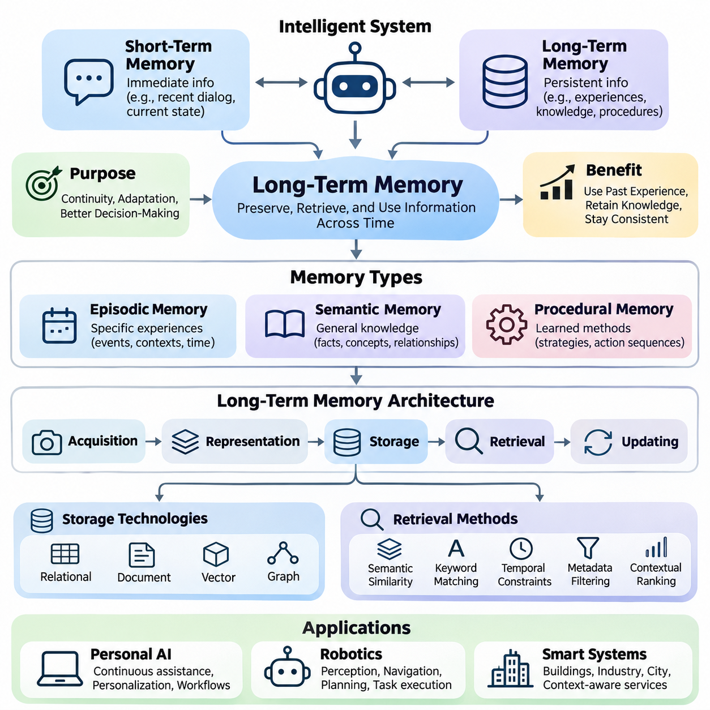
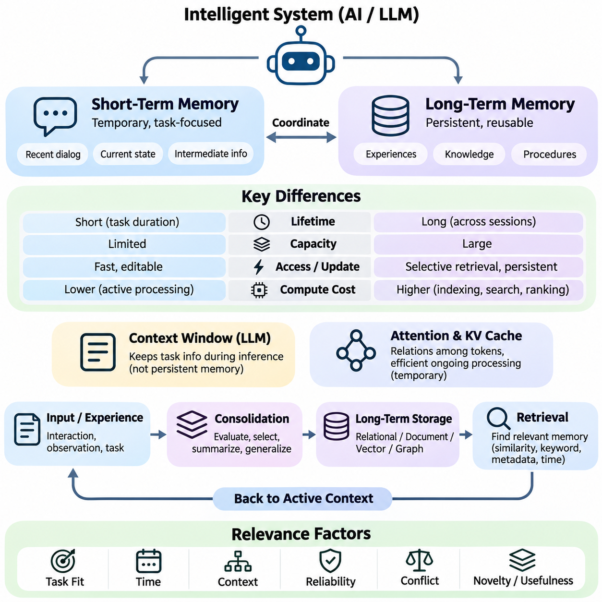
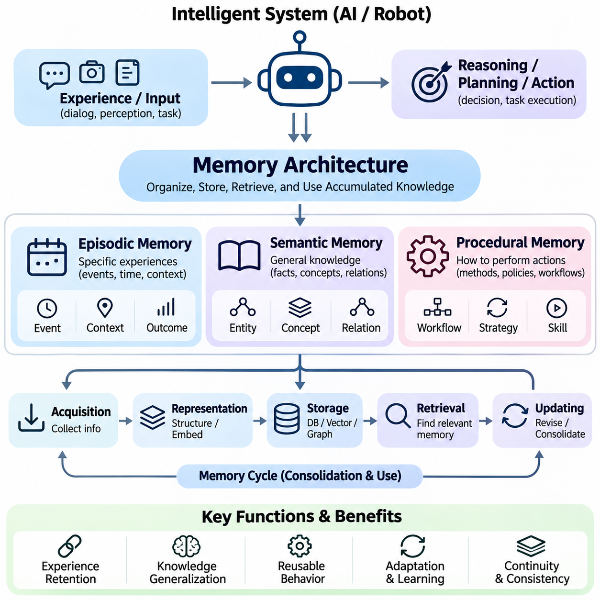
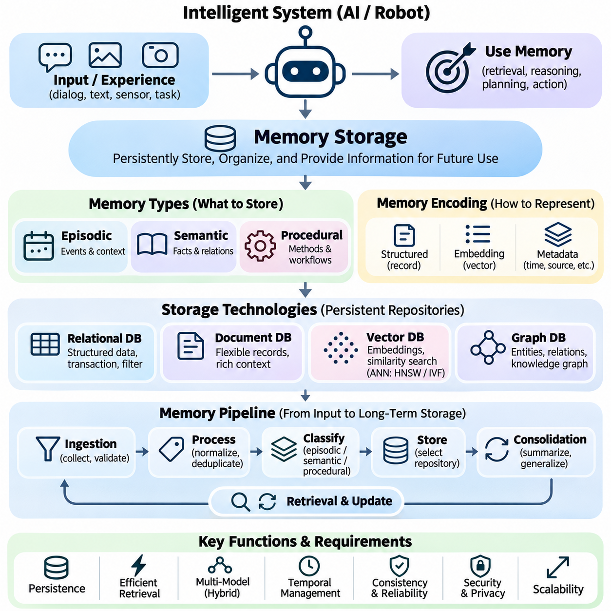
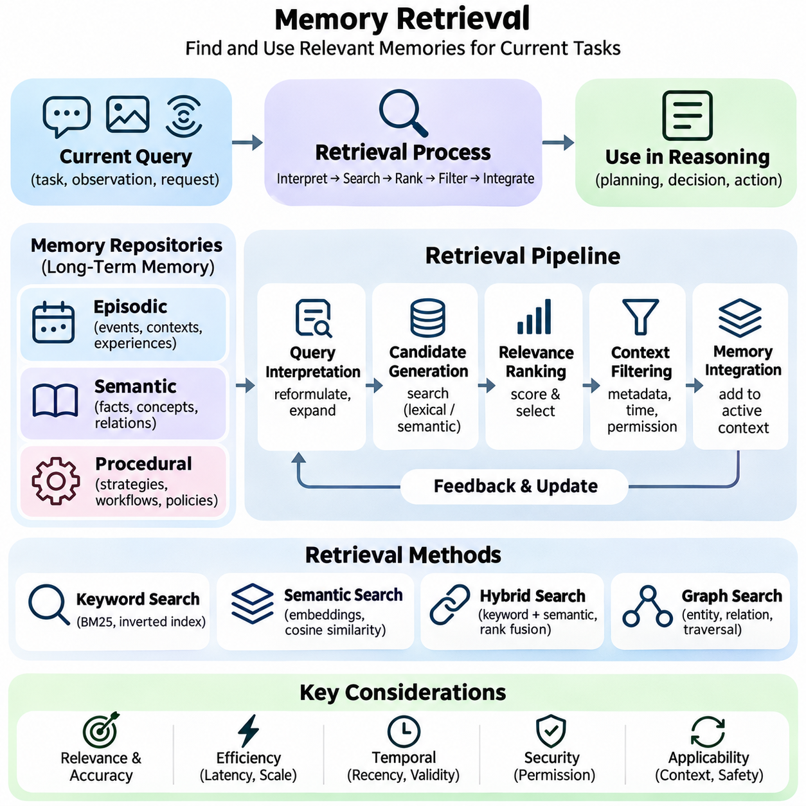
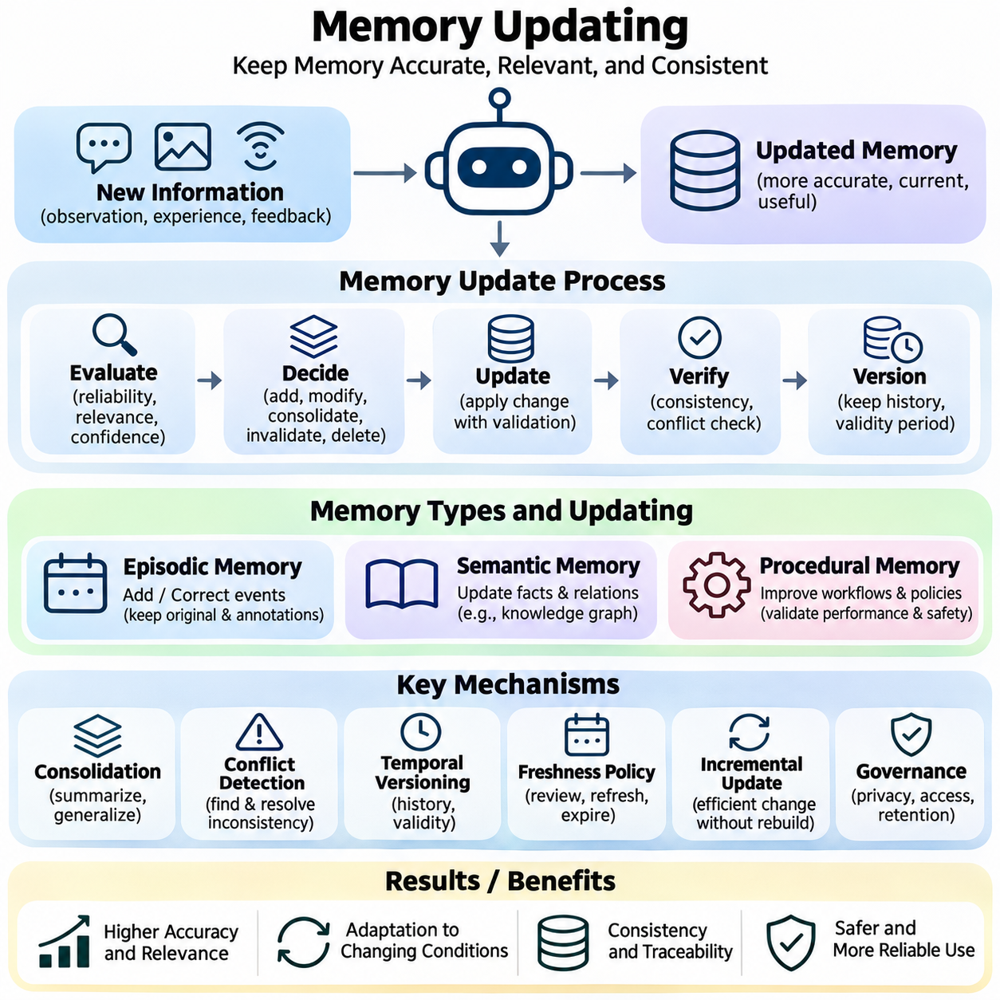
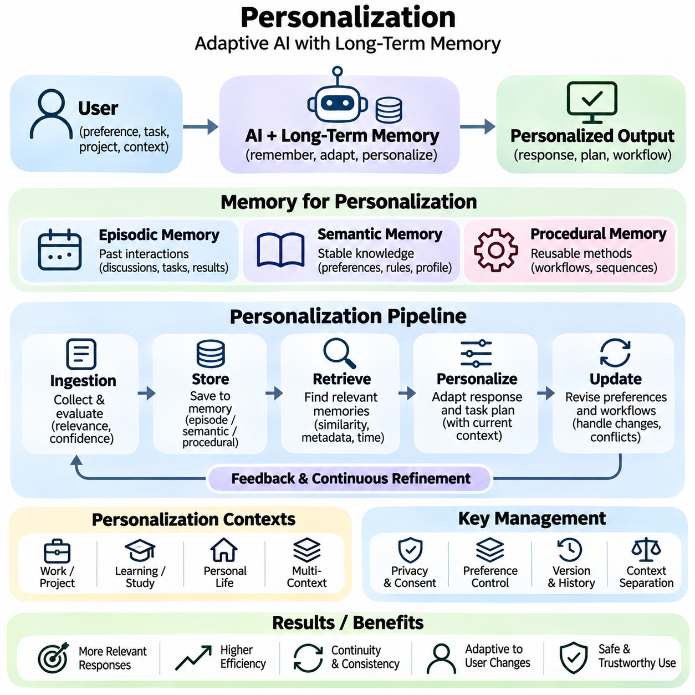
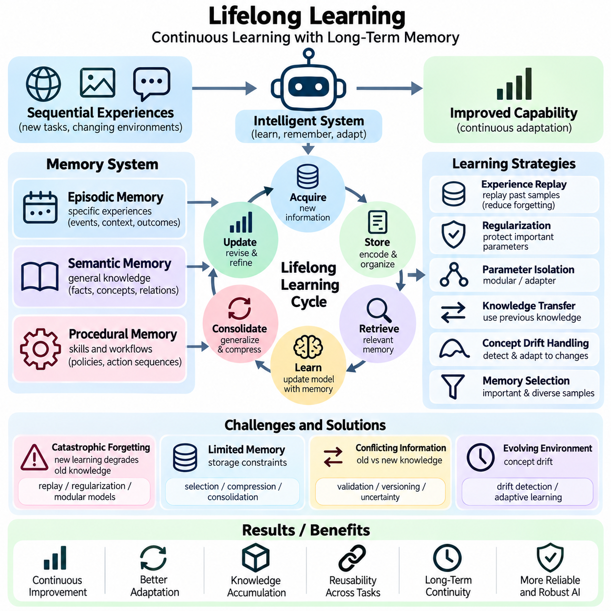
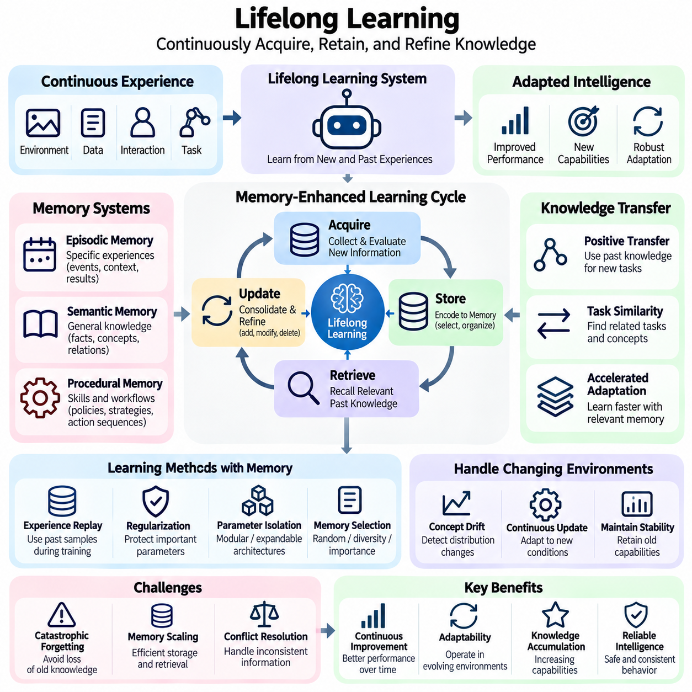
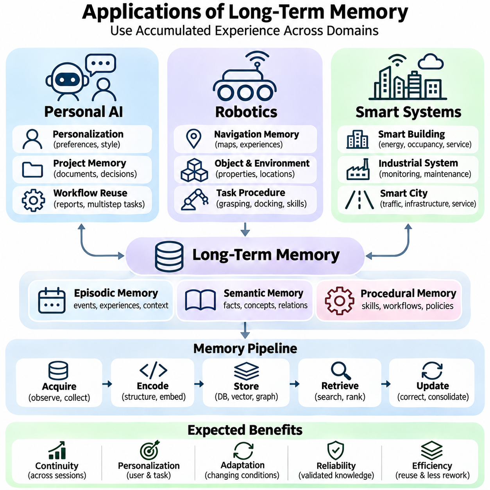

**Volume 37. Memory and Knowledge Systems**


# 03. Long Term Memory

## 03.00 Overview

{width="7.268055555555556in" height="7.268055555555556in"}

Long-term memory is a fundamental capability of intelligent systems that must preserve information beyond a single interaction, computation, or operational session. Unlike temporary context maintained during immediate processing, long-term memory enables artificial intelligence to retain experiences, acquired knowledge, learned preferences, and operational procedures. This capability supports continuity, adaptation, and increasingly informed decision-making across extended periods.

Modern artificial intelligence systems often operate with limited contextual information, particularly when processing long conversations, complex workflows, or continuously changing environments. Even large language models with extensive context windows cannot reliably preserve every relevant experience indefinitely. Long-term memory addresses this limitation by maintaining persistent representations that can be selectively retrieved and incorporated into subsequent reasoning, planning, and decision-making processes.

The distinction between short-term and long-term memory is essential for understanding memory-enabled intelligence. Short-term memory maintains information required for immediate computation, such as recent dialogue, intermediate reasoning states, or current sensor observations. Long-term memory preserves information that remains useful after the immediate task has ended. Effective systems coordinate these mechanisms to maintain both responsiveness and continuity without overwhelming computational resources.

Long-term memory in artificial intelligence is commonly organized into episodic, semantic, and procedural representations. Episodic memory records experiences associated with particular events, circumstances, and temporal contexts. Semantic memory maintains generalized facts, concepts, and relationships independent of individual experiences. Procedural memory represents learned methods, operational strategies, and action sequences that support repeated task execution and behavioral consistency.

Episodic memory allows an intelligent system to reconstruct relevant aspects of previous interactions and operational experiences. A conversational assistant may remember earlier user requests, while an autonomous robot may retain information about obstacles encountered during navigation. Such records typically include contextual attributes, timestamps, environmental conditions, and observed outcomes. These attributes help distinguish similar events and support experience-based reasoning.

Semantic memory provides a more generalized representation of accumulated knowledge. Instead of preserving every observation independently, an intelligent system can consolidate repeated experiences into concepts, factual relationships, and structured knowledge. Semantic representations may include entity descriptions, conceptual hierarchies, domain rules, and associations between objects. Their usefulness depends on accuracy, consistency, contextual relevance, and the ability to incorporate newly acquired information.

Procedural memory supports the retention of learned behaviors and operational knowledge. In robotic systems, procedural information may represent manipulation strategies, navigation routines, or task execution policies. In software agents, it may describe validated workflows, tool invocation sequences, and successful problem-solving methods. Unlike factual memory, procedural knowledge primarily concerns how actions should be performed under particular conditions.

A practical long-term memory architecture requires coordinated mechanisms for information acquisition, representation, storage, retrieval, and updating. Incoming observations must be evaluated to determine whether they contain information worth preserving. Relevant content can then be transformed into structured records, embeddings, summaries, or other representations. The selected storage mechanism must support persistence while maintaining sufficient information for reliable reconstruction and future interpretation.

Memory storage technologies vary according to the characteristics of the information being retained. Relational databases provide structured persistence and transactional consistency, while document databases accommodate flexible records and contextual metadata. Vector databases support similarity-based retrieval through numerical embeddings. Graph databases represent entities and relationships explicitly, making them useful when memory depends on interconnected knowledge rather than isolated observations.

Memory retrieval determines whether stored information can contribute effectively to intelligent behavior. A system must identify relevant memories from potentially large collections without introducing excessive latency or irrelevant context. Retrieval methods may combine semantic similarity, keyword matching, temporal constraints, metadata filtering, and contextual ranking. The retrieved information must then be integrated into the active reasoning process in a manner appropriate to the current task.

The relationship between memory retrieval and information retrieval is particularly important in modern language model systems. Conventional retrieval mechanisms often locate relevant documents from external knowledge collections. Memory retrieval additionally considers accumulated experiences, previous interactions, user-specific context, and changes over time. Although both mechanisms may employ similar indexing technologies, their information sources, update requirements, and relevance criteria can differ substantially.

Memory updating introduces challenges that are not adequately addressed by simple information storage. Newly acquired knowledge may contradict earlier records, supersede outdated assumptions, or reveal that previous interpretations were incomplete. Reliable memory systems therefore require mechanisms for correction, consolidation, versioning, and selective deletion. Without appropriate update policies, accumulated memories can become inconsistent and degrade the quality of future reasoning and decision-making.

Memory consolidation transforms fragmented observations into more stable and useful representations. Repeated experiences may reveal recurring patterns, while related records can be combined into higher-level summaries. Consolidation can reduce redundant storage and improve retrieval efficiency, but excessive compression may remove important details. Effective consolidation must therefore balance information preservation, abstraction quality, computational cost, and the ability to trace conclusions back to supporting experiences.

For personalized artificial intelligence, long-term memory provides continuity across interactions and supports adaptation to individual requirements. A personal assistant may retain explicitly provided preferences, recurring workflows, and relevant project context. Such information can improve subsequent responses by reducing unnecessary repetition and supporting context-aware recommendations. However, personalization must incorporate appropriate consent, access restrictions, correction mechanisms, and safeguards against retaining unnecessary sensitive information.

Long-term memory also contributes to lifelong learning, in which intelligent systems acquire useful information throughout extended operation. Unlike conventional training procedures that rely primarily on fixed datasets, lifelong learning addresses changing environments, emerging tasks, and newly observed experiences. Persistent memory can support experience replay, knowledge transfer, and incremental adaptation, although memory retention alone does not guarantee that a model has learned new capabilities.

A central challenge in lifelong learning is catastrophic forgetting, where adaptation to new information reduces performance on previously learned tasks. Memory-based approaches can mitigate this problem by preserving representative experiences or knowledge needed for continued competence. Replay mechanisms, parameter regularization, and architectural expansion provide complementary strategies. Their effectiveness depends on the learning environment, memory capacity, task relationships, and computational constraints.

In autonomous robotics, long-term memory enables systems to exploit operational experience accumulated across multiple missions. A mobile robot may preserve information about frequently encountered obstacles, environmental changes, navigation failures, and successful recovery strategies. These records can support improved planning, anomaly recognition, and maintenance decisions. Reliable deployment requires careful separation between remembered observations, verified environmental knowledge, and current sensor measurements.

Smart systems can extend these capabilities across interconnected devices, services, and operational environments. Industrial monitoring platforms may retain equipment histories, recurring anomalies, and maintenance outcomes. Smart infrastructure may combine historical observations with current measurements to support predictive analysis and resource allocation. Such applications require memory architectures that accommodate heterogeneous information, distributed access, temporal relationships, and changing operational conditions.

Security and privacy are fundamental requirements because persistent memory can accumulate sensitive information over long periods. Access control, encryption, retention policies, and audit mechanisms help protect stored records against unauthorized disclosure or modification. Systems should also support correction and deletion where appropriate. Memory provenance is especially important because decisions based on historical information should remain traceable to identifiable sources and recorded updates.

The effectiveness of long-term memory cannot be evaluated solely through storage capacity or retrieval speed. Meaningful assessment also considers retrieval relevance, factual consistency, temporal accuracy, resistance to outdated information, and improvements in downstream task performance. Evaluation scenarios should examine whether memory genuinely supports better decisions rather than merely increasing the amount of contextual information supplied to a model.

Long-term memory therefore represents more than an external database attached to an artificial intelligence model. It is an integrated capability connecting experience acquisition, knowledge representation, persistent storage, contextual retrieval, and continuous adaptation. The following sections examine these components through short-term and long-term memory distinctions, memory architectures, storage and retrieval mechanisms, updating strategies, personalization, lifelong learning, and applications in personal AI, robotics, and smart systems.

장기 기억(Long-Term Memory)은 단일 상호작용(Interaction), 연산(Computation) 또는 운영 세션(Operational Session)을 넘어 정보를 보존해야 하는 지능형 시스템(Intelligent Systems)의 핵심 기능이다. 즉각적인 처리 과정에서 유지되는 임시 문맥(Temporary Context)과 달리, 장기 기억은 인공지능(Artificial Intelligence)이 경험(Experience), 습득한 지식(Acquired Knowledge), 학습된 선호도(Learned Preferences), 운영 절차(Operational Procedures)를 지속적으로 보존하도록 한다. 이러한 기능은 장기간에 걸친 연속성(Continuity), 적응(Adaptation), 정보에 기반한 의사결정(Decision-Making)을 지원한다.

현대 인공지능 시스템은 특히 긴 대화(Long Conversations), 복잡한 작업 흐름(Complex Workflows), 지속적으로 변화하는 환경(Changing Environments)을 처리할 때 제한된 문맥 정보(Contextual Information)에 의존하는 경우가 많다. 광범위한 문맥 창(Context Window)을 가진 대규모 언어 모델(Large Language Models, LLMs)조차 모든 관련 경험을 무기한 안정적으로 보존할 수는 없다. 장기 기억은 지속적 표현(Persistent Representations)을 유지하고, 이를 선택적으로 검색하여 이후의 추론(Reasoning), 계획(Planning), 의사결정 과정에 통합함으로써 이러한 한계를 해결한다.

단기 기억(Short-Term Memory)과 장기 기억(Long-Term Memory)의 구분은 기억 기반 지능(Memory-Enabled Intelligence)을 이해하는 데 필수적이다. 단기 기억은 최근 대화(Recent Dialogue), 중간 추론 상태(Intermediate Reasoning States), 현재 센서 관측(Current Sensor Observations)과 같이 즉각적인 연산에 필요한 정보를 유지한다. 반면 장기 기억은 현재 작업이 종료된 이후에도 유용한 정보를 보존한다. 효과적인 시스템은 이러한 두 가지 기억 메커니즘(Memory Mechanisms)을 조정하여 연산 자원(Computational Resources)에 과도한 부담을 주지 않으면서 응답성과 연속성을 유지한다.

인공지능의 장기 기억은 일반적으로 일화 기억(Episodic Memory), 의미 기억(Semantic Memory), 절차 기억(Procedural Memory)으로 구성된다. 일화 기억은 특정 사건(Events), 상황(Circumstances), 시간적 문맥(Temporal Contexts)과 관련된 경험을 기록한다. 의미 기억은 개별 경험과 독립적인 일반화된 사실(Facts), 개념(Concepts), 관계(Relationships)를 유지한다. 절차 기억은 반복적인 작업 수행과 행동의 일관성을 지원하는 학습된 방법(Learned Methods), 운영 전략(Operational Strategies), 행동 순서(Action Sequences)를 표현한다.

일화 기억(Episodic Memory)은 지능형 시스템이 이전 상호작용과 운영 경험의 관련 요소를 재구성할 수 있도록 한다. 대화형 비서(Conversational Assistant)는 과거 사용자의 요청을 기억할 수 있으며, 자율 로봇(Autonomous Robot)은 주행 중 마주친 장애물에 관한 정보를 보존할 수 있다. 이러한 기록에는 일반적으로 문맥 속성(Contextual Attributes), 타임스탬프(Timestamps), 환경 조건(Environmental Conditions), 관측 결과(Observed Outcomes)가 포함된다. 이러한 속성은 유사한 사건을 구분하고 경험 기반 추론(Experience-Based Reasoning)을 지원한다.

의미 기억(Semantic Memory)은 축적된 지식에 대한 보다 일반화된 표현(Generalized Representation)을 제공한다. 지능형 시스템은 모든 관측을 독립적으로 보존하는 대신 반복된 경험을 개념, 사실적 관계(Factual Relationships), 구조화된 지식(Structured Knowledge)으로 통합할 수 있다. 의미 표현(Semantic Representations)에는 개체 설명(Entity Descriptions), 개념 계층(Conceptual Hierarchies), 도메인 규칙(Domain Rules), 객체 간 연관성(Associations)이 포함될 수 있다. 이러한 표현의 유용성은 정확성, 일관성, 문맥적 관련성, 새로운 정보의 통합 능력에 따라 결정된다.

절차 기억(Procedural Memory)은 학습된 행동(Learned Behaviors)과 운영 지식(Operational Knowledge)의 보존을 지원한다. 로봇 시스템에서 절차 정보는 조작 전략(Manipulation Strategies), 내비게이션 루틴(Navigation Routines), 작업 실행 정책(Task Execution Policies)을 표현할 수 있다. 소프트웨어 에이전트(Software Agents)에서는 검증된 작업 흐름(Validated Workflows), 도구 호출 순서(Tool Invocation Sequences), 성공적인 문제 해결 방법을 기술할 수 있다. 사실적 기억(Factual Memory)과 달리 절차 지식은 특정 조건에서 행동을 수행하는 방법에 중점을 둔다.

실용적인 장기 기억 아키텍처(Long-Term Memory Architecture)는 정보 획득(Information Acquisition), 표현(Representation), 저장(Storage), 검색(Retrieval), 갱신(Updating)을 위한 조정된 메커니즘을 필요로 한다. 입력되는 관측 정보는 보존할 가치가 있는지를 판단하기 위해 평가되어야 한다. 관련 내용은 구조화된 기록(Structured Records), 임베딩(Embeddings), 요약(Summaries) 또는 다른 표현으로 변환될 수 있다. 선택된 저장 메커니즘은 안정적인 재구성과 향후 해석에 필요한 충분한 정보를 유지하면서 영속성(Persistence)을 지원해야 한다.

기억 저장 기술(Memory Storage Technologies)은 보존하려는 정보의 특성에 따라 달라진다. 관계형 데이터베이스(Relational Databases)는 구조화된 영속성과 트랜잭션 일관성(Transactional Consistency)을 제공하며, 문서 데이터베이스(Document Databases)는 유연한 기록과 문맥 메타데이터(Contextual Metadata)를 수용한다. 벡터 데이터베이스(Vector Databases)는 수치 임베딩(Numerical Embeddings)을 이용한 유사도 기반 검색(Similarity-Based Retrieval)을 지원한다. 그래프 데이터베이스(Graph Databases)는 개체와 관계를 명시적으로 표현하여 개별 관측보다 상호 연결된 지식에 의존하는 기억에 유용하다.

기억 검색(Memory Retrieval)은 저장된 정보가 지능적 행동(Intelligent Behavior)에 효과적으로 기여할 수 있는지를 결정한다. 시스템은 잠재적으로 방대한 기억 집합(Memory Collections)에서 관련 기억을 식별하면서 과도한 지연 시간(Latency)이나 불필요한 문맥을 발생시키지 않아야 한다. 검색 방법은 의미적 유사도(Semantic Similarity), 키워드 매칭(Keyword Matching), 시간적 제약(Temporal Constraints), 메타데이터 필터링(Metadata Filtering), 문맥 기반 순위화(Contextual Ranking)를 결합할 수 있다. 검색된 정보는 현재 작업에 적합한 방식으로 활성 추론 과정(Active Reasoning Process)에 통합되어야 한다.

기억 검색(Memory Retrieval)과 정보 검색(Information Retrieval)의 관계는 현대 언어 모델 시스템에서 특히 중요하다. 기존 정보 검색 메커니즘은 외부 지식 집합(External Knowledge Collections)에서 관련 문서를 찾는 데 중점을 둔다. 반면 기억 검색은 축적된 경험(Accumulated Experiences), 이전 상호작용(Previous Interactions), 사용자별 문맥(User-Specific Context), 시간에 따른 변화까지 추가로 고려한다. 두 메커니즘은 유사한 색인 기술(Indexing Technologies)을 사용할 수 있지만, 정보 출처, 갱신 요구사항, 관련성 평가 기준은 상당히 다를 수 있다.

기억 갱신(Memory Updating)은 단순한 정보 저장만으로는 충분히 해결할 수 없는 문제를 발생시킨다. 새롭게 획득한 지식은 이전 기록과 충돌하거나, 오래된 가정(Outdated Assumptions)을 대체하거나, 기존 해석이 불완전했음을 드러낼 수 있다. 따라서 신뢰할 수 있는 기억 시스템은 수정(Correction), 통합(Consolidation), 버전 관리(Versioning), 선택적 삭제(Selective Deletion)를 위한 메커니즘을 필요로 한다. 적절한 갱신 정책이 없다면 축적된 기억은 불일치 상태가 되어 향후 추론과 의사결정의 품질을 저하시킬 수 있다.

기억 통합(Memory Consolidation)은 단편적인 관측(Fragmented Observations)을 보다 안정적이고 유용한 표현으로 변환한다. 반복된 경험은 반복적으로 나타나는 패턴(Recurring Patterns)을 드러낼 수 있으며, 관련 기록은 상위 수준의 요약(Higher-Level Summaries)으로 결합될 수 있다. 통합은 중복 저장(Redundant Storage)을 줄이고 검색 효율(Retrieval Efficiency)을 향상시킬 수 있지만, 과도한 압축(Excessive Compression)은 중요한 세부 정보를 제거할 수 있다. 따라서 효과적인 통합은 정보 보존, 추상화 품질(Abstraction Quality), 연산 비용, 근거 추적 능력 사이의 균형을 유지해야 한다.

개인화된 인공지능(Personalized Artificial Intelligence)에서 장기 기억은 상호작용 간 연속성을 제공하고 개인별 요구사항에 대한 적응을 지원한다. 개인 인공지능 비서(Personal AI Assistant)는 명시적으로 제공된 선호도, 반복적인 작업 흐름, 관련 프로젝트 문맥을 보존할 수 있다. 이러한 정보는 불필요한 반복을 줄이고 문맥 인식 추천(Context-Aware Recommendations)을 지원하여 이후 응답을 개선할 수 있다. 그러나 개인화에는 적절한 동의(Consent), 접근 제한(Access Restrictions), 수정 메커니즘, 불필요한 민감 정보의 보존을 방지하는 보호 조치가 포함되어야 한다.

장기 기억은 지능형 시스템이 장기간의 운영 과정에서 유용한 정보를 습득하는 평생 학습(Lifelong Learning)에도 기여한다. 주로 고정된 데이터셋(Fixed Datasets)에 의존하는 기존 학습 절차와 달리, 평생 학습은 변화하는 환경, 새롭게 등장하는 작업, 새롭게 관측된 경험을 다룬다. 지속적 기억(Persistent Memory)은 경험 재생(Experience Replay), 지식 전이(Knowledge Transfer), 점진적 적응(Incremental Adaptation)을 지원할 수 있다. 그러나 기억을 보존하는 것만으로 모델이 새로운 능력을 학습했다고 보장할 수는 없다.

평생 학습(Lifelong Learning)의 핵심 과제 중 하나는 새로운 정보에 적응하는 과정에서 이전에 학습한 작업의 성능이 저하되는 파국적 망각(Catastrophic Forgetting)이다. 기억 기반 접근법(Memory-Based Approaches)은 지속적인 역량 유지에 필요한 대표 경험(Representative Experiences)이나 지식을 보존함으로써 이러한 문제를 완화할 수 있다. 재생 메커니즘(Replay Mechanisms), 매개변수 정규화(Parameter Regularization), 아키텍처 확장(Architectural Expansion)은 상호 보완적인 전략을 제공한다. 그 효과는 학습 환경, 기억 용량, 작업 간 관계, 연산 제약에 따라 달라진다.

자율 로봇(Autonomous Robotics)에서 장기 기억은 여러 임무에 걸쳐 축적된 운영 경험을 활용할 수 있도록 한다. 이동 로봇(Mobile Robot)은 반복적으로 마주치는 장애물, 환경 변화, 내비게이션 실패(Navigation Failures), 성공적인 복구 전략(Recovery Strategies)에 관한 정보를 보존할 수 있다. 이러한 기록은 경로 계획(Planning), 이상 인식(Anomaly Recognition), 유지보수 의사결정(Maintenance Decisions)의 개선을 지원한다. 신뢰할 수 있는 배포(Deployment)를 위해서는 기억된 관측, 검증된 환경 지식, 현재 센서 측정값을 명확하게 구분해야 한다.

스마트 시스템(Smart Systems)은 이러한 기능을 상호 연결된 장치, 서비스, 운영 환경 전반으로 확장할 수 있다. 산업 모니터링 플랫폼(Industrial Monitoring Platforms)은 장비 이력(Equipment Histories), 반복적인 이상 현상(Recurring Anomalies), 유지보수 결과(Maintenance Outcomes)를 보존할 수 있다. 스마트 인프라(Smart Infrastructure)는 과거 관측과 현재 측정값을 결합하여 예측 분석(Predictive Analysis)과 자원 할당(Resource Allocation)을 지원할 수 있다. 이러한 응용에는 이기종 정보(Heterogeneous Information), 분산 접근(Distributed Access), 시간적 관계, 변화하는 운영 조건을 수용하는 기억 아키텍처가 필요하다.

보안(Security)과 개인정보 보호(Privacy)는 지속적 기억(Persistent Memory)이 장기간에 걸쳐 민감한 정보를 축적할 수 있기 때문에 기본적인 요구사항이다. 접근 제어(Access Control), 암호화(Encryption), 보존 정책(Retention Policies), 감사 메커니즘(Audit Mechanisms)은 저장된 기록을 무단 공개나 수정으로부터 보호한다. 시스템은 필요한 경우 정보 수정과 삭제도 지원해야 한다. 기억 출처 추적(Memory Provenance)은 특히 중요하며, 과거 정보에 기반한 의사결정은 식별 가능한 출처와 기록된 갱신 이력으로 추적할 수 있어야 한다.

장기 기억의 효과는 저장 용량(Storage Capacity)이나 검색 속도(Retrieval Speed)만으로 평가할 수 없다. 의미 있는 평가는 검색 관련성(Retrieval Relevance), 사실적 일관성(Factual Consistency), 시간적 정확성(Temporal Accuracy), 오래된 정보에 대한 저항성, 후속 작업 성능(Downstream Task Performance)의 개선까지 고려해야 한다. 평가 시나리오(Evaluation Scenarios)는 단순히 모델에 제공되는 문맥 정보의 양을 증가시키는 것이 아니라 기억이 실제로 더 나은 의사결정을 지원하는지를 검증해야 한다.

따라서 장기 기억(Long-Term Memory)은 인공지능 모델에 연결된 외부 데이터베이스(External Database) 이상의 의미를 가진다. 이는 경험 획득(Experience Acquisition), 지식 표현(Knowledge Representation), 영속적 저장(Persistent Storage), 문맥 기반 검색(Contextual Retrieval), 지속적 적응(Continuous Adaptation)을 연결하는 통합 기능이다. 이후 절에서는 단기 기억과 장기 기억의 차이, 기억 아키텍처, 저장 및 검색 메커니즘, 갱신 전략, 개인화, 평생 학습을 살펴보고 개인 인공지능(Personal AI), 로봇공학(Robotics), 스마트 시스템(Smart Systems)에서의 응용을 검토한다.

## 03.01 Short vs Long Term Memory

{width="7.268055555555556in" height="7.268055555555556in"}

Short-term memory and long-term memory represent two complementary mechanisms through which intelligent systems maintain and utilize information across different time scales. Short-term memory temporarily preserves information needed for immediate processing, reasoning, and decision-making, while long-term memory retains knowledge and experiences beyond the current interaction. Their coordination enables artificial intelligence systems to combine contextual responsiveness with persistent knowledge and behavioral continuity.

Short-term memory operates as an active information workspace that supports ongoing computational tasks. In conversational artificial intelligence, it may contain recent messages, user instructions, intermediate reasoning information, and retrieved documents. In autonomous systems, it may include current sensor measurements, estimated environmental states, and immediate control objectives. Its primary function is to maintain information relevant to the present task without requiring permanent storage.

Long-term memory serves a different purpose by preserving information that remains valuable across multiple interactions or operational sessions. Such information may include historical experiences, factual knowledge, learned preferences, environmental patterns, and successful task procedures. Unlike short-term memory, which emphasizes immediate accessibility, long-term memory emphasizes persistence, selective retrieval, and the ability to support future decisions using previously acquired information.

The distinction between these memory mechanisms is influenced by information lifetime, storage capacity, accessibility, and computational requirements. Short-term memory generally prioritizes rapid access and frequent modification, although its effective capacity may be constrained by available computational resources. Long-term memory can maintain substantially larger information collections, but retrieving relevant records may require indexing, similarity search, ranking, and contextual filtering.

Human cognitive science provides a useful conceptual foundation for distinguishing short-term and long-term memory. Working memory temporarily maintains and manipulates information required for active cognitive operations, whereas long-term memory supports the retention of knowledge and experiences over extended periods. Artificial intelligence systems adopt similar functional distinctions, although their computational implementations differ considerably from biological memory processes and should not be treated as direct neurological equivalents.

In large language models, the context window provides an important mechanism for maintaining task-relevant information during inference. Input tokens, previous dialogue, and retrieved content can influence subsequent predictions while they remain within the available context. However, a context window is not equivalent to persistent long-term memory. Once information is removed from the active context, continued access generally requires external storage, renewed retrieval, or another explicit persistence mechanism.

The attention mechanism allows transformer-based models to establish relationships among tokens within their available context. During autoregressive inference, key-value caches can reduce repeated computation by retaining intermediate attention representations. These caches support efficient processing of ongoing sequences but do not independently provide durable memory across unrelated sessions. Persistent memory therefore requires additional architectural components beyond conventional attention and inference caching.

Short-term memory management becomes increasingly important when interactions exceed available context capacity. Systems may remove older messages, compress previous dialogue into summaries, or prioritize information according to task relevance. These operations help preserve essential context while controlling computational cost. Nevertheless, aggressive summarization may eliminate important details, and simple truncation can discard information required for later reasoning or accurate interpretation.

Long-term memory architectures address these limitations through persistent storage and retrieval mechanisms. Information extracted from interactions may be represented as structured records, textual summaries, vector embeddings, or relational knowledge. Storage technologies can include relational databases, document repositories, vector databases, and knowledge graphs. The appropriate representation depends on whether the system must preserve exact events, generalized concepts, procedural information, or relationships between entities.

The transfer of information from short-term to long-term memory is commonly described as memory consolidation. During consolidation, an intelligent system evaluates incoming information according to relevance, novelty, reliability, and expected future usefulness. Important observations may be preserved directly, while repeated experiences can be combined into generalized representations. Effective consolidation must balance information retention against storage growth, redundancy, privacy requirements, and the risk of preserving inaccurate assumptions.

Memory retrieval enables previously stored information to return to the active computational context when needed. A retrieval mechanism may use semantic similarity, keyword matching, metadata constraints, temporal relevance, or combinations of these methods. Retrieved memories can then be incorporated into the current reasoning process. This interaction creates a functional connection between persistent historical knowledge and immediate decision-making without requiring all stored information to remain continuously active.

Memory relevance depends on more than semantic similarity alone. A record may closely match the current query while containing outdated information, uncertain conclusions, or details from an unrelated situation. Effective retrieval therefore considers temporal validity, source reliability, contextual compatibility, and task-specific importance. Memory ranking and validation mechanisms help reduce inappropriate retrieval and prevent historical information from being interpreted as unquestionably current.

Short-term and long-term memory also differ in their updating characteristics. Short-term memory changes continuously as new observations, messages, and intermediate states enter the active context. Long-term memory requires more deliberate update policies because stored information may influence decisions across many future sessions. Updating may involve correcting factual errors, replacing obsolete records, merging related experiences, or deleting information that is no longer relevant or authorized for retention.

An effective memory-enabled architecture establishes a bidirectional relationship between immediate context and persistent knowledge. Current observations can generate candidate memories for long-term storage, while previously stored information can be retrieved to support active reasoning. This process allows systems to accumulate useful experiences without treating every observation as permanent knowledge. The quality of the architecture depends on selecting what to retain, when to retrieve it, and how to resolve conflicts.

In personalized artificial intelligence, short-term memory supports the immediate conversation, while long-term memory provides continuity across separate interactions. A conversational assistant may temporarily track the current question and its supporting context while retrieving previously authorized preferences or project information when relevant. This combination can reduce repetitive explanations and improve contextual consistency, provided that retained information remains accurate, appropriately scoped, and subject to user control.

Autonomous robotics demonstrates another important distinction between these memory types. Short-term memory may maintain the robot\'s current pose estimate, nearby obstacles, local trajectories, and immediate navigation objectives. Long-term memory may preserve previously observed environmental characteristics, historical navigation outcomes, and recurring operational conditions. Integrating both mechanisms allows the robot to respond to current sensor measurements while benefiting from accumulated operational experience.

In industrial and smart systems, short-term memory frequently supports real-time monitoring and control, whereas long-term memory supports historical analysis and operational optimization. A monitoring system may temporarily maintain recent sensor readings and active anomaly indicators while preserving equipment histories and maintenance records. Historical information can support predictive maintenance and recurring fault analysis, but immediate safety decisions must remain grounded in validated current measurements.

The performance of memory systems must be evaluated across multiple dimensions, including retrieval accuracy, response latency, storage efficiency, temporal consistency, and downstream task effectiveness. Short-term memory evaluation emphasizes contextual coherence and immediate processing efficiency. Long-term memory evaluation additionally considers retention quality, update correctness, retrieval relevance, and resistance to outdated or misleading information. Combined evaluations determine whether persistent memory improves practical intelligence.

Security and privacy requirements apply differently to temporary and persistent information. Short-term memory may contain sensitive information needed only for immediate processing, while long-term memory introduces additional risks through extended retention and repeated accessibility. Appropriate safeguards include access control, encryption, retention limits, provenance tracking, and deletion mechanisms. Memory architectures should avoid automatically converting every temporary observation into permanently stored information.

The integration of short-term and long-term memory provides a foundation for adaptive artificial intelligence systems capable of maintaining immediate situational awareness while utilizing accumulated knowledge. Short-term memory supplies the active context required for responsive behavior, whereas long-term memory supports continuity, personalization, and experience-based adaptation. Their effective coordination is essential for developing reliable conversational agents, autonomous robots, and intelligent systems operating across extended periods.

단기 기억(Short-Term Memory)과 장기 기억(Long-Term Memory)은 지능형 시스템(Intelligent Systems)이 서로 다른 시간 범위(Time Scales)에 걸쳐 정보를 유지하고 활용하는 두 가지 상호 보완적인 메커니즘(Complementary Mechanisms)이다. 단기 기억은 즉각적인 처리(Immediate Processing), 추론(Reasoning), 의사결정(Decision-Making)에 필요한 정보를 일시적으로 보존하는 반면, 장기 기억은 현재 상호작용(Current Interaction)을 넘어 지식과 경험을 유지한다. 두 기억의 조정은 인공지능 시스템이 문맥적 응답성(Contextual Responsiveness)과 지속적인 지식 및 행동의 연속성(Behavioral Continuity)을 결합하도록 한다.

단기 기억(Short-Term Memory)은 진행 중인 연산 작업(Computational Tasks)을 지원하는 활성 정보 작업 공간(Active Information Workspace)으로 작동한다. 대화형 인공지능(Conversational Artificial Intelligence)에서는 최근 메시지, 사용자 지시사항, 중간 추론 정보(Intermediate Reasoning Information), 검색된 문서(Retrieved Documents)를 포함할 수 있다. 자율 시스템(Autonomous Systems)에서는 현재 센서 측정값(Current Sensor Measurements), 추정된 환경 상태(Estimated Environmental States), 즉각적인 제어 목표(Control Objectives)를 포함할 수 있다. 주요 기능은 영구 저장 없이 현재 작업과 관련된 정보를 유지하는 것이다.

장기 기억(Long-Term Memory)은 여러 상호작용이나 운영 세션(Operational Sessions)에 걸쳐 가치가 유지되는 정보를 보존함으로써 다른 목적을 수행한다. 이러한 정보에는 과거 경험(Historical Experiences), 사실적 지식(Factual Knowledge), 학습된 선호도(Learned Preferences), 환경 패턴(Environmental Patterns), 성공적인 작업 절차(Task Procedures)가 포함될 수 있다. 즉각적인 접근성(Immediate Accessibility)을 강조하는 단기 기억과 달리, 장기 기억은 영속성(Persistence), 선택적 검색(Selective Retrieval), 이전에 획득한 정보를 활용한 미래 의사결정 지원을 강조한다.

이러한 기억 메커니즘(Memory Mechanisms)의 차이는 정보 수명(Information Lifetime), 저장 용량(Storage Capacity), 접근성(Accessibility), 연산 요구사항(Computational Requirements)의 영향을 받는다. 단기 기억은 일반적으로 빠른 접근(Rapid Access)과 빈번한 수정(Frequent Modification)을 우선하지만, 유효 용량은 사용 가능한 연산 자원에 의해 제한될 수 있다. 장기 기억은 훨씬 큰 정보 집합을 유지할 수 있지만, 관련 기록을 검색하려면 색인(Indexing), 유사도 검색(Similarity Search), 순위화(Ranking), 문맥 필터링(Contextual Filtering)이 필요할 수 있다.

인간 인지과학(Human Cognitive Science)은 단기 기억과 장기 기억을 구분하는 데 유용한 개념적 기반(Conceptual Foundation)을 제공한다. 작업 기억(Working Memory)은 활성 인지 연산(Active Cognitive Operations)에 필요한 정보를 일시적으로 유지하고 조작하는 반면, 장기 기억은 장기간에 걸쳐 지식과 경험을 보존한다. 인공지능 시스템도 유사한 기능적 구분(Functional Distinctions)을 채택하지만, 연산 구현(Computational Implementations)은 생물학적 기억 과정(Biological Memory Processes)과 상당히 다르므로 직접적인 신경학적 등가물(Neurological Equivalents)로 간주해서는 안 된다.

대규모 언어 모델(Large Language Models, LLMs)에서 문맥 창(Context Window)은 추론(Inference) 중 작업 관련 정보를 유지하는 중요한 메커니즘을 제공한다. 입력 토큰(Input Tokens), 이전 대화(Previous Dialogue), 검색된 콘텐츠(Retrieved Content)는 사용 가능한 문맥 안에 유지되는 동안 후속 예측(Subsequent Predictions)에 영향을 줄 수 있다. 그러나 문맥 창은 영속적인 장기 기억(Persistent Long-Term Memory)과 동일하지 않다. 정보가 활성 문맥(Active Context)에서 제거되면 지속적인 접근을 위해 일반적으로 외부 저장(External Storage), 재검색(Renewed Retrieval), 또는 별도의 명시적인 영속화 메커니즘(Persistence Mechanism)이 필요하다.

어텐션 메커니즘(Attention Mechanism)은 트랜스포머 기반 모델(Transformer-Based Models)이 사용 가능한 문맥 내 토큰 사이의 관계를 형성하도록 한다. 자기회귀 추론(Autoregressive Inference) 과정에서 키-값 캐시(Key-Value Cache)는 중간 어텐션 표현(Intermediate Attention Representations)을 유지하여 반복 연산을 줄일 수 있다. 이러한 캐시는 진행 중인 시퀀스(Sequences)의 효율적인 처리를 지원하지만, 서로 관련 없는 세션 간에 지속되는 기억을 독립적으로 제공하지는 않는다. 따라서 영속적 기억에는 기존 어텐션과 추론 캐싱(Inference Caching)을 넘어서는 추가적인 아키텍처 구성요소가 필요하다.

단기 기억 관리(Short-Term Memory Management)는 상호작용이 사용 가능한 문맥 용량(Context Capacity)을 초과할 때 더욱 중요해진다. 시스템은 오래된 메시지를 제거하거나, 이전 대화를 요약(Summarization)하여 압축하거나, 작업 관련성(Task Relevance)에 따라 정보의 우선순위를 결정할 수 있다. 이러한 작업은 연산 비용(Computational Cost)을 제어하면서 필수 문맥을 보존하는 데 도움이 된다. 그러나 과도한 요약은 중요한 세부 정보를 제거할 수 있으며, 단순 절단(Truncation)은 이후 추론이나 정확한 해석에 필요한 정보를 버릴 수 있다.

장기 기억 아키텍처(Long-Term Memory Architectures)는 영속적 저장(Persistent Storage)과 검색 메커니즘(Retrieval Mechanisms)을 통해 이러한 한계를 해결한다. 상호작용에서 추출된 정보는 구조화된 기록(Structured Records), 텍스트 요약(Textual Summaries), 벡터 임베딩(Vector Embeddings), 관계형 지식(Relational Knowledge)으로 표현될 수 있다. 저장 기술에는 관계형 데이터베이스(Relational Databases), 문서 저장소(Document Repositories), 벡터 데이터베이스(Vector Databases), 지식 그래프(Knowledge Graphs)가 포함된다. 적절한 표현 방식은 정확한 사건, 일반화된 개념, 절차 정보 또는 개체 간 관계 중 무엇을 보존해야 하는지에 따라 달라진다.

단기 기억에서 장기 기억으로 정보가 전이되는 과정은 일반적으로 기억 통합(Memory Consolidation)이라고 한다. 통합 과정에서 지능형 시스템은 관련성(Relevance), 신규성(Novelty), 신뢰성(Reliability), 예상되는 미래 유용성(Expected Future Usefulness)을 기준으로 입력 정보를 평가한다. 중요한 관측은 직접 보존할 수 있으며, 반복된 경험은 일반화된 표현(Generalized Representations)으로 결합할 수 있다. 효과적인 통합은 정보 보존(Information Retention)과 저장 용량 증가(Storage Growth), 중복성(Redundancy), 개인정보 보호 요구사항(Privacy Requirements), 부정확한 가정의 보존 위험 사이에서 균형을 유지해야 한다.

기억 검색(Memory Retrieval)은 이전에 저장된 정보를 필요할 때 활성 연산 문맥(Active Computational Context)으로 다시 가져올 수 있도록 한다. 검색 메커니즘은 의미적 유사도(Semantic Similarity), 키워드 매칭(Keyword Matching), 메타데이터 제약(Metadata Constraints), 시간적 관련성(Temporal Relevance), 또는 이러한 방법의 조합을 사용할 수 있다. 검색된 기억은 현재 추론 과정(Current Reasoning Process)에 통합될 수 있다. 이러한 상호작용은 모든 저장 정보를 지속적으로 활성화하지 않고도 영속적인 과거 지식과 즉각적인 의사결정 사이에 기능적 연결을 형성한다.

기억 관련성(Memory Relevance)은 의미적 유사도(Semantic Similarity)만으로 결정되지 않는다. 특정 기록이 현재 질의(Current Query)와 매우 유사하더라도 오래된 정보(Outdated Information), 불확실한 결론(Uncertain Conclusions), 관련 없는 상황의 세부 정보를 포함할 수 있다. 따라서 효과적인 검색은 시간적 유효성(Temporal Validity), 출처 신뢰성(Source Reliability), 문맥적 적합성(Contextual Compatibility), 작업별 중요도(Task-Specific Importance)를 고려한다. 기억 순위화(Memory Ranking)와 검증 메커니즘(Validation Mechanisms)은 부적절한 검색을 줄이고 과거 정보가 무조건 현재에도 유효한 것으로 해석되는 문제를 방지한다.

단기 기억과 장기 기억은 갱신 특성(Updating Characteristics)에서도 차이가 있다. 단기 기억은 새로운 관측, 메시지, 중간 상태(Intermediate States)가 활성 문맥에 입력됨에 따라 지속적으로 변화한다. 반면 장기 기억은 저장된 정보가 향후 여러 세션의 의사결정에 영향을 줄 수 있으므로 보다 신중한 갱신 정책(Update Policies)이 필요하다. 갱신에는 사실적 오류(Factual Errors)의 수정, 오래된 기록(Obsolete Records)의 교체, 관련 경험의 병합(Merging), 더 이상 관련성이 없거나 보존 권한이 없는 정보의 삭제가 포함될 수 있다.

효과적인 기억 기반 아키텍처(Memory-Enabled Architecture)는 즉각적인 문맥(Immediate Context)과 영속적 지식(Persistent Knowledge) 사이에 양방향 관계(Bidirectional Relationship)를 형성한다. 현재 관측은 장기 저장을 위한 후보 기억(Candidate Memories)을 생성할 수 있으며, 이전에 저장된 정보는 활성 추론(Active Reasoning)을 지원하기 위해 검색될 수 있다. 이러한 과정은 모든 관측을 영구적인 지식으로 취급하지 않으면서 유용한 경험을 축적하도록 한다. 아키텍처의 품질은 무엇을 보존하고, 언제 검색하며, 충돌을 어떻게 해결하는지에 따라 결정된다.

개인화된 인공지능(Personalized Artificial Intelligence)에서 단기 기억은 즉각적인 대화(Immediate Conversation)를 지원하고, 장기 기억은 서로 다른 상호작용 간 연속성(Continuity)을 제공한다. 대화형 비서(Conversational Assistant)는 현재 질문과 관련 문맥을 일시적으로 추적하면서 필요할 때 이전에 보존이 허용된 선호도나 프로젝트 정보를 검색할 수 있다. 이러한 결합은 반복적인 설명을 줄이고 문맥적 일관성(Contextual Consistency)을 향상시킬 수 있다. 다만 보존된 정보는 정확하고 적절한 범위로 제한되어야 하며 사용자 통제(User Control)를 받을 수 있어야 한다.

자율 로봇공학(Autonomous Robotics)은 이러한 두 기억 유형의 또 다른 중요한 차이를 보여준다. 단기 기억은 로봇의 현재 자세 추정값(Pose Estimate), 주변 장애물(Nearby Obstacles), 지역 경로(Local Trajectories), 즉각적인 내비게이션 목표(Navigation Objectives)를 유지할 수 있다. 장기 기억은 이전에 관측한 환경 특성(Environmental Characteristics), 과거 주행 결과(Historical Navigation Outcomes), 반복적인 운영 조건(Recurring Operational Conditions)을 보존할 수 있다. 두 메커니즘의 통합은 로봇이 현재 센서 측정값에 대응하면서 축적된 운영 경험을 활용하도록 한다.

산업 및 스마트 시스템(Industrial and Smart Systems)에서 단기 기억은 주로 실시간 모니터링(Real-Time Monitoring)과 제어(Control)를 지원하는 반면, 장기 기억은 이력 분석(Historical Analysis)과 운영 최적화(Operational Optimization)를 지원한다. 모니터링 시스템은 최근 센서 측정값과 활성 이상 지표(Active Anomaly Indicators)를 일시적으로 유지하면서 장비 이력(Equipment Histories)과 유지보수 기록(Maintenance Records)을 보존할 수 있다. 과거 정보는 예측 유지보수(Predictive Maintenance)와 반복 고장 분석(Recurring Fault Analysis)을 지원하지만, 즉각적인 안전 의사결정은 검증된 현재 측정값에 근거해야 한다.

기억 시스템(Memory Systems)의 성능은 검색 정확도(Retrieval Accuracy), 응답 지연 시간(Response Latency), 저장 효율(Storage Efficiency), 시간적 일관성(Temporal Consistency), 후속 작업 효과(Downstream Task Effectiveness)를 포함한 여러 차원에서 평가해야 한다. 단기 기억 평가는 문맥적 일관성(Contextual Coherence)과 즉각적인 처리 효율(Processing Efficiency)을 강조한다. 장기 기억 평가는 추가로 보존 품질(Retention Quality), 갱신 정확성(Update Correctness), 검색 관련성(Retrieval Relevance), 오래되거나 오해를 유발하는 정보에 대한 저항성을 고려한다. 통합 평가는 영속적 기억이 실제 지능적 성능을 개선하는지 판단한다.

보안(Security)과 개인정보 보호(Privacy) 요구사항은 임시 정보(Temporary Information)와 영속적 정보(Persistent Information)에 서로 다르게 적용된다. 단기 기억에는 즉각적인 처리에만 필요한 민감 정보(Sensitive Information)가 포함될 수 있으며, 장기 기억은 장기간의 보존과 반복적인 접근으로 추가적인 위험을 발생시킨다. 적절한 보호 조치에는 접근 제어(Access Control), 암호화(Encryption), 보존 기간 제한(Retention Limits), 출처 추적(Provenance Tracking), 삭제 메커니즘(Deletion Mechanisms)이 포함된다. 기억 아키텍처는 모든 임시 관측을 자동으로 영구 저장 정보로 변환하지 않도록 설계되어야 한다.

단기 기억(Short-Term Memory)과 장기 기억(Long-Term Memory)의 통합은 축적된 지식을 활용하면서 즉각적인 상황 인식(Situational Awareness)을 유지할 수 있는 적응형 인공지능 시스템(Adaptive Artificial Intelligence Systems)의 기반을 제공한다. 단기 기억은 신속한 대응 행동(Responsive Behavior)에 필요한 활성 문맥(Active Context)을 제공하고, 장기 기억은 연속성(Continuity), 개인화(Personalization), 경험 기반 적응(Experience-Based Adaptation)을 지원한다. 두 기억의 효과적인 조정은 장기간에 걸쳐 작동하는 신뢰성 높은 대화형 에이전트(Conversational Agents), 자율 로봇(Autonomous Robots), 지능형 시스템(Intelligent Systems)을 개발하는 데 필수적이다.

## 03.02 Memory Architecture

{width="7.268055555555556in" height="7.268055555555556in"}

Memory architecture defines how an intelligent system organizes, stores, retrieves, and utilizes information accumulated through experience and learning. A comprehensive architecture distinguishes episodic memory, semantic memory, and procedural memory according to the nature of the information represented. These complementary memory systems enable artificial intelligence to preserve historical experiences, maintain generalized knowledge, and execute learned behaviors across different tasks and operational environments.

Episodic memory represents specific experiences associated with particular events, temporal contexts, and environmental conditions. Each memory episode may contain information about what occurred, when it happened, where it occurred, and which actions or outcomes were observed. This contextual organization allows intelligent systems to distinguish individual experiences and reconstruct relevant historical situations when performing reasoning, planning, or decision-making tasks.

An episodic memory record typically combines event descriptions with timestamps, contextual metadata, observations, actions, and outcomes. In conversational agents, episodes may correspond to previous interactions or completed tasks. In autonomous robotics, they may represent navigation events, obstacle encounters, or manipulation attempts. Maintaining these contextual relationships enables experience-based retrieval and supports the analysis of recurring operational patterns.

Episodic memory storage can employ structured databases, document repositories, or vector-based representations. Structured records preserve explicit attributes, while embeddings support semantic similarity searches across related experiences. Temporal indexing and metadata filtering can improve retrieval accuracy when historical sequence or environmental context matters. Hybrid storage architectures often combine these techniques to balance flexible retrieval with precise event reconstruction.

Episodic memory retrieval identifies past experiences relevant to the current situation. Retrieval mechanisms may consider semantic similarity, temporal proximity, environmental conditions, and observed outcomes. For example, an autonomous robot encountering an unfamiliar obstacle may retrieve earlier episodes involving comparable conditions. The retrieved experiences can inform planning, although historical observations must be validated against current sensor measurements before influencing safety-critical decisions.

Semantic memory represents generalized knowledge that is not necessarily associated with a particular event or experience. It includes factual information, concepts, relationships, categories, and domain-specific rules acquired through training or accumulated observations. Unlike episodic memory, which preserves contextual details of individual occurrences, semantic memory emphasizes stable representations that support interpretation, knowledge retrieval, and reasoning across multiple situations.

Semantic memory architectures frequently employ knowledge graphs, ontologies, relational databases, and vector representations. Knowledge graphs explicitly represent entities and their relationships, while ontologies define conceptual categories and logical constraints. Vector embeddings encode semantic associations within numerical spaces. Combining symbolic and distributed representations enables intelligent systems to support both structured reasoning and similarity-based knowledge retrieval.

The development of semantic memory often involves abstraction and consolidation of repeated experiences. Multiple episodic observations may reveal consistent relationships that can be transformed into generalized knowledge. For example, repeated navigation experiences may indicate that certain environmental conditions increase traversal difficulty. Such generalizations require evidence evaluation because isolated observations or temporary conditions should not automatically become permanent factual knowledge.

Semantic memory retrieval supports tasks requiring factual consistency, conceptual understanding, and relationships between entities. A language model may retrieve technical specifications, organizational knowledge, or previously verified domain information. A robotic system may access object properties, spatial relationships, or environmental constraints. Effective retrieval requires attention to source reliability, temporal validity, and possible contradictions between stored knowledge and current observations.

Procedural memory represents knowledge about how to perform actions, execute workflows, and accomplish operational objectives. It differs from episodic and semantic memory because its primary purpose is to support behavior rather than preserve events or factual descriptions. Procedural representations may include action sequences, task policies, control strategies, tool invocation procedures, and learned skills that can be reused under appropriate conditions.

In autonomous systems, procedural memory may contain navigation strategies, manipulation routines, recovery procedures, and task execution policies. A robotic manipulator may retain successful grasping strategies associated with particular object characteristics. A software agent may preserve validated sequences for interacting with external tools. These representations can reduce repeated planning effort and improve operational consistency when tasks recur under comparable conditions.

Procedural memory can be implemented through explicit rules, finite-state machines, behavior trees, hierarchical policies, or learned neural controllers. Symbolic representations provide interpretable execution structures, while learned policies can encode complex mappings between observations and actions. Hybrid approaches combine high-level procedural descriptions with low-level control models, enabling flexible task execution while maintaining operational constraints and safety requirements.

The acquisition of procedural memory may involve supervised learning, imitation learning, reinforcement learning, or repeated execution with performance feedback. Successful behaviors can be retained and refined through subsequent experience. However, procedural knowledge must be evaluated before reuse because a strategy that succeeds in one environment may fail under different conditions. Context-sensitive selection and validation are therefore essential components of reliable procedural memory systems.

Although episodic, semantic, and procedural memory serve different functions, practical intelligent systems benefit from their coordinated operation. Episodic memory supplies evidence from previous experiences, semantic memory provides generalized knowledge, and procedural memory supports action execution. Their integration enables an intelligent system to connect historical observations with conceptual understanding and appropriate behavioral responses during complex tasks.

Information can flow between these memory components through consolidation, abstraction, and learning. Repeated episodes may contribute to semantic knowledge when consistent patterns are verified. Episodic records of successful task execution may support the development or refinement of procedural strategies. Conversely, semantic knowledge can guide the interpretation of new experiences, while procedural policies determine which actions are executed and subsequently recorded as new episodes.

A unified memory architecture requires mechanisms for memory encoding, classification, indexing, retrieval, updating, and access control. Incoming information must be assigned suitable representations according to its purpose and expected future usefulness. Memory managers can coordinate storage across heterogeneous repositories and select relevant information for active reasoning. Such architectures must also manage redundancy, conflicting records, temporal changes, and computational resource limitations.

Memory consistency becomes particularly important when different memory components contain related but potentially contradictory information. An episodic record may describe a temporary condition that conflicts with established semantic knowledge, while a procedural strategy may rely on outdated assumptions. Reliable architectures should preserve provenance, distinguish observations from verified facts, and validate procedural applicability before execution. These safeguards reduce the risk of propagating errors across memory systems.

Memory architecture also influences personalization and lifelong learning. Episodic memory can preserve previous interactions, semantic memory can maintain stable user preferences or domain knowledge, and procedural memory can retain recurring workflows. Together, these components support adaptive behavior across extended periods. Nevertheless, memory retention and behavioral adaptation must remain subject to privacy controls, appropriate authorization, and mechanisms for correcting or deleting stored information.

In robotics, the integration of memory types can improve navigation, manipulation, and operational planning. Episodic memory records previous missions and environmental encounters, semantic memory represents objects and environmental relationships, and procedural memory stores executable strategies. A mobile robot can use these complementary representations to interpret current conditions, retrieve relevant experiences, and select suitable actions while maintaining reliance on current perception and safety constraints.

Enterprise and smart systems similarly benefit from integrated memory architectures. Episodic records can preserve equipment failures, maintenance events, and operational incidents. Semantic memory can organize equipment specifications, causal relationships, and domain terminology. Procedural memory can represent maintenance workflows, inspection procedures, and response strategies. Coordinating these representations supports historical analysis, knowledge reuse, and more consistent operational decision-making.

The evaluation of memory architecture requires examining the performance of individual components and their interactions. Episodic memory can be assessed through event retrieval accuracy and contextual reconstruction. Semantic memory requires factual consistency and relationship correctness, while procedural memory requires task success, execution reliability, and adaptability. System-level evaluation additionally considers latency, storage efficiency, update correctness, and the quality of decisions supported by retrieved information.

A well-designed memory architecture therefore extends beyond the passive preservation of information. By integrating episodic, semantic, and procedural memory, intelligent systems can connect past experiences, accumulated knowledge, and executable behaviors within a coherent computational framework. This integration provides a foundation for persistent artificial intelligence, personalized assistants, autonomous robotics, and continuously adapting systems capable of operating reliably across changing environments and extended time horizons.

기억 아키텍처(Memory Architecture)는 지능형 시스템(Intelligent System)이 경험과 학습을 통해 축적한 정보를 조직하고, 저장하고, 검색하고, 활용하는 방식을 정의한다. 포괄적인 기억 아키텍처는 표현되는 정보의 특성에 따라 일화 기억(Episodic Memory), 의미 기억(Semantic Memory), 절차 기억(Procedural Memory)을 구분한다. 이러한 상호 보완적인 기억 시스템은 인공지능이 과거 경험을 보존하고, 일반화된 지식을 유지하며, 다양한 작업과 운영 환경에서 학습된 행동을 실행할 수 있도록 한다.

일화 기억(Episodic Memory)은 특정 사건(Events), 시간적 문맥(Temporal Contexts), 환경 조건(Environmental Conditions)과 관련된 개별 경험을 표현한다. 각각의 기억 에피소드(Memory Episode)는 무엇이 발생했는지, 언제 발생했는지, 어디에서 발생했는지, 어떤 행동이나 결과가 관측되었는지에 관한 정보를 포함할 수 있다. 이러한 문맥 기반 구성(Contextual Organization)은 지능형 시스템이 개별 경험을 구분하고 추론(Reasoning), 계획(Planning), 의사결정(Decision-Making)을 수행할 때 관련된 과거 상황을 재구성할 수 있도록 한다.

일화 기억 기록(Episodic Memory Record)은 일반적으로 사건 설명(Event Descriptions), 타임스탬프(Timestamps), 문맥 메타데이터(Contextual Metadata), 관측(Observations), 행동(Actions), 결과(Outcomes)를 결합한다. 대화형 에이전트(Conversational Agents)에서 에피소드는 이전 상호작용이나 완료된 작업에 해당할 수 있다. 자율 로봇공학(Autonomous Robotics)에서는 주행 사건(Navigation Events), 장애물 조우(Obstacle Encounters), 조작 시도(Manipulation Attempts)를 표현할 수 있다. 이러한 문맥적 관계를 유지하면 경험 기반 검색(Experience-Based Retrieval)이 가능해지고 반복적인 운영 패턴의 분석을 지원할 수 있다.

일화 기억 저장(Episodic Memory Storage)에는 구조화된 데이터베이스(Structured Databases), 문서 저장소(Document Repositories), 벡터 기반 표현(Vector-Based Representations)을 사용할 수 있다. 구조화된 기록은 명시적인 속성을 보존하는 반면, 임베딩(Embeddings)은 관련 경험 사이의 의미적 유사도 검색(Semantic Similarity Search)을 지원한다. 시간적 색인(Temporal Indexing)과 메타데이터 필터링(Metadata Filtering)은 과거 사건의 순서나 환경적 문맥이 중요한 경우 검색 정확도를 향상시킬 수 있다. 하이브리드 저장 아키텍처(Hybrid Storage Architecture)는 유연한 검색과 정확한 사건 재구성 사이의 균형을 유지하기 위해 이러한 기술을 결합하는 경우가 많다.

일화 기억 검색(Episodic Memory Retrieval)은 현재 상황과 관련된 과거 경험을 식별한다. 검색 메커니즘(Retrieval Mechanisms)은 의미적 유사도(Semantic Similarity), 시간적 근접성(Temporal Proximity), 환경 조건(Environmental Conditions), 관측된 결과(Observed Outcomes)를 고려할 수 있다. 예를 들어 자율 로봇(Autonomous Robot)이 익숙하지 않은 장애물을 마주하면 유사한 조건이 포함된 이전 에피소드를 검색할 수 있다. 검색된 경험은 계획 수립에 활용될 수 있지만, 안전 필수 의사결정(Safety-Critical Decisions)에 영향을 주기 전에 현재 센서 측정값(Current Sensor Measurements)을 통해 검증되어야 한다.

의미 기억(Semantic Memory)은 반드시 특정 사건이나 경험과 연결되지 않는 일반화된 지식(Generalized Knowledge)을 표현한다. 여기에는 학습이나 축적된 관측을 통해 획득한 사실 정보(Factual Information), 개념(Concepts), 관계(Relationships), 범주(Categories), 도메인별 규칙(Domain-Specific Rules)이 포함된다. 개별 사건의 문맥적 세부 사항을 보존하는 일화 기억과 달리, 의미 기억은 다양한 상황에서 해석(Interpretation), 지식 검색(Knowledge Retrieval), 추론(Reasoning)을 지원하는 안정적인 표현(Stable Representations)을 강조한다.

의미 기억 아키텍처(Semantic Memory Architecture)는 지식 그래프(Knowledge Graphs), 온톨로지(Ontologies), 관계형 데이터베이스(Relational Databases), 벡터 표현(Vector Representations)을 활용하는 경우가 많다. 지식 그래프는 개체(Entities)와 그 관계를 명시적으로 표현하며, 온톨로지는 개념적 범주(Conceptual Categories)와 논리적 제약(Logical Constraints)을 정의한다. 벡터 임베딩(Vector Embeddings)은 의미적 연관성(Semantic Associations)을 수치 공간(Numerical Spaces)에 인코딩한다. 기호적 표현(Symbolic Representations)과 분산 표현(Distributed Representations)을 결합하면 구조화된 추론과 유사도 기반 지식 검색을 모두 지원할 수 있다.

의미 기억(Semantic Memory)의 형성에는 반복된 경험의 추상화(Abstraction)와 통합(Consolidation)이 포함되는 경우가 많다. 여러 일화적 관측(Episodic Observations)은 일관된 관계를 드러낼 수 있으며, 이러한 관계는 일반화된 지식으로 변환될 수 있다. 예를 들어 반복적인 주행 경험은 특정 환경 조건이 주행 난이도(Traversal Difficulty)를 증가시킨다는 사실을 보여줄 수 있다. 이러한 일반화에는 증거 평가(Evidence Evaluation)가 필요하며, 개별 관측이나 일시적인 조건이 자동으로 영구적인 사실 지식(Permanent Factual Knowledge)이 되어서는 안 된다.

의미 기억 검색(Semantic Memory Retrieval)은 사실적 일관성(Factual Consistency), 개념적 이해(Conceptual Understanding), 개체 간 관계를 필요로 하는 작업을 지원한다. 언어 모델(Language Model)은 기술 사양(Technical Specifications), 조직 지식(Organizational Knowledge), 이전에 검증된 도메인 정보(Domain Information)를 검색할 수 있다. 로봇 시스템(Robotic System)은 객체 속성(Object Properties), 공간적 관계(Spatial Relationships), 환경 제약(Environmental Constraints)에 접근할 수 있다. 효과적인 검색을 위해서는 출처 신뢰성(Source Reliability), 시간적 유효성(Temporal Validity), 저장된 지식과 현재 관측 사이의 잠재적인 충돌을 고려해야 한다.

절차 기억(Procedural Memory)은 행동을 수행하고, 작업 흐름(Workflows)을 실행하며, 운영 목표(Operational Objectives)를 달성하는 방법에 관한 지식을 표현한다. 절차 기억은 사건이나 사실적 설명을 보존하는 것보다 행동(Behavior)을 지원하는 데 주요 목적이 있다는 점에서 일화 기억 및 의미 기억과 구별된다. 절차적 표현(Procedural Representations)에는 행동 순서(Action Sequences), 작업 정책(Task Policies), 제어 전략(Control Strategies), 도구 호출 절차(Tool Invocation Procedures), 적절한 조건에서 재사용할 수 있는 학습된 기술(Learned Skills)이 포함될 수 있다.

자율 시스템(Autonomous Systems)에서 절차 기억은 내비게이션 전략(Navigation Strategies), 조작 루틴(Manipulation Routines), 복구 절차(Recovery Procedures), 작업 실행 정책(Task Execution Policies)을 포함할 수 있다. 로봇 매니퓰레이터(Robotic Manipulator)는 특정 객체 특성(Object Characteristics)과 관련된 성공적인 파지 전략(Grasping Strategies)을 보존할 수 있다. 소프트웨어 에이전트(Software Agent)는 외부 도구와 상호작용하기 위한 검증된 실행 순서를 유지할 수 있다. 이러한 표현은 유사한 조건에서 작업이 반복될 때 계획 수립의 부담을 줄이고 운영 일관성(Operational Consistency)을 향상시킬 수 있다.

절차 기억(Procedural Memory)은 명시적 규칙(Explicit Rules), 유한 상태 기계(Finite-State Machines), 행동 트리(Behavior Trees), 계층적 정책(Hierarchical Policies), 학습된 신경망 제어기(Learned Neural Controllers)를 통해 구현할 수 있다. 기호적 표현(Symbolic Representations)은 해석 가능한 실행 구조(Interpretable Execution Structures)를 제공하며, 학습된 정책(Learned Policies)은 관측과 행동 사이의 복잡한 대응 관계를 인코딩할 수 있다. 하이브리드 접근법(Hybrid Approaches)은 상위 수준의 절차적 설명과 하위 수준의 제어 모델을 결합하여 운영 제약과 안전 요구사항을 유지하면서 유연한 작업 실행을 가능하게 한다.

절차 기억(Procedural Memory)의 획득에는 지도 학습(Supervised Learning), 모방 학습(Imitation Learning), 강화 학습(Reinforcement Learning), 성능 피드백(Performance Feedback)을 활용한 반복 실행이 포함될 수 있다. 성공적인 행동은 이후 경험을 통해 보존되고 개선될 수 있다. 그러나 특정 환경에서 성공한 전략이 다른 조건에서는 실패할 수 있으므로 절차적 지식(Procedural Knowledge)은 재사용 전에 평가되어야 한다. 따라서 문맥에 민감한 선택(Context-Sensitive Selection)과 검증(Validation)은 신뢰할 수 있는 절차 기억 시스템의 필수 구성요소이다.

일화 기억(Episodic Memory), 의미 기억(Semantic Memory), 절차 기억(Procedural Memory)은 서로 다른 기능을 수행하지만, 실제 지능형 시스템은 이들의 조정된 운영(Coordinated Operation)을 통해 이점을 얻는다. 일화 기억은 이전 경험의 증거를 제공하고, 의미 기억은 일반화된 지식을 제공하며, 절차 기억은 행동 실행(Action Execution)을 지원한다. 이러한 통합은 지능형 시스템이 복잡한 작업을 수행하는 동안 과거 관측을 개념적 이해(Conceptual Understanding) 및 적절한 행동 반응(Behavioral Responses)과 연결할 수 있도록 한다.

정보는 통합(Consolidation), 추상화(Abstraction), 학습(Learning)을 통해 이러한 기억 구성요소 사이에서 이동할 수 있다. 반복된 에피소드는 일관된 패턴이 검증될 경우 의미 지식(Semantic Knowledge)의 형성에 기여할 수 있다. 성공적인 작업 실행에 관한 일화 기록은 절차적 전략(Procedural Strategies)의 개발이나 개선을 지원할 수 있다. 반대로 의미 지식은 새로운 경험의 해석을 안내할 수 있으며, 절차적 정책(Procedural Policies)은 실행할 행동을 결정하고 이후 새로운 에피소드로 기록되는 행동을 규정한다.

통합 기억 아키텍처(Unified Memory Architecture)는 기억 인코딩(Memory Encoding), 분류(Classification), 색인(Indexing), 검색(Retrieval), 갱신(Updating), 접근 제어(Access Control)를 위한 메커니즘을 필요로 한다. 입력 정보는 목적과 예상되는 미래 유용성에 따라 적절한 표현 방식으로 할당되어야 한다. 기억 관리자(Memory Managers)는 이기종 저장소(Heterogeneous Repositories) 전반의 저장을 조정하고 활성 추론(Active Reasoning)에 필요한 관련 정보를 선택할 수 있다. 이러한 아키텍처는 중복성(Redundancy), 충돌하는 기록(Conflicting Records), 시간적 변화(Temporal Changes), 연산 자원 제한(Computational Resource Limitations)도 관리해야 한다.

기억 일관성(Memory Consistency)은 서로 다른 기억 구성요소가 관련되어 있지만 잠재적으로 모순되는 정보를 포함할 때 특히 중요해진다. 일화 기록은 확립된 의미 지식과 충돌하는 일시적 조건을 설명할 수 있으며, 절차적 전략은 오래된 가정(Outdated Assumptions)에 의존할 수 있다. 신뢰할 수 있는 아키텍처는 출처 정보(Provenance)를 보존하고, 관측과 검증된 사실을 구분하며, 실행 전에 절차의 적용 가능성(Procedural Applicability)을 검증해야 한다. 이러한 보호 조치는 기억 시스템 전반으로 오류가 전파되는 위험을 줄인다.

기억 아키텍처(Memory Architecture)는 개인화(Personalization)와 평생 학습(Lifelong Learning)에도 영향을 미친다. 일화 기억은 이전 상호작용을 보존할 수 있고, 의미 기억은 안정적인 사용자 선호도(User Preferences)나 도메인 지식(Domain Knowledge)을 유지할 수 있으며, 절차 기억은 반복적인 작업 흐름(Recurring Workflows)을 보존할 수 있다. 이러한 구성요소는 장기간에 걸친 적응형 행동(Adaptive Behavior)을 지원한다. 그러나 기억 보존과 행동 적응은 개인정보 보호 통제(Privacy Controls), 적절한 권한 부여(Authorization), 저장된 정보의 수정 또는 삭제 메커니즘의 적용을 받아야 한다.

로봇공학(Robotics)에서 기억 유형의 통합은 내비게이션(Navigation), 조작(Manipulation), 운영 계획(Operational Planning)을 개선할 수 있다. 일화 기억은 이전 임무와 환경적 경험을 기록하고, 의미 기억은 객체와 환경적 관계를 표현하며, 절차 기억은 실행 가능한 전략(Executable Strategies)을 저장한다. 이동 로봇(Mobile Robot)은 이러한 상호 보완적인 표현을 활용하여 현재 조건을 해석하고, 관련 경험을 검색하며, 적절한 행동을 선택할 수 있다. 이 과정에서도 현재 인식(Current Perception)과 안전 제약(Safety Constraints)에 대한 의존성을 유지해야 한다.

기업 및 스마트 시스템(Enterprise and Smart Systems)도 통합 기억 아키텍처의 이점을 활용할 수 있다. 일화 기록은 장비 고장(Equipment Failures), 유지보수 사건(Maintenance Events), 운영 사고(Operational Incidents)를 보존할 수 있다. 의미 기억은 장비 사양(Equipment Specifications), 인과관계(Causal Relationships), 도메인 용어(Domain Terminology)를 체계화할 수 있다. 절차 기억은 유지보수 작업 흐름(Maintenance Workflows), 검사 절차(Inspection Procedures), 대응 전략(Response Strategies)을 표현할 수 있다. 이러한 표현의 조정은 이력 분석(Historical Analysis), 지식 재사용(Knowledge Reuse), 보다 일관된 운영 의사결정을 지원한다.

기억 아키텍처(Memory Architecture)의 평가에는 개별 구성요소의 성능과 구성요소 간 상호작용을 모두 검토해야 한다. 일화 기억은 사건 검색 정확도(Event Retrieval Accuracy)와 문맥 재구성(Contextual Reconstruction)을 통해 평가할 수 있다. 의미 기억은 사실적 일관성(Factual Consistency)과 관계 정확성(Relationship Correctness)이 필요하며, 절차 기억은 작업 성공률(Task Success), 실행 신뢰성(Execution Reliability), 적응성(Adaptability)을 평가해야 한다. 시스템 수준 평가(System-Level Evaluation)는 추가로 지연 시간(Latency), 저장 효율(Storage Efficiency), 갱신 정확성(Update Correctness), 검색된 정보가 지원하는 의사결정의 품질을 고려한다.

따라서 잘 설계된 기억 아키텍처(Well-Designed Memory Architecture)는 단순히 정보를 수동적으로 보존하는 수준을 넘어선다. 일화 기억(Episodic Memory), 의미 기억(Semantic Memory), 절차 기억(Procedural Memory)을 통합함으로써 지능형 시스템은 과거 경험, 축적된 지식, 실행 가능한 행동을 일관된 연산 프레임워크(Coherent Computational Framework) 안에서 연결할 수 있다. 이러한 통합은 변화하는 환경과 장기간의 운영 조건에서도 신뢰성 있게 작동할 수 있는 영속적 인공지능(Persistent Artificial Intelligence), 개인화된 비서(Personalized Assistants), 자율 로봇(Autonomous Robotics), 지속적 적응 시스템(Continuously Adapting Systems)의 기반을 제공한다.

## 03.03 Memory Storage [w/Code]

{width="7.268055555555556in" height="7.268055555555556in"}

Memory storage is a fundamental component of long-term memory architectures, providing the mechanisms required to preserve information beyond immediate computational sessions. Unlike temporary context maintained during inference, persistent memory storage enables intelligent systems to retain experiences, factual knowledge, and operational procedures. Its design determines how information is represented, organized, protected, and made available for future retrieval and reasoning.

An effective memory storage system must accommodate different forms of information, including episodic records, semantic knowledge, and procedural representations. Episodic records preserve events and contextual observations, semantic storage maintains facts and relationships, and procedural storage retains reusable workflows or learned behaviors. These categories impose different requirements on data structures, indexing methods, consistency guarantees, and retrieval operations.

Memory encoding transforms incoming information into representations suitable for persistent storage. Textual interactions may be preserved as structured documents, while semantic content can be converted into numerical embeddings. Sensor observations may require timestamps, spatial coordinates, confidence estimates, and associated metadata. The encoding process should retain sufficient contextual information to support accurate interpretation without unnecessarily increasing storage complexity.

Structured memory storage commonly relies on relational databases that organize information into tables with defined schemas and relationships. Such databases support transactional operations, integrity constraints, and precise filtering through structured queries. They are particularly useful for maintaining user profiles, event histories, task records, and operational metadata. Their limitations become apparent when storing highly heterogeneous observations or performing large-scale semantic similarity searches.

Document-oriented databases provide flexible storage for memories containing variable attributes and complex contextual descriptions. Individual records may include textual summaries, timestamps, source identifiers, environmental conditions, and nested metadata. This flexibility supports evolving memory schemas without requiring every record to share identical fields. However, careful schema validation and indexing remain necessary to prevent inconsistent representations and inefficient retrieval.

Vector databases provide a specialized mechanism for storing embeddings generated from textual, visual, or multimodal information. Each embedding represents semantic characteristics within a numerical vector space, allowing related memories to be retrieved through similarity measurements. Vector storage is especially useful for conversational histories, experience retrieval, and knowledge-augmented language models. Nevertheless, embeddings alone cannot preserve every factual detail or guarantee exact reconstruction of original information.

Similarity-based memory storage frequently employs approximate nearest neighbor indexing to support efficient retrieval from large embedding collections. Algorithms such as Hierarchical Navigable Small World and Inverted File indexing reduce search complexity by organizing vectors into searchable structures. Their effectiveness depends on embedding dimensionality, index configuration, dataset characteristics, and available computational resources. Index selection involves tradeoffs among retrieval accuracy, memory consumption, insertion cost, and query latency.

Graph-based memory storage represents knowledge through entities, relationships, and associated attributes. This structure is particularly useful when stored memories contain interconnected concepts, causal dependencies, or relationships between objects and events. Knowledge graphs can support structured traversal and relationship-oriented queries that are difficult to express through isolated vector embeddings. Combining graph storage with semantic retrieval enables more comprehensive access to interconnected information.

Hybrid memory storage architectures combine relational, document, vector, and graph representations according to their respective strengths. A memory episode may be stored as a structured event record while its semantic embedding is indexed separately for similarity retrieval. Relationships between relevant entities may be maintained in a graph database. Coordinating these representations allows intelligent systems to support precise filtering, semantic search, and relational reasoning within a unified memory framework.

Memory ingestion pipelines determine how observations enter persistent storage. Incoming information may undergo validation, normalization, deduplication, classification, and relevance assessment before being retained. A memory manager can assign records to appropriate storage components based on information type and expected future usefulness. These operations reduce unnecessary storage growth while improving consistency and retrieval quality across heterogeneous memory repositories.

Memory consolidation reduces fragmentation by transforming related observations into more stable representations. Repeated conversational interactions may produce summarized preferences, while recurring robotic observations may reveal persistent environmental characteristics. Consolidation can improve storage efficiency and retrieval relevance, but excessive abstraction may remove important contextual details. Reliable systems should preserve source references and distinguish generalized conclusions from the individual observations supporting them.

Temporal information is essential for maintaining accurate long-term memories. Records should distinguish when an event occurred, when information was stored, and when a fact was last verified. These timestamps support chronological retrieval, historical reconstruction, and the identification of outdated information. Temporal databases and versioned records can additionally represent changes in knowledge over time, preventing earlier observations from being incorrectly interpreted as current conditions.

Memory updating requires mechanisms for modifying stored information without compromising consistency or historical traceability. New observations may correct previous records, introduce additional context, or invalidate outdated assumptions. Version control, transaction management, and conflict resolution help maintain reliable memory states. In distributed architectures, synchronization policies must also account for delayed updates, concurrent modifications, and temporary communication failures.

Memory deletion and retention policies are equally important because persistent storage can accumulate irrelevant, redundant, or sensitive information. Retention rules may depend on information importance, age, usage frequency, and authorization requirements. Deletion mechanisms should address primary records, associated indexes, cached representations, and replicated copies where applicable. Proper lifecycle management prevents uncontrolled memory growth and supports privacy, compliance, and operational efficiency.

Storage scalability becomes increasingly important as intelligent systems accumulate information across extended periods. Partitioning, sharding, compression, and tiered storage can distribute memory collections across available infrastructure. Frequently accessed records may remain in high-performance storage, while historical archives can be transferred to lower-cost systems. These strategies must balance storage expenses, retrieval latency, availability, and the operational importance of preserved information.

Distributed memory storage introduces additional requirements for replication, synchronization, and fault tolerance. Replication can improve availability and protect against hardware failures, while distributed indexing supports larger memory collections. However, maintaining consistent information across multiple storage nodes may introduce communication overhead and update delays. System designers must select consistency guarantees appropriate to application requirements, particularly when memories influence operational or safety-related decisions.

Security and privacy must be incorporated directly into memory storage architecture. Persistent records may contain personal preferences, confidential documents, operational histories, or sensitive environmental information. Encryption, authentication, role-based access control, and audit logging help protect these records against unauthorized access or modification. Data minimization and configurable retention policies further reduce exposure by limiting unnecessary collection and prolonged preservation.

Memory provenance provides traceability between stored information and its original source. A record may include source identifiers, creation timestamps, confidence estimates, transformation histories, and validation status. These attributes help distinguish directly observed facts from inferred conclusions or generated summaries. Provenance is particularly important when retrieved memories influence automated reasoning because incorrect or unverifiable information can propagate into subsequent decisions.

In autonomous robotics, memory storage must accommodate heterogeneous data from cameras, LiDAR, radar, localization systems, and operational controllers. Raw sensor recordings may require high-capacity storage, while summarized events and learned environmental relationships can be retained in compact databases. Edge computing platforms may maintain local memory for low-latency operation and synchronize selected records with centralized repositories when connectivity becomes available.

Memory storage for personalized artificial intelligence emphasizes continuity across interactions while maintaining appropriate user control. Conversational histories, authorized preferences, recurring workflows, and relevant project knowledge may be preserved in separate storage categories. Semantic indexing enables context-sensitive retrieval, while structured metadata supports filtering by source, validity, and access permissions. Persistent storage should remain distinguishable from temporary conversational context and model parameters.

Evaluating memory storage requires examining durability, retrieval compatibility, scalability, consistency, security, and operational cost. Relevant measurements include write throughput, storage utilization, index construction time, update latency, and recovery performance. Storage quality must also be assessed through downstream retrieval accuracy and factual reliability. A technically efficient repository provides limited value if its representations cannot support correct interpretation and useful decision-making.

Memory storage therefore extends beyond the passive accumulation of historical information. It provides the persistent foundation through which intelligent systems preserve experiences, organize knowledge, maintain procedural information, and support future reasoning. By integrating appropriate data representations, indexing structures, lifecycle policies, and security mechanisms, memory storage architectures enable reliable long-term intelligence across conversational agents, autonomous robots, enterprise platforms, and continuously adapting systems.

기억 저장(Memory Storage)은 장기 기억 아키텍처(Long-Term Memory Architecture)의 핵심 구성요소로, 즉각적인 연산 세션(Computational Sessions)을 넘어 정보를 보존하는 데 필요한 메커니즘을 제공한다. 추론(Inference) 과정에서 유지되는 임시 문맥(Temporary Context)과 달리, 영속적 기억 저장(Persistent Memory Storage)은 지능형 시스템(Intelligent Systems)이 경험, 사실적 지식(Factual Knowledge), 운영 절차(Operational Procedures)를 유지할 수 있도록 한다. 기억 저장의 설계는 정보가 표현되고, 조직되고, 보호되며, 향후 검색과 추론에 활용되는 방식을 결정한다.

효과적인 기억 저장 시스템(Memory Storage System)은 일화 기록(Episodic Records), 의미 지식(Semantic Knowledge), 절차적 표현(Procedural Representations)을 포함한 다양한 정보 형태를 수용해야 한다. 일화 기록은 사건과 문맥적 관측(Contextual Observations)을 보존하고, 의미 기억 저장(Semantic Storage)은 사실과 관계를 유지하며, 절차 기억 저장(Procedural Storage)은 재사용 가능한 작업 흐름(Workflows)이나 학습된 행동(Learned Behaviors)을 유지한다. 이러한 범주는 데이터 구조(Data Structures), 색인 방법(Indexing Methods), 일관성 보장(Consistency Guarantees), 검색 연산(Retrieval Operations)에 서로 다른 요구사항을 부과한다.

기억 인코딩(Memory Encoding)은 입력 정보를 영속적 저장(Persistent Storage)에 적합한 표현으로 변환한다. 텍스트 기반 상호작용(Textual Interactions)은 구조화된 문서(Structured Documents)로 보존할 수 있으며, 의미적 콘텐츠(Semantic Content)는 수치 임베딩(Numerical Embeddings)으로 변환할 수 있다. 센서 관측(Sensor Observations)에는 타임스탬프(Timestamps), 공간 좌표(Spatial Coordinates), 신뢰도 추정값(Confidence Estimates), 관련 메타데이터(Associated Metadata)가 필요할 수 있다. 인코딩 과정은 저장 복잡성(Storage Complexity)을 불필요하게 증가시키지 않으면서 정확한 해석을 지원할 수 있는 충분한 문맥 정보를 유지해야 한다.

구조화된 기억 저장(Structured Memory Storage)은 일반적으로 정의된 스키마(Schemas)와 관계(Relationships)에 따라 정보를 테이블로 구성하는 관계형 데이터베이스(Relational Databases)에 의존한다. 이러한 데이터베이스는 트랜잭션 연산(Transactional Operations), 무결성 제약(Integrity Constraints), 구조화된 질의(Structured Queries)를 통한 정밀한 필터링을 지원한다. 특히 사용자 프로필(User Profiles), 사건 이력(Event Histories), 작업 기록(Task Records), 운영 메타데이터(Operational Metadata)를 유지하는 데 유용하다. 그러나 매우 이질적인 관측 정보를 저장하거나 대규모 의미적 유사도 검색(Semantic Similarity Search)을 수행할 때는 한계가 나타날 수 있다.

문서 지향 데이터베이스(Document-Oriented Databases)는 다양한 속성과 복잡한 문맥적 설명(Contextual Descriptions)을 포함하는 기억을 유연하게 저장할 수 있도록 한다. 개별 기록에는 텍스트 요약(Textual Summaries), 타임스탬프(Timestamps), 출처 식별자(Source Identifiers), 환경 조건(Environmental Conditions), 중첩 메타데이터(Nested Metadata)가 포함될 수 있다. 이러한 유연성은 모든 기록이 동일한 필드를 공유할 필요 없이 기억 스키마(Memory Schemas)를 발전시킬 수 있도록 한다. 그러나 일관성 없는 표현과 비효율적인 검색을 방지하려면 신중한 스키마 검증(Schema Validation)과 색인(Indexing)이 여전히 필요하다.

벡터 데이터베이스(Vector Databases)는 텍스트, 시각 정보 또는 멀티모달 정보(Multimodal Information)에서 생성된 임베딩(Embeddings)을 저장하기 위한 특화된 메커니즘을 제공한다. 각 임베딩은 수치 벡터 공간(Numerical Vector Space)에서 의미적 특성(Semantic Characteristics)을 표현하며, 유사도 측정(Similarity Measurements)을 통해 관련 기억을 검색할 수 있도록 한다. 벡터 저장(Vector Storage)은 대화 이력(Conversational Histories), 경험 검색(Experience Retrieval), 지식 증강 언어 모델(Knowledge-Augmented Language Models)에 특히 유용하다. 그러나 임베딩만으로 모든 사실적 세부 사항을 보존하거나 원본 정보의 정확한 재구성을 보장할 수는 없다.

유사도 기반 기억 저장(Similarity-Based Memory Storage)은 대규모 임베딩 집합(Embedding Collections)에서 효율적인 검색을 지원하기 위해 근사 최근접 이웃 색인(Approximate Nearest Neighbor Indexing)을 활용하는 경우가 많다. 계층적 탐색 가능 소규모 세계(Hierarchical Navigable Small World, HNSW)와 역파일 색인(Inverted File Indexing, IVF) 등의 알고리즘은 벡터를 검색 가능한 구조로 조직하여 검색 복잡도(Search Complexity)를 줄인다. 이러한 알고리즘의 효과는 임베딩 차원(Embedding Dimensionality), 색인 구성(Index Configuration), 데이터셋 특성(Dataset Characteristics), 사용 가능한 연산 자원에 따라 달라진다. 색인 선택에는 검색 정확도, 메모리 사용량, 삽입 비용(Insertion Cost), 질의 지연 시간(Query Latency) 사이의 절충이 필요하다.

그래프 기반 기억 저장(Graph-Based Memory Storage)은 개체(Entities), 관계(Relationships), 관련 속성(Associated Attributes)을 통해 지식을 표현한다. 이러한 구조는 저장된 기억이 상호 연결된 개념(Interconnected Concepts), 인과적 의존성(Causal Dependencies), 객체와 사건 사이의 관계를 포함할 때 특히 유용하다. 지식 그래프(Knowledge Graphs)는 개별 벡터 임베딩으로 표현하기 어려운 구조적 탐색(Structured Traversal)과 관계 중심 질의(Relationship-Oriented Queries)를 지원할 수 있다. 그래프 저장(Graph Storage)과 의미 검색(Semantic Retrieval)을 결합하면 상호 연결된 정보에 더욱 포괄적으로 접근할 수 있다.

하이브리드 기억 저장 아키텍처(Hybrid Memory Storage Architectures)는 관계형 표현(Relational Representations), 문서 표현(Document Representations), 벡터 표현(Vector Representations), 그래프 표현(Graph Representations)을 각각의 장점에 따라 결합한다. 하나의 기억 에피소드(Memory Episode)는 구조화된 사건 기록(Structured Event Record)으로 저장하면서 의미 임베딩(Semantic Embedding)은 유사도 검색을 위해 별도로 색인할 수 있다. 관련 개체 사이의 관계는 그래프 데이터베이스(Graph Database)에 유지할 수 있다. 이러한 표현을 조정하면 통합 기억 프레임워크(Unified Memory Framework) 안에서 정밀한 필터링, 의미 검색, 관계형 추론(Relational Reasoning)을 지원할 수 있다.

기억 수집 파이프라인(Memory Ingestion Pipelines)은 관측 정보가 영속적 저장소(Persistent Storage)에 입력되는 방식을 결정한다. 입력 정보는 보존되기 전에 검증(Validation), 정규화(Normalization), 중복 제거(Deduplication), 분류(Classification), 관련성 평가(Relevance Assessment)를 거칠 수 있다. 기억 관리자(Memory Manager)는 정보 유형과 예상되는 미래 유용성에 따라 기록을 적절한 저장 구성요소에 할당할 수 있다. 이러한 작업은 불필요한 저장 용량 증가를 줄이는 동시에 이기종 기억 저장소(Heterogeneous Memory Repositories) 전반의 일관성과 검색 품질을 개선한다.

기억 통합(Memory Consolidation)은 관련 관측을 더욱 안정적인 표현(Stable Representations)으로 변환하여 정보의 단편화(Fragmentation)를 줄인다. 반복적인 대화형 상호작용(Conversational Interactions)은 요약된 선호도(Summarized Preferences)를 생성할 수 있으며, 반복적인 로봇 관측(Robotic Observations)은 지속적인 환경 특성(Persistent Environmental Characteristics)을 드러낼 수 있다. 통합은 저장 효율(Storage Efficiency)과 검색 관련성(Retrieval Relevance)을 개선할 수 있지만, 과도한 추상화(Excessive Abstraction)는 중요한 문맥적 세부 사항을 제거할 수 있다. 신뢰할 수 있는 시스템은 출처 참조(Source References)를 보존하고 일반화된 결론과 이를 뒷받침하는 개별 관측을 구분해야 한다.

시간 정보(Temporal Information)는 정확한 장기 기억(Long-Term Memory)을 유지하는 데 필수적이다. 기록은 사건이 발생한 시점, 정보가 저장된 시점, 사실이 마지막으로 검증된 시점을 구분해야 한다. 이러한 타임스탬프(Timestamps)는 시간순 검색(Chronological Retrieval), 과거 상황 재구성(Historical Reconstruction), 오래된 정보(Outdated Information)의 식별을 지원한다. 시간 데이터베이스(Temporal Databases)와 버전 관리 기록(Versioned Records)은 시간에 따른 지식의 변화를 추가로 표현하여 이전 관측이 현재 조건으로 잘못 해석되는 문제를 방지할 수 있다.

기억 갱신(Memory Updating)에는 일관성(Consistency)이나 과거 이력 추적 가능성(Historical Traceability)을 손상시키지 않으면서 저장된 정보를 수정하는 메커니즘이 필요하다. 새로운 관측은 이전 기록을 수정하거나 추가적인 문맥을 제공하거나 오래된 가정(Outdated Assumptions)을 무효화할 수 있다. 버전 관리(Version Control), 트랜잭션 관리(Transaction Management), 충돌 해결(Conflict Resolution)은 신뢰할 수 있는 기억 상태(Memory States)를 유지하는 데 도움이 된다. 분산 아키텍처(Distributed Architectures)에서는 동기화 정책(Synchronization Policies)이 지연된 갱신, 동시 수정(Concurrent Modifications), 일시적인 통신 장애(Communication Failures)도 고려해야 한다.

기억 삭제(Memory Deletion)와 보존 정책(Retention Policies) 역시 중요하다. 영속적 저장소에는 관련성이 없거나 중복되거나 민감한 정보가 지속적으로 축적될 수 있기 때문이다. 보존 규칙(Retention Rules)은 정보 중요도(Information Importance), 경과 시간(Age), 사용 빈도(Usage Frequency), 권한 요구사항(Authorization Requirements)에 따라 달라질 수 있다. 삭제 메커니즘(Deletion Mechanisms)은 적용 가능한 범위에서 기본 기록(Primary Records), 관련 색인(Associated Indexes), 캐시된 표현(Cached Representations), 복제본(Replicated Copies)을 처리해야 한다. 적절한 수명주기 관리(Lifecycle Management)는 통제되지 않는 기억 증가를 방지하고 개인정보 보호, 규정 준수(Compliance), 운영 효율을 지원한다.

저장 확장성(Storage Scalability)은 지능형 시스템이 장기간에 걸쳐 정보를 축적할수록 더욱 중요해진다. 파티셔닝(Partitioning), 샤딩(Sharding), 압축(Compression), 계층형 저장(Tiered Storage)은 기억 집합(Memory Collections)을 사용 가능한 인프라에 분산할 수 있다. 자주 접근하는 기록은 고성능 저장소(High-Performance Storage)에 유지하고, 과거 아카이브(Historical Archives)는 저비용 시스템으로 이전할 수 있다. 이러한 전략은 저장 비용(Storage Expenses), 검색 지연 시간(Retrieval Latency), 가용성(Availability), 보존 정보의 운영상 중요성 사이에서 균형을 유지해야 한다.

분산 기억 저장(Distributed Memory Storage)은 복제(Replication), 동기화(Synchronization), 장애 허용성(Fault Tolerance)에 대한 추가적인 요구사항을 발생시킨다. 복제는 가용성을 개선하고 하드웨어 장애(Hardware Failures)로부터 데이터를 보호할 수 있으며, 분산 색인(Distributed Indexing)은 더 큰 기억 집합을 지원한다. 그러나 여러 저장 노드(Storage Nodes) 사이에서 정보의 일관성을 유지하면 통신 오버헤드(Communication Overhead)와 갱신 지연(Update Delays)이 발생할 수 있다. 시스템 설계자는 특히 기억이 운영 또는 안전 관련 의사결정에 영향을 미치는 경우 애플리케이션 요구사항에 적합한 일관성 보장(Consistency Guarantees)을 선택해야 한다.

보안(Security)과 개인정보 보호(Privacy)는 기억 저장 아키텍처(Memory Storage Architecture)에 직접 통합되어야 한다. 영속적 기록(Persistent Records)에는 개인 선호도(Personal Preferences), 기밀 문서(Confidential Documents), 운영 이력(Operational Histories), 민감한 환경 정보(Sensitive Environmental Information)가 포함될 수 있다. 암호화(Encryption), 인증(Authentication), 역할 기반 접근 제어(Role-Based Access Control, RBAC), 감사 로깅(Audit Logging)은 무단 접근이나 수정으로부터 이러한 기록을 보호하는 데 도움이 된다. 데이터 최소화(Data Minimization)와 설정 가능한 보존 정책(Configurable Retention Policies)은 불필요한 수집과 장기간의 보존을 제한하여 정보 노출 위험을 추가로 줄인다.

기억 출처 추적(Memory Provenance)은 저장된 정보와 원래 출처(Original Source) 사이의 추적 가능성(Traceability)을 제공한다. 기록에는 출처 식별자(Source Identifiers), 생성 타임스탬프(Creation Timestamps), 신뢰도 추정값(Confidence Estimates), 변환 이력(Transformation Histories), 검증 상태(Validation Status)가 포함될 수 있다. 이러한 속성은 직접 관측된 사실(Directly Observed Facts)을 추론된 결론(Inferred Conclusions)이나 생성된 요약(Generated Summaries)과 구분하는 데 도움이 된다. 잘못되거나 검증할 수 없는 정보가 후속 의사결정으로 전파될 수 있으므로, 검색된 기억이 자동 추론(Automated Reasoning)에 영향을 미치는 경우 출처 추적은 특히 중요하다.

자율 로봇공학(Autonomous Robotics)에서 기억 저장은 카메라(Cameras), 라이다(LiDAR), 레이더(Radar), 위치 추정 시스템(Localization Systems), 운영 제어기(Operational Controllers)에서 생성되는 이기종 데이터(Heterogeneous Data)를 수용해야 한다. 원시 센서 기록(Raw Sensor Recordings)은 대용량 저장소(High-Capacity Storage)가 필요할 수 있지만, 요약된 사건(Summarized Events)과 학습된 환경 관계(Learned Environmental Relationships)는 소형 데이터베이스(Compact Databases)에 보존할 수 있다. 엣지 컴퓨팅 플랫폼(Edge Computing Platforms)은 저지연 운영(Low-Latency Operation)을 위해 로컬 기억(Local Memory)을 유지하고, 연결이 가능해지면 선택된 기록을 중앙 저장소(Centralized Repositories)와 동기화할 수 있다.

개인화된 인공지능(Personalized Artificial Intelligence)을 위한 기억 저장은 적절한 사용자 통제(User Control)를 유지하면서 상호작용 간 연속성(Continuity)을 강조한다. 대화 이력(Conversational Histories), 보존이 허용된 선호도(Authorized Preferences), 반복적인 작업 흐름(Recurring Workflows), 관련 프로젝트 지식(Project Knowledge)은 서로 다른 저장 범주(Storage Categories)에 보존할 수 있다. 의미 색인(Semantic Indexing)은 문맥에 민감한 검색(Context-Sensitive Retrieval)을 가능하게 하며, 구조화된 메타데이터(Structured Metadata)는 출처, 유효성, 접근 권한(Access Permissions)에 따른 필터링을 지원한다. 영속적 저장소는 임시 대화 문맥(Temporary Conversational Context) 및 모델 매개변수(Model Parameters)와 명확히 구분되어야 한다.

기억 저장(Memory Storage)의 평가에는 내구성(Durability), 검색 호환성(Retrieval Compatibility), 확장성(Scalability), 일관성(Consistency), 보안(Security), 운영 비용(Operational Cost)을 검토해야 한다. 관련 측정 지표에는 쓰기 처리량(Write Throughput), 저장 공간 사용률(Storage Utilization), 색인 구축 시간(Index Construction Time), 갱신 지연 시간(Update Latency), 복구 성능(Recovery Performance)이 포함된다. 저장 품질(Storage Quality)은 후속 검색 정확도(Downstream Retrieval Accuracy)와 사실적 신뢰성(Factual Reliability)을 통해서도 평가해야 한다. 기술적으로 효율적인 저장소라도 저장된 표현이 정확한 해석과 유용한 의사결정을 지원하지 못한다면 그 가치는 제한적이다.

따라서 기억 저장(Memory Storage)은 과거 정보를 수동적으로 축적하는 수준을 넘어선다. 기억 저장은 지능형 시스템이 경험을 보존하고, 지식을 조직하고, 절차적 정보(Procedural Information)를 유지하며, 미래 추론(Future Reasoning)을 지원하는 영속적 기반(Persistent Foundation)을 제공한다. 적절한 데이터 표현(Data Representations), 색인 구조(Indexing Structures), 수명주기 정책(Lifecycle Policies), 보안 메커니즘(Security Mechanisms)을 통합함으로써 기억 저장 아키텍처는 대화형 에이전트(Conversational Agents), 자율 로봇(Autonomous Robots), 기업 플랫폼(Enterprise Platforms), 지속적 적응 시스템(Continuously Adapting Systems) 전반에서 신뢰할 수 있는 장기 지능(Long-Term Intelligence)을 가능하게 한다.

## 03.04 Memory Retrieval [w/Code]

{width="7.268055555555556in" height="7.268055555555556in"}

Memory retrieval is the process through which intelligent systems identify and access previously stored information relevant to current tasks, observations, or decisions. It connects persistent memory repositories with active computational contexts, enabling accumulated experiences and knowledge to influence present reasoning. Effective retrieval must balance relevance, accuracy, latency, and computational efficiency while preventing outdated or inappropriate information from affecting system behavior.

A memory retrieval architecture typically consists of query interpretation, candidate generation, relevance ranking, contextual filtering, and memory integration. The system first determines what information is required, then searches available memory repositories for potentially useful records. Retrieved candidates are evaluated before being introduced into the active reasoning context. This staged process reduces unnecessary information transfer and improves the usefulness of retrieved memories.

Query formulation plays a critical role in retrieval quality because user requests and environmental observations may not directly correspond to stored representations. A retrieval system can transform the current task into keywords, semantic embeddings, structured constraints, or multiple complementary queries. Query expansion and contextual reformulation improve coverage when relevant memories use different terminology or describe related experiences indirectly.

Keyword-based retrieval identifies records containing terms associated with the current query. Traditional information retrieval methods, including inverted indexes and BM25 ranking, provide efficient mechanisms for matching textual content. These approaches are particularly effective when exact terminology, identifiers, or technical specifications matter. However, lexical retrieval may overlook conceptually related information expressed through different words or descriptions.

Semantic retrieval addresses lexical limitations by representing queries and stored memories as numerical embeddings. Similarity measures, including cosine similarity and inner product, estimate relationships between vector representations. Relevant memories can therefore be identified even when their wording differs from the current request. Retrieval quality depends strongly on embedding models, domain compatibility, representation quality, and the semantic characteristics of stored information.

Large-scale semantic retrieval commonly employs approximate nearest neighbor search to reduce computational requirements. Indexing structures such as Hierarchical Navigable Small World and Inverted File indexes organize embedding collections for efficient candidate identification. Approximate search improves scalability but may omit some relevant neighbors. System designers must balance search recall, index memory consumption, update costs, and query latency according to application requirements.

Hybrid retrieval combines lexical and semantic search to improve robustness across different information types. Keyword matching captures exact references, while embedding similarity identifies conceptually related records. Candidate lists can be combined through score normalization, reciprocal rank fusion, or learned ranking methods. Hybrid approaches are especially valuable when memory repositories contain technical terminology, natural language descriptions, and heterogeneous historical records.

Metadata filtering restricts retrieval to records satisfying explicit contextual requirements. Filters may consider timestamps, user permissions, project identifiers, geographic regions, source categories, or operational conditions. Such constraints prevent irrelevant memories from entering the candidate set and can improve both efficiency and precision. In multiuser environments, authorization filtering must be enforced as an access-control requirement rather than treated merely as a relevance preference.

Temporal retrieval considers when information was created, observed, modified, or last verified. Recent records may be more relevant for changing operational conditions, while older memories may remain essential for historical analysis or long-term patterns. Time-aware ranking can incorporate recency without automatically discarding older knowledge. Reliable systems distinguish event time from storage time and account for the possibility that previously valid information has become obsolete.

Episodic memory retrieval focuses on identifying past events with relevant contextual similarities. Search criteria may include event descriptions, environmental conditions, actions, outcomes, and temporal relationships. An autonomous robot can retrieve earlier navigation episodes involving comparable obstacles or terrain conditions. These experiences may inform planning, but their applicability must be assessed against current observations and operational constraints.

Semantic memory retrieval emphasizes factual knowledge, conceptual relationships, and generalized information. Knowledge graphs can support entity-based queries and relationship traversal, while vector indexes enable similarity-based access to concepts. Combining these methods allows systems to retrieve both explicit relationships and semantically associated information. Source validation and contradiction detection are important when retrieved knowledge influences factual reasoning.

Procedural memory retrieval identifies reusable strategies, workflows, and action policies appropriate for the current objective. Retrieval conditions may include task type, available tools, environmental state, and execution constraints. A software agent may select a previously validated workflow, while a robot may retrieve a manipulation strategy. Procedural retrieval requires additional applicability and safety checks because retrieved information may directly influence executable actions.

Relevance ranking determines which candidate memories should receive priority after initial retrieval. Ranking models may consider semantic similarity, lexical matching, temporal relevance, source reliability, and task-specific importance. Cross-encoder reranking can evaluate query-memory relationships more precisely than independent embedding comparisons, although it introduces additional computation. Multi-stage ranking balances retrieval quality against response-time requirements.

Memory integration determines how selected records are incorporated into active reasoning. Retrieved content may be inserted into a language model context, converted into structured features, or supplied to planning and decision modules. The integration process should preserve source attribution and distinguish retrieved observations from verified knowledge. Excessive retrieval can introduce irrelevant details, increase token consumption, and reduce reasoning effectiveness.

Retrieval-augmented generation provides a common example of memory integration in language models. A retrieval component selects relevant external information and supplies it as contextual evidence for response generation. When applied to persistent conversational memories, this approach can support continuity across sessions without modifying model parameters. Nevertheless, retrieved content does not guarantee factual correctness, and generation mechanisms must avoid treating uncertain memories as authoritative evidence.

Retrieval systems must address conflicting, duplicated, and incomplete records. Multiple memories may describe the same event differently, while historical information may contradict newer observations. Deduplication, provenance tracking, confidence estimation, and conflict resolution help maintain retrieval reliability. When uncertainty cannot be resolved, the system should preserve competing interpretations rather than silently converting incomplete evidence into definitive conclusions.

Memory retrieval performance depends on the scale and organization of stored information. Caching, partitioning, parallel search, and hierarchical indexes can reduce access latency across large repositories. Frequently requested memories may be retained in faster storage tiers, while less frequently accessed records remain in archival systems. These optimizations must preserve consistency and prevent stale cached information from overriding updated records.

Security and privacy are essential because retrieval can expose information stored across extended periods. Access controls should restrict which memories can be searched, ranked, and returned for a particular user or application. Sensitive records may require encryption, audit logging, and purpose-based restrictions. Retrieved information must also be treated as potentially untrusted content to prevent malicious instructions embedded in memory records from controlling system behavior.

Evaluating memory retrieval requires measuring both search effectiveness and downstream task performance. Precision, recall, Recall\\@K, Mean Reciprocal Rank, and normalized Discounted Cumulative Gain provide complementary measures of retrieval quality. Latency, throughput, and resource utilization characterize operational efficiency. End-to-end evaluation should additionally examine factual accuracy, contextual consistency, task completion, and the consequences of retrieving misleading information.

Memory retrieval is therefore more than locating similar records within a database. It is a coordinated process of interpreting information needs, identifying candidates, evaluating relevance, enforcing constraints, and integrating selected knowledge into active computation. By combining lexical, semantic, temporal, and structured retrieval mechanisms, intelligent systems can transform persistent memories into useful evidence for reasoning, personalization, autonomous operation, and long-term adaptation.

기억 검색(Memory Retrieval)은 지능형 시스템(Intelligent Systems)이 현재 작업, 관측 또는 의사결정과 관련된 이전 저장 정보를 식별하고 접근하는 과정이다. 기억 검색은 영속적 기억 저장소(Persistent Memory Repositories)와 활성 연산 문맥(Active Computational Contexts)을 연결하여 축적된 경험과 지식이 현재 추론에 영향을 미칠 수 있도록 한다. 효과적인 검색은 관련성(Relevance), 정확도(Accuracy), 지연 시간(Latency), 연산 효율(Computational Efficiency) 사이의 균형을 유지하면서 오래되거나 부적절한 정보가 시스템 행동에 영향을 미치지 않도록 해야 한다.

기억 검색 아키텍처(Memory Retrieval Architecture)는 일반적으로 질의 해석(Query Interpretation), 후보 생성(Candidate Generation), 관련성 순위화(Relevance Ranking), 문맥 필터링(Contextual Filtering), 기억 통합(Memory Integration)으로 구성된다. 시스템은 먼저 필요한 정보를 판단한 다음, 사용 가능한 기억 저장소에서 잠재적으로 유용한 기록을 검색한다. 검색된 후보는 활성 추론 문맥(Active Reasoning Context)에 도입되기 전에 평가된다. 이러한 단계적 처리(Staged Process)는 불필요한 정보 전달을 줄이고 검색된 기억의 유용성을 향상시킨다.

질의 구성(Query Formulation)은 사용자 요청과 환경 관측이 저장된 표현과 직접적으로 일치하지 않을 수 있기 때문에 검색 품질(Retrieval Quality)에 중요한 역할을 한다. 검색 시스템은 현재 작업을 키워드(Keywords), 의미 임베딩(Semantic Embeddings), 구조화된 제약조건(Structured Constraints), 또는 여러 상호 보완적인 질의(Complementary Queries)로 변환할 수 있다. 질의 확장(Query Expansion)과 문맥 기반 재구성(Contextual Reformulation)은 관련 기억이 서로 다른 용어를 사용하거나 연관된 경험을 간접적으로 설명하는 경우 검색 범위(Coverage)를 개선한다.

키워드 기반 검색(Keyword-Based Retrieval)은 현재 질의와 관련된 용어를 포함하는 기록을 식별한다. 역색인(Inverted Indexes)과 BM25 순위화(BM25 Ranking)를 포함한 전통적인 정보 검색(Information Retrieval) 방법은 텍스트 콘텐츠를 효율적으로 매칭하는 메커니즘을 제공한다. 이러한 접근법은 정확한 용어(Exact Terminology), 식별자(Identifiers), 기술 사양(Technical Specifications)이 중요한 경우 특히 효과적이다. 그러나 어휘 기반 검색(Lexical Retrieval)은 서로 다른 단어나 설명으로 표현된 개념적으로 관련된 정보를 놓칠 수 있다.

의미 검색(Semantic Retrieval)은 질의와 저장된 기억을 수치 임베딩(Numerical Embeddings)으로 표현하여 어휘 기반 검색의 한계를 해결한다. 코사인 유사도(Cosine Similarity)와 내적(Inner Product)을 포함한 유사도 측정(Similarity Measures)은 벡터 표현(Vector Representations) 사이의 관계를 추정한다. 따라서 현재 요청과 표현 방식이 다르더라도 관련 기억을 식별할 수 있다. 검색 품질은 임베딩 모델(Embedding Models), 도메인 적합성(Domain Compatibility), 표현 품질(Representation Quality), 저장된 정보의 의미적 특성(Semantic Characteristics)에 크게 의존한다.

대규모 의미 검색(Large-Scale Semantic Retrieval)은 일반적으로 연산 요구사항을 줄이기 위해 근사 최근접 이웃 검색(Approximate Nearest Neighbor Search, ANN)을 활용한다. 계층적 탐색 가능 소규모 세계(Hierarchical Navigable Small World, HNSW)와 역파일 색인(Inverted File Indexes, IVF) 등의 색인 구조(Indexing Structures)는 효율적인 후보 식별을 위해 임베딩 집합(Embedding Collections)을 구성한다. 근사 검색(Approximate Search)은 확장성(Scalability)을 개선하지만 일부 관련 이웃 벡터(Relevant Neighbors)를 누락할 수 있다. 시스템 설계자는 애플리케이션 요구사항에 따라 검색 재현율(Search Recall), 색인 메모리 사용량(Index Memory Consumption), 갱신 비용(Update Costs), 질의 지연 시간(Query Latency) 사이의 균형을 유지해야 한다.

하이브리드 검색(Hybrid Retrieval)은 서로 다른 정보 유형에 대한 강건성(Robustness)을 향상시키기 위해 어휘 검색(Lexical Search)과 의미 검색(Semantic Search)을 결합한다. 키워드 매칭(Keyword Matching)은 정확한 참조 정보를 포착하고, 임베딩 유사도(Embedding Similarity)는 개념적으로 관련된 기록을 식별한다. 후보 목록(Candidate Lists)은 점수 정규화(Score Normalization), 상호 순위 융합(Reciprocal Rank Fusion, RRF), 학습 기반 순위화(Learned Ranking Methods)를 통해 결합할 수 있다. 하이브리드 접근법은 기억 저장소에 기술 용어, 자연어 설명, 이기종 과거 기록(Heterogeneous Historical Records)이 포함된 경우 특히 유용하다.

메타데이터 필터링(Metadata Filtering)은 명시적인 문맥 요구사항(Contextual Requirements)을 충족하는 기록으로 검색 범위를 제한한다. 필터는 타임스탬프(Timestamps), 사용자 권한(User Permissions), 프로젝트 식별자(Project Identifiers), 지리적 영역(Geographic Regions), 출처 범주(Source Categories), 운영 조건(Operational Conditions)을 고려할 수 있다. 이러한 제약조건은 관련 없는 기억이 후보 집합(Candidate Set)에 포함되는 것을 방지하고 효율성과 정밀도(Precision)를 모두 향상시킬 수 있다. 다중 사용자 환경(Multiuser Environments)에서는 권한 필터링(Authorization Filtering)을 단순한 관련성 선호도가 아니라 접근 제어 요구사항(Access-Control Requirement)으로 강제해야 한다.

시간 기반 검색(Temporal Retrieval)은 정보가 생성되고, 관측되고, 수정되고, 마지막으로 검증된 시점을 고려한다. 최근 기록은 변화하는 운영 조건에 더 적합할 수 있지만, 오래된 기억도 과거 분석(Historical Analysis)이나 장기 패턴(Long-Term Patterns)을 파악하는 데 필수적일 수 있다. 시간 인식 순위화(Time-Aware Ranking)는 오래된 지식을 자동으로 제거하지 않으면서 최신성(Recency)을 반영할 수 있다. 신뢰할 수 있는 시스템은 사건 발생 시점(Event Time)과 저장 시점(Storage Time)을 구분하고, 이전에 유효했던 정보가 더 이상 유효하지 않을 가능성을 고려해야 한다.

일화 기억 검색(Episodic Memory Retrieval)은 관련된 문맥적 유사성(Contextual Similarities)을 가진 과거 사건을 식별하는 데 중점을 둔다. 검색 기준에는 사건 설명(Event Descriptions), 환경 조건(Environmental Conditions), 행동(Actions), 결과(Outcomes), 시간적 관계(Temporal Relationships)가 포함될 수 있다. 자율 로봇(Autonomous Robot)은 유사한 장애물이나 지형 조건(Terrain Conditions)이 포함된 이전 주행 에피소드(Navigation Episodes)를 검색할 수 있다. 이러한 경험은 계획 수립에 활용될 수 있지만, 현재 관측과 운영 제약조건(Operational Constraints)을 기준으로 적용 가능성을 평가해야 한다.

의미 기억 검색(Semantic Memory Retrieval)은 사실적 지식(Factual Knowledge), 개념적 관계(Conceptual Relationships), 일반화된 정보(Generalized Information)를 강조한다. 지식 그래프(Knowledge Graphs)는 개체 기반 질의(Entity-Based Queries)와 관계 탐색(Relationship Traversal)을 지원하며, 벡터 색인(Vector Indexes)은 개념에 대한 유사도 기반 접근(Similarity-Based Access)을 가능하게 한다. 이러한 방법을 결합하면 명시적인 관계와 의미적으로 연관된 정보를 모두 검색할 수 있다. 검색된 지식이 사실적 추론(Factual Reasoning)에 영향을 미치는 경우 출처 검증(Source Validation)과 모순 탐지(Contradiction Detection)가 중요하다.

절차 기억 검색(Procedural Memory Retrieval)은 현재 목표에 적합한 재사용 가능한 전략(Reusable Strategies), 작업 흐름(Workflows), 행동 정책(Action Policies)을 식별한다. 검색 조건에는 작업 유형(Task Type), 사용 가능한 도구(Available Tools), 환경 상태(Environmental State), 실행 제약조건(Execution Constraints)이 포함될 수 있다. 소프트웨어 에이전트(Software Agent)는 이전에 검증된 작업 흐름을 선택할 수 있으며, 로봇은 조작 전략(Manipulation Strategy)을 검색할 수 있다. 절차 기억 검색은 검색된 정보가 실행 가능한 행동(Executable Actions)에 직접적인 영향을 줄 수 있으므로 추가적인 적용 가능성 검사(Applicability Checks)와 안전성 검사(Safety Checks)가 필요하다.

관련성 순위화(Relevance Ranking)는 초기 검색 이후 어떤 후보 기억을 우선적으로 사용할지 결정한다. 순위화 모델(Ranking Models)은 의미적 유사도(Semantic Similarity), 어휘 매칭(Lexical Matching), 시간적 관련성(Temporal Relevance), 출처 신뢰성(Source Reliability), 작업별 중요도(Task-Specific Importance)를 고려할 수 있다. 교차 인코더 재순위화(Cross-Encoder Reranking)는 독립적인 임베딩 비교보다 질의와 기억 사이의 관계를 정밀하게 평가할 수 있지만 추가적인 연산이 필요하다. 다단계 순위화(Multi-Stage Ranking)는 검색 품질과 응답 시간 요구사항(Response-Time Requirements) 사이의 균형을 유지한다.

기억 통합(Memory Integration)은 선택된 기록을 활성 추론(Active Reasoning)에 반영하는 방식을 결정한다. 검색된 콘텐츠는 언어 모델 문맥(Language Model Context)에 삽입되거나, 구조화된 특징(Structured Features)으로 변환되거나, 계획 및 의사결정 모듈(Planning and Decision Modules)에 제공될 수 있다. 통합 과정은 출처 귀속(Source Attribution)을 유지하고 검색된 관측과 검증된 지식을 구분해야 한다. 과도한 검색(Excessive Retrieval)은 관련 없는 세부 정보를 유입시키고, 토큰 사용량(Token Consumption)을 증가시키며, 추론 효과(Reasoning Effectiveness)를 감소시킬 수 있다.

검색 증강 생성(Retrieval-Augmented Generation, RAG)은 언어 모델(Language Models)에서 기억 통합을 구현하는 대표적인 사례이다. 검색 구성요소(Retrieval Component)는 관련 외부 정보를 선택하고 응답 생성(Response Generation)을 위한 문맥적 근거(Contextual Evidence)로 제공한다. 영속적인 대화 기억(Persistent Conversational Memories)에 적용하면 모델 매개변수(Model Parameters)를 수정하지 않고도 세션 간 연속성(Continuity Across Sessions)을 지원할 수 있다. 그러나 검색된 콘텐츠가 사실적 정확성(Factual Correctness)을 보장하는 것은 아니며, 생성 메커니즘(Generation Mechanisms)은 불확실한 기억을 권위 있는 증거로 취급하지 않도록 해야 한다.

검색 시스템(Retrieval Systems)은 충돌하거나 중복되거나 불완전한 기록을 처리해야 한다. 여러 기억이 동일한 사건을 서로 다르게 설명할 수 있으며, 과거 정보가 새로운 관측과 모순될 수도 있다. 중복 제거(Deduplication), 출처 추적(Provenance Tracking), 신뢰도 추정(Confidence Estimation), 충돌 해결(Conflict Resolution)은 검색 신뢰성(Retrieval Reliability)을 유지하는 데 도움이 된다. 불확실성을 해결할 수 없는 경우 시스템은 불완전한 증거를 확정적인 결론으로 조용히 변환하기보다 서로 다른 해석을 보존해야 한다.

기억 검색 성능(Memory Retrieval Performance)은 저장된 정보의 규모와 조직 방식에 따라 달라진다. 캐싱(Caching), 파티셔닝(Partitioning), 병렬 검색(Parallel Search), 계층적 색인(Hierarchical Indexes)은 대규모 저장소에서 접근 지연 시간(Access Latency)을 줄일 수 있다. 자주 요청되는 기억은 빠른 저장 계층(Faster Storage Tiers)에 유지하고, 접근 빈도가 낮은 기록은 아카이브 시스템(Archival Systems)에 보존할 수 있다. 이러한 최적화는 일관성(Consistency)을 유지해야 하며, 오래된 캐시 정보(Stale Cached Information)가 갱신된 기록을 덮어쓰거나 우선하지 않도록 해야 한다.

보안(Security)과 개인정보 보호(Privacy)는 검색 과정에서 장기간 저장된 정보가 노출될 수 있으므로 필수적이다. 접근 제어(Access Controls)는 특정 사용자나 애플리케이션이 검색하고, 순위를 지정하고, 반환받을 수 있는 기억을 제한해야 한다. 민감한 기록(Sensitive Records)에는 암호화(Encryption), 감사 로깅(Audit Logging), 목적 기반 제한(Purpose-Based Restrictions)이 필요할 수 있다. 또한 검색된 정보는 잠재적으로 신뢰할 수 없는 콘텐츠(Untrusted Content)로 취급하여 기억 기록에 포함된 악의적인 지시(Malicious Instructions)가 시스템 행동을 제어하는 프롬프트 주입(Prompt Injection)을 방지해야 한다.

기억 검색(Memory Retrieval)의 평가에는 검색 효과(Search Effectiveness)와 후속 작업 성능(Downstream Task Performance)을 모두 측정해야 한다. 정밀도(Precision), 재현율(Recall), 상위 K개 재현율(Recall\\@K), 평균 역순위(Mean Reciprocal Rank, MRR), 정규화된 할인 누적 이득(Normalized Discounted Cumulative Gain, nDCG)은 검색 품질을 상호 보완적으로 측정한다. 지연 시간(Latency), 처리량(Throughput), 자원 사용률(Resource Utilization)은 운영 효율(Operational Efficiency)을 나타낸다. 종단 간 평가(End-to-End Evaluation)는 사실적 정확도(Factual Accuracy), 문맥적 일관성(Contextual Consistency), 작업 완료(Task Completion), 오해를 유발하는 정보 검색의 결과도 추가로 검토해야 한다.

따라서 기억 검색(Memory Retrieval)은 단순히 데이터베이스(Database)에서 유사한 기록을 찾는 것 이상의 의미를 가진다. 기억 검색은 정보 요구사항(Information Needs)을 해석하고, 후보를 식별하고, 관련성을 평가하고, 제약조건을 적용하며, 선택된 지식을 활성 연산(Active Computation)에 통합하는 조정된 과정이다. 어휘적 검색(Lexical Retrieval), 의미적 검색(Semantic Retrieval), 시간 기반 검색(Temporal Retrieval), 구조화된 검색(Structured Retrieval)을 결합함으로써 지능형 시스템은 영속적 기억(Persistent Memories)을 추론(Reasoning), 개인화(Personalization), 자율 운영(Autonomous Operation), 장기 적응(Long-Term Adaptation)을 위한 유용한 근거로 변환할 수 있다.

## 03.05 Memory Updating

{width="7.268055555555556in" height="7.268055555555556in"}

Memory updating is the process of modifying persistent information as intelligent systems acquire new observations, experiences, and knowledge. Unlike memory storage, which emphasizes preservation, memory updating maintains the accuracy, relevance, and consistency of previously retained information. Effective updating allows artificial intelligence systems to adapt to changing conditions without losing valuable historical knowledge or introducing contradictions into their memory repositories.

Long-term memory is not a static collection of records because real-world environments, user preferences, and operational requirements continuously evolve. Previously accurate information may become outdated, while new observations may reveal errors or provide additional context. Memory updating must therefore distinguish between adding new knowledge, correcting existing information, revising uncertain conclusions, and removing records that are no longer valid or appropriate for retention.

Memory update operations generally include insertion, modification, consolidation, invalidation, and deletion. Insertion preserves newly acquired information, while modification changes existing records when reliable evidence becomes available. Consolidation combines related observations into more useful representations, and invalidation marks information as no longer applicable. Deletion removes records according to retention policies, authorization requirements, or explicit removal requests.

An effective updating architecture begins with evaluating incoming information before modifying persistent memory. The system may assess source reliability, temporal relevance, contextual compatibility, and confidence estimates. New observations should not automatically replace established knowledge merely because they are recent. Instead, update decisions should consider the quality of supporting evidence and whether apparent contradictions reflect genuine changes or differences in observation conditions.

Episodic memory updating primarily concerns the addition and correction of historical event records. New episodes may contain timestamps, environmental observations, actions, and outcomes associated with specific experiences. Existing episodes can receive corrected metadata or additional annotations when new evidence becomes available. However, historical events should not be silently rewritten because preserving original observations and subsequent corrections supports traceability and reliable retrospective analysis.

Semantic memory updating modifies generalized facts, concepts, and relationships represented within knowledge repositories. A newly verified observation may introduce a factual relationship, revise an existing attribute, or invalidate an outdated assumption. Knowledge graphs and structured databases can support these changes through explicit entity and relationship updates. Consistency checks are necessary to prevent contradictory facts from propagating across interconnected knowledge structures.

Procedural memory updating focuses on improving reusable workflows, action strategies, and learned task policies. A software agent may revise an execution sequence after discovering a more reliable procedure, while a robot may refine a manipulation strategy through operational feedback. Procedural updates require careful validation because modified instructions or policies can directly influence system behavior. New procedures should be tested against performance, safety, and operational constraints before deployment.

Memory consolidation plays an important role in reducing redundant information and extracting stable knowledge from repeated experiences. Multiple episodic records may reveal consistent patterns that can be summarized into semantic representations. Repeated successful actions may contribute to improved procedural strategies. Nevertheless, consolidation should preserve relevant source references and uncertainty because excessive generalization can eliminate contextual distinctions essential for future reasoning.

Conflict detection identifies situations in which newly acquired information disagrees with existing memory. Conflicts may arise from outdated records, measurement errors, ambiguous language, or genuine environmental changes. Resolution mechanisms can compare timestamps, source reliability, confidence levels, and contextual conditions. When evidence remains insufficient, the system should preserve uncertainty or maintain alternative interpretations rather than selecting an unsupported conclusion.

Temporal versioning enables memory systems to represent how information changes over time. Instead of replacing every previous value, versioned records can preserve historical states alongside updated information. Validity intervals distinguish when a fact was applicable, while modification timestamps indicate when the repository changed. This distinction is particularly important for applications requiring historical reconstruction, auditing, or accurate interpretation of evolving operational conditions.

Memory freshness policies determine when stored information should be reviewed, refreshed, or considered potentially obsolete. Frequently changing data may require short validation intervals, while stable domain knowledge can remain useful for extended periods. Time-to-live mechanisms can expire temporary records, although expiration does not necessarily imply that information was incorrect. Appropriate freshness policies depend on information volatility, application requirements, and the consequences of using outdated memories.

Incremental updating allows intelligent systems to incorporate new information without rebuilding entire memory repositories. Structured databases can update individual records, while vector databases may replace embeddings when underlying content changes. Knowledge graphs can modify selected entities and relationships. Incremental methods improve operational efficiency, but associated indexes, caches, summaries, and derived representations must remain synchronized to prevent inconsistent retrieval results.

Distributed memory architectures introduce additional challenges when multiple agents or storage nodes update shared information. Concurrent modifications may produce conflicting versions, delayed synchronization, or temporary inconsistencies. Transaction management, optimistic concurrency control, and conflict resolution policies can coordinate updates across repositories. Applications with safety-critical requirements may require stronger consistency guarantees than systems supporting noncritical conversational personalization.

Memory updating also requires distinguishing observed information from inferred knowledge. Direct sensor measurements, user-provided statements, model-generated summaries, and probabilistic predictions possess different reliability characteristics. Update mechanisms should preserve provenance and confidence information so that uncertain inferences are not automatically promoted into verified facts. This separation supports trustworthy reasoning and reduces the accumulation of unsupported assumptions.

In personalized artificial intelligence, memory updating enables systems to accommodate changing preferences, project requirements, and interaction patterns. Previously retained preferences may be revised when users provide explicit corrections or new instructions. However, inferred preferences should not override direct user statements without sufficient justification. User control, transparent correction mechanisms, and appropriate retention boundaries are essential for maintaining reliable and privacy-conscious personalization.

Autonomous robotics requires memory updating across dynamic environmental and operational conditions. A mobile robot may revise map attributes, obstacle histories, or navigation preferences after encountering new information. Temporary obstacles should be distinguished from permanent environmental changes, and localization uncertainty must be considered before updating persistent maps. Safety-related changes require validation against current perception and established operational constraints.

Continuous learning introduces a broader relationship between memory updating and model adaptation. Persistent memories can accumulate new experiences without immediately modifying neural network parameters, while selected information may later support retraining or policy improvement. This separation reduces unnecessary model updates and allows explicit knowledge corrections. Nevertheless, updating learned parameters introduces additional risks, including catastrophic forgetting and unintended changes to previously acquired capabilities.

Security and privacy requirements must govern every stage of the memory update lifecycle. Unauthorized modifications can corrupt persistent knowledge, while excessive retention may expose sensitive information. Access control, audit logs, encryption, and deletion procedures help protect stored memories. When records are corrected or removed, dependent indexes, cached representations, and replicated copies should also be updated according to applicable retention and deletion policies.

Evaluating memory updating requires measuring correctness, consistency, timeliness, and the preservation of useful historical information. Relevant indicators include update latency, conflict resolution accuracy, stale-record frequency, and retrieval consistency after modification. Procedural updates additionally require task-level performance and safety validation. Evaluation should examine whether new information improves downstream decisions without introducing regressions or erasing essential knowledge.

A reliable memory updating system must also support recovery from incorrect modifications. Transaction logs, version histories, checkpoints, and rollback mechanisms allow administrators or automated controllers to restore previously valid states when necessary. Recovery procedures are especially important when updates affect shared knowledge or executable policies. Controlled rollback preserves operational continuity while enabling investigation of the evidence and processes responsible for erroneous changes.

Memory updating therefore provides the adaptive mechanism through which persistent knowledge remains useful across changing environments and extended operational periods. By combining evidence evaluation, conflict detection, temporal versioning, consolidation, synchronization, and controlled deletion, intelligent systems can maintain evolving memories without sacrificing reliability. Effective updating connects historical experience with current knowledge and supports personalization, lifelong learning, autonomous operation, and trustworthy decision-making.

기억 갱신(Memory Updating)은 지능형 시스템(Intelligent Systems)이 새로운 관측(Observations), 경험(Experiences), 지식(Knowledge)을 획득함에 따라 영속적 정보(Persistent Information)를 수정하는 과정이다. 정보의 보존을 강조하는 기억 저장(Memory Storage)과 달리, 기억 갱신은 이전에 보존된 정보의 정확성(Accuracy), 관련성(Relevance), 일관성(Consistency)을 유지한다. 효과적인 기억 갱신은 인공지능 시스템이 가치 있는 과거 지식을 잃거나 기억 저장소(Memory Repositories)에 모순을 발생시키지 않으면서 변화하는 조건에 적응할 수 있도록 한다.

장기 기억(Long-Term Memory)은 실제 환경(Real-World Environments), 사용자 선호도(User Preferences), 운영 요구사항(Operational Requirements)이 지속적으로 변화하기 때문에 정적인 기록 집합(Static Collection of Records)이 아니다. 이전에 정확했던 정보가 오래된 정보(Outdated Information)가 될 수 있으며, 새로운 관측이 오류를 드러내거나 추가적인 문맥(Additional Context)을 제공할 수도 있다. 따라서 기억 갱신은 새로운 지식의 추가, 기존 정보의 수정, 불확실한 결론의 재검토, 더 이상 유효하지 않거나 보존하기에 적절하지 않은 기록의 제거를 구분해야 한다.

기억 갱신 연산(Memory Update Operations)에는 일반적으로 삽입(Insertion), 수정(Modification), 통합(Consolidation), 무효화(Invalidation), 삭제(Deletion)가 포함된다. 삽입은 새롭게 획득한 정보를 보존하고, 수정은 신뢰할 수 있는 증거가 확보되었을 때 기존 기록을 변경한다. 통합은 관련 관측을 더욱 유용한 표현으로 결합하며, 무효화는 정보가 더 이상 적용되지 않음을 표시한다. 삭제는 보존 정책(Retention Policies), 권한 요구사항(Authorization Requirements), 명시적인 삭제 요청(Explicit Removal Requests)에 따라 기록을 제거한다.

효과적인 갱신 아키텍처(Updating Architecture)는 영속적 기억(Persistent Memory)을 수정하기 전에 입력 정보(Incoming Information)를 평가하는 과정에서 시작된다. 시스템은 출처 신뢰성(Source Reliability), 시간적 관련성(Temporal Relevance), 문맥적 적합성(Contextual Compatibility), 신뢰도 추정값(Confidence Estimates)을 평가할 수 있다. 새로운 관측이 최근에 발생했다는 이유만으로 기존 지식을 자동으로 대체해서는 안 된다. 대신 갱신 결정(Update Decisions)은 이를 뒷받침하는 증거의 품질과 겉으로 나타나는 모순이 실제 변화인지 또는 관측 조건의 차이인지를 고려해야 한다.

일화 기억 갱신(Episodic Memory Updating)은 주로 과거 사건 기록(Historical Event Records)의 추가와 수정에 관한 것이다. 새로운 에피소드(Episodes)에는 특정 경험과 관련된 타임스탬프(Timestamps), 환경 관측(Environmental Observations), 행동(Actions), 결과(Outcomes)가 포함될 수 있다. 새로운 증거가 확보되면 기존 에피소드에 수정된 메타데이터(Corrected Metadata)나 추가 주석(Additional Annotations)을 부여할 수 있다. 그러나 과거 사건을 아무런 표시 없이 다시 작성해서는 안 된다. 원래의 관측과 이후의 수정 사항을 보존하는 것은 추적 가능성(Traceability)과 신뢰할 수 있는 회고적 분석(Retrospective Analysis)을 지원하기 때문이다.

의미 기억 갱신(Semantic Memory Updating)은 지식 저장소(Knowledge Repositories)에 표현된 일반화된 사실(Generalized Facts), 개념(Concepts), 관계(Relationships)를 수정한다. 새롭게 검증된 관측은 사실적 관계(Factual Relationship)를 추가하거나 기존 속성(Existing Attribute)을 수정하거나 오래된 가정(Outdated Assumption)을 무효화할 수 있다. 지식 그래프(Knowledge Graphs)와 구조화된 데이터베이스(Structured Databases)는 명시적인 개체 및 관계 갱신(Entity and Relationship Updates)을 통해 이러한 변경을 지원할 수 있다. 상호 연결된 지식 구조(Interconnected Knowledge Structures) 전반에 모순된 사실이 전파되는 것을 방지하려면 일관성 검사(Consistency Checks)가 필요하다.

절차 기억 갱신(Procedural Memory Updating)은 재사용 가능한 작업 흐름(Reusable Workflows), 행동 전략(Action Strategies), 학습된 작업 정책(Learned Task Policies)을 개선하는 데 중점을 둔다. 소프트웨어 에이전트(Software Agent)는 더 신뢰할 수 있는 절차를 발견한 후 실행 순서(Execution Sequence)를 수정할 수 있으며, 로봇은 운영 피드백(Operational Feedback)을 통해 조작 전략(Manipulation Strategy)을 개선할 수 있다. 절차적 갱신은 수정된 지시사항이나 정책이 시스템 행동에 직접적인 영향을 미칠 수 있으므로 신중한 검증이 필요하다. 새로운 절차는 배포(Deployment) 전에 성능(Performance), 안전성(Safety), 운영 제약조건(Operational Constraints)을 기준으로 시험되어야 한다.

기억 통합(Memory Consolidation)은 중복 정보(Redundant Information)를 줄이고 반복된 경험에서 안정적인 지식(Stable Knowledge)을 추출하는 데 중요한 역할을 한다. 여러 일화 기록(Episodic Records)은 일관된 패턴을 드러낼 수 있으며, 이러한 패턴은 의미적 표현(Semantic Representations)으로 요약될 수 있다. 반복적으로 성공한 행동은 개선된 절차적 전략(Procedural Strategies)의 형성에 기여할 수 있다. 그러나 과도한 일반화(Excessive Generalization)는 미래 추론(Future Reasoning)에 필수적인 문맥적 차이(Contextual Distinctions)를 제거할 수 있으므로 기억 통합은 관련 출처 참조(Source References)와 불확실성(Uncertainty)을 보존해야 한다.

충돌 탐지(Conflict Detection)는 새롭게 획득한 정보가 기존 기억과 일치하지 않는 상황을 식별한다. 충돌은 오래된 기록(Outdated Records), 측정 오류(Measurement Errors), 모호한 언어(Ambiguous Language), 실제 환경 변화(Genuine Environmental Changes)로 인해 발생할 수 있다. 충돌 해결 메커니즘(Conflict Resolution Mechanisms)은 타임스탬프(Timestamps), 출처 신뢰성(Source Reliability), 신뢰도 수준(Confidence Levels), 문맥적 조건(Contextual Conditions)을 비교할 수 있다. 증거가 여전히 불충분한 경우 시스템은 근거 없는 결론을 선택하기보다 불확실성을 보존하거나 대안적인 해석(Alternative Interpretations)을 유지해야 한다.

시간적 버전 관리(Temporal Versioning)는 기억 시스템(Memory Systems)이 시간에 따라 정보가 변화하는 방식을 표현할 수 있도록 한다. 모든 이전 값을 대체하는 대신 버전 관리 기록(Versioned Records)은 갱신된 정보와 함께 과거 상태(Historical States)를 보존할 수 있다. 유효 기간(Validity Intervals)은 특정 사실이 적용되었던 시점을 구분하고, 수정 타임스탬프(Modification Timestamps)는 저장소가 변경된 시점을 나타낸다. 이러한 구분은 과거 상황 재구성(Historical Reconstruction), 감사(Auditing), 변화하는 운영 조건(Evolving Operational Conditions)의 정확한 해석이 필요한 애플리케이션에서 특히 중요하다.

기억 최신성 정책(Memory Freshness Policies)은 저장된 정보를 언제 검토하고, 새롭게 갱신하고, 잠재적으로 오래된 정보로 간주할지를 결정한다. 자주 변화하는 데이터는 짧은 검증 주기(Validation Intervals)가 필요할 수 있지만, 안정적인 도메인 지식(Stable Domain Knowledge)은 장기간 유용하게 유지될 수 있다. 유효 시간(Time-to-Live, TTL) 메커니즘은 임시 기록(Temporary Records)을 만료시킬 수 있지만, 만료가 반드시 정보의 부정확성을 의미하지는 않는다. 적절한 최신성 정책은 정보 변동성(Information Volatility), 애플리케이션 요구사항(Application Requirements), 오래된 기억을 사용했을 때 발생하는 결과에 따라 달라진다.

증분 갱신(Incremental Updating)은 전체 기억 저장소(Memory Repositories)를 다시 구축하지 않고도 새로운 정보를 통합할 수 있도록 한다. 구조화된 데이터베이스(Structured Databases)는 개별 기록을 갱신할 수 있으며, 벡터 데이터베이스(Vector Databases)는 기본 콘텐츠(Underlying Content)가 변경될 때 임베딩(Embeddings)을 교체할 수 있다. 지식 그래프(Knowledge Graphs)는 선택된 개체와 관계를 수정할 수 있다. 증분 방식은 운영 효율(Operational Efficiency)을 개선하지만, 일관성 없는 검색 결과(Inconsistent Retrieval Results)를 방지하려면 관련 색인(Indexes), 캐시(Caches), 요약(Summaries), 파생 표현(Derived Representations)이 동기화된 상태를 유지해야 한다.

분산 기억 아키텍처(Distributed Memory Architectures)는 여러 에이전트(Agents)나 저장 노드(Storage Nodes)가 공유 정보(Shared Information)를 갱신할 때 추가적인 문제를 발생시킨다. 동시 수정(Concurrent Modifications)은 충돌하는 버전(Conflicting Versions), 지연된 동기화(Delayed Synchronization), 일시적인 불일치(Temporary Inconsistencies)를 초래할 수 있다. 트랜잭션 관리(Transaction Management), 낙관적 동시성 제어(Optimistic Concurrency Control), 충돌 해결 정책(Conflict Resolution Policies)은 저장소 전반의 갱신을 조정할 수 있다. 안전 필수 요구사항(Safety-Critical Requirements)이 있는 애플리케이션은 중요도가 낮은 대화형 개인화(Conversational Personalization)를 지원하는 시스템보다 강력한 일관성 보장(Consistency Guarantees)이 필요할 수 있다.

기억 갱신(Memory Updating)은 관측된 정보(Observed Information)와 추론된 지식(Inferred Knowledge)을 구분하는 것도 필요하다. 직접적인 센서 측정값(Direct Sensor Measurements), 사용자가 제공한 진술(User-Provided Statements), 모델이 생성한 요약(Model-Generated Summaries), 확률적 예측(Probabilistic Predictions)은 서로 다른 신뢰성 특성(Reliability Characteristics)을 가진다. 갱신 메커니즘은 불확실한 추론이 자동으로 검증된 사실(Verified Facts)로 승격되지 않도록 출처 정보(Provenance)와 신뢰도 정보(Confidence Information)를 보존해야 한다. 이러한 구분은 신뢰할 수 있는 추론(Trustworthy Reasoning)을 지원하고 근거 없는 가정(Unsupported Assumptions)의 축적을 줄인다.

개인화된 인공지능(Personalized Artificial Intelligence)에서 기억 갱신은 변화하는 선호도(Preferences), 프로젝트 요구사항(Project Requirements), 상호작용 패턴(Interaction Patterns)을 수용할 수 있도록 한다. 이전에 보존된 선호도는 사용자가 명시적인 수정 사항(Explicit Corrections)이나 새로운 지시사항(New Instructions)을 제공할 때 변경될 수 있다. 그러나 추론된 선호도(Inferred Preferences)는 충분한 근거 없이 사용자의 직접적인 진술(Direct User Statements)을 대체해서는 안 된다. 사용자 통제(User Control), 투명한 수정 메커니즘(Transparent Correction Mechanisms), 적절한 보존 범위(Retention Boundaries)는 신뢰할 수 있고 개인정보 보호를 고려한 개인화를 유지하는 데 필수적이다.

자율 로봇공학(Autonomous Robotics)은 동적인 환경 및 운영 조건(Dynamic Environmental and Operational Conditions) 전반에 걸친 기억 갱신을 필요로 한다. 이동 로봇(Mobile Robot)은 새로운 정보를 접한 후 지도 속성(Map Attributes), 장애물 이력(Obstacle Histories), 주행 선호도(Navigation Preferences)를 수정할 수 있다. 일시적인 장애물(Temporary Obstacles)은 영구적인 환경 변화(Permanent Environmental Changes)와 구분해야 하며, 영속적 지도(Persistent Maps)를 갱신하기 전에 위치 추정 불확실성(Localization Uncertainty)을 고려해야 한다. 안전 관련 변경(Safety-Related Changes)은 현재 인식(Current Perception)과 확립된 운영 제약조건(Operational Constraints)을 기준으로 검증해야 한다.

지속 학습(Continuous Learning)은 기억 갱신과 모델 적응(Model Adaptation) 사이에 더욱 폭넓은 관계를 형성한다. 영속적 기억(Persistent Memories)은 신경망 매개변수(Neural Network Parameters)를 즉시 수정하지 않고도 새로운 경험을 축적할 수 있으며, 선택된 정보는 이후 재학습(Retraining)이나 정책 개선(Policy Improvement)을 지원할 수 있다. 이러한 분리는 불필요한 모델 갱신을 줄이고 명시적인 지식 수정(Explicit Knowledge Corrections)을 가능하게 한다. 그러나 학습된 매개변수를 갱신하는 과정에는 파국적 망각(Catastrophic Forgetting)과 기존에 획득한 능력(Previously Acquired Capabilities)의 의도하지 않은 변화 등 추가적인 위험이 존재한다.

보안(Security)과 개인정보 보호(Privacy) 요구사항은 기억 갱신 수명주기(Memory Update Lifecycle)의 모든 단계를 관리해야 한다. 무단 수정(Unauthorized Modifications)은 영속적 지식(Persistent Knowledge)을 손상시킬 수 있으며, 과도한 정보 보존(Excessive Retention)은 민감한 정보(Sensitive Information)를 노출할 수 있다. 접근 제어(Access Control), 감사 로그(Audit Logs), 암호화(Encryption), 삭제 절차(Deletion Procedures)는 저장된 기억을 보호하는 데 도움이 된다. 기록이 수정되거나 삭제될 때는 적용 가능한 보존 및 삭제 정책에 따라 종속 색인(Dependent Indexes), 캐시된 표현(Cached Representations), 복제본(Replicated Copies)도 함께 갱신되어야 한다.

기억 갱신(Memory Updating)의 평가에는 정확성(Correctness), 일관성(Consistency), 적시성(Timeliness), 유용한 과거 정보의 보존(Preservation of Useful Historical Information)을 측정해야 한다. 관련 지표에는 갱신 지연 시간(Update Latency), 충돌 해결 정확도(Conflict Resolution Accuracy), 오래된 기록의 발생 빈도(Stale-Record Frequency), 수정 이후 검색 일관성(Retrieval Consistency)이 포함된다. 절차적 갱신(Procedural Updates)은 추가로 작업 수준 성능(Task-Level Performance)과 안전성 검증(Safety Validation)이 필요하다. 평가는 새로운 정보가 성능 저하(Regressions)를 발생시키거나 필수 지식을 제거하지 않으면서 후속 의사결정(Downstream Decisions)을 개선하는지 검토해야 한다.

신뢰할 수 있는 기억 갱신 시스템(Reliable Memory Updating System)은 잘못된 수정으로부터 복구(Recovery)할 수 있어야 한다. 트랜잭션 로그(Transaction Logs), 버전 이력(Version Histories), 체크포인트(Checkpoints), 롤백 메커니즘(Rollback Mechanisms)은 필요할 때 관리자(Administrators)나 자동 제어기(Automated Controllers)가 이전의 유효한 상태(Previously Valid States)를 복원할 수 있도록 한다. 복구 절차(Recovery Procedures)는 갱신이 공유 지식(Shared Knowledge)이나 실행 가능한 정책(Executable Policies)에 영향을 미치는 경우 특히 중요하다. 통제된 롤백(Controlled Rollback)은 운영 연속성(Operational Continuity)을 유지하면서 잘못된 변경을 발생시킨 증거와 과정을 조사할 수 있도록 한다.

따라서 기억 갱신(Memory Updating)은 변화하는 환경과 장기간의 운영 기간(Extended Operational Periods)에 걸쳐 영속적 지식(Persistent Knowledge)의 유용성을 유지하는 적응 메커니즘(Adaptive Mechanism)을 제공한다. 증거 평가(Evidence Evaluation), 충돌 탐지(Conflict Detection), 시간적 버전 관리(Temporal Versioning), 기억 통합(Consolidation), 동기화(Synchronization), 통제된 삭제(Controlled Deletion)를 결합함으로써 지능형 시스템은 신뢰성을 희생하지 않으면서 변화하는 기억(Evolving Memories)을 유지할 수 있다. 효과적인 기억 갱신은 과거 경험을 현재 지식과 연결하며 개인화(Personalization), 평생 학습(Lifelong Learning), 자율 운영(Autonomous Operation), 신뢰할 수 있는 의사결정(Trustworthy Decision-Making)을 지원한다.

## 03.06 Personalization

{width="7.268055555555556in" height="7.268055555555556in"}

Personalization enables intelligent systems to adapt their responses, recommendations, and behaviors according to individual preferences, historical interactions, and contextual requirements. Long-term memory provides the persistent foundation for this capability by preserving relevant information across separate sessions. Unlike temporary context adaptation, memory-based personalization supports continuity and progressively refined assistance without requiring users to repeatedly provide the same information.

A personalized memory architecture typically combines episodic, semantic, and procedural memory to represent different aspects of user interaction. Episodic memory preserves previous conversations and completed activities, while semantic memory maintains verified preferences, stable facts, and relevant domain knowledge. Procedural memory stores recurring workflows and preferred execution methods. Their coordination enables personalization across communication, reasoning, and task execution.

User profiles provide structured representations of information relevant to personalized interactions. A profile may contain explicitly stated preferences, authorized project details, communication requirements, and recurring task characteristics. These attributes can be stored in relational databases or document repositories with associated metadata. Effective profile design distinguishes persistent preferences from temporary conditions and avoids collecting information unrelated to the intended service.

Personalization begins with identifying which observations are appropriate for long-term retention. Explicit user statements generally provide stronger evidence of preferences than behavioral patterns inferred from isolated interactions. Memory ingestion mechanisms may evaluate relevance, confidence, temporal stability, and authorization before preserving information. This selective process reduces unnecessary storage while preventing uncertain assumptions from becoming permanent user characteristics.

Episodic memory supports personalization by preserving relevant experiences from previous interactions. A conversational assistant may retrieve earlier project discussions, unresolved questions, or previously completed tasks when they directly relate to a current request. Such retrieval reduces repetitive explanations and improves continuity. However, individual episodes should retain their original context so that temporary decisions are not incorrectly interpreted as enduring preferences.

Semantic memory enables personalization through generalized knowledge about recurring preferences and established requirements. Repeatedly confirmed communication preferences or project conventions may be represented as structured attributes. These representations support consistent responses without requiring retrieval of complete historical conversations. Nevertheless, semantic profiles must remain revisable because preferences and requirements can change over time.

Procedural memory extends personalization from information presentation to task execution. A system may retain authorized workflows, preferred document structures, or validated sequences for completing recurring operations. When a similar task appears, the system can retrieve an applicable procedure and adapt it to current requirements. Procedural reuse improves efficiency, but stored workflows must be checked for compatibility with current tools, permissions, and operational constraints.

Context-aware personalization combines persistent user information with immediate task requirements. The current request, available resources, environmental conditions, and recent interactions determine which stored memories are relevant. A previously preferred response format may be useful for routine explanations but inappropriate for an explicitly requested alternative. Effective personalization therefore treats long-term preferences as contextual guidance rather than immutable instructions.

Memory retrieval plays a central role in selecting information for personalized reasoning. Retrieval mechanisms may combine semantic similarity, metadata filtering, temporal relevance, and explicit user identifiers. Relevant memories can be incorporated into an active language model context or supplied to task-planning modules. Ranking mechanisms should prioritize directly applicable and reliable information while excluding unrelated historical details that could distort the current response.

Personalization systems must distinguish explicit preferences, inferred preferences, and temporary behavioral observations. Explicit preferences originate from direct user instructions, whereas inferred preferences are estimated from repeated interaction patterns. Temporary observations may reflect circumstances that are unlikely to remain stable. Preserving these distinctions allows systems to assign appropriate confidence levels and avoid presenting probabilistic assumptions as established personal facts.

Preference updating is essential because personalization requirements evolve. Users may revise communication styles, change project priorities, or replace previously established workflows. Memory managers should identify contradictions between new instructions and stored preferences, evaluate their scope, and update relevant records. Explicit corrections should receive appropriate priority, while historical versions may be retained only when justified by operational needs and applicable retention policies.

Personalization also requires managing multiple contexts associated with the same user. Professional projects, educational activities, and personal tasks may involve different terminology, formatting conventions, or operational requirements. Contextual separation prevents preferences established for one activity from being applied indiscriminately to another. Project-specific memory partitions and metadata-based filtering can support accurate personalization across distinct working environments.

Collaborative environments introduce additional complexity because personalization may involve individual preferences and shared organizational knowledge. A team assistant may need to distinguish personal communication requirements from project-wide standards and authorized shared procedures. Access permissions and information ownership must remain explicit. Personalized retrieval should never expose another participant\'s restricted information merely because it appears relevant to the current task.

Adaptive personalization can improve through feedback collected during repeated interactions. Direct corrections, accepted recommendations, and task outcomes may provide evidence about the effectiveness of previous responses. Feedback mechanisms can refine retrieval priorities or update authorized preferences. However, implicit signals such as response acceptance are often ambiguous and should not automatically trigger permanent changes without sufficient supporting evidence.

Personalization quality depends on balancing adaptation with generalization. Excessive personalization may narrow the range of information presented, reinforce outdated assumptions, or create unnecessary dependence on historical preferences. Systems should remain capable of offering alternative perspectives and responding to unfamiliar tasks. Memory-based adaptation should improve relevance and efficiency without restricting user autonomy or reducing the diversity of available solutions.

In autonomous robotics, personalization may involve adapting interaction methods, service schedules, or operational preferences for authorized users. A service robot can retain preferred delivery locations or interaction settings while responding to current environmental conditions. Persistent preferences must remain subordinate to real-time perception, safety constraints, and operational policies. Personalization should modify appropriate service behavior without compromising navigation reliability or physical safety.

Smart environments can use persistent memory to support personalized services across connected devices and applications. Building systems may adapt permitted environmental settings, while enterprise platforms can retrieve recurring operational preferences. Such applications require coordination between user profiles, device states, and contextual observations. Personalization must account for shared spaces, conflicting preferences, and the limitations of inferred user intentions.

Privacy and security are fundamental requirements because personalized memories may contain sensitive information accumulated over extended periods. Data minimization, purpose limitation, encryption, access control, and retention policies reduce unnecessary exposure. Users should have appropriate mechanisms to inspect, correct, and delete retained information. Memory systems must also prevent unauthorized cross-user retrieval and ensure that personalization remains consistent with applicable consent and governance requirements.

Evaluating personalization requires measuring relevance, consistency, user satisfaction, and task effectiveness across repeated interactions. Metrics may include preference adherence, correction frequency, retrieval accuracy, and successful completion of recurring workflows. Evaluation should also examine inappropriate memory use, outdated assumptions, and privacy violations. Longitudinal testing is particularly important because personalization quality depends on behavior across multiple sessions rather than isolated responses.

Personalization architectures should also consider computational efficiency and operational scalability. Maintaining complete interaction histories in active context is often impractical, especially for long-running assistants. Selective memory consolidation, compact user profiles, and relevance-based retrieval reduce unnecessary processing. Efficient systems preserve essential information while avoiding excessive storage growth, repeated retrieval, and increased inference latency.

Memory-based personalization ultimately connects persistent user knowledge with immediate contextual reasoning. By coordinating episodic experiences, semantic preferences, procedural workflows, and controlled memory updates, intelligent systems can deliver more consistent and relevant assistance over time. Reliable personalization requires accurate retrieval, contextual interpretation, user control, and continuous evaluation, providing a foundation for adaptive conversational agents, intelligent services, and human-centered autonomous systems.

개인화(Personalization)는 지능형 시스템(Intelligent Systems)이 개인의 선호도(Individual Preferences), 과거 상호작용(Historical Interactions), 문맥적 요구사항(Contextual Requirements)에 따라 응답, 추천, 행동을 조정할 수 있도록 하는 기능이다. 장기 기억(Long-Term Memory)은 서로 다른 세션(Session)에 걸쳐 관련 정보를 보존함으로써 이러한 기능을 위한 영속적 기반(Persistent Foundation)을 제공한다. 일시적인 문맥 적응(Temporary Context Adaptation)과 달리, 기억 기반 개인화(Memory-Based Personalization)는 사용자가 동일한 정보를 반복적으로 제공하지 않아도 연속성(Continuity)과 점진적으로 개선되는 지원을 가능하게 한다.

개인화 기억 아키텍처(Personalized Memory Architecture)는 일반적으로 일화 기억(Episodic Memory), 의미 기억(Semantic Memory), 절차 기억(Procedural Memory)을 결합하여 사용자 상호작용(User Interaction)의 다양한 측면을 표현한다. 일화 기억은 이전 대화와 완료된 활동을 보존하고, 의미 기억은 검증된 선호도(Verified Preferences), 안정적인 사실(Stable Facts), 관련 도메인 지식(Domain Knowledge)을 유지한다. 절차 기억은 반복적인 작업 흐름(Recurring Workflows)과 선호하는 실행 방법(Preferred Execution Methods)을 저장한다. 이러한 기억의 조정(Coordination)은 의사소통, 추론, 작업 실행 전반에 걸친 개인화를 가능하게 한다.

사용자 프로필(User Profiles)은 개인화된 상호작용(Personalized Interactions)과 관련된 정보를 구조화하여 표현한다. 프로필에는 명시적으로 진술된 선호도(Explicitly Stated Preferences), 승인된 프로젝트 세부정보(Authorized Project Details), 의사소통 요구사항(Communication Requirements), 반복적인 작업 특성(Recurring Task Characteristics)이 포함될 수 있다. 이러한 속성은 관련 메타데이터(Metadata)와 함께 관계형 데이터베이스(Relational Databases) 또는 문서 저장소(Document Repositories)에 저장할 수 있다. 효과적인 프로필 설계(Profile Design)는 지속적인 선호도(Persistent Preferences)와 일시적인 조건(Temporary Conditions)을 구분하고, 의도된 서비스와 관련 없는 정보의 수집을 방지한다.

개인화는 어떤 관측 정보(Observations)를 장기적으로 보존하는 것이 적절한지 식별하는 과정에서 시작된다. 명시적인 사용자 진술(Explicit User Statements)은 일반적으로 개별 상호작용에서 추론한 행동 패턴(Inferred Behavioral Patterns)보다 선호도에 관한 강력한 증거를 제공한다. 기억 수집 메커니즘(Memory Ingestion Mechanisms)은 정보를 보존하기 전에 관련성(Relevance), 신뢰도(Confidence), 시간적 안정성(Temporal Stability), 권한(Authorization)을 평가할 수 있다. 이러한 선택적 처리(Selective Process)는 불필요한 저장을 줄이는 동시에 불확실한 가정(Uncertain Assumptions)이 영구적인 사용자 특성(Permanent User Characteristics)으로 고착되는 것을 방지한다.

일화 기억(Episodic Memory)은 이전 상호작용에서 관련된 경험을 보존함으로써 개인화를 지원한다. 대화형 비서(Conversational Assistant)는 현재 요청과 직접적으로 관련된 이전 프로젝트 논의(Project Discussions), 해결되지 않은 질문(Unresolved Questions), 과거에 완료된 작업(Previously Completed Tasks)을 검색할 수 있다. 이러한 검색은 반복적인 설명을 줄이고 연속성(Continuity)을 향상시킨다. 그러나 일시적인 결정(Temporary Decisions)이 지속적인 선호도(Enduring Preferences)로 잘못 해석되지 않도록 개별 에피소드(Episodes)는 원래의 문맥(Original Context)을 유지해야 한다.

의미 기억(Semantic Memory)은 반복적인 선호도(Recurring Preferences)와 확립된 요구사항(Established Requirements)에 관한 일반화된 지식을 통해 개인화를 가능하게 한다. 반복적으로 확인된 의사소통 선호도(Communication Preferences)나 프로젝트 규칙(Project Conventions)은 구조화된 속성(Structured Attributes)으로 표현할 수 있다. 이러한 표현은 전체 과거 대화(Complete Historical Conversations)를 검색하지 않고도 일관된 응답을 지원한다. 그러나 선호도와 요구사항은 시간이 지남에 따라 변경될 수 있으므로 의미적 프로필(Semantic Profiles)은 수정 가능한 상태를 유지해야 한다.

절차 기억(Procedural Memory)은 정보 제공을 넘어 작업 실행(Task Execution)까지 개인화를 확장한다. 시스템은 승인된 작업 흐름(Authorized Workflows), 선호하는 문서 구조(Preferred Document Structures), 반복적인 작업을 완료하기 위한 검증된 실행 순서(Validated Execution Sequences)를 보존할 수 있다. 유사한 작업이 발생하면 시스템은 적용 가능한 절차(Applicable Procedure)를 검색하고 현재 요구사항에 맞게 조정할 수 있다. 절차적 재사용(Procedural Reuse)은 효율성을 향상시키지만, 저장된 작업 흐름은 현재 도구(Tools), 권한(Permissions), 운영 제약조건(Operational Constraints)과의 호환성을 확인해야 한다.

문맥 인식 개인화(Context-Aware Personalization)는 영속적인 사용자 정보(Persistent User Information)와 즉각적인 작업 요구사항(Immediate Task Requirements)을 결합한다. 현재 요청(Current Request), 사용 가능한 자원(Available Resources), 환경 조건(Environmental Conditions), 최근 상호작용(Recent Interactions)은 어떤 저장된 기억이 관련성이 있는지를 결정한다. 이전에 선호했던 응답 형식(Response Format)은 일반적인 설명에는 유용할 수 있지만, 명시적으로 다른 형식을 요청한 경우에는 적절하지 않을 수 있다. 따라서 효과적인 개인화는 장기적인 선호도를 변경할 수 없는 지시사항(Immutable Instructions)이 아니라 문맥적 지침(Contextual Guidance)으로 취급한다.

기억 검색(Memory Retrieval)은 개인화된 추론(Personalized Reasoning)에 사용할 정보를 선택하는 데 핵심적인 역할을 한다. 검색 메커니즘(Retrieval Mechanisms)은 의미적 유사도(Semantic Similarity), 메타데이터 필터링(Metadata Filtering), 시간적 관련성(Temporal Relevance), 명시적인 사용자 식별자(Explicit User Identifiers)를 결합할 수 있다. 관련 기억은 활성 언어 모델 문맥(Active Language Model Context)에 통합하거나 작업 계획 모듈(Task-Planning Modules)에 제공할 수 있다. 순위화 메커니즘(Ranking Mechanisms)은 직접 적용할 수 있고 신뢰할 수 있는 정보를 우선시하면서 현재 응답을 왜곡할 수 있는 관련 없는 과거 세부정보를 제외해야 한다.

개인화 시스템(Personalization Systems)은 명시적인 선호도(Explicit Preferences), 추론된 선호도(Inferred Preferences), 일시적인 행동 관측(Temporary Behavioral Observations)을 구분해야 한다. 명시적인 선호도는 사용자의 직접적인 지시사항(Direct User Instructions)에서 비롯되며, 추론된 선호도는 반복적인 상호작용 패턴(Repeated Interaction Patterns)을 바탕으로 추정된다. 일시적인 관측은 안정적으로 유지되지 않을 가능성이 높은 상황을 반영할 수 있다. 이러한 차이를 보존하면 시스템이 적절한 신뢰도 수준(Confidence Levels)을 부여하고 확률적 가정(Probabilistic Assumptions)을 확립된 개인적 사실(Established Personal Facts)로 제시하는 것을 방지할 수 있다.

선호도 갱신(Preference Updating)은 개인화 요구사항(Personalization Requirements)이 변화하기 때문에 필수적이다. 사용자는 의사소통 방식(Communication Styles)을 수정하거나 프로젝트 우선순위(Project Priorities)를 변경하거나 이전에 확립된 작업 흐름(Workflows)을 교체할 수 있다. 기억 관리자(Memory Managers)는 새로운 지시사항과 저장된 선호도 사이의 모순을 식별하고, 적용 범위(Scope)를 평가하며, 관련 기록을 갱신해야 한다. 명시적인 수정 사항(Explicit Corrections)에는 적절한 우선순위를 부여해야 하며, 과거 버전(Historical Versions)은 운영상 필요성과 적용 가능한 보존 정책(Retention Policies)에 의해 정당화되는 경우에만 유지할 수 있다.

개인화는 동일한 사용자와 관련된 여러 문맥(Multiple Contexts)을 관리하는 것도 필요하다. 전문 프로젝트(Professional Projects), 교육 활동(Educational Activities), 개인 작업(Personal Tasks)은 서로 다른 용어(Terminology), 서식 규칙(Formatting Conventions), 운영 요구사항(Operational Requirements)을 포함할 수 있다. 문맥 분리(Contextual Separation)는 한 활동에서 확립된 선호도가 다른 활동에 무분별하게 적용되는 것을 방지한다. 프로젝트별 기억 파티션(Project-Specific Memory Partitions)과 메타데이터 기반 필터링(Metadata-Based Filtering)은 서로 다른 작업 환경(Distinct Working Environments)에서 정확한 개인화를 지원할 수 있다.

협업 환경(Collaborative Environments)은 개인화가 개인의 선호도(Individual Preferences)와 공유된 조직 지식(Shared Organizational Knowledge)을 함께 포함할 수 있으므로 추가적인 복잡성을 발생시킨다. 팀 비서(Team Assistant)는 개인적인 의사소통 요구사항(Personal Communication Requirements)을 프로젝트 전체 표준(Project-Wide Standards) 및 승인된 공유 절차(Authorized Shared Procedures)와 구분해야 할 수 있다. 접근 권한(Access Permissions)과 정보 소유권(Information Ownership)은 명확하게 유지되어야 한다. 개인화 검색(Personalized Retrieval)은 다른 참여자의 제한된 정보(Restricted Information)가 현재 작업과 관련성이 있다는 이유만으로 이를 노출해서는 안 된다.

적응형 개인화(Adaptive Personalization)는 반복적인 상호작용에서 수집한 피드백(Feedback)을 통해 개선될 수 있다. 직접적인 수정(Direct Corrections), 수용된 추천(Accepted Recommendations), 작업 결과(Task Outcomes)는 이전 응답의 효과성(Effectiveness)에 관한 증거를 제공할 수 있다. 피드백 메커니즘(Feedback Mechanisms)은 검색 우선순위(Retrieval Priorities)를 개선하거나 승인된 선호도(Authorized Preferences)를 갱신할 수 있다. 그러나 응답 수용(Response Acceptance)과 같은 암묵적 신호(Implicit Signals)는 해석이 모호한 경우가 많으므로 충분한 근거 없이 영구적인 변경을 자동으로 발생시켜서는 안 된다.

개인화 품질(Personalization Quality)은 적응(Adaptation)과 일반화(Generalization) 사이의 균형에 따라 달라진다. 과도한 개인화(Excessive Personalization)는 제공되는 정보의 범위를 좁히거나 오래된 가정(Outdated Assumptions)을 강화하거나 과거 선호도에 대한 불필요한 의존성을 형성할 수 있다. 시스템은 대안적인 관점(Alternative Perspectives)을 제시하고 익숙하지 않은 작업(Unfamiliar Tasks)에 대응할 수 있는 능력을 유지해야 한다. 기억 기반 적응(Memory-Based Adaptation)은 사용자 자율성(User Autonomy)을 제한하거나 사용 가능한 해결책의 다양성(Diversity of Available Solutions)을 감소시키지 않으면서 관련성과 효율성을 향상시켜야 한다.

자율 로봇공학(Autonomous Robotics)에서 개인화는 승인된 사용자를 위한 상호작용 방법(Interaction Methods), 서비스 일정(Service Schedules), 운영 선호도(Operational Preferences)를 조정하는 것을 포함할 수 있다. 서비스 로봇(Service Robot)은 현재 환경 조건(Environmental Conditions)에 대응하면서 선호하는 배송 위치(Preferred Delivery Locations)나 상호작용 설정(Interaction Settings)을 보존할 수 있다. 영속적인 선호도(Persistent Preferences)는 실시간 인식(Real-Time Perception), 안전 제약조건(Safety Constraints), 운영 정책(Operational Policies)보다 우선해서는 안 된다. 개인화는 주행 신뢰성(Navigation Reliability)이나 물리적 안전(Physical Safety)을 저해하지 않는 범위에서 적절한 서비스 행동(Service Behavior)을 변경해야 한다.

스마트 환경(Smart Environments)은 영속적 기억(Persistent Memory)을 활용하여 연결된 장치(Connected Devices)와 애플리케이션(Applications) 전반에 걸쳐 개인화된 서비스(Personalized Services)를 지원할 수 있다. 건물 시스템(Building Systems)은 허용된 환경 설정(Environmental Settings)을 조정할 수 있으며, 기업 플랫폼(Enterprise Platforms)은 반복적인 운영 선호도(Recurring Operational Preferences)를 검색할 수 있다. 이러한 애플리케이션은 사용자 프로필(User Profiles), 장치 상태(Device States), 문맥적 관측(Contextual Observations) 사이의 조정이 필요하다. 개인화는 공유 공간(Shared Spaces), 충돌하는 선호도(Conflicting Preferences), 추론된 사용자 의도(Inferred User Intentions)의 한계를 고려해야 한다.

개인정보 보호(Privacy)와 보안(Security)은 개인화 기억(Personalized Memories)에 장기간 축적된 민감한 정보(Sensitive Information)가 포함될 수 있으므로 기본적인 요구사항이다. 데이터 최소화(Data Minimization), 목적 제한(Purpose Limitation), 암호화(Encryption), 접근 제어(Access Control), 보존 정책(Retention Policies)은 불필요한 정보 노출을 줄인다. 사용자는 보존된 정보를 열람(Inspect), 수정(Correct), 삭제(Delete)할 수 있는 적절한 메커니즘을 제공받아야 한다. 기억 시스템은 승인되지 않은 사용자 간 검색(Unauthorized Cross-User Retrieval)을 방지하고 개인화가 적용 가능한 동의(Consent) 및 거버넌스 요구사항(Governance Requirements)에 부합하도록 해야 한다.

개인화 평가(Personalization Evaluation)는 반복적인 상호작용 전반에 걸쳐 관련성(Relevance), 일관성(Consistency), 사용자 만족도(User Satisfaction), 작업 효과성(Task Effectiveness)을 측정해야 한다. 평가 지표(Metrics)에는 선호도 준수도(Preference Adherence), 수정 빈도(Correction Frequency), 검색 정확도(Retrieval Accuracy), 반복적인 작업 흐름의 성공적인 완료(Successful Completion of Recurring Workflows)가 포함될 수 있다. 또한 평가는 부적절한 기억 사용(Inappropriate Memory Use), 오래된 가정(Outdated Assumptions), 개인정보 보호 위반(Privacy Violations)을 검토해야 한다. 개인화 품질은 개별 응답보다 여러 세션에 걸친 행동에 의존하므로 종단적 시험(Longitudinal Testing)이 특히 중요하다.

개인화 아키텍처(Personalization Architectures)는 연산 효율(Computational Efficiency)과 운영 확장성(Operational Scalability)도 고려해야 한다. 전체 상호작용 이력(Complete Interaction Histories)을 활성 문맥(Active Context)에 유지하는 것은 특히 장기간 실행되는 비서(Long-Running Assistants)에서 비현실적인 경우가 많다. 선택적 기억 통합(Selective Memory Consolidation), 간결한 사용자 프로필(Compact User Profiles), 관련성 기반 검색(Relevance-Based Retrieval)은 불필요한 처리를 줄인다. 효율적인 시스템은 과도한 저장 공간 증가(Excessive Storage Growth), 반복적인 검색(Repeated Retrieval), 증가된 추론 지연 시간(Inference Latency)을 방지하면서 필수 정보를 보존한다.

기억 기반 개인화(Memory-Based Personalization)는 궁극적으로 영속적인 사용자 지식(Persistent User Knowledge)을 즉각적인 문맥적 추론(Immediate Contextual Reasoning)과 연결한다. 일화적 경험(Episodic Experiences), 의미적 선호도(Semantic Preferences), 절차적 작업 흐름(Procedural Workflows), 통제된 기억 갱신(Controlled Memory Updates)을 조정함으로써 지능형 시스템은 시간이 지남에 따라 더욱 일관되고 관련성 높은 지원을 제공할 수 있다. 신뢰할 수 있는 개인화(Reliable Personalization)는 정확한 검색(Accurate Retrieval), 문맥적 해석(Contextual Interpretation), 사용자 통제(User Control), 지속적인 평가(Continuous Evaluation)를 필요로 하며, 적응형 대화 에이전트(Adaptive Conversational Agents), 지능형 서비스(Intelligent Services), 인간 중심 자율 시스템(Human-Centered Autonomous Systems)을 위한 기반을 제공한다.

## 03.07 Lifelong Learning

{width="7.268055555555556in" height="7.268055555555556in"}

{width="7.268055555555556in" height="7.268055555555556in"}

Lifelong learning enables intelligent systems to acquire, retain, and refine knowledge continuously throughout extended periods of operation. Unlike conventional machine learning, which often assumes a fixed training dataset, lifelong learning addresses sequential experiences and evolving environments. Long-term memory provides an essential foundation by preserving previous observations, learned concepts, and successful strategies that can support adaptation to new tasks without discarding earlier capabilities.

The relationship between lifelong learning and memory management involves continuous interaction between knowledge acquisition, storage, retrieval, and updating. New experiences are encoded into persistent representations, while relevant historical information is retrieved to guide subsequent learning. Memory consolidation transforms repeated observations into generalized knowledge. This continuous cycle enables intelligent systems to accumulate useful experience while maintaining coherence across changing operational conditions.

A central challenge in lifelong learning is catastrophic forgetting, which occurs when learning new information degrades previously acquired knowledge or capabilities. Neural networks are particularly vulnerable when parameter updates favor recent training distributions. Memory-based approaches mitigate this problem by retaining representative historical examples or previously learned representations. However, preserving memory alone does not guarantee that model parameters will retain earlier competencies.

Experience replay is a widely used mechanism for maintaining previously acquired knowledge during sequential learning. A replay buffer stores selected observations, training examples, or task trajectories from earlier experiences. During subsequent training, historical samples are combined with new data to reduce interference between learning stages. Replay effectiveness depends on sample diversity, memory capacity, selection strategies, and the relationship between past and current tasks.

Memory selection determines which experiences should be preserved when storage resources are limited. Random sampling provides a simple baseline, while diversity-based selection attempts to represent different regions of the experience distribution. Importance-based methods prioritize informative or unusual observations. Effective selection must avoid excessive concentration on recent events and preserve examples that support rare but operationally important situations.

Regularization-based lifelong learning methods attempt to protect previously acquired capabilities by restricting changes to important model parameters. Techniques such as Elastic Weight Consolidation estimate parameter importance and penalize modifications that could disrupt earlier tasks. These approaches can reduce forgetting without storing extensive historical datasets. Their effectiveness nevertheless depends on task relationships, model capacity, and the accuracy of importance estimates.

Parameter isolation offers another strategy by assigning separate model components or parameter subsets to different tasks. Modular networks, adapters, and expandable architectures can preserve earlier functions while supporting additional capabilities. Such methods reduce direct interference between tasks but may increase computational and storage requirements. Effective systems must balance architectural expansion against the need to transfer useful knowledge across related tasks.

Knowledge transfer is essential because lifelong learning should improve future adaptation rather than merely preserve previous performance. Representations acquired from earlier tasks can accelerate learning when new tasks share underlying structures or concepts. Positive transfer reduces training requirements, while negative transfer occurs when inappropriate prior knowledge harms performance. Memory retrieval and task similarity estimation help determine which historical knowledge should influence new learning.

Episodic memory contributes to lifelong learning by preserving specific experiences, environmental conditions, actions, and outcomes. These records allow systems to revisit earlier situations and compare them with new observations. In robotics, stored navigation episodes may support adaptation to unfamiliar terrain or changing obstacles. Episodic retrieval provides contextual evidence, but individual experiences should not be generalized without considering uncertainty and environmental differences.

Semantic memory supports lifelong learning by organizing stable facts, conceptual relationships, and generalized patterns derived from repeated experiences. As new information becomes available, semantic representations can be extended or revised through controlled memory updates. Knowledge graphs and structured repositories help preserve relationships between concepts. Contradiction detection and provenance tracking are necessary to prevent incorrect generalizations from accumulating over time.

Procedural memory preserves reusable workflows, action sequences, and learned control strategies that support efficient task execution. Successful procedures may be refined through feedback and adapted to new operational conditions. A robotic system can retain validated manipulation policies while learning improved strategies for unfamiliar objects. Procedural updates require careful evaluation because newly learned actions may introduce safety risks or reduce the reliability of established behaviors.

Continual adaptation must account for concept drift, where statistical relationships or environmental conditions change over time. Data distributions may evolve because of seasonal variation, equipment degradation, user behavior, or changing operational requirements. Drift detection mechanisms monitor prediction errors, feature distributions, and task outcomes. When significant changes are identified, the system can update relevant memories or initiate controlled model adaptation.

Memory consolidation provides a bridge between short-term experiences and durable long-term knowledge. Repeated observations may be summarized into semantic concepts, while successful action patterns can become procedural representations. Consolidation reduces redundancy and improves retrieval efficiency, but excessive compression can eliminate rare experiences or important contextual distinctions. Effective systems retain sufficient evidence to support future verification and reinterpretation.

Lifelong learning architectures often combine external memory systems with parameter-based learning mechanisms. External memory allows rapid knowledge insertion and correction without retraining the underlying model. Parameter updates can subsequently incorporate stable patterns into learned representations. This separation supports flexible adaptation while reducing unnecessary training. However, both memory retrieval and model adaptation require validation to prevent outdated or unreliable knowledge from influencing decisions.

Task identification and contextual retrieval determine which previously acquired knowledge should be activated during new learning. A system may estimate task similarity using semantic embeddings, environmental features, or historical performance records. Relevant memories can initialize learning strategies, guide exploration, or provide reference examples. Incorrect task identification may activate unsuitable knowledge, making confidence estimation and contextual verification important components of reliable adaptation.

Autonomous robotics provides an important application of lifelong learning because robots encounter changing environments, unfamiliar objects, and evolving operational requirements. A mobile robot may accumulate navigation experiences, refine obstacle-handling strategies, and improve environmental representations. Learning must remain subordinate to real-time perception and safety constraints. Newly acquired behaviors should undergo validation before they are permitted to influence safety-critical control functions.

Multi-agent lifelong learning extends memory management to systems in which several agents acquire experiences independently. Shared repositories can distribute useful knowledge across robots or software agents, reducing duplicated learning effort. However, agents may operate under different environmental conditions, hardware configurations, or task constraints. Shared memories therefore require provenance, compatibility checks, access controls, and synchronization mechanisms to prevent inappropriate knowledge transfer.

Privacy and security remain important when lifelong learning systems retain information over extended periods. Historical experiences may contain sensitive observations, proprietary data, or information that is no longer authorized for retention. Data minimization, controlled deletion, and access restrictions should apply throughout the learning lifecycle. Removing stored records does not necessarily eliminate their influence on trained parameters, so additional model-level remediation may sometimes be required.

Evaluating lifelong learning requires examining both the acquisition of new capabilities and the preservation of earlier performance. Metrics include average accuracy across tasks, backward transfer, forward transfer, forgetting measures, and learning efficiency. Resource consumption, memory growth, and adaptation latency characterize operational feasibility. Longitudinal evaluation should also assess robustness, safety, and performance under changing data distributions rather than relying exclusively on isolated benchmark results.

Lifelong learning ultimately transforms long-term memory from a passive information repository into an active mechanism for cumulative intelligence. By coordinating episodic experience, semantic knowledge, procedural strategies, selective replay, and controlled model adaptation, intelligent systems can improve through continued interaction with their environments. Reliable lifelong learning requires balancing plasticity and stability while preserving historical knowledge, managing uncertainty, and maintaining trustworthy behavior.

평생 학습(Lifelong Learning)은 지능형 시스템(Intelligent Systems)이 장기간의 운영 과정에서 지속적으로 지식을 획득하고, 보존하고, 개선할 수 있도록 한다. 고정된 학습 데이터셋(Fixed Training Dataset)을 가정하는 경우가 많은 전통적인 기계 학습(Conventional Machine Learning)과 달리, 평생 학습은 순차적인 경험(Sequential Experiences)과 변화하는 환경(Evolving Environments)을 다룬다. 장기 기억(Long-Term Memory)은 이전 관측(Previous Observations), 학습된 개념(Learned Concepts), 성공적인 전략(Successful Strategies)을 보존함으로써 기존 능력을 잃지 않으면서 새로운 작업에 적응할 수 있도록 하는 필수적인 기반을 제공한다.

평생 학습과 기억 관리(Memory Management)의 관계는 지식 획득(Knowledge Acquisition), 저장(Storage), 검색(Retrieval), 갱신(Updating) 사이의 지속적인 상호작용을 포함한다. 새로운 경험은 영속적 표현(Persistent Representations)으로 인코딩(Encoding)되며, 관련된 과거 정보는 이후 학습을 안내하기 위해 검색된다. 기억 통합(Memory Consolidation)은 반복적인 관측을 일반화된 지식(Generalized Knowledge)으로 변환한다. 이러한 지속적인 순환 과정은 지능형 시스템이 변화하는 운영 조건(Operational Conditions) 전반에 걸쳐 일관성(Coherence)을 유지하면서 유용한 경험을 축적할 수 있도록 한다.

평생 학습의 핵심 과제는 새로운 정보를 학습하는 과정에서 이전에 획득한 지식이나 능력이 저하되는 파국적 망각(Catastrophic Forgetting)이다. 신경망(Neural Networks)은 매개변수 갱신(Parameter Updates)이 최근 학습 분포(Recent Training Distributions)에 편향될 때 특히 취약하다. 기억 기반 접근법(Memory-Based Approaches)은 대표적인 과거 사례(Representative Historical Examples)나 이전에 학습된 표현(Previously Learned Representations)을 보존하여 이러한 문제를 완화한다. 그러나 기억을 보존하는 것만으로 모델 매개변수(Model Parameters)가 이전의 능력을 유지한다고 보장할 수는 없다.

경험 재생(Experience Replay)은 순차 학습(Sequential Learning) 과정에서 이전에 획득한 지식을 유지하기 위해 널리 사용되는 메커니즘이다. 재생 버퍼(Replay Buffer)는 이전 경험에서 선택한 관측(Observations), 학습 사례(Training Examples), 작업 궤적(Task Trajectories)을 저장한다. 이후 학습 과정에서는 과거 샘플(Historical Samples)을 새로운 데이터와 결합하여 학습 단계 사이의 간섭(Interference)을 줄인다. 경험 재생의 효과는 샘플 다양성(Sample Diversity), 기억 용량(Memory Capacity), 선택 전략(Selection Strategies), 과거 작업과 현재 작업 사이의 관계에 따라 달라진다.

기억 선택(Memory Selection)은 저장 자원(Storage Resources)이 제한된 상황에서 어떤 경험을 보존할 것인지 결정한다. 무작위 샘플링(Random Sampling)은 간단한 기준 방법(Baseline)을 제공하며, 다양성 기반 선택(Diversity-Based Selection)은 경험 분포(Experience Distribution)의 서로 다른 영역을 대표하도록 시도한다. 중요도 기반 방법(Importance-Based Methods)은 정보량이 많거나 특이한 관측(Informative or Unusual Observations)에 우선순위를 부여한다. 효과적인 선택은 최근 사건에 지나치게 집중되는 것을 방지하고, 드물지만 운영상 중요한 상황(Rare but Operationally Important Situations)을 지원하는 사례를 보존해야 한다.

정규화 기반 평생 학습 방법(Regularization-Based Lifelong Learning Methods)은 중요한 모델 매개변수의 변화를 제한하여 이전에 획득한 능력을 보호하려고 한다. 탄성 가중치 통합(Elastic Weight Consolidation, EWC)과 같은 기법은 매개변수 중요도(Parameter Importance)를 추정하고 이전 작업을 방해할 수 있는 수정에 페널티(Penalty)를 부여한다. 이러한 접근법은 방대한 과거 데이터셋을 저장하지 않고도 망각을 줄일 수 있다. 그러나 효과는 작업 간 관계(Task Relationships), 모델 용량(Model Capacity), 중요도 추정(Importance Estimates)의 정확성에 따라 달라진다.

매개변수 분리(Parameter Isolation)는 서로 다른 작업에 별도의 모델 구성요소(Model Components)나 매개변수 부분집합(Parameter Subsets)을 할당하는 또 다른 전략이다. 모듈형 네트워크(Modular Networks), 어댑터(Adapters), 확장 가능한 아키텍처(Expandable Architectures)는 추가적인 능력을 지원하면서 기존 기능을 보존할 수 있다. 이러한 방법은 작업 간 직접적인 간섭(Direct Interference)을 줄이지만 연산 및 저장 요구사항(Computational and Storage Requirements)을 증가시킬 수 있다. 효과적인 시스템은 아키텍처 확장(Architectural Expansion)과 관련 작업 사이에서 유용한 지식을 전이해야 할 필요성 사이의 균형을 유지해야 한다.

지식 전이(Knowledge Transfer)는 평생 학습이 단순히 이전 성능을 보존하는 데 그치지 않고 미래의 적응(Future Adaptation)을 개선해야 하므로 필수적이다. 이전 작업에서 획득한 표현(Representations)은 새로운 작업이 기본 구조(Underlying Structures)나 개념(Concepts)을 공유할 때 학습을 가속할 수 있다. 긍정적 전이(Positive Transfer)는 학습 요구량을 줄이는 반면, 부정적 전이(Negative Transfer)는 부적절한 사전 지식(Prior Knowledge)이 성능을 저하시키는 경우에 발생한다. 기억 검색(Memory Retrieval)과 작업 유사도 추정(Task Similarity Estimation)은 어떤 과거 지식이 새로운 학습에 영향을 미쳐야 하는지 결정하는 데 도움이 된다.

일화 기억(Episodic Memory)은 특정 경험(Specific Experiences), 환경 조건(Environmental Conditions), 행동(Actions), 결과(Outcomes)를 보존함으로써 평생 학습에 기여한다. 이러한 기록은 시스템이 이전 상황을 다시 검토하고 새로운 관측과 비교할 수 있도록 한다. 로봇공학(Robotics)에서는 저장된 주행 에피소드(Navigation Episodes)가 익숙하지 않은 지형(Unfamiliar Terrain)이나 변화하는 장애물(Changing Obstacles)에 대한 적응을 지원할 수 있다. 일화 기억 검색(Episodic Retrieval)은 문맥적 증거(Contextual Evidence)를 제공하지만, 개별 경험은 불확실성과 환경적 차이를 고려하지 않은 상태에서 일반화해서는 안 된다.

의미 기억(Semantic Memory)은 반복적인 경험에서 도출된 안정적인 사실(Stable Facts), 개념적 관계(Conceptual Relationships), 일반화된 패턴(Generalized Patterns)을 조직화하여 평생 학습을 지원한다. 새로운 정보가 확보되면 의미적 표현(Semantic Representations)은 통제된 기억 갱신(Controlled Memory Updates)을 통해 확장되거나 수정될 수 있다. 지식 그래프(Knowledge Graphs)와 구조화된 저장소(Structured Repositories)는 개념 사이의 관계를 보존하는 데 도움이 된다. 잘못된 일반화(Incorrect Generalizations)가 시간이 지남에 따라 축적되는 것을 방지하려면 모순 탐지(Contradiction Detection)와 출처 추적(Provenance Tracking)이 필요하다.

절차 기억(Procedural Memory)은 효율적인 작업 실행(Task Execution)을 지원하는 재사용 가능한 작업 흐름(Reusable Workflows), 행동 순서(Action Sequences), 학습된 제어 전략(Learned Control Strategies)을 보존한다. 성공적인 절차는 피드백(Feedback)을 통해 개선되고 새로운 운영 조건에 맞게 조정될 수 있다. 로봇 시스템(Robotic System)은 검증된 조작 정책(Validated Manipulation Policies)을 유지하면서 익숙하지 않은 물체에 대한 개선된 전략을 학습할 수 있다. 절차적 갱신(Procedural Updates)은 새롭게 학습된 행동이 안전 위험(Safety Risks)을 발생시키거나 기존 행동의 신뢰성(Reliability)을 감소시킬 수 있으므로 신중한 평가가 필요하다.

지속적 적응(Continual Adaptation)은 통계적 관계(Statistical Relationships)나 환경 조건이 시간에 따라 변화하는 개념 드리프트(Concept Drift)를 고려해야 한다. 데이터 분포(Data Distributions)는 계절적 변화(Seasonal Variation), 장비 성능 저하(Equipment Degradation), 사용자 행동(User Behavior), 변화하는 운영 요구사항(Operational Requirements)으로 인해 달라질 수 있다. 드리프트 탐지 메커니즘(Drift Detection Mechanisms)은 예측 오류(Prediction Errors), 특징 분포(Feature Distributions), 작업 결과(Task Outcomes)를 모니터링한다. 중요한 변화가 식별되면 시스템은 관련 기억을 갱신하거나 통제된 모델 적응(Controlled Model Adaptation)을 시작할 수 있다.

기억 통합(Memory Consolidation)은 단기 경험(Short-Term Experiences)과 지속적인 장기 지식(Durable Long-Term Knowledge)을 연결하는 역할을 한다. 반복적인 관측은 의미적 개념(Semantic Concepts)으로 요약될 수 있으며, 성공적인 행동 패턴(Action Patterns)은 절차적 표현(Procedural Representations)으로 전환될 수 있다. 기억 통합은 중복성(Redundancy)을 줄이고 검색 효율(Retrieval Efficiency)을 향상시키지만, 과도한 압축(Excessive Compression)은 드문 경험이나 중요한 문맥적 차이(Contextual Distinctions)를 제거할 수 있다. 효과적인 시스템은 향후 검증(Future Verification)과 재해석(Reinterpretation)을 지원할 수 있도록 충분한 증거를 보존한다.

평생 학습 아키텍처(Lifelong Learning Architectures)는 외부 기억 시스템(External Memory Systems)과 매개변수 기반 학습 메커니즘(Parameter-Based Learning Mechanisms)을 결합하는 경우가 많다. 외부 기억은 기본 모델(Underlying Model)을 재학습하지 않고도 신속한 지식 삽입(Knowledge Insertion)과 수정을 가능하게 한다. 이후 매개변수 갱신(Parameter Updates)은 안정적인 패턴을 학습된 표현(Learned Representations)에 통합할 수 있다. 이러한 분리는 불필요한 학습을 줄이면서 유연한 적응(Flexible Adaptation)을 지원한다. 그러나 오래되거나 신뢰할 수 없는 지식이 의사결정에 영향을 미치지 않도록 기억 검색과 모델 적응 모두 검증이 필요하다.

작업 식별(Task Identification)과 문맥적 검색(Contextual Retrieval)은 새로운 학습 과정에서 이전에 획득한 지식 중 무엇을 활성화할지 결정한다. 시스템은 의미 임베딩(Semantic Embeddings), 환경 특징(Environmental Features), 과거 성능 기록(Historical Performance Records)을 사용하여 작업 유사도(Task Similarity)를 추정할 수 있다. 관련 기억은 학습 전략(Learning Strategies)을 초기화하거나 탐색(Exploration)을 안내하거나 참조 사례(Reference Examples)를 제공할 수 있다. 잘못된 작업 식별은 부적절한 지식을 활성화할 수 있으므로 신뢰도 추정(Confidence Estimation)과 문맥적 검증(Contextual Verification)은 신뢰할 수 있는 적응의 중요한 구성요소이다.

자율 로봇공학(Autonomous Robotics)은 로봇이 변화하는 환경, 익숙하지 않은 물체, 진화하는 운영 요구사항을 지속적으로 경험하기 때문에 평생 학습의 중요한 응용 분야이다. 이동 로봇(Mobile Robot)은 주행 경험(Navigation Experiences)을 축적하고 장애물 처리 전략(Obstacle-Handling Strategies)을 개선하며 환경 표현(Environmental Representations)을 향상시킬 수 있다. 학습은 실시간 인식(Real-Time Perception)과 안전 제약조건(Safety Constraints)에 종속되어야 한다. 새롭게 획득한 행동은 안전 필수 제어 기능(Safety-Critical Control Functions)에 영향을 미치도록 허용되기 전에 검증을 거쳐야 한다.

다중 에이전트 평생 학습(Multi-Agent Lifelong Learning)은 여러 에이전트가 독립적으로 경험을 획득하는 시스템으로 기억 관리를 확장한다. 공유 저장소(Shared Repositories)는 로봇이나 소프트웨어 에이전트(Software Agents) 사이에 유용한 지식을 배포하여 중복 학습(Duplicated Learning Effort)을 줄일 수 있다. 그러나 에이전트는 서로 다른 환경 조건(Environmental Conditions), 하드웨어 구성(Hardware Configurations), 작업 제약조건(Task Constraints)에서 동작할 수 있다. 따라서 공유 기억(Shared Memories)에는 부적절한 지식 전이(Inappropriate Knowledge Transfer)를 방지하기 위한 출처 정보(Provenance), 호환성 검사(Compatibility Checks), 접근 제어(Access Controls), 동기화 메커니즘(Synchronization Mechanisms)이 필요하다.

개인정보 보호(Privacy)와 보안(Security)은 평생 학습 시스템이 장기간 정보를 보존할 때 여전히 중요하다. 과거 경험(Historical Experiences)에는 민감한 관측(Sensitive Observations), 독점 데이터(Proprietary Data), 더 이상 보존이 승인되지 않은 정보가 포함될 수 있다. 데이터 최소화(Data Minimization), 통제된 삭제(Controlled Deletion), 접근 제한(Access Restrictions)은 학습 수명주기(Learning Lifecycle) 전반에 적용되어야 한다. 저장된 기록을 제거하더라도 학습된 매개변수(Trained Parameters)에 남아 있는 영향이 반드시 제거되는 것은 아니므로, 경우에 따라 추가적인 모델 수준의 수정 조치(Model-Level Remediation)가 필요할 수 있다.

평생 학습 평가(Lifelong Learning Evaluation)는 새로운 능력의 획득(Acquisition of New Capabilities)과 이전 성능의 보존(Preservation of Earlier Performance)을 모두 검토해야 한다. 평가 지표(Metrics)에는 작업 전반의 평균 정확도(Average Accuracy Across Tasks), 역방향 전이(Backward Transfer), 순방향 전이(Forward Transfer), 망각 측정값(Forgetting Measures), 학습 효율(Learning Efficiency)이 포함된다. 자원 소비(Resource Consumption), 기억 증가량(Memory Growth), 적응 지연 시간(Adaptation Latency)은 운영 실현 가능성(Operational Feasibility)을 나타낸다. 종단적 평가(Longitudinal Evaluation)는 개별 벤치마크 결과(Isolated Benchmark Results)에만 의존하지 않고 변화하는 데이터 분포에서의 강건성(Robustness), 안전성(Safety), 성능(Performance)도 평가해야 한다.

평생 학습(Lifelong Learning)은 궁극적으로 장기 기억(Long-Term Memory)을 수동적인 정보 저장소(Passive Information Repository)에서 누적 지능(Cumulative Intelligence)을 위한 능동적인 메커니즘(Active Mechanism)으로 전환한다. 일화적 경험(Episodic Experience), 의미적 지식(Semantic Knowledge), 절차적 전략(Procedural Strategies), 선택적 재생(Selective Replay), 통제된 모델 적응(Controlled Model Adaptation)을 조정함으로써 지능형 시스템은 환경과의 지속적인 상호작용을 통해 개선될 수 있다. 신뢰할 수 있는 평생 학습은 과거 지식(Historical Knowledge)을 보존하고 불확실성(Uncertainty)을 관리하며 신뢰할 수 있는 행동(Trustworthy Behavior)을 유지하는 동시에 가소성(Plasticity)과 안정성(Stability) 사이의 균형을 유지해야 한다.

## 03.08 Applications

{width="7.268055555555556in" height="7.268055555555556in"}

Long-term memory enables intelligent systems to preserve information across interactions and use accumulated knowledge to improve future decisions. Its practical applications extend across personal artificial intelligence, autonomous robotics, and smart systems. Although these domains differ in operational requirements, they share fundamental mechanisms involving episodic memory, semantic knowledge, procedural experience, contextual retrieval, and controlled memory updating.

Personal AI systems use long-term memory to maintain continuity across conversations, tasks, and extended periods of interaction. Instead of treating each request as an isolated event, a memory-enabled assistant can retrieve relevant historical discussions, established preferences, and previously completed work. This capability reduces repetitive instructions and supports more consistent assistance while preserving distinctions between current requests and historical information.

Personalization represents a central application of memory-enabled personal AI. Persistent user profiles can contain explicitly authorized preferences, communication requirements, recurring activities, and project-specific conventions. Semantic memory maintains stable attributes, while episodic memory preserves contextual experiences that explain earlier decisions. Effective personalization retrieves only information relevant to the current task and allows users to revise or remove outdated preferences.

Personal AI can also support knowledge-intensive professional workflows through persistent project memory. An assistant may retain document structures, technical decisions, unresolved questions, and validated procedures across multiple sessions. When a project resumes, relevant memories can reconstruct operational context without requiring complete conversation histories. Source attribution and version management remain essential because technical requirements and project decisions frequently evolve.

Procedural memory allows personal AI systems to reuse previously validated workflows for recurring tasks. Examples include preparing structured reports, organizing research materials, or coordinating multistep operations. The system can retrieve an appropriate procedure and adapt it to current objectives, available tools, and user instructions. However, remembered workflows must not override explicit requests or authorize actions beyond currently granted permissions.

Personal AI applications also introduce significant privacy and reliability challenges. Long-term conversational records may contain sensitive information, uncertain inferences, or temporary preferences that should not become permanent attributes. Memory management therefore requires selective retention, access control, provenance tracking, and correction mechanisms. Users should remain able to influence what information is retained and how it affects subsequent assistance.

Autonomous robotics applies long-term memory to perception, navigation, planning, and interaction with physical environments. Unlike purely conversational systems, robots must connect stored knowledge with real-time sensor observations and physical control constraints. Persistent memory can preserve environmental maps, navigation experiences, object properties, and successful action strategies. These representations support adaptation across repeated missions and changing operating conditions.

Episodic memory in robotics records specific experiences involving environmental conditions, sensor observations, actions, and outcomes. A mobile robot may preserve information about difficult navigation segments, temporary obstacles, or unsuccessful maneuvers. When encountering similar circumstances, the robot can retrieve relevant episodes to improve planning. Historical experiences provide useful evidence but must be validated against current perception and localization uncertainty.

Semantic memory supports robotic systems by maintaining structured knowledge about objects, locations, environmental properties, and operational relationships. Knowledge graphs and spatial databases can represent connections between physical entities and their functions. A warehouse robot may retain information about storage zones, access restrictions, and object categories. Semantic knowledge improves task planning when combined with updated maps and reliable perception.

Procedural memory enables robots to preserve reusable navigation policies, manipulation sequences, and task execution strategies. A robotic manipulator may retrieve a validated grasping procedure for a familiar object category, while a mobile platform may reuse a successful docking strategy. Such memories can improve efficiency and reduce repeated learning. Nevertheless, execution must remain subject to real-time safety checks, actuator limitations, and current environmental conditions.

Robotic memory updating is especially important because physical environments change continuously. Obstacles may appear temporarily, equipment may be relocated, and operating surfaces may deteriorate. Persistent maps and environmental knowledge must distinguish temporary observations from durable changes. Sensor fusion, temporal validation, and confidence estimation help prevent unreliable observations from corrupting long-term representations used for autonomous decision-making.

Fleet robotics extends memory applications from individual robots to coordinated groups of autonomous machines. Shared repositories can preserve navigation experiences, operational events, maintenance histories, and validated procedures across multiple platforms. Knowledge acquired by one robot may improve another robot\'s performance when operating conditions are compatible. Effective sharing requires synchronization, provenance tracking, hardware compatibility checks, and access restrictions.

Smart systems use long-term memory to support context-aware services across connected devices, infrastructure, and distributed applications. Smart buildings, industrial facilities, and urban platforms generate continuous streams of operational data. Persistent memory allows these systems to recognize recurring patterns, compare current conditions with historical observations, and support informed decisions. Integration between sensor data, semantic knowledge, and operational records is essential.

In smart buildings, memory-enabled systems can preserve environmental conditions, equipment histories, occupancy patterns, and authorized service preferences. Historical information may support energy optimization, maintenance planning, and adaptive environmental control. However, occupancy patterns and individual preferences can involve sensitive information. Appropriate access controls and data minimization are necessary to balance operational efficiency with privacy requirements.

Industrial smart systems apply persistent memory to equipment monitoring, anomaly detection, and predictive maintenance. Historical sensor measurements, fault events, maintenance records, and operational configurations provide evidence for identifying emerging problems. Retrieval mechanisms can compare current anomalies with earlier incidents and their verified resolutions. Reliable diagnosis requires distinguishing correlation from causation and considering changes in equipment condition or operating context.

Smart city applications combine long-term memory with spatial, temporal, and semantic information across transportation, infrastructure, and public services. Historical traffic patterns, infrastructure inspections, and environmental observations can support planning and operational analysis. Knowledge graphs may connect assets, locations, events, and maintenance activities. Such systems require careful governance because information originates from multiple organizations with different permissions and reliability levels.

Memory-enabled smart systems can also support adaptive resource allocation and coordinated decision-making. Historical demand patterns may inform scheduling, while recurring operational events can guide preventive interventions. Distributed agents may retrieve shared knowledge to coordinate responses across connected infrastructure. Nevertheless, decisions should incorporate current observations, uncertainty estimates, and explicit operational constraints rather than relying exclusively on historical patterns.

Across personal AI, robotics, and smart systems, hybrid memory architectures provide practical advantages. Episodic repositories preserve specific experiences, semantic stores maintain generalized knowledge, and procedural memory supports reusable actions. Vector databases enable similarity-based retrieval, while relational and graph databases support structured relationships. Combining these mechanisms improves retrieval flexibility but introduces synchronization and consistency requirements.

Deployment requires attention to latency, scalability, security, and memory lifecycle management. Personal assistants may prioritize contextual relevance and privacy, robots often require bounded response times and safety validation, and smart infrastructure emphasizes distributed reliability and governance. Evaluation should measure retrieval accuracy, task performance, memory freshness, and operational robustness. Application-specific constraints ultimately determine appropriate storage and retrieval strategies.

Long-term memory transforms isolated intelligent functions into systems capable of accumulating experience and maintaining operational continuity. Personal AI benefits from consistent assistance, robotics gains reusable environmental and procedural knowledge, and smart systems acquire historical context for coordinated operations. Their successful deployment depends on accurate retrieval, controlled updating, secure information management, and continuous validation of how remembered knowledge influences real-world decisions.

장기 기억(Long-Term Memory)은 지능형 시스템(Intelligent Systems)이 여러 상호작용에 걸쳐 정보를 보존하고 축적된 지식을 활용하여 미래의 의사결정을 개선할 수 있도록 한다. 장기 기억의 실제 응용 분야는 개인 인공지능(Personal Artificial Intelligence), 자율 로봇공학(Autonomous Robotics), 스마트 시스템(Smart Systems) 전반에 걸쳐 확장된다. 이러한 분야는 운영 요구사항(Operational Requirements)이 서로 다르지만, 일화 기억(Episodic Memory), 의미적 지식(Semantic Knowledge), 절차적 경험(Procedural Experience), 문맥적 검색(Contextual Retrieval), 통제된 기억 갱신(Controlled Memory Updating)과 관련된 기본 메커니즘을 공유한다.

개인 인공지능 시스템(Personal AI Systems)은 장기 기억을 활용하여 대화, 작업, 장기간의 상호작용 전반에 걸쳐 연속성(Continuity)을 유지한다. 각 요청을 독립적인 사건(Isolated Event)으로 처리하는 대신, 기억 기능을 갖춘 비서(Memory-Enabled Assistant)는 관련된 과거 논의(Historical Discussions), 확립된 선호도(Established Preferences), 이전에 완료된 작업(Previously Completed Work)을 검색할 수 있다. 이러한 기능은 반복적인 지시사항을 줄이고 현재 요청과 과거 정보 사이의 구분을 유지하면서 더욱 일관된 지원을 가능하게 한다.

개인화(Personalization)는 기억 기반 개인 인공지능(Memory-Enabled Personal AI)의 핵심 응용 분야이다. 영속적 사용자 프로필(Persistent User Profiles)에는 명시적으로 승인된 선호도(Explicitly Authorized Preferences), 의사소통 요구사항(Communication Requirements), 반복적인 활동(Recurring Activities), 프로젝트별 규칙(Project-Specific Conventions)이 포함될 수 있다. 의미 기억(Semantic Memory)은 안정적인 속성(Stable Attributes)을 유지하고, 일화 기억(Episodic Memory)은 이전 결정의 배경을 설명하는 문맥적 경험(Contextual Experiences)을 보존한다. 효과적인 개인화는 현재 작업과 관련된 정보만 검색하며, 사용자가 오래된 선호도를 수정하거나 제거할 수 있도록 한다.

개인 인공지능(Personal AI)은 영속적 프로젝트 기억(Persistent Project Memory)을 통해 지식 집약적인 전문 작업 흐름(Knowledge-Intensive Professional Workflows)을 지원할 수도 있다. 인공지능 비서는 여러 세션에 걸쳐 문서 구조(Document Structures), 기술적 결정(Technical Decisions), 해결되지 않은 질문(Unresolved Questions), 검증된 절차(Validated Procedures)를 보존할 수 있다. 프로젝트가 재개되면 관련 기억을 통해 전체 대화 이력(Complete Conversation Histories)을 요구하지 않고도 운영 문맥(Operational Context)을 재구성할 수 있다. 기술적 요구사항과 프로젝트 결정은 자주 변화하므로 출처 귀속(Source Attribution)과 버전 관리(Version Management)는 필수적이다.

절차 기억(Procedural Memory)은 개인 인공지능 시스템이 반복적인 작업에 대해 이전에 검증된 작업 흐름(Validated Workflows)을 재사용할 수 있도록 한다. 대표적인 사례에는 구조화된 보고서(Structured Reports) 작성, 연구 자료(Research Materials) 정리, 다단계 작업(Multistep Operations) 조정이 포함된다. 시스템은 적절한 절차를 검색하고 현재 목표(Current Objectives), 사용 가능한 도구(Available Tools), 사용자 지시사항(User Instructions)에 맞게 조정할 수 있다. 그러나 기억된 작업 흐름(Remembered Workflows)이 명시적인 요청을 무시하거나 현재 부여된 권한(Currently Granted Permissions)을 초과하는 행동을 승인해서는 안 된다.

개인 인공지능 애플리케이션(Personal AI Applications)은 개인정보 보호(Privacy)와 신뢰성(Reliability) 측면에서도 중요한 과제를 제기한다. 장기 대화 기록(Long-Term Conversational Records)에는 영구적인 속성으로 전환되어서는 안 되는 민감한 정보(Sensitive Information), 불확실한 추론(Uncertain Inferences), 일시적인 선호도(Temporary Preferences)가 포함될 수 있다. 따라서 기억 관리(Memory Management)에는 선택적 보존(Selective Retention), 접근 제어(Access Control), 출처 추적(Provenance Tracking), 수정 메커니즘(Correction Mechanisms)이 필요하다. 사용자는 어떤 정보가 보존되고 이후 지원에 어떻게 영향을 미치는지 통제할 수 있어야 한다.

자율 로봇공학(Autonomous Robotics)은 장기 기억을 인식(Perception), 주행(Navigation), 계획(Planning), 물리적 환경(Physical Environments)과의 상호작용에 적용한다. 순수한 대화형 시스템과 달리, 로봇은 저장된 지식을 실시간 센서 관측(Real-Time Sensor Observations) 및 물리적 제어 제약조건(Physical Control Constraints)과 연결해야 한다. 영속적 기억(Persistent Memory)은 환경 지도(Environmental Maps), 주행 경험(Navigation Experiences), 물체 속성(Object Properties), 성공적인 행동 전략(Successful Action Strategies)을 보존할 수 있다. 이러한 표현은 반복적인 임무(Repeated Missions)와 변화하는 운영 조건(Changing Operating Conditions)에 걸친 적응을 지원한다.

로봇공학에서 일화 기억(Episodic Memory)은 환경 조건(Environmental Conditions), 센서 관측(Sensor Observations), 행동(Actions), 결과(Outcomes)와 관련된 특정 경험을 기록한다. 이동 로봇(Mobile Robot)은 주행이 어려운 구간(Difficult Navigation Segments), 일시적인 장애물(Temporary Obstacles), 실패한 기동(Unsuccessful Maneuvers)에 관한 정보를 보존할 수 있다. 유사한 상황에 직면하면 로봇은 관련 에피소드(Relevant Episodes)를 검색하여 계획 수립을 개선할 수 있다. 과거 경험(Historical Experiences)은 유용한 증거를 제공하지만 현재 인식(Current Perception)과 위치 추정 불확실성(Localization Uncertainty)을 기준으로 검증해야 한다.

의미 기억(Semantic Memory)은 물체(Objects), 위치(Locations), 환경 속성(Environmental Properties), 운영 관계(Operational Relationships)에 관한 구조화된 지식(Structured Knowledge)을 유지하여 로봇 시스템을 지원한다. 지식 그래프(Knowledge Graphs)와 공간 데이터베이스(Spatial Databases)는 물리적 개체(Physical Entities)와 그 기능 사이의 연결 관계를 표현할 수 있다. 창고 로봇(Warehouse Robot)은 보관 구역(Storage Zones), 접근 제한(Access Restrictions), 물체 범주(Object Categories)에 관한 정보를 보존할 수 있다. 의미적 지식은 갱신된 지도(Updated Maps)와 신뢰할 수 있는 인식(Reliable Perception)을 결합할 때 작업 계획(Task Planning)을 개선한다.

절차 기억(Procedural Memory)은 로봇이 재사용 가능한 주행 정책(Navigation Policies), 조작 순서(Manipulation Sequences), 작업 실행 전략(Task Execution Strategies)을 보존할 수 있도록 한다. 로봇 조작기(Robotic Manipulator)는 익숙한 물체 범주에 대해 검증된 파지 절차(Validated Grasping Procedure)를 검색할 수 있으며, 이동 플랫폼(Mobile Platform)은 성공적인 도킹 전략(Docking Strategy)을 재사용할 수 있다. 이러한 기억은 효율성을 향상시키고 반복 학습(Repeated Learning)을 줄일 수 있다. 그러나 실행은 실시간 안전 검사(Real-Time Safety Checks), 구동기 한계(Actuator Limitations), 현재 환경 조건의 제약을 계속 받아야 한다.

로봇 기억 갱신(Robotic Memory Updating)은 물리적 환경이 지속적으로 변화하기 때문에 특히 중요하다. 장애물이 일시적으로 나타날 수 있고, 장비가 다른 위치로 이동할 수 있으며, 운영 표면(Operating Surfaces)이 열화될 수 있다. 영속적 지도(Persistent Maps)와 환경 지식(Environmental Knowledge)은 일시적인 관측(Temporary Observations)과 지속적인 변화(Durable Changes)를 구분해야 한다. 센서 융합(Sensor Fusion), 시간적 검증(Temporal Validation), 신뢰도 추정(Confidence Estimation)은 신뢰할 수 없는 관측이 자율 의사결정(Autonomous Decision-Making)에 사용되는 장기 표현(Long-Term Representations)을 손상시키는 것을 방지하는 데 도움이 된다.

군집 로봇공학(Fleet Robotics)은 기억 응용을 개별 로봇에서 여러 자율 기계(Autonomous Machines)의 협력 집단으로 확장한다. 공유 저장소(Shared Repositories)는 여러 플랫폼에 걸쳐 주행 경험(Navigation Experiences), 운영 이벤트(Operational Events), 유지보수 이력(Maintenance Histories), 검증된 절차(Validated Procedures)를 보존할 수 있다. 한 로봇이 획득한 지식은 운영 조건이 호환되는 경우 다른 로봇의 성능을 향상시킬 수 있다. 효과적인 공유에는 동기화(Synchronization), 출처 추적(Provenance Tracking), 하드웨어 호환성 검사(Hardware Compatibility Checks), 접근 제한(Access Restrictions)이 필요하다.

스마트 시스템(Smart Systems)은 장기 기억을 활용하여 연결된 장치(Connected Devices), 인프라(Infrastructure), 분산 애플리케이션(Distributed Applications) 전반에 걸쳐 문맥 인식 서비스(Context-Aware Services)를 지원한다. 스마트 빌딩(Smart Buildings), 산업 시설(Industrial Facilities), 도시 플랫폼(Urban Platforms)은 지속적인 운영 데이터 스트림(Operational Data Streams)을 생성한다. 영속적 기억(Persistent Memory)은 이러한 시스템이 반복적인 패턴(Recurring Patterns)을 인식하고 현재 조건을 과거 관측(Historical Observations)과 비교하며 정보에 근거한 의사결정(Informed Decisions)을 지원할 수 있도록 한다. 센서 데이터(Sensor Data), 의미적 지식(Semantic Knowledge), 운영 기록(Operational Records) 사이의 통합이 필수적이다.

스마트 빌딩에서 기억 기반 시스템(Memory-Enabled Systems)은 환경 조건(Environmental Conditions), 장비 이력(Equipment Histories), 재실 패턴(Occupancy Patterns), 승인된 서비스 선호도(Authorized Service Preferences)를 보존할 수 있다. 과거 정보는 에너지 최적화(Energy Optimization), 유지보수 계획(Maintenance Planning), 적응형 환경 제어(Adaptive Environmental Control)를 지원할 수 있다. 그러나 재실 패턴과 개인 선호도에는 민감한 정보(Sensitive Information)가 포함될 수 있다. 운영 효율(Operational Efficiency)과 개인정보 보호 요구사항(Privacy Requirements) 사이의 균형을 유지하려면 적절한 접근 제어(Access Controls)와 데이터 최소화(Data Minimization)가 필요하다.

산업용 스마트 시스템(Industrial Smart Systems)은 영속적 기억(Persistent Memory)을 장비 모니터링(Equipment Monitoring), 이상 탐지(Anomaly Detection), 예지보전(Predictive Maintenance)에 적용한다. 과거 센서 측정값(Historical Sensor Measurements), 고장 이벤트(Fault Events), 유지보수 기록(Maintenance Records), 운영 구성(Operational Configurations)은 발생 가능성이 있는 문제를 식별하기 위한 증거를 제공한다. 검색 메커니즘(Retrieval Mechanisms)은 현재 이상 현상(Current Anomalies)을 이전 사고(Earlier Incidents) 및 검증된 해결 방법(Verified Resolutions)과 비교할 수 있다. 신뢰할 수 있는 진단(Reliable Diagnosis)을 위해서는 상관관계(Correlation)와 인과관계(Causation)를 구분하고 장비 상태(Equipment Condition) 또는 운영 문맥(Operating Context)의 변화를 고려해야 한다.

스마트 시티 응용(Smart City Applications)은 교통(Transportation), 인프라(Infrastructure), 공공 서비스(Public Services) 전반에 걸쳐 장기 기억을 공간적 정보(Spatial Information), 시간적 정보(Temporal Information), 의미적 정보(Semantic Information)와 결합한다. 과거 교통 패턴(Historical Traffic Patterns), 인프라 점검(Infrastructure Inspections), 환경 관측(Environmental Observations)은 계획 수립과 운영 분석(Operational Analysis)을 지원할 수 있다. 지식 그래프(Knowledge Graphs)는 자산(Assets), 위치(Locations), 이벤트(Events), 유지보수 활동(Maintenance Activities)을 연결할 수 있다. 이러한 시스템은 서로 다른 권한과 신뢰성 수준을 가진 여러 조직에서 정보가 생성되므로 신중한 거버넌스(Governance)가 필요하다.

기억 기반 스마트 시스템(Memory-Enabled Smart Systems)은 적응형 자원 할당(Adaptive Resource Allocation)과 협력적 의사결정(Coordinated Decision-Making)도 지원할 수 있다. 과거 수요 패턴(Historical Demand Patterns)은 일정 계획(Scheduling)에 활용될 수 있으며, 반복적인 운영 이벤트(Recurring Operational Events)는 예방적 개입(Preventive Interventions)을 안내할 수 있다. 분산 에이전트(Distributed Agents)는 공유 지식(Shared Knowledge)을 검색하여 연결된 인프라 전반의 대응을 조정할 수 있다. 그러나 의사결정은 과거 패턴에만 의존하지 않고 현재 관측(Current Observations), 불확실성 추정(Uncertainty Estimates), 명시적인 운영 제약조건(Explicit Operational Constraints)을 반영해야 한다.

개인 인공지능(Personal AI), 로봇공학(Robotics), 스마트 시스템(Smart Systems) 전반에서 하이브리드 기억 아키텍처(Hybrid Memory Architectures)는 실질적인 이점을 제공한다. 일화 기억 저장소(Episodic Repositories)는 특정 경험을 보존하고, 의미 기억 저장소(Semantic Stores)는 일반화된 지식을 유지하며, 절차 기억(Procedural Memory)은 재사용 가능한 행동을 지원한다. 벡터 데이터베이스(Vector Databases)는 유사도 기반 검색(Similarity-Based Retrieval)을 가능하게 하며, 관계형 데이터베이스(Relational Databases)와 그래프 데이터베이스(Graph Databases)는 구조화된 관계(Structured Relationships)를 지원한다. 이러한 메커니즘을 결합하면 검색 유연성(Retrieval Flexibility)이 향상되지만 동기화(Synchronization)와 일관성(Consistency)에 대한 요구사항도 발생한다.

배포(Deployment)에서는 지연 시간(Latency), 확장성(Scalability), 보안(Security), 기억 수명주기 관리(Memory Lifecycle Management)를 고려해야 한다. 개인 비서(Personal Assistants)는 문맥적 관련성(Contextual Relevance)과 개인정보 보호(Privacy)를 우선시할 수 있으며, 로봇은 일반적으로 제한된 응답 시간(Bounded Response Times)과 안전성 검증(Safety Validation)을 필요로 하고, 스마트 인프라(Smart Infrastructure)는 분산 신뢰성(Distributed Reliability)과 거버넌스(Governance)를 강조한다. 평가는 검색 정확도(Retrieval Accuracy), 작업 성능(Task Performance), 기억 최신성(Memory Freshness), 운영 강건성(Operational Robustness)을 측정해야 한다. 궁극적으로 애플리케이션별 제약조건(Application-Specific Constraints)이 적절한 저장 및 검색 전략을 결정한다.

장기 기억(Long-Term Memory)은 독립적인 지능형 기능(Isolated Intelligent Functions)을 경험을 축적하고 운영 연속성(Operational Continuity)을 유지할 수 있는 시스템으로 전환한다. 개인 인공지능(Personal AI)은 일관된 지원(Consistent Assistance)의 이점을 얻고, 로봇공학(Robotics)은 재사용 가능한 환경 및 절차적 지식(Reusable Environmental and Procedural Knowledge)을 확보하며, 스마트 시스템(Smart Systems)은 협력적 운영(Coordinated Operations)을 위한 과거 문맥(Historical Context)을 획득한다. 이러한 시스템의 성공적인 배포는 정확한 검색(Accurate Retrieval), 통제된 갱신(Controlled Updating), 안전한 정보 관리(Secure Information Management), 기억된 지식이 실제 의사결정(Real-World Decisions)에 미치는 영향에 대한 지속적인 검증(Continuous Validation)에 달려 있다.
