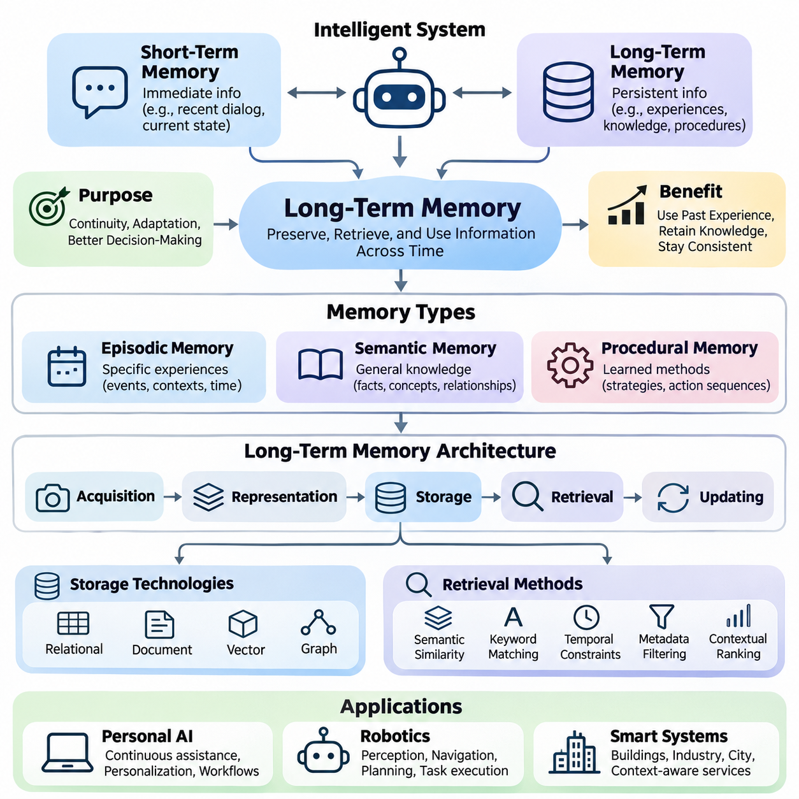
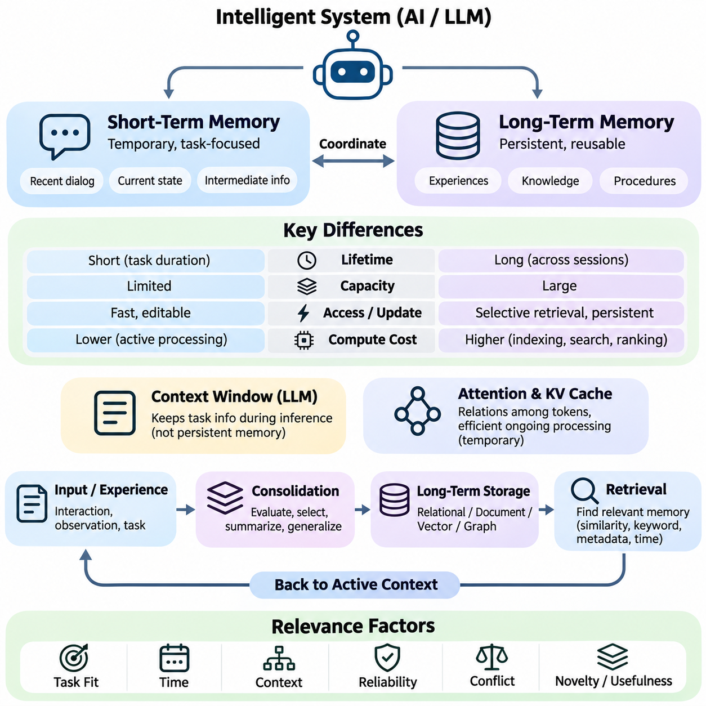
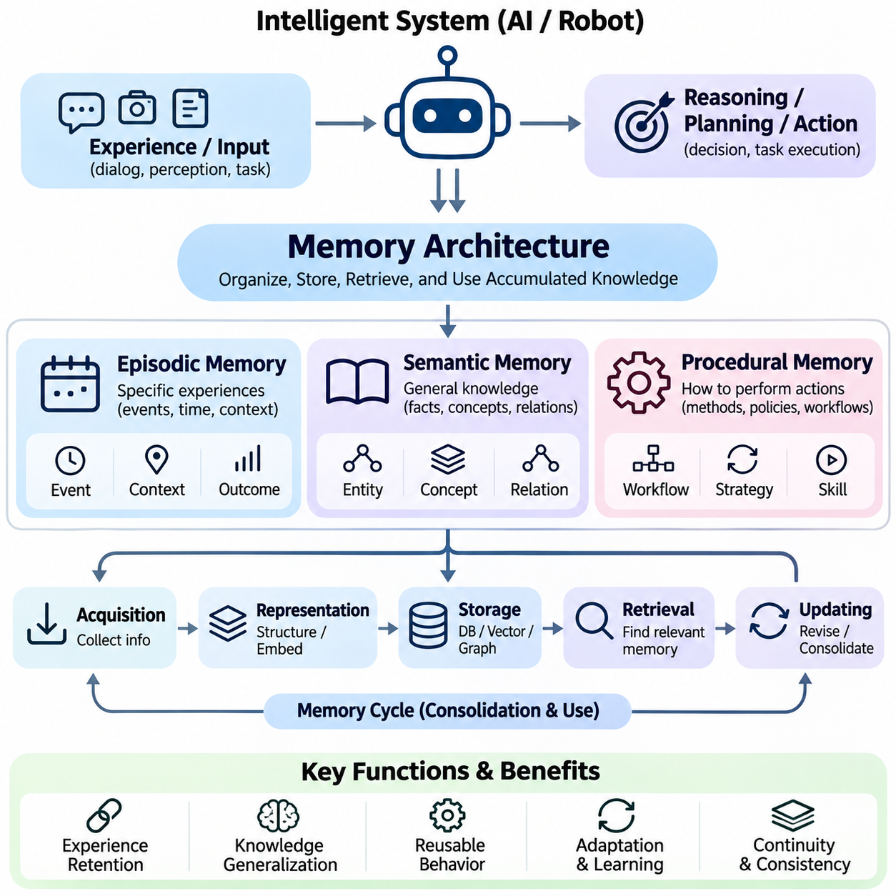
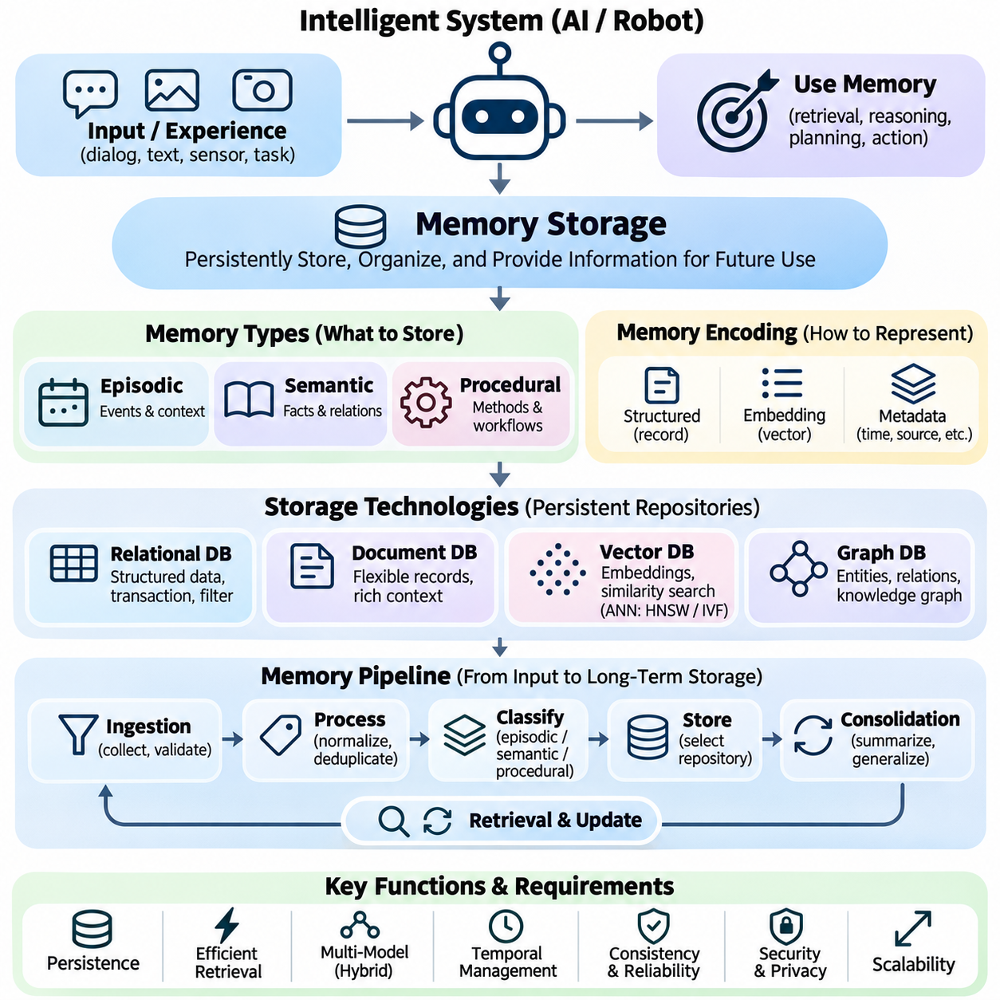
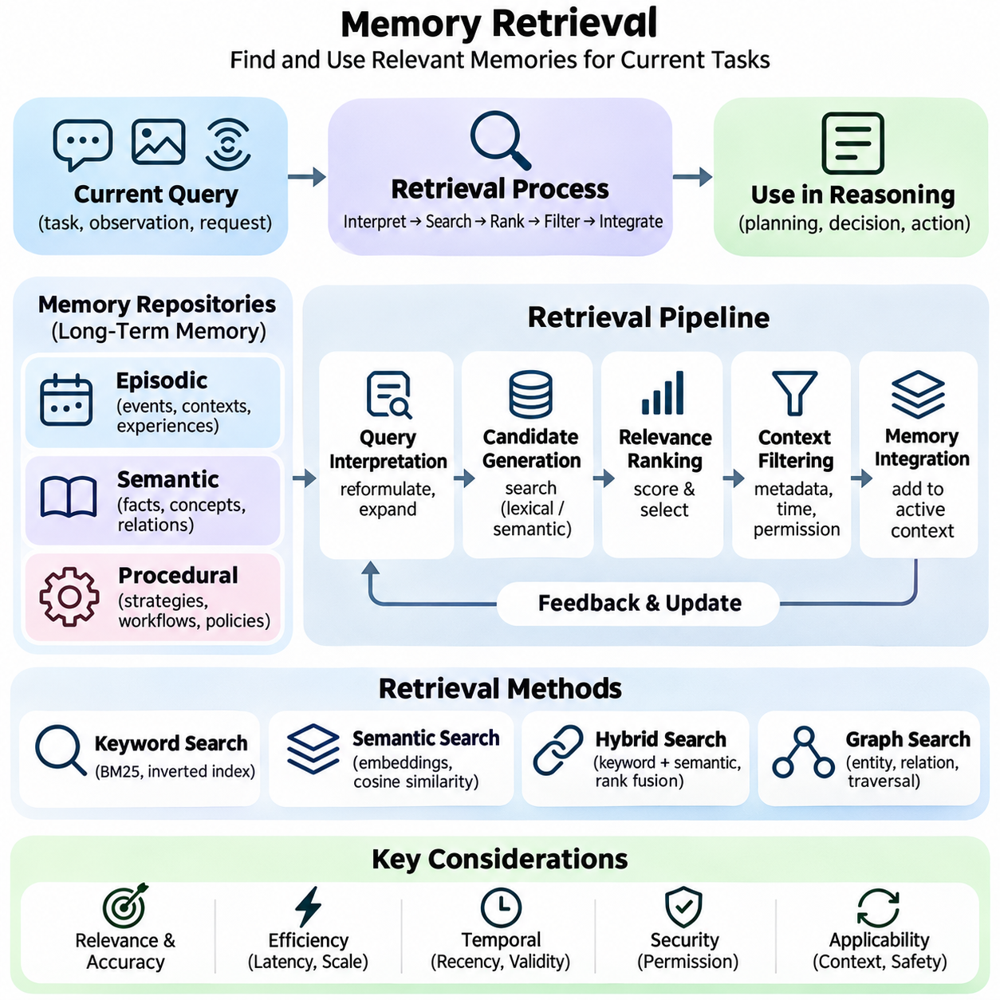
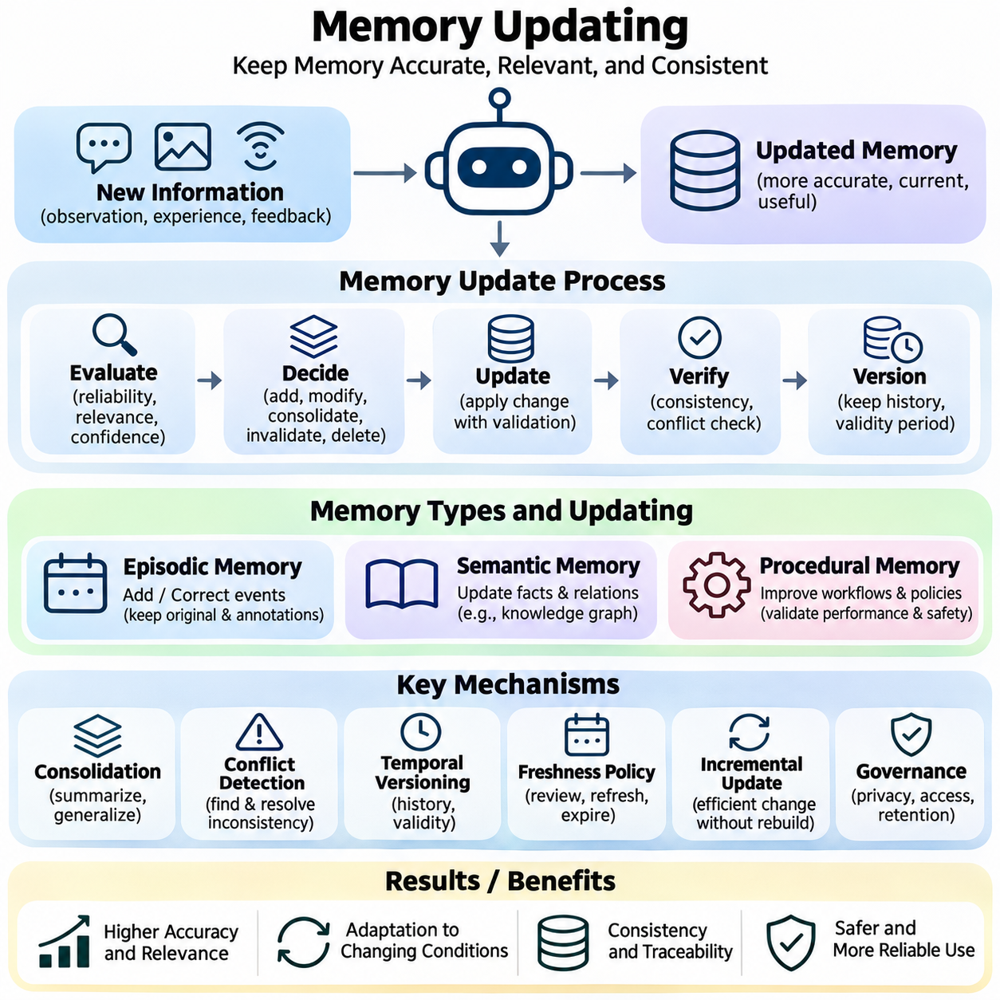
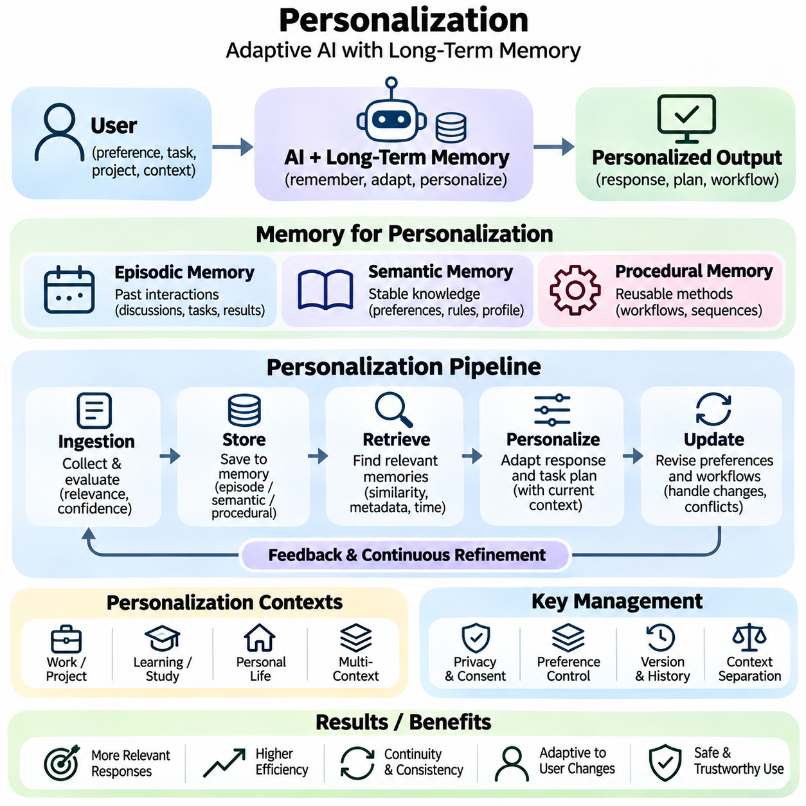
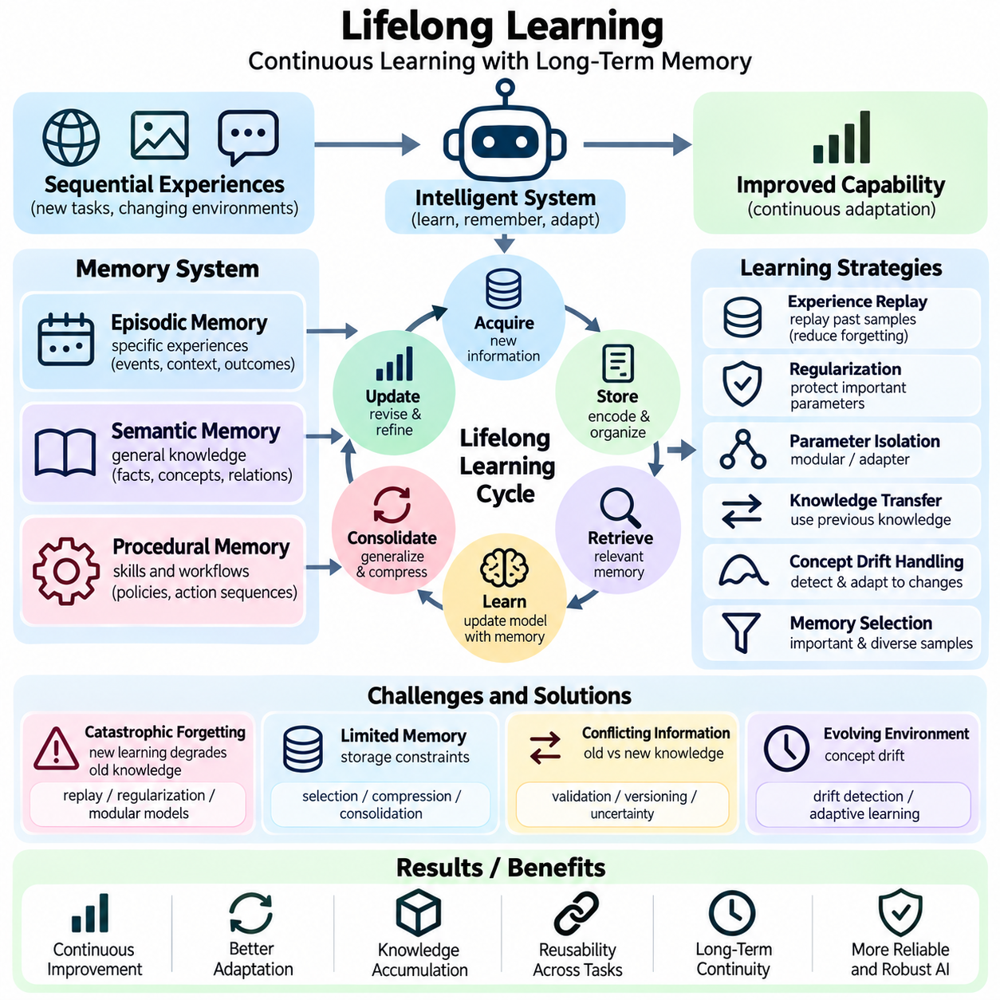
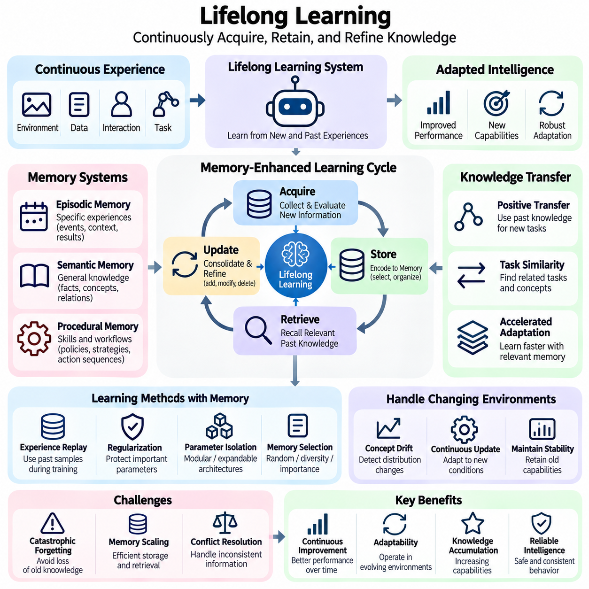
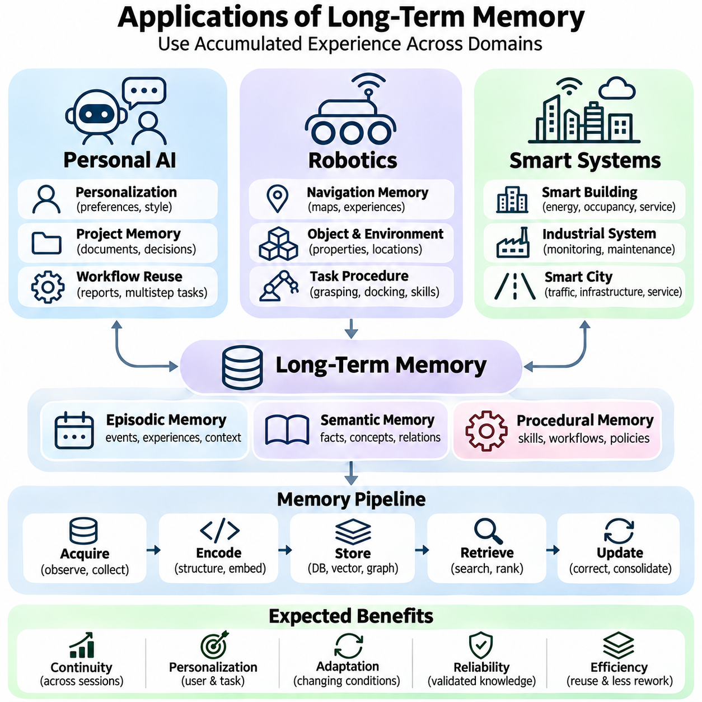

**Volume 37. Memory and Knowledge Systems**

# 03. Long Term Memory

## 03.00 Overview

{width="7.268055555555556in" height="7.268055555555556in"}

Long-term memory is a fundamental capability of intelligent systems that must preserve information beyond a single interaction, computation, or operational session. Unlike temporary context maintained during immediate processing, long-term memory enables artificial intelligence to retain experiences, acquired knowledge, learned preferences, and operational procedures. This capability supports continuity, adaptation, and increasingly informed decision-making across extended periods.

Modern artificial intelligence systems often operate with limited contextual information, particularly when processing long conversations, complex workflows, or continuously changing environments. Even large language models with extensive context windows cannot reliably preserve every relevant experience indefinitely. Long-term memory addresses this limitation by maintaining persistent representations that can be selectively retrieved and incorporated into subsequent reasoning, planning, and decision-making processes.

The distinction between short-term and long-term memory is essential for understanding memory-enabled intelligence. Short-term memory maintains information required for immediate computation, such as recent dialogue, intermediate reasoning states, or current sensor observations. Long-term memory preserves information that remains useful after the immediate task has ended. Effective systems coordinate these mechanisms to maintain both responsiveness and continuity without overwhelming computational resources.

Long-term memory in artificial intelligence is commonly organized into episodic, semantic, and procedural representations. Episodic memory records experiences associated with particular events, circumstances, and temporal contexts. Semantic memory maintains generalized facts, concepts, and relationships independent of individual experiences. Procedural memory represents learned methods, operational strategies, and action sequences that support repeated task execution and behavioral consistency.

Episodic memory allows an intelligent system to reconstruct relevant aspects of previous interactions and operational experiences. A conversational assistant may remember earlier user requests, while an autonomous robot may retain information about obstacles encountered during navigation. Such records typically include contextual attributes, timestamps, environmental conditions, and observed outcomes. These attributes help distinguish similar events and support experience-based reasoning.

Semantic memory provides a more generalized representation of accumulated knowledge. Instead of preserving every observation independently, an intelligent system can consolidate repeated experiences into concepts, factual relationships, and structured knowledge. Semantic representations may include entity descriptions, conceptual hierarchies, domain rules, and associations between objects. Their usefulness depends on accuracy, consistency, contextual relevance, and the ability to incorporate newly acquired information.

Procedural memory supports the retention of learned behaviors and operational knowledge. In robotic systems, procedural information may represent manipulation strategies, navigation routines, or task execution policies. In software agents, it may describe validated workflows, tool invocation sequences, and successful problem-solving methods. Unlike factual memory, procedural knowledge primarily concerns how actions should be performed under particular conditions.

A practical long-term memory architecture requires coordinated mechanisms for information acquisition, representation, storage, retrieval, and updating. Incoming observations must be evaluated to determine whether they contain information worth preserving. Relevant content can then be transformed into structured records, embeddings, summaries, or other representations. The selected storage mechanism must support persistence while maintaining sufficient information for reliable reconstruction and future interpretation.

Memory storage technologies vary according to the characteristics of the information being retained. Relational databases provide structured persistence and transactional consistency, while document databases accommodate flexible records and contextual metadata. Vector databases support similarity-based retrieval through numerical embeddings. Graph databases represent entities and relationships explicitly, making them useful when memory depends on interconnected knowledge rather than isolated observations.

Memory retrieval determines whether stored information can contribute effectively to intelligent behavior. A system must identify relevant memories from potentially large collections without introducing excessive latency or irrelevant context. Retrieval methods may combine semantic similarity, keyword matching, temporal constraints, metadata filtering, and contextual ranking. The retrieved information must then be integrated into the active reasoning process in a manner appropriate to the current task.

The relationship between memory retrieval and information retrieval is particularly important in modern language model systems. Conventional retrieval mechanisms often locate relevant documents from external knowledge collections. Memory retrieval additionally considers accumulated experiences, previous interactions, user-specific context, and changes over time. Although both mechanisms may employ similar indexing technologies, their information sources, update requirements, and relevance criteria can differ substantially.

Memory updating introduces challenges that are not adequately addressed by simple information storage. Newly acquired knowledge may contradict earlier records, supersede outdated assumptions, or reveal that previous interpretations were incomplete. Reliable memory systems therefore require mechanisms for correction, consolidation, versioning, and selective deletion. Without appropriate update policies, accumulated memories can become inconsistent and degrade the quality of future reasoning and decision-making.

Memory consolidation transforms fragmented observations into more stable and useful representations. Repeated experiences may reveal recurring patterns, while related records can be combined into higher-level summaries. Consolidation can reduce redundant storage and improve retrieval efficiency, but excessive compression may remove important details. Effective consolidation must therefore balance information preservation, abstraction quality, computational cost, and the ability to trace conclusions back to supporting experiences.

For personalized artificial intelligence, long-term memory provides continuity across interactions and supports adaptation to individual requirements. A personal assistant may retain explicitly provided preferences, recurring workflows, and relevant project context. Such information can improve subsequent responses by reducing unnecessary repetition and supporting context-aware recommendations. However, personalization must incorporate appropriate consent, access restrictions, correction mechanisms, and safeguards against retaining unnecessary sensitive information.

Long-term memory also contributes to lifelong learning, in which intelligent systems acquire useful information throughout extended operation. Unlike conventional training procedures that rely primarily on fixed datasets, lifelong learning addresses changing environments, emerging tasks, and newly observed experiences. Persistent memory can support experience replay, knowledge transfer, and incremental adaptation, although memory retention alone does not guarantee that a model has learned new capabilities.

A central challenge in lifelong learning is catastrophic forgetting, where adaptation to new information reduces performance on previously learned tasks. Memory-based approaches can mitigate this problem by preserving representative experiences or knowledge needed for continued competence. Replay mechanisms, parameter regularization, and architectural expansion provide complementary strategies. Their effectiveness depends on the learning environment, memory capacity, task relationships, and computational constraints.

In autonomous robotics, long-term memory enables systems to exploit operational experience accumulated across multiple missions. A mobile robot may preserve information about frequently encountered obstacles, environmental changes, navigation failures, and successful recovery strategies. These records can support improved planning, anomaly recognition, and maintenance decisions. Reliable deployment requires careful separation between remembered observations, verified environmental knowledge, and current sensor measurements.

Smart systems can extend these capabilities across interconnected devices, services, and operational environments. Industrial monitoring platforms may retain equipment histories, recurring anomalies, and maintenance outcomes. Smart infrastructure may combine historical observations with current measurements to support predictive analysis and resource allocation. Such applications require memory architectures that accommodate heterogeneous information, distributed access, temporal relationships, and changing operational conditions.

Security and privacy are fundamental requirements because persistent memory can accumulate sensitive information over long periods. Access control, encryption, retention policies, and audit mechanisms help protect stored records against unauthorized disclosure or modification. Systems should also support correction and deletion where appropriate. Memory provenance is especially important because decisions based on historical information should remain traceable to identifiable sources and recorded updates.

The effectiveness of long-term memory cannot be evaluated solely through storage capacity or retrieval speed. Meaningful assessment also considers retrieval relevance, factual consistency, temporal accuracy, resistance to outdated information, and improvements in downstream task performance. Evaluation scenarios should examine whether memory genuinely supports better decisions rather than merely increasing the amount of contextual information supplied to a model.

Long-term memory therefore represents more than an external database attached to an artificial intelligence model. It is an integrated capability connecting experience acquisition, knowledge representation, persistent storage, contextual retrieval, and continuous adaptation. The following sections examine these components through short-term and long-term memory distinctions, memory architectures, storage and retrieval mechanisms, updating strategies, personalization, lifelong learning, and applications in personal AI, robotics, and smart systems.

## 03.01 Short vs Long Term Memory

{width="7.268055555555556in" height="7.268055555555556in"}

Short-term memory and long-term memory represent two complementary mechanisms through which intelligent systems maintain and utilize information across different time scales. Short-term memory temporarily preserves information needed for immediate processing, reasoning, and decision-making, while long-term memory retains knowledge and experiences beyond the current interaction. Their coordination enables artificial intelligence systems to combine contextual responsiveness with persistent knowledge and behavioral continuity.

Short-term memory operates as an active information workspace that supports ongoing computational tasks. In conversational artificial intelligence, it may contain recent messages, user instructions, intermediate reasoning information, and retrieved documents. In autonomous systems, it may include current sensor measurements, estimated environmental states, and immediate control objectives. Its primary function is to maintain information relevant to the present task without requiring permanent storage.

Long-term memory serves a different purpose by preserving information that remains valuable across multiple interactions or operational sessions. Such information may include historical experiences, factual knowledge, learned preferences, environmental patterns, and successful task procedures. Unlike short-term memory, which emphasizes immediate accessibility, long-term memory emphasizes persistence, selective retrieval, and the ability to support future decisions using previously acquired information.

The distinction between these memory mechanisms is influenced by information lifetime, storage capacity, accessibility, and computational requirements. Short-term memory generally prioritizes rapid access and frequent modification, although its effective capacity may be constrained by available computational resources. Long-term memory can maintain substantially larger information collections, but retrieving relevant records may require indexing, similarity search, ranking, and contextual filtering.

Human cognitive science provides a useful conceptual foundation for distinguishing short-term and long-term memory. Working memory temporarily maintains and manipulates information required for active cognitive operations, whereas long-term memory supports the retention of knowledge and experiences over extended periods. Artificial intelligence systems adopt similar functional distinctions, although their computational implementations differ considerably from biological memory processes and should not be treated as direct neurological equivalents.

In large language models, the context window provides an important mechanism for maintaining task-relevant information during inference. Input tokens, previous dialogue, and retrieved content can influence subsequent predictions while they remain within the available context. However, a context window is not equivalent to persistent long-term memory. Once information is removed from the active context, continued access generally requires external storage, renewed retrieval, or another explicit persistence mechanism.

The attention mechanism allows transformer-based models to establish relationships among tokens within their available context. During autoregressive inference, key-value caches can reduce repeated computation by retaining intermediate attention representations. These caches support efficient processing of ongoing sequences but do not independently provide durable memory across unrelated sessions. Persistent memory therefore requires additional architectural components beyond conventional attention and inference caching.

Short-term memory management becomes increasingly important when interactions exceed available context capacity. Systems may remove older messages, compress previous dialogue into summaries, or prioritize information according to task relevance. These operations help preserve essential context while controlling computational cost. Nevertheless, aggressive summarization may eliminate important details, and simple truncation can discard information required for later reasoning or accurate interpretation.

Long-term memory architectures address these limitations through persistent storage and retrieval mechanisms. Information extracted from interactions may be represented as structured records, textual summaries, vector embeddings, or relational knowledge. Storage technologies can include relational databases, document repositories, vector databases, and knowledge graphs. The appropriate representation depends on whether the system must preserve exact events, generalized concepts, procedural information, or relationships between entities.

The transfer of information from short-term to long-term memory is commonly described as memory consolidation. During consolidation, an intelligent system evaluates incoming information according to relevance, novelty, reliability, and expected future usefulness. Important observations may be preserved directly, while repeated experiences can be combined into generalized representations. Effective consolidation must balance information retention against storage growth, redundancy, privacy requirements, and the risk of preserving inaccurate assumptions.

Memory retrieval enables previously stored information to return to the active computational context when needed. A retrieval mechanism may use semantic similarity, keyword matching, metadata constraints, temporal relevance, or combinations of these methods. Retrieved memories can then be incorporated into the current reasoning process. This interaction creates a functional connection between persistent historical knowledge and immediate decision-making without requiring all stored information to remain continuously active.

Memory relevance depends on more than semantic similarity alone. A record may closely match the current query while containing outdated information, uncertain conclusions, or details from an unrelated situation. Effective retrieval therefore considers temporal validity, source reliability, contextual compatibility, and task-specific importance. Memory ranking and validation mechanisms help reduce inappropriate retrieval and prevent historical information from being interpreted as unquestionably current.

Short-term and long-term memory also differ in their updating characteristics. Short-term memory changes continuously as new observations, messages, and intermediate states enter the active context. Long-term memory requires more deliberate update policies because stored information may influence decisions across many future sessions. Updating may involve correcting factual errors, replacing obsolete records, merging related experiences, or deleting information that is no longer relevant or authorized for retention.

An effective memory-enabled architecture establishes a bidirectional relationship between immediate context and persistent knowledge. Current observations can generate candidate memories for long-term storage, while previously stored information can be retrieved to support active reasoning. This process allows systems to accumulate useful experiences without treating every observation as permanent knowledge. The quality of the architecture depends on selecting what to retain, when to retrieve it, and how to resolve conflicts.

In personalized artificial intelligence, short-term memory supports the immediate conversation, while long-term memory provides continuity across separate interactions. A conversational assistant may temporarily track the current question and its supporting context while retrieving previously authorized preferences or project information when relevant. This combination can reduce repetitive explanations and improve contextual consistency, provided that retained information remains accurate, appropriately scoped, and subject to user control.

Autonomous robotics demonstrates another important distinction between these memory types. Short-term memory may maintain the robot\'s current pose estimate, nearby obstacles, local trajectories, and immediate navigation objectives. Long-term memory may preserve previously observed environmental characteristics, historical navigation outcomes, and recurring operational conditions. Integrating both mechanisms allows the robot to respond to current sensor measurements while benefiting from accumulated operational experience.

In industrial and smart systems, short-term memory frequently supports real-time monitoring and control, whereas long-term memory supports historical analysis and operational optimization. A monitoring system may temporarily maintain recent sensor readings and active anomaly indicators while preserving equipment histories and maintenance records. Historical information can support predictive maintenance and recurring fault analysis, but immediate safety decisions must remain grounded in validated current measurements.

The performance of memory systems must be evaluated across multiple dimensions, including retrieval accuracy, response latency, storage efficiency, temporal consistency, and downstream task effectiveness. Short-term memory evaluation emphasizes contextual coherence and immediate processing efficiency. Long-term memory evaluation additionally considers retention quality, update correctness, retrieval relevance, and resistance to outdated or misleading information. Combined evaluations determine whether persistent memory improves practical intelligence.

Security and privacy requirements apply differently to temporary and persistent information. Short-term memory may contain sensitive information needed only for immediate processing, while long-term memory introduces additional risks through extended retention and repeated accessibility. Appropriate safeguards include access control, encryption, retention limits, provenance tracking, and deletion mechanisms. Memory architectures should avoid automatically converting every temporary observation into permanently stored information.

The integration of short-term and long-term memory provides a foundation for adaptive artificial intelligence systems capable of maintaining immediate situational awareness while utilizing accumulated knowledge. Short-term memory supplies the active context required for responsive behavior, whereas long-term memory supports continuity, personalization, and experience-based adaptation. Their effective coordination is essential for developing reliable conversational agents, autonomous robots, and intelligent systems operating across extended periods.

## 03.02 Memory Architecture

{width="7.268055555555556in" height="7.268055555555556in"}

Memory architecture defines how an intelligent system organizes, stores, retrieves, and utilizes information accumulated through experience and learning. A comprehensive architecture distinguishes episodic memory, semantic memory, and procedural memory according to the nature of the information represented. These complementary memory systems enable artificial intelligence to preserve historical experiences, maintain generalized knowledge, and execute learned behaviors across different tasks and operational environments.

Episodic memory represents specific experiences associated with particular events, temporal contexts, and environmental conditions. Each memory episode may contain information about what occurred, when it happened, where it occurred, and which actions or outcomes were observed. This contextual organization allows intelligent systems to distinguish individual experiences and reconstruct relevant historical situations when performing reasoning, planning, or decision-making tasks.

An episodic memory record typically combines event descriptions with timestamps, contextual metadata, observations, actions, and outcomes. In conversational agents, episodes may correspond to previous interactions or completed tasks. In autonomous robotics, they may represent navigation events, obstacle encounters, or manipulation attempts. Maintaining these contextual relationships enables experience-based retrieval and supports the analysis of recurring operational patterns.

Episodic memory storage can employ structured databases, document repositories, or vector-based representations. Structured records preserve explicit attributes, while embeddings support semantic similarity searches across related experiences. Temporal indexing and metadata filtering can improve retrieval accuracy when historical sequence or environmental context matters. Hybrid storage architectures often combine these techniques to balance flexible retrieval with precise event reconstruction.

Episodic memory retrieval identifies past experiences relevant to the current situation. Retrieval mechanisms may consider semantic similarity, temporal proximity, environmental conditions, and observed outcomes. For example, an autonomous robot encountering an unfamiliar obstacle may retrieve earlier episodes involving comparable conditions. The retrieved experiences can inform planning, although historical observations must be validated against current sensor measurements before influencing safety-critical decisions.

Semantic memory represents generalized knowledge that is not necessarily associated with a particular event or experience. It includes factual information, concepts, relationships, categories, and domain-specific rules acquired through training or accumulated observations. Unlike episodic memory, which preserves contextual details of individual occurrences, semantic memory emphasizes stable representations that support interpretation, knowledge retrieval, and reasoning across multiple situations.

Semantic memory architectures frequently employ knowledge graphs, ontologies, relational databases, and vector representations. Knowledge graphs explicitly represent entities and their relationships, while ontologies define conceptual categories and logical constraints. Vector embeddings encode semantic associations within numerical spaces. Combining symbolic and distributed representations enables intelligent systems to support both structured reasoning and similarity-based knowledge retrieval.

The development of semantic memory often involves abstraction and consolidation of repeated experiences. Multiple episodic observations may reveal consistent relationships that can be transformed into generalized knowledge. For example, repeated navigation experiences may indicate that certain environmental conditions increase traversal difficulty. Such generalizations require evidence evaluation because isolated observations or temporary conditions should not automatically become permanent factual knowledge.

Semantic memory retrieval supports tasks requiring factual consistency, conceptual understanding, and relationships between entities. A language model may retrieve technical specifications, organizational knowledge, or previously verified domain information. A robotic system may access object properties, spatial relationships, or environmental constraints. Effective retrieval requires attention to source reliability, temporal validity, and possible contradictions between stored knowledge and current observations.

Procedural memory represents knowledge about how to perform actions, execute workflows, and accomplish operational objectives. It differs from episodic and semantic memory because its primary purpose is to support behavior rather than preserve events or factual descriptions. Procedural representations may include action sequences, task policies, control strategies, tool invocation procedures, and learned skills that can be reused under appropriate conditions.

In autonomous systems, procedural memory may contain navigation strategies, manipulation routines, recovery procedures, and task execution policies. A robotic manipulator may retain successful grasping strategies associated with particular object characteristics. A software agent may preserve validated sequences for interacting with external tools. These representations can reduce repeated planning effort and improve operational consistency when tasks recur under comparable conditions.

Procedural memory can be implemented through explicit rules, finite-state machines, behavior trees, hierarchical policies, or learned neural controllers. Symbolic representations provide interpretable execution structures, while learned policies can encode complex mappings between observations and actions. Hybrid approaches combine high-level procedural descriptions with low-level control models, enabling flexible task execution while maintaining operational constraints and safety requirements.

The acquisition of procedural memory may involve supervised learning, imitation learning, reinforcement learning, or repeated execution with performance feedback. Successful behaviors can be retained and refined through subsequent experience. However, procedural knowledge must be evaluated before reuse because a strategy that succeeds in one environment may fail under different conditions. Context-sensitive selection and validation are therefore essential components of reliable procedural memory systems.

Although episodic, semantic, and procedural memory serve different functions, practical intelligent systems benefit from their coordinated operation. Episodic memory supplies evidence from previous experiences, semantic memory provides generalized knowledge, and procedural memory supports action execution. Their integration enables an intelligent system to connect historical observations with conceptual understanding and appropriate behavioral responses during complex tasks.

Information can flow between these memory components through consolidation, abstraction, and learning. Repeated episodes may contribute to semantic knowledge when consistent patterns are verified. Episodic records of successful task execution may support the development or refinement of procedural strategies. Conversely, semantic knowledge can guide the interpretation of new experiences, while procedural policies determine which actions are executed and subsequently recorded as new episodes.

A unified memory architecture requires mechanisms for memory encoding, classification, indexing, retrieval, updating, and access control. Incoming information must be assigned suitable representations according to its purpose and expected future usefulness. Memory managers can coordinate storage across heterogeneous repositories and select relevant information for active reasoning. Such architectures must also manage redundancy, conflicting records, temporal changes, and computational resource limitations.

Memory consistency becomes particularly important when different memory components contain related but potentially contradictory information. An episodic record may describe a temporary condition that conflicts with established semantic knowledge, while a procedural strategy may rely on outdated assumptions. Reliable architectures should preserve provenance, distinguish observations from verified facts, and validate procedural applicability before execution. These safeguards reduce the risk of propagating errors across memory systems.

Memory architecture also influences personalization and lifelong learning. Episodic memory can preserve previous interactions, semantic memory can maintain stable user preferences or domain knowledge, and procedural memory can retain recurring workflows. Together, these components support adaptive behavior across extended periods. Nevertheless, memory retention and behavioral adaptation must remain subject to privacy controls, appropriate authorization, and mechanisms for correcting or deleting stored information.

In robotics, the integration of memory types can improve navigation, manipulation, and operational planning. Episodic memory records previous missions and environmental encounters, semantic memory represents objects and environmental relationships, and procedural memory stores executable strategies. A mobile robot can use these complementary representations to interpret current conditions, retrieve relevant experiences, and select suitable actions while maintaining reliance on current perception and safety constraints.

Enterprise and smart systems similarly benefit from integrated memory architectures. Episodic records can preserve equipment failures, maintenance events, and operational incidents. Semantic memory can organize equipment specifications, causal relationships, and domain terminology. Procedural memory can represent maintenance workflows, inspection procedures, and response strategies. Coordinating these representations supports historical analysis, knowledge reuse, and more consistent operational decision-making.

The evaluation of memory architecture requires examining the performance of individual components and their interactions. Episodic memory can be assessed through event retrieval accuracy and contextual reconstruction. Semantic memory requires factual consistency and relationship correctness, while procedural memory requires task success, execution reliability, and adaptability. System-level evaluation additionally considers latency, storage efficiency, update correctness, and the quality of decisions supported by retrieved information.

A well-designed memory architecture therefore extends beyond the passive preservation of information. By integrating episodic, semantic, and procedural memory, intelligent systems can connect past experiences, accumulated knowledge, and executable behaviors within a coherent computational framework. This integration provides a foundation for persistent artificial intelligence, personalized assistants, autonomous robotics, and continuously adapting systems capable of operating reliably across changing environments and extended time horizons.

## 03.03 Memory Storage [w/Code]

{width="7.268055555555556in" height="7.268055555555556in"}

Memory storage is a fundamental component of long-term memory architectures, providing the mechanisms required to preserve information beyond immediate computational sessions. Unlike temporary context maintained during inference, persistent memory storage enables intelligent systems to retain experiences, factual knowledge, and operational procedures. Its design determines how information is represented, organized, protected, and made available for future retrieval and reasoning.

An effective memory storage system must accommodate different forms of information, including episodic records, semantic knowledge, and procedural representations. Episodic records preserve events and contextual observations, semantic storage maintains facts and relationships, and procedural storage retains reusable workflows or learned behaviors. These categories impose different requirements on data structures, indexing methods, consistency guarantees, and retrieval operations.

Memory encoding transforms incoming information into representations suitable for persistent storage. Textual interactions may be preserved as structured documents, while semantic content can be converted into numerical embeddings. Sensor observations may require timestamps, spatial coordinates, confidence estimates, and associated metadata. The encoding process should retain sufficient contextual information to support accurate interpretation without unnecessarily increasing storage complexity.

Structured memory storage commonly relies on relational databases that organize information into tables with defined schemas and relationships. Such databases support transactional operations, integrity constraints, and precise filtering through structured queries. They are particularly useful for maintaining user profiles, event histories, task records, and operational metadata. Their limitations become apparent when storing highly heterogeneous observations or performing large-scale semantic similarity searches.

Document-oriented databases provide flexible storage for memories containing variable attributes and complex contextual descriptions. Individual records may include textual summaries, timestamps, source identifiers, environmental conditions, and nested metadata. This flexibility supports evolving memory schemas without requiring every record to share identical fields. However, careful schema validation and indexing remain necessary to prevent inconsistent representations and inefficient retrieval.

Vector databases provide a specialized mechanism for storing embeddings generated from textual, visual, or multimodal information. Each embedding represents semantic characteristics within a numerical vector space, allowing related memories to be retrieved through similarity measurements. Vector storage is especially useful for conversational histories, experience retrieval, and knowledge-augmented language models. Nevertheless, embeddings alone cannot preserve every factual detail or guarantee exact reconstruction of original information.

Similarity-based memory storage frequently employs approximate nearest neighbor indexing to support efficient retrieval from large embedding collections. Algorithms such as Hierarchical Navigable Small World and Inverted File indexing reduce search complexity by organizing vectors into searchable structures. Their effectiveness depends on embedding dimensionality, index configuration, dataset characteristics, and available computational resources. Index selection involves tradeoffs among retrieval accuracy, memory consumption, insertion cost, and query latency.

Graph-based memory storage represents knowledge through entities, relationships, and associated attributes. This structure is particularly useful when stored memories contain interconnected concepts, causal dependencies, or relationships between objects and events. Knowledge graphs can support structured traversal and relationship-oriented queries that are difficult to express through isolated vector embeddings. Combining graph storage with semantic retrieval enables more comprehensive access to interconnected information.

Hybrid memory storage architectures combine relational, document, vector, and graph representations according to their respective strengths. A memory episode may be stored as a structured event record while its semantic embedding is indexed separately for similarity retrieval. Relationships between relevant entities may be maintained in a graph database. Coordinating these representations allows intelligent systems to support precise filtering, semantic search, and relational reasoning within a unified memory framework.

Memory ingestion pipelines determine how observations enter persistent storage. Incoming information may undergo validation, normalization, deduplication, classification, and relevance assessment before being retained. A memory manager can assign records to appropriate storage components based on information type and expected future usefulness. These operations reduce unnecessary storage growth while improving consistency and retrieval quality across heterogeneous memory repositories.

Memory consolidation reduces fragmentation by transforming related observations into more stable representations. Repeated conversational interactions may produce summarized preferences, while recurring robotic observations may reveal persistent environmental characteristics. Consolidation can improve storage efficiency and retrieval relevance, but excessive abstraction may remove important contextual details. Reliable systems should preserve source references and distinguish generalized conclusions from the individual observations supporting them.

Temporal information is essential for maintaining accurate long-term memories. Records should distinguish when an event occurred, when information was stored, and when a fact was last verified. These timestamps support chronological retrieval, historical reconstruction, and the identification of outdated information. Temporal databases and versioned records can additionally represent changes in knowledge over time, preventing earlier observations from being incorrectly interpreted as current conditions.

Memory updating requires mechanisms for modifying stored information without compromising consistency or historical traceability. New observations may correct previous records, introduce additional context, or invalidate outdated assumptions. Version control, transaction management, and conflict resolution help maintain reliable memory states. In distributed architectures, synchronization policies must also account for delayed updates, concurrent modifications, and temporary communication failures.

Memory deletion and retention policies are equally important because persistent storage can accumulate irrelevant, redundant, or sensitive information. Retention rules may depend on information importance, age, usage frequency, and authorization requirements. Deletion mechanisms should address primary records, associated indexes, cached representations, and replicated copies where applicable. Proper lifecycle management prevents uncontrolled memory growth and supports privacy, compliance, and operational efficiency.

Storage scalability becomes increasingly important as intelligent systems accumulate information across extended periods. Partitioning, sharding, compression, and tiered storage can distribute memory collections across available infrastructure. Frequently accessed records may remain in high-performance storage, while historical archives can be transferred to lower-cost systems. These strategies must balance storage expenses, retrieval latency, availability, and the operational importance of preserved information.

Distributed memory storage introduces additional requirements for replication, synchronization, and fault tolerance. Replication can improve availability and protect against hardware failures, while distributed indexing supports larger memory collections. However, maintaining consistent information across multiple storage nodes may introduce communication overhead and update delays. System designers must select consistency guarantees appropriate to application requirements, particularly when memories influence operational or safety-related decisions.

Security and privacy must be incorporated directly into memory storage architecture. Persistent records may contain personal preferences, confidential documents, operational histories, or sensitive environmental information. Encryption, authentication, role-based access control, and audit logging help protect these records against unauthorized access or modification. Data minimization and configurable retention policies further reduce exposure by limiting unnecessary collection and prolonged preservation.

Memory provenance provides traceability between stored information and its original source. A record may include source identifiers, creation timestamps, confidence estimates, transformation histories, and validation status. These attributes help distinguish directly observed facts from inferred conclusions or generated summaries. Provenance is particularly important when retrieved memories influence automated reasoning because incorrect or unverifiable information can propagate into subsequent decisions.

In autonomous robotics, memory storage must accommodate heterogeneous data from cameras, LiDAR, radar, localization systems, and operational controllers. Raw sensor recordings may require high-capacity storage, while summarized events and learned environmental relationships can be retained in compact databases. Edge computing platforms may maintain local memory for low-latency operation and synchronize selected records with centralized repositories when connectivity becomes available.

Memory storage for personalized artificial intelligence emphasizes continuity across interactions while maintaining appropriate user control. Conversational histories, authorized preferences, recurring workflows, and relevant project knowledge may be preserved in separate storage categories. Semantic indexing enables context-sensitive retrieval, while structured metadata supports filtering by source, validity, and access permissions. Persistent storage should remain distinguishable from temporary conversational context and model parameters.

Evaluating memory storage requires examining durability, retrieval compatibility, scalability, consistency, security, and operational cost. Relevant measurements include write throughput, storage utilization, index construction time, update latency, and recovery performance. Storage quality must also be assessed through downstream retrieval accuracy and factual reliability. A technically efficient repository provides limited value if its representations cannot support correct interpretation and useful decision-making.

Memory storage therefore extends beyond the passive accumulation of historical information. It provides the persistent foundation through which intelligent systems preserve experiences, organize knowledge, maintain procedural information, and support future reasoning. By integrating appropriate data representations, indexing structures, lifecycle policies, and security mechanisms, memory storage architectures enable reliable long-term intelligence across conversational agents, autonomous robots, enterprise platforms, and continuously adapting systems.

## 03.04 Memory Retrieval [w/Code]

{width="7.268055555555556in" height="7.268055555555556in"}

Memory retrieval is the process through which intelligent systems identify and access previously stored information relevant to current tasks, observations, or decisions. It connects persistent memory repositories with active computational contexts, enabling accumulated experiences and knowledge to influence present reasoning. Effective retrieval must balance relevance, accuracy, latency, and computational efficiency while preventing outdated or inappropriate information from affecting system behavior.

A memory retrieval architecture typically consists of query interpretation, candidate generation, relevance ranking, contextual filtering, and memory integration. The system first determines what information is required, then searches available memory repositories for potentially useful records. Retrieved candidates are evaluated before being introduced into the active reasoning context. This staged process reduces unnecessary information transfer and improves the usefulness of retrieved memories.

Query formulation plays a critical role in retrieval quality because user requests and environmental observations may not directly correspond to stored representations. A retrieval system can transform the current task into keywords, semantic embeddings, structured constraints, or multiple complementary queries. Query expansion and contextual reformulation improve coverage when relevant memories use different terminology or describe related experiences indirectly.

Keyword-based retrieval identifies records containing terms associated with the current query. Traditional information retrieval methods, including inverted indexes and BM25 ranking, provide efficient mechanisms for matching textual content. These approaches are particularly effective when exact terminology, identifiers, or technical specifications matter. However, lexical retrieval may overlook conceptually related information expressed through different words or descriptions.

Semantic retrieval addresses lexical limitations by representing queries and stored memories as numerical embeddings. Similarity measures, including cosine similarity and inner product, estimate relationships between vector representations. Relevant memories can therefore be identified even when their wording differs from the current request. Retrieval quality depends strongly on embedding models, domain compatibility, representation quality, and the semantic characteristics of stored information.

Large-scale semantic retrieval commonly employs approximate nearest neighbor search to reduce computational requirements. Indexing structures such as Hierarchical Navigable Small World and Inverted File indexes organize embedding collections for efficient candidate identification. Approximate search improves scalability but may omit some relevant neighbors. System designers must balance search recall, index memory consumption, update costs, and query latency according to application requirements.

Hybrid retrieval combines lexical and semantic search to improve robustness across different information types. Keyword matching captures exact references, while embedding similarity identifies conceptually related records. Candidate lists can be combined through score normalization, reciprocal rank fusion, or learned ranking methods. Hybrid approaches are especially valuable when memory repositories contain technical terminology, natural language descriptions, and heterogeneous historical records.

Metadata filtering restricts retrieval to records satisfying explicit contextual requirements. Filters may consider timestamps, user permissions, project identifiers, geographic regions, source categories, or operational conditions. Such constraints prevent irrelevant memories from entering the candidate set and can improve both efficiency and precision. In multiuser environments, authorization filtering must be enforced as an access-control requirement rather than treated merely as a relevance preference.

Temporal retrieval considers when information was created, observed, modified, or last verified. Recent records may be more relevant for changing operational conditions, while older memories may remain essential for historical analysis or long-term patterns. Time-aware ranking can incorporate recency without automatically discarding older knowledge. Reliable systems distinguish event time from storage time and account for the possibility that previously valid information has become obsolete.

Episodic memory retrieval focuses on identifying past events with relevant contextual similarities. Search criteria may include event descriptions, environmental conditions, actions, outcomes, and temporal relationships. An autonomous robot can retrieve earlier navigation episodes involving comparable obstacles or terrain conditions. These experiences may inform planning, but their applicability must be assessed against current observations and operational constraints.

Semantic memory retrieval emphasizes factual knowledge, conceptual relationships, and generalized information. Knowledge graphs can support entity-based queries and relationship traversal, while vector indexes enable similarity-based access to concepts. Combining these methods allows systems to retrieve both explicit relationships and semantically associated information. Source validation and contradiction detection are important when retrieved knowledge influences factual reasoning.

Procedural memory retrieval identifies reusable strategies, workflows, and action policies appropriate for the current objective. Retrieval conditions may include task type, available tools, environmental state, and execution constraints. A software agent may select a previously validated workflow, while a robot may retrieve a manipulation strategy. Procedural retrieval requires additional applicability and safety checks because retrieved information may directly influence executable actions.

Relevance ranking determines which candidate memories should receive priority after initial retrieval. Ranking models may consider semantic similarity, lexical matching, temporal relevance, source reliability, and task-specific importance. Cross-encoder reranking can evaluate query-memory relationships more precisely than independent embedding comparisons, although it introduces additional computation. Multi-stage ranking balances retrieval quality against response-time requirements.

Memory integration determines how selected records are incorporated into active reasoning. Retrieved content may be inserted into a language model context, converted into structured features, or supplied to planning and decision modules. The integration process should preserve source attribution and distinguish retrieved observations from verified knowledge. Excessive retrieval can introduce irrelevant details, increase token consumption, and reduce reasoning effectiveness.

Retrieval-augmented generation provides a common example of memory integration in language models. A retrieval component selects relevant external information and supplies it as contextual evidence for response generation. When applied to persistent conversational memories, this approach can support continuity across sessions without modifying model parameters. Nevertheless, retrieved content does not guarantee factual correctness, and generation mechanisms must avoid treating uncertain memories as authoritative evidence.

Retrieval systems must address conflicting, duplicated, and incomplete records. Multiple memories may describe the same event differently, while historical information may contradict newer observations. Deduplication, provenance tracking, confidence estimation, and conflict resolution help maintain retrieval reliability. When uncertainty cannot be resolved, the system should preserve competing interpretations rather than silently converting incomplete evidence into definitive conclusions.

Memory retrieval performance depends on the scale and organization of stored information. Caching, partitioning, parallel search, and hierarchical indexes can reduce access latency across large repositories. Frequently requested memories may be retained in faster storage tiers, while less frequently accessed records remain in archival systems. These optimizations must preserve consistency and prevent stale cached information from overriding updated records.

Security and privacy are essential because retrieval can expose information stored across extended periods. Access controls should restrict which memories can be searched, ranked, and returned for a particular user or application. Sensitive records may require encryption, audit logging, and purpose-based restrictions. Retrieved information must also be treated as potentially untrusted content to prevent malicious instructions embedded in memory records from controlling system behavior.

Evaluating memory retrieval requires measuring both search effectiveness and downstream task performance. Precision, recall, Recall\\@K, Mean Reciprocal Rank, and normalized Discounted Cumulative Gain provide complementary measures of retrieval quality. Latency, throughput, and resource utilization characterize operational efficiency. End-to-end evaluation should additionally examine factual accuracy, contextual consistency, task completion, and the consequences of retrieving misleading information.

Memory retrieval is therefore more than locating similar records within a database. It is a coordinated process of interpreting information needs, identifying candidates, evaluating relevance, enforcing constraints, and integrating selected knowledge into active computation. By combining lexical, semantic, temporal, and structured retrieval mechanisms, intelligent systems can transform persistent memories into useful evidence for reasoning, personalization, autonomous operation, and long-term adaptation.

## 03.05 Memory Updating

{width="7.268055555555556in" height="7.268055555555556in"}

Memory updating is the process of modifying persistent information as intelligent systems acquire new observations, experiences, and knowledge. Unlike memory storage, which emphasizes preservation, memory updating maintains the accuracy, relevance, and consistency of previously retained information. Effective updating allows artificial intelligence systems to adapt to changing conditions without losing valuable historical knowledge or introducing contradictions into their memory repositories.

Long-term memory is not a static collection of records because real-world environments, user preferences, and operational requirements continuously evolve. Previously accurate information may become outdated, while new observations may reveal errors or provide additional context. Memory updating must therefore distinguish between adding new knowledge, correcting existing information, revising uncertain conclusions, and removing records that are no longer valid or appropriate for retention.

Memory update operations generally include insertion, modification, consolidation, invalidation, and deletion. Insertion preserves newly acquired information, while modification changes existing records when reliable evidence becomes available. Consolidation combines related observations into more useful representations, and invalidation marks information as no longer applicable. Deletion removes records according to retention policies, authorization requirements, or explicit removal requests.

An effective updating architecture begins with evaluating incoming information before modifying persistent memory. The system may assess source reliability, temporal relevance, contextual compatibility, and confidence estimates. New observations should not automatically replace established knowledge merely because they are recent. Instead, update decisions should consider the quality of supporting evidence and whether apparent contradictions reflect genuine changes or differences in observation conditions.

Episodic memory updating primarily concerns the addition and correction of historical event records. New episodes may contain timestamps, environmental observations, actions, and outcomes associated with specific experiences. Existing episodes can receive corrected metadata or additional annotations when new evidence becomes available. However, historical events should not be silently rewritten because preserving original observations and subsequent corrections supports traceability and reliable retrospective analysis.

Semantic memory updating modifies generalized facts, concepts, and relationships represented within knowledge repositories. A newly verified observation may introduce a factual relationship, revise an existing attribute, or invalidate an outdated assumption. Knowledge graphs and structured databases can support these changes through explicit entity and relationship updates. Consistency checks are necessary to prevent contradictory facts from propagating across interconnected knowledge structures.

Procedural memory updating focuses on improving reusable workflows, action strategies, and learned task policies. A software agent may revise an execution sequence after discovering a more reliable procedure, while a robot may refine a manipulation strategy through operational feedback. Procedural updates require careful validation because modified instructions or policies can directly influence system behavior. New procedures should be tested against performance, safety, and operational constraints before deployment.

Memory consolidation plays an important role in reducing redundant information and extracting stable knowledge from repeated experiences. Multiple episodic records may reveal consistent patterns that can be summarized into semantic representations. Repeated successful actions may contribute to improved procedural strategies. Nevertheless, consolidation should preserve relevant source references and uncertainty because excessive generalization can eliminate contextual distinctions essential for future reasoning.

Conflict detection identifies situations in which newly acquired information disagrees with existing memory. Conflicts may arise from outdated records, measurement errors, ambiguous language, or genuine environmental changes. Resolution mechanisms can compare timestamps, source reliability, confidence levels, and contextual conditions. When evidence remains insufficient, the system should preserve uncertainty or maintain alternative interpretations rather than selecting an unsupported conclusion.

Temporal versioning enables memory systems to represent how information changes over time. Instead of replacing every previous value, versioned records can preserve historical states alongside updated information. Validity intervals distinguish when a fact was applicable, while modification timestamps indicate when the repository changed. This distinction is particularly important for applications requiring historical reconstruction, auditing, or accurate interpretation of evolving operational conditions.

Memory freshness policies determine when stored information should be reviewed, refreshed, or considered potentially obsolete. Frequently changing data may require short validation intervals, while stable domain knowledge can remain useful for extended periods. Time-to-live mechanisms can expire temporary records, although expiration does not necessarily imply that information was incorrect. Appropriate freshness policies depend on information volatility, application requirements, and the consequences of using outdated memories.

Incremental updating allows intelligent systems to incorporate new information without rebuilding entire memory repositories. Structured databases can update individual records, while vector databases may replace embeddings when underlying content changes. Knowledge graphs can modify selected entities and relationships. Incremental methods improve operational efficiency, but associated indexes, caches, summaries, and derived representations must remain synchronized to prevent inconsistent retrieval results.

Distributed memory architectures introduce additional challenges when multiple agents or storage nodes update shared information. Concurrent modifications may produce conflicting versions, delayed synchronization, or temporary inconsistencies. Transaction management, optimistic concurrency control, and conflict resolution policies can coordinate updates across repositories. Applications with safety-critical requirements may require stronger consistency guarantees than systems supporting noncritical conversational personalization.

Memory updating also requires distinguishing observed information from inferred knowledge. Direct sensor measurements, user-provided statements, model-generated summaries, and probabilistic predictions possess different reliability characteristics. Update mechanisms should preserve provenance and confidence information so that uncertain inferences are not automatically promoted into verified facts. This separation supports trustworthy reasoning and reduces the accumulation of unsupported assumptions.

In personalized artificial intelligence, memory updating enables systems to accommodate changing preferences, project requirements, and interaction patterns. Previously retained preferences may be revised when users provide explicit corrections or new instructions. However, inferred preferences should not override direct user statements without sufficient justification. User control, transparent correction mechanisms, and appropriate retention boundaries are essential for maintaining reliable and privacy-conscious personalization.

Autonomous robotics requires memory updating across dynamic environmental and operational conditions. A mobile robot may revise map attributes, obstacle histories, or navigation preferences after encountering new information. Temporary obstacles should be distinguished from permanent environmental changes, and localization uncertainty must be considered before updating persistent maps. Safety-related changes require validation against current perception and established operational constraints.

Continuous learning introduces a broader relationship between memory updating and model adaptation. Persistent memories can accumulate new experiences without immediately modifying neural network parameters, while selected information may later support retraining or policy improvement. This separation reduces unnecessary model updates and allows explicit knowledge corrections. Nevertheless, updating learned parameters introduces additional risks, including catastrophic forgetting and unintended changes to previously acquired capabilities.

Security and privacy requirements must govern every stage of the memory update lifecycle. Unauthorized modifications can corrupt persistent knowledge, while excessive retention may expose sensitive information. Access control, audit logs, encryption, and deletion procedures help protect stored memories. When records are corrected or removed, dependent indexes, cached representations, and replicated copies should also be updated according to applicable retention and deletion policies.

Evaluating memory updating requires measuring correctness, consistency, timeliness, and the preservation of useful historical information. Relevant indicators include update latency, conflict resolution accuracy, stale-record frequency, and retrieval consistency after modification. Procedural updates additionally require task-level performance and safety validation. Evaluation should examine whether new information improves downstream decisions without introducing regressions or erasing essential knowledge.

A reliable memory updating system must also support recovery from incorrect modifications. Transaction logs, version histories, checkpoints, and rollback mechanisms allow administrators or automated controllers to restore previously valid states when necessary. Recovery procedures are especially important when updates affect shared knowledge or executable policies. Controlled rollback preserves operational continuity while enabling investigation of the evidence and processes responsible for erroneous changes.

Memory updating therefore provides the adaptive mechanism through which persistent knowledge remains useful across changing environments and extended operational periods. By combining evidence evaluation, conflict detection, temporal versioning, consolidation, synchronization, and controlled deletion, intelligent systems can maintain evolving memories without sacrificing reliability. Effective updating connects historical experience with current knowledge and supports personalization, lifelong learning, autonomous operation, and trustworthy decision-making.

## 03.06 Personalization

{width="7.268055555555556in" height="7.268055555555556in"}

Personalization enables intelligent systems to adapt their responses, recommendations, and behaviors according to individual preferences, historical interactions, and contextual requirements. Long-term memory provides the persistent foundation for this capability by preserving relevant information across separate sessions. Unlike temporary context adaptation, memory-based personalization supports continuity and progressively refined assistance without requiring users to repeatedly provide the same information.

A personalized memory architecture typically combines episodic, semantic, and procedural memory to represent different aspects of user interaction. Episodic memory preserves previous conversations and completed activities, while semantic memory maintains verified preferences, stable facts, and relevant domain knowledge. Procedural memory stores recurring workflows and preferred execution methods. Their coordination enables personalization across communication, reasoning, and task execution.

User profiles provide structured representations of information relevant to personalized interactions. A profile may contain explicitly stated preferences, authorized project details, communication requirements, and recurring task characteristics. These attributes can be stored in relational databases or document repositories with associated metadata. Effective profile design distinguishes persistent preferences from temporary conditions and avoids collecting information unrelated to the intended service.

Personalization begins with identifying which observations are appropriate for long-term retention. Explicit user statements generally provide stronger evidence of preferences than behavioral patterns inferred from isolated interactions. Memory ingestion mechanisms may evaluate relevance, confidence, temporal stability, and authorization before preserving information. This selective process reduces unnecessary storage while preventing uncertain assumptions from becoming permanent user characteristics.

Episodic memory supports personalization by preserving relevant experiences from previous interactions. A conversational assistant may retrieve earlier project discussions, unresolved questions, or previously completed tasks when they directly relate to a current request. Such retrieval reduces repetitive explanations and improves continuity. However, individual episodes should retain their original context so that temporary decisions are not incorrectly interpreted as enduring preferences.

Semantic memory enables personalization through generalized knowledge about recurring preferences and established requirements. Repeatedly confirmed communication preferences or project conventions may be represented as structured attributes. These representations support consistent responses without requiring retrieval of complete historical conversations. Nevertheless, semantic profiles must remain revisable because preferences and requirements can change over time.

Procedural memory extends personalization from information presentation to task execution. A system may retain authorized workflows, preferred document structures, or validated sequences for completing recurring operations. When a similar task appears, the system can retrieve an applicable procedure and adapt it to current requirements. Procedural reuse improves efficiency, but stored workflows must be checked for compatibility with current tools, permissions, and operational constraints.

Context-aware personalization combines persistent user information with immediate task requirements. The current request, available resources, environmental conditions, and recent interactions determine which stored memories are relevant. A previously preferred response format may be useful for routine explanations but inappropriate for an explicitly requested alternative. Effective personalization therefore treats long-term preferences as contextual guidance rather than immutable instructions.

Memory retrieval plays a central role in selecting information for personalized reasoning. Retrieval mechanisms may combine semantic similarity, metadata filtering, temporal relevance, and explicit user identifiers. Relevant memories can be incorporated into an active language model context or supplied to task-planning modules. Ranking mechanisms should prioritize directly applicable and reliable information while excluding unrelated historical details that could distort the current response.

Personalization systems must distinguish explicit preferences, inferred preferences, and temporary behavioral observations. Explicit preferences originate from direct user instructions, whereas inferred preferences are estimated from repeated interaction patterns. Temporary observations may reflect circumstances that are unlikely to remain stable. Preserving these distinctions allows systems to assign appropriate confidence levels and avoid presenting probabilistic assumptions as established personal facts.

Preference updating is essential because personalization requirements evolve. Users may revise communication styles, change project priorities, or replace previously established workflows. Memory managers should identify contradictions between new instructions and stored preferences, evaluate their scope, and update relevant records. Explicit corrections should receive appropriate priority, while historical versions may be retained only when justified by operational needs and applicable retention policies.

Personalization also requires managing multiple contexts associated with the same user. Professional projects, educational activities, and personal tasks may involve different terminology, formatting conventions, or operational requirements. Contextual separation prevents preferences established for one activity from being applied indiscriminately to another. Project-specific memory partitions and metadata-based filtering can support accurate personalization across distinct working environments.

Collaborative environments introduce additional complexity because personalization may involve individual preferences and shared organizational knowledge. A team assistant may need to distinguish personal communication requirements from project-wide standards and authorized shared procedures. Access permissions and information ownership must remain explicit. Personalized retrieval should never expose another participant\'s restricted information merely because it appears relevant to the current task.

Adaptive personalization can improve through feedback collected during repeated interactions. Direct corrections, accepted recommendations, and task outcomes may provide evidence about the effectiveness of previous responses. Feedback mechanisms can refine retrieval priorities or update authorized preferences. However, implicit signals such as response acceptance are often ambiguous and should not automatically trigger permanent changes without sufficient supporting evidence.

Personalization quality depends on balancing adaptation with generalization. Excessive personalization may narrow the range of information presented, reinforce outdated assumptions, or create unnecessary dependence on historical preferences. Systems should remain capable of offering alternative perspectives and responding to unfamiliar tasks. Memory-based adaptation should improve relevance and efficiency without restricting user autonomy or reducing the diversity of available solutions.

In autonomous robotics, personalization may involve adapting interaction methods, service schedules, or operational preferences for authorized users. A service robot can retain preferred delivery locations or interaction settings while responding to current environmental conditions. Persistent preferences must remain subordinate to real-time perception, safety constraints, and operational policies. Personalization should modify appropriate service behavior without compromising navigation reliability or physical safety.

Smart environments can use persistent memory to support personalized services across connected devices and applications. Building systems may adapt permitted environmental settings, while enterprise platforms can retrieve recurring operational preferences. Such applications require coordination between user profiles, device states, and contextual observations. Personalization must account for shared spaces, conflicting preferences, and the limitations of inferred user intentions.

Privacy and security are fundamental requirements because personalized memories may contain sensitive information accumulated over extended periods. Data minimization, purpose limitation, encryption, access control, and retention policies reduce unnecessary exposure. Users should have appropriate mechanisms to inspect, correct, and delete retained information. Memory systems must also prevent unauthorized cross-user retrieval and ensure that personalization remains consistent with applicable consent and governance requirements.

Evaluating personalization requires measuring relevance, consistency, user satisfaction, and task effectiveness across repeated interactions. Metrics may include preference adherence, correction frequency, retrieval accuracy, and successful completion of recurring workflows. Evaluation should also examine inappropriate memory use, outdated assumptions, and privacy violations. Longitudinal testing is particularly important because personalization quality depends on behavior across multiple sessions rather than isolated responses.

Personalization architectures should also consider computational efficiency and operational scalability. Maintaining complete interaction histories in active context is often impractical, especially for long-running assistants. Selective memory consolidation, compact user profiles, and relevance-based retrieval reduce unnecessary processing. Efficient systems preserve essential information while avoiding excessive storage growth, repeated retrieval, and increased inference latency.

Memory-based personalization ultimately connects persistent user knowledge with immediate contextual reasoning. By coordinating episodic experiences, semantic preferences, procedural workflows, and controlled memory updates, intelligent systems can deliver more consistent and relevant assistance over time. Reliable personalization requires accurate retrieval, contextual interpretation, user control, and continuous evaluation, providing a foundation for adaptive conversational agents, intelligent services, and human-centered autonomous systems.

## 03.07 Lifelong Learning

{width="7.268055555555556in" height="7.268055555555556in"}

{width="7.268055555555556in" height="7.268055555555556in"}

Lifelong learning enables intelligent systems to acquire, retain, and refine knowledge continuously throughout extended periods of operation. Unlike conventional machine learning, which often assumes a fixed training dataset, lifelong learning addresses sequential experiences and evolving environments. Long-term memory provides an essential foundation by preserving previous observations, learned concepts, and successful strategies that can support adaptation to new tasks without discarding earlier capabilities.

The relationship between lifelong learning and memory management involves continuous interaction between knowledge acquisition, storage, retrieval, and updating. New experiences are encoded into persistent representations, while relevant historical information is retrieved to guide subsequent learning. Memory consolidation transforms repeated observations into generalized knowledge. This continuous cycle enables intelligent systems to accumulate useful experience while maintaining coherence across changing operational conditions.

A central challenge in lifelong learning is catastrophic forgetting, which occurs when learning new information degrades previously acquired knowledge or capabilities. Neural networks are particularly vulnerable when parameter updates favor recent training distributions. Memory-based approaches mitigate this problem by retaining representative historical examples or previously learned representations. However, preserving memory alone does not guarantee that model parameters will retain earlier competencies.

Experience replay is a widely used mechanism for maintaining previously acquired knowledge during sequential learning. A replay buffer stores selected observations, training examples, or task trajectories from earlier experiences. During subsequent training, historical samples are combined with new data to reduce interference between learning stages. Replay effectiveness depends on sample diversity, memory capacity, selection strategies, and the relationship between past and current tasks.

Memory selection determines which experiences should be preserved when storage resources are limited. Random sampling provides a simple baseline, while diversity-based selection attempts to represent different regions of the experience distribution. Importance-based methods prioritize informative or unusual observations. Effective selection must avoid excessive concentration on recent events and preserve examples that support rare but operationally important situations.

Regularization-based lifelong learning methods attempt to protect previously acquired capabilities by restricting changes to important model parameters. Techniques such as Elastic Weight Consolidation estimate parameter importance and penalize modifications that could disrupt earlier tasks. These approaches can reduce forgetting without storing extensive historical datasets. Their effectiveness nevertheless depends on task relationships, model capacity, and the accuracy of importance estimates.

Parameter isolation offers another strategy by assigning separate model components or parameter subsets to different tasks. Modular networks, adapters, and expandable architectures can preserve earlier functions while supporting additional capabilities. Such methods reduce direct interference between tasks but may increase computational and storage requirements. Effective systems must balance architectural expansion against the need to transfer useful knowledge across related tasks.

Knowledge transfer is essential because lifelong learning should improve future adaptation rather than merely preserve previous performance. Representations acquired from earlier tasks can accelerate learning when new tasks share underlying structures or concepts. Positive transfer reduces training requirements, while negative transfer occurs when inappropriate prior knowledge harms performance. Memory retrieval and task similarity estimation help determine which historical knowledge should influence new learning.

Episodic memory contributes to lifelong learning by preserving specific experiences, environmental conditions, actions, and outcomes. These records allow systems to revisit earlier situations and compare them with new observations. In robotics, stored navigation episodes may support adaptation to unfamiliar terrain or changing obstacles. Episodic retrieval provides contextual evidence, but individual experiences should not be generalized without considering uncertainty and environmental differences.

Semantic memory supports lifelong learning by organizing stable facts, conceptual relationships, and generalized patterns derived from repeated experiences. As new information becomes available, semantic representations can be extended or revised through controlled memory updates. Knowledge graphs and structured repositories help preserve relationships between concepts. Contradiction detection and provenance tracking are necessary to prevent incorrect generalizations from accumulating over time.

Procedural memory preserves reusable workflows, action sequences, and learned control strategies that support efficient task execution. Successful procedures may be refined through feedback and adapted to new operational conditions. A robotic system can retain validated manipulation policies while learning improved strategies for unfamiliar objects. Procedural updates require careful evaluation because newly learned actions may introduce safety risks or reduce the reliability of established behaviors.

Continual adaptation must account for concept drift, where statistical relationships or environmental conditions change over time. Data distributions may evolve because of seasonal variation, equipment degradation, user behavior, or changing operational requirements. Drift detection mechanisms monitor prediction errors, feature distributions, and task outcomes. When significant changes are identified, the system can update relevant memories or initiate controlled model adaptation.

Memory consolidation provides a bridge between short-term experiences and durable long-term knowledge. Repeated observations may be summarized into semantic concepts, while successful action patterns can become procedural representations. Consolidation reduces redundancy and improves retrieval efficiency, but excessive compression can eliminate rare experiences or important contextual distinctions. Effective systems retain sufficient evidence to support future verification and reinterpretation.

Lifelong learning architectures often combine external memory systems with parameter-based learning mechanisms. External memory allows rapid knowledge insertion and correction without retraining the underlying model. Parameter updates can subsequently incorporate stable patterns into learned representations. This separation supports flexible adaptation while reducing unnecessary training. However, both memory retrieval and model adaptation require validation to prevent outdated or unreliable knowledge from influencing decisions.

Task identification and contextual retrieval determine which previously acquired knowledge should be activated during new learning. A system may estimate task similarity using semantic embeddings, environmental features, or historical performance records. Relevant memories can initialize learning strategies, guide exploration, or provide reference examples. Incorrect task identification may activate unsuitable knowledge, making confidence estimation and contextual verification important components of reliable adaptation.

Autonomous robotics provides an important application of lifelong learning because robots encounter changing environments, unfamiliar objects, and evolving operational requirements. A mobile robot may accumulate navigation experiences, refine obstacle-handling strategies, and improve environmental representations. Learning must remain subordinate to real-time perception and safety constraints. Newly acquired behaviors should undergo validation before they are permitted to influence safety-critical control functions.

Multi-agent lifelong learning extends memory management to systems in which several agents acquire experiences independently. Shared repositories can distribute useful knowledge across robots or software agents, reducing duplicated learning effort. However, agents may operate under different environmental conditions, hardware configurations, or task constraints. Shared memories therefore require provenance, compatibility checks, access controls, and synchronization mechanisms to prevent inappropriate knowledge transfer.

Privacy and security remain important when lifelong learning systems retain information over extended periods. Historical experiences may contain sensitive observations, proprietary data, or information that is no longer authorized for retention. Data minimization, controlled deletion, and access restrictions should apply throughout the learning lifecycle. Removing stored records does not necessarily eliminate their influence on trained parameters, so additional model-level remediation may sometimes be required.

Evaluating lifelong learning requires examining both the acquisition of new capabilities and the preservation of earlier performance. Metrics include average accuracy across tasks, backward transfer, forward transfer, forgetting measures, and learning efficiency. Resource consumption, memory growth, and adaptation latency characterize operational feasibility. Longitudinal evaluation should also assess robustness, safety, and performance under changing data distributions rather than relying exclusively on isolated benchmark results.

Lifelong learning ultimately transforms long-term memory from a passive information repository into an active mechanism for cumulative intelligence. By coordinating episodic experience, semantic knowledge, procedural strategies, selective replay, and controlled model adaptation, intelligent systems can improve through continued interaction with their environments. Reliable lifelong learning requires balancing plasticity and stability while preserving historical knowledge, managing uncertainty, and maintaining trustworthy behavior.

## 03.08 Applications

{width="7.268055555555556in" height="7.268055555555556in"}

Long-term memory enables intelligent systems to preserve information across interactions and use accumulated knowledge to improve future decisions. Its practical applications extend across personal artificial intelligence, autonomous robotics, and smart systems. Although these domains differ in operational requirements, they share fundamental mechanisms involving episodic memory, semantic knowledge, procedural experience, contextual retrieval, and controlled memory updating.

Personal AI systems use long-term memory to maintain continuity across conversations, tasks, and extended periods of interaction. Instead of treating each request as an isolated event, a memory-enabled assistant can retrieve relevant historical discussions, established preferences, and previously completed work. This capability reduces repetitive instructions and supports more consistent assistance while preserving distinctions between current requests and historical information.

Personalization represents a central application of memory-enabled personal AI. Persistent user profiles can contain explicitly authorized preferences, communication requirements, recurring activities, and project-specific conventions. Semantic memory maintains stable attributes, while episodic memory preserves contextual experiences that explain earlier decisions. Effective personalization retrieves only information relevant to the current task and allows users to revise or remove outdated preferences.

Personal AI can also support knowledge-intensive professional workflows through persistent project memory. An assistant may retain document structures, technical decisions, unresolved questions, and validated procedures across multiple sessions. When a project resumes, relevant memories can reconstruct operational context without requiring complete conversation histories. Source attribution and version management remain essential because technical requirements and project decisions frequently evolve.

Procedural memory allows personal AI systems to reuse previously validated workflows for recurring tasks. Examples include preparing structured reports, organizing research materials, or coordinating multistep operations. The system can retrieve an appropriate procedure and adapt it to current objectives, available tools, and user instructions. However, remembered workflows must not override explicit requests or authorize actions beyond currently granted permissions.

Personal AI applications also introduce significant privacy and reliability challenges. Long-term conversational records may contain sensitive information, uncertain inferences, or temporary preferences that should not become permanent attributes. Memory management therefore requires selective retention, access control, provenance tracking, and correction mechanisms. Users should remain able to influence what information is retained and how it affects subsequent assistance.

Autonomous robotics applies long-term memory to perception, navigation, planning, and interaction with physical environments. Unlike purely conversational systems, robots must connect stored knowledge with real-time sensor observations and physical control constraints. Persistent memory can preserve environmental maps, navigation experiences, object properties, and successful action strategies. These representations support adaptation across repeated missions and changing operating conditions.

Episodic memory in robotics records specific experiences involving environmental conditions, sensor observations, actions, and outcomes. A mobile robot may preserve information about difficult navigation segments, temporary obstacles, or unsuccessful maneuvers. When encountering similar circumstances, the robot can retrieve relevant episodes to improve planning. Historical experiences provide useful evidence but must be validated against current perception and localization uncertainty.

Semantic memory supports robotic systems by maintaining structured knowledge about objects, locations, environmental properties, and operational relationships. Knowledge graphs and spatial databases can represent connections between physical entities and their functions. A warehouse robot may retain information about storage zones, access restrictions, and object categories. Semantic knowledge improves task planning when combined with updated maps and reliable perception.

Procedural memory enables robots to preserve reusable navigation policies, manipulation sequences, and task execution strategies. A robotic manipulator may retrieve a validated grasping procedure for a familiar object category, while a mobile platform may reuse a successful docking strategy. Such memories can improve efficiency and reduce repeated learning. Nevertheless, execution must remain subject to real-time safety checks, actuator limitations, and current environmental conditions.

Robotic memory updating is especially important because physical environments change continuously. Obstacles may appear temporarily, equipment may be relocated, and operating surfaces may deteriorate. Persistent maps and environmental knowledge must distinguish temporary observations from durable changes. Sensor fusion, temporal validation, and confidence estimation help prevent unreliable observations from corrupting long-term representations used for autonomous decision-making.

Fleet robotics extends memory applications from individual robots to coordinated groups of autonomous machines. Shared repositories can preserve navigation experiences, operational events, maintenance histories, and validated procedures across multiple platforms. Knowledge acquired by one robot may improve another robot\'s performance when operating conditions are compatible. Effective sharing requires synchronization, provenance tracking, hardware compatibility checks, and access restrictions.

Smart systems use long-term memory to support context-aware services across connected devices, infrastructure, and distributed applications. Smart buildings, industrial facilities, and urban platforms generate continuous streams of operational data. Persistent memory allows these systems to recognize recurring patterns, compare current conditions with historical observations, and support informed decisions. Integration between sensor data, semantic knowledge, and operational records is essential.

In smart buildings, memory-enabled systems can preserve environmental conditions, equipment histories, occupancy patterns, and authorized service preferences. Historical information may support energy optimization, maintenance planning, and adaptive environmental control. However, occupancy patterns and individual preferences can involve sensitive information. Appropriate access controls and data minimization are necessary to balance operational efficiency with privacy requirements.

Industrial smart systems apply persistent memory to equipment monitoring, anomaly detection, and predictive maintenance. Historical sensor measurements, fault events, maintenance records, and operational configurations provide evidence for identifying emerging problems. Retrieval mechanisms can compare current anomalies with earlier incidents and their verified resolutions. Reliable diagnosis requires distinguishing correlation from causation and considering changes in equipment condition or operating context.

Smart city applications combine long-term memory with spatial, temporal, and semantic information across transportation, infrastructure, and public services. Historical traffic patterns, infrastructure inspections, and environmental observations can support planning and operational analysis. Knowledge graphs may connect assets, locations, events, and maintenance activities. Such systems require careful governance because information originates from multiple organizations with different permissions and reliability levels.

Memory-enabled smart systems can also support adaptive resource allocation and coordinated decision-making. Historical demand patterns may inform scheduling, while recurring operational events can guide preventive interventions. Distributed agents may retrieve shared knowledge to coordinate responses across connected infrastructure. Nevertheless, decisions should incorporate current observations, uncertainty estimates, and explicit operational constraints rather than relying exclusively on historical patterns.

Across personal AI, robotics, and smart systems, hybrid memory architectures provide practical advantages. Episodic repositories preserve specific experiences, semantic stores maintain generalized knowledge, and procedural memory supports reusable actions. Vector databases enable similarity-based retrieval, while relational and graph databases support structured relationships. Combining these mechanisms improves retrieval flexibility but introduces synchronization and consistency requirements.

Deployment requires attention to latency, scalability, security, and memory lifecycle management. Personal assistants may prioritize contextual relevance and privacy, robots often require bounded response times and safety validation, and smart infrastructure emphasizes distributed reliability and governance. Evaluation should measure retrieval accuracy, task performance, memory freshness, and operational robustness. Application-specific constraints ultimately determine appropriate storage and retrieval strategies.

Long-term memory transforms isolated intelligent functions into systems capable of accumulating experience and maintaining operational continuity. Personal AI benefits from consistent assistance, robotics gains reusable environmental and procedural knowledge, and smart systems acquire historical context for coordinated operations. Their successful deployment depends on accurate retrieval, controlled updating, secure information management, and continuous validation of how remembered knowledge influences real-world decisions.
