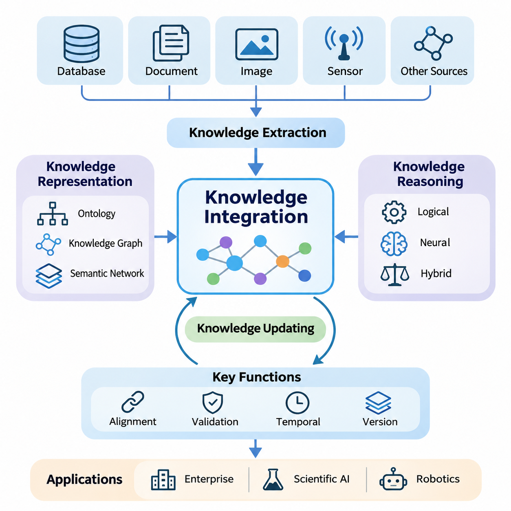
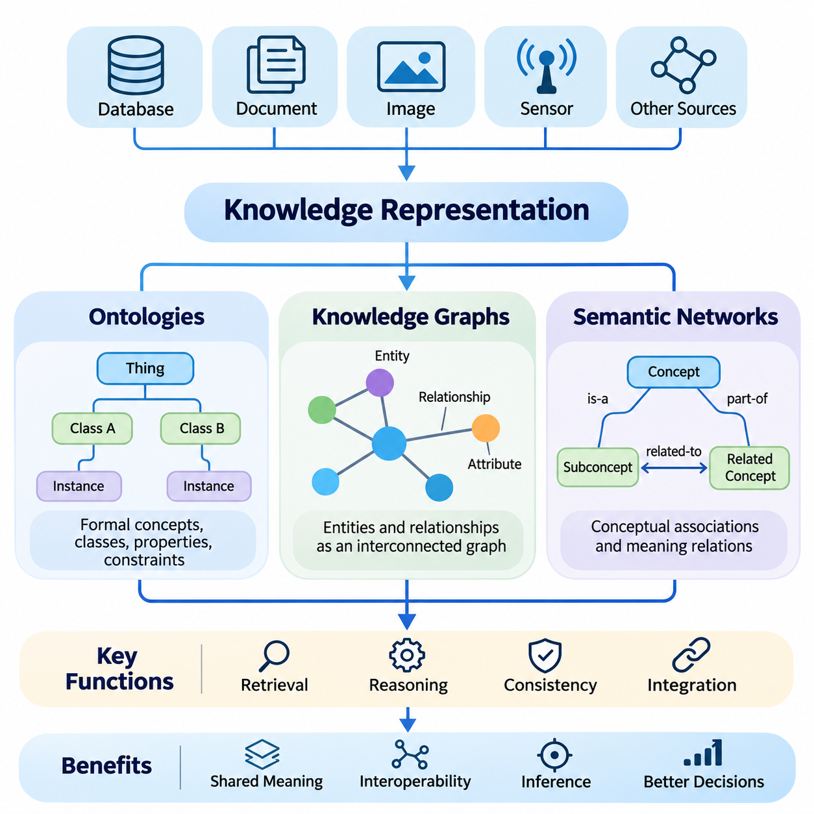
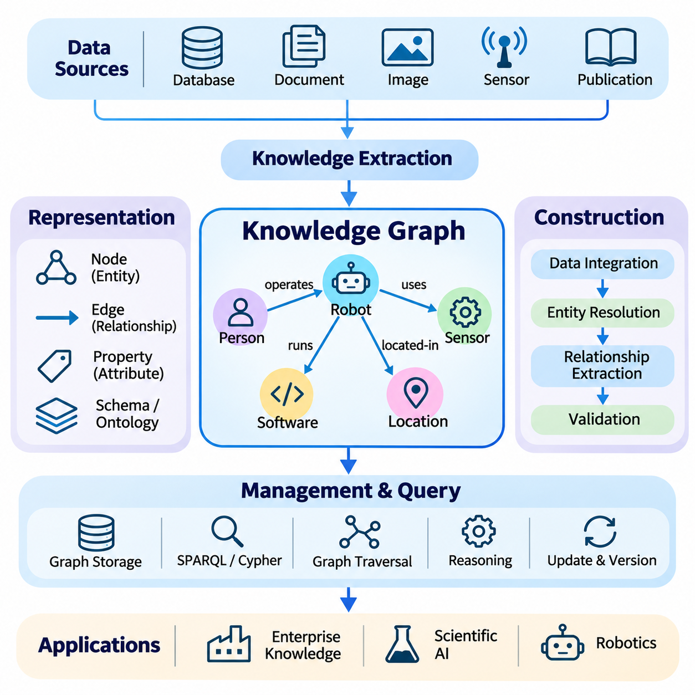
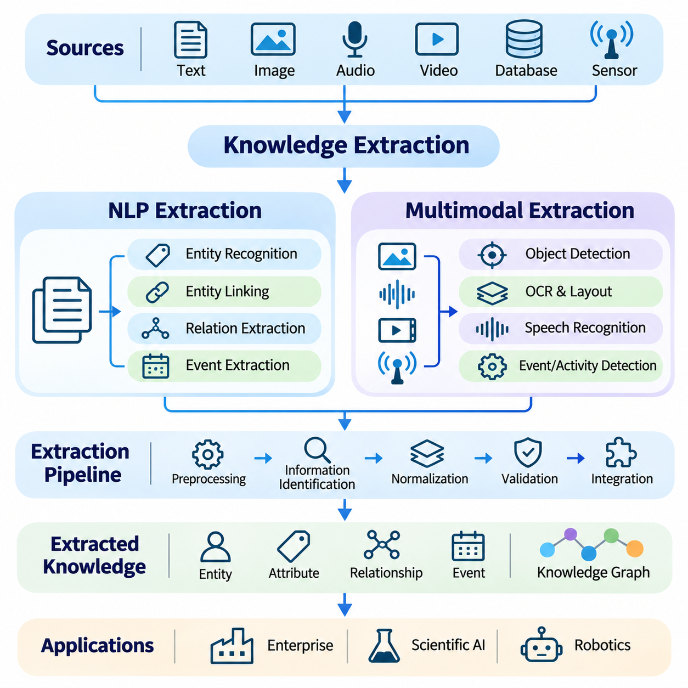
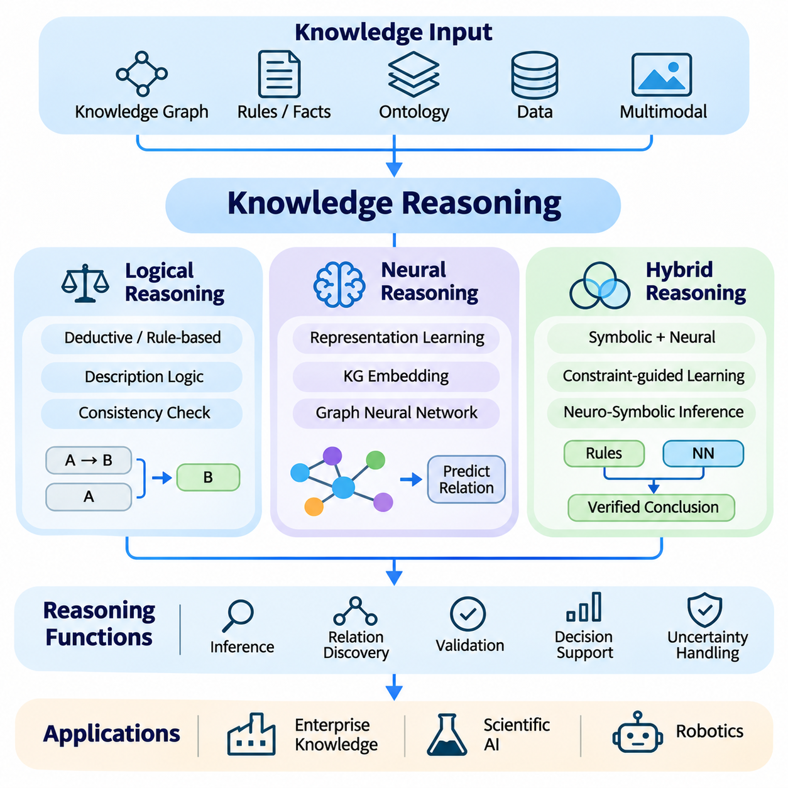
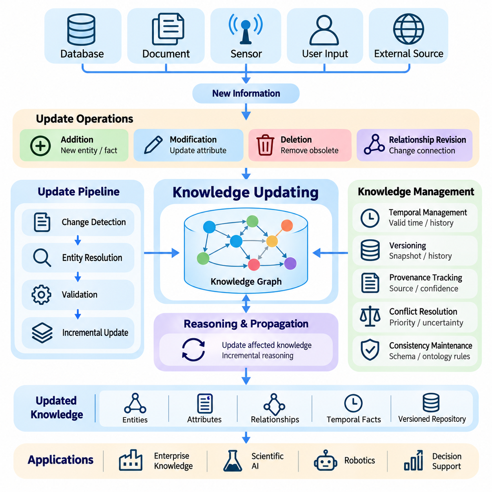
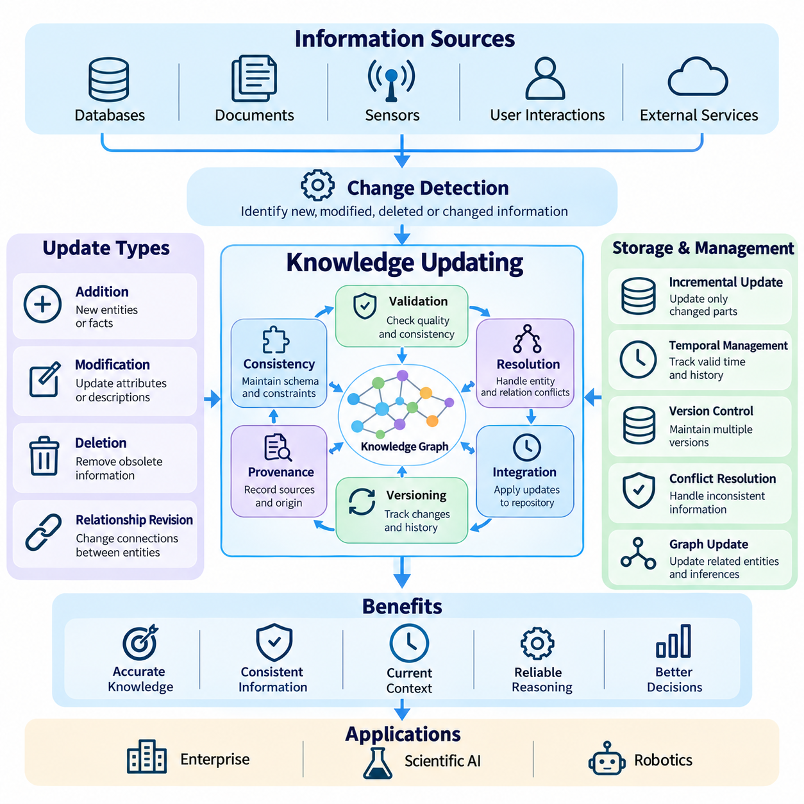
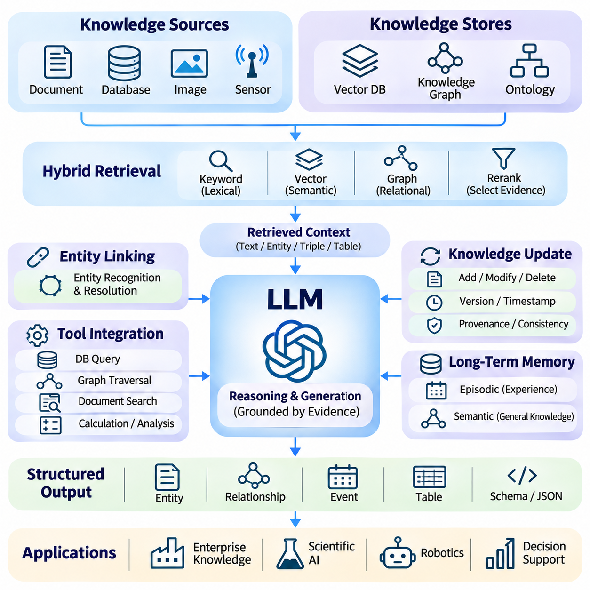
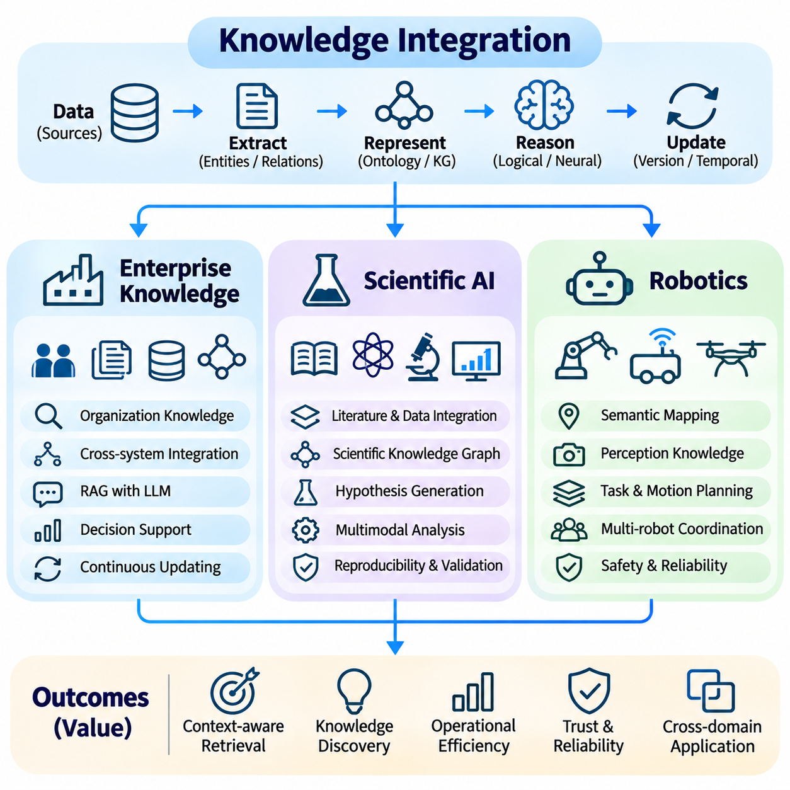

**Volume 37. Memory and Knowledge Systems**

# 04. Knowledge Integration

## 04.00 Overview

{width="7.268055555555556in" height="7.268055555555556in"}

Knowledge integration is a fundamental capability of intelligent systems that must combine information from heterogeneous sources into a coherent and usable representation. Modern artificial intelligence increasingly depends on more than isolated datasets or pretrained model parameters. Effective knowledge integration connects structured facts, unstructured documents, learned representations, and contextual observations to support consistent understanding, reasoning, and decision-making.

Traditional information systems often store knowledge in separate databases, documents, applications, and organizational repositories. Although these resources may contain valuable information, differences in terminology, structure, semantics, and update frequency make unified interpretation difficult. Knowledge integration addresses these limitations by establishing relationships among information sources and transforming fragmented content into interconnected knowledge that intelligent systems can retrieve and interpret.

The distinction between data, information, and knowledge is essential to understanding integration. Data represents observations or recorded values, while information provides context and interpretation. Knowledge additionally captures relationships, constraints, and meaningful patterns that support inference. An integrated knowledge system therefore does more than aggregate records; it preserves semantic meaning and enables information from different sources to contribute to a common understanding.

Knowledge representation provides the structural foundation for integration. Ontologies define concepts, categories, properties, and relationships within a domain, while knowledge graphs represent entities and their connections explicitly. Semantic networks provide another approach to organizing conceptual associations. These representations help intelligent systems interpret relationships consistently and reduce ambiguity when information originates from independently developed sources.

Ontologies are particularly important when multiple systems describe similar concepts using different terminology. A manufacturing database may identify a component through a numerical identifier, while maintenance documentation refers to the same component by its functional name. Ontological alignment connects these descriptions through shared definitions and relationships, allowing information from engineering, production, and maintenance environments to be interpreted within a unified semantic framework.

Knowledge graphs extend structured representation by connecting entities through meaningful relationships. Nodes commonly represent objects, concepts, events, or organizations, while edges describe relationships between them. This structure enables navigation across interconnected facts and supports queries that require multiple relationships. Graph-based representations are especially valuable when understanding dependencies, contextual associations, or indirect connections is more important than retrieving isolated records.

Knowledge extraction transforms information from documents, databases, images, and sensor observations into representations suitable for integration. Natural language processing can identify entities, attributes, and relationships within textual material, while multimodal extraction combines information from visual, textual, and other sensory sources. Extracted knowledge must be normalized and validated because recognition errors, ambiguous expressions, and inconsistent terminology can introduce incorrect relationships.

Integrating multimodal information requires additional attention to semantic and temporal alignment. A visual observation, textual description, and sensor measurement may refer to the same physical event while representing different aspects of that event. Effective integration associates these observations through shared entities, timestamps, spatial references, and contextual relationships. Such alignment enables intelligent systems to develop richer interpretations than individual modalities can provide independently.

Knowledge reasoning transforms integrated representations into a basis for inference and decision-making. Logical reasoning applies explicit rules and constraints to derive conclusions from established facts. Neural reasoning uses learned representations to identify patterns and estimate relationships that may not be directly encoded. Hybrid reasoning combines these approaches, seeking to preserve the interpretability of symbolic structures while benefiting from the flexibility of learned representations.

The reliability of reasoning depends strongly on the quality of integrated knowledge. Incorrect entity resolution, contradictory facts, incomplete relationships, or outdated information can propagate through inference processes. Knowledge integration systems therefore require mechanisms for provenance tracking, confidence estimation, consistency checking, and conflict resolution. These mechanisms help distinguish verified knowledge from uncertain observations and automatically generated interpretations.

Knowledge updating is necessary because real-world environments continuously change. Organizations introduce new products, scientific discoveries revise existing explanations, and autonomous systems encounter previously unknown conditions. An integrated knowledge repository must support additions, modifications, and removal or retirement of obsolete information without unnecessarily disrupting valid relationships. Incremental updating and version management help preserve continuity while incorporating new evidence.

Temporal knowledge management further improves the accuracy of integrated systems. A relationship that was valid during an earlier period may no longer describe the current state of an entity. Recording timestamps, validity intervals, and historical changes allows systems to distinguish current knowledge from previous conditions. This capability is particularly important for applications involving equipment maintenance, operational planning, scientific observations, and dynamically changing environments.

Large language models introduce new opportunities for connecting natural language understanding with structured knowledge. Although pretrained models capture substantial statistical information, their internal representations do not guarantee factual accuracy, current knowledge, or explicit traceability. Integrating external knowledge repositories enables language models to access domain-specific information and incorporate structured relationships into their responses, reducing dependence on implicit parametric knowledge.

Knowledge graph integration with large language models can support entity-aware retrieval, relationship exploration, and multi-step reasoning. A language model may interpret a natural language question, identify relevant entities, and obtain related facts from a graph-based repository. Retrieved knowledge can then provide contextual evidence for response generation. However, the system must verify that generated conclusions are supported by retrieved facts rather than assuming that fluent explanations are necessarily correct.

Knowledge integration is closely related to retrieval systems and long-term memory, but these capabilities serve different purposes. Retrieval identifies information relevant to a particular query, while memory preserves information across interactions or operational periods. Knowledge integration establishes semantic relationships among these resources, enabling retrieved evidence and stored experiences to contribute to a coherent representation that supports reasoning, contextual interpretation, and future decisions.

In enterprise environments, integrated knowledge systems connect operational databases, technical documentation, organizational procedures, and accumulated expertise. Such systems can support question answering, decision assistance, compliance analysis, and knowledge discovery across departments. Their effectiveness depends on maintaining consistent terminology, controlling access to sensitive information, and preserving the provenance of facts collected from different organizational sources.

Scientific artificial intelligence benefits from integrating experimental observations, research publications, theoretical models, and structured scientific databases. Relationships among materials, biological entities, physical processes, and experimental conditions can reveal connections that are difficult to identify through isolated analysis. Integrated knowledge can support hypothesis generation and evidence exploration, although experimentally validated findings must remain distinguishable from computational predictions.

Robotics provides another important application because autonomous systems must combine semantic knowledge with physical observations. A robot may recognize objects through perception models while relying on stored knowledge to understand their functions, operational constraints, and relationships to surrounding environments. Integrating spatial information, sensor observations, task descriptions, and procedural knowledge supports more context-aware planning and behavior in complex operating conditions.

Practical knowledge integration architectures must also address scalability, computational efficiency, and system interoperability. Large repositories may contain millions of entities and relationships distributed across different storage technologies. Efficient indexing, graph querying, caching, and distributed processing help maintain acceptable performance. Standardized interfaces and representation formats enable knowledge to move between applications without repeatedly reconstructing its underlying semantic structure.

Security and governance are equally important because integrated knowledge can expose relationships that are not apparent within individual datasets. Access control must account for both stored facts and information inferred through their connections. Data lineage, auditability, privacy protection, and source-level permissions help prevent unauthorized disclosure or misuse. Governance policies should also define responsibility for validating, correcting, and retiring knowledge throughout its operational lifecycle.

Evaluating knowledge integration requires more than measuring storage capacity or query speed. Important considerations include entity alignment accuracy, relationship correctness, completeness, consistency, reasoning reliability, and update latency. Application-level evaluation should determine whether integrated knowledge improves factual grounding, decision quality, and task performance. These measurements help identify whether additional semantic complexity produces meaningful benefits for the overall intelligent system.

The long-term significance of knowledge integration lies in its ability to connect perception, memory, retrieval, reasoning, and action within a common information framework. Rather than treating knowledge as static content, advanced AI systems increasingly require representations that evolve through observation and interaction. Effective integration provides the foundation for knowledge-aware language models, adaptive autonomous systems, and intelligent applications capable of operating across diverse and changing environments.

## 04.01 Knowledge Representation

{width="7.268055555555556in" height="7.268055555555556in"}

Knowledge representation provides the conceptual and computational foundation for organizing information into structures that artificial intelligence systems can interpret, retrieve, and reason about. Rather than treating knowledge as isolated facts, representation methods describe entities, attributes, relationships, and constraints within a coherent framework. Ontologies, knowledge graphs, and semantic networks offer complementary approaches to transforming heterogeneous information into meaningful structures.

The primary objective of knowledge representation is to make information understandable to both machines and human users. A representation must identify what entities exist, how they are classified, and which relationships connect them. It should also support inference, consistency checking, and knowledge retrieval. The choice of representation influences how effectively an intelligent system can combine information from different sources and apply it to unfamiliar situations.

Ontologies provide formal descriptions of concepts and relationships within a particular domain. They define classes, properties, individuals, and constraints that establish a shared vocabulary for knowledge organization. A class represents a category of entities, while an individual represents a specific instance. Properties describe attributes or relationships, allowing systems to distinguish between conceptual definitions and factual observations.

A well-designed ontology establishes semantic consistency across independently developed information systems. For example, a manufacturing environment may contain separate databases for equipment, components, maintenance records, and operational procedures. An ontology can define shared concepts such as machines, sensors, failures, and maintenance activities. These definitions allow information from different repositories to be interpreted through a common conceptual model.

Ontology development typically begins with domain analysis and concept identification. Designers determine the important entities, define their properties, and establish hierarchical or associative relationships. Taxonomic relationships describe how specialized concepts inherit characteristics from broader categories. Additional constraints specify valid combinations of entities and properties, helping automated systems detect inconsistencies and maintain coherent knowledge structures.

Formal ontology languages provide machine-readable mechanisms for expressing these definitions. The Resource Description Framework, RDF, represents information through subject-predicate-object statements, while the Web Ontology Language, OWL, supports richer class definitions and logical constraints. Description logics provide mathematical foundations for many ontology reasoning operations, including classification, consistency checking, and the inference of implicit relationships.

Ontology reasoning enables systems to derive conclusions that are not explicitly stored as individual facts. If a mobile robot is classified as an autonomous vehicle and autonomous vehicles are defined as robotic systems, a reasoner may infer that the mobile robot belongs to the broader robotic system category. Such conclusions depend on the logical definitions and assumptions encoded in the ontology, making careful semantic modeling essential.

Knowledge graphs represent interconnected knowledge using nodes and edges. Nodes correspond to entities such as people, machines, locations, concepts, or events, while edges describe meaningful relationships among them. Unlike conventional tables that primarily organize records by predefined fields, graph structures emphasize connections. This makes them suitable for representing complex dependencies, interconnected processes, and relationships spanning multiple information domains.

A knowledge graph can describe a robotic system through relationships among its sensors, controllers, actuators, software modules, and operational environments. A sensor may be connected to a perception module, which contributes information to localization or obstacle detection. These relationships allow engineers and intelligent agents to explore dependencies, identify affected components, and retrieve contextual information associated with specific system functions.

Knowledge graphs commonly employ either RDF-based representations or property graph models. RDF graphs express relationships through triples and can use standardized semantic vocabularies. Property graphs associate labels and attributes with nodes and relationships, supporting flexible graph traversal and application-oriented querying. Both approaches represent interconnected information, although their data models, query mechanisms, and reasoning capabilities differ.

Graph querying enables knowledge retrieval based on relationships rather than isolated keyword matches. SPARQL supports querying RDF datasets through graph patterns, while Cypher is widely associated with property graph databases. Queries can identify direct relationships, traverse multiple connections, or retrieve entities satisfying specified conditions. Efficient graph indexing and query optimization become increasingly important as knowledge repositories grow in size and complexity.

Knowledge graph construction requires entity extraction, relationship identification, entity resolution, and data integration. Information may originate from structured databases, technical documents, scientific publications, or multimodal observations. Entity resolution determines whether different references identify the same real-world object. Relationship extraction identifies meaningful associations, while normalization aligns terminology and attributes with the intended knowledge schema.

Graph quality depends on the accuracy and completeness of its underlying information. Incorrect entity merging can combine unrelated facts, while missing relationships may prevent valid conclusions from being discovered. Provenance information records where knowledge originated, and confidence values can indicate uncertainty in extracted relationships. Validation procedures should distinguish verified facts from predictions, inferred connections, and potentially conflicting observations.

Semantic networks provide a broader conceptual approach to representing knowledge through interconnected concepts and associative relationships. Historically, semantic networks have been used to model human conceptual organization and machine reasoning. Concepts are represented as nodes, while labeled links express relationships such as category membership, similarity, association, or part-whole structure. Their intuitive organization makes them useful for explaining conceptual dependencies.

Hierarchical semantic networks often employ inheritance relationships to organize general and specialized concepts. A vehicle may possess general properties, while a mobile robot inherits relevant characteristics and introduces additional capabilities. Such structures can reduce redundant descriptions and support conceptual classification. However, inheritance becomes more complicated when exceptions, multiple classifications, or conflicting properties must be represented accurately.

Semantic networks differ from formal ontologies primarily in their degree of semantic specification and logical rigor. A general semantic network may express associations without defining precise inference rules, while an ontology typically establishes explicit conceptual definitions and formal constraints. Knowledge graphs emphasize the representation and management of interconnected facts. In practical systems, these categories frequently overlap rather than forming completely separate technologies.

The integration of ontologies and knowledge graphs combines formal conceptual definitions with large collections of factual relationships. Ontologies can provide schemas, classifications, and constraints, while knowledge graphs store entities and their connections. Reasoning engines may use ontology definitions to infer additional relationships or identify inconsistencies. This combination supports semantic interoperability and improves the consistency of knowledge acquired from heterogeneous sources.

Neural representations can complement symbolic knowledge structures by encoding entities and relationships as continuous vectors. Knowledge graph embeddings learn numerical representations that capture selected structural patterns, enabling similarity estimation and link prediction. These methods can identify plausible missing relationships, but predicted connections remain uncertain until validated. Combining symbolic constraints with neural models can improve flexibility while preserving explicit semantic information.

Large language models can interact with knowledge representations through natural language interfaces, entity linking, and structured retrieval. A model may interpret a question, identify relevant concepts, and query an ontology or knowledge graph for supporting evidence. Retrieved relationships can then inform response generation and multi-step reasoning. This integration can improve factual grounding, although generated explanations still require verification against authoritative knowledge sources.

Dynamic environments require knowledge representations that support continuous modification. New entities may appear, existing relationships may change, and previously valid facts may become obsolete. Temporal attributes, version histories, and incremental updates help preserve the distinction between historical and current knowledge. Maintaining consistency during updates is particularly important when multiple applications or autonomous agents share the same knowledge repository.

Knowledge representation also introduces challenges involving scalability, uncertainty, ambiguity, and semantic alignment. Different organizations may classify identical entities using incompatible conceptual structures. Automated mapping can suggest correspondences, but domain expertise is often necessary to resolve difficult cases. Effective integration therefore combines formal modeling, statistical methods, validation procedures, and governance mechanisms to maintain reliable knowledge across diverse systems.

Applications of these representations extend across enterprise intelligence, scientific discovery, healthcare, robotics, and autonomous systems. Enterprise applications connect organizational information, scientific systems model relationships among experimental findings, and robots combine semantic descriptions with physical observations. In each case, structured knowledge provides contextual information that complements perception, retrieval, and machine learning, supporting more informed decisions and interpretable system behavior.

The effectiveness of knowledge representation should be evaluated through semantic correctness, coverage, consistency, reasoning performance, and practical usefulness. A highly expressive ontology may support sophisticated inference but introduce computational overhead, while a simpler graph may provide faster retrieval with fewer logical guarantees. Selecting an appropriate representation requires balancing formal expressiveness, operational efficiency, maintainability, and the reasoning requirements of the intended application.

Ontologies, knowledge graphs, and semantic networks collectively establish the structural foundation of knowledge-aware artificial intelligence. Ontologies formalize conceptual meaning, knowledge graphs organize interconnected facts, and semantic networks express conceptual associations. Their coordinated use enables intelligent systems to connect fragmented information, discover meaningful relationships, and support reasoning across domains, providing essential infrastructure for advanced memory, retrieval, and autonomous decision-making systems.

## 04.02 Knowledge Graphs [w/Code]

{width="7.268055555555556in" height="7.268055555555556in"}

Knowledge graphs provide a structured framework for representing entities, attributes, and relationships as interconnected information. Unlike conventional databases that emphasize isolated records, knowledge graphs organize information around meaningful connections. This structure enables artificial intelligence systems to retrieve contextual knowledge, explore dependencies, and perform reasoning across heterogeneous data sources while preserving the semantic relationships among entities.

The fundamental structure of a knowledge graph consists of nodes and edges. Nodes represent entities such as people, organizations, machines, locations, events, or abstract concepts, while edges describe relationships between them. A relationship may indicate ownership, membership, dependency, location, or functional interaction. Properties associated with nodes and edges provide additional descriptive information, allowing complex real-world knowledge to be represented systematically.

Knowledge graphs are commonly modeled using directed labeled graphs, where relationships connect source entities to target entities. A statement such as a robot using a LiDAR sensor can be represented as a relationship between the robot entity and the sensor entity. Multiple statements form an interconnected network that supports navigation across related concepts. This graph-oriented organization is particularly effective when information contains numerous dependencies and indirect relationships.

The Resource Description Framework, RDF, represents knowledge through subject-predicate-object triples. Each triple expresses a relationship between two resources or between a resource and a value. RDF identifiers enable consistent references to entities across distributed information systems. By combining multiple triples, an RDF graph can represent complex relationships while supporting standardized data exchange and semantic interoperability across applications.

Property graph models provide another widely used approach to knowledge representation. In these models, nodes and relationships may contain labels and key-value properties. A robot node might include its identifier, manufacturer, and operational status, while a relationship connecting the robot to a sensor could contain installation information. Property graphs are especially useful for application-oriented systems requiring flexible traversal and efficient relationship-based queries.

Knowledge graph schemas define the expected types of entities, relationships, and properties within a domain. A schema may specify that sensors are installed on robotic platforms, that controllers execute software modules, and that maintenance events affect equipment. Such definitions improve consistency and support validation. Ontologies can extend these schemas by introducing formal semantics, hierarchical classifications, and logical constraints that enable more sophisticated reasoning.

Constructing a knowledge graph begins with identifying relevant information sources and defining the target knowledge model. Structured databases, technical documents, operational logs, scientific publications, and sensor observations may contribute information. Data extraction processes identify candidate entities and relationships, while transformation procedures convert heterogeneous representations into a consistent graph structure. The resulting knowledge must be validated before it becomes part of a trusted repository.

Entity resolution is a critical step because different sources may describe the same real-world object using different names or identifiers. A robotic component may appear under a product code in an inventory database and under a functional description in maintenance documentation. Entity resolution methods compare identifiers, attributes, contextual information, and semantic similarity to determine whether references correspond to the same entity.

Relationship extraction identifies meaningful connections among entities from structured and unstructured information. Natural language processing models can recognize relationships expressed in technical documentation, while database mappings can derive connections from existing records. Multimodal extraction may associate visual observations with recognized objects and their attributes. Extracted relationships require confidence assessment because automated extraction can introduce ambiguity, incorrect associations, and incomplete information.

Graph storage systems organize interconnected data to support efficient traversal and retrieval. Native graph databases often optimize operations involving connected entities, while RDF stores provide specialized mechanisms for managing triples and semantic queries. Storage architecture influences query latency, scalability, indexing efficiency, and update performance. Selecting an appropriate database requires considering graph size, relationship density, query patterns, and operational requirements.

Graph query languages allow users and applications to retrieve information through structural patterns. SPARQL supports querying RDF graphs, while Cypher is commonly used with property graph systems. A query may identify all sensors connected to a particular robot or retrieve software modules dependent on a specified controller. More complex queries traverse several relationships to discover indirect dependencies that would be difficult to express through isolated record searches.

Graph traversal algorithms provide additional mechanisms for exploring interconnected knowledge. Breadth-first search identifies reachable entities by expanding neighboring nodes, while depth-first search explores paths through connected structures. Shortest-path algorithms can identify efficient connection sequences, and centrality measures estimate the structural importance of entities. These algorithms support dependency analysis, relationship discovery, recommendation, and network-oriented reasoning.

Knowledge graph reasoning derives additional information from existing facts and formal relationships. Rule-based reasoning applies predefined logical rules, while ontology reasoning uses semantic definitions and constraints. For example, if a sensor is installed on a robot and the robot belongs to a particular fleet, a rule may infer that the sensor is associated with that fleet. Such conclusions depend on explicitly defined semantics rather than graph connectivity alone.

Knowledge graph embeddings transform entities and relationships into continuous numerical representations. Methods such as TransE, DistMult, and ComplEx learn vector representations that capture selected relational patterns. These embeddings support link prediction, entity similarity estimation, and knowledge graph completion. However, predicted relationships represent statistical hypotheses rather than verified facts, making validation important when graph predictions influence operational decisions.

Graph neural networks extend representation learning by aggregating information from connected nodes and relationships. Graph convolutional networks and graph attention networks can learn contextual representations based on graph structure and node attributes. Relational graph neural networks additionally distinguish different relationship types. These models support node classification, link prediction, anomaly detection, and other tasks requiring the combined interpretation of graph topology and learned features.

Temporal knowledge graphs represent relationships that change over time. Equipment configurations, organizational structures, operational conditions, and scientific knowledge may evolve continuously. Timestamps and validity intervals allow systems to distinguish historical facts from current relationships. Temporal graph models can support event analysis and time-dependent reasoning, although maintaining accurate histories requires consistent update procedures and careful management of conflicting observations.

Knowledge graph updating involves adding new entities, modifying relationships, and retiring obsolete information while preserving consistency. Incremental updates reduce the need to reconstruct an entire graph whenever new evidence becomes available. Version management and provenance tracking help explain when information changed and which source introduced it. These capabilities are particularly important for autonomous systems and enterprise environments where decisions depend on current knowledge.

Integrating knowledge graphs with vector databases combines explicit relationships with semantic similarity search. Vector retrieval identifies potentially relevant information based on embedding similarity, while graph traversal explores structured connections among retrieved entities. Hybrid retrieval can therefore combine semantic relevance with relational context. This approach is useful when questions require both conceptual similarity and evidence distributed across several connected knowledge sources.

Large language models can use knowledge graphs as external sources of structured information. A language model may identify entities in a user question, generate a graph query, retrieve relevant relationships, and incorporate the results into its response. Graph-based retrieval-augmented generation, often called GraphRAG, can support multi-hop questions and relationship-aware context construction. Nevertheless, retrieved evidence must be checked to prevent unsupported conclusions or incorrect interpretations.

Knowledge graphs also support explainability by exposing relationships used during retrieval and reasoning. Instead of presenting only a predicted answer, a system can identify the entities, relationships, and sources contributing to its conclusion. This traceability is valuable for engineering, scientific analysis, and operational decision support. However, graph-based explanations remain reliable only when the underlying relationships and inference procedures are accurate.

Scalability introduces challenges as knowledge graphs grow to millions or billions of relationships. Efficient indexing, graph partitioning, caching, distributed storage, and query optimization can reduce computational overhead. Highly connected entities may create uneven workloads, while complex multi-hop queries can increase latency. Practical architectures must balance storage efficiency, consistency requirements, retrieval performance, and the cost of maintaining continuously updated graph structures.

Knowledge graph evaluation should consider entity accuracy, relationship correctness, completeness, consistency, and retrieval effectiveness. Link prediction models may be evaluated using ranking metrics such as mean reciprocal rank and Hits\\@K, while graph query systems require latency and throughput measurements. Application-level evaluation determines whether graph integration improves reasoning quality, factual grounding, and decision performance compared with simpler information retrieval approaches.

Knowledge graphs are increasingly relevant to enterprise knowledge management, scientific discovery, robotics, and autonomous systems. They connect fragmented information into structures that support contextual retrieval, dependency analysis, and interpretable reasoning. When combined with ontologies, neural representations, vector retrieval, and large language models, knowledge graphs provide a foundation for knowledge-aware AI systems capable of integrating structured relationships with learned intelligence.

## 04.03 Knowledge Extraction

{width="7.268055555555556in" height="7.268055555555556in"}

Knowledge extraction is the process of transforming information from heterogeneous sources into structured representations that intelligent systems can interpret, integrate, and reason about. Modern knowledge repositories contain documents, databases, images, audio recordings, videos, and sensor observations. Extraction methods identify entities, attributes, relationships, and events within these sources, converting fragmented information into reusable knowledge.

The effectiveness of knowledge extraction depends on accurately identifying meaningful information while preserving its original context. Extracted facts must distinguish entities from their descriptions, relationships from incidental associations, and verified observations from uncertain predictions. A complete extraction pipeline typically includes data preprocessing, information identification, normalization, validation, and integration into a structured knowledge repository.

Natural language processing provides essential techniques for extracting knowledge from textual information. Scientific publications, technical manuals, operational reports, and organizational documents contain relationships expressed through natural language. NLP extraction systems analyze linguistic structures and semantic patterns to identify concepts, entities, events, and relationships that can be represented in knowledge graphs or other structured formats.

Named entity recognition identifies references to specific objects, organizations, locations, measurements, and domain-specific concepts. Traditional methods rely on linguistic features and statistical sequence models, while modern approaches employ transformer-based language representations. Domain adaptation is often necessary because terminology varies across scientific, industrial, medical, and engineering environments, affecting extraction accuracy.

Entity linking connects recognized expressions to canonical entities within an existing knowledge repository. A document may describe the same machine using a model number, abbreviation, or functional name. Entity linking evaluates contextual evidence and semantic similarity to determine the intended reference. This process reduces duplicate entities and enables information from independent documents to contribute to a unified knowledge structure.

Relation extraction identifies meaningful associations between recognized entities. A technical report may state that a controller operates a motor, a sensor measures temperature, or a component belongs to a particular assembly. Extraction models convert these statements into structured relationships suitable for graph storage. Accurate relation extraction requires understanding linguistic context, directionality, negation, and the distinction between observed facts and hypothetical statements.

Event extraction extends knowledge acquisition beyond static relationships by identifying activities, changes, and occurrences. An event representation may include participants, actions, timestamps, locations, and outcomes. In industrial environments, maintenance reports may describe equipment failures, repairs, or operational interruptions. Extracting these events enables temporal analysis and supports knowledge systems that track evolving conditions.

Modern transformer models support contextual extraction by learning relationships among words and sentences. Encoder-based models can perform entity recognition and relation classification, while generative language models can produce structured records from natural language descriptions. However, generated outputs may contain unsupported entities or relationships. Schema constraints, evidence verification, and structured validation are necessary to reduce extraction errors.

Document-level knowledge extraction must address information distributed across multiple sentences and sections. A component may be introduced in one paragraph and referenced through abbreviations or pronouns elsewhere. Coreference resolution connects these references, while document structure analysis identifies headings, tables, captions, and related descriptions. Combining linguistic and structural information improves the completeness of extracted knowledge.

Multimodal knowledge extraction extends these principles to information represented through different sensory and communication modalities. Images, audio, video, text, and sensor measurements may describe complementary aspects of the same environment. A multimodal extraction system identifies meaningful elements within each modality and establishes relationships among them, enabling richer knowledge representations than text-only processing.

Visual knowledge extraction uses computer vision models to identify objects, attributes, spatial relationships, and activities within images. Object detection determines the locations and categories of visible entities, while segmentation identifies their spatial boundaries. Visual relationship detection can describe interactions such as an object resting on a surface or a robotic arm holding a component, converting visual observations into structured facts.

Optical character recognition converts text embedded in images, scanned documents, and technical drawings into machine-readable content. Layout analysis identifies tables, diagrams, labels, and document regions, while subsequent language processing extracts semantic information. In engineering applications, these techniques can connect component identifiers, specifications, and annotations with corresponding physical objects or design elements.

Audio knowledge extraction converts speech and environmental sounds into meaningful representations. Automatic speech recognition produces textual transcripts that can be processed using NLP extraction methods. Acoustic event detection identifies sounds associated with machines, alarms, impacts, or environmental conditions. Combining speech content with acoustic observations enables systems to represent both communicated information and detected operational events.

Video knowledge extraction introduces temporal continuity and dynamic relationships. Individual frames provide visual observations, while object tracking associates entities across time. Action recognition and temporal event detection identify activities, interactions, and state transitions. These methods can transform recorded operations into sequences of structured events, supporting behavior analysis and the reconstruction of operational histories.

Sensor-based knowledge extraction interprets measurements from LiDAR, radar, inertial sensors, thermal cameras, and other sensing devices. Raw measurements must be transformed into meaningful observations such as object locations, motion states, environmental conditions, or equipment anomalies. Calibration, coordinate transformation, and uncertainty estimation are essential because sensor measurements differ in accuracy, resolution, and reference frames.

Multimodal alignment connects observations that refer to the same entities or events across different information sources. A detected vehicle, a radar track, and a textual incident report may describe the same physical object. Spatial coordinates, timestamps, object identities, and contextual relationships help establish these correspondences. Incorrect alignment can create misleading associations, making synchronization and identity verification critical.

Cross-modal fusion combines complementary evidence to improve knowledge extraction reliability. Visual observations may identify an object\'s appearance, while depth sensors estimate distance and language descriptions provide functional context. Fusion may occur at the feature, representation, or decision level. The appropriate strategy depends on modality characteristics, synchronization requirements, computational resources, and the uncertainty associated with each observation.

Knowledge extraction pipelines must normalize outputs before integrating them into shared repositories. Different sources may use incompatible terminology, measurement units, entity identifiers, or relationship definitions. Schema mapping and ontology alignment establish common representations, while unit conversion and entity resolution reduce inconsistencies. Normalization enables extracted knowledge to support coherent queries and reasoning across multiple domains.

Extraction uncertainty must be represented explicitly rather than hidden within apparently definitive facts. Recognition confidence, source reliability, temporal validity, and provenance provide important context for evaluating extracted information. Contradictory observations should be retained or resolved through defined procedures rather than automatically overwritten. Such mechanisms help prevent uncertain predictions from being treated as verified knowledge.

Human validation remains important when extraction errors carry significant operational consequences. Domain specialists can review ambiguous entities, uncertain relationships, and automatically generated interpretations. Active learning can prioritize difficult examples for annotation, while feedback-driven refinement improves extraction models over time. Human oversight is particularly valuable when specialized terminology or rare events limit the reliability of automated methods.

Large language models and vision-language models increasingly support unified extraction from heterogeneous information. These models can interpret instructions, identify relevant entities, and generate structured descriptions across textual and visual contexts. Nevertheless, their outputs require grounding in source evidence and validation against predefined schemas. Model fluency alone does not establish the factual correctness of extracted knowledge.

Scalable extraction architectures must process large document collections and continuous multimodal streams efficiently. Batch processing supports historical repositories, while streaming pipelines handle real-time observations and events. Distributed processing, caching, incremental updates, and selective inference can reduce computational costs. System design must balance extraction accuracy, throughput, latency, and the resources required for downstream knowledge integration.

Knowledge extraction should be evaluated through entity recognition accuracy, relation extraction quality, event detection performance, and integration consistency. Precision, recall, and F1 scores measure extraction effectiveness, while alignment accuracy and provenance completeness assess integration reliability. Application-level evaluation determines whether extracted knowledge improves retrieval, reasoning, decision-making, and the performance of knowledge-aware intelligent systems.

## 04.04 Knowledge Reasoning

{width="7.268055555555556in" height="7.268055555555556in"}

Knowledge reasoning enables intelligent systems to derive conclusions, identify relationships, and make decisions from represented information. Unlike knowledge retrieval, which primarily locates existing facts, reasoning transforms available knowledge into additional insights. Logical, neural, and hybrid approaches provide different mechanisms for inference, allowing artificial intelligence systems to combine explicit rules, learned patterns, and contextual evidence.

The foundations of knowledge reasoning involve facts, relationships, assumptions, and inference procedures. A reasoning system evaluates available evidence and applies computational mechanisms to determine whether conclusions are justified. Its effectiveness depends on knowledge quality, representation consistency, and the validity of inference assumptions. Reliable reasoning must also distinguish established conclusions from uncertain predictions.

Logical reasoning uses formal rules and symbolic representations to derive conclusions from explicit premises. Propositional logic represents statements through Boolean expressions, while first-order logic introduces variables, predicates, and quantifiers. These frameworks allow systems to express relationships and constraints precisely. When premises and inference rules are valid, logical reasoning can produce conclusions supported by a well-defined mathematical foundation.

Deductive reasoning derives conclusions that necessarily follow from established premises under a specified logical system. For example, if every autonomous robot requires a controller and a particular machine is classified as an autonomous robot, the system can infer that the machine requires a controller. This inference is logically valid when the premises are accepted. However, logical validity does not independently guarantee that the original premises accurately describe reality.

Rule-based reasoning implements logical inference through explicit conditional statements. Production rules commonly express conditions and corresponding actions or conclusions. A maintenance system may infer that equipment requires inspection when temperature exceeds a defined threshold and vibration measurements indicate abnormal behavior. Rule engines evaluate these conditions against available facts, enabling transparent decision procedures in well-defined operational environments.

Description logics provide formal reasoning capabilities for ontologies and knowledge graphs. They support concept classification, subsumption checking, instance recognition, and consistency verification. Ontology reasoners can infer relationships based on class hierarchies and property restrictions. These operations improve semantic interoperability, although increasingly expressive logical languages may require greater computational resources.

Logical reasoning systems often distinguish between open-world and closed-world assumptions. Under an open-world assumption, missing information does not imply that a statement is false. Under a closed-world assumption, facts absent from a sufficiently complete database may be treated as false for particular queries. Selecting an appropriate assumption is essential because incomplete knowledge can otherwise produce incorrect interpretations or unjustified conclusions.

Uncertainty introduces limitations to purely deterministic logical reasoning. Real-world observations may contain measurement errors, ambiguous descriptions, or incomplete evidence. Probabilistic reasoning frameworks represent uncertainty through probability distributions and conditional dependencies. Bayesian networks and probabilistic graphical models can estimate the likelihood of hypotheses, complementing logical systems when conclusions cannot be established with certainty.

Neural reasoning uses learned numerical representations to estimate relationships and generate conclusions from observed patterns. Neural networks encode information in distributed representations rather than relying exclusively on explicit symbolic rules. This approach supports generalization across similar examples and can operate with noisy or incomplete inputs. However, learned predictions may lack formal guarantees and can be difficult to interpret.

Knowledge graph embeddings provide one mechanism for neural reasoning over structured relationships. Models such as TransE, DistMult, and ComplEx learn representations of entities and relations that support link prediction. A model may estimate whether an unobserved relationship is plausible based on patterns learned from existing graph connections. Such predictions are useful for knowledge completion but must not be confused with logically proven facts.

Graph neural networks perform relational learning by propagating and aggregating information across connected entities. Message-passing architectures update node representations using neighboring nodes, edge attributes, and learned transformation functions. These mechanisms support node classification, relation prediction, and anomaly detection. Their effectiveness depends on graph quality, neighborhood structure, and the ability to generalize beyond training distributions.

Large language models introduce another form of neural reasoning through contextual language representations. Transformer architectures can perform multi-step problem solving, interpret relationships, and generate explanations from textual evidence. Nevertheless, fluent reasoning traces do not guarantee valid conclusions. Language models may overlook constraints, invent intermediate facts, or produce inconsistent answers, making external verification important.

Neural reasoning can incorporate multimodal information from images, text, audio, and sensor observations. A robotic system may combine visual recognition, spatial measurements, and task descriptions to infer object functions or environmental conditions. Cross-modal representations help connect complementary observations, while uncertainty estimation can identify unreliable predictions. Such reasoning supports context-aware behavior in dynamic environments.

Hybrid reasoning combines symbolic knowledge structures with neural learning mechanisms. Symbolic components provide explicit concepts, constraints, and inference rules, while neural components estimate uncertain relationships and interpret unstructured information. This combination seeks to improve flexibility without abandoning logical consistency. Hybrid architectures are especially valuable when applications require both generalization and verifiable decision constraints.

Neuro-symbolic reasoning integrates neural representations with formal logic through several architectural strategies. Neural models may extract facts that symbolic engines subsequently evaluate, or logical constraints may guide neural training and inference. Differentiable reasoning methods approximate selected logical operations using continuous mathematical functions. These approaches offer different tradeoffs among expressiveness, trainability, interpretability, and computational complexity.

Knowledge graphs frequently serve as the shared representation within hybrid reasoning systems. Neural models can identify candidate entities and relationships, while ontology rules verify compatibility with domain constraints. Graph traversal retrieves supporting evidence, and symbolic inference derives additional relationships. This coordinated process can reduce unsupported predictions, although incorrect extracted facts may still propagate through the reasoning pipeline.

Retrieval-augmented reasoning connects external knowledge repositories with language models and inference mechanisms. A system may retrieve relevant documents, identify entities, explore graph relationships, and evaluate possible conclusions. Multi-hop reasoning follows several evidence connections to answer questions requiring indirect relationships. Reliable implementations must preserve source provenance and verify that each reasoning step is supported by available evidence.

Temporal reasoning addresses knowledge that changes over time. Events, states, and relationships may have different validity periods, making chronological consistency essential. Temporal logic can express ordering and duration constraints, while neural sequence models learn patterns across historical observations. Hybrid temporal reasoning combines explicit time constraints with predictive models to support monitoring, forecasting, and event interpretation.

Causal reasoning extends beyond identifying statistical associations by examining how interventions may influence outcomes. Structural causal models represent hypothesized cause-and-effect relationships, while learned models can estimate patterns from observational data. Causal conclusions require assumptions that cannot generally be established from correlations alone. Integrating causal knowledge with logical and neural reasoning can improve decision support when interventions are considered.

Reasoning under uncertainty requires explicit treatment of confidence, conflicting evidence, and incomplete information. A hybrid system may combine probabilistic predictions with hard safety constraints, preventing uncertain model outputs from overriding mandatory operational rules. Confidence calibration and contradiction detection help identify unreliable conclusions. Such safeguards are important in robotics, industrial automation, and other high-consequence applications.

Knowledge reasoning architectures must also address scalability and computational efficiency. Complex logical inference may become expensive as rule sets and knowledge bases grow, while neural reasoning can require substantial memory and processing resources. Selective retrieval, incremental inference, graph partitioning, and caching reduce unnecessary computation. Practical systems must balance reasoning depth, response latency, accuracy, and operational cost.

Evaluation of knowledge reasoning should distinguish logical correctness from predictive performance. Symbolic systems can be assessed through soundness, completeness, and consistency within their formal assumptions. Neural approaches require accuracy, calibration, robustness, and generalization measurements. Hybrid systems additionally need evaluations of constraint satisfaction, evidence traceability, and performance under incomplete or contradictory knowledge.

Applications of knowledge reasoning include enterprise decision support, scientific discovery, healthcare, robotics, and autonomous systems. Logical methods enforce explicit rules, neural methods identify complex patterns, and hybrid methods coordinate both capabilities. The long-term objective is to develop systems that reason across structured knowledge and uncertain observations while producing conclusions that are accurate, explainable, adaptable, and operationally reliable.

## 04.05 Knowledge Updating

{width="7.268055555555556in" height="7.268055555555556in"}

{width="7.268055555555556in" height="7.268055555555556in"}

Knowledge updating is the process of maintaining accurate, consistent, and relevant information as the real world changes. Intelligent systems must continuously incorporate new observations, revise existing relationships, and retire obsolete facts. Unlike static knowledge repositories, dynamic knowledge systems preserve information across evolving conditions. Effective updating ensures that retrieval, reasoning, and decision-making remain aligned with current evidence and operational requirements.

Knowledge repositories receive updates from structured databases, documents, sensor streams, user interactions, and external information services. Each source may introduce new entities, modify existing attributes, or challenge previously accepted relationships. An updating system must identify meaningful changes and determine how they affect existing knowledge. This requires coordinated mechanisms for change detection, validation, conflict resolution, and controlled integration.

Knowledge updates can be classified as additions, modifications, deletions, and relationship revisions. Additions introduce previously unknown entities or facts, while modifications change existing attributes or descriptions. Deletions remove information that should no longer be retained, and relationship revisions alter connections between entities. These operations must preserve structural integrity and avoid unintended changes to unrelated knowledge.

Incremental updating modifies only the affected portions of a knowledge repository rather than reconstructing the entire system. This approach reduces computational overhead and supports frequent updates in large knowledge graphs. Incremental processing identifies changed records, determines dependent relationships, and applies targeted modifications. Its effectiveness depends on reliable change tracking and mechanisms for maintaining consistency across interconnected information.

Change detection identifies differences between incoming information and previously stored knowledge. Database change data capture can monitor modifications to structured records, while document comparison detects revisions in textual sources. Streaming systems process incoming events and sensor observations continuously. Semantic change detection is particularly important because a meaningful knowledge revision may occur even when the underlying textual differences appear relatively small.

Entity resolution remains essential during updating because incoming information may refer to existing entities using unfamiliar names or identifiers. A new maintenance report may describe equipment already represented in a knowledge graph. The system must determine whether the report introduces a new entity or modifies an existing one. Incorrect entity matching can duplicate knowledge or merge unrelated facts, reducing the reliability of subsequent retrieval and reasoning.

Temporal knowledge management distinguishes when information was observed, recorded, and considered valid. A fact may describe a historical condition rather than the current state of an entity. Temporal attributes and validity intervals allow systems to preserve earlier relationships while representing subsequent changes. Bitemporal models additionally distinguish valid time from transaction time, supporting historical reconstruction and auditing of delayed or corrected information.

Knowledge versioning records successive states of a repository and enables previous configurations to be reconstructed. Version histories identify which entities and relationships changed, when modifications occurred, and which processes introduced them. Snapshot-based approaches preserve complete repository states, while event-based approaches reconstruct states from recorded changes. Version management supports rollback, reproducibility, debugging, and the evaluation of historical decisions.

Provenance tracking maintains information about the origins and transformations of knowledge. An updated relationship may originate from a verified database, an extracted document, a sensor observation, or a model-generated prediction. Recording source identity, extraction methods, timestamps, and validation status helps establish trust. Provenance also enables systems to reassess affected facts when a source is corrected, withdrawn, or determined to be unreliable.

Conflicting knowledge presents a major challenge when multiple sources provide incompatible descriptions. Two databases may report different equipment configurations, or sensor observations may disagree about an object\'s state. Conflict resolution can consider source authority, observation time, confidence estimates, and domain-specific constraints. However, disagreement should not always be eliminated automatically, because competing observations may represent legitimate uncertainty.

Consistency maintenance ensures that updates do not violate established schemas, ontologies, or logical constraints. A relationship may be rejected if it connects incompatible entity types or contradicts a mandatory domain rule. Constraint validation can occur before changes are committed or through subsequent consistency checks. For distributed systems, maintaining consistency also requires careful coordination among repositories that may receive updates at different times.

Knowledge graphs require specialized updating mechanisms because modifying one relationship may affect several connected entities and inferred facts. Adding a new class membership can introduce additional relationships through ontology reasoning, while deleting a supporting fact may invalidate derived conclusions. Incremental reasoning engines update affected inferences without repeating all computations. Dependency tracking helps identify which conclusions require reconsideration after changes.

Neural knowledge representations must also adapt when the underlying repository evolves. Knowledge graph embeddings may become outdated as entities and relationships change, while learned retrieval models may fail to reflect newly introduced concepts. Incremental training and selective fine-tuning can update representations without rebuilding every model. Nevertheless, adaptation must be evaluated for catastrophic forgetting, representation drift, and degradation of previously learned relationships.

Large language models introduce additional challenges because their internal parametric knowledge is not easily modified through ordinary database updates. External retrieval systems provide a practical mechanism for supplying current information without retraining the entire model. Retrieval-augmented generation can access updated documents and knowledge graphs during inference. However, outdated internal knowledge may conflict with retrieved evidence, requiring grounding and source-priority mechanisms.

Continuous knowledge updating is closely connected to long-term memory in intelligent agents. Agents accumulate observations, interactions, task outcomes, and environmental changes over extended periods. Memory consolidation can transform repeated experiences into stable knowledge while preserving important episodic details. Updating policies must distinguish persistent facts from temporary states and prevent unreliable observations from becoming permanent assumptions.

Multimodal updating integrates changes detected through text, images, audio, video, and physical sensors. An autonomous robot may observe that an obstacle has moved, while a maintenance record reports that a component has been replaced. These observations must be aligned with existing entities and temporal references. Sensor calibration, identity tracking, and uncertainty estimation help prevent inconsistent updates when different modalities describe the same environment.

Real-time knowledge updating requires low-latency processing and controlled resource consumption. Streaming pipelines can ingest events continuously, while message brokers distribute changes among dependent services. Event-driven architectures trigger validation, indexing, and inference updates when relevant information arrives. System designers must balance update frequency, computational cost, consistency guarantees, and the urgency of operational decisions.

Distributed knowledge repositories introduce synchronization and concurrency challenges. Multiple applications may update the same entity simultaneously, producing conflicting revisions or inconsistent states. Transaction management, optimistic concurrency control, and version checks can prevent unintended overwrites. Depending on application requirements, systems may prioritize strong consistency or accept temporary divergence under eventual consistency models.

Security and governance must remain active throughout the knowledge updating lifecycle. Unauthorized modifications can corrupt relationships, introduce misleading facts, or expose sensitive information. Access controls, audit logs, approval workflows, and integrity checks help protect trusted repositories. Governance policies should define who may introduce, validate, correct, or retire knowledge, especially when automated extraction systems contribute updates.

Knowledge deletion requires particular care because removing a fact may affect dependent relationships, cached results, and derived inferences. Some information must be retired from active use while remaining available for historical analysis, whereas privacy requirements may demand complete removal from applicable storage systems. Deletion workflows should identify downstream dependencies and ensure that obsolete information is not unintentionally reintroduced.

Update quality can be evaluated through freshness, correctness, consistency, completeness, and propagation latency. Freshness measures whether stored knowledge reflects recent changes, while propagation latency measures how quickly updates reach dependent systems. Additional metrics assess conflict resolution accuracy, entity matching quality, and inference stability. Application-level testing determines whether updated knowledge improves decisions without introducing regressions.

Robust updating architectures combine automated ingestion with selective human oversight. Routine changes may be validated through predefined rules, while uncertain or high-impact modifications require expert review. Monitoring systems can detect unusual update patterns, contradictory information, and unexpected changes in reasoning outputs. Feedback from these evaluations supports continuous improvement of extraction models, validation policies, and repository maintenance procedures.

Knowledge updating transforms static information collections into evolving knowledge systems capable of supporting adaptive intelligence. By coordinating temporal modeling, incremental processing, provenance, consistency management, and neural adaptation, intelligent systems can preserve reliable knowledge while incorporating new evidence. This capability is fundamental to enterprise knowledge management, scientific AI, robotics, and autonomous systems operating in continuously changing environments.

## 04.06 Integration with LLM

{width="7.268055555555556in" height="7.268055555555556in"}

Integration with large language models enables knowledge systems to combine structured information, semantic retrieval, and natural language reasoning within a unified architecture. Traditional knowledge repositories provide explicit facts and relationships, while language models offer flexible interpretation and generation capabilities. Their integration supports intelligent applications that require factual grounding, contextual understanding, and interaction with continuously evolving information.

Large language models acquire broad statistical knowledge during pretraining, but their internal representations are not equivalent to verified knowledge databases. Parametric knowledge may become outdated, contain inconsistencies, or lack precise source attribution. External knowledge integration addresses these limitations by providing access to documents, databases, and knowledge graphs during inference, allowing generated responses to incorporate evidence beyond model parameters.

Retrieval-augmented generation provides a practical foundation for connecting language models with external knowledge. A user query is transformed into a retrieval request, relevant information is selected, and the retrieved context is supplied to the model. The model then generates a response conditioned on both the original question and supporting evidence. This architecture reduces dependence on memorized information but does not automatically eliminate hallucinations.

Vector databases support semantic retrieval by storing numerical embeddings of documents, passages, and other knowledge objects. An embedding model transforms queries and stored content into representations suitable for similarity comparison. Approximate nearest-neighbor search identifies potentially relevant information efficiently. Retrieval quality depends on embedding selection, document segmentation, indexing strategies, and the semantic characteristics of the underlying knowledge.

Knowledge graphs complement vector retrieval by representing explicit entities, attributes, and relationships. Unlike similarity-based search, graph traversal can identify structured connections between concepts and enforce relationship constraints. A language model may use graph queries to determine how components, organizations, or events are connected. Combining semantic similarity with graph relationships improves retrieval for questions requiring precise associations.

Graph-based retrieval-augmented generation extends conventional retrieval by incorporating graph structure into evidence selection. Systems may identify entities in a question, locate corresponding graph nodes, and retrieve connected facts or supporting documents. Multi-hop traversal enables access to indirect relationships that may not appear within a single passage. However, graph expansion must be controlled to prevent irrelevant connections from overwhelming the language model.

Hybrid retrieval combines lexical matching, vector similarity, and structured graph queries to improve information coverage. Keyword-based methods preserve exact terminology, while embedding retrieval identifies semantically related content. Graph queries provide relational precision and support explicit constraints. A ranking or reranking stage can combine these results according to relevance, evidence quality, and application requirements before information reaches the language model.

Knowledge representation must be adapted to the context requirements of language models. Retrieved information may include textual passages, entity descriptions, graph triples, tables, or structured records. Context construction converts these materials into a coherent representation while preserving important identifiers and relationships. Excessive context can increase latency and introduce distractions, making selective compression and relevance filtering essential.

Entity linking provides an important bridge between natural language queries and structured knowledge repositories. A language model may identify references to products, people, machines, or scientific concepts, while an entity resolution component maps those references to canonical identifiers. This process reduces ambiguity and enables reliable graph queries. Domain-specific dictionaries and contextual validation improve linking accuracy when terminology is specialized.

Tool-augmented language models can interact with knowledge repositories through controlled external operations. Instead of generating answers exclusively from internal representations, a model may request database queries, graph traversal, document retrieval, or analytical calculations. Tool execution returns observable results that can support subsequent reasoning. Reliable architectures validate tool arguments, restrict permissions, and distinguish retrieved facts from model-generated interpretations.

Structured output generation enables language models to produce information compatible with downstream knowledge systems. Schema-constrained generation can represent extracted entities, relationships, events, and attributes in predefined formats. Validation mechanisms check required fields, data types, identifier consistency, and relationship compatibility. These controls are particularly important when language models contribute new information to persistent knowledge repositories.

Knowledge updating introduces challenges because external repositories and model parameters evolve at different rates. Documents and graph records may be revised immediately, while internal language model knowledge remains unchanged until further training. Retrieval mechanisms can prioritize current external evidence when conflicts arise. Version identifiers, timestamps, and provenance metadata help systems distinguish historical facts from current information and identify authoritative sources.

Long-term memory integration allows language-model-based agents to retain useful information across extended interactions. Episodic memory stores experiences and task histories, while semantic memory preserves generalized facts and relationships. Retrieval policies select relevant memories according to context, recency, and importance. Memory consolidation and controlled forgetting help prevent unbounded accumulation of redundant, obsolete, or unreliable information.

Knowledge-grounded reasoning combines retrieved evidence with the language model\'s ability to interpret and connect information. A complex question may require identifying relevant entities, retrieving several documents, and evaluating relationships across multiple sources. Explicit reasoning workflows can separate evidence acquisition from conclusion generation. Nevertheless, each inference must be checked against available evidence because plausible explanations may contain unsupported assumptions.

Neuro-symbolic integration combines language models with logical inference engines and ontology-based constraints. The language model interprets natural language and proposes candidate relationships, while symbolic components verify formal consistency or derive rule-based conclusions. This division of responsibilities can improve reliability in domains requiring strict constraints. Symbolic verification remains dependent on the completeness and correctness of the underlying knowledge.

Multimodal knowledge integration extends language models through visual, auditory, and sensor-based representations. Vision-language models can interpret images and technical diagrams, while speech processing and sensor pipelines provide additional observations. Extracted information may be aligned with existing entities in a shared knowledge graph. Such integration supports applications where decisions depend on both linguistic instructions and observations of the physical environment.

Enterprise knowledge systems benefit from integrating language models with organizational documents, operational databases, and domain ontologies. Employees can ask questions in natural language while retrieval components identify relevant policies, specifications, and historical records. Access controls must ensure that responses contain only authorized information. Evidence attribution and version awareness are essential when organizational decisions depend on changing documentation.

Scientific applications connect language models with publications, experimental datasets, and structured research knowledge. Semantic retrieval identifies relevant studies, while knowledge graphs represent relationships among hypotheses, methods, observations, and results. Language models can synthesize evidence and suggest research directions, but generated hypotheses require independent validation. Provenance and reproducibility are especially important when interpreting scientific findings.

Robotics applications integrate language models with spatial knowledge, task representations, and real-time perception systems. A robot may interpret instructions, retrieve object properties, and generate high-level task plans using stored knowledge. Motion planning and safety-critical control should remain governed by validated algorithms and explicit constraints. This separation allows language models to support flexible task understanding without directly replacing deterministic control mechanisms.

Security and privacy requirements apply throughout the integration architecture. Retrieved documents may contain confidential information or malicious instructions designed to influence model behavior. Permission-aware retrieval, input isolation, output validation, and audit logging help reduce these risks. External content should be treated as evidence rather than executable authority, and knowledge access must follow the security policies of the underlying organization.

Evaluation must consider both retrieval performance and the factual reliability of generated responses. Retrieval metrics include recall, ranking quality, and evidence coverage, while generation metrics assess faithfulness, answer correctness, and citation accuracy. End-to-end testing should examine latency, computational cost, robustness, and behavior under conflicting evidence. Benchmark scenarios must also include outdated records, ambiguous entities, and incomplete knowledge.

Efficient deployment requires coordination among embedding models, vector indexes, graph databases, language models, and application services. Caching, incremental indexing, query routing, and selective context construction can reduce latency and resource consumption. Monitoring systems should track retrieval failures, unsupported conclusions, and knowledge freshness. Scalable architectures balance response quality with operational constraints and the frequency of repository updates.

Integration with large language models transforms knowledge repositories into interactive systems capable of retrieval, explanation, and context-sensitive reasoning. Vector search provides semantic access, knowledge graphs preserve explicit relationships, and symbolic mechanisms support validation. When combined with provenance tracking, continuous updating, and appropriate safeguards, these technologies establish a foundation for reliable knowledge-aware AI across enterprise, scientific, and autonomous applications.

## 04.07 Applications

{width="7.268055555555556in" height="7.268055555555556in"}

Knowledge integration enables intelligent systems to transform distributed information into actionable knowledge across enterprise operations, scientific research, and robotics. These application domains require different forms of representation, retrieval, reasoning, and updating. Enterprise systems emphasize organizational consistency, scientific systems prioritize evidence and discovery, while robotic systems connect symbolic knowledge with physical perception and action.

Enterprise knowledge management addresses information distributed across documents, databases, operational platforms, and employee expertise. Organizations accumulate technical specifications, policies, project records, and customer information that are difficult to access through isolated systems. Knowledge integration connects these resources through common identifiers, semantic relationships, and searchable representations, enabling consistent information access across departments.

Enterprise knowledge graphs represent relationships among employees, departments, products, suppliers, processes, and organizational assets. Ontologies define shared concepts and relationship constraints, while entity resolution connects records that refer to the same real-world objects. These structures reduce information fragmentation and support complex queries involving multiple business systems. Graph-based reasoning can reveal dependencies that remain hidden within conventional databases.

Retrieval-augmented generation allows enterprise users to interact with organizational knowledge through natural language. Language models interpret questions, retrieve relevant documents, and generate explanations grounded in authorized information. Hybrid retrieval combines keyword matching, vector similarity, and graph traversal to improve coverage. Reliable deployment requires source attribution, permission-aware retrieval, and safeguards against unsupported conclusions.

Knowledge integration also supports enterprise decision-making by connecting operational metrics, historical events, and organizational rules. A manufacturing organization may correlate maintenance records, equipment configurations, and production interruptions to identify recurring problems. Logical reasoning evaluates explicit constraints, while statistical models estimate patterns and risks. Human review remains necessary when recommendations involve financial, regulatory, or safety consequences.

Enterprise knowledge repositories must evolve alongside organizational processes. New policies, product revisions, personnel changes, and operational events require continuous updating. Version control and temporal metadata distinguish historical records from current requirements. Provenance tracking identifies authoritative sources and supports auditing. These capabilities are particularly important when different departments maintain partially overlapping or contradictory information.

Scientific artificial intelligence uses knowledge integration to connect publications, experimental observations, datasets, computational models, and research hypotheses. Scientific information is often distributed across specialized repositories with inconsistent terminology and data structures. Ontologies and semantic mappings establish relationships among concepts, enabling researchers to discover relevant evidence across disciplinary boundaries and heterogeneous information sources.

Scientific knowledge graphs represent entities such as materials, molecules, genes, instruments, experiments, and measured properties. Relationships may describe experimental conditions, observed effects, or established theoretical associations. Automated extraction converts scientific text and structured datasets into graph representations. However, extracted claims must retain their original context because experimental findings may depend on assumptions, measurement conditions, and statistical uncertainty.

Knowledge-guided scientific discovery combines existing evidence with computational models to generate and evaluate research hypotheses. Graph learning can identify candidate relationships, while language models synthesize relevant literature and propose possible explanations. These outputs support exploration rather than establish scientific truth. Independent experiments, reproducible analysis, and appropriate statistical evaluation remain necessary before accepting newly proposed relationships.

Multimodal scientific knowledge integration connects textual descriptions with images, measurements, simulations, and experimental recordings. Microscopy images may provide structural observations, while laboratory instruments generate numerical measurements and publications explain experimental procedures. Aligning these modalities creates richer representations of scientific phenomena. Metadata describing calibration, uncertainty, and experimental conditions is essential for reliable interpretation.

Scientific reasoning requires careful separation of correlation, causation, and established mechanisms. Logical systems can enforce theoretical constraints, probabilistic models quantify uncertainty, and neural models discover complex patterns. Hybrid reasoning coordinates these capabilities while preserving evidence provenance. Contradictory findings should be represented explicitly rather than automatically merged, particularly when studies differ in methodology or experimental conditions.

Reproducibility is a central requirement for scientific knowledge systems. Research conclusions must remain traceable to datasets, software versions, experimental protocols, and analytical procedures. Knowledge versioning records changes in evidence and interpretation over time. Automated validation can identify missing metadata or inconsistent measurements. These mechanisms help researchers evaluate whether computational discoveries remain valid under independent examination.

Robotics knowledge integration connects symbolic descriptions of objects, tasks, and environments with real-time sensory observations. Autonomous robots must interpret instructions, recognize physical entities, and determine appropriate actions under changing conditions. Knowledge graphs can represent object properties, spatial relationships, task dependencies, and operational constraints. These representations provide contextual information that complements perception, localization, and motion planning algorithms.

Semantic mapping extends conventional geometric mapping by associating physical locations with meaningful concepts. A robot may recognize corridors, charging stations, restricted zones, and movable obstacles within a mapped environment. Geometric maps support localization and navigation, while semantic knowledge describes functions and permitted interactions. Integrating these representations enables task planning that considers both spatial feasibility and operational meaning.

Robot perception systems extract knowledge from cameras, LiDAR, radar, depth sensors, and other measurement devices. Object detection identifies entities, tracking estimates their motion, and sensor fusion combines complementary observations. Extracted information is associated with persistent object identities and spatial coordinates. Because observations are uncertain and environments change, robotic knowledge systems require confidence estimation, temporal updating, and mechanisms for correcting mistaken associations.

Task planning uses integrated knowledge to transform high-level instructions into executable action sequences. A mobile manipulator may need to identify an object, determine its location, select an appropriate grasp, and navigate toward a destination. Symbolic planners evaluate task dependencies and preconditions, while learned models can propose candidate actions. Motion feasibility and safety constraints must be verified before commands reach physical actuators.

Language models can improve human-robot interaction by interpreting natural language instructions and connecting them with structured task knowledge. A user may request an operation without specifying every intermediate action. The language model can identify relevant objects, retrieve procedures, and propose a task sequence. However, execution should remain supervised by validated planning, perception, and control components rather than relying solely on generated language.

Long-term robotic memory enables autonomous systems to retain knowledge acquired through repeated operations. A robot may learn where frequently used objects are located, which routes are temporarily blocked, or which tasks require special handling. Episodic memory preserves individual experiences, while semantic memory consolidates recurring patterns. Updating mechanisms must distinguish stable environmental properties from temporary observations to prevent outdated knowledge from influencing future actions.

Multi-robot systems extend knowledge integration across fleets of autonomous agents. Individual robots may contribute observations about obstacles, task completion, equipment status, and environmental changes. Shared knowledge repositories support coordination and reduce duplicated exploration. Distributed synchronization must account for communication delays, inconsistent observations, and changing local conditions. Fleet-level reasoning can improve task allocation and operational efficiency.

Safety-critical robotics requires explicit separation between uncertain knowledge and mandatory operational constraints. Neural models may estimate object categories or predict human movement, but safety decisions must respect validated limits and verified system states. Hybrid reasoning can combine learned predictions with rule-based restrictions. Uncertainty-aware planning, independent monitoring, and fallback behaviors help prevent incorrect knowledge from producing unsafe physical actions.

Knowledge integration architectures must address scalability, latency, security, and consistency across all three application domains. Enterprise systems emphasize access control and governance, scientific systems require provenance and reproducibility, and robotics demands real-time responsiveness and physical safety. Evaluation should measure retrieval accuracy, reasoning reliability, update freshness, and application-specific outcomes rather than relying exclusively on model-level benchmarks.

The broader significance of knowledge integration lies in connecting information representation with intelligent behavior. Enterprise applications transform organizational records into accessible operational knowledge, scientific applications connect evidence with hypothesis generation, and robotic applications link perception with planning and action. Combining structured knowledge, neural learning, logical reasoning, and continuous updating establishes a foundation for adaptive and trustworthy knowledge-aware AI systems.
