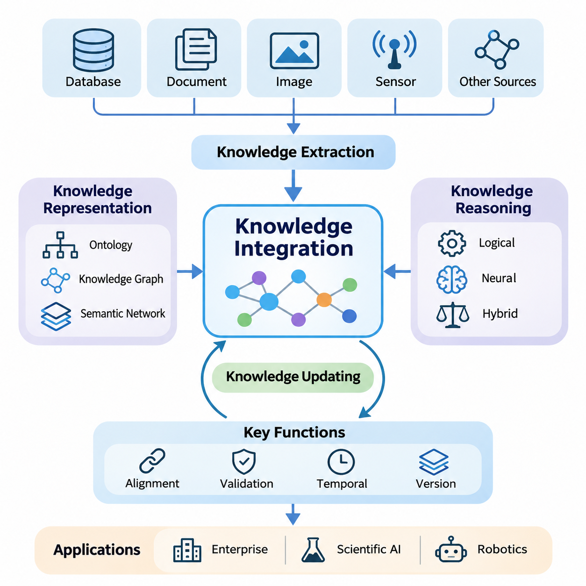
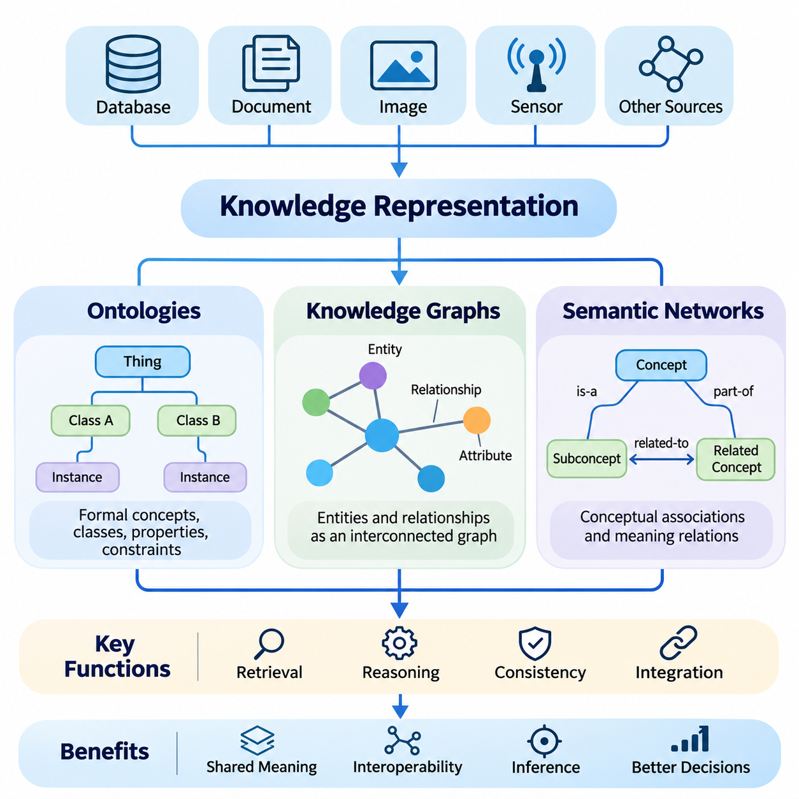
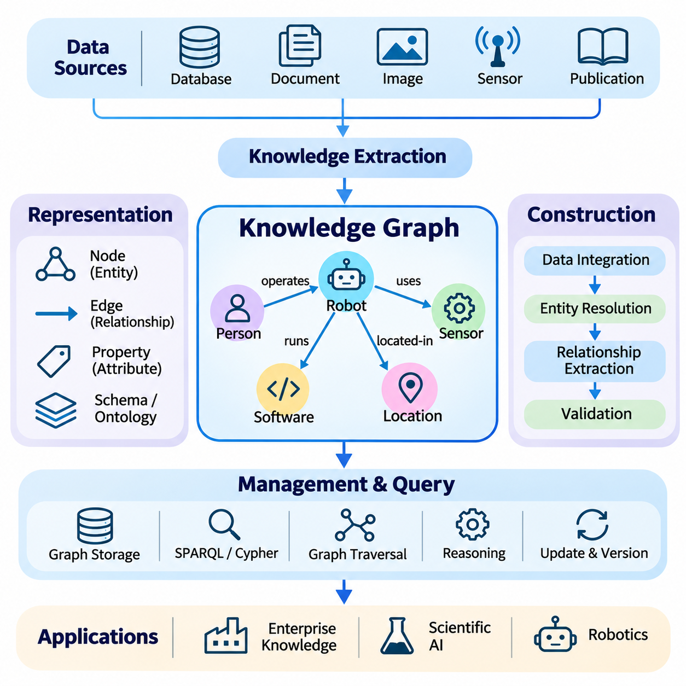
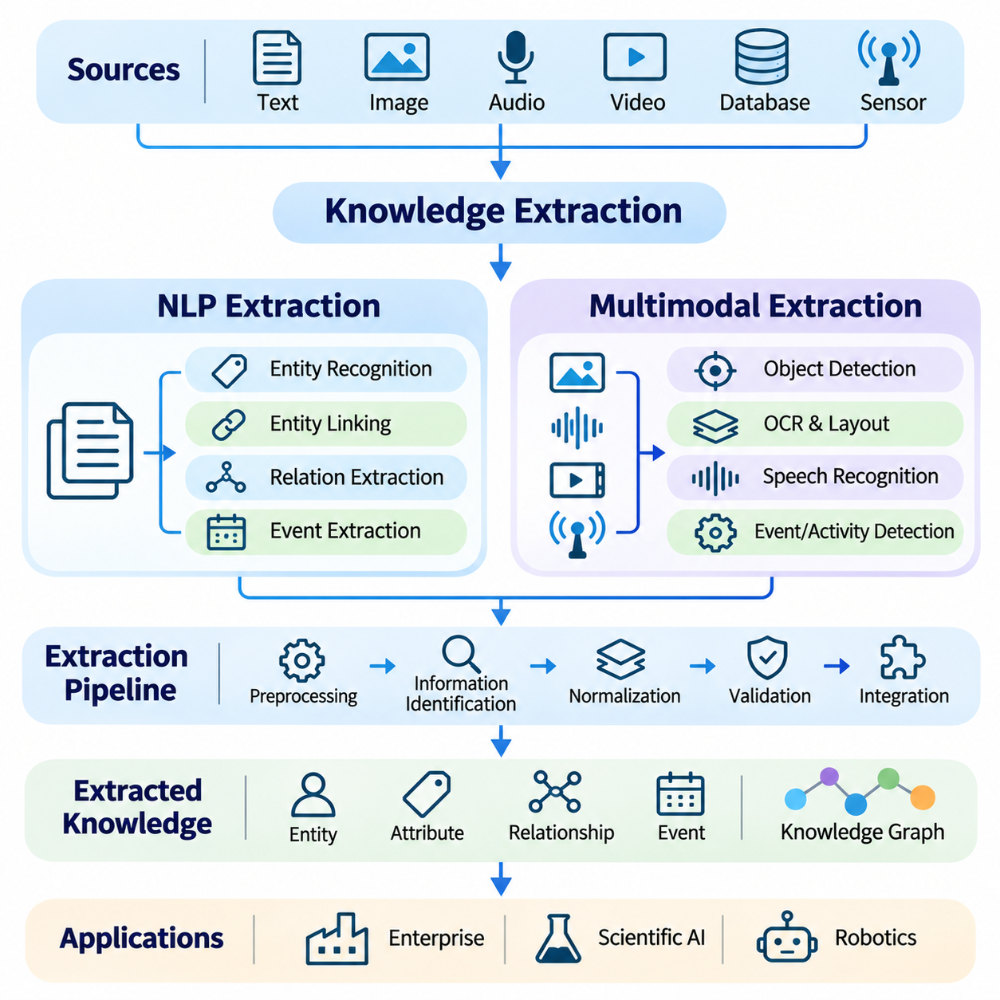
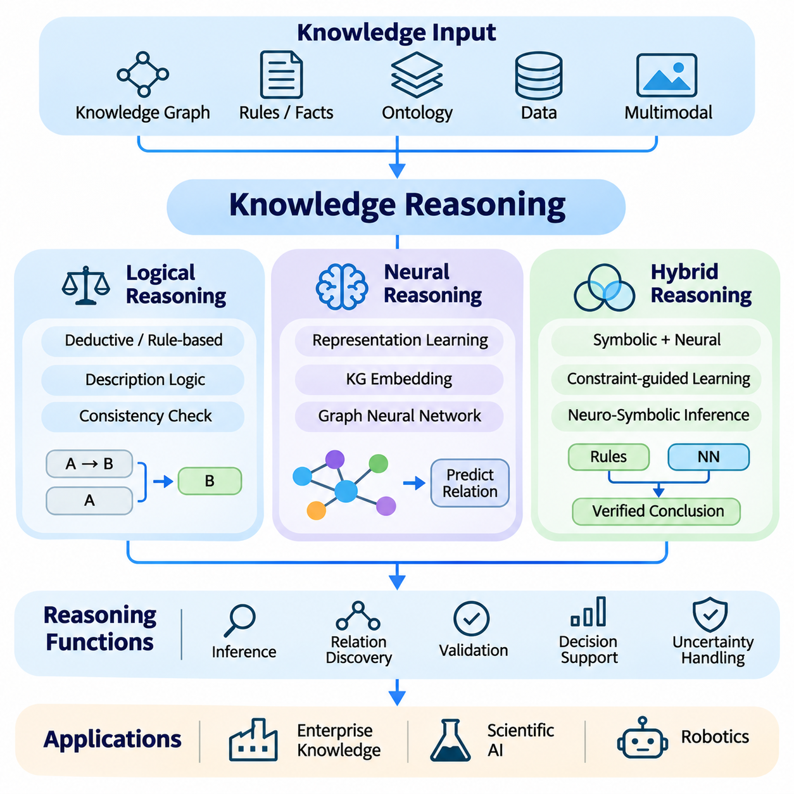
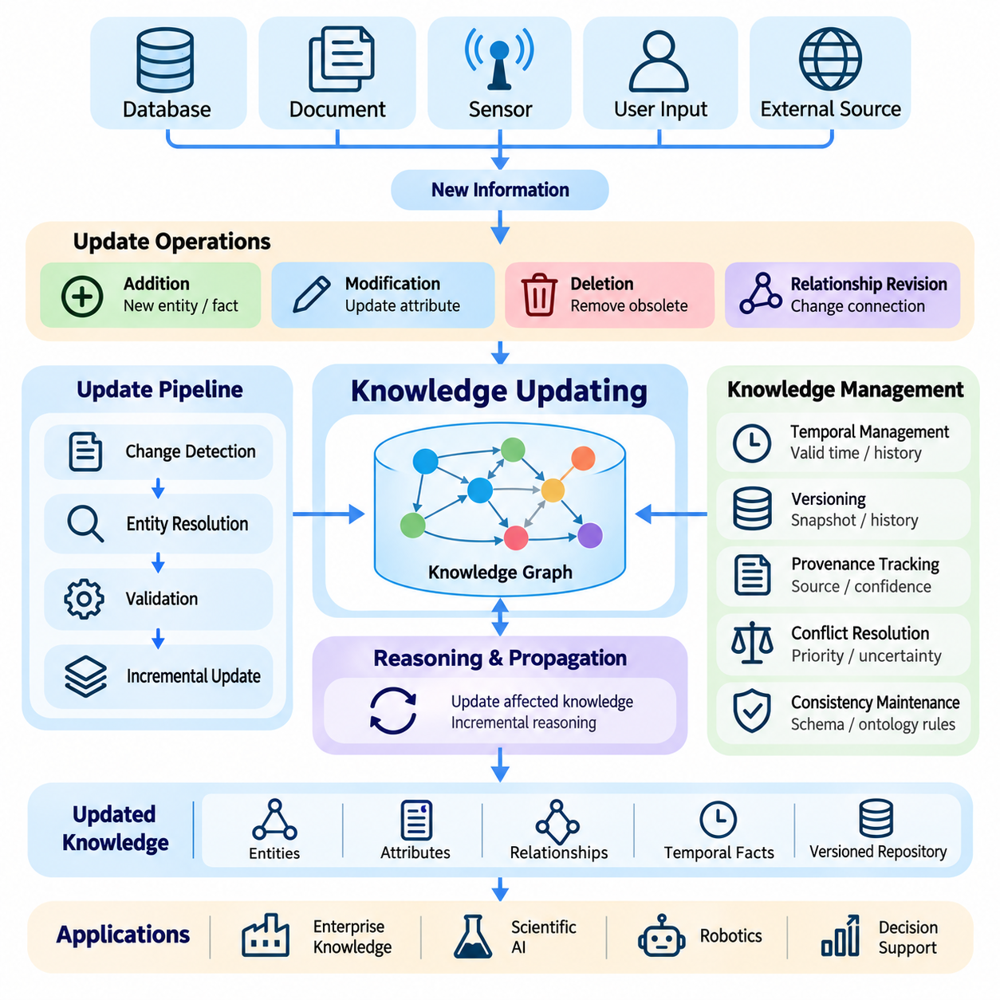
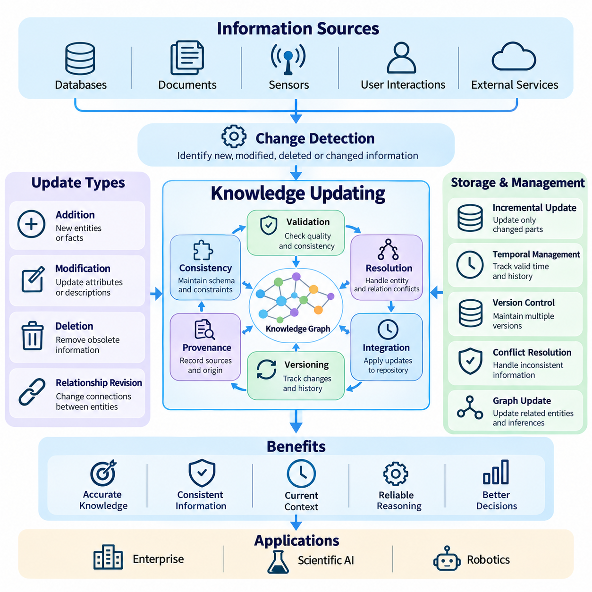
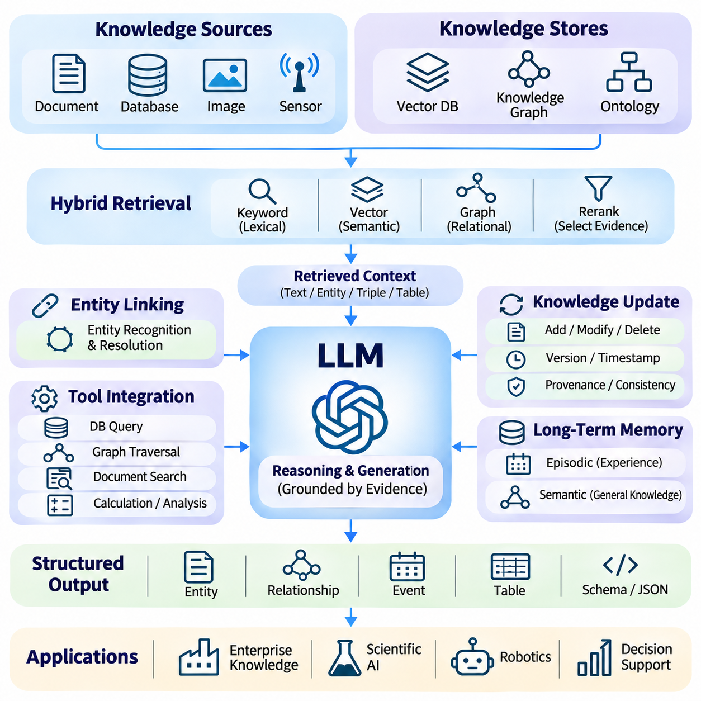
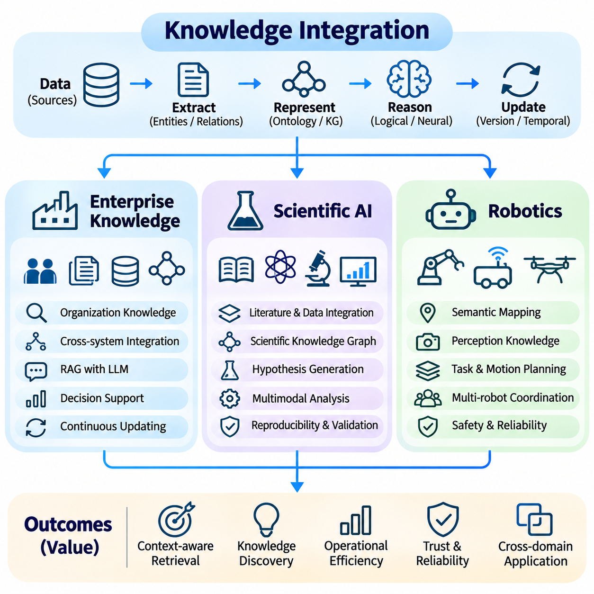

**Volume 37. Memory and Knowledge Systems**

# 04. Knowledge Integration

## 04.00 Overview

{width="7.268055555555556in" height="7.268055555555556in"}

지식 통합(Knowledge Integration)은 이질적인 정보원(Heterogeneous Sources)에서 수집된 정보를 일관되고 활용 가능한 표현으로 결합해야 하는 지능형 시스템(Intelligent Systems)의 핵심 기능이다. 현대 인공지능(Artificial Intelligence)은 개별 데이터셋(Dataset)이나 사전 학습된 모델 매개변수(Pretrained Model Parameters) 이상의 정보에 의존한다. 효과적인 지식 통합은 구조화된 사실(Structured Facts), 비정형 문서(Unstructured Documents), 학습된 표현(Learned Representations), 문맥적 관측(Contextual Observations)을 연결하여 일관된 이해와 추론 및 의사결정을 지원한다.

전통적인 정보 시스템(Information Systems)은 지식을 서로 분리된 데이터베이스(Database), 문서(Document), 애플리케이션(Application), 조직 저장소(Organizational Repositories)에 보관하는 경우가 많다. 이러한 자원에는 가치 있는 정보가 포함되어 있지만, 용어와 구조, 의미 체계(Semantics), 갱신 주기(Update Frequency)의 차이로 인해 통합된 해석이 어렵다. 지식 통합은 정보원 사이의 관계를 설정하고 분산된 내용을 상호 연결된 지식으로 변환하여 이러한 한계를 해결한다.

데이터(Data), 정보(Information), 지식(Knowledge)의 차이를 이해하는 것은 지식 통합의 기본이다. 데이터는 관측 결과나 기록된 값을 의미하며, 정보는 이러한 데이터에 문맥과 해석을 부여한다. 지식은 여기에 추론(Inference)을 지원하는 관계(Relationships), 제약조건(Constraints), 의미 있는 패턴(Patterns)을 추가한다. 따라서 통합 지식 시스템(Integrated Knowledge System)은 단순히 기록을 집계하는 것이 아니라 의미적 의미(Semantic Meaning)를 보존하고 서로 다른 정보원이 공통된 이해에 기여하도록 한다.

지식 표현(Knowledge Representation)은 지식 통합을 위한 구조적 기반을 제공한다. 온톨로지(Ontologies)는 특정 도메인(Domain)의 개념, 범주, 속성, 관계를 정의하며, 지식 그래프(Knowledge Graphs)는 개체(Entity)와 그 연결 관계를 명시적으로 표현한다. 의미망(Semantic Networks)은 개념적 연관성을 구성하는 또 다른 접근법이다. 이러한 표현 방식은 지능형 시스템이 관계를 일관되게 해석하도록 지원하며, 독립적으로 개발된 정보원에서 발생하는 모호성(Ambiguity)을 줄인다.

온톨로지(Ontology)는 여러 시스템이 서로 다른 용어로 유사한 개념을 설명할 때 특히 중요하다. 제조 데이터베이스는 부품을 숫자 식별자(Numerical Identifier)로 관리하는 반면, 유지보수 문서는 동일한 부품을 기능적 명칭(Functional Name)으로 표현할 수 있다. 온톨로지 정렬(Ontological Alignment)은 공통 정의와 관계를 통해 이러한 표현을 연결한다. 이를 통해 엔지니어링(Engineering), 생산(Production), 유지보수(Maintenance) 환경의 정보를 통합된 의미 체계(Semantic Framework) 안에서 해석할 수 있다.

지식 그래프(Knowledge Graph)는 의미 있는 관계를 통해 개체를 연결함으로써 구조화된 표현을 확장한다. 노드(Node)는 일반적으로 객체(Object), 개념(Concept), 사건(Event), 조직(Organization)을 나타내며, 엣지(Edge)는 이들 사이의 관계를 설명한다. 이러한 구조는 상호 연결된 사실을 탐색하고 여러 관계를 필요로 하는 질의(Query)를 지원한다. 그래프 기반 표현(Graph-Based Representation)은 개별 기록의 검색보다 의존성(Dependency), 문맥적 연관성(Contextual Association), 간접적 연결(Indirect Connection)을 이해하는 것이 중요한 환경에서 특히 유용하다.

지식 추출(Knowledge Extraction)은 문서, 데이터베이스, 이미지, 센서 관측에서 얻은 정보를 통합에 적합한 표현으로 변환하는 과정이다. 자연어 처리(Natural Language Processing)는 텍스트에서 개체, 속성, 관계를 식별하며, 멀티모달 추출(Multimodal Extraction)은 시각, 텍스트 및 기타 감각 정보원을 결합한다. 추출된 지식은 정규화(Normalization)와 검증(Validation)이 필요하다. 인식 오류(Recognition Errors), 모호한 표현, 일관되지 않은 용어가 잘못된 관계를 생성할 수 있기 때문이다.

멀티모달 정보(Multimodal Information)를 통합하려면 의미적 정렬(Semantic Alignment)과 시간적 정렬(Temporal Alignment)을 추가로 고려해야 한다. 시각적 관측, 텍스트 설명, 센서 측정값은 동일한 물리적 사건을 서로 다른 관점에서 표현할 수 있다. 효과적인 통합은 공통 개체(Shared Entities), 타임스탬프(Timestamps), 공간 참조(Spatial References), 문맥적 관계(Contextual Relationships)를 통해 이러한 관측을 연결한다. 이를 통해 지능형 시스템은 개별 모달리티(Modality)만으로 얻기 어려운 풍부한 해석을 수행할 수 있다.

지식 추론(Knowledge Reasoning)은 통합된 표현을 추론과 의사결정의 기반으로 변환한다. 논리적 추론(Logical Reasoning)은 명시적인 규칙(Rules)과 제약조건을 적용하여 확립된 사실에서 결론을 도출한다. 신경망 추론(Neural Reasoning)은 학습된 표현을 활용하여 직접 부호화되지 않은 패턴과 관계를 추정한다. 하이브리드 추론(Hybrid Reasoning)은 이러한 접근법을 결합하여 기호적 구조(Symbolic Structures)의 해석 가능성(Interpretability)을 유지하면서 학습 기반 표현의 유연성을 활용한다.

추론의 신뢰성(Reliability)은 통합된 지식의 품질에 크게 의존한다. 잘못된 개체 식별 및 통합(Entity Resolution), 모순된 사실(Contradictory Facts), 불완전한 관계(Incomplete Relationships), 오래된 정보(Outdated Information)는 추론 과정 전체에 오류를 전파할 수 있다. 따라서 지식 통합 시스템에는 출처 추적(Provenance Tracking), 신뢰도 추정(Confidence Estimation), 일관성 검사(Consistency Checking), 충돌 해결(Conflict Resolution) 기능이 필요하다. 이러한 기능은 검증된 지식과 불확실한 관측 및 자동 생성된 해석을 구분하는 데 도움을 준다.

지식 갱신(Knowledge Updating)은 실제 환경이 지속적으로 변화하기 때문에 필수적이다. 조직은 새로운 제품을 도입하고, 과학적 발견은 기존 설명을 수정하며, 자율 시스템(Autonomous Systems)은 이전에 알려지지 않은 상황을 경험한다. 통합 지식 저장소(Integrated Knowledge Repository)는 유효한 관계를 불필요하게 손상시키지 않으면서 새로운 정보의 추가, 기존 정보의 수정, 오래된 정보의 삭제 또는 폐기를 지원해야 한다. 증분 갱신(Incremental Updating)과 버전 관리(Version Management)는 새로운 증거를 반영하면서 지식의 연속성을 유지하는 데 기여한다.

시간적 지식 관리(Temporal Knowledge Management)는 통합 시스템의 정확성을 더욱 향상시킨다. 과거 특정 시점에 유효했던 관계가 현재의 개체 상태를 더 이상 설명하지 못할 수 있다. 타임스탬프(Timestamps), 유효 기간(Validity Intervals), 변경 이력(Historical Changes)을 기록하면 시스템은 현재 지식과 과거 상태를 구분할 수 있다. 이러한 기능은 설비 유지보수(Equipment Maintenance), 운영 계획(Operational Planning), 과학적 관측(Scientific Observations), 동적으로 변화하는 환경에서 특히 중요하다.

대규모 언어 모델(Large Language Models, LLMs)은 자연어 이해(Natural Language Understanding)와 구조화된 지식(Structured Knowledge)을 연결할 새로운 가능성을 제공한다. 사전 학습된 모델(Pretrained Models)은 상당한 통계적 정보를 학습하지만, 내부 표현만으로 사실적 정확성(Factual Accuracy), 최신 지식(Current Knowledge), 명시적인 추적 가능성(Traceability)이 보장되지는 않는다. 외부 지식 저장소(External Knowledge Repositories)를 통합하면 언어 모델이 도메인 특화 정보(Domain-Specific Information)에 접근하고 구조화된 관계를 응답에 반영하여 암묵적인 매개변수 지식(Parametric Knowledge)에 대한 의존성을 줄일 수 있다.

지식 그래프와 대규모 언어 모델의 통합(Knowledge Graph Integration with LLMs)은 개체 인식 검색(Entity-Aware Retrieval), 관계 탐색(Relationship Exploration), 다단계 추론(Multi-Step Reasoning)을 지원할 수 있다. 언어 모델은 자연어 질문을 해석하고 관련 개체를 식별한 다음 그래프 기반 저장소에서 연관된 사실을 검색한다. 검색된 지식은 응답 생성(Response Generation)의 문맥적 증거(Contextual Evidence)가 된다. 그러나 유창한 설명이 반드시 정확한 결론을 의미하지 않으므로, 생성된 결론이 검색된 사실에 의해 뒷받침되는지 검증해야 한다.

지식 통합은 검색 시스템(Retrieval Systems) 및 장기 기억(Long-Term Memory)과 밀접하게 관련되지만, 각 기능의 목적은 서로 다르다. 검색(Retrieval)은 특정 질의와 관련된 정보를 식별하고, 기억(Memory)은 상호작용이나 운영 기간에 걸쳐 정보를 보존한다. 지식 통합은 이러한 자원 사이에 의미적 관계(Semantic Relationships)를 설정한다. 이를 통해 검색된 증거와 저장된 경험이 일관된 표현에 기여하고, 추론과 문맥적 해석 및 향후 의사결정을 지원한다.

기업 환경(Enterprise Environments)에서 통합 지식 시스템은 운영 데이터베이스(Operational Databases), 기술 문서(Technical Documentation), 조직 절차(Organizational Procedures), 축적된 전문 지식(Accumulated Expertise)을 연결한다. 이러한 시스템은 부서 간 질의응답(Question Answering), 의사결정 지원(Decision Assistance), 규정 준수 분석(Compliance Analysis), 지식 발견(Knowledge Discovery)에 활용될 수 있다. 효과적인 운영을 위해서는 일관된 용어 관리, 민감 정보(Sensitive Information)에 대한 접근 제어(Access Control), 서로 다른 조직 정보원에서 수집된 사실의 출처 보존이 필요하다.

과학 인공지능(Scientific AI)은 실험 관측(Experimental Observations), 연구 논문(Research Publications), 이론 모델(Theoretical Models), 구조화된 과학 데이터베이스(Structured Scientific Databases)를 통합함으로써 이점을 얻는다. 재료(Materials), 생물학적 개체(Biological Entities), 물리적 과정(Physical Processes), 실험 조건(Experimental Conditions) 사이의 관계는 개별 분석으로 발견하기 어려운 연결을 드러낼 수 있다. 통합 지식은 가설 생성(Hypothesis Generation)과 증거 탐색(Evidence Exploration)을 지원하지만, 실험적으로 검증된 결과와 계산을 통해 예측된 결과는 명확하게 구분되어야 한다.

로보틱스(Robotics)는 자율 시스템이 의미적 지식(Semantic Knowledge)과 물리적 관측(Physical Observations)을 결합해야 하므로 지식 통합의 중요한 응용 분야이다. 로봇은 인식 모델(Perception Models)을 통해 객체를 식별하는 동시에 저장된 지식을 활용하여 객체의 기능, 운영 제약조건(Operational Constraints), 주변 환경과의 관계를 이해할 수 있다. 공간 정보(Spatial Information), 센서 관측(Sensor Observations), 작업 설명(Task Descriptions), 절차적 지식(Procedural Knowledge)의 통합은 복잡한 운영 환경에서 문맥 인식 계획(Context-Aware Planning)과 행동을 지원한다.

실용적인 지식 통합 아키텍처(Knowledge Integration Architecture)는 확장성(Scalability), 계산 효율성(Computational Efficiency), 시스템 상호운용성(System Interoperability)도 고려해야 한다. 대규모 저장소에는 서로 다른 저장 기술(Storage Technologies)에 분산된 수백만 개의 개체와 관계가 포함될 수 있다. 효율적인 인덱싱(Indexing), 그래프 질의(Graph Querying), 캐싱(Caching), 분산 처리(Distributed Processing)는 적절한 성능을 유지하는 데 도움을 준다. 표준화된 인터페이스(Standardized Interfaces)와 표현 형식(Representation Formats)은 기본적인 의미 구조를 반복적으로 재구성하지 않고도 애플리케이션 사이에서 지식을 교환하도록 지원한다.

보안(Security)과 거버넌스(Governance) 역시 중요하다. 통합 지식은 개별 데이터셋에서는 명확하게 드러나지 않는 관계를 노출할 수 있기 때문이다. 접근 제어(Access Control)는 저장된 사실뿐 아니라 관계를 통해 추론할 수 있는 정보까지 고려해야 한다. 데이터 계보(Data Lineage), 감사 가능성(Auditability), 개인정보 보호(Privacy Protection), 정보원 수준의 권한(Source-Level Permissions)은 무단 공개와 오용을 방지하는 데 도움을 준다. 거버넌스 정책은 운영 수명주기(Operational Lifecycle) 전반에 걸쳐 지식의 검증, 수정, 폐기에 대한 책임도 정의해야 한다.

지식 통합의 평가(Evaluation)는 저장 용량(Storage Capacity)이나 질의 속도(Query Speed)를 측정하는 것만으로 충분하지 않다. 중요한 평가 요소에는 개체 정렬 정확도(Entity Alignment Accuracy), 관계 정확성(Relationship Correctness), 완전성(Completeness), 일관성(Consistency), 추론 신뢰성(Reasoning Reliability), 갱신 지연시간(Update Latency)이 포함된다. 응용 수준 평가(Application-Level Evaluation)는 통합 지식이 사실적 근거 확보(Factual Grounding), 의사결정 품질(Decision Quality), 작업 성능(Task Performance)을 실제로 개선하는지 확인해야 한다. 이러한 측정은 추가적인 의미적 복잡성(Semantic Complexity)이 전체 지능형 시스템에 실질적인 이점을 제공하는지 판단하는 데 도움을 준다.

지식 통합의 장기적 중요성은 인식(Perception), 기억(Memory), 검색(Retrieval), 추론(Reasoning), 행동(Action)을 공통 정보 체계(Common Information Framework) 안에서 연결할 수 있다는 데 있다. 고급 인공지능 시스템(Advanced AI Systems)은 지식을 정적인 콘텐츠(Static Content)로 취급하기보다 관측과 상호작용을 통해 발전하는 표현을 필요로 한다. 효과적인 지식 통합은 지식 인식 언어 모델(Knowledge-Aware Language Models), 적응형 자율 시스템(Adaptive Autonomous Systems), 다양하고 변화하는 환경에서 작동할 수 있는 지능형 애플리케이션(Intelligent Applications)의 기반을 제공한다.

## 04.01 Knowledge Representation

{width="7.268055555555556in" height="7.268055555555556in"}

지식 표현(Knowledge Representation)은 인공지능 시스템(Artificial Intelligence Systems)이 정보를 해석하고 검색하며 추론할 수 있도록 구조화하는 개념적·계산적 기반을 제공한다. 지식 표현 방법은 지식을 개별적인 사실로 취급하는 대신, 일관된 체계 안에서 개체(Entity), 속성(Attribute), 관계(Relationship), 제약조건(Constraint)을 설명한다. 온톨로지(Ontologies), 지식 그래프(Knowledge Graphs), 의미망(Semantic Networks)은 이질적인 정보를 의미 있는 구조로 변환하기 위한 상호 보완적인 접근법을 제공한다.

지식 표현의 주요 목적은 기계와 인간 사용자 모두가 정보를 이해할 수 있도록 만드는 것이다. 지식 표현은 어떤 개체가 존재하는지, 개체가 어떻게 분류되는지, 어떤 관계가 개체들을 연결하는지 식별해야 한다. 또한 추론(Inference), 일관성 검사(Consistency Checking), 지식 검색(Knowledge Retrieval)을 지원해야 한다. 표현 방식의 선택은 지능형 시스템이 서로 다른 정보원의 정보를 얼마나 효과적으로 결합하고 새로운 상황에 적용할 수 있는지에 영향을 미친다.

온톨로지(Ontologies)는 특정 도메인(Domain) 내의 개념과 관계에 대한 형식적 설명(Formal Descriptions)을 제공한다. 온톨로지는 지식 구성을 위한 공통 어휘(Shared Vocabulary)를 설정하는 클래스(Class), 속성(Property), 개체 인스턴스(Individual), 제약조건(Constraint)을 정의한다. 클래스는 개체의 범주를 나타내고, 인스턴스는 특정 개체를 나타낸다. 속성은 개체의 특성이나 관계를 설명하며, 시스템이 개념적 정의와 실제 관측된 사실을 구분하도록 지원한다.

잘 설계된 온톨로지는 독립적으로 개발된 정보 시스템 사이에 의미적 일관성(Semantic Consistency)을 확립한다. 예를 들어 제조 환경에는 설비, 부품, 유지보수 기록, 운영 절차를 관리하는 별도의 데이터베이스가 존재할 수 있다. 온톨로지는 기계, 센서, 고장, 유지보수 활동과 같은 공통 개념을 정의한다. 이러한 정의를 통해 서로 다른 저장소의 정보를 공통 개념 모델(Common Conceptual Model)을 기반으로 일관되게 해석할 수 있다.

온톨로지 개발(Ontology Development)은 일반적으로 도메인 분석(Domain Analysis)과 개념 식별(Concept Identification)에서 시작된다. 설계자는 중요한 개체를 결정하고 속성을 정의하며 계층적 관계(Hierarchical Relationships)와 연관 관계(Associative Relationships)를 설정한다. 분류학적 관계(Taxonomic Relationships)는 세부 개념이 상위 범주의 특성을 어떻게 상속하는지 설명한다. 추가적인 제약조건은 유효한 개체와 속성의 조합을 지정하여 자동화 시스템이 불일치를 감지하고 일관된 지식 구조를 유지하도록 지원한다.

형식적 온톨로지 언어(Formal Ontology Languages)는 이러한 정의를 기계가 읽을 수 있는 형태로 표현하는 방법을 제공한다. 자원 기술 프레임워크(Resource Description Framework, RDF)는 주어-술어-목적어(Subject-Predicate-Object) 형식의 문장으로 정보를 표현하며, 웹 온톨로지 언어(Web Ontology Language, OWL)는 더욱 풍부한 클래스 정의와 논리적 제약조건을 지원한다. 기술 논리(Description Logics)는 분류(Classification), 일관성 검사, 암묵적 관계 추론(Implicit Relationship Inference) 등 다양한 온톨로지 추론 작업의 수학적 기반을 제공한다.

온톨로지 추론(Ontology Reasoning)은 개별 사실로 명시적으로 저장되지 않은 결론을 시스템이 도출하도록 한다. 예를 들어 이동 로봇(Mobile Robot)이 자율주행 차량(Autonomous Vehicle)으로 분류되고, 자율주행 차량이 로봇 시스템(Robotic System)의 일종으로 정의되어 있다면 추론 엔진(Reasoner)은 이동 로봇이 상위 범주인 로봇 시스템에 속한다고 추론할 수 있다. 이러한 결론은 온톨로지에 부호화된 논리적 정의와 가정에 의존하므로 신중한 의미 모델링(Semantic Modeling)이 필수적이다.

지식 그래프(Knowledge Graphs)는 노드(Node)와 엣지(Edge)를 사용하여 상호 연결된 지식을 표현한다. 노드는 사람, 기계, 장소, 개념, 사건과 같은 개체를 나타내며, 엣지는 개체 사이의 의미 있는 관계를 설명한다. 미리 정의된 필드를 중심으로 기록을 구성하는 전통적인 테이블(Table)과 달리 그래프 구조(Graph Structure)는 연결 관계를 강조한다. 따라서 복잡한 의존성(Dependencies), 상호 연결된 프로세스(Interconnected Processes), 여러 정보 도메인에 걸친 관계를 표현하는 데 적합하다.

지식 그래프는 로봇 시스템의 센서(Sensors), 제어기(Controllers), 액추에이터(Actuators), 소프트웨어 모듈(Software Modules), 운영 환경(Operational Environments) 사이의 관계를 설명할 수 있다. 센서는 인식 모듈(Perception Module)에 연결되고, 인식 모듈은 위치 추정(Localization)이나 장애물 감지(Obstacle Detection)에 정보를 제공할 수 있다. 이러한 관계를 통해 엔지니어와 지능형 에이전트(Intelligent Agents)는 의존성을 탐색하고 영향을 받는 구성요소를 식별하며 특정 시스템 기능과 관련된 문맥 정보를 검색할 수 있다.

지식 그래프는 일반적으로 RDF 기반 표현(RDF-Based Representation) 또는 속성 그래프 모델(Property Graph Model)을 사용한다. RDF 그래프는 트리플(Triple)을 통해 관계를 표현하고 표준화된 의미 어휘(Semantic Vocabulary)를 사용할 수 있다. 속성 그래프는 노드와 관계에 레이블(Label) 및 속성(Attribute)을 연결하여 유연한 그래프 탐색(Graph Traversal)과 응용 중심 질의(Application-Oriented Querying)를 지원한다. 두 접근법 모두 상호 연결된 정보를 표현하지만 데이터 모델(Data Model), 질의 메커니즘(Query Mechanism), 추론 기능(Reasoning Capabilities)에는 차이가 있다.

그래프 질의(Graph Querying)는 개별 키워드 일치보다 관계를 기반으로 지식을 검색하도록 한다. SPARQL은 그래프 패턴(Graph Patterns)을 통해 RDF 데이터셋을 질의하며, 사이퍼(Cypher)는 속성 그래프 데이터베이스(Property Graph Databases)와 널리 연관된 질의 언어이다. 질의는 직접적인 관계를 식별하고 여러 연결을 탐색하거나 지정된 조건을 만족하는 개체를 검색할 수 있다. 지식 저장소의 크기와 복잡성이 증가할수록 효율적인 그래프 인덱싱(Graph Indexing)과 질의 최적화(Query Optimization)가 중요해진다.

지식 그래프 구축(Knowledge Graph Construction)에는 개체 추출(Entity Extraction), 관계 식별(Relationship Identification), 개체 식별 및 통합(Entity Resolution), 데이터 통합(Data Integration)이 필요하다. 정보는 구조화된 데이터베이스, 기술 문서, 과학 논문, 멀티모달 관측(Multimodal Observations)에서 수집될 수 있다. 개체 식별 및 통합은 서로 다른 참조가 동일한 실제 객체를 가리키는지 판단한다. 관계 추출(Relationship Extraction)은 의미 있는 연관성을 식별하며, 정규화(Normalization)는 용어와 속성을 의도된 지식 스키마(Knowledge Schema)에 맞게 정렬한다.

그래프 품질(Graph Quality)은 기반 정보의 정확성(Accuracy)과 완전성(Completeness)에 의존한다. 잘못된 개체 병합(Entity Merging)은 관련 없는 사실을 결합할 수 있으며, 누락된 관계는 유효한 결론을 발견하지 못하게 할 수 있다. 출처 정보(Provenance Information)는 지식이 어디에서 생성되었는지 기록하고, 신뢰도 값(Confidence Values)은 추출된 관계의 불확실성을 나타낼 수 있다. 검증 절차(Validation Procedures)는 확인된 사실과 예측, 추론된 연결, 잠재적으로 충돌하는 관측을 구분해야 한다.

의미망(Semantic Networks)은 상호 연결된 개념과 연관 관계를 통해 지식을 표현하는 보다 폭넓은 개념적 접근법을 제공한다. 역사적으로 의미망은 인간의 개념적 조직(Human Conceptual Organization)과 기계 추론(Machine Reasoning)을 모델링하는 데 사용되어 왔다. 개념은 노드로 표현되며, 레이블이 지정된 연결(Labeled Links)은 범주 소속(Category Membership), 유사성(Similarity), 연관성(Association), 부분-전체 관계(Part-Whole Relationships)를 나타낸다. 직관적인 구성 방식은 개념적 의존성을 설명하는 데 유용하다.

계층적 의미망(Hierarchical Semantic Networks)은 일반적으로 상속 관계(Inheritance Relationships)를 사용하여 일반 개념과 세부 개념을 구성한다. 차량(Vehicle)은 일반적인 속성을 가질 수 있으며, 이동 로봇은 관련 특성을 상속하면서 추가적인 기능을 도입할 수 있다. 이러한 구조는 중복된 설명을 줄이고 개념적 분류(Conceptual Classification)를 지원한다. 그러나 예외(Exception), 다중 분류(Multiple Classifications), 충돌하는 속성(Conflicting Properties)을 정확하게 표현해야 하는 경우 상속 구조는 더욱 복잡해진다.

의미망과 형식적 온톨로지(Formal Ontologies)의 주요 차이는 의미적 명세(Semantic Specification)의 수준과 논리적 엄밀성(Logical Rigor)에 있다. 일반적인 의미망은 정확한 추론 규칙(Inference Rules)을 정의하지 않고 연관성을 표현할 수 있지만, 온톨로지는 일반적으로 명시적인 개념 정의와 형식적 제약조건을 설정한다. 지식 그래프는 상호 연결된 사실의 표현과 관리에 중점을 둔다. 실제 시스템에서는 이러한 범주가 완전히 분리된 기술로 존재하기보다 서로 중첩되는 경우가 많다.

온톨로지와 지식 그래프의 통합(Integration of Ontologies and Knowledge Graphs)은 형식적 개념 정의와 대규모 사실 관계를 결합한다. 온톨로지는 스키마(Schema), 분류(Classification), 제약조건을 제공하고, 지식 그래프는 개체와 연결 관계를 저장한다. 추론 엔진(Reasoning Engines)은 온톨로지 정의를 활용하여 추가적인 관계를 추론하거나 불일치를 식별할 수 있다. 이러한 결합은 의미적 상호운용성(Semantic Interoperability)을 지원하고 이질적인 정보원에서 획득한 지식의 일관성을 향상시킨다.

신경망 표현(Neural Representations)은 개체와 관계를 연속 벡터(Continuous Vectors)로 부호화하여 기호적 지식 구조(Symbolic Knowledge Structures)를 보완할 수 있다. 지식 그래프 임베딩(Knowledge Graph Embeddings)은 선택된 구조적 패턴(Structural Patterns)을 포착하는 수치 표현을 학습하여 유사도 추정(Similarity Estimation)과 링크 예측(Link Prediction)을 가능하게 한다. 이러한 방법은 누락되었을 가능성이 있는 관계를 식별할 수 있지만, 예측된 연결은 검증되기 전까지 불확실한 상태로 남는다. 기호적 제약조건(Symbolic Constraints)과 신경망 모델(Neural Models)을 결합하면 명시적인 의미 정보를 보존하면서 유연성을 향상시킬 수 있다.

대규모 언어 모델(Large Language Models, LLMs)은 자연어 인터페이스(Natural Language Interfaces), 개체 연결(Entity Linking), 구조화된 검색(Structured Retrieval)을 통해 지식 표현과 상호작용할 수 있다. 모델은 질문을 해석하고 관련 개념을 식별한 다음 온톨로지나 지식 그래프를 질의하여 근거 자료(Supporting Evidence)를 확보할 수 있다. 검색된 관계는 응답 생성(Response Generation)과 다단계 추론(Multi-Step Reasoning)에 활용된다. 이러한 통합은 사실적 근거 확보(Factual Grounding)를 개선할 수 있지만, 생성된 설명은 여전히 권위 있는 지식 정보원(Authoritative Knowledge Sources)을 기준으로 검증해야 한다.

동적 환경(Dynamic Environments)에서는 지속적인 수정이 가능한 지식 표현이 필요하다. 새로운 개체가 등장하고 기존 관계가 변경되며 이전에 유효했던 사실이 더 이상 유효하지 않을 수 있다. 시간적 속성(Temporal Attributes), 버전 이력(Version Histories), 증분 갱신(Incremental Updates)은 과거 지식과 현재 지식의 구분을 유지하는 데 도움을 준다. 여러 애플리케이션이나 자율 에이전트(Autonomous Agents)가 동일한 지식 저장소를 공유하는 경우 갱신 과정에서 일관성을 유지하는 것이 특히 중요하다.

지식 표현은 확장성(Scalability), 불확실성(Uncertainty), 모호성(Ambiguity), 의미적 정렬(Semantic Alignment)과 관련된 과제도 수반한다. 서로 다른 조직은 동일한 개체를 호환되지 않는 개념 구조(Incompatible Conceptual Structures)로 분류할 수 있다. 자동 매핑(Automated Mapping)은 대응 관계를 제안할 수 있지만, 복잡한 사례를 해결하려면 도메인 전문 지식(Domain Expertise)이 필요한 경우가 많다. 따라서 효과적인 통합은 형식적 모델링(Formal Modeling), 통계적 방법(Statistical Methods), 검증 절차, 거버넌스 메커니즘(Governance Mechanisms)을 결합하여 다양한 시스템에서 신뢰할 수 있는 지식을 유지한다.

이러한 지식 표현의 응용 분야는 기업 지능(Enterprise Intelligence), 과학적 발견(Scientific Discovery), 의료(Healthcare), 로보틱스(Robotics), 자율 시스템(Autonomous Systems) 전반에 걸쳐 확장된다. 기업 애플리케이션은 조직 정보를 연결하고, 과학 시스템은 실험 결과 사이의 관계를 모델링하며, 로봇은 의미적 설명과 물리적 관측을 결합한다. 각 분야에서 구조화된 지식(Structured Knowledge)은 인식(Perception), 검색(Retrieval), 기계학습(Machine Learning)을 보완하는 문맥 정보를 제공하여 더욱 정교한 의사결정과 해석 가능한 시스템 동작을 지원한다.

지식 표현의 효과는 의미적 정확성(Semantic Correctness), 적용 범위(Coverage), 일관성(Consistency), 추론 성능(Reasoning Performance), 실용적 유용성(Practical Usefulness)을 통해 평가해야 한다. 표현력이 높은 온톨로지(Expressive Ontology)는 정교한 추론을 지원하지만 계산 부담(Computational Overhead)을 증가시킬 수 있다. 반면 단순한 그래프는 논리적 보장(Logical Guarantees)이 적은 대신 빠른 검색을 제공할 수 있다. 적절한 표현 방식을 선택하려면 형식적 표현력(Formal Expressiveness), 운영 효율성(Operational Efficiency), 유지보수성(Maintainability), 응용 분야의 추론 요구사항(Reasoning Requirements) 사이의 균형을 고려해야 한다.

온톨로지(Ontologies), 지식 그래프(Knowledge Graphs), 의미망(Semantic Networks)은 지식 인식 인공지능(Knowledge-Aware Artificial Intelligence)의 구조적 기반을 공동으로 형성한다. 온톨로지는 개념적 의미를 형식화하고, 지식 그래프는 상호 연결된 사실을 구성하며, 의미망은 개념적 연관성을 표현한다. 이러한 기술을 조화롭게 활용하면 지능형 시스템은 분산된 정보를 연결하고 의미 있는 관계를 발견하며 여러 도메인에 걸친 추론을 수행할 수 있다. 이는 고급 기억 시스템(Advanced Memory Systems), 검색 시스템(Retrieval Systems), 자율 의사결정 시스템(Autonomous Decision-Making Systems)을 위한 필수적인 기반 기술이 된다.

## 04.02 Knowledge Graphs [w/Code]

{width="7.268055555555556in" height="7.268055555555556in"}

지식 그래프(Knowledge Graphs)는 개체(Entity), 속성(Attribute), 관계(Relationship)를 상호 연결된 정보로 표현하기 위한 구조화된 프레임워크(Structured Framework)를 제공한다. 개별 기록을 중심으로 정보를 관리하는 전통적인 데이터베이스(Conventional Databases)와 달리, 지식 그래프는 의미 있는 연결 관계를 중심으로 정보를 구성한다. 이러한 구조는 인공지능 시스템(Artificial Intelligence Systems)이 개체 사이의 의미적 관계(Semantic Relationships)를 보존하면서 문맥적 지식(Contextual Knowledge)을 검색하고, 의존성을 탐색하며, 이질적인 데이터 소스(Heterogeneous Data Sources)에 걸쳐 추론을 수행하도록 지원한다.

지식 그래프의 기본 구조는 노드(Node)와 엣지(Edge)로 구성된다. 노드는 사람, 조직, 기계, 장소, 사건 또는 추상적 개념과 같은 개체를 나타내며, 엣지는 개체 사이의 관계를 설명한다. 관계는 소유권(Ownership), 소속(Membership), 의존성(Dependency), 위치(Location), 기능적 상호작용(Functional Interaction)을 나타낼 수 있다. 노드와 엣지에 연결된 속성(Properties)은 추가적인 설명 정보를 제공하여 복잡한 현실 세계의 지식을 체계적으로 표현할 수 있도록 한다.

지식 그래프는 일반적으로 방향성 레이블 그래프(Directed Labeled Graphs)를 사용하여 모델링되며, 관계는 출발 개체(Source Entity)와 대상 개체(Target Entity)를 연결한다. 예를 들어 로봇이 라이다(LiDAR) 센서를 사용한다는 문장은 로봇 개체와 센서 개체 사이의 관계로 표현할 수 있다. 여러 문장이 결합되면 관련 개념을 탐색할 수 있는 상호 연결된 네트워크(Interconnected Network)가 형성된다. 이러한 그래프 중심 구성(Graph-Oriented Organization)은 정보에 많은 의존성과 간접적인 관계가 포함된 경우 특히 효과적이다.

자원 기술 프레임워크(Resource Description Framework, RDF)는 주어-술어-목적어(Subject-Predicate-Object)로 구성된 트리플(Triple)을 통해 지식을 표현한다. 각 트리플은 두 자원 사이 또는 자원과 값 사이의 관계를 나타낸다. RDF 식별자(Identifiers)는 분산된 정보 시스템에서 개체를 일관되게 참조할 수 있도록 한다. 여러 트리플을 결합하면 복잡한 관계를 표현할 수 있으며, 표준화된 데이터 교환(Standardized Data Exchange)과 애플리케이션 간 의미적 상호운용성(Semantic Interoperability)을 지원할 수 있다.

속성 그래프 모델(Property Graph Models)은 지식 표현에 널리 사용되는 또 다른 접근법이다. 이 모델에서 노드와 관계는 레이블(Label) 및 키-값 속성(Key-Value Properties)을 포함할 수 있다. 로봇 노드에는 식별자, 제조사, 운영 상태가 포함될 수 있으며, 로봇과 센서를 연결하는 관계에는 설치 정보가 포함될 수 있다. 속성 그래프는 유연한 그래프 탐색(Graph Traversal)과 효율적인 관계 기반 질의(Relationship-Based Queries)가 필요한 응용 중심 시스템(Application-Oriented Systems)에 특히 유용하다.

지식 그래프 스키마(Knowledge Graph Schemas)는 특정 도메인(Domain)에서 예상되는 개체, 관계, 속성의 유형을 정의한다. 스키마는 센서가 로봇 플랫폼(Robotic Platforms)에 설치되고, 제어기(Controllers)가 소프트웨어 모듈(Software Modules)을 실행하며, 유지보수 이벤트(Maintenance Events)가 장비에 영향을 미친다는 관계를 지정할 수 있다. 이러한 정의는 일관성을 향상시키고 검증(Validation)을 지원한다. 온톨로지(Ontologies)는 형식적 의미(Formal Semantics), 계층적 분류(Hierarchical Classifications), 논리적 제약조건(Logical Constraints)을 추가하여 더욱 정교한 추론을 가능하게 한다.

지식 그래프 구축(Knowledge Graph Construction)은 관련 정보원을 식별하고 목표 지식 모델(Target Knowledge Model)을 정의하는 과정에서 시작된다. 구조화된 데이터베이스(Structured Databases), 기술 문서(Technical Documents), 운영 로그(Operational Logs), 과학 논문(Scientific Publications), 센서 관측(Sensor Observations)이 정보원으로 활용될 수 있다. 데이터 추출(Data Extraction)은 후보 개체와 관계를 식별하고, 변환 절차(Transformation Procedures)는 이질적인 표현을 일관된 그래프 구조로 변환한다. 생성된 지식은 신뢰할 수 있는 저장소(Trusted Repository)에 포함되기 전에 검증되어야 한다.

개체 식별 및 통합(Entity Resolution)은 서로 다른 정보원이 동일한 현실 세계의 객체를 다른 이름이나 식별자로 설명할 수 있기 때문에 중요한 단계이다. 로봇 구성요소(Robotic Component)는 재고 데이터베이스(Inventory Database)에서는 제품 코드(Product Code)로 나타나고, 유지보수 문서(Maintenance Documentation)에서는 기능적 설명(Functional Description)으로 나타날 수 있다. 개체 식별 및 통합 방법은 식별자, 속성, 문맥 정보(Contextual Information), 의미적 유사도(Semantic Similarity)를 비교하여 서로 다른 참조가 동일한 개체를 나타내는지 판단한다.

관계 추출(Relationship Extraction)은 구조화된 정보와 비정형 정보(Unstructured Information)에서 개체 사이의 의미 있는 연결을 식별한다. 자연어 처리(Natural Language Processing, NLP) 모델은 기술 문서에 표현된 관계를 인식할 수 있으며, 데이터베이스 매핑(Database Mapping)은 기존 기록에서 연결 관계를 도출할 수 있다. 멀티모달 추출(Multimodal Extraction)은 시각적 관측(Visual Observations)을 인식된 객체 및 속성과 연결할 수 있다. 자동 추출은 모호성, 잘못된 연관성, 불완전한 정보를 발생시킬 수 있으므로 추출된 관계에는 신뢰도 평가(Confidence Assessment)가 필요하다.

그래프 저장 시스템(Graph Storage Systems)은 효율적인 탐색과 검색을 지원하도록 상호 연결된 데이터를 구성한다. 네이티브 그래프 데이터베이스(Native Graph Databases)는 연결된 개체를 처리하는 연산을 최적화하는 경우가 많으며, RDF 저장소(RDF Stores)는 트리플 관리와 의미적 질의(Semantic Queries)를 위한 특화된 메커니즘을 제공한다. 저장 아키텍처(Storage Architecture)는 질의 지연시간(Query Latency), 확장성(Scalability), 인덱싱 효율성(Indexing Efficiency), 갱신 성능(Update Performance)에 영향을 미친다. 적절한 데이터베이스를 선택하려면 그래프 크기, 관계 밀도(Relationship Density), 질의 패턴(Query Patterns), 운영 요구사항(Operational Requirements)을 고려해야 한다.

그래프 질의 언어(Graph Query Languages)는 사용자와 애플리케이션이 구조적 패턴(Structural Patterns)을 통해 정보를 검색하도록 지원한다. SPARQL은 RDF 그래프 질의를 지원하며, 사이퍼(Cypher)는 속성 그래프 시스템(Property Graph Systems)에서 일반적으로 사용된다. 질의는 특정 로봇에 연결된 모든 센서를 식별하거나 지정된 제어기에 의존하는 소프트웨어 모듈을 검색할 수 있다. 더욱 복잡한 질의는 여러 관계를 탐색하여 개별 기록 검색만으로 표현하기 어려운 간접적인 의존성을 발견할 수 있다.

그래프 탐색 알고리즘(Graph Traversal Algorithms)은 상호 연결된 지식을 탐색하기 위한 추가적인 메커니즘을 제공한다. 너비 우선 탐색(Breadth-First Search, BFS)은 인접 노드를 확장하여 도달 가능한 개체를 식별하고, 깊이 우선 탐색(Depth-First Search, DFS)은 연결된 구조의 경로를 탐색한다. 최단 경로 알고리즘(Shortest-Path Algorithms)은 효율적인 연결 경로를 식별하며, 중심성 척도(Centrality Measures)는 개체의 구조적 중요도를 추정한다. 이러한 알고리즘은 의존성 분석(Dependency Analysis), 관계 발견(Relationship Discovery), 추천(Recommendation), 네트워크 기반 추론(Network-Oriented Reasoning)을 지원한다.

지식 그래프 추론(Knowledge Graph Reasoning)은 기존 사실과 형식적 관계(Formal Relationships)로부터 추가적인 정보를 도출한다. 규칙 기반 추론(Rule-Based Reasoning)은 사전에 정의된 논리 규칙(Logical Rules)을 적용하며, 온톨로지 추론(Ontology Reasoning)은 의미적 정의와 제약조건을 활용한다. 예를 들어 센서가 로봇에 설치되어 있고 해당 로봇이 특정 플릿(Fleet)에 속한다면, 규칙을 통해 센서도 해당 플릿과 연관되어 있다고 추론할 수 있다. 이러한 결론은 단순한 그래프 연결성이 아니라 명시적으로 정의된 의미 체계에 의존한다.

지식 그래프 임베딩(Knowledge Graph Embeddings)은 개체와 관계를 연속적인 수치 표현(Continuous Numerical Representations)으로 변환한다. TransE, DistMult, ComplEx와 같은 방법은 특정 관계 패턴(Relational Patterns)을 포착하는 벡터 표현(Vector Representations)을 학습한다. 이러한 임베딩은 링크 예측(Link Prediction), 개체 유사도 추정(Entity Similarity Estimation), 지식 그래프 완성(Knowledge Graph Completion)을 지원한다. 그러나 예측된 관계는 검증된 사실이 아니라 통계적 가설(Statistical Hypotheses)이므로, 그래프 예측이 운영 의사결정에 영향을 미치는 경우 검증이 중요하다.

그래프 신경망(Graph Neural Networks, GNNs)은 연결된 노드와 관계의 정보를 집계하여 표현 학습(Representation Learning)을 확장한다. 그래프 합성곱 신경망(Graph Convolutional Networks, GCNs)과 그래프 어텐션 신경망(Graph Attention Networks, GATs)은 그래프 구조와 노드 속성을 기반으로 문맥적 표현(Contextual Representations)을 학습할 수 있다. 관계형 그래프 신경망(Relational Graph Neural Networks)은 서로 다른 관계 유형을 추가로 구분한다. 이러한 모델은 노드 분류(Node Classification), 링크 예측, 이상 탐지(Anomaly Detection) 등 그래프 토폴로지(Graph Topology)와 학습된 특징(Learned Features)의 통합적 해석이 필요한 작업을 지원한다.

시간적 지식 그래프(Temporal Knowledge Graphs)는 시간에 따라 변화하는 관계를 표현한다. 장비 구성(Equipment Configurations), 조직 구조(Organizational Structures), 운영 조건(Operational Conditions), 과학적 지식(Scientific Knowledge)은 지속적으로 변화할 수 있다. 타임스탬프(Timestamps)와 유효 기간(Validity Intervals)을 사용하면 시스템은 과거 사실과 현재 관계를 구분할 수 있다. 시간적 그래프 모델(Temporal Graph Models)은 이벤트 분석(Event Analysis)과 시간 의존적 추론(Time-Dependent Reasoning)을 지원하지만, 정확한 이력을 유지하려면 일관된 갱신 절차와 충돌하는 관측의 신중한 관리가 필요하다.

지식 그래프 갱신(Knowledge Graph Updating)은 일관성을 유지하면서 새로운 개체를 추가하고, 관계를 수정하며, 오래된 정보를 폐기하는 과정이다. 증분 갱신(Incremental Updates)은 새로운 증거가 확보될 때마다 전체 그래프를 재구축할 필요성을 줄인다. 버전 관리(Version Management)와 출처 추적(Provenance Tracking)은 정보가 언제 변경되었고 어떤 정보원이 해당 변경을 도입했는지 설명하는 데 도움을 준다. 이러한 기능은 의사결정이 최신 지식에 의존하는 자율 시스템(Autonomous Systems)과 기업 환경(Enterprise Environments)에서 특히 중요하다.

지식 그래프와 벡터 데이터베이스(Vector Databases)의 통합은 명시적인 관계(Explicit Relationships)와 의미적 유사도 검색(Semantic Similarity Search)을 결합한다. 벡터 검색(Vector Retrieval)은 임베딩 유사도(Embedding Similarity)를 기반으로 관련성이 높은 정보를 식별하며, 그래프 탐색은 검색된 개체 사이의 구조화된 연결을 탐색한다. 따라서 하이브리드 검색(Hybrid Retrieval)은 의미적 관련성(Semantic Relevance)과 관계적 문맥(Relational Context)을 결합할 수 있다. 이러한 접근법은 개념적 유사성과 여러 지식 정보원에 분산된 증거가 모두 필요한 질문에 유용하다.

대규모 언어 모델(Large Language Models, LLMs)은 지식 그래프를 외부의 구조화된 정보원(External Sources of Structured Information)으로 활용할 수 있다. 언어 모델은 사용자 질문에서 개체를 식별하고, 그래프 질의를 생성하며, 관련 관계를 검색한 다음 그 결과를 응답에 반영할 수 있다. 일반적으로 그래프 기반 검색 증강 생성(Graph-Based Retrieval-Augmented Generation, GraphRAG)이라고 하는 접근법은 다중 홉 질문(Multi-Hop Questions)과 관계 인식 문맥 구성(Relationship-Aware Context Construction)을 지원할 수 있다. 그러나 근거 없는 결론이나 잘못된 해석을 방지하려면 검색된 증거를 반드시 확인해야 한다.

지식 그래프는 검색과 추론 과정에서 사용된 관계를 드러냄으로써 설명 가능성(Explainability)도 지원한다. 시스템은 예측된 답변만 제시하는 대신 결론에 기여한 개체, 관계, 정보원을 식별할 수 있다. 이러한 추적 가능성(Traceability)은 엔지니어링(Engineering), 과학적 분석(Scientific Analysis), 운영 의사결정 지원(Operational Decision Support)에서 가치가 높다. 그러나 그래프 기반 설명(Graph-Based Explanations)은 기반 관계와 추론 절차가 정확한 경우에만 신뢰할 수 있다.

지식 그래프가 수백만 또는 수십억 개의 관계로 확장되면 확장성(Scalability)과 관련된 문제가 발생한다. 효율적인 인덱싱(Indexing), 그래프 분할(Graph Partitioning), 캐싱(Caching), 분산 저장(Distributed Storage), 질의 최적화(Query Optimization)는 계산 부담(Computational Overhead)을 줄일 수 있다. 연결성이 높은 개체(Highly Connected Entities)는 불균형한 작업 부하(Uneven Workloads)를 발생시킬 수 있으며, 복잡한 다중 홉 질의(Multi-Hop Queries)는 지연시간을 증가시킬 수 있다. 실용적인 아키텍처는 저장 효율성, 일관성 요구사항, 검색 성능, 지속적으로 갱신되는 그래프 구조의 유지관리 비용 사이에서 균형을 유지해야 한다.

지식 그래프 평가(Knowledge Graph Evaluation)는 개체 정확도(Entity Accuracy), 관계 정확성(Relationship Correctness), 완전성(Completeness), 일관성(Consistency), 검색 효과성(Retrieval Effectiveness)을 고려해야 한다. 링크 예측 모델(Link Prediction Models)은 평균 역순위(Mean Reciprocal Rank, MRR)와 Hits\\@K 같은 순위 평가 지표(Ranking Metrics)를 사용하여 평가할 수 있으며, 그래프 질의 시스템(Graph Query Systems)은 지연시간(Latency)과 처리량(Throughput)을 측정해야 한다. 응용 수준 평가(Application-Level Evaluation)는 그래프 통합이 단순한 정보 검색 접근법과 비교하여 추론 품질(Reasoning Quality), 사실적 근거 확보(Factual Grounding), 의사결정 성능(Decision Performance)을 개선하는지 판단한다.

지식 그래프는 기업 지식 관리(Enterprise Knowledge Management), 과학적 발견(Scientific Discovery), 로보틱스(Robotics), 자율 시스템(Autonomous Systems)에서 점점 더 중요해지고 있다. 지식 그래프는 분산된 정보를 연결하여 문맥적 검색(Contextual Retrieval), 의존성 분석(Dependency Analysis), 해석 가능한 추론(Interpretable Reasoning)을 지원하는 구조로 변환한다. 온톨로지(Ontologies), 신경망 표현(Neural Representations), 벡터 검색(Vector Retrieval), 대규모 언어 모델과 결합하면 지식 그래프는 구조화된 관계와 학습 기반 지능(Learned Intelligence)을 통합할 수 있는 지식 인식 인공지능 시스템(Knowledge-Aware AI Systems)의 기반을 제공한다.

## 04.03 Knowledge Extraction

{width="7.268055555555556in" height="7.268055555555556in"}

지식 추출(Knowledge Extraction)은 이질적인 정보원(Heterogeneous Sources)에서 얻은 정보를 지능형 시스템(Intelligent Systems)이 해석하고 통합하며 추론할 수 있는 구조화된 표현(Structured Representations)으로 변환하는 과정이다. 현대의 지식 저장소(Knowledge Repositories)에는 문서, 데이터베이스, 이미지, 오디오 녹음, 비디오, 센서 관측 정보가 포함된다. 지식 추출 방법은 이러한 정보원에서 개체(Entity), 속성(Attribute), 관계(Relationship), 이벤트(Event)를 식별하여 분산된 정보를 재사용 가능한 지식으로 변환한다.

지식 추출의 효과는 원래의 문맥(Original Context)을 보존하면서 의미 있는 정보를 정확하게 식별하는 능력에 달려 있다. 추출된 사실은 개체와 그 설명, 실제 관계와 우연한 연관성, 검증된 관측과 불확실한 예측을 구분해야 한다. 완전한 추출 파이프라인(Extraction Pipeline)은 일반적으로 데이터 전처리(Data Preprocessing), 정보 식별(Information Identification), 정규화(Normalization), 검증(Validation), 구조화된 지식 저장소(Structured Knowledge Repository)로의 통합 과정을 포함한다.

자연어 처리(Natural Language Processing, NLP)는 텍스트 정보에서 지식을 추출하기 위한 핵심 기술을 제공한다. 과학 논문(Scientific Publications), 기술 매뉴얼(Technical Manuals), 운영 보고서(Operational Reports), 조직 문서(Organizational Documents)에는 자연어로 표현된 다양한 관계가 포함되어 있다. 자연어 처리 기반 추출 시스템(NLP Extraction Systems)은 언어적 구조(Linguistic Structures)와 의미적 패턴(Semantic Patterns)을 분석하여 지식 그래프(Knowledge Graphs) 또는 기타 구조화된 형식으로 표현할 수 있는 개념, 개체, 이벤트, 관계를 식별한다.

개체명 인식(Named Entity Recognition, NER)은 특정 객체, 조직, 위치, 측정값, 도메인 특화 개념(Domain-Specific Concepts)에 대한 참조를 식별한다. 전통적인 방법은 언어적 특징(Linguistic Features)과 통계적 시퀀스 모델(Statistical Sequence Models)에 의존하지만, 현대적인 접근법은 트랜스포머 기반 언어 표현(Transformer-Based Language Representations)을 활용한다. 과학, 산업, 의료, 엔지니어링 환경에서는 용어가 서로 다르며 이러한 차이가 추출 정확도(Extraction Accuracy)에 영향을 미치므로 도메인 적응(Domain Adaptation)이 필요한 경우가 많다.

개체 연결(Entity Linking)은 인식된 표현을 기존 지식 저장소의 표준 개체(Canonical Entities)에 연결한다. 하나의 문서에서 동일한 기계를 모델 번호(Model Number), 약어(Abbreviation), 기능적 명칭(Functional Name)으로 서로 다르게 설명할 수 있다. 개체 연결은 문맥적 증거(Contextual Evidence)와 의미적 유사도(Semantic Similarity)를 평가하여 의도된 참조 대상을 결정한다. 이러한 과정은 중복 개체(Duplicate Entities)를 줄이고 독립적인 문서에서 추출된 정보가 통합된 지식 구조(Unified Knowledge Structure)에 기여하도록 한다.

관계 추출(Relation Extraction)은 인식된 개체 사이의 의미 있는 연관성을 식별한다. 기술 보고서에는 제어기(Controller)가 모터(Motor)를 구동하거나, 센서(Sensor)가 온도를 측정하거나, 특정 부품(Component)이 조립체(Assembly)에 속한다는 내용이 포함될 수 있다. 추출 모델(Extraction Models)은 이러한 문장을 그래프 저장(Graph Storage)에 적합한 구조화된 관계로 변환한다. 정확한 관계 추출을 위해서는 언어적 문맥(Linguistic Context), 방향성(Directionality), 부정 표현(Negation), 관측된 사실과 가설적 진술(Hypothetical Statements)의 차이를 이해해야 한다.

이벤트 추출(Event Extraction)은 활동, 변화, 발생 사건을 식별함으로써 정적인 관계를 넘어 지식 획득(Knowledge Acquisition)의 범위를 확장한다. 이벤트 표현(Event Representation)에는 참여자(Participants), 행동(Actions), 타임스탬프(Timestamps), 위치(Locations), 결과(Outcomes)가 포함될 수 있다. 산업 환경에서는 유지보수 보고서(Maintenance Reports)에 장비 고장(Equipment Failures), 수리(Repairs), 운영 중단(Operational Interruptions)이 기록될 수 있다. 이러한 이벤트를 추출하면 시간적 분석(Temporal Analysis)이 가능해지고 변화하는 상태를 추적하는 지식 시스템을 지원할 수 있다.

현대적인 트랜스포머 모델(Transformer Models)은 단어와 문장 사이의 관계를 학습하여 문맥 기반 추출(Contextual Extraction)을 지원한다. 인코더 기반 모델(Encoder-Based Models)은 개체 인식(Entity Recognition)과 관계 분류(Relation Classification)를 수행할 수 있으며, 생성형 언어 모델(Generative Language Models)은 자연어 설명으로부터 구조화된 기록(Structured Records)을 생성할 수 있다. 그러나 생성된 출력에는 근거가 없는 개체나 관계가 포함될 수 있다. 추출 오류를 줄이기 위해서는 스키마 제약조건(Schema Constraints), 증거 검증(Evidence Verification), 구조적 검증(Structured Validation)이 필요하다.

문서 수준 지식 추출(Document-Level Knowledge Extraction)은 여러 문장과 절에 분산된 정보를 처리해야 한다. 특정 부품이 한 문단에서 처음 소개된 후 다른 부분에서는 약어나 대명사로 참조될 수 있다. 상호참조 해결(Coreference Resolution)은 이러한 참조를 연결하며, 문서 구조 분석(Document Structure Analysis)은 제목, 표, 캡션, 관련 설명을 식별한다. 언어적 정보(Linguistic Information)와 구조적 정보(Structural Information)를 결합하면 추출된 지식의 완전성(Completeness)을 향상시킬 수 있다.

멀티모달 지식 추출(Multimodal Knowledge Extraction)은 서로 다른 감각 및 의사소통 모달리티(Modality)로 표현된 정보까지 이러한 원리를 확장한다. 이미지, 오디오, 비디오, 텍스트, 센서 측정값은 동일한 환경의 서로 다른 측면을 보완적으로 설명할 수 있다. 멀티모달 추출 시스템(Multimodal Extraction System)은 각 모달리티에서 의미 있는 요소를 식별하고 이들 사이의 관계를 설정한다. 이를 통해 텍스트만 처리하는 방식보다 풍부한 지식 표현(Knowledge Representations)을 구성할 수 있다.

시각적 지식 추출(Visual Knowledge Extraction)은 컴퓨터 비전 모델(Computer Vision Models)을 사용하여 이미지 내 객체, 속성, 공간적 관계(Spatial Relationships), 활동(Activities)을 식별한다. 객체 탐지(Object Detection)는 보이는 개체의 위치와 범주를 결정하며, 분할(Segmentation)은 공간적 경계(Spatial Boundaries)를 식별한다. 시각적 관계 탐지(Visual Relationship Detection)는 객체가 표면 위에 놓여 있거나 로봇 팔(Robotic Arm)이 부품을 잡고 있는 것과 같은 상호작용을 설명하여 시각적 관측을 구조화된 사실로 변환할 수 있다.

광학 문자 인식(Optical Character Recognition, OCR)은 이미지, 스캔 문서, 기술 도면(Technical Drawings)에 포함된 텍스트를 기계가 읽을 수 있는 콘텐츠(Machine-Readable Content)로 변환한다. 레이아웃 분석(Layout Analysis)은 표, 다이어그램, 레이블, 문서 영역을 식별하며, 후속 언어 처리(Language Processing)는 의미 정보를 추출한다. 엔지니어링 응용 분야에서는 이러한 기술을 통해 부품 식별자(Component Identifiers), 사양(Specifications), 주석(Annotations)을 해당 물리적 객체 또는 설계 요소(Design Elements)와 연결할 수 있다.

오디오 지식 추출(Audio Knowledge Extraction)은 음성과 환경음을 의미 있는 표현으로 변환한다. 자동 음성 인식(Automatic Speech Recognition, ASR)은 자연어 처리 기반 추출 방법에 활용할 수 있는 텍스트 전사본(Textual Transcripts)을 생성한다. 음향 이벤트 탐지(Acoustic Event Detection)는 기계, 경보, 충격, 환경 조건과 관련된 소리를 식별한다. 음성 내용(Speech Content)과 음향 관측(Acoustic Observations)을 결합하면 전달된 정보와 감지된 운영 이벤트(Operational Events)를 모두 표현할 수 있다.

비디오 지식 추출(Video Knowledge Extraction)은 시간적 연속성(Temporal Continuity)과 동적인 관계(Dynamic Relationships)를 추가로 고려한다. 개별 프레임(Frame)은 시각적 관측을 제공하며, 객체 추적(Object Tracking)은 시간에 따라 동일한 개체를 연결한다. 행동 인식(Action Recognition)과 시간적 이벤트 탐지(Temporal Event Detection)는 활동, 상호작용, 상태 전이(State Transitions)를 식별한다. 이러한 방법은 기록된 운영 과정을 구조화된 이벤트 시퀀스(Structured Event Sequences)로 변환하여 행동 분석(Behavior Analysis)과 운영 이력(Operational Histories)의 재구성을 지원한다.

센서 기반 지식 추출(Sensor-Based Knowledge Extraction)은 라이다(LiDAR), 레이더(Radar), 관성 센서(Inertial Sensors), 열화상 카메라(Thermal Cameras), 기타 감지 장치(Sensing Devices)의 측정값을 해석한다. 원시 측정값(Raw Measurements)은 객체 위치(Object Locations), 운동 상태(Motion States), 환경 조건(Environmental Conditions), 장비 이상(Equipment Anomalies)과 같은 의미 있는 관측으로 변환되어야 한다. 센서마다 정확도(Accuracy), 해상도(Resolution), 기준 좌표계(Reference Frames)가 다르므로 보정(Calibration), 좌표 변환(Coordinate Transformation), 불확실성 추정(Uncertainty Estimation)이 필수적이다.

멀티모달 정렬(Multimodal Alignment)은 서로 다른 정보원에서 동일한 개체나 이벤트를 참조하는 관측을 연결한다. 감지된 차량(Detected Vehicle), 레이더 추적 정보(Radar Track), 텍스트 사고 보고서(Textual Incident Report)는 동일한 물리적 객체를 설명할 수 있다. 공간 좌표(Spatial Coordinates), 타임스탬프(Timestamps), 객체 식별 정보(Object Identities), 문맥적 관계(Contextual Relationships)는 이러한 대응 관계를 설정하는 데 도움을 준다. 잘못된 정렬은 오해를 유발하는 연관성을 생성할 수 있으므로 동기화(Synchronization)와 식별 검증(Identity Verification)이 중요하다.

교차 모달 융합(Cross-Modal Fusion)은 상호 보완적인 증거를 결합하여 지식 추출의 신뢰성(Reliability)을 향상시킨다. 시각적 관측은 객체의 외형(Appearance)을 식별하고, 깊이 센서(Depth Sensors)는 거리를 추정하며, 언어적 설명(Language Descriptions)은 기능적 문맥(Functional Context)을 제공할 수 있다. 융합(Fusion)은 특징 수준(Feature Level), 표현 수준(Representation Level), 의사결정 수준(Decision Level)에서 수행될 수 있다. 적절한 전략은 모달리티 특성(Modality Characteristics), 동기화 요구사항(Synchronization Requirements), 계산 자원(Computational Resources), 각 관측의 불확실성에 따라 결정된다.

지식 추출 파이프라인(Knowledge Extraction Pipelines)은 결과를 공유 저장소(Shared Repositories)에 통합하기 전에 정규화(Normalization)해야 한다. 서로 다른 정보원은 호환되지 않는 용어, 측정 단위(Measurement Units), 개체 식별자(Entity Identifiers), 관계 정의(Relationship Definitions)를 사용할 수 있다. 스키마 매핑(Schema Mapping)과 온톨로지 정렬(Ontology Alignment)은 공통 표현을 설정하며, 단위 변환(Unit Conversion)과 개체 식별 및 통합(Entity Resolution)은 불일치를 줄인다. 정규화는 추출된 지식이 여러 도메인에 걸쳐 일관된 질의와 추론을 지원하도록 한다.

추출 불확실성(Extraction Uncertainty)은 확정적인 사실처럼 보이도록 숨기지 않고 명시적으로 표현해야 한다. 인식 신뢰도(Recognition Confidence), 정보원 신뢰성(Source Reliability), 시간적 유효성(Temporal Validity), 출처 정보(Provenance)는 추출된 정보를 평가하는 데 중요한 문맥을 제공한다. 서로 모순되는 관측(Contradictory Observations)은 자동으로 덮어쓰기보다 정의된 절차에 따라 보존하거나 해결해야 한다. 이러한 메커니즘은 불확실한 예측이 검증된 지식(Verified Knowledge)으로 취급되는 것을 방지하는 데 도움을 준다.

추출 오류가 중대한 운영상 결과를 초래할 수 있는 경우 인간 검증(Human Validation)은 여전히 중요하다. 도메인 전문가(Domain Specialists)는 모호한 개체, 불확실한 관계, 자동 생성된 해석을 검토할 수 있다. 능동 학습(Active Learning)은 주석 작업(Annotation)이 필요한 어려운 사례를 우선적으로 선정할 수 있으며, 피드백 기반 개선(Feedback-Driven Refinement)은 시간이 지남에 따라 추출 모델의 성능을 향상시킨다. 전문 용어나 드문 이벤트(Rare Events)로 인해 자동화 방법의 신뢰성이 제한되는 경우 인간 감독(Human Oversight)은 특히 가치가 높다.

대규모 언어 모델(Large Language Models, LLMs)과 시각-언어 모델(Vision-Language Models, VLMs)은 이질적인 정보로부터 통합된 지식을 추출하는 데 점점 더 많이 활용되고 있다. 이러한 모델은 지시사항(Instructions)을 해석하고 관련 개체를 식별하며 텍스트와 시각적 문맥 전반에서 구조화된 설명(Structured Descriptions)을 생성할 수 있다. 그러나 출력 결과는 원본 증거(Source Evidence)에 근거해야 하며 사전에 정의된 스키마(Predefined Schemas)를 기준으로 검증되어야 한다. 모델의 유창성(Model Fluency)만으로 추출된 지식의 사실적 정확성(Factual Correctness)이 보장되는 것은 아니다.

확장 가능한 추출 아키텍처(Scalable Extraction Architectures)는 대규모 문서 집합(Document Collections)과 연속적인 멀티모달 스트림(Multimodal Streams)을 효율적으로 처리해야 한다. 배치 처리(Batch Processing)는 과거 데이터 저장소(Historical Repositories)를 지원하며, 스트리밍 파이프라인(Streaming Pipelines)은 실시간 관측과 이벤트를 처리한다. 분산 처리(Distributed Processing), 캐싱(Caching), 증분 갱신(Incremental Updates), 선택적 추론(Selective Inference)은 계산 비용(Computational Costs)을 줄일 수 있다. 시스템 설계는 추출 정확도, 처리량(Throughput), 지연시간(Latency), 후속 지식 통합(Downstream Knowledge Integration)에 필요한 자원 사이의 균형을 고려해야 한다.

지식 추출은 개체 인식 정확도(Entity Recognition Accuracy), 관계 추출 품질(Relation Extraction Quality), 이벤트 탐지 성능(Event Detection Performance), 통합 일관성(Integration Consistency)을 통해 평가해야 한다. 정밀도(Precision), 재현율(Recall), F1 점수(F1 Score)는 추출 효과성을 측정하며, 정렬 정확도(Alignment Accuracy)와 출처 정보의 완전성(Provenance Completeness)은 통합 신뢰성(Integration Reliability)을 평가한다. 응용 수준 평가(Application-Level Evaluation)는 추출된 지식이 검색(Retrieval), 추론(Reasoning), 의사결정(Decision-Making), 지식 인식 지능형 시스템(Knowledge-Aware Intelligent Systems)의 성능을 실제로 향상시키는지 판단한다.

## 04.04 Knowledge Reasoning

{width="7.268055555555556in" height="7.268055555555556in"}

지식 추론(Knowledge Reasoning)은 지능형 시스템(Intelligent Systems)이 표현된 정보로부터 결론을 도출하고 관계를 식별하며 의사결정을 수행하도록 지원한다. 기존 사실을 찾는 데 중점을 두는 지식 검색(Knowledge Retrieval)과 달리, 추론은 활용 가능한 지식을 추가적인 통찰(Insights)로 변환한다. 논리적 추론(Logical Reasoning), 신경망 추론(Neural Reasoning), 하이브리드 추론(Hybrid Reasoning)은 서로 다른 추론 메커니즘(Inference Mechanisms)을 제공하며, 인공지능 시스템이 명시적 규칙(Explicit Rules), 학습된 패턴(Learned Patterns), 문맥적 증거(Contextual Evidence)를 결합하도록 한다.

지식 추론의 기반은 사실(Facts), 관계(Relationships), 가정(Assumptions), 추론 절차(Inference Procedures)로 구성된다. 추론 시스템(Reasoning System)은 활용 가능한 증거를 평가하고 계산 메커니즘(Computational Mechanisms)을 적용하여 결론이 정당화될 수 있는지 판단한다. 추론의 효과는 지식 품질(Knowledge Quality), 표현의 일관성(Representation Consistency), 추론 가정의 타당성(Validity of Inference Assumptions)에 의존한다. 신뢰할 수 있는 추론은 확립된 결론과 불확실한 예측을 구분해야 한다.

논리적 추론(Logical Reasoning)은 형식적 규칙(Formal Rules)과 기호적 표현(Symbolic Representations)을 사용하여 명시적인 전제(Premises)로부터 결론을 도출한다. 명제 논리(Propositional Logic)는 불리언 표현(Boolean Expressions)을 통해 문장을 나타내며, 일차 논리(First-Order Logic)는 변수(Variables), 술어(Predicates), 한정자(Quantifiers)를 도입한다. 이러한 체계는 관계와 제약조건을 정확하게 표현하도록 한다. 전제와 추론 규칙이 유효하면 논리적 추론은 명확하게 정의된 수학적 기반에 의해 뒷받침되는 결론을 생성할 수 있다.

연역적 추론(Deductive Reasoning)은 특정 논리 체계(Logical System)에서 확립된 전제로부터 필연적으로 따라오는 결론을 도출한다. 예를 들어 모든 자율 로봇(Autonomous Robots)에 제어기(Controller)가 필요하고 특정 기계가 자율 로봇으로 분류된다면, 시스템은 해당 기계에 제어기가 필요하다고 추론할 수 있다. 이러한 추론은 전제가 받아들여질 때 논리적으로 타당하다. 그러나 논리적 타당성(Logical Validity)만으로 원래의 전제가 현실을 정확하게 설명한다는 사실까지 보장되지는 않는다.

규칙 기반 추론(Rule-Based Reasoning)은 명시적인 조건문(Conditional Statements)을 통해 논리적 추론을 구현한다. 생성 규칙(Production Rules)은 일반적으로 조건과 그에 대응하는 행동 또는 결론을 표현한다. 유지보수 시스템(Maintenance System)은 온도가 정의된 임계값(Threshold)을 초과하고 진동 측정값(Vibration Measurements)이 비정상적인 동작을 나타내면 장비 점검이 필요하다고 추론할 수 있다. 규칙 엔진(Rule Engines)은 활용 가능한 사실을 기준으로 이러한 조건을 평가하여 명확하게 정의된 운영 환경에서 투명한 의사결정 절차를 지원한다.

기술 논리(Description Logics)는 온톨로지(Ontologies)와 지식 그래프(Knowledge Graphs)를 위한 형식적 추론 기능(Formal Reasoning Capabilities)을 제공한다. 기술 논리는 개념 분류(Concept Classification), 포함 관계 검사(Subsumption Checking), 인스턴스 인식(Instance Recognition), 일관성 검증(Consistency Verification)을 지원한다. 온톨로지 추론 엔진(Ontology Reasoners)은 클래스 계층 구조(Class Hierarchies)와 속성 제약(Property Restrictions)을 기반으로 관계를 추론할 수 있다. 이러한 연산은 의미적 상호운용성(Semantic Interoperability)을 향상시키지만, 논리 언어의 표현력(Expressiveness)이 높아질수록 더 많은 계산 자원이 필요할 수 있다.

논리적 추론 시스템은 개방 세계 가정(Open-World Assumption)과 폐쇄 세계 가정(Closed-World Assumption)을 구분하는 경우가 많다. 개방 세계 가정에서는 정보가 존재하지 않는다고 해서 해당 명제가 거짓이라는 의미는 아니다. 폐쇄 세계 가정에서는 충분히 완전한 데이터베이스에 존재하지 않는 사실을 특정 질의에 대해 거짓으로 취급할 수 있다. 적절한 가정을 선택하는 것은 중요하다. 불완전한 지식(Incomplete Knowledge)이 잘못된 해석이나 정당화되지 않은 결론을 생성할 수 있기 때문이다.

불확실성(Uncertainty)은 순수하게 결정론적인 논리적 추론(Deterministic Logical Reasoning)에 한계를 발생시킨다. 현실 세계의 관측에는 측정 오류(Measurement Errors), 모호한 설명(Ambiguous Descriptions), 불완전한 증거(Incomplete Evidence)가 포함될 수 있다. 확률적 추론 프레임워크(Probabilistic Reasoning Frameworks)는 확률 분포(Probability Distributions)와 조건부 의존성(Conditional Dependencies)을 통해 불확실성을 표현한다. 베이지안 네트워크(Bayesian Networks)와 확률적 그래프 모델(Probabilistic Graphical Models)은 가설의 가능성을 추정할 수 있으며, 확실한 결론을 도출할 수 없는 상황에서 논리적 시스템을 보완한다.

신경망 추론(Neural Reasoning)은 학습된 수치 표현(Learned Numerical Representations)을 사용하여 관측된 패턴으로부터 관계를 추정하고 결론을 생성한다. 신경망(Neural Networks)은 명시적인 기호 규칙(Symbolic Rules)에만 의존하는 대신 분산 표현(Distributed Representations)에 정보를 부호화한다. 이러한 접근법은 유사한 사례 사이의 일반화(Generalization)를 지원하며 잡음이 있거나 불완전한 입력도 처리할 수 있다. 그러나 학습된 예측은 형식적 보장(Formal Guarantees)이 부족할 수 있으며 해석하기 어려울 수 있다.

지식 그래프 임베딩(Knowledge Graph Embeddings)은 구조화된 관계에 대한 신경망 추론을 구현하는 방법 중 하나이다. TransE, DistMult, ComplEx와 같은 모델은 링크 예측(Link Prediction)을 지원하는 개체 및 관계 표현(Entity and Relation Representations)을 학습한다. 모델은 기존 그래프 연결에서 학습한 패턴을 기반으로 관측되지 않은 관계의 가능성을 추정할 수 있다. 이러한 예측은 지식 완성(Knowledge Completion)에 유용하지만 논리적으로 증명된 사실(Logically Proven Facts)과 혼동해서는 안 된다.

그래프 신경망(Graph Neural Networks, GNNs)은 연결된 개체 사이에서 정보를 전파하고 집계하여 관계 학습(Relational Learning)을 수행한다. 메시지 전달 아키텍처(Message-Passing Architectures)는 인접 노드(Neighboring Nodes), 엣지 속성(Edge Attributes), 학습된 변환 함수(Learned Transformation Functions)를 사용하여 노드 표현(Node Representations)을 갱신한다. 이러한 메커니즘은 노드 분류(Node Classification), 관계 예측(Relation Prediction), 이상 탐지(Anomaly Detection)를 지원한다. 성능은 그래프 품질(Graph Quality), 이웃 구조(Neighborhood Structure), 학습 분포(Training Distributions)를 벗어난 상황에 대한 일반화 능력에 의존한다.

대규모 언어 모델(Large Language Models, LLMs)은 문맥적 언어 표현(Contextual Language Representations)을 통해 또 다른 형태의 신경망 추론을 제공한다. 트랜스포머 아키텍처(Transformer Architectures)는 다단계 문제 해결(Multi-Step Problem Solving), 관계 해석(Relationship Interpretation), 텍스트 증거(Textual Evidence)를 기반으로 한 설명 생성을 수행할 수 있다. 그러나 유창한 추론 과정(Fluent Reasoning Traces)이 타당한 결론을 보장하지는 않는다. 언어 모델은 제약조건을 누락하거나 중간 사실(Intermediate Facts)을 만들어 내거나 일관되지 않은 답변을 생성할 수 있으므로 외부 검증(External Verification)이 중요하다.

신경망 추론은 이미지, 텍스트, 오디오, 센서 관측에서 얻은 멀티모달 정보(Multimodal Information)를 통합할 수 있다. 로봇 시스템(Robotic System)은 시각적 인식(Visual Recognition), 공간 측정(Spatial Measurements), 작업 설명(Task Descriptions)을 결합하여 객체의 기능이나 환경 조건을 추론할 수 있다. 교차 모달 표현(Cross-Modal Representations)은 상호 보완적인 관측을 연결하며, 불확실성 추정(Uncertainty Estimation)은 신뢰할 수 없는 예측을 식별하도록 지원한다. 이러한 추론은 동적 환경(Dynamic Environments)에서 문맥 인식 행동(Context-Aware Behavior)을 가능하게 한다.

하이브리드 추론(Hybrid Reasoning)은 기호적 지식 구조(Symbolic Knowledge Structures)와 신경망 학습 메커니즘(Neural Learning Mechanisms)을 결합한다. 기호적 구성요소(Symbolic Components)는 명시적인 개념, 제약조건, 추론 규칙을 제공하며, 신경망 구성요소(Neural Components)는 불확실한 관계를 추정하고 비정형 정보(Unstructured Information)를 해석한다. 이러한 결합은 논리적 일관성(Logical Consistency)을 유지하면서 유연성을 향상시키는 것을 목표로 한다. 하이브리드 아키텍처(Hybrid Architectures)는 일반화 능력과 검증 가능한 의사결정 제약조건(Verifiable Decision Constraints)이 모두 필요한 응용 분야에서 특히 유용하다.

신경기호 추론(Neuro-Symbolic Reasoning)은 여러 아키텍처 전략(Architectural Strategies)을 통해 신경망 표현과 형식 논리(Formal Logic)를 통합한다. 신경망 모델은 사실을 추출하고 기호적 추론 엔진(Symbolic Engines)은 이를 평가할 수 있으며, 반대로 논리적 제약조건(Logical Constraints)이 신경망 학습과 추론을 유도할 수도 있다. 미분 가능한 추론(Differentiable Reasoning)은 연속적인 수학 함수(Continuous Mathematical Functions)를 사용하여 일부 논리 연산을 근사한다. 이러한 접근법은 표현력, 학습 가능성(Trainability), 해석 가능성(Interpretability), 계산 복잡도(Computational Complexity) 사이에서 서로 다른 절충 관계를 제공한다.

지식 그래프(Knowledge Graphs)는 하이브리드 추론 시스템에서 공통 표현(Shared Representation)으로 활용되는 경우가 많다. 신경망 모델은 후보 개체(Candidate Entities)와 관계를 식별하고, 온톨로지 규칙(Ontology Rules)은 도메인 제약조건(Domain Constraints)과의 호환성을 검증할 수 있다. 그래프 탐색(Graph Traversal)은 근거 자료(Supporting Evidence)를 검색하고, 기호적 추론(Symbolic Inference)은 추가적인 관계를 도출한다. 이러한 협력 과정은 근거 없는 예측(Unsupported Predictions)을 줄일 수 있지만 잘못 추출된 사실이 추론 파이프라인(Reasoning Pipeline) 전체로 전파될 가능성은 여전히 존재한다.

검색 증강 추론(Retrieval-Augmented Reasoning)은 외부 지식 저장소(External Knowledge Repositories)를 언어 모델 및 추론 메커니즘과 연결한다. 시스템은 관련 문서를 검색하고, 개체를 식별하며, 그래프 관계를 탐색하고, 가능한 결론을 평가할 수 있다. 다중 홉 추론(Multi-Hop Reasoning)은 여러 증거 연결을 따라가며 간접적인 관계를 필요로 하는 질문에 답한다. 신뢰할 수 있는 구현을 위해서는 정보 출처(Provenance)를 보존하고 각 추론 단계가 활용 가능한 증거에 의해 뒷받침되는지 검증해야 한다.

시간적 추론(Temporal Reasoning)은 시간에 따라 변화하는 지식을 처리한다. 이벤트(Events), 상태(States), 관계(Relationships)는 서로 다른 유효 기간(Validity Periods)을 가질 수 있으므로 시간적 일관성(Chronological Consistency)이 중요하다. 시간 논리(Temporal Logic)는 순서와 지속시간 제약조건(Ordering and Duration Constraints)을 표현할 수 있으며, 신경망 시퀀스 모델(Neural Sequence Models)은 과거 관측에서 패턴을 학습한다. 하이브리드 시간적 추론(Hybrid Temporal Reasoning)은 명시적인 시간 제약조건과 예측 모델(Predictive Models)을 결합하여 모니터링(Monitoring), 예측(Forecasting), 이벤트 해석(Event Interpretation)을 지원한다.

인과 추론(Causal Reasoning)은 개입(Interventions)이 결과에 어떤 영향을 미칠 수 있는지 분석함으로써 통계적 연관성(Statistical Associations)의 식별을 넘어선다. 구조적 인과 모델(Structural Causal Models)은 가정된 원인과 결과의 관계(Cause-and-Effect Relationships)를 표현하며, 학습 모델(Learned Models)은 관측 데이터(Observational Data)에서 패턴을 추정할 수 있다. 인과적 결론(Causal Conclusions)에는 일반적으로 상관관계(Correlations)만으로 확립할 수 없는 가정이 필요하다. 인과 지식을 논리적 추론 및 신경망 추론과 통합하면 개입을 고려하는 의사결정 지원(Decision Support)을 개선할 수 있다.

불확실성 하의 추론(Reasoning Under Uncertainty)은 신뢰도(Confidence), 상충하는 증거(Conflicting Evidence), 불완전한 정보(Incomplete Information)를 명시적으로 처리해야 한다. 하이브리드 시스템은 확률적 예측(Probabilistic Predictions)과 엄격한 안전 제약조건(Hard Safety Constraints)을 결합하여 불확실한 모델 출력이 필수적인 운영 규칙(Mandatory Operational Rules)을 무시하지 못하도록 할 수 있다. 신뢰도 보정(Confidence Calibration)과 모순 탐지(Contradiction Detection)는 신뢰할 수 없는 결론을 식별하는 데 도움을 준다. 이러한 보호 메커니즘은 로보틱스, 산업 자동화(Industrial Automation), 기타 결과의 영향이 큰 응용 분야(High-Consequence Applications)에서 중요하다.

지식 추론 아키텍처(Knowledge Reasoning Architectures)는 확장성(Scalability)과 계산 효율성(Computational Efficiency)도 고려해야 한다. 규칙 집합(Rule Sets)과 지식 베이스(Knowledge Bases)가 커질수록 복잡한 논리적 추론의 계산 비용이 증가할 수 있으며, 신경망 추론은 상당한 메모리와 처리 자원을 요구할 수 있다. 선택적 검색(Selective Retrieval), 증분 추론(Incremental Inference), 그래프 분할(Graph Partitioning), 캐싱(Caching)은 불필요한 계산을 줄인다. 실용적인 시스템은 추론 깊이(Reasoning Depth), 응답 지연시간(Response Latency), 정확도(Accuracy), 운영 비용(Operational Cost) 사이에서 균형을 유지해야 한다.

지식 추론 평가(Knowledge Reasoning Evaluation)는 논리적 정확성(Logical Correctness)과 예측 성능(Predictive Performance)을 구분해야 한다. 기호적 시스템(Symbolic Systems)은 형식적 가정(Formal Assumptions) 내에서 건전성(Soundness), 완전성(Completeness), 일관성(Consistency)을 기준으로 평가할 수 있다. 신경망 접근법(Neural Approaches)은 정확도, 신뢰도 보정(Calibration), 강건성(Robustness), 일반화(Generalization)를 측정해야 한다. 하이브리드 시스템은 추가로 제약조건 충족(Constraint Satisfaction), 증거 추적 가능성(Evidence Traceability), 불완전하거나 모순된 지식에서의 성능을 평가해야 한다.

지식 추론의 응용 분야에는 기업 의사결정 지원(Enterprise Decision Support), 과학적 발견(Scientific Discovery), 의료(Healthcare), 로보틱스(Robotics), 자율 시스템(Autonomous Systems)이 포함된다. 논리적 방법(Logical Methods)은 명시적인 규칙을 적용하고, 신경망 방법(Neural Methods)은 복잡한 패턴을 식별하며, 하이브리드 방법(Hybrid Methods)은 두 기능을 조화롭게 결합한다. 장기적인 목표는 구조화된 지식(Structured Knowledge)과 불확실한 관측(Uncertain Observations)을 함께 활용하여 정확하고 설명 가능하며 적응성이 높고 운영상 신뢰할 수 있는 결론을 생성하는 지능형 시스템을 개발하는 것이다.

## 04.05 Knowledge Updating

{width="7.268055555555556in" height="7.268055555555556in"}

{width="7.268055555555556in" height="7.268055555555556in"}

지식 갱신(Knowledge Updating)은 현실 세계가 변화함에 따라 정확하고 일관되며 관련성이 높은 정보를 유지하는 과정이다. 지능형 시스템(Intelligent Systems)은 새로운 관측 정보를 지속적으로 통합하고, 기존 관계를 수정하며, 더 이상 유효하지 않은 사실을 폐기해야 한다. 정적인 지식 저장소(Static Knowledge Repositories)와 달리 동적인 지식 시스템(Dynamic Knowledge Systems)은 변화하는 조건에서도 정보를 유지하고 관리한다. 효과적인 지식 갱신은 검색(Retrieval), 추론(Reasoning), 의사결정(Decision-Making)이 최신 증거와 운영 요구사항에 부합하도록 보장한다.

지식 저장소(Knowledge Repositories)는 구조화된 데이터베이스(Structured Databases), 문서(Documents), 센서 스트림(Sensor Streams), 사용자 상호작용(User Interactions), 외부 정보 서비스(External Information Services)로부터 갱신 정보를 수신한다. 각 정보원은 새로운 개체(Entity)를 추가하거나 기존 속성(Attribute)을 수정하거나 이전에 받아들여진 관계(Relationship)에 이의를 제기할 수 있다. 갱신 시스템(Updating System)은 의미 있는 변화를 식별하고 기존 지식에 미치는 영향을 판단해야 한다. 이를 위해 변경 탐지(Change Detection), 검증(Validation), 충돌 해결(Conflict Resolution), 통제된 통합(Controlled Integration)을 위한 체계적인 메커니즘이 필요하다.

지식 갱신은 추가(Additions), 수정( Modifications), 삭제(Deletions), 관계 변경(Relationship Revisions)으로 분류할 수 있다. 추가는 이전에 알려지지 않은 개체나 사실을 도입하며, 수정은 기존 속성이나 설명을 변경한다. 삭제는 더 이상 유지할 필요가 없는 정보를 제거하고, 관계 변경은 개체 사이의 연결을 수정한다. 이러한 작업은 구조적 무결성(Structural Integrity)을 유지하면서 관련 없는 지식에 의도하지 않은 변경이 발생하지 않도록 해야 한다.

증분 갱신(Incremental Updating)은 전체 시스템을 다시 구축하는 대신 지식 저장소에서 영향을 받는 부분만 수정한다. 이러한 접근법은 계산 오버헤드(Computational Overhead)를 줄이고 대규모 지식 그래프(Knowledge Graphs)의 빈번한 갱신을 지원한다. 증분 처리(Incremental Processing)는 변경된 레코드(Changed Records)를 식별하고, 종속 관계(Dependent Relationships)를 결정하며, 필요한 부분에만 변경을 적용한다. 그 효과는 신뢰할 수 있는 변경 추적(Change Tracking)과 상호 연결된 정보의 일관성을 유지하는 메커니즘에 달려 있다.

변경 탐지(Change Detection)는 새롭게 유입된 정보와 이전에 저장된 지식 사이의 차이를 식별한다. 데이터베이스 변경 데이터 캡처(Change Data Capture, CDC)는 구조화된 레코드의 변경을 감시할 수 있으며, 문서 비교(Document Comparison)는 텍스트 정보원의 수정 사항을 탐지한다. 스트리밍 시스템(Streaming Systems)은 유입되는 이벤트와 센서 관측을 지속적으로 처리한다. 의미적 변경 탐지(Semantic Change Detection)는 특히 중요하다. 기본 텍스트의 차이가 상대적으로 작더라도 지식의 의미에는 중요한 변화가 발생할 수 있기 때문이다.

개체 식별 및 통합(Entity Resolution)은 새롭게 유입된 정보가 익숙하지 않은 이름이나 식별자를 사용하여 기존 개체를 참조할 수 있기 때문에 갱신 과정에서도 필수적이다. 새로운 유지보수 보고서(Maintenance Report)는 이미 지식 그래프에 표현된 장비를 설명할 수 있다. 시스템은 해당 보고서가 새로운 개체를 도입하는지, 기존 개체를 수정하는지 판단해야 한다. 잘못된 개체 매칭(Entity Matching)은 지식을 중복시키거나 서로 관련 없는 사실을 병합하여 후속 검색과 추론의 신뢰성을 떨어뜨릴 수 있다.

시간적 지식 관리(Temporal Knowledge Management)는 정보가 관측된 시점, 기록된 시점, 유효한 것으로 간주되는 시점을 구분한다. 어떤 사실은 개체의 현재 상태가 아니라 과거의 상태를 설명할 수 있다. 시간적 속성(Temporal Attributes)과 유효 기간(Validity Intervals)은 이전 관계를 보존하면서 이후의 변화를 표현하도록 한다. 이중 시간 모델(Bitemporal Models)은 유효 시간(Valid Time)과 트랜잭션 시간(Transaction Time)을 추가로 구분하여 과거 상태의 재구성과 지연되거나 수정된 정보에 대한 감사(Auditing)를 지원한다.

지식 버전 관리(Knowledge Versioning)는 저장소의 연속적인 상태를 기록하고 이전 구성을 재구성할 수 있도록 한다. 버전 이력(Version Histories)은 어떤 개체와 관계가 변경되었는지, 수정이 언제 발생했는지, 어떤 프로세스가 변경을 도입했는지 식별한다. 스냅샷 기반 접근법(Snapshot-Based Approaches)은 저장소의 전체 상태를 보존하며, 이벤트 기반 접근법(Event-Based Approaches)은 기록된 변경 사항으로부터 상태를 재구성한다. 버전 관리는 롤백(Rollback), 재현성(Reproducibility), 디버깅(Debugging), 과거 의사결정의 평가를 지원한다.

출처 추적(Provenance Tracking)은 지식의 기원과 변환 과정에 관한 정보를 유지한다. 갱신된 관계는 검증된 데이터베이스(Verified Database), 추출된 문서(Extracted Document), 센서 관측(Sensor Observation), 모델 생성 예측(Model-Generated Prediction)에서 비롯될 수 있다. 정보원 식별 정보(Source Identity), 추출 방법(Extraction Methods), 타임스탬프(Timestamps), 검증 상태(Validation Status)를 기록하면 신뢰성을 확립하는 데 도움이 된다. 출처 정보(Provenance)는 정보원이 수정되거나 철회되거나 신뢰할 수 없는 것으로 판정될 때 영향을 받는 사실을 재평가하도록 지원한다.

상충하는 지식(Conflicting Knowledge)은 여러 정보원이 서로 호환되지 않는 설명을 제공할 때 중요한 문제를 발생시킨다. 두 데이터베이스가 서로 다른 장비 구성(Equipment Configurations)을 보고하거나, 센서 관측이 객체 상태(Object State)에 대해 일치하지 않을 수 있다. 충돌 해결(Conflict Resolution)은 정보원의 권위(Source Authority), 관측 시점(Observation Time), 신뢰도 추정(Confidence Estimates), 도메인 특화 제약조건(Domain-Specific Constraints)을 고려할 수 있다. 그러나 서로 다른 관측이 실제 불확실성(Legitimate Uncertainty)을 나타낼 수 있으므로 불일치를 항상 자동으로 제거해서는 안 된다.

일관성 유지(Consistency Maintenance)는 갱신이 기존 스키마(Schemas), 온톨로지(Ontologies), 논리적 제약조건(Logical Constraints)을 위반하지 않도록 보장한다. 관계가 호환되지 않는 개체 유형(Entity Types)을 연결하거나 필수 도메인 규칙(Mandatory Domain Rule)과 모순된다면 해당 관계를 거부할 수 있다. 제약조건 검증(Constraint Validation)은 변경 사항을 확정하기 전에 수행하거나 후속 일관성 검사(Consistency Checks)를 통해 수행할 수 있다. 분산 시스템(Distributed Systems)에서는 서로 다른 시점에 갱신을 수신하는 저장소 사이의 신중한 조정도 필요하다.

지식 그래프(Knowledge Graphs)는 하나의 관계를 수정하는 작업이 여러 연결된 개체와 추론된 사실(Inferred Facts)에 영향을 미칠 수 있으므로 특수한 갱신 메커니즘이 필요하다. 새로운 클래스 소속 관계(Class Membership)를 추가하면 온톨로지 추론(Ontology Reasoning)을 통해 추가 관계가 생성될 수 있으며, 근거가 되는 사실을 삭제하면 파생된 결론(Derived Conclusions)이 무효화될 수 있다. 증분 추론 엔진(Incremental Reasoning Engines)은 모든 계산을 반복하지 않고 영향을 받는 추론 결과를 갱신한다. 의존성 추적(Dependency Tracking)은 변경 이후 어떤 결론을 재검토해야 하는지 식별하는 데 도움을 준다.

신경망 지식 표현(Neural Knowledge Representations)도 기본 지식 저장소가 변화하면 적응해야 한다. 개체와 관계가 변경됨에 따라 지식 그래프 임베딩(Knowledge Graph Embeddings)이 오래된 상태가 될 수 있으며, 학습된 검색 모델(Learned Retrieval Models)은 새롭게 도입된 개념을 반영하지 못할 수 있다. 증분 학습(Incremental Training)과 선택적 미세 조정(Selective Fine-Tuning)은 모든 모델을 다시 구축하지 않고 표현을 갱신할 수 있다. 그러나 이러한 적응은 파국적 망각(Catastrophic Forgetting), 표현 드리프트(Representation Drift), 이전에 학습한 관계의 성능 저하를 평가해야 한다.

대규모 언어 모델(Large Language Models, LLMs)은 내부 매개변수 지식(Internal Parametric Knowledge)을 일반적인 데이터베이스 갱신 방식으로 쉽게 수정할 수 없기 때문에 추가적인 문제를 발생시킨다. 외부 검색 시스템(External Retrieval Systems)은 전체 모델을 재학습하지 않고 최신 정보를 제공할 수 있는 실용적인 메커니즘이다. 검색 증강 생성(Retrieval-Augmented Generation, RAG)은 추론 과정에서 갱신된 문서와 지식 그래프에 접근할 수 있다. 그러나 오래된 내부 지식이 검색된 증거와 충돌할 수 있으므로 근거 기반 생성(Grounding)과 정보원 우선순위 메커니즘(Source-Priority Mechanisms)이 필요하다.

지속적인 지식 갱신(Continuous Knowledge Updating)은 지능형 에이전트(Intelligent Agents)의 장기 기억(Long-Term Memory)과 밀접하게 연결된다. 에이전트는 장기간에 걸쳐 관측, 상호작용, 작업 결과(Task Outcomes), 환경 변화(Environmental Changes)를 축적한다. 기억 통합(Memory Consolidation)은 중요한 일화적 세부정보(Episodic Details)를 보존하면서 반복적인 경험을 안정적인 지식(Stable Knowledge)으로 변환할 수 있다. 갱신 정책(Updating Policies)은 지속적인 사실(Persistent Facts)과 일시적인 상태(Temporary States)를 구분하고 신뢰할 수 없는 관측이 영구적인 가정(Permanent Assumptions)으로 전환되는 것을 방지해야 한다.

멀티모달 갱신(Multimodal Updating)은 텍스트, 이미지, 오디오, 비디오, 물리적 센서(Physical Sensors)를 통해 탐지된 변화를 통합한다. 자율 로봇(Autonomous Robot)은 장애물이 이동한 사실을 관측할 수 있으며, 유지보수 기록(Maintenance Record)은 특정 부품이 교체되었다고 보고할 수 있다. 이러한 관측은 기존 개체와 시간적 참조(Temporal References)에 정렬되어야 한다. 센서 보정(Sensor Calibration), 개체 식별 추적(Identity Tracking), 불확실성 추정(Uncertainty Estimation)은 서로 다른 모달리티가 동일한 환경을 설명할 때 일관되지 않은 갱신을 방지하는 데 도움을 준다.

실시간 지식 갱신(Real-Time Knowledge Updating)은 낮은 지연시간(Low Latency)의 처리와 통제된 자원 소비(Resource Consumption)를 요구한다. 스트리밍 파이프라인(Streaming Pipelines)은 이벤트를 지속적으로 수집할 수 있으며, 메시지 브로커(Message Brokers)는 종속 서비스(Dependent Services) 사이에 변경 사항을 전달한다. 이벤트 기반 아키텍처(Event-Driven Architectures)는 관련 정보가 도착하면 검증, 인덱싱(Indexing), 추론 갱신을 실행한다. 시스템 설계자는 갱신 빈도(Update Frequency), 계산 비용(Computational Cost), 일관성 보장(Consistency Guarantees), 운영 의사결정의 긴급성 사이에서 균형을 유지해야 한다.

분산 지식 저장소(Distributed Knowledge Repositories)는 동기화(Synchronization)와 동시성(Concurrency) 문제를 발생시킨다. 여러 응용 프로그램이 동일한 개체를 동시에 갱신하면 충돌하는 수정 사항이나 일관되지 않은 상태가 생성될 수 있다. 트랜잭션 관리(Transaction Management), 낙관적 동시성 제어(Optimistic Concurrency Control), 버전 검사(Version Checks)는 의도하지 않은 덮어쓰기를 방지할 수 있다. 응용 요구사항에 따라 시스템은 강한 일관성(Strong Consistency)을 우선하거나 최종 일관성 모델(Eventual Consistency Models)에서 일시적인 상태 불일치(Temporary Divergence)를 허용할 수 있다.

보안(Security)과 거버넌스(Governance)는 지식 갱신 수명주기(Knowledge Updating Lifecycle) 전반에서 지속적으로 적용되어야 한다. 승인되지 않은 수정(Unauthorized Modifications)은 관계를 손상시키거나 잘못된 사실을 도입하거나 민감한 정보(Sensitive Information)를 노출할 수 있다. 접근 제어(Access Controls), 감사 로그(Audit Logs), 승인 워크플로(Approval Workflows), 무결성 검사(Integrity Checks)는 신뢰할 수 있는 저장소를 보호하는 데 도움을 준다. 거버넌스 정책(Governance Policies)은 특히 자동 추출 시스템(Automated Extraction Systems)이 갱신에 참여할 때 누가 지식을 도입하고 검증하며 수정하거나 폐기할 수 있는지 정의해야 한다.

지식 삭제(Knowledge Deletion)는 하나의 사실을 제거하는 작업이 종속 관계(Dependent Relationships), 캐시된 결과(Cached Results), 파생된 추론 결과(Derived Inferences)에 영향을 미칠 수 있으므로 특별한 주의가 필요하다. 일부 정보는 과거 분석(Historical Analysis)을 위해 유지하면서 활성 사용(Active Use)에서는 제외해야 하지만, 개인정보 보호 요구사항(Privacy Requirements)에 따라 관련 저장 시스템에서 완전한 삭제가 필요할 수도 있다. 삭제 워크플로(Deletion Workflows)는 후속 의존성(Downstream Dependencies)을 식별하고 오래된 정보가 의도하지 않게 다시 도입되지 않도록 해야 한다.

갱신 품질(Update Quality)은 최신성(Freshness), 정확성(Correctness), 일관성(Consistency), 완전성(Completeness), 전파 지연시간(Propagation Latency)을 통해 평가할 수 있다. 최신성은 저장된 지식이 최근 변화를 반영하는지 측정하며, 전파 지연시간은 갱신 사항이 종속 시스템에 얼마나 빠르게 전달되는지 측정한다. 추가적인 평가 지표(Metrics)는 충돌 해결 정확도(Conflict Resolution Accuracy), 개체 매칭 품질(Entity Matching Quality), 추론 안정성(Inference Stability)을 평가한다. 응용 수준 시험(Application-Level Testing)은 갱신된 지식이 성능 회귀(Regressions)를 유발하지 않으면서 의사결정을 개선하는지 판단한다.

강건한 갱신 아키텍처(Robust Updating Architectures)는 자동화된 정보 수집(Automated Ingestion)과 선택적인 인간 감독(Selective Human Oversight)을 결합한다. 일반적인 변경은 사전에 정의된 규칙(Predefined Rules)을 통해 검증할 수 있지만, 불확실하거나 영향이 큰 수정은 전문가 검토(Expert Review)가 필요하다. 모니터링 시스템(Monitoring Systems)은 비정상적인 갱신 패턴(Unusual Update Patterns), 모순된 정보(Contradictory Information), 추론 출력(Reasoning Outputs)의 예상치 못한 변화를 탐지할 수 있다. 이러한 평가에서 얻은 피드백은 추출 모델(Extraction Models), 검증 정책(Validation Policies), 저장소 유지보수 절차(Repository Maintenance Procedures)의 지속적인 개선을 지원한다.

지식 갱신(Knowledge Updating)은 정적인 정보 집합을 적응형 지능(Adaptive Intelligence)을 지원할 수 있는 진화하는 지식 시스템(Evolving Knowledge Systems)으로 전환한다. 시간적 모델링(Temporal Modeling), 증분 처리(Incremental Processing), 출처 관리(Provenance), 일관성 관리(Consistency Management), 신경망 적응(Neural Adaptation)을 조정함으로써 지능형 시스템은 새로운 증거를 통합하면서 신뢰할 수 있는 지식을 보존할 수 있다. 이러한 능력은 지속적으로 변화하는 환경에서 운영되는 기업 지식 관리(Enterprise Knowledge Management), 과학 인공지능(Scientific AI), 로보틱스(Robotics), 자율 시스템(Autonomous Systems)의 핵심 기반이다.

## 04.06 Integration with LLM

{width="7.268055555555556in" height="7.268055555555556in"}

대규모 언어 모델(Large Language Models, LLMs)과의 통합은 지식 시스템(Knowledge Systems)이 구조화된 정보(Structured Information), 의미 기반 검색(Semantic Retrieval), 자연어 추론(Natural Language Reasoning)을 통합된 아키텍처(Unified Architecture) 내에서 결합하도록 한다. 전통적인 지식 저장소(Knowledge Repositories)는 명시적인 사실과 관계를 제공하는 반면, 언어 모델(Language Models)은 유연한 해석과 생성 기능을 제공한다. 이러한 통합은 사실적 근거(Factual Grounding), 문맥 이해(Contextual Understanding), 지속적으로 변화하는 정보와의 상호작용이 필요한 지능형 응용 프로그램(Intelligent Applications)을 지원한다.

대규모 언어 모델은 사전학습(Pretraining) 과정에서 광범위한 통계적 지식(Statistical Knowledge)을 습득하지만, 내부 표현(Internal Representations)이 검증된 지식 데이터베이스(Verified Knowledge Databases)와 동일한 것은 아니다. 매개변수 지식(Parametric Knowledge)은 오래되거나 불일치를 포함하거나 정확한 출처 정보(Source Attribution)가 부족할 수 있다. 외부 지식 통합(External Knowledge Integration)은 추론 과정에서 문서, 데이터베이스, 지식 그래프(Knowledge Graphs)에 접근하도록 하여 이러한 한계를 보완하고, 생성된 응답이 모델 매개변수(Model Parameters)에 저장된 정보 이외의 증거를 활용하도록 한다.

검색 증강 생성(Retrieval-Augmented Generation, RAG)은 언어 모델과 외부 지식을 연결하는 실용적인 기반을 제공한다. 사용자 질의(User Query)는 검색 요청(Retrieval Request)으로 변환되고, 관련 정보가 선택되며, 검색된 문맥(Retrieved Context)이 모델에 제공된다. 이후 모델은 원래 질문과 이를 뒷받침하는 증거(Supporting Evidence)를 함께 조건으로 사용하여 응답을 생성한다. 이러한 아키텍처는 기억된 정보(Memorized Information)에 대한 의존성을 줄이지만 환각(Hallucinations)을 자동으로 완전히 제거하지는 못한다.

벡터 데이터베이스(Vector Databases)는 문서, 문단, 기타 지식 객체(Knowledge Objects)의 수치적 임베딩(Numerical Embeddings)을 저장하여 의미 기반 검색(Semantic Retrieval)을 지원한다. 임베딩 모델(Embedding Model)은 질의와 저장된 콘텐츠를 유사도 비교(Similarity Comparison)에 적합한 표현으로 변환한다. 근사 최근접 이웃 검색(Approximate Nearest-Neighbor Search)은 잠재적으로 관련성이 높은 정보를 효율적으로 식별한다. 검색 품질(Retrieval Quality)은 임베딩 선택(Embedding Selection), 문서 분할(Document Segmentation), 인덱싱 전략(Indexing Strategies), 기본 지식의 의미적 특성(Semantic Characteristics)에 따라 달라진다.

지식 그래프(Knowledge Graphs)는 명시적인 개체(Entity), 속성(Attribute), 관계(Relationship)를 표현함으로써 벡터 검색(Vector Retrieval)을 보완한다. 유사도 기반 검색(Similarity-Based Search)과 달리 그래프 탐색(Graph Traversal)은 개념 사이의 구조화된 연결을 식별하고 관계 제약조건(Relationship Constraints)을 적용할 수 있다. 언어 모델은 그래프 질의(Graph Queries)를 사용하여 부품, 조직, 이벤트가 어떻게 연결되는지 판단할 수 있다. 의미적 유사도(Semantic Similarity)와 그래프 관계(Graph Relationships)를 결합하면 정확한 연관성이 필요한 질문의 검색 성능을 향상시킬 수 있다.

그래프 기반 검색 증강 생성(Graph-Based Retrieval-Augmented Generation)은 증거 선택(Evidence Selection)에 그래프 구조(Graph Structure)를 통합하여 기존 검색 방식을 확장한다. 시스템은 질문에서 개체를 식별하고, 해당 그래프 노드(Graph Nodes)를 찾으며, 연결된 사실이나 관련 문서를 검색할 수 있다. 다중 홉 탐색(Multi-Hop Traversal)은 하나의 문단에 직접 나타나지 않는 간접적인 관계(Indirect Relationships)에 접근하도록 한다. 그러나 그래프 확장(Graph Expansion)은 관련성이 낮은 연결이 언어 모델에 과도하게 제공되지 않도록 제어해야 한다.

하이브리드 검색(Hybrid Retrieval)은 어휘적 매칭(Lexical Matching), 벡터 유사도(Vector Similarity), 구조화된 그래프 질의(Structured Graph Queries)를 결합하여 정보 검색 범위를 개선한다. 키워드 기반 방법(Keyword-Based Methods)은 정확한 용어를 보존하고, 임베딩 검색(Embedding Retrieval)은 의미적으로 관련된 콘텐츠를 식별한다. 그래프 질의는 관계적 정밀성(Relational Precision)을 제공하고 명시적인 제약조건을 지원한다. 순위 결정(Ranking) 또는 재순위화(Reranking) 단계에서는 정보가 언어 모델에 전달되기 전에 관련성, 증거 품질(Evidence Quality), 응용 요구사항에 따라 결과를 결합할 수 있다.

지식 표현(Knowledge Representation)은 언어 모델의 문맥 요구사항(Context Requirements)에 맞게 조정되어야 한다. 검색된 정보에는 텍스트 문단(Textual Passages), 개체 설명(Entity Descriptions), 그래프 트리플(Graph Triples), 표(Tables), 구조화된 레코드(Structured Records)가 포함될 수 있다. 문맥 구성(Context Construction)은 중요한 식별자와 관계를 보존하면서 이러한 자료를 일관된 표현으로 변환한다. 과도한 문맥은 지연시간(Latency)을 증가시키고 불필요한 정보를 유입시킬 수 있으므로 선택적 압축(Selective Compression)과 관련성 필터링(Relevance Filtering)이 필수적이다.

개체 연결(Entity Linking)은 자연어 질의(Natural Language Queries)와 구조화된 지식 저장소(Structured Knowledge Repositories)를 연결하는 중요한 역할을 한다. 언어 모델은 제품, 사람, 기계, 과학적 개념에 대한 참조를 식별할 수 있으며, 개체 식별 및 통합 구성요소(Entity Resolution Component)는 이러한 참조를 표준 식별자(Canonical Identifiers)에 매핑한다. 이 과정은 모호성(Ambiguity)을 줄이고 신뢰할 수 있는 그래프 질의를 가능하게 한다. 도메인 특화 사전(Domain-Specific Dictionaries)과 문맥 검증(Contextual Validation)은 전문 용어가 사용되는 환경에서 연결 정확도(Linking Accuracy)를 향상시킨다.

도구 증강 언어 모델(Tool-Augmented Language Models)은 통제된 외부 작업(Controlled External Operations)을 통해 지식 저장소와 상호작용할 수 있다. 모델은 내부 표현만으로 답변을 생성하는 대신 데이터베이스 질의(Database Queries), 그래프 탐색(Graph Traversal), 문서 검색(Document Retrieval), 분석 계산(Analytical Calculations)을 요청할 수 있다. 도구 실행(Tool Execution)은 후속 추론을 지원하는 관측 가능한 결과(Observable Results)를 반환한다. 신뢰할 수 있는 아키텍처는 도구 인수(Tool Arguments)를 검증하고 권한(Permissions)을 제한하며 검색된 사실과 모델이 생성한 해석을 구분한다.

구조화된 출력 생성(Structured Output Generation)은 언어 모델이 후속 지식 시스템(Downstream Knowledge Systems)과 호환되는 정보를 생성하도록 한다. 스키마 제약 생성(Schema-Constrained Generation)은 추출된 개체, 관계, 이벤트, 속성을 사전에 정의된 형식으로 표현할 수 있다. 검증 메커니즘(Validation Mechanisms)은 필수 필드(Required Fields), 데이터 유형(Data Types), 식별자 일관성(Identifier Consistency), 관계 호환성(Relationship Compatibility)을 검사한다. 이러한 제어는 언어 모델이 영구적인 지식 저장소(Persistent Knowledge Repositories)에 새로운 정보를 추가할 때 특히 중요하다.

지식 갱신(Knowledge Updating)은 외부 저장소와 모델 매개변수가 서로 다른 속도로 변화하기 때문에 추가적인 문제를 발생시킨다. 문서와 그래프 레코드(Graph Records)는 즉시 수정될 수 있지만, 언어 모델의 내부 지식은 추가 학습이 이루어지기 전까지 변경되지 않는다. 검색 메커니즘(Retrieval Mechanisms)은 충돌이 발생할 때 최신 외부 증거(Current External Evidence)를 우선할 수 있다. 버전 식별자(Version Identifiers), 타임스탬프(Timestamps), 출처 메타데이터(Provenance Metadata)는 과거 사실과 현재 정보를 구분하고 권위 있는 정보원(Authoritative Sources)을 식별하는 데 도움을 준다.

장기 기억 통합(Long-Term Memory Integration)은 언어 모델 기반 에이전트(Language-Model-Based Agents)가 장기간의 상호작용에서 유용한 정보를 유지하도록 한다. 일화 기억(Episodic Memory)은 경험과 작업 이력(Task Histories)을 저장하며, 의미 기억(Semantic Memory)은 일반화된 사실과 관계를 보존한다. 검색 정책(Retrieval Policies)은 문맥, 최신성(Recency), 중요도(Importance)에 따라 관련 기억을 선택한다. 기억 통합(Memory Consolidation)과 통제된 망각(Controlled Forgetting)은 중복되거나 오래되거나 신뢰할 수 없는 정보가 무제한으로 축적되는 것을 방지하는 데 도움을 준다.

지식 기반 추론(Knowledge-Grounded Reasoning)은 검색된 증거와 언어 모델의 정보 해석 및 연결 능력을 결합한다. 복잡한 질문은 관련 개체를 식별하고 여러 문서를 검색하며 다수의 정보원에 걸친 관계를 평가해야 할 수 있다. 명시적인 추론 워크플로(Explicit Reasoning Workflows)는 증거 획득(Evidence Acquisition)과 결론 생성(Conclusion Generation)을 분리할 수 있다. 그러나 그럴듯한 설명에도 근거 없는 가정(Unsupported Assumptions)이 포함될 수 있으므로 각 추론은 활용 가능한 증거를 기준으로 검증해야 한다.

신경기호 통합(Neuro-Symbolic Integration)은 언어 모델을 논리적 추론 엔진(Logical Inference Engines) 및 온톨로지 기반 제약조건(Ontology-Based Constraints)과 결합한다. 언어 모델은 자연어를 해석하고 후보 관계(Candidate Relationships)를 제안하며, 기호적 구성요소(Symbolic Components)는 형식적 일관성(Formal Consistency)을 검증하거나 규칙 기반 결론(Rule-Based Conclusions)을 도출한다. 이러한 역할 분담은 엄격한 제약조건이 필요한 도메인에서 신뢰성을 향상시킬 수 있다. 다만 기호적 검증(Symbolic Verification)의 효과는 기본 지식의 완전성(Completeness)과 정확성(Correctness)에 의존한다.

멀티모달 지식 통합(Multimodal Knowledge Integration)은 시각, 청각, 센서 기반 표현(Visual, Auditory, and Sensor-Based Representations)을 통해 언어 모델의 활용 범위를 확장한다. 시각-언어 모델(Vision-Language Models)은 이미지와 기술 다이어그램(Technical Diagrams)을 해석할 수 있으며, 음성 처리(Speech Processing)와 센서 파이프라인(Sensor Pipelines)은 추가적인 관측을 제공한다. 추출된 정보는 공유 지식 그래프(Shared Knowledge Graph)의 기존 개체와 정렬될 수 있다. 이러한 통합은 의사결정이 언어적 지시와 물리적 환경 관측 모두에 의존하는 응용 분야를 지원한다.

기업 지식 시스템(Enterprise Knowledge Systems)은 언어 모델을 조직 문서(Organizational Documents), 운영 데이터베이스(Operational Databases), 도메인 온톨로지(Domain Ontologies)와 통합함으로써 이점을 얻는다. 직원은 자연어로 질문할 수 있으며, 검색 구성요소(Retrieval Components)는 관련 정책, 사양(Specifications), 과거 기록(Historical Records)을 식별한다. 접근 제어(Access Controls)는 응답에 승인된 정보만 포함되도록 보장해야 한다. 조직의 의사결정이 변화하는 문서에 의존하는 경우 증거 출처 표시(Evidence Attribution)와 버전 인식(Version Awareness)이 필수적이다.

과학 분야 응용(Scientific Applications)은 언어 모델을 학술 출판물(Publications), 실험 데이터셋(Experimental Datasets), 구조화된 연구 지식(Structured Research Knowledge)과 연결한다. 의미 기반 검색(Semantic Retrieval)은 관련 연구를 식별하고, 지식 그래프는 가설(Hypotheses), 방법(Methods), 관측(Observations), 결과(Results) 사이의 관계를 표현한다. 언어 모델은 증거를 종합하고 연구 방향을 제안할 수 있지만, 생성된 가설은 독립적인 검증(Independent Validation)이 필요하다. 과학적 발견을 해석할 때 출처 추적(Provenance)과 재현성(Reproducibility)은 특히 중요하다.

로보틱스 응용(Robotics Applications)은 언어 모델을 공간 지식(Spatial Knowledge), 작업 표현(Task Representations), 실시간 인식 시스템(Real-Time Perception Systems)과 통합한다. 로봇은 저장된 지식을 사용하여 지시사항을 해석하고 객체 속성(Object Properties)을 검색하며 상위 수준 작업 계획(High-Level Task Plans)을 생성할 수 있다. 동작 계획(Motion Planning)과 안전 필수 제어(Safety-Critical Control)는 검증된 알고리즘(Validated Algorithms)과 명시적인 제약조건(Explicit Constraints)에 의해 관리되어야 한다. 이러한 분리는 언어 모델이 결정론적 제어 메커니즘(Deterministic Control Mechanisms)을 직접 대체하지 않으면서 유연한 작업 이해를 지원하도록 한다.

보안(Security)과 개인정보 보호(Privacy) 요구사항은 통합 아키텍처(Integration Architecture) 전반에 적용된다. 검색된 문서에는 기밀 정보(Confidential Information) 또는 모델 동작에 영향을 주도록 설계된 악의적인 지시(Malicious Instructions)가 포함될 수 있다. 권한 인식 검색(Permission-Aware Retrieval), 입력 격리(Input Isolation), 출력 검증(Output Validation), 감사 로깅(Audit Logging)은 이러한 위험을 줄이는 데 도움을 준다. 외부 콘텐츠는 실행 권한(Executable Authority)이 아니라 증거(Evidence)로 취급해야 하며, 지식 접근은 해당 조직의 보안 정책(Security Policies)을 따라야 한다.

평가(Evaluation)는 검색 성능(Retrieval Performance)과 생성된 응답의 사실적 신뢰성(Factual Reliability)을 모두 고려해야 한다. 검색 평가 지표(Retrieval Metrics)에는 재현율(Recall), 순위 품질(Ranking Quality), 증거 포괄성(Evidence Coverage)이 포함되며, 생성 평가 지표(Generation Metrics)는 근거 충실도(Faithfulness), 답변 정확성(Answer Correctness), 인용 정확도(Citation Accuracy)를 평가한다. 종단 간 시험(End-to-End Testing)은 지연시간, 계산 비용(Computational Cost), 강건성(Robustness), 상충하는 증거가 존재할 때의 동작을 검사해야 한다. 벤치마크 시나리오(Benchmark Scenarios)에는 오래된 기록, 모호한 개체, 불완전한 지식도 포함되어야 한다.

효율적인 배포(Efficient Deployment)를 위해서는 임베딩 모델(Embedding Models), 벡터 인덱스(Vector Indexes), 그래프 데이터베이스(Graph Databases), 언어 모델, 응용 서비스(Application Services) 사이의 조정이 필요하다. 캐싱(Caching), 증분 인덱싱(Incremental Indexing), 질의 라우팅(Query Routing), 선택적 문맥 구성(Selective Context Construction)은 지연시간과 자원 소비(Resource Consumption)를 줄일 수 있다. 모니터링 시스템(Monitoring Systems)은 검색 실패(Retrieval Failures), 근거 없는 결론(Unsupported Conclusions), 지식 최신성(Knowledge Freshness)을 추적해야 한다. 확장 가능한 아키텍처(Scalable Architectures)는 응답 품질(Response Quality), 운영 제약조건(Operational Constraints), 저장소 갱신 빈도(Repository Update Frequency) 사이의 균형을 유지한다.

대규모 언어 모델과의 통합(Integration with Large Language Models)은 지식 저장소를 검색, 설명, 문맥 인식 추론(Context-Sensitive Reasoning)이 가능한 대화형 시스템(Interactive Systems)으로 전환한다. 벡터 검색(Vector Search)은 의미적 접근(Semantic Access)을 제공하고, 지식 그래프는 명시적인 관계를 보존하며, 기호적 메커니즘(Symbolic Mechanisms)은 검증을 지원한다. 이러한 기술을 출처 추적(Provenance Tracking), 지속적인 갱신(Continuous Updating), 적절한 보호 메커니즘(Safeguards)과 결합하면 기업, 과학, 자율 시스템 응용 분야 전반에서 신뢰할 수 있는 지식 인식 인공지능(Knowledge-Aware AI)의 기반을 구축할 수 있다.

## 04.07 Applications

{width="7.268055555555556in" height="7.268055555555556in"}

지식 통합(Knowledge Integration)은 지능형 시스템(Intelligent Systems)이 분산된 정보(Distributed Information)를 기업 운영(Enterprise Operations), 과학 연구(Scientific Research), 로보틱스(Robotics) 전반에서 활용 가능한 지식(Actionable Knowledge)으로 변환하도록 한다. 이러한 응용 분야는 서로 다른 형태의 지식 표현(Knowledge Representation), 검색(Retrieval), 추론(Reasoning), 갱신(Updating)을 요구한다. 기업 시스템은 조직적 일관성(Organizational Consistency)을 강조하고, 과학 시스템은 증거(Evidence)와 발견(Discovery)을 우선하며, 로봇 시스템은 기호적 지식(Symbolic Knowledge)을 물리적 인식(Physical Perception) 및 행동(Action)과 연결한다.

기업 지식 관리(Enterprise Knowledge Management)는 문서, 데이터베이스, 운영 플랫폼(Operational Platforms), 직원의 전문 지식(Employee Expertise)에 분산된 정보를 다룬다. 조직은 기술 사양(Technical Specifications), 정책(Policies), 프로젝트 기록(Project Records), 고객 정보(Customer Information)를 축적하지만, 이러한 정보는 독립된 시스템을 통해 접근하기 어려운 경우가 많다. 지식 통합은 공통 식별자(Common Identifiers), 의미적 관계(Semantic Relationships), 검색 가능한 표현(Searchable Representations)을 통해 이러한 자원을 연결하여 부서 간 일관된 정보 접근을 가능하게 한다.

기업 지식 그래프(Enterprise Knowledge Graphs)는 직원, 부서, 제품, 공급업체, 프로세스, 조직 자산(Organizational Assets) 사이의 관계를 표현한다. 온톨로지(Ontologies)는 공유 개념(Shared Concepts)과 관계 제약조건(Relationship Constraints)을 정의하며, 개체 식별 및 통합(Entity Resolution)은 동일한 실제 객체를 참조하는 기록을 연결한다. 이러한 구조는 정보 단편화(Information Fragmentation)를 줄이고 여러 비즈니스 시스템에 걸친 복잡한 질의를 지원한다. 그래프 기반 추론(Graph-Based Reasoning)은 기존 데이터베이스에서 드러나지 않는 의존 관계(Dependencies)를 발견할 수 있다.

검색 증강 생성(Retrieval-Augmented Generation, RAG)은 기업 사용자가 자연어(Natural Language)를 통해 조직 지식(Organizational Knowledge)과 상호작용하도록 한다. 언어 모델(Language Models)은 질문을 해석하고 관련 문서를 검색하며 승인된 정보(Authorized Information)에 근거한 설명을 생성한다. 하이브리드 검색(Hybrid Retrieval)은 키워드 매칭(Keyword Matching), 벡터 유사도(Vector Similarity), 그래프 탐색(Graph Traversal)을 결합하여 검색 범위를 개선한다. 신뢰할 수 있는 배포(Reliable Deployment)를 위해서는 출처 표시(Source Attribution), 권한 인식 검색(Permission-Aware Retrieval), 근거 없는 결론(Unsupported Conclusions)에 대한 보호 메커니즘이 필요하다.

지식 통합은 운영 지표(Operational Metrics), 과거 이벤트(Historical Events), 조직 규칙(Organizational Rules)을 연결하여 기업 의사결정(Enterprise Decision-Making)도 지원한다. 제조 기업은 유지보수 기록(Maintenance Records), 장비 구성(Equipment Configurations), 생산 중단(Production Interruptions) 사이의 상관관계를 분석하여 반복되는 문제를 식별할 수 있다. 논리적 추론(Logical Reasoning)은 명시적인 제약조건을 평가하고, 통계 모델(Statistical Models)은 패턴과 위험을 추정한다. 권고사항이 재무, 규제, 안전에 영향을 미치는 경우 인간 검토(Human Review)는 여전히 필요하다.

기업 지식 저장소(Enterprise Knowledge Repositories)는 조직의 프로세스와 함께 변화해야 한다. 새로운 정책, 제품 개정(Product Revisions), 인력 변경(Personnel Changes), 운영 이벤트(Operational Events)는 지속적인 갱신(Continuous Updating)을 요구한다. 버전 관리(Version Control)와 시간적 메타데이터(Temporal Metadata)는 과거 기록과 현재 요구사항을 구분한다. 출처 추적(Provenance Tracking)은 권위 있는 정보원(Authoritative Sources)을 식별하고 감사(Auditing)를 지원한다. 이러한 기능은 서로 다른 부서가 부분적으로 중복되거나 모순된 정보를 관리하는 경우 특히 중요하다.

과학 인공지능(Scientific Artificial Intelligence, Scientific AI)은 지식 통합을 활용하여 학술 출판물(Publications), 실험 관측(Experimental Observations), 데이터셋(Datasets), 계산 모델(Computational Models), 연구 가설(Research Hypotheses)을 연결한다. 과학 정보는 용어와 데이터 구조가 일치하지 않는 전문 저장소(Specialized Repositories)에 분산되어 있는 경우가 많다. 온톨로지와 의미적 매핑(Semantic Mappings)은 개념 사이의 관계를 설정하여 연구자가 학문 분야의 경계와 이질적인 정보원을 넘어 관련 증거를 발견하도록 한다.

과학 지식 그래프(Scientific Knowledge Graphs)는 재료(Materials), 분자(Molecules), 유전자(Genes), 실험 장비(Instruments), 실험(Experiments), 측정 속성(Measured Properties)과 같은 개체를 표현한다. 관계는 실험 조건(Experimental Conditions), 관측된 효과(Observed Effects), 확립된 이론적 연관성(Established Theoretical Associations)을 설명할 수 있다. 자동 추출(Automated Extraction)은 과학 텍스트와 구조화된 데이터셋을 그래프 표현(Graph Representations)으로 변환한다. 그러나 실험 결과는 가정, 측정 조건, 통계적 불확실성(Statistical Uncertainty)에 의존할 수 있으므로 추출된 주장(Extracted Claims)은 원래의 문맥을 유지해야 한다.

지식 기반 과학적 발견(Knowledge-Guided Scientific Discovery)은 기존 증거와 계산 모델을 결합하여 연구 가설을 생성하고 평가한다. 그래프 학습(Graph Learning)은 후보 관계(Candidate Relationships)를 식별할 수 있으며, 언어 모델은 관련 문헌을 종합하고 가능한 설명을 제안한다. 이러한 출력은 탐색(Exploration)을 지원하지만 과학적 진실(Scientific Truth)을 확립하는 것은 아니다. 새롭게 제안된 관계를 받아들이기 위해서는 독립적인 실험(Independent Experiments), 재현 가능한 분석(Reproducible Analysis), 적절한 통계적 평가(Statistical Evaluation)가 여전히 필요하다.

멀티모달 과학 지식 통합(Multimodal Scientific Knowledge Integration)은 텍스트 설명(Textual Descriptions)을 이미지, 측정값(Measurements), 시뮬레이션(Simulations), 실험 기록(Experimental Recordings)과 연결한다. 현미경 이미지(Microscopy Images)는 구조적 관측(Structural Observations)을 제공하고, 실험실 장비(Laboratory Instruments)는 수치 측정값(Numerical Measurements)을 생성하며, 학술 출판물은 실험 절차(Experimental Procedures)를 설명할 수 있다. 이러한 모달리티(Modality)를 정렬하면 과학 현상(Scientific Phenomena)에 대한 더욱 풍부한 표현을 구성할 수 있다. 신뢰할 수 있는 해석을 위해서는 보정(Calibration), 불확실성(Uncertainty), 실험 조건을 설명하는 메타데이터(Metadata)가 필수적이다.

과학적 추론(Scientific Reasoning)은 상관관계(Correlation), 인과관계(Causation), 확립된 메커니즘(Established Mechanisms)을 신중하게 구분해야 한다. 논리적 시스템(Logical Systems)은 이론적 제약조건(Theoretical Constraints)을 적용하고, 확률 모델(Probabilistic Models)은 불확실성을 정량화하며, 신경망 모델(Neural Models)은 복잡한 패턴을 발견한다. 하이브리드 추론(Hybrid Reasoning)은 증거 출처(Evidence Provenance)를 보존하면서 이러한 기능을 조정한다. 특히 연구마다 방법론(Methodology)이나 실험 조건이 다른 경우, 모순되는 연구 결과(Contradictory Findings)를 자동으로 병합하기보다 명시적으로 표현해야 한다.

재현성(Reproducibility)은 과학 지식 시스템(Scientific Knowledge Systems)의 핵심 요구사항이다. 연구 결론(Research Conclusions)은 데이터셋, 소프트웨어 버전(Software Versions), 실험 프로토콜(Experimental Protocols), 분석 절차(Analytical Procedures)까지 추적할 수 있어야 한다. 지식 버전 관리(Knowledge Versioning)는 시간에 따른 증거와 해석의 변화를 기록한다. 자동 검증(Automated Validation)은 누락된 메타데이터나 일관되지 않은 측정값을 식별할 수 있다. 이러한 메커니즘은 연구자가 계산 기반 발견(Computational Discoveries)이 독립적인 검토에서도 유효한지 평가하도록 지원한다.

로보틱스 지식 통합(Robotics Knowledge Integration)은 객체, 작업, 환경에 대한 기호적 설명(Symbolic Descriptions)을 실시간 감각 관측(Real-Time Sensory Observations)과 연결한다. 자율 로봇(Autonomous Robots)은 변화하는 조건에서 지시사항을 해석하고 물리적 개체(Physical Entities)를 인식하며 적절한 행동을 결정해야 한다. 지식 그래프는 객체 속성(Object Properties), 공간적 관계(Spatial Relationships), 작업 의존성(Task Dependencies), 운영 제약조건(Operational Constraints)을 표현할 수 있다. 이러한 표현은 인식(Perception), 위치 추정(Localization), 동작 계획(Motion Planning) 알고리즘을 보완하는 문맥 정보를 제공한다.

의미 지도 작성(Semantic Mapping)은 물리적 위치를 의미 있는 개념과 연결하여 기존의 기하학적 지도 작성(Geometric Mapping)을 확장한다. 로봇은 지도화된 환경에서 복도(Corridors), 충전소(Charging Stations), 제한 구역(Restricted Zones), 이동 가능한 장애물(Movable Obstacles)을 인식할 수 있다. 기하학적 지도(Geometric Maps)는 위치 추정과 내비게이션(Navigation)을 지원하고, 의미적 지식(Semantic Knowledge)은 기능과 허용되는 상호작용(Permitted Interactions)을 설명한다. 이러한 표현을 통합하면 공간적 실행 가능성(Spatial Feasibility)과 운영상 의미(Operational Meaning)를 모두 고려하는 작업 계획이 가능해진다.

로봇 인식 시스템(Robot Perception Systems)은 카메라, 라이다(LiDAR), 레이더(Radar), 깊이 센서(Depth Sensors), 기타 측정 장치(Measurement Devices)로부터 지식을 추출한다. 객체 탐지(Object Detection)는 개체를 식별하고, 추적(Tracking)은 움직임을 추정하며, 센서 융합(Sensor Fusion)은 상호 보완적인 관측을 결합한다. 추출된 정보는 지속적인 객체 식별 정보(Persistent Object Identities) 및 공간 좌표(Spatial Coordinates)와 연결된다. 관측에는 불확실성이 존재하고 환경은 변화하므로 로봇 지식 시스템은 신뢰도 추정(Confidence Estimation), 시간적 갱신(Temporal Updating), 잘못된 연관성을 수정하는 메커니즘이 필요하다.

작업 계획(Task Planning)은 통합된 지식을 활용하여 상위 수준 지시사항(High-Level Instructions)을 실행 가능한 행동 시퀀스(Executable Action Sequences)로 변환한다. 이동형 매니퓰레이터(Mobile Manipulator)는 객체를 식별하고 위치를 결정하며 적절한 파지(Grasp)를 선택한 후 목적지까지 이동해야 할 수 있다. 기호적 계획기(Symbolic Planners)는 작업 의존성과 사전조건(Preconditions)을 평가하고, 학습 모델(Learned Models)은 후보 행동(Candidate Actions)을 제안할 수 있다. 명령이 물리적 구동기(Physical Actuators)에 전달되기 전에 동작 실행 가능성(Motion Feasibility)과 안전 제약조건(Safety Constraints)을 검증해야 한다.

언어 모델(Language Models)은 자연어 지시사항(Natural Language Instructions)을 해석하고 구조화된 작업 지식(Structured Task Knowledge)과 연결함으로써 인간-로봇 상호작용(Human-Robot Interaction)을 개선할 수 있다. 사용자는 모든 중간 행동(Intermediate Actions)을 명시하지 않고도 작업을 요청할 수 있다. 언어 모델은 관련 객체를 식별하고 절차(Procedures)를 검색하며 작업 시퀀스(Task Sequence)를 제안할 수 있다. 그러나 실행은 생성된 언어에만 의존하기보다 검증된 계획(Planning), 인식(Perception), 제어(Control) 구성요소의 감독을 받아야 한다.

장기 로봇 기억(Long-Term Robotic Memory)은 자율 시스템(Autonomous Systems)이 반복적인 운영을 통해 획득한 지식을 유지하도록 한다. 로봇은 자주 사용하는 객체의 위치, 일시적으로 차단된 경로, 특별한 처리가 필요한 작업을 학습할 수 있다. 일화 기억(Episodic Memory)은 개별 경험을 보존하고, 의미 기억(Semantic Memory)은 반복되는 패턴을 통합한다. 갱신 메커니즘(Updating Mechanisms)은 안정적인 환경 속성(Stable Environmental Properties)과 일시적인 관측(Temporary Observations)을 구분하여 오래된 지식이 향후 행동에 영향을 미치지 않도록 해야 한다.

다중 로봇 시스템(Multi-Robot Systems)은 지식 통합을 여러 자율 에이전트(Autonomous Agents)로 구성된 로봇 군집(Fleets) 전체로 확장한다. 개별 로봇은 장애물, 작업 완료(Task Completion), 장비 상태(Equipment Status), 환경 변화에 관한 관측을 제공할 수 있다. 공유 지식 저장소(Shared Knowledge Repositories)는 협업(Coordination)을 지원하고 중복 탐색(Duplicated Exploration)을 줄인다. 분산 동기화(Distributed Synchronization)는 통신 지연(Communication Delays), 일관되지 않은 관측(Inconsistent Observations), 변화하는 지역적 조건(Local Conditions)을 고려해야 한다. 로봇 군집 수준 추론(Fleet-Level Reasoning)은 작업 할당(Task Allocation)과 운영 효율성(Operational Efficiency)을 개선할 수 있다.

안전 필수 로보틱스(Safety-Critical Robotics)는 불확실한 지식(Uncertain Knowledge)과 필수 운영 제약조건(Mandatory Operational Constraints)을 명확하게 분리해야 한다. 신경망 모델(Neural Models)은 객체 범주(Object Categories)를 추정하거나 사람의 움직임(Human Movement)을 예측할 수 있지만, 안전 관련 의사결정(Safety Decisions)은 검증된 한계(Validated Limits)와 확인된 시스템 상태(Verified System States)를 준수해야 한다. 하이브리드 추론은 학습된 예측(Learned Predictions)과 규칙 기반 제한(Rule-Based Restrictions)을 결합할 수 있다. 불확실성 인식 계획(Uncertainty-Aware Planning), 독립적인 모니터링(Independent Monitoring), 대체 동작(Fallback Behaviors)은 잘못된 지식이 위험한 물리적 행동을 유발하는 것을 방지하는 데 도움을 준다.

지식 통합 아키텍처(Knowledge Integration Architectures)는 세 가지 응용 분야 전반에서 확장성(Scalability), 지연시간(Latency), 보안(Security), 일관성(Consistency)을 고려해야 한다. 기업 시스템은 접근 제어(Access Control)와 거버넌스(Governance)를 강조하고, 과학 시스템은 출처 추적(Provenance)과 재현성(Reproducibility)을 요구하며, 로보틱스는 실시간 응답성(Real-Time Responsiveness)과 물리적 안전(Physical Safety)을 필요로 한다. 평가는 모델 수준 벤치마크(Model-Level Benchmarks)에만 의존하기보다 검색 정확도(Retrieval Accuracy), 추론 신뢰성(Reasoning Reliability), 갱신 최신성(Update Freshness), 응용 분야별 성과(Application-Specific Outcomes)를 측정해야 한다.

지식 통합의 광범위한 중요성은 정보 표현(Information Representation)을 지능적 행동(Intelligent Behavior)과 연결하는 데 있다. 기업 응용 분야는 조직 기록(Organizational Records)을 접근 가능한 운영 지식(Operational Knowledge)으로 변환하고, 과학 응용 분야는 증거를 가설 생성(Hypothesis Generation)과 연결하며, 로보틱스 응용 분야는 인식(Perception)을 계획(Planning) 및 행동(Action)과 연결한다. 구조화된 지식(Structured Knowledge), 신경망 학습(Neural Learning), 논리적 추론(Logical Reasoning), 지속적인 갱신(Continuous Updating)을 결합하면 적응성과 신뢰성을 갖춘 지식 인식 인공지능 시스템(Knowledge-Aware AI Systems)의 기반을 구축할 수 있다.
