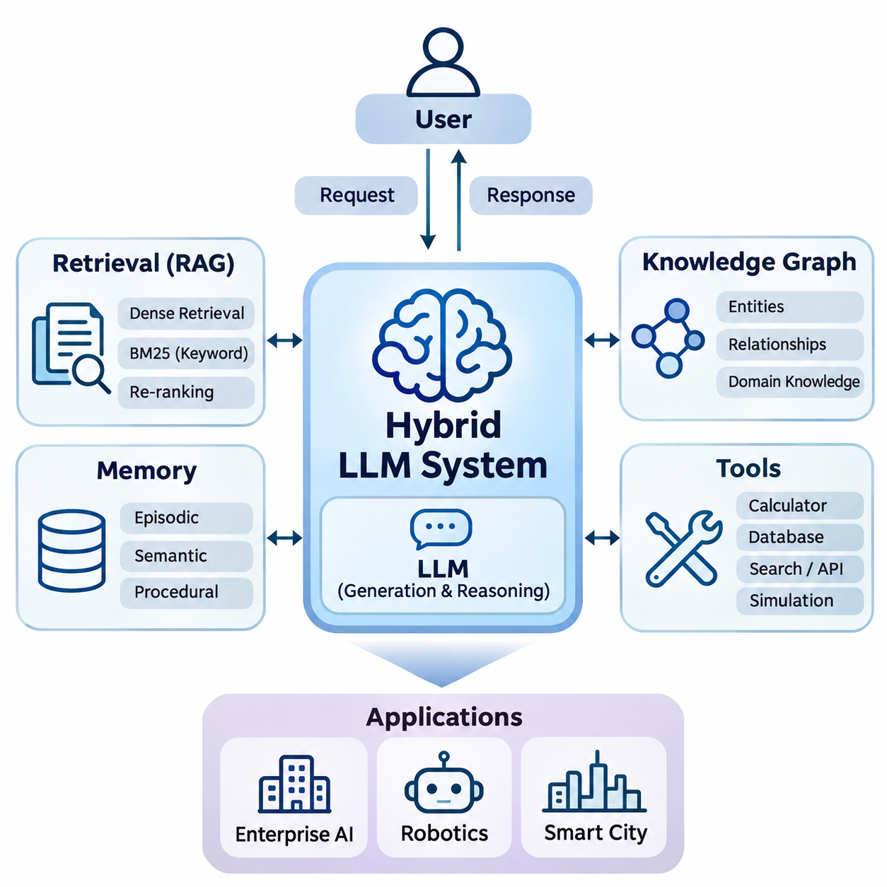
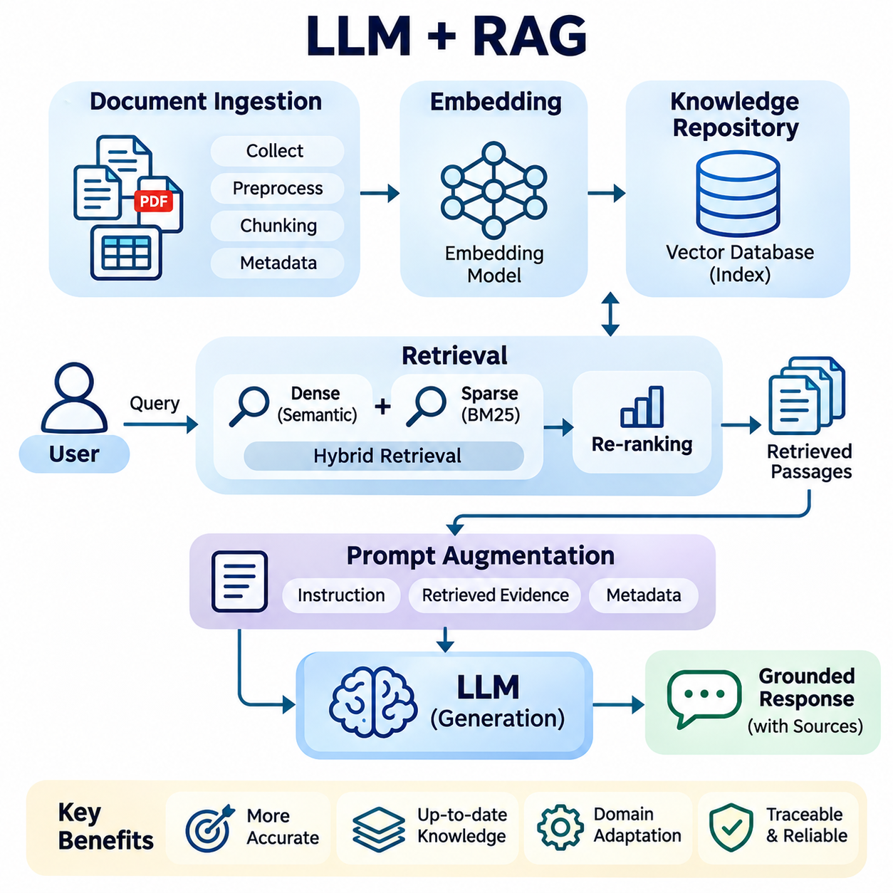
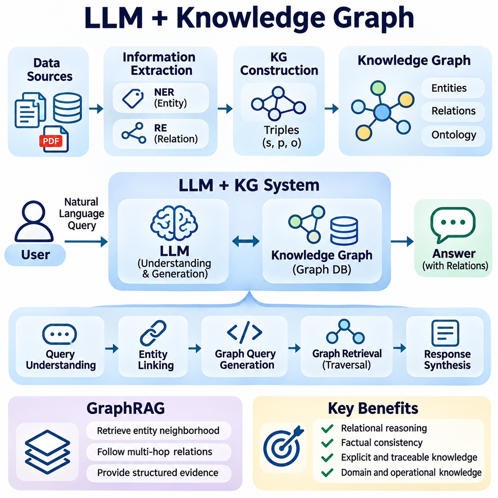
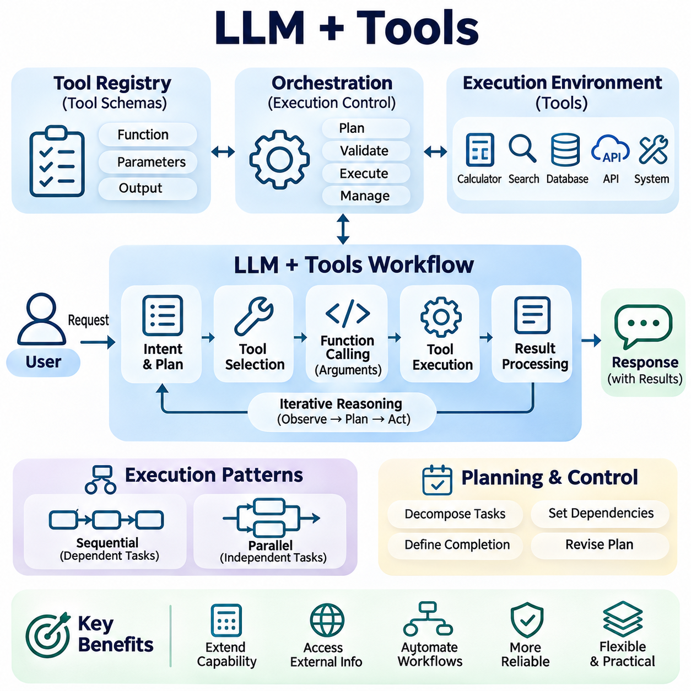
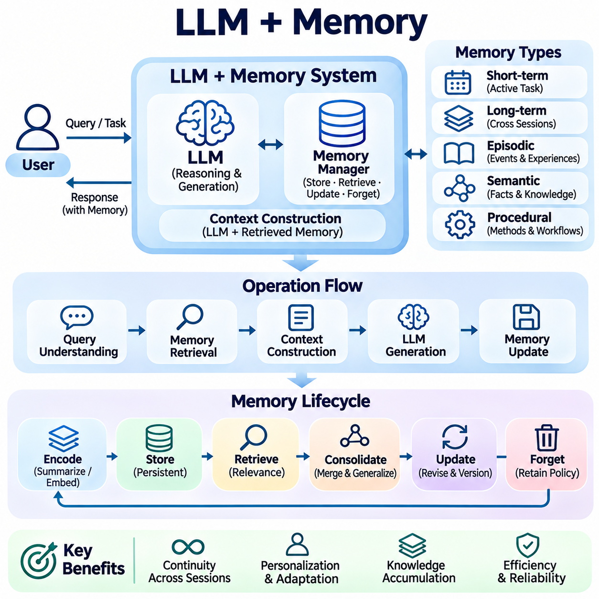
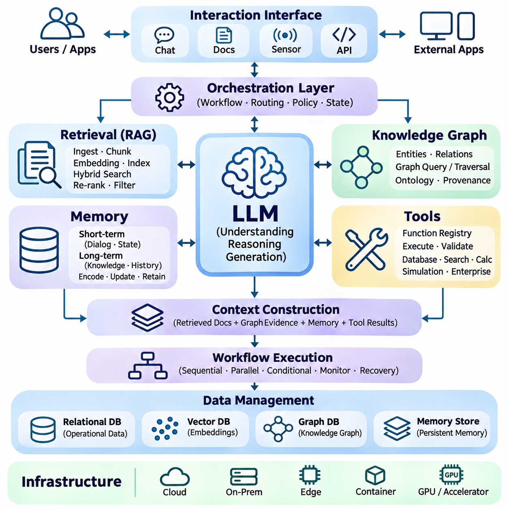
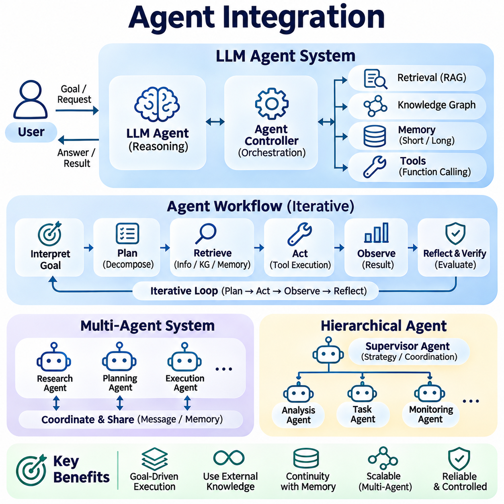
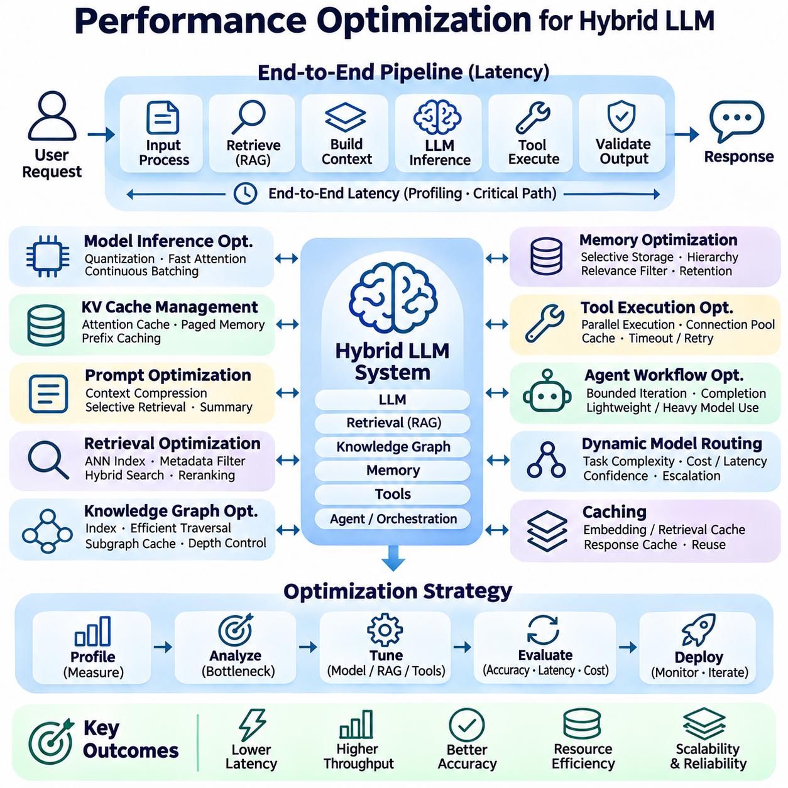
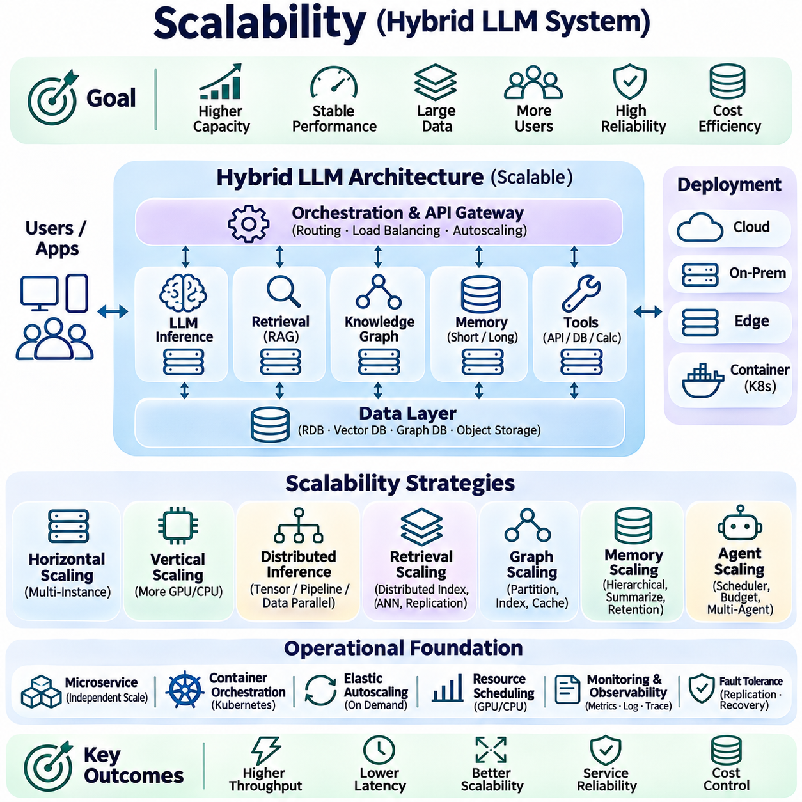
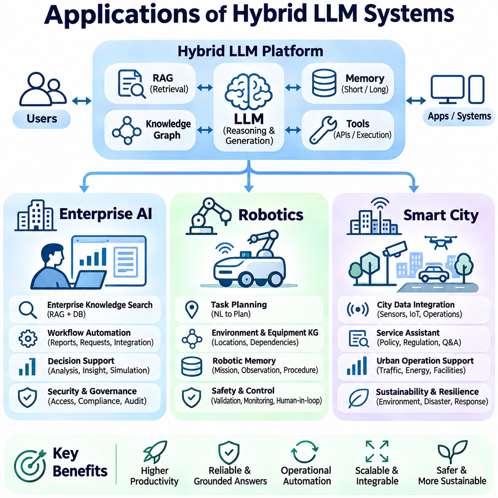

**Volume 37. Memory and Knowledge Systems**

# 05. Hybrid LLM Systems

## 05.00 Overview

{width="7.268055555555556in" height="7.268055555555556in"}

Hybrid Large Language Model (LLM) systems represent an architectural approach that combines the generative and reasoning capabilities of language models with external knowledge, retrieval mechanisms, persistent memory, and executable tools. Rather than relying exclusively on knowledge encoded during pretraining, these systems dynamically access information and computational resources to produce responses that are more relevant, adaptable, and grounded in operational contexts.

Traditional LLMs generate responses by predicting sequences of tokens based on learned statistical relationships. Although this mechanism supports sophisticated language understanding and generation, it introduces limitations involving outdated information, hallucination, restricted context windows, and insufficient access to domain-specific knowledge. Hybrid architectures address these limitations by connecting language models to specialized components that provide additional evidence and functionality.

The fundamental principle of a hybrid LLM system is the separation of language generation from external knowledge management and operational execution. The LLM serves as a central interpretation and reasoning component, while retrieval engines, knowledge graphs, memory databases, and software tools provide specialized capabilities. This modular organization enables developers to improve individual components without retraining the entire language model whenever information or system requirements change.

Retrieval-Augmented Generation (RAG) is one of the most widely adopted approaches to hybrid LLM development. A RAG system retrieves relevant information from external repositories before generating an answer. Documents are typically transformed into embeddings and stored in vector databases, allowing semantic similarity searches to identify useful passages. Retrieved evidence is then incorporated into the model context, helping the LLM generate responses grounded in accessible information.

Hybrid retrieval extends conventional RAG by combining dense semantic retrieval with sparse keyword-based techniques. Dense embeddings identify conceptual similarities, while methods such as BM25 preserve sensitivity to exact terminology, identifiers, and technical expressions. Re-ranking models can further refine candidate documents according to their relevance. This combination is particularly valuable in technical environments where both semantic interpretation and precise terminology are essential.

Knowledge graphs introduce structured representations of entities, relationships, and domain constraints into hybrid LLM systems. Unlike unstructured documents, knowledge graphs explicitly describe connections between concepts, equipment, organizations, events, and operational dependencies. Graph-based retrieval enables the system to explore these relationships and provide structured evidence that complements the linguistic knowledge encoded within the LLM.

The integration of LLMs with knowledge graphs supports applications requiring relational reasoning and traceable knowledge access. For example, an industrial maintenance assistant may identify relationships among equipment components, failure symptoms, maintenance procedures, and replacement parts. The language model interprets the user request, while graph queries retrieve relevant connections. This architecture can improve factual consistency when the underlying knowledge is accurate and appropriately validated.

Tool integration transforms an LLM from a conversational generator into an interface capable of interacting with external computational systems. Tools may include mathematical solvers, database query engines, search services, simulation platforms, and application programming interfaces. The model interprets user intentions and selects suitable operations, while external software performs the actual computation or data access. Results are subsequently returned for interpretation and response generation.

Tool-enabled architectures require explicit mechanisms for function selection, argument construction, execution control, and result validation. The LLM may propose a sequence of operations, but execution should remain governed by deterministic interfaces and permission policies. Such separation reduces the risk of treating generated language as executable authority and allows developers to implement auditing, error handling, and safeguards around potentially consequential operations.

Persistent memory provides another important dimension of hybrid LLM functionality. Conventional conversational systems primarily depend on information contained within their active context windows. Memory-augmented architectures store selected information beyond individual interactions and retrieve it when relevant. This capability supports continuity across sessions, adaptation to recurring tasks, and the accumulation of useful knowledge without requiring repeated transmission of complete interaction histories.

Hybrid memory architectures may distinguish episodic, semantic, and procedural information. Episodic memory preserves records of previous interactions or events, semantic memory maintains factual relationships and accumulated knowledge, and procedural memory represents reusable workflows or operational instructions. These memory categories can be implemented using different storage technologies and retrieval policies, allowing the system to select information according to task requirements.

Memory updating introduces challenges involving information freshness, conflicting records, relevance, and privacy. A reliable hybrid system must determine which observations deserve persistent storage, how existing records should be revised, and when obsolete information should be removed. Retrieval mechanisms must also distinguish verified knowledge from uncertain historical observations. Without these controls, persistent memory can propagate outdated assumptions and amplify errors across subsequent interactions.

System architecture determines how retrieval, knowledge graphs, memory, tools, and language generation interact. A typical hybrid architecture includes an interface layer, an orchestration component, external knowledge services, model inference infrastructure, and monitoring mechanisms. The orchestration layer coordinates information retrieval, context assembly, tool execution, and response generation while enforcing resource constraints and operational policies.

Agent integration extends hybrid LLM architectures through goal-directed workflows involving planning, observation, and iterative execution. An agent may decompose a complex request into smaller tasks, retrieve supporting knowledge, invoke appropriate tools, and evaluate intermediate results. Memory maintains task continuity, while external systems provide observations and executable capabilities. Reliable agent behavior nevertheless depends on bounded execution, verification, and clearly defined authorization.

Performance optimization is essential because hybrid systems introduce additional computational stages beyond ordinary language model inference. Retrieval latency, database access, context construction, tool execution, and token generation all contribute to response time. Optimization techniques include caching, efficient indexing, parallel retrieval, selective context compression, and model routing. Their effectiveness depends on workload characteristics and the tradeoff between computational cost and answer quality.

Scalability becomes increasingly important when hybrid LLM systems support large knowledge repositories, concurrent users, and continuously updated information. Distributed vector databases, horizontally scalable retrieval services, asynchronous execution, and independent inference resources can accommodate growing workloads. Architectural separation also enables individual components to scale according to demand, avoiding unnecessary duplication of expensive language model resources.

Enterprise AI represents a major application domain for hybrid LLM systems. Organizations maintain extensive collections of technical documents, operational procedures, databases, and institutional knowledge. Hybrid architectures can connect these resources through retrieval and structured knowledge integration, enabling employees to obtain context-sensitive information. Access control, document provenance, confidentiality, and update consistency remain critical requirements for enterprise deployment.

Robotics applications extend hybrid LLM systems into environments involving physical perception, planning, and interaction. A robot may combine language instructions with stored maps, equipment knowledge, task history, and external planning tools. The LLM can assist with high-level task interpretation and procedural reasoning, while dedicated perception, motion planning, and control modules manage time-critical operations. Safety-critical actions require independent validation and deterministic control mechanisms.

Smart city applications involve integrating information from transportation networks, infrastructure monitoring systems, environmental sensors, and municipal knowledge repositories. Hybrid LLM systems can support infrastructure analysis, incident interpretation, maintenance coordination, and public information services. Knowledge graphs represent infrastructure relationships, retrieval systems access regulations and technical records, and tool interfaces obtain current operational measurements from authorized services.

Security and governance must be incorporated throughout hybrid LLM development. External documents and tool responses may contain inaccurate information or malicious instructions, while persistent memory may expose sensitive operational data. Effective safeguards include authentication, authorization, input validation, retrieval filtering, execution isolation, and audit logging. These measures help maintain boundaries between trusted system instructions, retrieved evidence, user requests, and executable actions.

Evaluation of hybrid LLM systems requires more than measuring the linguistic quality of generated responses. Relevant dimensions include retrieval recall, ranking effectiveness, factual grounding, tool execution accuracy, memory consistency, response latency, and operational reliability. End-to-end testing should examine how component errors propagate through the system. A successful response depends not only on model capability but also on the quality and coordination of supporting services.

The development of hybrid LLM systems reflects a broader transition from isolated generative models toward integrated intelligence architectures. By combining retrieval, structured knowledge, persistent memory, executable tools, and coordinated agents, these systems can support increasingly complex workflows. Their long-term value depends on achieving reliable information access, transparent execution, scalable infrastructure, and controlled interaction between probabilistic reasoning and deterministic operational components.

## 05.01 LLM plus RAG

{width="7.268055555555556in" height="7.268055555555556in"}

The integration of Large Language Models (LLMs) with Retrieval-Augmented Generation (RAG) provides a systematic approach to combining generative intelligence with external information retrieval. Instead of depending exclusively on knowledge acquired during pretraining, an LLM retrieves relevant evidence from external repositories before generating responses. This architecture improves knowledge accessibility, supports domain adaptation, and provides a foundation for more reliable information-driven applications.

Conventional LLMs encode extensive linguistic and factual patterns within model parameters, but their knowledge is limited by training data and subsequent updates. They may generate plausible statements without sufficient supporting evidence, particularly when addressing recent events or specialized technical subjects. RAG mitigates these limitations by introducing a retrieval stage that supplies relevant external information during inference without requiring continuous model retraining.

A typical LLM-RAG architecture consists of a document processing pipeline, an embedding model, a retrieval engine, a knowledge repository, and a generative language model. Documents are collected, normalized, segmented, and transformed into searchable representations. During inference, the system processes a user query, identifies relevant information, constructs an augmented prompt, and generates a response based on the retrieved context and the model\'s language capabilities.

Document ingestion establishes the foundation of retrieval quality. Source materials may include technical manuals, research publications, enterprise databases, operational records, and structured reports. Preprocessing removes irrelevant formatting, resolves encoding inconsistencies, and extracts meaningful textual content. Document metadata, including source identifiers, timestamps, access permissions, and version information, should be preserved to support traceability and reliable retrieval.

Document chunking divides large information sources into smaller units suitable for indexing and retrieval. Fixed-length segmentation offers implementation simplicity, while semantic chunking attempts to preserve conceptual boundaries between topics. Overlapping chunks can reduce information loss at segment boundaries, although excessive overlap increases storage requirements and retrieval redundancy. Chunk size should reflect document structure, embedding characteristics, and expected query complexity.

Embedding models transform textual chunks into dense numerical vectors that represent semantic relationships. Similar concepts are generally positioned near one another within the learned embedding space, enabling retrieval beyond exact keyword matching. These vectors are stored in specialized databases or vector indexes that support efficient similarity search. Embedding quality depends on model training, domain vocabulary, multilingual capability, and consistency between document and query representations.

Vector databases provide the infrastructure required to manage and search large collections of embeddings. Systems such as FAISS, Milvus, Weaviate, and Pinecone support different indexing, storage, and retrieval configurations. Approximate Nearest Neighbor algorithms, including Hierarchical Navigable Small World graphs and inverted file indexes, reduce search costs for large datasets. Their configurations involve tradeoffs among retrieval accuracy, memory consumption, indexing overhead, and query latency.

The retrieval stage begins when a user query is converted into a representation compatible with the indexed knowledge repository. Similarity measures such as cosine similarity, dot product, or Euclidean distance identify candidate passages according to embedding geometry. The retrieval engine selects relevant chunks and may apply metadata filters to restrict results by document type, publication date, organizational permissions, or operational context.

Hybrid retrieval combines dense vector search with sparse lexical retrieval to improve coverage across different query types. Semantic retrieval captures conceptual similarity, whereas algorithms such as BM25 identify documents containing precise terminology, numerical identifiers, or specialized expressions. Candidate results can be merged through weighted score combinations or rank fusion techniques. This approach is particularly useful for engineering documents containing part numbers, technical standards, and domain-specific abbreviations.

Re-ranking introduces an additional relevance assessment after initial retrieval. A cross-encoder or another specialized ranking model evaluates the relationship between a query and each candidate passage, producing refined relevance estimates. Although re-ranking increases computational overhead, it can improve the quality of information supplied to the LLM. The number of candidates and the ranking model should therefore be selected according to latency constraints and retrieval performance requirements.

Prompt augmentation transforms retrieved passages into contextual evidence that the LLM can use during response generation. The system combines user instructions, selected documents, source metadata, and response requirements within the available context window. Effective prompt construction clearly separates retrieved content from executable instructions and encourages evidence-based answers. Context ordering and token allocation influence how effectively the model uses the supplied information.

Grounded generation aims to ensure that responses remain consistent with retrieved evidence rather than relying on unsupported model assumptions. Source attribution allows users to inspect the documents supporting individual claims, improving transparency and auditability. However, retrieval alone does not guarantee factual correctness because documents may be inaccurate, incomplete, or contradictory. Reliable systems require mechanisms for evidence verification, uncertainty handling, and appropriate refusal when sufficient information is unavailable.

Query understanding improves retrieval by identifying user intent, technical terminology, and contextual constraints. Query rewriting can transform ambiguous requests into more precise search expressions, while decomposition separates complex questions into independently retrievable subproblems. Multi-query retrieval explores alternative formulations to improve information coverage. These techniques must preserve the original information need to avoid introducing unrelated evidence or changing the intended meaning.

Multi-hop RAG supports questions requiring information from several documents or interconnected facts. The system retrieves initial evidence, identifies unresolved relationships, and performs additional searches before generating a consolidated answer. This process is useful for technical diagnostics, scientific literature analysis, and organizational knowledge exploration. Nevertheless, iterative retrieval requires termination criteria, evidence tracking, and safeguards against accumulating irrelevant or conflicting information.

RAG systems must also manage knowledge freshness and repository consistency. New documents may be indexed incrementally, while modified or deleted records require corresponding updates to embeddings and metadata. Version control and synchronization mechanisms help prevent outdated passages from appearing in generated responses. Time-sensitive applications may additionally require freshness-aware ranking, explicit validity periods, and direct access to authoritative operational databases.

Performance optimization involves balancing retrieval quality, generation accuracy, response latency, and infrastructure cost. Caching frequent queries, batching embedding operations, optimizing vector indexes, and limiting unnecessary context can improve efficiency. Adaptive retrieval may allocate more computational resources to difficult questions while using simpler processing for straightforward requests. Optimization should be evaluated using representative workloads rather than isolated component benchmarks.

Security and privacy considerations extend across the entire retrieval and generation pipeline. Enterprise repositories may contain confidential documents, personal information, or restricted operational records. Retrieval systems must enforce document-level authorization before supplying content to the model. Additional safeguards are necessary against prompt injection embedded in retrieved documents, unauthorized data exposure, malicious source manipulation, and accidental disclosure through generated responses.

Evaluation of LLM-RAG systems requires independent examination of retrieval and generation performance. Retrieval metrics such as Recall\\@K, Mean Reciprocal Rank, and Normalized Discounted Cumulative Gain measure evidence discovery and ranking effectiveness. Generation evaluation examines answer relevance, factual consistency, citation accuracy, and completeness. End-to-end assessment should also measure latency, robustness, computational cost, and behavior when relevant evidence is missing.

Enterprise applications use LLM-RAG systems to provide access to internal policies, technical documentation, customer support knowledge, and operational procedures. In robotics, retrieval can connect language-based task interpretation with equipment manuals, maintenance histories, and environmental knowledge. Smart city systems can retrieve infrastructure regulations, inspection records, and public service information to support operational analysis and decision assistance across distributed information resources.

The combination of LLMs and RAG represents a transition from isolated language generation toward knowledge-grounded intelligence systems. Its effectiveness depends on coordinated document processing, embedding representation, retrieval accuracy, contextual integration, and evidence validation. As hybrid architectures evolve, RAG increasingly operates alongside knowledge graphs, persistent memory, external tools, and autonomous agents, forming an essential component of scalable and adaptable AI systems.

## 05.02 LLM plus Knowledge Graph

{width="7.268055555555556in" height="7.268055555555556in"}

The integration of Large Language Models (LLMs) with Knowledge Graphs (KGs) establishes a hybrid architecture that combines neural language understanding with structured knowledge representation. LLMs provide flexible interpretation and natural language generation, while knowledge graphs organize entities, relationships, and semantic constraints. This combination enables AI systems to access explicit domain knowledge and produce responses supported by identifiable relationships.

Knowledge graphs represent information through interconnected entities and relationships, commonly expressed as subject-predicate-object triples. Entities may describe people, organizations, equipment, locations, or abstract concepts, while relationships define their associations. Unlike knowledge embedded implicitly within model parameters, graph structures provide explicit connections that can be queried, inspected, updated, and validated independently of the language model.

Conventional LLMs can interpret complex questions and generate fluent explanations, but they may struggle with precise relational reasoning and factual consistency. Their internal representations do not guarantee accurate reconstruction of specific relationships among entities. Knowledge graph integration addresses this limitation by providing structured evidence during inference, allowing the model to reference verified relationships rather than relying exclusively on probabilistic associations.

A typical LLM-KG architecture contains a language model, graph database, entity recognition module, relation extraction component, query generation mechanism, and response synthesis layer. The language model interprets user requests and identifies relevant concepts. Graph retrieval services locate corresponding entities and relationships, while the response synthesis component combines retrieved graph evidence with natural language generation to produce contextually appropriate answers.

Knowledge graph construction begins with identifying entities and relationships from structured and unstructured information sources. Structured databases provide explicit attributes and connections, whereas documents require information extraction techniques. Named Entity Recognition identifies relevant objects, and Relation Extraction determines how they interact. Extracted information is transformed into graph triples and validated before being incorporated into the knowledge repository.

Entity resolution is essential because different names may refer to the same real-world object. A technical component, for example, may appear under a manufacturer identifier, internal part number, or descriptive name. Entity linking connects these variations to canonical graph nodes, reducing duplication and ambiguity. Reliable resolution requires contextual analysis, identifier matching, and confidence assessment to prevent incorrect relationships from entering the graph.

Ontologies provide formal definitions of entity categories, relationship types, attributes, and domain constraints. They establish semantic rules that guide knowledge graph construction and interpretation. For example, an industrial ontology may distinguish machines, sensors, actuators, and control systems while defining permissible connections. Ontological constraints support consistency checking and help prevent invalid relationships during graph updates.

Graph databases store and manage interconnected knowledge using data models optimized for relationship traversal. Property graph systems such as Neo4j represent nodes and edges with associated attributes, while RDF-based systems express information through standardized triples. Query languages such as Cypher and SPARQL enable structured access to graph information. The appropriate representation depends on interoperability, reasoning requirements, and application complexity.

Natural language interfaces allow users to query knowledge graphs without directly writing graph query languages. An LLM can translate a question into a structured query, identify relevant graph entities, and request corresponding relationships. The generated query must be validated against the graph schema and authorization policies before execution. Retrieved results are then converted into readable explanations while preserving their underlying factual relationships.

Graph-based retrieval differs from conventional vector retrieval because it explicitly follows relationships rather than relying primarily on semantic similarity. A graph query can identify dependency chains, organizational hierarchies, or component connections through defined traversal operations. Vector retrieval remains useful for locating conceptually related documents, while graph retrieval provides precise structural evidence. Combining both approaches can improve coverage across heterogeneous knowledge sources.

Graph Retrieval-Augmented Generation, commonly called GraphRAG, integrates graph-based knowledge retrieval with language model generation. Depending on implementation, the system may retrieve entity neighborhoods, connected subgraphs, relationship paths, or graph-derived summaries. These structures are transformed into contextual evidence for the LLM. GraphRAG is particularly useful when answering questions requires understanding relationships distributed across multiple documents.

Multi-hop reasoning enables the system to investigate relationships spanning several graph edges. For example, determining which production processes are affected by a sensor failure may require traversing connections among sensors, controllers, machines, and manufacturing operations. The graph provides explicit dependency paths, while the LLM interprets their operational significance. Reliable conclusions require complete and accurate relationships within the relevant graph.

Hybrid reasoning combines neural interpretation with symbolic inference mechanisms. LLMs contribute semantic understanding and flexible hypothesis generation, while symbolic engines apply logical rules and graph constraints. Rule-based inference can derive additional relationships from existing facts when the underlying rules are valid. This separation allows the system to distinguish formally supported conclusions from language-model interpretations that remain uncertain.

Knowledge graph updating is necessary because real-world entities and relationships change over time. New equipment may be installed, organizational responsibilities may shift, and operational dependencies may evolve. Update pipelines must detect changes, resolve conflicts, and maintain consistency between graph records and source systems. Temporal attributes and version histories can preserve historical relationships while supporting queries about current conditions.

Graph embeddings extend structured knowledge integration by converting entities and relationships into numerical representations. Methods such as TransE, RotatE, and graph neural networks can capture relational patterns within learned vector spaces. These representations support entity similarity, link prediction, and candidate relationship discovery. However, predicted connections should remain distinguishable from verified graph facts, particularly in safety-critical applications.

Knowledge provenance provides information about where graph facts originated and how they were established. Relationships may be linked to source documents, database records, timestamps, and validation procedures. Provenance enables users and automated systems to assess evidence quality and trace conclusions to their origins. When an LLM generates an explanation from graph evidence, preserving these references improves transparency and supports auditing.

Performance optimization involves balancing graph traversal complexity, retrieval coverage, and language model inference costs. Large knowledge graphs may contain millions of entities and relationships, making unrestricted traversal computationally expensive. Query planning, indexing, neighborhood filtering, caching, and selective subgraph extraction can reduce processing overhead. Efficient architectures retrieve only the graph information necessary to answer the current question.

Security considerations include access control over graph entities, relationships, and associated attributes. Enterprise knowledge graphs may contain confidential organizational structures, proprietary technical dependencies, or sensitive operational information. Query validation and permission-aware retrieval must prevent unauthorized graph exploration. LLM-generated queries also require safeguards against excessive resource consumption, unintended modifications, and disclosure of restricted relationships.

Evaluation of LLM-KG systems requires examining entity linking accuracy, relation extraction quality, graph query correctness, and answer grounding. Graph completeness and consistency influence the reliability of downstream reasoning. End-to-end benchmarks should assess whether generated responses accurately reflect retrieved relationships and distinguish missing information from established facts. Latency, scalability, and robustness under ambiguous queries are additional operational considerations.

Enterprise AI applications use LLM-KG integration to connect organizational knowledge, business processes, technical assets, and operational dependencies. Robotics systems can represent relationships among sensors, actuators, control modules, environments, and task procedures. Smart city platforms can organize infrastructure assets, transportation networks, maintenance records, and service dependencies. These applications benefit from combining structured relational knowledge with natural language interaction.

The integration of LLMs and knowledge graphs represents an important development toward knowledge-aware AI architectures. Language models provide flexible communication and semantic interpretation, while graphs contribute explicit relationships, structured retrieval, and traceable evidence. When combined with RAG, persistent memory, and external tools, these capabilities support more reliable reasoning and adaptable decision assistance across complex technical and organizational environments.

## 05.03 LLM plus Tools

{width="7.268055555555556in" height="7.268055555555556in"}

The integration of Large Language Models (LLMs) with external tools extends generative AI beyond natural language processing into computational execution, information access, and operational interaction. While conventional LLMs generate responses from learned representations, tool-augmented systems can invoke specialized software to perform calculations, retrieve current information, and interact with external services. This architecture transforms language models into flexible interfaces for complex digital workflows.

Tool integration addresses fundamental limitations of standalone language models, including unreliable arithmetic, restricted access to current information, and the inability to directly manipulate external systems. By delegating specialized operations to appropriate tools, an LLM can focus on interpreting user intentions, selecting operations, and explaining results. However, tool execution does not automatically guarantee correctness, making validation and controlled execution essential architectural requirements.

A typical LLM-tool architecture consists of a language model, tool registry, orchestration layer, execution environment, and result processing mechanism. The tool registry describes available functions, input parameters, and expected outputs. The orchestration layer interprets model-generated requests, validates arguments, invokes authorized operations, and returns structured results. The language model subsequently incorporates these observations into its response or determines whether additional operations are necessary.

Function calling provides a structured mechanism through which an LLM requests external operations. Instead of generating executable commands directly, the model produces a function identifier and arguments that conform to a predefined schema. An application controller validates this request and executes the corresponding function. Structured interfaces reduce ambiguity, support automated validation, and separate probabilistic language generation from deterministic software execution.

Tool schemas define the operational contract between language models and external services. A schema typically specifies function names, descriptions, required parameters, data types, constraints, and output structures. Clear descriptions improve tool selection and argument generation, while strict validation prevents malformed requests. Schema design should minimize ambiguity, expose only necessary functionality, and maintain compatibility as external services evolve.

Tool selection requires identifying which available operation best satisfies the current user request. An LLM may choose a database query for factual records, a calculator for numerical operations, or a search service for recent information. Complex requests may require multiple tools with different capabilities. Selection accuracy depends on tool descriptions, contextual understanding, and the model\'s ability to distinguish between tasks requiring external execution and those answerable directly.

Execution orchestration coordinates the sequence of tool interactions and manages dependencies between operations. A request may involve retrieving data, transforming results, performing calculations, and generating a final explanation. The orchestration component maintains execution state, transfers validated outputs between stages, and enforces operational limits. This separation enables predictable workflow management even when the language model proposes flexible execution strategies.

Sequential tool execution is appropriate when later operations depend on earlier results. For example, an industrial assistant may retrieve equipment specifications before calculating operating limits or selecting maintenance procedures. Parallel execution can reduce latency when independent information sources must be queried simultaneously. Effective orchestration identifies dependencies, avoids unnecessary calls, and combines results without losing source context or introducing unsupported assumptions.

Tool outputs may contain structured records, numerical values, documents, error messages, or references to external resources. The system must transform these outputs into representations that the LLM can interpret reliably. Structured formats such as JSON support consistent parsing, while metadata can preserve source identity and execution status. Output normalization is particularly important when combining heterogeneous tools that use different conventions, units, or data schemas.

Error handling is essential because external tools may fail due to network interruptions, invalid parameters, unavailable resources, or permission restrictions. A robust system distinguishes transient failures from permanent errors and applies appropriate recovery strategies. These may include bounded retries, alternative tools, revised arguments, or requests for clarification. The language model should not present an operation as successful unless execution results confirm its completion.

Tool-augmented reasoning supports iterative workflows in which an LLM alternates between generating actions and interpreting observations. The model may formulate an intermediate objective, invoke a tool, inspect the returned information, and select the next operation. This pattern enables adaptive problem solving without requiring every step to be predetermined. Nevertheless, execution boundaries and termination conditions are necessary to prevent uncontrolled loops and excessive resource consumption.

Planning mechanisms improve the coordination of multiple tool calls by organizing complex objectives into manageable subtasks. A planning component may identify required information, establish operation dependencies, and define completion criteria before execution. Plans can be revised when observations reveal missing information or unexpected conditions. Reliable planning requires distinguishing proposed actions from verified outcomes and maintaining consistency between intermediate results and the original objective.

External information access is a major application of LLM-tool integration. Search engines, database connectors, document repositories, and application programming interfaces provide information that may not exist within model parameters. Tool calls can retrieve updated records or authoritative measurements when suitable services are available. The resulting evidence should retain timestamps, provenance, and access restrictions so that generated explanations reflect the reliability and relevance of their sources.

Computational tools complement language models by performing operations that require numerical precision or specialized algorithms. Mathematical solvers, statistical libraries, simulation engines, and optimization frameworks can execute calculations independently of token prediction. The LLM interprets the problem and explains the computed results, while external software performs the calculation. Correctness still depends on valid inputs, appropriate algorithms, and verification of units and assumptions.

Database integration enables natural language interaction with structured operational information. An LLM can translate user questions into database queries, retrieve relevant records, and summarize results. Generated queries must be checked against database schemas, access permissions, and resource constraints before execution. Read-only access is preferable for informational tasks, while modifications should require explicit authorization and transactional safeguards to prevent unintended changes.

Security becomes critical when language models can initiate operations affecting external systems. Prompt injection, malicious tool outputs, unauthorized function selection, and excessive permissions can create substantial risks. Secure architectures enforce least-privilege access, argument validation, execution isolation, and comprehensive audit logging. Untrusted retrieved content must never be allowed to override higher-priority operational policies or independently authorize sensitive actions.

Human oversight is particularly important for tools capable of modifying records, transferring information, or controlling physical equipment. Systems should distinguish low-risk informational operations from consequential actions requiring confirmation or approval. Authorization mechanisms may incorporate role-based access control, policy evaluation, and execution thresholds. In safety-critical environments, deterministic controllers and independent safety systems must retain authority over physical operations.

Performance optimization involves minimizing unnecessary tool calls while preserving task accuracy and reliability. Tool invocation introduces network latency, processing overhead, and potential service costs. Caching, asynchronous execution, batching, and selective tool routing can improve responsiveness. System designers must also consider rate limits, concurrency restrictions, and execution timeouts. Optimization should prioritize successful task completion rather than reducing latency at the expense of correctness.

Evaluation of LLM-tool systems requires measuring tool selection accuracy, argument validity, execution success, recovery behavior, and final task completion. Benchmarks should include ambiguous requests, unavailable services, malformed outputs, and multi-step dependencies. End-to-end evaluation must distinguish model planning errors from tool failures and orchestration defects. Reliability, security compliance, latency, and operational cost provide additional measures of production readiness.

Enterprise AI applications use tool-augmented LLMs to access business databases, generate reports, coordinate workflows, and interact with organizational software. Robotics systems can connect high-level language instructions to mapping, diagnostics, scheduling, and planning services while preserving independent motion control. Smart city platforms may integrate infrastructure monitoring, transportation information, and maintenance systems through authorized interfaces, supporting coordinated analysis and operational assistance.

The integration of LLMs with tools establishes a foundation for hybrid intelligence systems that combine flexible language understanding with specialized computational capabilities. Its effectiveness depends on structured interfaces, reliable orchestration, secure execution, and verifiable results. When combined with retrieval systems, knowledge graphs, and persistent memory, tool-enabled LLMs can support increasingly sophisticated agents capable of interacting with complex digital and physical environments.

## 05.04 LLM plus Memory [w/Code]

{width="7.268055555555556in" height="7.268055555555556in"}

The integration of Large Language Models (LLMs) with memory systems enables artificial intelligence to preserve, retrieve, and reuse information across interactions. Conventional LLMs primarily operate within limited context windows and do not inherently retain persistent records of previous sessions. Memory-augmented architectures overcome this limitation by connecting language models to external storage mechanisms that support continuity, personalization, and knowledge accumulation.

Memory in LLM systems refers to mechanisms that maintain information beyond immediate token processing. It may contain conversation histories, user preferences, task outcomes, environmental observations, and previously acquired knowledge. Unlike model parameters established during training, external memory can be updated without retraining the underlying language model. This distinction enables dynamic adaptation while preserving the general capabilities of pretrained models.

A typical LLM-memory architecture consists of a language model, memory manager, storage backend, retrieval engine, and context construction module. The memory manager determines which information should be stored, updated, retrieved, or discarded. Storage services maintain persistent records, while retrieval components identify relevant memories. The context construction module integrates selected information into prompts before response generation.

Short-term memory maintains information required during an active interaction or task. It typically includes recent dialogue, intermediate reasoning results, tool observations, and temporary execution states. Because the context window has finite capacity, older information may be summarized, compressed, or removed. Effective short-term memory management preserves task-relevant details while preventing unnecessary information from consuming valuable context resources.

Long-term memory preserves information across sessions and extended operational periods. It may include stable preferences, recurring tasks, historical decisions, and accumulated domain knowledge. Persistent storage enables an LLM to resume activities without reconstructing every previous interaction. However, long-term memory requires mechanisms for relevance assessment, temporal validity, access control, and correction of outdated information.

Episodic memory represents specific experiences or events associated with particular contexts and times. In an AI assistant, episodes may describe completed tasks, previous conversations, or observed operational incidents. These records provide historical context for future decisions and allow the system to identify recurring patterns. Episodic retrieval should preserve event timestamps and circumstances to prevent inappropriate generalization from isolated experiences.

Semantic memory stores generalized knowledge, concepts, facts, and relationships independent of individual experiences. It may contain technical definitions, organizational procedures, equipment specifications, and domain-specific rules. Semantic memories can be represented through structured databases, knowledge graphs, or vector repositories. Their reliability depends on source verification, consistent updates, and clear separation between established facts and inferred knowledge.

Procedural memory captures reusable methods for performing tasks, including workflows, operational instructions, and tool invocation strategies. Unlike episodic memory, which records what happened, procedural memory describes how activities should be performed. An LLM may retrieve a validated troubleshooting procedure or data processing workflow when encountering similar tasks. Such procedures must remain subject to current authorization and safety requirements.

Memory encoding transforms raw interactions into representations suitable for persistent storage and retrieval. Conversation records may be summarized, converted into embeddings, or decomposed into structured facts and events. Encoding strategies should preserve important entities, relationships, temporal references, and uncertainty. Excessive compression can eliminate critical details, while insufficient filtering may create redundant or contradictory memory records.

Memory retrieval selects previously stored information relevant to the current query or operational objective. Vector similarity search can identify semantically related experiences, while keyword matching and structured queries support precise factual retrieval. Hybrid approaches combine these mechanisms with metadata filtering and temporal constraints. Retrieval quality depends on accurate indexing, appropriate relevance thresholds, and the ability to distinguish useful memories from unrelated records.

Memory consolidation converts multiple observations into more stable and reusable knowledge. Repeated interactions may reveal consistent preferences, recurring operational patterns, or frequently encountered problems. Consolidation can merge duplicate records, summarize related episodes, and extract generalized facts. Nevertheless, inferred patterns should not automatically become authoritative knowledge without sufficient supporting evidence and appropriate validation.

Memory updating addresses changes in facts, preferences, procedures, and environmental conditions. New observations may reinforce existing records, introduce corrections, or invalidate previous assumptions. Update mechanisms should distinguish replacement from historical revision and preserve provenance when necessary. Temporal metadata and version histories help determine whether a memory remains applicable to the current situation.

Memory forgetting is necessary to prevent uncontrolled storage growth and reduce the influence of irrelevant information. Retention policies may consider age, relevance, frequency of use, confidence, and explicit deletion requirements. Some information can be summarized or archived, while sensitive records may require permanent removal. Forgetting mechanisms should operate consistently across indexes, caches, summaries, and underlying storage systems.

Context construction determines how retrieved memories are incorporated into the LLM\'s active prompt. Relevant information must be selected according to task importance, token limits, and source reliability. Memory ranking can prioritize recent decisions, verified facts, and directly related experiences. Clear boundaries between stored observations and operational instructions help prevent outdated or untrusted memories from controlling model behavior.

Memory-augmented reasoning allows an LLM to combine current observations with previously accumulated experience. A system may compare new situations with historical episodes, retrieve relevant procedures, and identify differences requiring adaptation. This capability supports continuity in complex workflows and repeated decision processes. However, retrieved memories should inform reasoning rather than override current evidence or validated operational constraints.

Personalization is an important application of persistent memory because repeated interactions can reveal stable communication preferences and recurring information needs. A memory-enabled assistant may adapt explanations, preserve project terminology, and maintain continuity across sessions. Personalization should remain transparent and controllable, with appropriate mechanisms for reviewing, correcting, and deleting stored information.

Security and privacy requirements become increasingly important when memory systems retain information over extended periods. Persistent records may contain confidential documents, personal details, operational histories, or sensitive organizational knowledge. Secure architectures require access control, encryption, retention policies, and audit mechanisms. Memory retrieval must respect authorization boundaries and prevent information from one user or context from leaking into another.

Performance optimization balances memory retrieval accuracy, storage efficiency, context utilization, and response latency. Hierarchical storage can separate frequently accessed memories from historical archives, while caching accelerates repeated retrieval operations. Summarization and selective indexing reduce unnecessary processing. Efficient systems should allocate retrieval resources according to task complexity without sacrificing important contextual information.

Evaluation of LLM-memory systems requires measuring retrieval relevance, factual consistency, temporal correctness, and long-term task continuity. Benchmarks may examine whether the system recalls appropriate information, updates outdated records, and avoids unsupported personalization. Additional metrics include storage growth, retrieval latency, memory contamination, and resistance to misleading historical content. Longitudinal testing is essential because memory quality changes over repeated interactions.

Enterprise AI applications use persistent memory to maintain project histories, organizational decisions, and recurring operational workflows. Robotics systems can store task outcomes, environmental observations, maintenance events, and validated procedures. Smart city platforms may preserve infrastructure inspection histories, service incidents, and evolving operational conditions. These applications benefit from combining historical context with current information and structured decision support.

The integration of LLMs with memory systems represents a transition from isolated conversational processing toward persistent, context-aware intelligence. Its effectiveness depends on reliable encoding, selective retrieval, controlled updating, appropriate forgetting, and secure information management. When combined with retrieval systems, knowledge graphs, and external tools, persistent memory provides a foundation for adaptive agents capable of maintaining continuity across complex tasks and changing environments.

## 05.05 System Architecture

{width="7.268055555555556in" height="7.268055555555556in"}

The system architecture of hybrid Large Language Model (LLM) systems integrates language generation, retrieval, structured knowledge, persistent memory, and external tools into a coordinated computational framework. Rather than treating an LLM as an isolated inference engine, this architecture distributes responsibilities across specialized components. Its primary objective is to achieve reliable reasoning, efficient information access, and controlled execution within complex operational environments.

A typical hybrid LLM architecture consists of an interaction interface, orchestration layer, model inference service, retrieval subsystem, knowledge graph, memory manager, and tool execution environment. Each component performs a distinct function while exchanging information through defined interfaces. Modular decomposition allows individual services to evolve independently and supports the integration of specialized capabilities without redesigning the entire system.

The interaction layer receives user requests, application events, and machine-generated observations through standardized interfaces. Inputs may include natural language, structured records, sensor measurements, or operational commands. This layer performs initial validation, authentication, and request normalization before forwarding information to orchestration services. It also manages response formatting and communication with external applications.

The orchestration layer coordinates the execution of hybrid AI workflows by selecting appropriate processing paths and managing dependencies between components. It determines whether a request requires direct language generation, document retrieval, graph traversal, memory access, or external tool execution. Workflow state and intermediate results are maintained throughout processing. Explicit control policies prevent unnecessary operations and constrain execution behavior.

The model inference layer provides natural language understanding, reasoning support, and response generation. It may contain one general-purpose foundation model or multiple specialized models selected according to task requirements. Model routing can consider computational cost, latency, context capacity, and expected reasoning complexity. Separating inference services from application logic enables model replacement, optimization, and deployment across different hardware platforms.

The retrieval subsystem connects the LLM to external document repositories and searchable information sources. Document ingestion pipelines perform extraction, cleaning, chunking, embedding generation, and indexing. During inference, query processing identifies relevant passages through dense, sparse, or hybrid retrieval methods. Re-ranking and metadata filtering improve evidence quality before retrieved information is incorporated into the model context.

Knowledge graph integration provides explicit representations of entities, relationships, and domain constraints. Graph databases support structured queries, relationship traversal, and dependency analysis that may be difficult to perform through vector similarity alone. The orchestration layer can combine graph results with retrieved documents to construct richer evidence. Ontologies and provenance metadata help maintain semantic consistency and traceability.

The memory subsystem maintains information required for continuity across interactions and operational sessions. Short-term memory preserves active dialogue and execution state, while long-term memory stores reusable knowledge, historical events, and validated procedures. Memory management services control encoding, retrieval, consolidation, updating, and retention. Retrieved memories are evaluated for relevance and validity before inclusion in the active context.

Tool integration extends the architecture into external computational and operational systems. Function registries describe available capabilities, while execution controllers validate parameters and enforce authorization policies. Tools may include databases, search services, mathematical solvers, simulation environments, and enterprise applications. Execution results return through structured interfaces, allowing the LLM to interpret observations without directly controlling privileged infrastructure.

Context construction combines information from retrieval, knowledge graphs, memory, and tool outputs into a coherent model input. Because context windows have finite capacity, the system must prioritize evidence according to relevance, reliability, and task requirements. Source identifiers and temporal metadata should remain attached to retrieved information. Clear separation between instructions and external content reduces ambiguity and limits prompt injection risks.

Workflow execution can follow sequential, parallel, or conditional processing patterns depending on task dependencies. Independent retrieval services may operate concurrently, while computational tools requiring previous results execute sequentially. Conditional branches allow additional searches or verification when evidence is incomplete. State management and termination criteria prevent uncontrolled execution loops and support recovery from interrupted workflows.

Data management architecture separates operational records, vector embeddings, graph structures, and persistent memory according to their access patterns and consistency requirements. Relational databases support transactional information, vector indexes enable semantic search, and graph stores represent interconnected entities. Synchronization pipelines maintain consistency across representations. Versioning and provenance tracking help prevent outdated or contradictory information from influencing responses.

Communication between architectural components commonly relies on application programming interfaces, message brokers, and asynchronous processing mechanisms. Synchronous requests are appropriate for short interactions requiring immediate results, while asynchronous queues support long-running operations and background processing. Standardized data contracts improve interoperability. Timeouts, retries, and circuit breakers reduce the impact of unavailable services on overall system reliability.

Security architecture establishes trust boundaries across users, models, repositories, and execution environments. Authentication verifies identities, while authorization restricts access to documents, memory records, graph entities, and tools. Sensitive information may require encryption, isolation, and retention controls. Tool execution should follow least-privilege principles, and untrusted external content must not override system policies or authorize consequential operations.

Reliability engineering addresses failures involving model inference, retrieval services, storage systems, and external tools. Health monitoring detects degraded components, while fallback strategies maintain limited functionality when dependencies become unavailable. Retry policies should distinguish transient failures from persistent errors. Idempotent operations and transactional safeguards reduce unintended side effects during recovery, particularly when workflows modify external systems.

Observability provides visibility into system behavior through structured logs, metrics, distributed traces, and execution records. Monitoring should capture retrieval latency, model inference time, tool success rates, memory access patterns, and overall task completion. Tracing allows developers to identify which component contributed to an incorrect response or execution failure. Audit records also support security investigations and operational accountability.

Performance optimization considers the complete processing pipeline rather than individual components in isolation. Model quantization, inference batching, retrieval caching, optimized indexes, and selective context construction can reduce latency and resource consumption. Parallel execution improves throughput when dependencies permit. Resource allocation should account for workload variability, model complexity, and service-level objectives without compromising response quality.

Scalability requires architectural mechanisms that support increasing users, document volumes, memory records, and tool interactions. Stateless inference services can be replicated horizontally, while storage systems may require partitioning, replication, and distributed indexing. Load balancing distributes requests across available resources. Independent scaling of retrieval, inference, and execution components prevents a single subsystem from determining overall capacity.

Deployment architecture may distribute hybrid LLM components across cloud infrastructure, on-premises servers, and edge computing devices. Cloud environments provide elastic computational resources, while edge systems support low-latency interaction and local data processing. Hybrid deployment can place sensitive databases within controlled infrastructure while using remote inference services where permitted. Network reliability and synchronization requirements influence component placement.

Evaluation architecture integrates automated testing, benchmark execution, and continuous quality monitoring into the development lifecycle. Component tests measure retrieval accuracy, graph query correctness, memory consistency, and tool execution reliability. End-to-end tests evaluate grounded response quality, task completion, latency, and security compliance. Controlled experiments help identify architectural bottlenecks and assess the effects of model or infrastructure changes.

Enterprise AI systems use modular hybrid architectures to connect language interfaces with organizational knowledge and business applications. Robotics platforms can combine language reasoning with mapping, diagnostics, task planning, and persistent operational memory while maintaining independent safety controllers. Smart city systems may integrate infrastructure databases, sensor observations, maintenance histories, and analytical services to support coordinated operational decisions.

The architecture of hybrid LLM systems represents a transition from monolithic language processing toward distributed, knowledge-aware, and tool-enabled intelligence. Its effectiveness depends on clear component boundaries, reliable data exchange, controlled orchestration, and comprehensive governance. By integrating retrieval, structured knowledge, memory, and external execution within a unified framework, hybrid architectures establish the foundation for scalable and adaptable intelligent systems.

## 05.06 Agent Integration [w/Code]

{width="7.268055555555556in" height="7.268055555555556in"}

Agent integration extends hybrid Large Language Model (LLM) systems from passive response generation into goal-directed computational environments. An AI agent interprets objectives, selects actions, accesses external knowledge, and evaluates outcomes through repeated interaction. By combining language models with retrieval, memory, knowledge graphs, and tools, agent architectures support adaptive task execution while maintaining explicit operational boundaries and supervision.

An LLM-based agent typically consists of a reasoning model, planning mechanism, memory subsystem, tool interface, and execution controller. The reasoning model interprets requests and proposes actions, while the controller validates and coordinates execution. Memory preserves relevant observations, and tools provide access to external capabilities. This separation allows flexible decision-making without granting the language model unrestricted authority over operational systems.

Agent orchestration manages the sequence of reasoning, action selection, execution, and observation. A common workflow begins with interpreting a goal, identifying required information, selecting an available tool, and evaluating the returned result. The agent may continue processing until completion criteria are satisfied. Explicit execution limits, timeouts, and termination conditions prevent uncontrolled loops and unnecessary computational consumption.

Planning enables agents to decompose complex objectives into smaller tasks with identifiable dependencies. A planning module may establish milestones, select information sources, and determine which operations must occur sequentially. Plans can be revised when unexpected results appear or required information is unavailable. Reliable planning distinguishes proposed actions from completed operations and maintains alignment between intermediate steps and the original objective.

Retrieval-Augmented Generation (RAG) provides agents with access to external documents and current domain information. Before selecting an action, an agent can retrieve technical procedures, operational constraints, or supporting evidence. Relevant passages are incorporated into the active context to improve decision quality. Retrieval results must retain provenance and should be evaluated for accuracy, freshness, and applicability before influencing execution.

Knowledge graph integration enables agents to reason over explicit entities, relationships, and dependencies. Graph queries can identify equipment connections, organizational responsibilities, or relationships between operational events. Multi-hop traversal supports investigation of complex dependency chains. Combining graph evidence with language interpretation allows agents to construct informed plans while distinguishing verified relationships from uncertain assumptions.

Persistent memory supports continuity across extended tasks and repeated interactions. Short-term memory maintains active execution states, intermediate observations, and recent decisions. Long-term memory preserves historical outcomes, reusable procedures, and validated domain knowledge. Memory retrieval helps agents adapt previous experience to current conditions, while update and forgetting mechanisms reduce the influence of obsolete or irrelevant information.

Tool integration provides the execution capabilities required for agents to interact with external systems. Function calling allows the language model to request database queries, computational operations, document processing, or application services through structured interfaces. An execution controller validates arguments and permissions before invoking tools. Returned observations inform subsequent decisions, enabling iterative problem solving without direct unrestricted system access.

Agent state management records the information necessary to resume, inspect, and coordinate execution. State may include current objectives, completed actions, pending operations, retrieved evidence, and tool outputs. Durable checkpoints support recovery after interruptions, while execution histories provide traceability. State transitions should be explicitly validated to prevent inconsistent workflows and unintended repetition of consequential operations.

Multi-agent systems distribute complex responsibilities among specialized agents operating within a coordinated architecture. Individual agents may focus on research, planning, verification, execution, or monitoring. A supervisory component assigns tasks and consolidates results according to predefined policies. Specialization can improve modularity, although communication overhead and conflicting decisions may reduce efficiency when coordination is poorly designed.

Agent communication requires structured message formats and clear responsibility boundaries. Messages may contain task descriptions, intermediate findings, execution status, or requests for additional information. Shared memory and message brokers can support asynchronous collaboration among distributed agents. Communication protocols should preserve source attribution and prevent unverified outputs from being treated as authoritative instructions.

Hierarchical agent architectures organize decision-making across strategic, tactical, and operational levels. A supervisory agent interprets high-level objectives and delegates subtasks to specialized components. Lower-level agents execute bounded operations and report verified results. This structure supports complex workflows while limiting authority. In physical systems, real-time controllers and independent safety mechanisms must remain separate from probabilistic language-based planning.

Reflection and verification mechanisms allow agents to examine intermediate results and identify potential errors. A verification component may compare generated conclusions with retrieved evidence, validate calculations, or inspect tool execution records. When inconsistencies are detected, the agent can revise its plan or request additional information. Verification improves reliability but must use independent evidence rather than merely repeating unsupported model judgments.

Adaptive agent execution responds to changing conditions without requiring every action to be predetermined. New observations may trigger additional retrieval, alternative tool selection, or revised task priorities. Event-driven orchestration enables agents to react to external signals and operational changes. Adaptation should remain constrained by authorized objectives, resource budgets, and safety policies to prevent uncontrolled behavioral expansion.

Human-agent collaboration establishes mechanisms for supervision, clarification, and approval. Agents can autonomously perform low-risk informational operations while requesting confirmation for consequential actions. Human operators may modify objectives, inspect execution histories, or terminate ongoing workflows. Effective interfaces communicate uncertainty, planned operations, and verified outcomes without obscuring the distinction between recommendations and completed actions.

Security requirements become more complex when agents combine persistent memory, external knowledge, and executable tools. Prompt injection, malicious retrieved content, unauthorized tool calls, and memory contamination may influence future decisions. Secure architectures enforce least-privilege permissions, execution isolation, input validation, and audit logging. Trust boundaries must prevent external information from overriding operational policies or granting unauthorized authority.

Reliability engineering addresses tool failures, incomplete observations, conflicting evidence, and interrupted execution. Agents should distinguish temporary service failures from invalid plans and apply bounded recovery strategies. Checkpointing, idempotent operations, and transactional safeguards reduce unintended side effects. Escalation mechanisms allow unresolved problems to be transferred to human operators when automated recovery cannot establish a safe and verifiable outcome.

Performance optimization balances reasoning quality, execution latency, computational cost, and tool utilization. Complex planning and repeated model calls can increase response times and resource consumption. Caching, parallel execution, selective retrieval, and model routing reduce unnecessary processing. Efficient systems allocate additional reasoning resources only when task complexity or uncertainty justifies them, while maintaining sufficient verification for consequential decisions.

Evaluation of agent integration requires measuring task completion, planning accuracy, tool execution success, recovery capability, and adherence to operational constraints. Benchmarks should include multi-step dependencies, ambiguous instructions, unavailable resources, and changing environments. Longitudinal evaluation examines memory consistency and repeated task performance. Security compliance, human intervention frequency, and resource efficiency provide additional indicators of operational readiness.

Enterprise AI agents can coordinate document analysis, reporting, workflow management, and business application integration. Robotics agents may combine language-based objectives with navigation planning, diagnostics, and environmental knowledge while delegating motion execution to deterministic controllers. Smart city agents can integrate infrastructure records, monitoring services, and maintenance workflows to support coordinated operational assistance under defined authorization policies.

Agent integration represents the evolution of hybrid LLM systems toward persistent, interactive, and goal-directed intelligence. Its effectiveness depends on coordinated planning, reliable retrieval, structured knowledge, controlled memory, secure tool execution, and verifiable feedback. By combining these capabilities within supervised architectures, AI agents can support increasingly complex workflows while preserving accountability, operational reliability, and human control.

## 05.07 Performance Optimization

{width="7.268055555555556in" height="7.268055555555556in"}

Performance optimization in hybrid Large Language Model (LLM) systems focuses on improving response latency, throughput, accuracy, and resource efficiency across interconnected components. Unlike standalone language models, hybrid architectures combine inference, retrieval, memory, knowledge graphs, and external tools. Optimization must therefore consider the complete execution pipeline, since improvements in one component may provide limited benefits when other services remain bottlenecks.

End-to-end latency represents the total time required to process a request and deliver a completed response. It includes input processing, retrieval, context construction, model inference, tool execution, and output validation. Performance profiling identifies the contribution of each stage through timestamps and distributed tracing. Critical-path analysis helps determine which operations directly affect response time and which can execute concurrently.

Model inference optimization addresses the computational demands of transformer architectures. Quantization reduces numerical precision to decrease memory consumption and improve execution efficiency, while optimized attention kernels accelerate sequence processing. Continuous batching combines requests with different generation lengths. These techniques must be evaluated against model accuracy, hardware compatibility, and workload characteristics before production deployment.

Key-value cache management is essential for efficient autoregressive generation. The attention cache stores intermediate representations of previously processed tokens, reducing redundant computation during decoding. Paged memory allocation improves cache utilization, while prefix caching can reuse computation for repeated prompt segments. Cache capacity and eviction policies must balance concurrency, memory consumption, and the risk of reduced throughput.

Prompt optimization reduces unnecessary token processing while preserving instructions and supporting evidence. Long prompts increase prefill computation, memory requirements, and inference costs. Context compression, selective retrieval, and structured summaries can reduce token usage. However, aggressive compression may remove important constraints or factual details. Prompt quality should therefore be evaluated using both efficiency metrics and task completion accuracy.

Retrieval optimization improves the speed and relevance of information supplied to the language model. Approximate nearest neighbor indexes accelerate vector similarity search, while metadata filtering reduces the candidate search space. Hybrid retrieval combines semantic and lexical matching to improve coverage. Index configuration, embedding dimensions, candidate counts, and reranking depth must be tuned according to dataset size and query characteristics.

Reranking introduces additional computational cost but can improve the quality of retrieved evidence. A two-stage retrieval pipeline first identifies candidate documents using efficient search methods and then applies a more expensive relevance model. Adaptive reranking adjusts the number of evaluated candidates according to query complexity. This approach balances retrieval accuracy against processing latency and downstream context consumption.

Knowledge graph optimization focuses on efficient traversal, structured querying, and relationship filtering. Graph indexes accelerate entity lookup, while selective traversal limits unnecessary expansion across highly connected nodes. Query planners can exploit relationship types and graph statistics. Caching frequently accessed subgraphs reduces repeated database operations. Excessive multi-hop exploration should be constrained to prevent unpredictable execution costs.

Memory optimization determines which historical information should be stored, retrieved, summarized, or discarded. Frequently accessed memories can be maintained in fast storage, while older records may be archived. Hierarchical memory structures reduce search overhead by separating active context from long-term knowledge. Relevance filtering and temporal constraints prevent obsolete information from consuming context capacity or degrading response quality.

Tool execution optimization reduces delays associated with external services and computational operations. Independent tool calls may execute concurrently, while dependent operations require sequential coordination. Connection pooling, asynchronous requests, and result caching reduce communication overhead. Timeouts and bounded retries prevent slow or unavailable services from blocking entire workflows. Tool selection should account for both reliability and execution cost.

Agent workflow optimization addresses the overhead introduced by repeated reasoning, planning, and tool interactions. Complex tasks may require multiple inference cycles, increasing latency and token consumption. Explicit completion criteria and bounded execution budgets prevent unnecessary iterations. Lightweight models can handle routine classification or routing, while stronger reasoning models are reserved for difficult decisions requiring additional analysis.

Dynamic model routing selects inference resources according to task complexity, latency requirements, and expected quality. Simple extraction or classification requests may use smaller models, while complex reasoning tasks require more capable systems. Routing decisions can incorporate confidence estimates, historical performance, and available hardware capacity. Escalation policies should verify whether lower-cost processing is sufficient before invoking expensive models.

Caching improves performance by reusing previously computed results across compatible requests. Embedding caches avoid repeated vector generation, retrieval caches accelerate recurring searches, and response caches reduce redundant inference. Cache keys must incorporate relevant parameters, access permissions, and data versions. Invalidation policies are essential because outdated cached information can undermine factual correctness and operational reliability.

Parallel processing increases throughput when architectural dependencies permit independent execution. Document retrieval, graph queries, and memory searches may operate concurrently before their results are merged. Asynchronous scheduling reduces idle time during network communication. However, excessive parallelism can increase contention for shared resources. Concurrency limits and workload-aware scheduling help maintain predictable performance under varying demand.

Resource allocation must account for GPU memory, CPU utilization, system memory, storage bandwidth, and network capacity. Model inference often depends heavily on accelerator resources, while retrieval and database operations may be constrained by memory access or storage latency. Separating workloads across specialized hardware can reduce interference. Resource monitoring supports capacity planning and identifies underutilized or overloaded components.

Distributed deployment introduces communication costs that must be considered alongside computational benefits. Separating inference, retrieval, memory, and tool services improves modularity but increases network dependencies. Service placement should minimize unnecessary data transfers and repeated serialization. Locality-aware scheduling can place frequently interacting components closer together. Network latency and bandwidth constraints become particularly important in edge-cloud architectures.

Quality-aware optimization recognizes that reducing latency or computational cost is insufficient if response accuracy deteriorates. Retrieval depth, context length, model size, and verification frequency influence both performance and reliability. Optimization experiments should compare groundedness, factual consistency, task success, and execution cost. Pareto analysis helps identify configurations that provide favorable tradeoffs without assuming a single universally optimal setting.

Performance evaluation requires representative workloads and reproducible measurement procedures. Important metrics include time to first token, tokens generated per second, end-to-end latency, request throughput, GPU utilization, retrieval recall, and tool execution success. Percentile latency measurements reveal performance variation beyond average values. Benchmark datasets should include short requests, complex multi-step tasks, and concurrent user workloads.

Continuous performance monitoring detects degradation caused by increasing data volumes, changing workloads, model updates, or infrastructure failures. Distributed tracing identifies slow execution stages, while dashboards track latency, throughput, error rates, and resource consumption. Automated alerts can identify abnormal conditions before service quality becomes unacceptable. Performance regression testing should accompany changes to models, retrieval indexes, memory policies, and orchestration logic.

Enterprise AI systems benefit from optimized retrieval, selective model routing, and efficient integration with business applications. Robotics systems require predictable response times and local processing for time-sensitive functions, while safety-critical control remains independent of language model inference. Smart city platforms must manage distributed data sources and large concurrent workloads. Optimization strategies should reflect each application\'s operational constraints and reliability requirements.

Performance optimization transforms hybrid LLM systems into practical architectures capable of delivering reliable intelligence under real-world resource constraints. Effective optimization combines inference acceleration, retrieval efficiency, memory management, tool scheduling, and workload-aware deployment. Continuous measurement and quality validation ensure that improvements remain meaningful. The objective is not maximum speed alone, but sustainable performance that preserves accuracy, scalability, security, and operational reliability.

## 05.08 Scalability

{width="7.268055555555556in" height="7.268055555555556in"}

Scalability in hybrid Large Language Model (LLM) systems refers to the ability to support increasing workloads, users, data volumes, and computational demands without unacceptable degradation in performance or reliability. Hybrid architectures integrate inference engines, retrieval systems, knowledge graphs, persistent memory, and external tools. Their scalability depends on coordinated resource management across these components rather than simply increasing model inference capacity.

Horizontal scaling increases processing capacity by distributing workloads across additional servers or computing instances. Stateless inference services can be replicated behind load balancers to handle concurrent requests. Vertical scaling improves the capabilities of individual machines through additional GPUs, memory, or faster processors. Hybrid LLM deployments often combine both approaches, depending on workload characteristics, hardware availability, and infrastructure costs.

Distributed inference enables large language models to operate across multiple accelerators when individual devices lack sufficient memory or computational capacity. Tensor parallelism divides model operations across GPUs, while pipeline parallelism distributes network layers among devices. Data parallelism replicates model instances to process independent requests. Communication overhead, synchronization requirements, and accelerator interconnect bandwidth influence overall scaling efficiency.

Inference serving architectures must accommodate variable request lengths, generation speeds, and concurrency levels. Continuous batching combines active requests dynamically, improving accelerator utilization without waiting for fixed batches. Efficient key-value cache allocation reduces memory fragmentation and supports more simultaneous sessions. Admission control and request scheduling prevent overload while maintaining predictable latency for different workload priorities.

Retrieval scalability becomes important as document collections and embedding databases expand. Distributed vector indexes partition embeddings across storage nodes, while approximate nearest neighbor algorithms reduce search complexity. Metadata filtering and hierarchical indexing narrow the candidate search space. Replication improves query availability and read throughput, but index updates and synchronization must be managed carefully to preserve retrieval consistency.

Knowledge graph scalability addresses increasing numbers of entities, relationships, and complex traversal operations. Graph partitioning distributes data across computing nodes, although relationships crossing partitions introduce communication overhead. Selective traversal, relationship indexing, and query optimization reduce unnecessary graph expansion. Frequently accessed graph structures may be cached to improve response time while maintaining appropriate consistency guarantees.

Persistent memory scalability requires efficient management of growing conversation histories, task records, and accumulated knowledge. Hierarchical memory architectures separate active context, frequently accessed memories, and historical archives. Summarization, consolidation, and retention policies limit uncontrolled storage growth. Distributed memory services must preserve user isolation, temporal validity, and consistency when records are updated across multiple sessions.

Tool integration introduces scaling challenges because external services may have independent capacity limits and response characteristics. API rate limits, database connection pools, and execution quotas constrain concurrent operations. Asynchronous queues and worker pools distribute requests while protecting downstream systems. Backpressure mechanisms prevent excessive workloads from overwhelming dependent services, and bounded retries reduce cascading failures.

Agent scalability involves managing large numbers of concurrent reasoning workflows and multi-step execution processes. Each agent may generate multiple model calls, retrieval requests, and tool operations, increasing resource consumption. Workflow schedulers coordinate task execution and maintain durable states for interrupted sessions. Explicit execution budgets and termination conditions prevent individual agents from monopolizing shared computational resources.

Multi-agent architectures can distribute specialized responsibilities across independent services, but increasing agent counts does not guarantee higher throughput. Communication overhead, duplicated reasoning, and coordination conflicts may offset parallel execution benefits. Hierarchical orchestration and structured message exchange reduce unnecessary interactions. Shared resources should be partitioned or governed to prevent contention between collaborating agents.

Data architecture must support heterogeneous storage requirements across relational databases, vector repositories, graph stores, and object storage systems. Partitioning distributes large datasets, while replication improves availability and read performance. Event-driven synchronization can propagate updates between representations. However, asynchronous replication introduces temporary inconsistencies, requiring version tracking and application-specific consistency policies.

Microservice architectures enable inference, retrieval, memory, orchestration, and tool execution components to scale independently. Container orchestration platforms can deploy replicated services, monitor health, and replace failed instances. Service discovery and standardized interfaces support dynamic infrastructure changes. Excessive service fragmentation should be avoided because network communication, observability, and operational complexity increase with architectural distribution.

Elastic scaling adjusts computational resources according to changing demand. Autoscaling policies may use request queue length, GPU utilization, token generation throughput, and service latency as control signals. Predictive scaling can prepare additional capacity before anticipated workload peaks. However, model loading times and GPU availability may delay capacity expansion, making warm instances and admission control important for stable operation.

Load balancing distributes requests across inference servers and supporting services according to available capacity. Traditional request-count balancing may be insufficient because LLM requests differ significantly in input length and output generation requirements. Token-aware scheduling estimates computational demand more accurately. Session affinity may improve cache reuse, although excessive affinity can create uneven resource utilization across serving instances.

Network architecture becomes increasingly important as hybrid LLM components are distributed across data centers, cloud environments, and edge devices. Model inference may require high-bandwidth accelerator communication, while retrieval and tool services depend on reliable network access. Data locality reduces unnecessary transfers and serialization overhead. Edge-cloud coordination should account for intermittent connectivity, synchronization delays, and privacy constraints.

Fault tolerance ensures that scaling does not introduce unacceptable operational fragility. Replicated services can continue processing when individual instances fail, while health checks detect unavailable components. Circuit breakers, timeouts, and bounded retries prevent failures from propagating across dependent services. Durable queues and checkpoints support recovery of interrupted workflows. Redundancy must be balanced against infrastructure cost and consistency requirements.

Security and governance must scale alongside computational capacity. Increasing users and distributed services creates more authentication, authorization, and audit requirements. Tenant isolation prevents memory records and retrieved information from crossing organizational boundaries. Centralized policy management supports consistent enforcement across services. Encryption, access logging, and data retention controls must remain effective as infrastructure expands.

Cost scalability evaluates whether increasing computational resources produces proportional improvements in useful service capacity. GPU infrastructure, storage replication, network transfers, and external API usage contribute to operating expenses. Cost-aware scheduling routes simpler tasks to efficient models and reserves expensive inference for complex requests. Capacity planning should compare throughput, latency, quality, and cost per successfully completed task.

Scalability testing evaluates system behavior under increasing concurrency, expanding datasets, and changing workload distributions. Load testing measures throughput and latency, while stress testing identifies overload thresholds and failure conditions. Soak testing examines long-duration stability, resource leakage, and memory growth. Performance measurements should include percentile latency, queue depth, accelerator utilization, retrieval accuracy, and recovery behavior.

Enterprise AI systems require scalable access to organizational documents, databases, and concurrent business workflows. Robotics platforms may distribute computationally intensive reasoning to cloud services while maintaining local autonomy and independent safety control. Smart city applications must coordinate large sensor networks, infrastructure records, and geographically distributed services. Each deployment requires scaling policies aligned with operational latency, reliability, and privacy requirements.

Scalability transforms hybrid LLM architectures from isolated prototypes into dependable platforms capable of supporting sustained production workloads. Successful scaling combines distributed inference, efficient retrieval, hierarchical memory, controlled agent execution, resilient services, and elastic resource allocation. Continuous measurement and governance ensure that increasing system capacity does not compromise accuracy, security, or operational reliability.

## 05.09 Applications

{width="7.268055555555556in" height="7.268055555555556in"}

Hybrid Large Language Model (LLM) systems support applications that require language understanding, structured knowledge, persistent memory, and interaction with external environments. Their integration with Retrieval-Augmented Generation (RAG), knowledge graphs, and executable tools enables capabilities beyond conventional conversational AI. Enterprise AI, robotics, and smart city systems represent three important application domains where these technologies support informed decisions and coordinated operations.

Enterprise AI applies hybrid LLM architectures to organizational knowledge management, business process automation, and decision support. Enterprises maintain information across documents, databases, communication systems, and operational applications. A hybrid LLM can retrieve relevant records, interpret relationships, and generate context-aware responses. Integration with existing infrastructure allows organizations to improve information accessibility without replacing established business systems.

Enterprise knowledge assistants combine semantic retrieval with structured database queries to answer complex organizational questions. RAG retrieves policies, technical documentation, and project reports, while knowledge graphs represent relationships between departments, products, and business processes. Persistent memory maintains task context across sessions. Source attribution and permission-aware retrieval help ensure that generated answers remain traceable and consistent with organizational access restrictions.

Business workflow automation extends enterprise AI beyond information retrieval into operational execution. LLM agents can prepare reports, classify service requests, summarize contracts, and coordinate approved application workflows. Tool interfaces connect agents with enterprise resource planning, customer relationship management, and document management systems. Execution controllers validate permissions and require human approval for consequential changes to business records.

Enterprise decision support integrates historical records, real-time operational data, and analytical services. Hybrid LLM systems can explain performance indicators, investigate recurring failures, and summarize alternative operational strategies. Knowledge graphs expose dependencies among organizational resources, while memory preserves previous decisions and their outcomes. Analytical conclusions should distinguish verified evidence from model-generated interpretations and uncertain forecasts.

Security and governance are essential for enterprise AI because organizational information often includes confidential documents and regulated data. Authentication, role-based authorization, encryption, and audit logging establish controlled access to information and tools. Retrieval systems must respect document-level permissions, while memory services enforce retention policies. Reliable deployment also requires monitoring factual accuracy, operational costs, and compliance with organizational procedures.

Robotics applications extend hybrid LLM systems into physical environments where perception, planning, and action must operate together. Language models interpret high-level instructions, while specialized robotic modules handle localization, mapping, motion planning, and control. Retrieval provides technical procedures and environmental information, while persistent memory stores previous missions. The LLM serves as a supervisory reasoning component rather than a replacement for real-time controllers.

Task planning in robotics translates natural language objectives into structured operational goals. A mobile robot may receive instructions to inspect equipment, navigate designated areas, or report detected abnormalities. The hybrid LLM retrieves task constraints and available capabilities before generating an execution plan. Planning interfaces convert approved objectives into commands understood by robotic software, while feasibility checks verify environmental and operational limitations.

Knowledge graphs support robotic reasoning by representing spatial relationships, equipment dependencies, and semantic descriptions of environments. A graph may connect rooms, corridors, inspection targets, and restricted zones. Graph traversal helps identify relevant destinations and operational dependencies. Combined with geometric maps and localization systems, semantic knowledge enables robots to interpret instructions involving objects, locations, and functional relationships.

Robotic memory systems preserve mission histories, environmental observations, equipment conditions, and previous task outcomes. Episodic memory records specific events, while semantic memory stores reusable environmental knowledge. Procedural memory maintains validated inspection and recovery workflows. Memory updates should reflect environmental changes, and uncertain observations must be distinguished from confirmed facts to prevent repeated navigation or inspection errors.

Safety architecture is particularly important when hybrid LLM agents interact with physical actuators. Language-generated plans must pass through deterministic validation, motion planning, collision avoidance, and independent emergency control mechanisms. Real-time safety functions cannot depend on unpredictable language inference latency. Human supervision, operational boundaries, and execution monitoring ensure that high-level reasoning remains separated from safety-critical physical control.

Smart city applications use hybrid LLM systems to integrate infrastructure information, sensor observations, public services, and operational knowledge. Urban environments contain heterogeneous data from transportation networks, utilities, buildings, and environmental monitoring systems. RAG provides access to regulations and technical records, while knowledge graphs represent infrastructure relationships. Memory preserves historical incidents and maintenance activities for contextual analysis.

Infrastructure monitoring benefits from combining current sensor measurements with historical inspection records and structured asset information. A hybrid LLM can help interpret alerts, retrieve maintenance procedures, and summarize potential causes of abnormal conditions. Knowledge graphs identify connections between affected assets and dependent services. Analytical tools perform numerical evaluation, while the language model explains findings and supports human operators in prioritizing responses.

Transportation and mobility services can use hybrid LLM systems to interpret traffic reports, coordinate operational information, and support infrastructure maintenance planning. Retrieval provides road regulations and historical incidents, while graph models represent intersections, routes, and transportation dependencies. Real-time analytics supplies traffic measurements. Recommendations must account for uncertainty and remain separate from certified traffic control and safety systems.

Urban environmental management integrates air quality, weather observations, energy consumption, and infrastructure conditions. Hybrid LLM agents can retrieve environmental standards, compare historical measurements, and generate operational summaries. Persistent memory supports long-term trend interpretation, while analytical tools calculate indicators and detect anomalies. Decisions involving public infrastructure should rely on validated measurements and authorized operational procedures.

Smart city service platforms can improve interactions between citizens, municipal departments, and infrastructure operators. Language interfaces help interpret service requests, retrieve applicable regulations, and route cases to responsible organizations. Knowledge graphs represent administrative responsibilities and service dependencies. Persistent memory supports case continuity, while workflow tools update approved service records and preserve accountability through auditable execution histories.

Across enterprise AI, robotics, and smart city applications, deployment architecture must accommodate different latency, security, and reliability requirements. Enterprise systems emphasize controlled information access and workflow integration. Robotics requires local autonomy and independent physical safety control. Smart city platforms must coordinate geographically distributed data sources and public infrastructure. Cloud, edge, and on-premises resources can be combined according to these constraints.

Evaluation methods should reflect the operational objectives of each application domain. Enterprise AI requires factual consistency, permission compliance, and workflow completion accuracy. Robotics evaluation emphasizes task success, navigation reliability, execution latency, and safety compliance. Smart city systems require data freshness, infrastructure coverage, and operational traceability. End-to-end testing should include incomplete information, service failures, and changing environmental conditions.

Scalability and maintainability determine whether hybrid LLM applications can progress from prototypes to sustained production services. Modular architectures allow retrieval, inference, memory, and tool execution components to evolve independently. Monitoring identifies performance bottlenecks, while version control and automated testing support controlled updates. Human oversight and governance mechanisms remain necessary as operational scope and system autonomy increase.

The integration of hybrid LLM systems into enterprise AI, robotics, and smart city environments demonstrates the transition from language generation toward knowledge-driven operational intelligence. Retrieval supplies relevant evidence, knowledge graphs organize relationships, memory preserves continuity, and tools enable controlled interaction with external systems. Their combined effectiveness depends on reliable architecture, validated information, secure execution, and clearly defined human authority.
