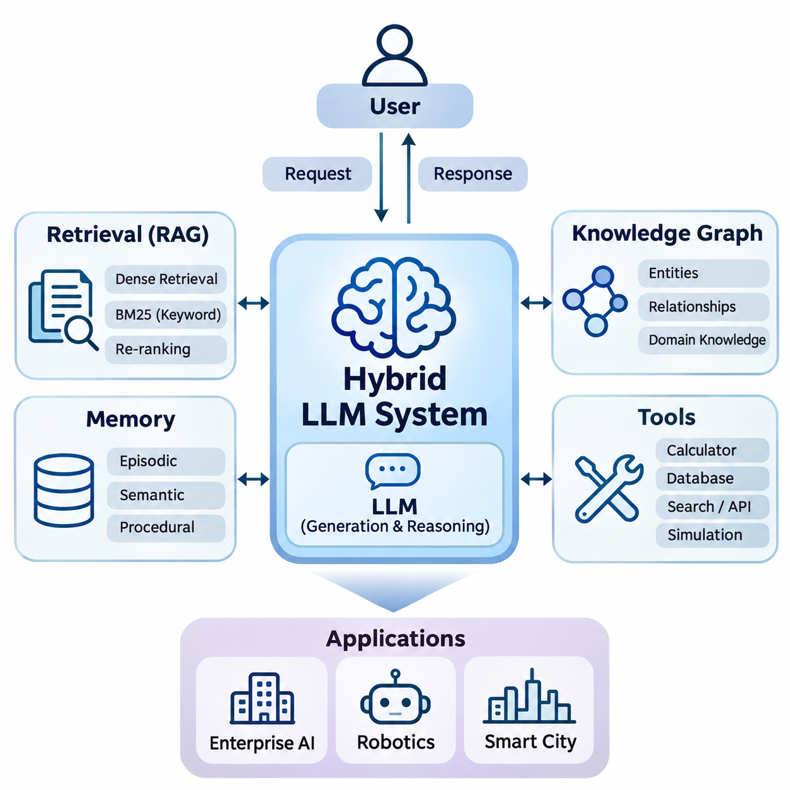
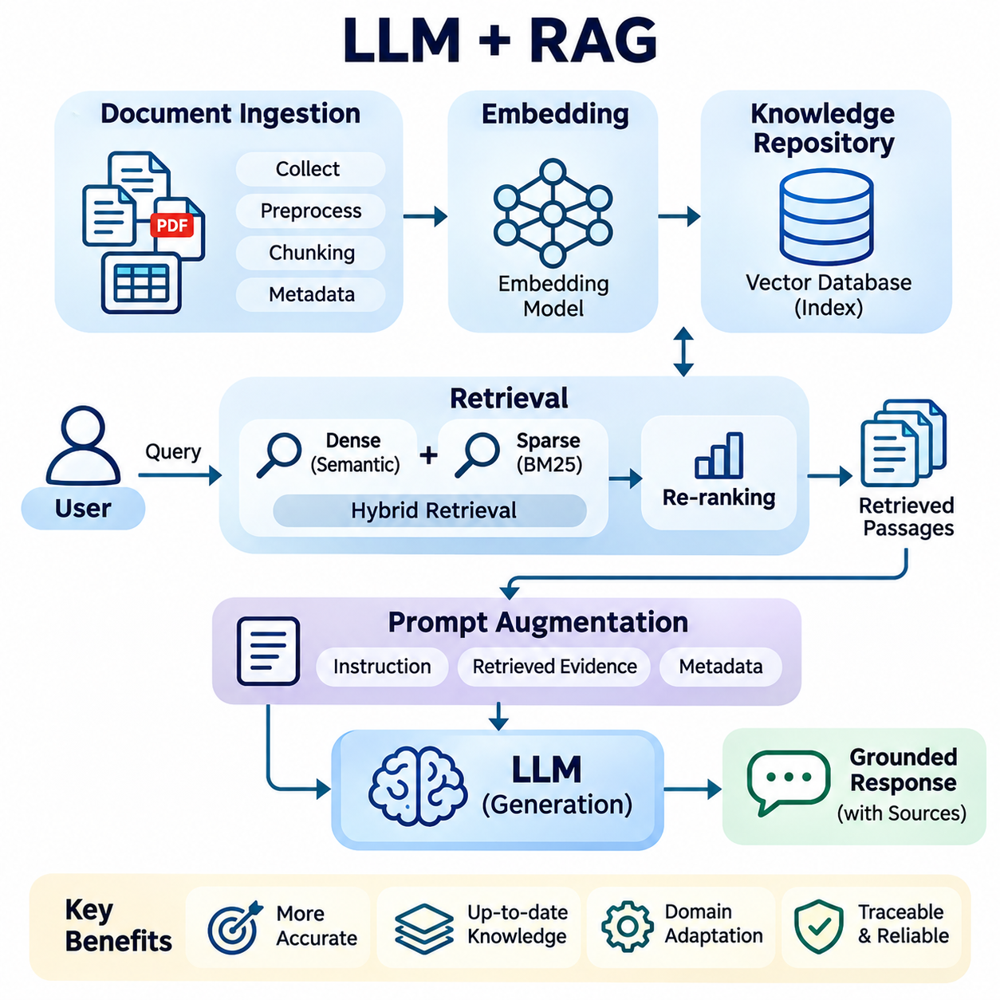
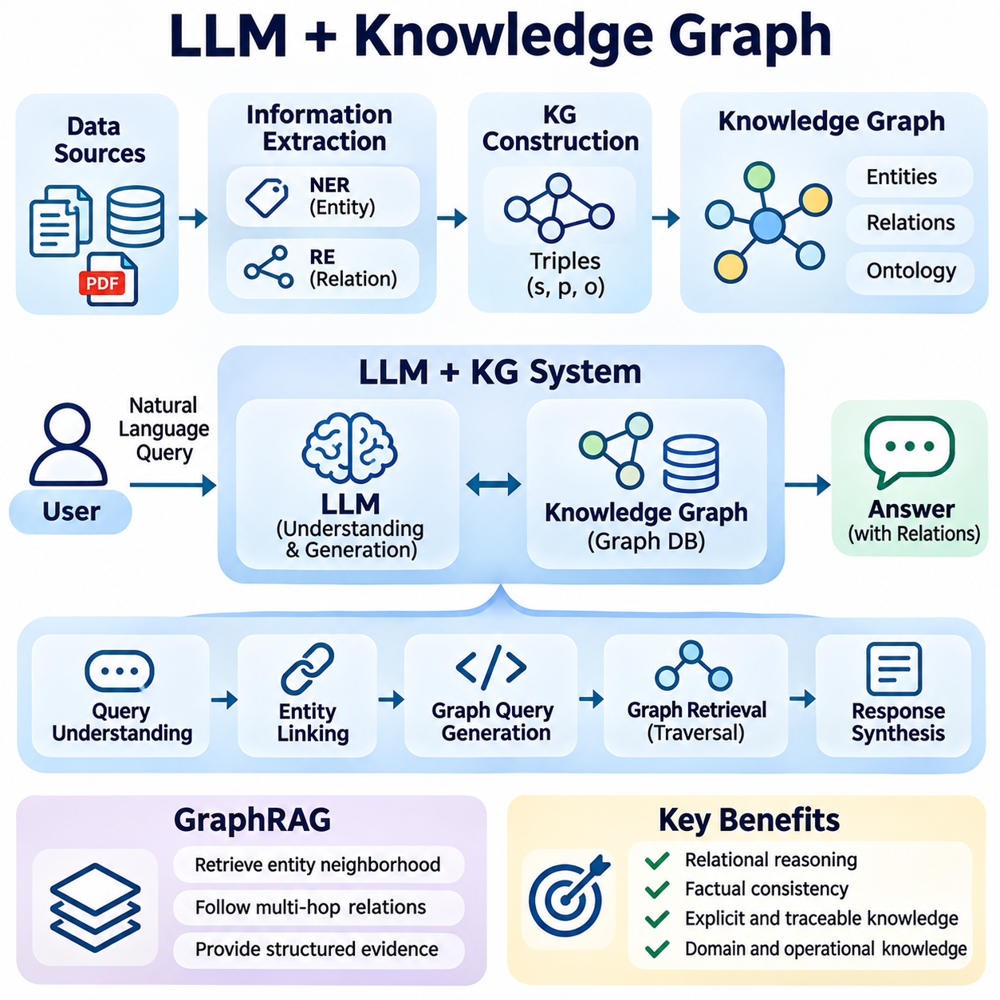
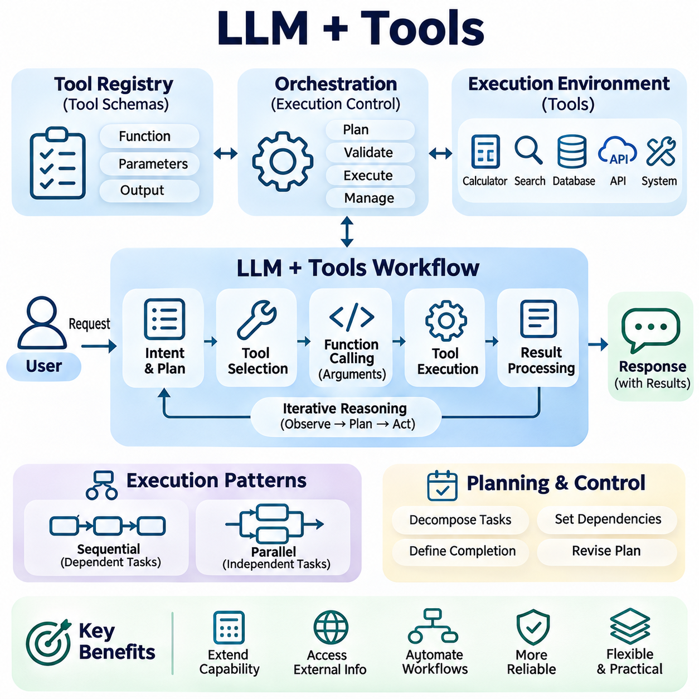
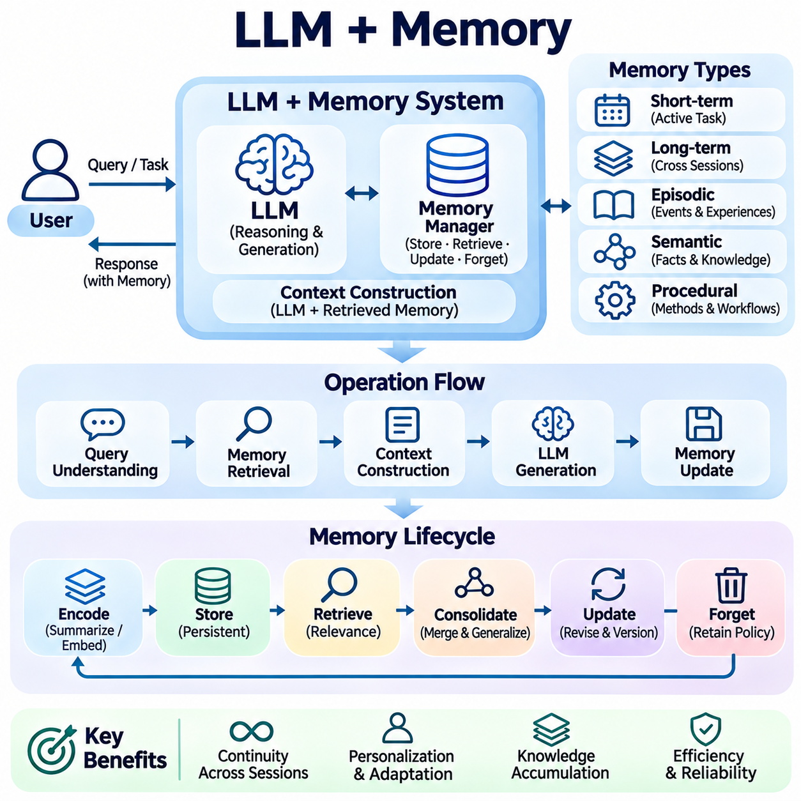
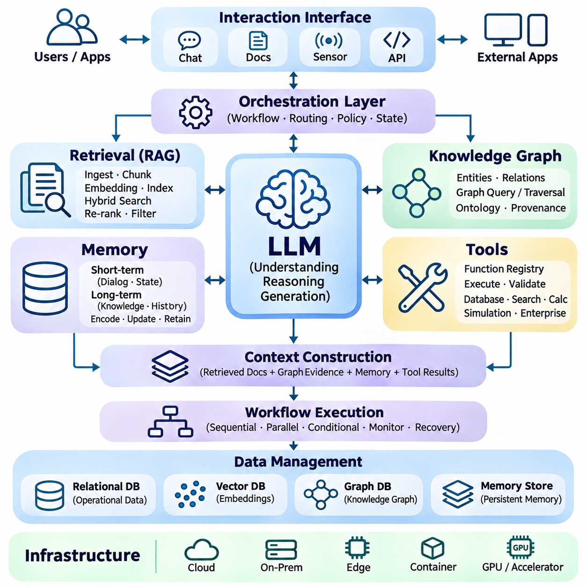
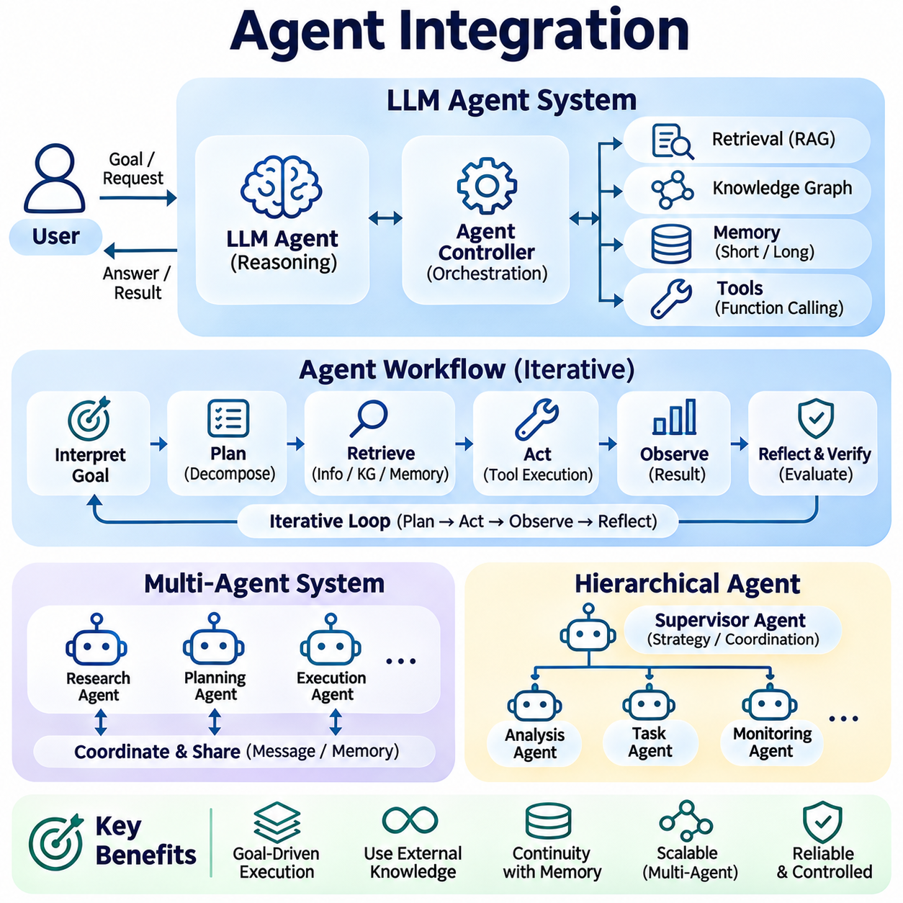
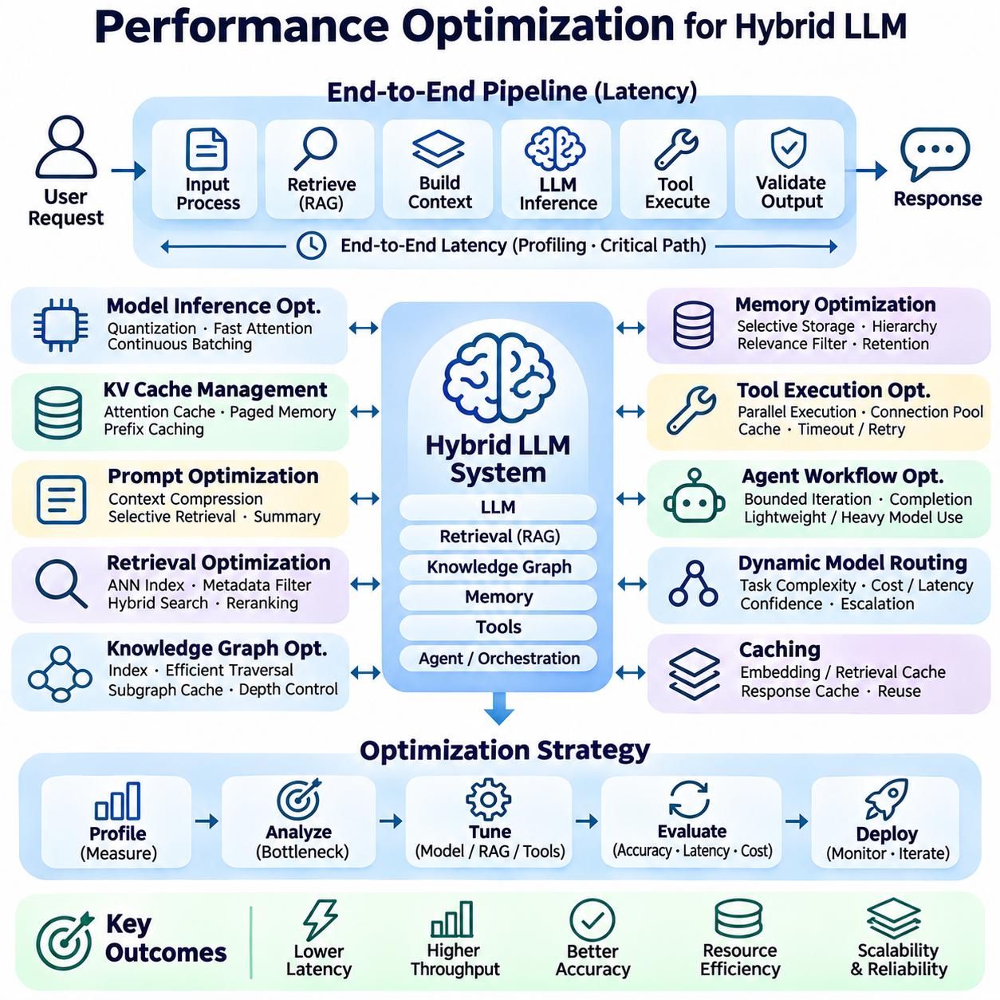
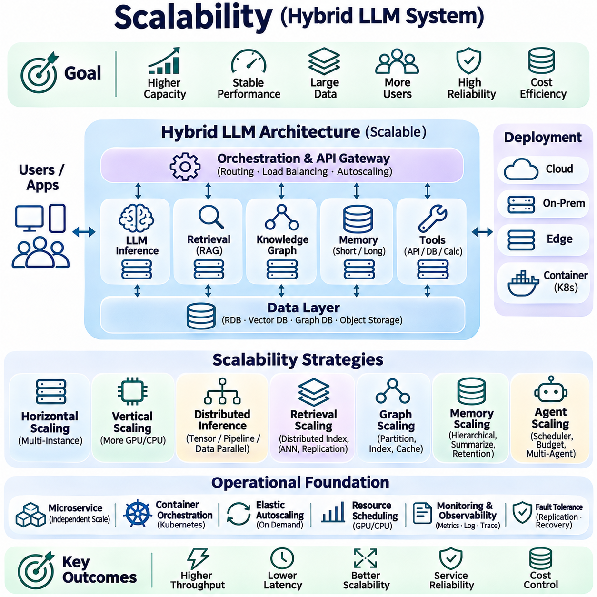
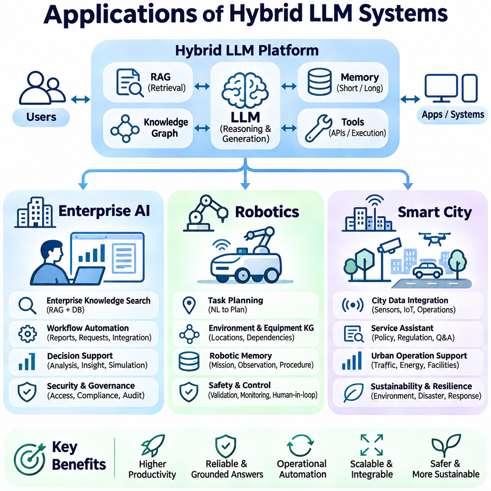

**Volume 37. Memory and Knowledge Systems**

# 05. Hybrid LLM Systems

## 05.00 Overview

{width="7.268055555555556in" height="7.268055555555556in"}

하이브리드 대규모 언어 모델 시스템(Hybrid Large Language Model Systems)은 대규모 언어 모델(LLM)의 생성 및 추론 능력을 외부 지식(External Knowledge), 검색 메커니즘(Retrieval Mechanisms), 영구 메모리(Persistent Memory), 실행 가능한 도구(Executable Tools)와 결합하는 아키텍처 접근 방식이다. 이러한 시스템은 사전 학습(Pretraining) 과정에서 모델 내부에 저장된 지식에만 의존하지 않고, 외부 정보와 컴퓨팅 자원(Computational Resources)에 동적으로 접근하여 관련성과 적응성이 높고 실제 운영 환경에 근거한 응답을 생성한다.

전통적인 대규모 언어 모델(LLM)은 학습된 통계적 관계(Statistical Relationships)를 기반으로 토큰(Token) 시퀀스를 예측하여 응답을 생성한다. 이러한 메커니즘은 정교한 언어 이해(Language Understanding)와 언어 생성(Language Generation)을 지원하지만, 오래된 정보(Outdated Information), 환각(Hallucination), 제한된 문맥 창(Context Window), 도메인 특화 지식(Domain-Specific Knowledge)에 대한 접근 부족 등의 한계를 가진다. 하이브리드 아키텍처(Hybrid Architecture)는 추가적인 근거와 기능을 제공하는 전문 구성 요소를 언어 모델에 연결하여 이러한 한계를 보완한다.

하이브리드 대규모 언어 모델 시스템의 기본 원리는 언어 생성(Language Generation)을 외부 지식 관리(External Knowledge Management) 및 운영 실행(Operational Execution)과 분리하는 것이다. 대규모 언어 모델은 중앙의 해석 및 추론 구성 요소로 작동하며, 검색 엔진(Retrieval Engine), 지식 그래프(Knowledge Graph), 메모리 데이터베이스(Memory Database), 소프트웨어 도구(Software Tools)는 각각 전문적인 기능을 제공한다. 이러한 모듈형 구조(Modular Architecture)를 통해 개발자는 정보나 시스템 요구사항이 변경될 때마다 전체 언어 모델을 재학습하지 않고 개별 구성 요소를 개선할 수 있다.

검색 증강 생성(Retrieval-Augmented Generation, RAG)은 하이브리드 대규모 언어 모델 개발에서 가장 널리 채택되는 접근 방식 중 하나이다. RAG 시스템은 응답을 생성하기 전에 외부 저장소(External Repository)에서 관련 정보를 검색한다. 일반적으로 문서는 임베딩(Embedding)으로 변환되어 벡터 데이터베이스(Vector Database)에 저장되며, 의미적 유사도 검색(Semantic Similarity Search)을 통해 유용한 문서 구간을 식별한다. 검색된 근거는 모델의 문맥(Context)에 포함되어 접근 가능한 정보에 기반한 응답을 생성하도록 지원한다.

하이브리드 검색(Hybrid Retrieval)은 밀집 의미 검색(Dense Semantic Retrieval)과 희소 키워드 기반 검색(Sparse Keyword-Based Retrieval)을 결합하여 기존 RAG를 확장한다. 밀집 임베딩(Dense Embedding)은 개념적 유사성을 식별하고, BM25와 같은 방법은 정확한 용어, 식별자, 기술적 표현에 대한 민감도를 유지한다. 재순위화 모델(Re-Ranking Model)은 관련성을 기준으로 후보 문서를 추가로 정제할 수 있다. 이러한 결합은 의미적 해석과 정확한 전문 용어가 모두 중요한 기술 환경에서 특히 유용하다.

지식 그래프(Knowledge Graph)는 개체(Entity), 관계(Relationship), 도메인 제약조건(Domain Constraints)의 구조화된 표현을 하이브리드 대규모 언어 모델 시스템에 도입한다. 비정형 문서(Unstructured Document)와 달리 지식 그래프는 개념, 장비, 조직, 사건, 운영 의존성 사이의 연결을 명시적으로 표현한다. 그래프 기반 검색(Graph-Based Retrieval)은 이러한 관계를 탐색하고, 대규모 언어 모델 내부에 학습된 언어적 지식을 보완하는 구조화된 근거(Structured Evidence)를 제공한다.

대규모 언어 모델과 지식 그래프의 통합은 관계형 추론(Relational Reasoning)과 추적 가능한 지식 접근(Traceable Knowledge Access)이 필요한 응용 분야를 지원한다. 예를 들어 산업 설비 유지보수 보조 시스템은 장비 구성 요소, 고장 증상, 유지보수 절차, 교체 부품 사이의 관계를 식별할 수 있다. 언어 모델은 사용자 요청을 해석하고 그래프 질의(Graph Query)는 관련 연결 관계를 검색한다. 기반 지식이 정확하고 적절하게 검증된다면 이러한 아키텍처는 사실적 일관성(Factual Consistency)을 향상시킬 수 있다.

도구 통합(Tool Integration)은 대규모 언어 모델을 대화형 생성기(Conversational Generator)에서 외부 컴퓨팅 시스템과 상호작용할 수 있는 인터페이스로 확장한다. 도구에는 수학적 해석기(Mathematical Solver), 데이터베이스 질의 엔진(Database Query Engine), 검색 서비스(Search Service), 시뮬레이션 플랫폼(Simulation Platform), 응용 프로그래밍 인터페이스(Application Programming Interface, API) 등이 포함된다. 모델은 사용자 의도를 해석하고 적절한 작업을 선택하며, 외부 소프트웨어가 실제 계산이나 데이터 접근을 수행한다. 이후 결과는 해석과 응답 생성을 위해 모델에 반환된다.

도구 지원 아키텍처(Tool-Enabled Architecture)에는 함수 선택(Function Selection), 인자 구성(Argument Construction), 실행 제어(Execution Control), 결과 검증(Result Validation)을 위한 명시적인 메커니즘이 필요하다. 대규모 언어 모델은 작업 순서를 제안할 수 있지만, 실제 실행은 결정론적 인터페이스(Deterministic Interface)와 권한 정책(Permission Policy)에 따라 관리되어야 한다. 이러한 분리는 생성된 언어를 실행 권한으로 잘못 취급할 위험을 줄이고, 개발자가 중요한 작업에 대한 감사(Auditing), 오류 처리(Error Handling), 안전장치(Safeguards)를 구현할 수 있도록 한다.

영구 메모리(Persistent Memory)는 하이브리드 대규모 언어 모델의 또 다른 중요한 기능이다. 기존 대화형 시스템은 주로 활성 문맥 창(Active Context Window)에 포함된 정보에 의존한다. 메모리 증강 아키텍처(Memory-Augmented Architecture)는 개별 상호작용 이후에도 선택된 정보를 저장하고 필요할 때 검색한다. 이러한 기능은 여러 세션에 걸친 연속성(Continuity), 반복 작업에 대한 적응(Adaptation), 전체 상호작용 기록을 반복적으로 전달하지 않고도 유용한 지식을 축적하는 기능을 지원한다.

하이브리드 메모리 아키텍처(Hybrid Memory Architecture)는 일화 기억(Episodic Memory), 의미 기억(Semantic Memory), 절차 기억(Procedural Memory)을 구분할 수 있다. 일화 기억은 이전 상호작용이나 사건의 기록을 보존하고, 의미 기억은 사실적 관계와 축적된 지식을 유지하며, 절차 기억은 재사용 가능한 작업 흐름(Workflow)이나 운영 지침을 표현한다. 이러한 메모리 유형은 서로 다른 저장 기술(Storage Technology)과 검색 정책(Retrieval Policy)을 사용하여 구현할 수 있으며, 시스템은 작업 요구사항에 따라 적절한 정보를 선택할 수 있다.

메모리 갱신(Memory Updating)은 정보의 최신성(Information Freshness), 상충하는 기록(Conflicting Records), 관련성(Relevance), 개인정보 보호(Privacy)와 관련된 문제를 발생시킨다. 신뢰할 수 있는 하이브리드 시스템은 어떤 관측 정보를 영구적으로 저장할지, 기존 기록을 어떻게 수정할지, 오래된 정보를 언제 제거할지 결정해야 한다. 또한 검색 메커니즘은 검증된 지식과 불확실한 과거 관측 정보를 구분해야 한다. 이러한 제어가 없다면 영구 메모리는 오래된 가정을 전파하고 이후 상호작용에서 오류를 증폭시킬 수 있다.

시스템 아키텍처(System Architecture)는 검색, 지식 그래프, 메모리, 도구, 언어 생성이 상호작용하는 방식을 결정한다. 일반적인 하이브리드 아키텍처는 인터페이스 계층(Interface Layer), 오케스트레이션 구성 요소(Orchestration Component), 외부 지식 서비스(External Knowledge Services), 모델 추론 인프라(Model Inference Infrastructure), 모니터링 메커니즘(Monitoring Mechanisms)으로 구성된다. 오케스트레이션 계층(Orchestration Layer)은 자원 제약조건과 운영 정책을 적용하면서 정보 검색, 문맥 구성, 도구 실행, 응답 생성을 조정한다.

에이전트 통합(Agent Integration)은 계획(Planning), 관측(Observation), 반복 실행(Iterative Execution)을 포함하는 목표 지향적 작업 흐름(Goal-Directed Workflow)을 통해 하이브리드 대규모 언어 모델 아키텍처를 확장한다. 에이전트는 복잡한 요청을 작은 작업으로 분해하고, 지원 지식을 검색하며, 적절한 도구를 호출하고, 중간 결과를 평가할 수 있다. 메모리는 작업의 연속성을 유지하고 외부 시스템은 관측 정보와 실행 기능을 제공한다. 그러나 신뢰할 수 있는 에이전트 동작을 위해서는 제한된 실행(Bounded Execution), 검증(Verification), 명확하게 정의된 권한 부여(Authorization)가 필요하다.

성능 최적화(Performance Optimization)는 하이브리드 시스템이 일반적인 언어 모델 추론 외에 추가적인 계산 단계를 포함하기 때문에 필수적이다. 검색 지연시간(Retrieval Latency), 데이터베이스 접근(Database Access), 문맥 구성(Context Construction), 도구 실행(Tool Execution), 토큰 생성(Token Generation)은 모두 응답시간(Response Time)에 영향을 미친다. 최적화 기술에는 캐싱(Caching), 효율적인 인덱싱(Efficient Indexing), 병렬 검색(Parallel Retrieval), 선택적 문맥 압축(Selective Context Compression), 모델 라우팅(Model Routing)이 포함된다. 이러한 기술의 효과는 작업 부하 특성과 계산 비용 및 응답 품질 사이의 절충관계(Tradeoff)에 따라 달라진다.

확장성(Scalability)은 하이브리드 대규모 언어 모델 시스템이 대규모 지식 저장소, 동시 사용자(Concurrent Users), 지속적으로 갱신되는 정보를 지원할 때 더욱 중요해진다. 분산 벡터 데이터베이스(Distributed Vector Database), 수평 확장형 검색 서비스(Horizontally Scalable Retrieval Service), 비동기 실행(Asynchronous Execution), 독립적인 추론 자원(Inference Resources)은 증가하는 작업 부하를 처리할 수 있다. 또한 아키텍처 분리(Architectural Separation)는 개별 구성 요소가 수요에 따라 확장되도록 하여 비용이 높은 언어 모델 자원의 불필요한 중복을 방지한다.

기업 인공지능(Enterprise AI)은 하이브리드 대규모 언어 모델 시스템의 주요 응용 분야이다. 조직은 방대한 기술 문서, 운영 절차, 데이터베이스, 조직 내부 지식(Institutional Knowledge)을 보유하고 있다. 하이브리드 아키텍처는 검색과 구조화된 지식 통합(Structured Knowledge Integration)을 통해 이러한 자원을 연결하여 직원들이 상황에 적합한 정보(Context-Sensitive Information)를 얻도록 지원한다. 접근 제어(Access Control), 문서 출처 추적(Document Provenance), 기밀성(Confidentiality), 갱신 일관성(Update Consistency)은 기업 환경에 배포할 때 중요한 요구사항이다.

로보틱스(Robotics) 응용 분야는 하이브리드 대규모 언어 모델 시스템을 물리적 인식(Physical Perception), 계획(Planning), 상호작용(Interaction)이 필요한 환경으로 확장한다. 로봇은 언어 명령을 저장된 지도, 장비 지식, 작업 이력, 외부 계획 도구와 결합할 수 있다. 대규모 언어 모델은 상위 수준 작업 해석(High-Level Task Interpretation)과 절차적 추론(Procedural Reasoning)을 지원하며, 전용 인식(Perception), 동작 계획(Motion Planning), 제어(Control) 모듈은 시간 제약이 엄격한 작업을 처리한다. 안전 필수 동작(Safety-Critical Actions)에는 독립적인 검증과 결정론적 제어가 필요하다.

스마트 시티(Smart City) 응용 분야는 교통망(Transportation Network), 인프라 모니터링 시스템(Infrastructure Monitoring System), 환경 센서(Environmental Sensor), 도시 지식 저장소(Municipal Knowledge Repository)의 정보를 통합한다. 하이브리드 대규모 언어 모델 시스템은 인프라 분석, 사고 해석, 유지보수 조정, 공공 정보 서비스를 지원할 수 있다. 지식 그래프는 인프라 관계를 표현하고, 검색 시스템은 규정과 기술 기록에 접근하며, 도구 인터페이스는 승인된 서비스에서 현재 운영 측정값을 가져온다.

보안(Security)과 거버넌스(Governance)는 하이브리드 대규모 언어 모델 개발의 모든 단계에 포함되어야 한다. 외부 문서와 도구 응답에는 부정확한 정보나 악의적인 명령이 포함될 수 있으며, 영구 메모리는 민감한 운영 데이터를 노출할 가능성이 있다. 효과적인 보호 조치에는 인증(Authentication), 권한 부여(Authorization), 입력 검증(Input Validation), 검색 필터링(Retrieval Filtering), 실행 격리(Execution Isolation), 감사 로깅(Audit Logging)이 포함된다. 이러한 조치는 신뢰할 수 있는 시스템 명령, 검색된 근거, 사용자 요청, 실행 가능한 작업 사이의 경계를 유지하는 데 도움이 된다.

하이브리드 대규모 언어 모델 시스템의 평가(Evaluation)는 생성된 응답의 언어적 품질을 측정하는 것 이상을 요구한다. 주요 평가 항목에는 검색 재현율(Retrieval Recall), 순위화 효과(Ranking Effectiveness), 사실적 근거성(Factual Grounding), 도구 실행 정확도(Tool Execution Accuracy), 메모리 일관성(Memory Consistency), 응답 지연시간(Response Latency), 운영 신뢰성(Operational Reliability)이 포함된다. 종단 간 테스트(End-to-End Testing)는 구성 요소의 오류가 시스템 전체로 전파되는 방식을 검토해야 한다. 성공적인 응답은 모델의 능력뿐 아니라 지원 서비스의 품질과 조정 수준에도 의존한다.

하이브리드 대규모 언어 모델 시스템의 발전은 독립적인 생성 모델(Isolated Generative Model)에서 통합 지능 아키텍처(Integrated Intelligence Architecture)로 전환되는 광범위한 흐름을 반영한다. 검색, 구조화된 지식, 영구 메모리, 실행 가능한 도구, 조정된 에이전트를 결합함으로써 이러한 시스템은 점점 복잡해지는 작업 흐름을 지원할 수 있다. 장기적인 가치는 신뢰할 수 있는 정보 접근, 투명한 실행(Transparent Execution), 확장 가능한 인프라(Scalable Infrastructure), 확률적 추론(Probabilistic Reasoning)과 결정론적 운영 구성 요소(Deterministic Operational Components) 사이의 통제된 상호작용을 달성하는 데 달려 있다.

## 05.01 LLM plus RAG

{width="7.268055555555556in" height="7.268055555555556in"}

대규모 언어 모델(Large Language Model, LLM)과 검색 증강 생성(Retrieval-Augmented Generation, RAG)의 통합은 생성형 지능(Generative Intelligence)과 외부 정보 검색(External Information Retrieval)을 결합하는 체계적인 접근 방식을 제공한다. 대규모 언어 모델은 사전 학습(Pretraining) 과정에서 습득한 지식에만 의존하지 않고, 응답을 생성하기 전에 외부 저장소(External Repository)에서 관련 근거를 검색한다. 이러한 아키텍처는 지식 접근성을 향상시키고, 도메인 적응(Domain Adaptation)을 지원하며, 신뢰할 수 있는 정보 기반 응용 시스템의 기반을 제공한다.

기존 대규모 언어 모델(LLM)은 방대한 언어적 패턴과 사실적 지식을 모델 매개변수(Model Parameters)에 인코딩하지만, 지식의 범위는 학습 데이터와 이후 갱신 과정에 의해 제한된다. 특히 최근 사건이나 전문적인 기술 주제를 다룰 때 충분한 근거 없이 그럴듯한 설명을 생성할 수 있다. 검색 증강 생성(RAG)은 추론(Inference) 과정에서 관련 외부 정보를 제공하는 검색 단계(Retrieval Stage)를 도입하여 지속적인 모델 재학습 없이 이러한 한계를 완화한다.

일반적인 LLM-RAG 아키텍처는 문서 처리 파이프라인(Document Processing Pipeline), 임베딩 모델(Embedding Model), 검색 엔진(Retrieval Engine), 지식 저장소(Knowledge Repository), 생성형 언어 모델(Generative Language Model)로 구성된다. 문서는 수집, 정규화, 분할 과정을 거쳐 검색 가능한 표현으로 변환된다. 추론 과정에서는 사용자 질의를 처리하고 관련 정보를 식별한 다음, 증강 프롬프트(Augmented Prompt)를 구성하여 검색된 문맥과 모델의 언어 능력을 기반으로 응답을 생성한다.

문서 수집 및 적재(Document Ingestion)는 검색 품질(Retrieval Quality)의 기반을 형성한다. 원본 자료에는 기술 매뉴얼, 연구 논문, 기업 데이터베이스, 운영 기록, 구조화된 보고서 등이 포함될 수 있다. 전처리(Preprocessing)는 불필요한 서식을 제거하고, 인코딩 불일치를 해결하며, 의미 있는 텍스트 내용을 추출한다. 출처 식별자(Source Identifier), 타임스탬프(Timestamp), 접근 권한(Access Permission), 버전 정보(Version Information)를 포함한 문서 메타데이터(Document Metadata)는 추적성과 신뢰할 수 있는 검색을 지원하기 위해 보존되어야 한다.

문서 청킹(Document Chunking)은 대규모 정보 원본을 인덱싱(Indexing)과 검색에 적합한 작은 단위로 분할한다. 고정 길이 분할(Fixed-Length Segmentation)은 구현이 간단한 반면, 의미 기반 청킹(Semantic Chunking)은 주제 사이의 개념적 경계(Conceptual Boundary)를 유지하려고 한다. 중첩 청크(Overlapping Chunks)는 분할 경계에서 발생하는 정보 손실을 줄일 수 있지만, 과도한 중첩은 저장 요구량과 검색 중복성을 증가시킨다. 청크 크기(Chunk Size)는 문서 구조, 임베딩 특성, 예상 질의 복잡도를 고려하여 결정해야 한다.

임베딩 모델(Embedding Model)은 텍스트 청크를 의미적 관계를 표현하는 밀집 수치 벡터(Dense Numerical Vector)로 변환한다. 유사한 개념은 일반적으로 학습된 임베딩 공간(Embedding Space)에서 서로 가까운 위치에 배치되므로 정확한 키워드 일치를 넘어서는 검색이 가능하다. 이러한 벡터는 효율적인 유사도 검색(Similarity Search)을 지원하는 전문 데이터베이스나 벡터 인덱스(Vector Index)에 저장된다. 임베딩 품질은 모델 학습, 도메인 어휘, 다국어 처리 능력, 문서와 질의 표현 사이의 일관성에 따라 달라진다.

벡터 데이터베이스(Vector Database)는 대규모 임베딩 컬렉션을 관리하고 검색하는 데 필요한 인프라를 제공한다. FAISS, Milvus, Weaviate, Pinecone과 같은 시스템은 서로 다른 인덱싱, 저장 및 검색 구성을 지원한다. 계층적 탐색 가능 소세계 그래프(Hierarchical Navigable Small World, HNSW)와 역파일 인덱스(Inverted File Index, IVF)를 포함한 근사 최근접 이웃(Approximate Nearest Neighbor, ANN) 알고리즘은 대규모 데이터셋의 검색 비용을 줄인다. 이러한 구성에는 검색 정확도, 메모리 사용량, 인덱싱 오버헤드, 질의 지연시간 사이의 절충관계(Tradeoff)가 존재한다.

검색 단계(Retrieval Stage)는 사용자 질의를 인덱싱된 지식 저장소와 호환되는 표현으로 변환하면서 시작된다. 코사인 유사도(Cosine Similarity), 내적(Dot Product), 유클리드 거리(Euclidean Distance)와 같은 유사도 측정 방법은 임베딩 기하학(Embedding Geometry)을 기준으로 후보 문서 구간을 식별한다. 검색 엔진은 관련 청크를 선택하고, 문서 유형, 발행 날짜, 조직 접근 권한, 운영 문맥에 따라 결과를 제한하는 메타데이터 필터(Metadata Filter)를 적용할 수 있다.

하이브리드 검색(Hybrid Retrieval)은 밀집 벡터 검색(Dense Vector Search)과 희소 어휘 검색(Sparse Lexical Retrieval)을 결합하여 다양한 질의 유형에 대한 검색 범위를 개선한다. 의미 검색(Semantic Retrieval)은 개념적 유사성을 포착하는 반면, BM25와 같은 알고리즘은 정확한 전문 용어, 숫자 식별자, 특수 표현이 포함된 문서를 식별한다. 후보 결과는 가중 점수 결합(Weighted Score Combination)이나 순위 융합(Rank Fusion) 기법을 통해 병합할 수 있다. 이러한 접근 방식은 부품 번호, 기술 표준, 도메인 특화 약어가 포함된 엔지니어링 문서에서 특히 유용하다.

재순위화(Re-Ranking)는 초기 검색 이후 추가적인 관련성 평가(Relevance Assessment)를 수행한다. 교차 인코더(Cross-Encoder) 또는 다른 전문 순위화 모델(Ranking Model)은 질의와 각 후보 문서 구간 사이의 관계를 평가하여 정제된 관련성 추정값(Relevance Estimate)을 생성한다. 재순위화는 계산 오버헤드를 증가시키지만, 대규모 언어 모델에 제공되는 정보의 품질을 향상시킬 수 있다. 따라서 후보 문서 수와 순위화 모델은 지연시간 제약조건과 검색 성능 요구사항에 따라 선택해야 한다.

프롬프트 증강(Prompt Augmentation)은 검색된 문서 구간을 대규모 언어 모델이 응답 생성에 활용할 수 있는 문맥적 근거(Contextual Evidence)로 변환한다. 시스템은 사용자 지침, 선택된 문서, 출처 메타데이터, 응답 요구사항을 사용 가능한 문맥 창(Context Window) 안에 결합한다. 효과적인 프롬프트 구성(Prompt Construction)은 검색된 내용을 실행 가능한 명령과 명확하게 분리하고, 근거 기반 응답(Evidence-Based Answer)을 유도한다. 문맥의 배치 순서와 토큰 할당(Token Allocation)은 모델이 제공된 정보를 얼마나 효과적으로 활용하는지에 영향을 미친다.

근거 기반 생성(Grounded Generation)은 응답이 근거 없는 모델의 가정보다 검색된 증거와 일관성을 유지하도록 하는 것을 목표로 한다. 출처 표시(Source Attribution)는 사용자가 개별 주장을 뒷받침하는 문서를 확인할 수 있도록 하여 투명성(Transparency)과 감사 가능성(Auditability)을 향상시킨다. 그러나 문서 자체가 부정확하거나 불완전하거나 서로 모순될 수 있으므로 검색만으로 사실적 정확성이 보장되지는 않는다. 신뢰할 수 있는 시스템에는 근거 검증(Evidence Verification), 불확실성 처리(Uncertainty Handling), 충분한 정보가 없을 때 적절하게 응답을 거부하는 메커니즘이 필요하다.

질의 이해(Query Understanding)는 사용자 의도(User Intent), 기술 용어(Technical Terminology), 문맥적 제약조건(Contextual Constraints)을 식별하여 검색 성능을 개선한다. 질의 재작성(Query Rewriting)은 모호한 요청을 보다 정확한 검색 표현으로 변환하며, 질의 분해(Query Decomposition)는 복잡한 질문을 독립적으로 검색할 수 있는 하위 문제로 분리한다. 다중 질의 검색(Multi-Query Retrieval)은 대체 표현을 탐색하여 정보 검색 범위를 확대한다. 이러한 기술은 관련 없는 근거를 도입하거나 의도된 의미를 변경하지 않도록 원래의 정보 요구사항을 유지해야 한다.

다단계 검색 증강 생성(Multi-Hop RAG)은 여러 문서나 상호 연결된 사실에서 정보를 수집해야 하는 질문을 지원한다. 시스템은 초기 근거를 검색하고 해결되지 않은 관계를 식별한 다음, 통합된 응답을 생성하기 전에 추가 검색을 수행한다. 이러한 과정은 기술 진단(Technical Diagnostics), 과학 문헌 분석(Scientific Literature Analysis), 조직 지식 탐색(Organizational Knowledge Exploration)에 유용하다. 그러나 반복 검색(Iterative Retrieval)에는 종료 기준(Termination Criteria), 근거 추적(Evidence Tracking), 관련성이 없거나 상충하는 정보의 누적을 방지하는 안전장치가 필요하다.

RAG 시스템은 지식의 최신성(Knowledge Freshness)과 저장소 일관성(Repository Consistency)도 관리해야 한다. 새로운 문서는 점진적으로 인덱싱(Incremental Indexing)할 수 있으며, 수정되거나 삭제된 기록은 임베딩과 메타데이터에도 해당 변경사항을 반영해야 한다. 버전 관리(Version Control)와 동기화 메커니즘(Synchronization Mechanism)은 오래된 문서 구간이 생성된 응답에 포함되는 것을 방지하는 데 도움이 된다. 시간에 민감한 응용 시스템에는 최신성 인식 순위화(Freshness-Aware Ranking), 명시적인 유효 기간(Validity Period), 권위 있는 운영 데이터베이스에 대한 직접 접근이 추가로 필요할 수 있다.

성능 최적화(Performance Optimization)는 검색 품질, 생성 정확도(Generation Accuracy), 응답 지연시간(Response Latency), 인프라 비용(Infrastructure Cost) 사이의 균형을 조정하는 과정이다. 빈번한 질의의 캐싱(Caching), 임베딩 작업의 배치 처리(Batching), 벡터 인덱스 최적화(Vector Index Optimization), 불필요한 문맥 제한은 효율성을 향상시킬 수 있다. 적응형 검색(Adaptive Retrieval)은 어려운 질문에 더 많은 계산 자원을 할당하고 간단한 요청에는 단순한 처리를 적용할 수 있다. 최적화 효과는 개별 구성 요소의 벤치마크보다 대표적인 작업 부하(Representative Workload)를 사용하여 평가해야 한다.

보안(Security)과 개인정보 보호(Privacy)는 전체 검색 및 생성 파이프라인(Retrieval and Generation Pipeline)에 걸쳐 고려되어야 한다. 기업 저장소에는 기밀 문서(Confidential Documents), 개인정보(Personal Information), 접근이 제한된 운영 기록이 포함될 수 있다. 검색 시스템은 모델에 내용을 제공하기 전에 문서 수준 권한 부여(Document-Level Authorization)를 적용해야 한다. 또한 검색된 문서에 포함된 프롬프트 주입(Prompt Injection), 무단 데이터 노출(Unauthorized Data Exposure), 악의적인 출처 조작(Malicious Source Manipulation), 생성된 응답을 통한 우발적인 정보 공개를 방지하기 위한 추가 보호 조치가 필요하다.

LLM-RAG 시스템의 평가(Evaluation)는 검색 성능과 생성 성능을 독립적으로 검토해야 한다. Recall\\@K, 평균 역순위(Mean Reciprocal Rank, MRR), 정규화 할인 누적 이득(Normalized Discounted Cumulative Gain, NDCG)과 같은 검색 평가 지표(Retrieval Metrics)는 근거 발견과 순위화 효과를 측정한다. 생성 평가(Generation Evaluation)는 응답 관련성(Answer Relevance), 사실적 일관성(Factual Consistency), 인용 정확도(Citation Accuracy), 완전성(Completeness)을 검토한다. 종단 간 평가(End-to-End Assessment)에는 지연시간, 강건성(Robustness), 계산 비용, 관련 근거가 없는 상황에서의 동작도 포함되어야 한다.

기업 응용 시스템(Enterprise Applications)은 LLM-RAG를 활용하여 내부 정책, 기술 문서, 고객 지원 지식, 운영 절차에 대한 접근을 제공한다. 로보틱스(Robotics)에서는 검색 기능을 통해 언어 기반 작업 해석(Language-Based Task Interpretation)을 장비 매뉴얼, 유지보수 이력, 환경 지식과 연결할 수 있다. 스마트 시티(Smart City) 시스템은 인프라 규정, 점검 기록, 공공 서비스 정보를 검색하여 분산된 정보 자원 전반에 걸친 운영 분석(Operational Analysis)과 의사결정 지원(Decision Assistance)을 수행할 수 있다.

대규모 언어 모델과 검색 증강 생성의 결합은 독립적인 언어 생성(Isolated Language Generation)에서 지식 기반 지능 시스템(Knowledge-Grounded Intelligence Systems)으로 전환되는 과정을 나타낸다. 이러한 시스템의 효과는 문서 처리, 임베딩 표현(Embedding Representation), 검색 정확도(Retrieval Accuracy), 문맥 통합(Contextual Integration), 근거 검증(Evidence Validation)의 유기적인 조정에 달려 있다. 하이브리드 아키텍처가 발전함에 따라 RAG는 지식 그래프(Knowledge Graph), 영구 메모리(Persistent Memory), 외부 도구(External Tools), 자율 에이전트(Autonomous Agents)와 함께 작동하면서 확장 가능하고 적응력 있는 인공지능 시스템의 핵심 구성 요소로 발전하고 있다.

## 05.02 LLM plus Knowledge Graph

{width="7.268055555555556in" height="7.268055555555556in"}

대규모 언어 모델(Large Language Model, LLM)과 지식 그래프(Knowledge Graph, KG)의 통합은 신경망 기반 언어 이해(Neural Language Understanding)와 구조화된 지식 표현(Structured Knowledge Representation)을 결합하는 하이브리드 아키텍처(Hybrid Architecture)를 구축한다. 대규모 언어 모델은 유연한 해석과 자연어 생성(Natural Language Generation)을 제공하며, 지식 그래프는 개체(Entity), 관계(Relationship), 의미적 제약조건(Semantic Constraints)을 체계적으로 구성한다. 이러한 결합을 통해 인공지능 시스템은 명시적인 도메인 지식(Domain Knowledge)에 접근하고 식별 가능한 관계에 근거한 응답을 생성할 수 있다.

지식 그래프(Knowledge Graph)는 상호 연결된 개체와 관계를 통해 정보를 표현하며, 일반적으로 주어-술어-목적어 트리플(Subject-Predicate-Object Triple) 형태로 구성된다. 개체는 사람, 조직, 장비, 위치 또는 추상적 개념을 나타낼 수 있으며, 관계는 이들 사이의 연관성을 정의한다. 모델 매개변수(Model Parameters)에 암묵적으로 저장된 지식과 달리 그래프 구조(Graph Structure)는 언어 모델과 독립적으로 질의, 검사, 갱신 및 검증할 수 있는 명시적인 연결 관계를 제공한다.

기존 대규모 언어 모델(LLM)은 복잡한 질문을 해석하고 자연스러운 설명을 생성할 수 있지만, 정확한 관계형 추론(Relational Reasoning)과 사실적 일관성(Factual Consistency)을 유지하는 데 어려움을 겪을 수 있다. 모델의 내부 표현(Internal Representation)은 개체 사이의 특정 관계를 정확하게 재구성한다고 보장하지 않는다. 지식 그래프 통합(Knowledge Graph Integration)은 추론(Inference) 과정에서 구조화된 근거(Structured Evidence)를 제공하여 확률적 연관성(Probabilistic Association)에만 의존하지 않고 검증된 관계를 참조할 수 있도록 한다.

일반적인 LLM-KG 아키텍처는 언어 모델(Language Model), 그래프 데이터베이스(Graph Database), 개체 인식 모듈(Entity Recognition Module), 관계 추출 구성 요소(Relation Extraction Component), 질의 생성 메커니즘(Query Generation Mechanism), 응답 합성 계층(Response Synthesis Layer)으로 구성된다. 언어 모델은 사용자 요청을 해석하고 관련 개념을 식별한다. 그래프 검색 서비스(Graph Retrieval Service)는 해당 개체와 관계를 검색하며, 응답 합성 구성 요소는 검색된 그래프 근거와 자연어 생성을 결합하여 문맥에 적합한 응답을 생성한다.

지식 그래프 구축(Knowledge Graph Construction)은 정형 및 비정형 정보 원본(Structured and Unstructured Information Sources)에서 개체와 관계를 식별하는 과정으로 시작된다. 정형 데이터베이스(Structured Database)는 명시적인 속성과 연결 관계를 제공하지만, 문서에서는 정보 추출(Information Extraction) 기술이 필요하다. 개체명 인식(Named Entity Recognition, NER)은 관련 객체를 식별하고, 관계 추출(Relation Extraction)은 객체 사이의 상호작용을 결정한다. 추출된 정보는 그래프 트리플(Graph Triple)로 변환되고 검증 과정을 거친 후 지식 저장소(Knowledge Repository)에 통합된다.

개체 식별 및 통합(Entity Resolution)은 서로 다른 명칭이 동일한 실제 객체를 가리킬 수 있기 때문에 필수적이다. 예를 들어 기술 부품은 제조업체 식별자(Manufacturer Identifier), 내부 부품 번호(Internal Part Number), 설명형 명칭(Descriptive Name)으로 표현될 수 있다. 개체 연결(Entity Linking)은 이러한 다양한 표현을 표준 그래프 노드(Canonical Graph Node)에 연결하여 중복성과 모호성을 줄인다. 신뢰할 수 있는 개체 식별에는 문맥 분석(Contextual Analysis), 식별자 매칭(Identifier Matching), 신뢰도 평가(Confidence Assessment)가 필요하며, 이를 통해 잘못된 관계가 그래프에 포함되는 것을 방지한다.

온톨로지(Ontology)는 개체 범주(Entity Category), 관계 유형(Relationship Type), 속성(Attribute), 도메인 제약조건(Domain Constraint)에 대한 형식적 정의를 제공한다. 온톨로지는 지식 그래프 구축과 해석을 안내하는 의미적 규칙(Semantic Rules)을 설정한다. 예를 들어 산업용 온톨로지는 기계, 센서, 액추에이터(Actuator), 제어 시스템(Control System)을 구분하고 허용 가능한 연결 관계를 정의할 수 있다. 온톨로지 제약조건(Ontological Constraints)은 일관성 검사(Consistency Checking)를 지원하고 그래프 갱신 과정에서 유효하지 않은 관계가 생성되는 것을 방지한다.

그래프 데이터베이스(Graph Database)는 관계 탐색(Relationship Traversal)에 최적화된 데이터 모델을 사용하여 상호 연결된 지식을 저장하고 관리한다. Neo4j와 같은 속성 그래프 시스템(Property Graph System)은 속성이 연결된 노드(Node)와 간선(Edge)을 표현하며, RDF 기반 시스템(RDF-Based System)은 표준화된 트리플을 통해 정보를 표현한다. Cypher와 SPARQL 같은 질의 언어(Query Language)는 그래프 정보에 대한 구조화된 접근을 지원한다. 적절한 표현 방식은 상호운용성(Interoperability), 추론 요구사항(Reasoning Requirements), 응용 시스템의 복잡도(Application Complexity)에 따라 결정된다.

자연어 인터페이스(Natural Language Interface)는 사용자가 그래프 질의 언어를 직접 작성하지 않고도 지식 그래프를 검색할 수 있도록 한다. 대규모 언어 모델은 질문을 구조화된 질의(Structured Query)로 변환하고, 관련 그래프 개체를 식별하며, 해당 관계를 요청할 수 있다. 생성된 질의는 실행 전에 그래프 스키마(Graph Schema)와 권한 정책(Authorization Policy)에 따라 검증되어야 한다. 이후 검색 결과는 기본적인 사실 관계를 유지하면서 읽기 쉬운 설명으로 변환된다.

그래프 기반 검색(Graph-Based Retrieval)은 주로 의미적 유사성(Semantic Similarity)에 의존하는 기존 벡터 검색(Vector Retrieval)과 달리 명시적인 관계를 따라 탐색한다. 그래프 질의(Graph Query)는 정의된 탐색 연산(Traversal Operation)을 통해 의존성 체인(Dependency Chain), 조직 계층(Organizational Hierarchy), 구성 요소 연결(Component Connection)을 식별할 수 있다. 벡터 검색은 개념적으로 관련된 문서를 찾는 데 여전히 유용하며, 그래프 검색은 정확한 구조적 근거(Structural Evidence)를 제공한다. 두 접근 방식을 결합하면 이질적인 지식 원본(Heterogeneous Knowledge Sources)에 대한 검색 범위를 개선할 수 있다.

그래프 검색 증강 생성(Graph Retrieval-Augmented Generation, GraphRAG)은 그래프 기반 지식 검색과 언어 모델 생성을 통합한다. 구현 방식에 따라 시스템은 개체 주변 영역(Entity Neighborhood), 연결된 하위 그래프(Connected Subgraph), 관계 경로(Relationship Path), 그래프 기반 요약(Graph-Derived Summary)을 검색할 수 있다. 이러한 구조는 대규모 언어 모델이 활용할 수 있는 문맥적 근거(Contextual Evidence)로 변환된다. GraphRAG는 여러 문서에 분산된 관계를 이해해야 하는 질문에 응답할 때 특히 유용하다.

다중 홉 추론(Multi-Hop Reasoning)은 여러 그래프 간선(Graph Edge)에 걸쳐 연결된 관계를 조사할 수 있도록 한다. 예를 들어 센서 고장이 어떤 생산 공정에 영향을 미치는지 판단하려면 센서, 제어기, 기계, 제조 작업 사이의 연결 관계를 탐색해야 할 수 있다. 그래프는 명시적인 의존성 경로(Dependency Path)를 제공하며, 대규모 언어 모델은 해당 관계의 운영상 의미(Operational Significance)를 해석한다. 신뢰할 수 있는 결론을 도출하려면 관련 그래프에 포함된 관계가 완전하고 정확해야 한다.

하이브리드 추론(Hybrid Reasoning)은 신경망 기반 해석(Neural Interpretation)과 기호적 추론 메커니즘(Symbolic Inference Mechanism)을 결합한다. 대규모 언어 모델은 의미적 이해(Semantic Understanding)와 유연한 가설 생성(Hypothesis Generation)을 담당하며, 기호적 추론 엔진(Symbolic Reasoning Engine)은 논리 규칙(Logical Rules)과 그래프 제약조건(Graph Constraints)을 적용한다. 규칙 기반 추론(Rule-Based Inference)은 기반 규칙이 유효할 때 기존 사실로부터 추가적인 관계를 도출할 수 있다. 이러한 분리는 형식적으로 뒷받침되는 결론과 여전히 불확실한 언어 모델의 해석을 구분할 수 있도록 한다.

지식 그래프 갱신(Knowledge Graph Updating)은 실제 세계의 개체와 관계가 시간에 따라 변화하기 때문에 필요하다. 새로운 장비가 설치되거나 조직의 책임이 변경되고 운영 의존성(Operational Dependency)이 발전할 수 있다. 갱신 파이프라인(Update Pipeline)은 변경사항을 탐지하고 충돌을 해결하며, 그래프 기록과 원본 시스템(Source System) 사이의 일관성을 유지해야 한다. 시간적 속성(Temporal Attribute)과 버전 이력(Version History)은 과거 관계를 보존하면서 현재 상태에 대한 질의를 지원할 수 있다.

그래프 임베딩(Graph Embedding)은 개체와 관계를 수치적 표현(Numerical Representation)으로 변환하여 구조화된 지식 통합을 확장한다. TransE, RotatE, 그래프 신경망(Graph Neural Network, GNN)과 같은 방법은 학습된 벡터 공간(Vector Space)에서 관계형 패턴(Relational Pattern)을 포착할 수 있다. 이러한 표현은 개체 유사도(Entity Similarity), 링크 예측(Link Prediction), 후보 관계 발견(Candidate Relationship Discovery)을 지원한다. 그러나 특히 안전 필수 응용 분야(Safety-Critical Applications)에서는 예측된 연결 관계와 검증된 그래프 사실을 명확하게 구분해야 한다.

지식 출처 추적(Knowledge Provenance)은 그래프에 포함된 사실이 어디에서 유래했으며 어떤 과정을 통해 확립되었는지에 대한 정보를 제공한다. 관계는 원본 문서(Source Document), 데이터베이스 기록(Database Record), 타임스탬프(Timestamp), 검증 절차(Validation Procedure)와 연결될 수 있다. 출처 추적은 사용자와 자동화 시스템이 근거의 품질을 평가하고 결론의 기원을 추적할 수 있도록 한다. 대규모 언어 모델이 그래프 근거를 기반으로 설명을 생성할 때 이러한 참조 정보를 유지하면 투명성(Transparency)이 향상되고 감사(Auditing)를 지원할 수 있다.

성능 최적화(Performance Optimization)는 그래프 탐색 복잡도(Graph Traversal Complexity), 검색 범위(Retrieval Coverage), 언어 모델 추론 비용(Language Model Inference Cost) 사이의 균형을 조정하는 과정이다. 대규모 지식 그래프에는 수백만 개의 개체와 관계가 포함될 수 있으므로 제한 없는 탐색은 높은 계산 비용을 발생시킨다. 질의 계획(Query Planning), 인덱싱(Indexing), 주변 영역 필터링(Neighborhood Filtering), 캐싱(Caching), 선택적 하위 그래프 추출(Selective Subgraph Extraction)은 처리 오버헤드를 줄일 수 있다. 효율적인 아키텍처는 현재 질문에 응답하는 데 필요한 그래프 정보만 검색한다.

보안 고려사항(Security Considerations)에는 그래프 개체, 관계, 관련 속성에 대한 접근 제어(Access Control)가 포함된다. 기업 지식 그래프에는 기밀 조직 구조(Confidential Organizational Structure), 독점적인 기술 의존성(Proprietary Technical Dependency), 민감한 운영 정보(Sensitive Operational Information)가 포함될 수 있다. 질의 검증(Query Validation)과 권한 인식 검색(Permission-Aware Retrieval)은 승인되지 않은 그래프 탐색을 방지해야 한다. 또한 대규모 언어 모델이 생성한 질의에는 과도한 자원 소비, 의도하지 않은 수정, 제한된 관계 정보의 노출을 방지하기 위한 안전장치가 필요하다.

LLM-KG 시스템의 평가(Evaluation)는 개체 연결 정확도(Entity Linking Accuracy), 관계 추출 품질(Relation Extraction Quality), 그래프 질의 정확성(Graph Query Correctness), 응답 근거성(Answer Grounding)을 검토해야 한다. 그래프 완전성(Graph Completeness)과 일관성(Consistency)은 후속 추론(Downstream Reasoning)의 신뢰성에 영향을 미친다. 종단 간 벤치마크(End-to-End Benchmark)는 생성된 응답이 검색된 관계를 정확하게 반영하고, 누락된 정보와 확립된 사실을 구분하는지 평가해야 한다. 지연시간(Latency), 확장성(Scalability), 모호한 질의에 대한 강건성(Robustness)도 추가적인 운영 고려사항이다.

기업 인공지능(Enterprise AI) 응용 시스템은 LLM-KG 통합을 활용하여 조직 지식, 비즈니스 프로세스(Business Process), 기술 자산(Technical Asset), 운영 의존성을 연결한다. 로보틱스(Robotics) 시스템은 센서, 액추에이터, 제어 모듈(Control Module), 환경, 작업 절차 사이의 관계를 표현할 수 있다. 스마트 시티(Smart City) 플랫폼은 인프라 자산(Infrastructure Asset), 교통망(Transportation Network), 유지보수 기록(Maintenance Record), 서비스 의존성(Service Dependency)을 체계적으로 구성할 수 있다. 이러한 응용 분야는 구조화된 관계형 지식과 자연어 상호작용(Natural Language Interaction)의 결합을 통해 이점을 얻는다.

대규모 언어 모델과 지식 그래프의 통합은 지식 인식 인공지능 아키텍처(Knowledge-Aware AI Architecture)로 발전하는 중요한 단계이다. 언어 모델은 유연한 의사소통과 의미적 해석을 제공하며, 지식 그래프는 명시적인 관계, 구조화된 검색, 추적 가능한 근거를 제공한다. 이러한 기능이 검색 증강 생성(Retrieval-Augmented Generation, RAG), 영구 메모리(Persistent Memory), 외부 도구(External Tools)와 결합되면 복잡한 기술 및 조직 환경 전반에서 더욱 신뢰할 수 있는 추론과 적응형 의사결정 지원(Adaptive Decision Assistance)이 가능해진다.

## 05.03 LLM plus Tools

{width="7.268055555555556in" height="7.268055555555556in"}

대규모 언어 모델(Large Language Model, LLM)과 외부 도구(External Tools)의 통합은 생성형 인공지능(Generative AI)의 기능을 자연어 처리(Natural Language Processing)에서 계산 실행(Computational Execution), 정보 접근(Information Access), 운영 시스템 상호작용(Operational Interaction)으로 확장한다. 기존 대규모 언어 모델은 학습된 표현을 기반으로 응답을 생성하지만, 도구 증강 시스템(Tool-Augmented System)은 전문 소프트웨어를 호출하여 계산을 수행하고 최신 정보를 검색하며 외부 서비스와 상호작용할 수 있다. 이러한 아키텍처는 언어 모델을 복잡한 디지털 작업 흐름(Digital Workflow)을 위한 유연한 인터페이스로 전환한다.

도구 통합(Tool Integration)은 독립형 언어 모델(Standalone Language Model)의 근본적인 한계인 불안정한 산술 연산, 최신 정보에 대한 제한적인 접근, 외부 시스템을 직접 조작할 수 없는 문제를 해결한다. 전문적인 작업을 적절한 도구에 위임함으로써 대규모 언어 모델은 사용자 의도(User Intent)를 해석하고 작업을 선택하며 결과를 설명하는 데 집중할 수 있다. 그러나 도구 실행 자체가 정확성을 자동으로 보장하지는 않으므로 검증(Validation)과 통제된 실행(Controlled Execution)이 필수적인 아키텍처 요구사항이 된다.

일반적인 LLM-도구 아키텍처(LLM-Tool Architecture)는 언어 모델(Language Model), 도구 레지스트리(Tool Registry), 오케스트레이션 계층(Orchestration Layer), 실행 환경(Execution Environment), 결과 처리 메커니즘(Result Processing Mechanism)으로 구성된다. 도구 레지스트리는 사용 가능한 함수, 입력 매개변수, 예상 출력값을 정의한다. 오케스트레이션 계층은 모델이 생성한 요청을 해석하고 인수를 검증하며 승인된 작업을 호출한 후 구조화된 결과를 반환한다. 이후 언어 모델은 이러한 관측 결과(Observation)를 응답에 반영하거나 추가 작업의 필요성을 판단한다.

함수 호출(Function Calling)은 대규모 언어 모델이 외부 작업을 요청할 수 있도록 하는 구조화된 메커니즘이다. 모델은 실행 가능한 명령을 직접 생성하는 대신 사전에 정의된 스키마(Predefined Schema)를 따르는 함수 식별자(Function Identifier)와 인수(Argument)를 생성한다. 응용 프로그램 제어기(Application Controller)는 요청을 검증하고 해당 함수를 실행한다. 구조화된 인터페이스(Structured Interface)는 모호성을 줄이고 자동 검증(Automated Validation)을 지원하며, 확률적 언어 생성(Probabilistic Language Generation)과 결정론적 소프트웨어 실행(Deterministic Software Execution)을 분리한다.

도구 스키마(Tool Schema)는 언어 모델과 외부 서비스 사이의 운영 계약(Operational Contract)을 정의한다. 스키마는 일반적으로 함수 이름, 설명, 필수 매개변수, 데이터 유형(Data Type), 제약조건(Constraint), 출력 구조(Output Structure)를 명시한다. 명확한 설명은 도구 선택(Tool Selection)과 인수 생성(Argument Generation)의 정확도를 향상시키며, 엄격한 검증은 잘못 구성된 요청을 방지한다. 스키마 설계(Schema Design)는 모호성을 최소화하고 필요한 기능만 노출하며 외부 서비스가 발전하더라도 호환성을 유지해야 한다.

도구 선택(Tool Selection)은 현재 사용자 요청을 가장 적절하게 수행할 수 있는 작업을 식별하는 과정이다. 대규모 언어 모델은 사실 기록을 조회하기 위해 데이터베이스 질의(Database Query)를 선택하거나, 수치 연산을 위해 계산기(Calculator)를 사용하고, 최신 정보를 얻기 위해 검색 서비스(Search Service)를 호출할 수 있다. 복잡한 요청에는 서로 다른 기능을 가진 여러 도구가 필요할 수 있다. 선택 정확도는 도구 설명, 문맥 이해(Contextual Understanding), 외부 실행이 필요한 작업과 직접 응답할 수 있는 작업을 구분하는 모델의 능력에 따라 달라진다.

실행 오케스트레이션(Execution Orchestration)은 도구 상호작용의 순서를 조정하고 작업 사이의 의존성(Dependency)을 관리한다. 하나의 요청에는 데이터 검색, 결과 변환, 계산 수행, 최종 설명 생성이 포함될 수 있다. 오케스트레이션 구성 요소(Orchestration Component)는 실행 상태(Execution State)를 유지하고 검증된 출력을 단계 사이에 전달하며 운영 제한조건(Operational Limits)을 적용한다. 이러한 분리는 언어 모델이 유연한 실행 전략을 제안하더라도 예측 가능한 작업 흐름 관리(Workflow Management)를 가능하게 한다.

순차적 도구 실행(Sequential Tool Execution)은 후속 작업이 이전 결과에 의존할 때 적합하다. 예를 들어 산업용 인공지능 비서(Industrial AI Assistant)는 운영 한계를 계산하거나 유지보수 절차를 선택하기 전에 장비 사양을 검색할 수 있다. 병렬 실행(Parallel Execution)은 독립적인 정보 원본을 동시에 조회해야 할 때 지연시간(Latency)을 줄일 수 있다. 효과적인 오케스트레이션은 의존성을 식별하고 불필요한 호출을 방지하며, 출처 문맥(Source Context)을 잃거나 근거 없는 가정을 도입하지 않고 결과를 통합한다.

도구 출력(Tool Output)에는 구조화된 기록(Structured Record), 수치값(Numerical Value), 문서(Document), 오류 메시지(Error Message), 외부 자원 참조(External Resource Reference)가 포함될 수 있다. 시스템은 이러한 출력을 대규모 언어 모델이 신뢰성 있게 해석할 수 있는 표현으로 변환해야 한다. JSON과 같은 구조화된 형식(Structured Format)은 일관된 파싱(Parsing)을 지원하며, 메타데이터(Metadata)는 출처 식별 정보와 실행 상태를 보존할 수 있다. 출력 정규화(Output Normalization)는 서로 다른 규칙, 단위 또는 데이터 스키마를 사용하는 이기종 도구(Heterogeneous Tools)를 결합할 때 특히 중요하다.

오류 처리(Error Handling)는 외부 도구가 네트워크 중단(Network Interruption), 잘못된 매개변수(Invalid Parameter), 사용 불가능한 자원(Unavailable Resource), 권한 제한(Permission Restriction)으로 인해 실패할 수 있으므로 필수적이다. 강건한 시스템(Robust System)은 일시적인 오류(Transient Failure)와 영구적인 오류(Permanent Error)를 구분하고 적절한 복구 전략(Recovery Strategy)을 적용한다. 여기에는 제한된 재시도(Bounded Retry), 대체 도구(Alternative Tool), 수정된 인수(Revised Argument), 추가 설명 요청(Clarification Request)이 포함될 수 있다. 언어 모델은 실행 결과가 완료를 확인하지 않는 한 작업이 성공했다고 표현해서는 안 된다.

도구 증강 추론(Tool-Augmented Reasoning)은 대규모 언어 모델이 작업을 생성하고 관측 결과를 해석하는 과정을 반복하는 작업 흐름을 지원한다. 모델은 중간 목표(Intermediate Objective)를 설정하고 도구를 호출한 다음 반환된 정보를 검토하여 다음 작업을 선택할 수 있다. 이러한 방식은 모든 단계를 사전에 결정하지 않아도 적응형 문제 해결(Adaptive Problem Solving)을 가능하게 한다. 그러나 통제되지 않은 반복 실행(Uncontrolled Loop)과 과도한 자원 소비를 방지하기 위해 실행 경계(Execution Boundary)와 종료 조건(Termination Condition)이 필요하다.

계획 메커니즘(Planning Mechanism)은 복잡한 목표를 관리 가능한 하위 작업(Subtask)으로 구성하여 여러 도구 호출을 효율적으로 조정한다. 계획 구성 요소(Planning Component)는 실행 전에 필요한 정보를 식별하고 작업 의존성을 설정하며 완료 기준(Completion Criteria)을 정의할 수 있다. 관측 결과에서 누락된 정보나 예상하지 못한 상황이 발견되면 계획을 수정할 수 있다. 신뢰할 수 있는 계획 수립에는 제안된 작업(Proposed Action)과 검증된 결과(Verified Outcome)를 구분하고, 중간 결과와 원래 목표 사이의 일관성을 유지하는 과정이 필요하다.

외부 정보 접근(External Information Access)은 LLM-도구 통합의 주요 응용 분야이다. 검색 엔진(Search Engine), 데이터베이스 커넥터(Database Connector), 문서 저장소(Document Repository), 응용 프로그램 프로그래밍 인터페이스(Application Programming Interface, API)는 모델 매개변수에 존재하지 않을 수 있는 정보를 제공한다. 적절한 서비스가 사용 가능하면 도구 호출을 통해 갱신된 기록이나 권위 있는 측정값(Authoritative Measurement)을 검색할 수 있다. 생성된 설명이 출처의 신뢰성과 관련성을 반영하도록 결과 근거에는 타임스탬프(Timestamp), 출처 정보(Provenance), 접근 제한(Access Restriction)이 유지되어야 한다.

계산 도구(Computational Tool)는 수치적 정밀도(Numerical Precision)나 전문 알고리즘(Specialized Algorithm)이 필요한 작업을 수행하여 언어 모델의 기능을 보완한다. 수학적 해석기(Mathematical Solver), 통계 라이브러리(Statistical Library), 시뮬레이션 엔진(Simulation Engine), 최적화 프레임워크(Optimization Framework)는 토큰 예측(Token Prediction)과 독립적으로 계산을 실행할 수 있다. 대규모 언어 모델은 문제를 해석하고 계산 결과를 설명하며, 외부 소프트웨어는 실제 연산을 수행한다. 다만 정확성은 유효한 입력값, 적절한 알고리즘, 단위와 가정에 대한 검증에 여전히 의존한다.

데이터베이스 통합(Database Integration)은 구조화된 운영 정보(Structured Operational Information)에 대한 자연어 상호작용(Natural Language Interaction)을 가능하게 한다. 대규모 언어 모델은 사용자 질문을 데이터베이스 질의로 변환하고 관련 기록을 검색하여 결과를 요약할 수 있다. 생성된 질의는 실행 전에 데이터베이스 스키마(Database Schema), 접근 권한(Access Permission), 자원 제약조건(Resource Constraint)에 따라 검증되어야 한다. 정보 조회 작업에는 읽기 전용 접근(Read-Only Access)이 적합하며, 데이터 수정에는 명시적인 승인(Explicit Authorization)과 의도하지 않은 변경을 방지하기 위한 트랜잭션 안전장치(Transactional Safeguard)가 필요하다.

언어 모델이 외부 시스템에 영향을 미치는 작업을 시작할 수 있게 되면 보안(Security)이 매우 중요해진다. 프롬프트 주입(Prompt Injection), 악의적인 도구 출력(Malicious Tool Output), 승인되지 않은 함수 선택(Unauthorized Function Selection), 과도한 권한(Excessive Permission)은 심각한 위험을 초래할 수 있다. 안전한 아키텍처는 최소 권한 접근(Least-Privilege Access), 인수 검증(Argument Validation), 실행 격리(Execution Isolation), 포괄적인 감사 로깅(Audit Logging)을 적용한다. 신뢰할 수 없는 검색 내용(Untrusted Retrieved Content)이 상위 운영 정책(Higher-Priority Operational Policy)을 무시하거나 민감한 작업을 독립적으로 승인하도록 허용해서는 안 된다.

사람의 감독(Human Oversight)은 기록 수정, 정보 전송 또는 물리적 장비 제어가 가능한 도구에서 특히 중요하다. 시스템은 위험도가 낮은 정보 조회 작업과 확인 또는 승인이 필요한 중대한 작업(Consequential Action)을 구분해야 한다. 승인 메커니즘(Authorization Mechanism)에는 역할 기반 접근 제어(Role-Based Access Control, RBAC), 정책 평가(Policy Evaluation), 실행 임계값(Execution Threshold)이 포함될 수 있다. 안전 필수 환경(Safety-Critical Environment)에서는 결정론적 제어기(Deterministic Controller)와 독립적인 안전 시스템(Independent Safety System)이 물리적 작업에 대한 최종 제어 권한을 유지해야 한다.

성능 최적화(Performance Optimization)는 작업 정확도(Task Accuracy)와 신뢰성(Reliability)을 유지하면서 불필요한 도구 호출을 최소화하는 과정이다. 도구 호출(Tool Invocation)은 네트워크 지연시간(Network Latency), 처리 오버헤드(Processing Overhead), 잠재적인 서비스 비용(Service Cost)을 발생시킨다. 캐싱(Caching), 비동기 실행(Asynchronous Execution), 배치 처리(Batching), 선택적 도구 라우팅(Selective Tool Routing)은 응답성을 향상시킬 수 있다. 시스템 설계자는 호출 속도 제한(Rate Limit), 동시 실행 제한(Concurrency Restriction), 실행 시간 초과(Execution Timeout)도 고려해야 한다. 최적화는 정확성을 희생하면서 지연시간을 줄이는 것보다 성공적인 작업 완료(Task Completion)를 우선해야 한다.

LLM-도구 시스템의 평가(Evaluation)는 도구 선택 정확도(Tool Selection Accuracy), 인수 유효성(Argument Validity), 실행 성공률(Execution Success Rate), 복구 동작(Recovery Behavior), 최종 작업 완료(Final Task Completion)를 측정해야 한다. 벤치마크(Benchmark)에는 모호한 요청(Ambiguous Request), 사용 불가능한 서비스(Unavailable Service), 잘못 구성된 출력(Malformed Output), 다단계 의존성(Multi-Step Dependency)이 포함되어야 한다. 종단 간 평가(End-to-End Evaluation)는 모델 계획 오류(Model Planning Error), 도구 실패(Tool Failure), 오케스트레이션 결함(Orchestration Defect)을 구분해야 한다. 신뢰성, 보안 준수(Security Compliance), 지연시간, 운영 비용(Operational Cost)은 실제 운영 준비도(Production Readiness)를 평가하는 추가 지표가 된다.

기업 인공지능(Enterprise AI) 응용 시스템은 도구 증강 대규모 언어 모델(Tool-Augmented LLM)을 활용하여 비즈니스 데이터베이스에 접근하고 보고서를 생성하며 작업 흐름을 조정하고 조직 소프트웨어와 상호작용한다. 로보틱스(Robotics) 시스템은 독립적인 모션 제어(Motion Control)를 유지하면서 상위 수준의 언어 명령(High-Level Language Instruction)을 지도 작성(Mapping), 진단(Diagnostics), 일정 관리(Scheduling), 계획 서비스(Planning Service)와 연결할 수 있다. 스마트 시티(Smart City) 플랫폼은 승인된 인터페이스를 통해 인프라 모니터링(Infrastructure Monitoring), 교통 정보(Transportation Information), 유지보수 시스템(Maintenance System)을 통합하여 협력적 분석(Coordinated Analysis)과 운영 지원(Operational Assistance)을 제공할 수 있다.

대규모 언어 모델과 도구의 통합은 유연한 언어 이해(Flexible Language Understanding)와 전문적인 계산 능력(Specialized Computational Capability)을 결합하는 하이브리드 지능 시스템(Hybrid Intelligence System)의 기반을 구축한다. 이러한 시스템의 효과는 구조화된 인터페이스(Structured Interface), 신뢰할 수 있는 오케스트레이션(Reliable Orchestration), 안전한 실행(Secure Execution), 검증 가능한 결과(Verifiable Result)에 달려 있다. 검색 시스템(Retrieval System), 지식 그래프(Knowledge Graph), 영구 메모리(Persistent Memory)와 결합되면 도구 기반 대규모 언어 모델(Tool-Enabled LLM)은 복잡한 디지털 및 물리적 환경(Digital and Physical Environment)과 상호작용할 수 있는 더욱 정교한 에이전트(Agent)를 지원할 수 있다.

## 05.04 LLM plus Memory [w/Code]

{width="7.268055555555556in" height="7.268055555555556in"}

대규모 언어 모델(Large Language Model, LLM)과 메모리 시스템(Memory System)의 통합은 인공지능이 여러 상호작용에 걸쳐 정보를 보존, 검색 및 재사용할 수 있도록 한다. 기존 대규모 언어 모델은 주로 제한된 문맥 창(Context Window) 내에서 작동하며, 이전 세션의 기록을 본질적으로 영구 보존하지 않는다. 메모리 증강 아키텍처(Memory-Augmented Architecture)는 언어 모델을 외부 저장 메커니즘(External Storage Mechanism)과 연결하여 이러한 한계를 극복하고, 연속성(Continuity), 개인화(Personalization), 지식 축적(Knowledge Accumulation)을 지원한다.

대규모 언어 모델 시스템에서 메모리(Memory)는 즉각적인 토큰 처리(Token Processing)를 넘어 정보를 유지하는 메커니즘을 의미한다. 여기에는 대화 이력(Conversation History), 사용자 선호도(User Preference), 작업 결과(Task Outcome), 환경 관측(Environmental Observation), 이전에 습득한 지식이 포함될 수 있다. 학습 과정에서 확립된 모델 매개변수(Model Parameters)와 달리 외부 메모리(External Memory)는 기반 언어 모델을 재학습하지 않고도 갱신할 수 있다. 이러한 차이는 사전 학습 모델(Pretrained Model)의 일반적인 능력을 유지하면서 동적 적응(Dynamic Adaptation)을 가능하게 한다.

일반적인 LLM-메모리 아키텍처(LLM-Memory Architecture)는 언어 모델(Language Model), 메모리 관리자(Memory Manager), 저장 백엔드(Storage Backend), 검색 엔진(Retrieval Engine), 문맥 구성 모듈(Context Construction Module)로 구성된다. 메모리 관리자는 어떤 정보를 저장, 갱신, 검색 또는 폐기할지 결정한다. 저장 서비스(Storage Service)는 영구 기록(Persistent Record)을 유지하며, 검색 구성 요소(Retrieval Component)는 관련 메모리를 식별한다. 문맥 구성 모듈은 응답 생성 전에 선택된 정보를 프롬프트(Prompt)에 통합한다.

단기 메모리(Short-Term Memory)는 현재 진행 중인 상호작용이나 작업에 필요한 정보를 유지한다. 일반적으로 최근 대화(Recent Dialogue), 중간 추론 결과(Intermediate Reasoning Result), 도구 관측 결과(Tool Observation), 임시 실행 상태(Temporary Execution State)가 포함된다. 문맥 창의 용량은 제한되어 있으므로 오래된 정보는 요약(Summarization), 압축(Compression) 또는 제거(Removal)될 수 있다. 효과적인 단기 메모리 관리는 불필요한 정보가 중요한 문맥 자원을 소비하지 않도록 하면서 작업과 관련된 세부사항을 보존한다.

장기 메모리(Long-Term Memory)는 여러 세션과 장기간의 운영 과정에 걸쳐 정보를 보존한다. 여기에는 안정적인 선호도(Stable Preference), 반복 작업(Recurring Task), 과거 의사결정(Historical Decision), 축적된 도메인 지식(Domain Knowledge)이 포함될 수 있다. 영구 저장소(Persistent Storage)를 활용하면 대규모 언어 모델은 이전 상호작용을 모두 재구성하지 않고도 작업을 재개할 수 있다. 그러나 장기 메모리에는 관련성 평가(Relevance Assessment), 시간적 유효성(Temporal Validity), 접근 제어(Access Control), 오래된 정보의 수정(Correction)을 위한 메커니즘이 필요하다.

일화 메모리(Episodic Memory)는 특정 문맥과 시간에 연관된 개별 경험이나 사건을 표현한다. 인공지능 비서(AI Assistant)에서는 완료된 작업, 이전 대화 또는 관측된 운영 사고(Operational Incident)를 기록할 수 있다. 이러한 기록은 향후 의사결정을 위한 역사적 문맥(Historical Context)을 제공하고 반복되는 패턴(Recurring Pattern)을 식별할 수 있도록 한다. 일화 검색(Episodic Retrieval)은 개별 경험으로부터 부적절한 일반화(Inappropriate Generalization)가 발생하지 않도록 사건의 타임스탬프(Timestamp)와 발생 상황을 보존해야 한다.

의미 메모리(Semantic Memory)는 개별 경험과 독립적인 일반화된 지식(Generalized Knowledge), 개념(Concept), 사실(Fact), 관계(Relationship)를 저장한다. 여기에는 기술적 정의(Technical Definition), 조직 절차(Organizational Procedure), 장비 사양(Equipment Specification), 도메인별 규칙(Domain-Specific Rule)이 포함될 수 있다. 의미 메모리는 구조화된 데이터베이스(Structured Database), 지식 그래프(Knowledge Graph), 벡터 저장소(Vector Repository)를 통해 표현할 수 있다. 신뢰성은 출처 검증(Source Verification), 일관된 갱신(Consistent Update), 확립된 사실과 추론된 지식 사이의 명확한 구분에 따라 달라진다.

절차 메모리(Procedural Memory)는 작업을 수행하는 데 재사용할 수 있는 방법을 저장하며, 작업 흐름(Workflow), 운영 지침(Operational Instruction), 도구 호출 전략(Tool Invocation Strategy)을 포함한다. 무엇이 발생했는지를 기록하는 일화 메모리와 달리 절차 메모리는 활동을 어떻게 수행해야 하는지를 설명한다. 대규모 언어 모델은 유사한 작업을 수행할 때 검증된 문제 해결 절차(Troubleshooting Procedure)나 데이터 처리 작업 흐름(Data Processing Workflow)을 검색할 수 있다. 이러한 절차에는 현재의 승인(Authorization) 및 안전 요구사항(Safety Requirements)이 계속 적용되어야 한다.

메모리 인코딩(Memory Encoding)은 원시 상호작용(Raw Interaction)을 영구 저장과 검색에 적합한 표현으로 변환한다. 대화 기록은 요약되거나 임베딩(Embedding)으로 변환되며, 구조화된 사실(Structured Fact)과 사건(Event)으로 분해될 수도 있다. 인코딩 전략(Encoding Strategy)은 중요한 개체(Entity), 관계(Relationship), 시간적 참조(Temporal Reference), 불확실성(Uncertainty)을 보존해야 한다. 과도한 압축(Excessive Compression)은 핵심 세부사항을 제거할 수 있으며, 불충분한 필터링(Insufficient Filtering)은 중복되거나 상충하는 메모리 기록을 생성할 수 있다.

메모리 검색(Memory Retrieval)은 현재 질의(Query)나 운영 목표(Operational Objective)와 관련된 이전 저장 정보를 선택한다. 벡터 유사도 검색(Vector Similarity Search)은 의미적으로 관련된 경험을 식별할 수 있으며, 키워드 매칭(Keyword Matching)과 구조화된 질의(Structured Query)는 정확한 사실 검색을 지원한다. 하이브리드 접근 방식(Hybrid Approach)은 이러한 메커니즘을 메타데이터 필터링(Metadata Filtering) 및 시간적 제약조건(Temporal Constraint)과 결합한다. 검색 품질은 정확한 인덱싱(Indexing), 적절한 관련성 임계값(Relevance Threshold), 유용한 메모리와 관련 없는 기록을 구분하는 능력에 따라 결정된다.

메모리 통합 및 공고화(Memory Consolidation)는 여러 관측 결과를 더욱 안정적이고 재사용 가능한 지식으로 변환한다. 반복적인 상호작용은 일관된 선호도(Consistent Preference), 반복적인 운영 패턴(Recurring Operational Pattern), 자주 발생하는 문제를 드러낼 수 있다. 메모리 공고화는 중복 기록(Duplicate Record)을 병합하고 관련된 일화(Episode)를 요약하며 일반화된 사실(Generalized Fact)을 추출할 수 있다. 그러나 추론된 패턴(Inferred Pattern)은 충분한 근거와 적절한 검증 없이 자동으로 권위 있는 지식(Authoritative Knowledge)이 되어서는 안 된다.

메모리 갱신(Memory Updating)은 사실, 선호도, 절차 및 환경 조건(Environmental Condition)의 변화를 처리한다. 새로운 관측 결과(New Observation)는 기존 기록을 강화하거나 수정사항(Correction)을 도입하고 이전 가정(Previous Assumption)을 무효화할 수 있다. 갱신 메커니즘(Update Mechanism)은 기록의 대체(Replacement)와 역사적 수정(Historical Revision)을 구분하고 필요한 경우 출처 정보(Provenance)를 보존해야 한다. 시간적 메타데이터(Temporal Metadata)와 버전 이력(Version History)은 메모리가 현재 상황에 여전히 적용 가능한지 판단하는 데 도움이 된다.

메모리 망각(Memory Forgetting)은 통제되지 않은 저장 용량 증가(Storage Growth)를 방지하고 관련 없는 정보의 영향을 줄이기 위해 필요하다. 보존 정책(Retention Policy)은 정보의 경과 시간(Age), 관련성(Relevance), 사용 빈도(Frequency of Use), 신뢰도(Confidence), 명시적인 삭제 요구사항(Explicit Deletion Requirement)을 고려할 수 있다. 일부 정보는 요약되거나 보관(Archiving)될 수 있지만, 민감한 기록(Sensitive Record)은 영구 삭제(Permanent Removal)가 필요할 수 있다. 망각 메커니즘은 인덱스(Index), 캐시(Cache), 요약 기록(Summary), 기본 저장 시스템(Underlying Storage System) 전반에서 일관되게 작동해야 한다.

문맥 구성(Context Construction)은 검색된 메모리가 대규모 언어 모델의 활성 프롬프트(Active Prompt)에 어떻게 통합되는지를 결정한다. 관련 정보는 작업 중요도(Task Importance), 토큰 제한(Token Limit), 출처 신뢰성(Source Reliability)에 따라 선택되어야 한다. 메모리 순위화(Memory Ranking)는 최근 의사결정(Recent Decision), 검증된 사실(Verified Fact), 직접적으로 관련된 경험에 우선순위를 부여할 수 있다. 저장된 관측 결과와 운영 지침(Operational Instruction) 사이에 명확한 경계를 설정하면 오래되거나 신뢰할 수 없는 메모리가 모델 동작을 제어하는 것을 방지하는 데 도움이 된다.

메모리 증강 추론(Memory-Augmented Reasoning)은 대규모 언어 모델이 현재 관측 결과(Current Observation)와 이전에 축적된 경험(Accumulated Experience)을 결합할 수 있도록 한다. 시스템은 새로운 상황을 과거 일화(Historical Episode)와 비교하고 관련 절차를 검색하며 적응(Adaptation)이 필요한 차이점을 식별할 수 있다. 이러한 기능은 복잡한 작업 흐름과 반복적인 의사결정 과정(Repeated Decision Process)의 연속성을 지원한다. 그러나 검색된 메모리는 추론을 지원하는 역할을 해야 하며 현재의 근거나 검증된 운영 제약조건(Validated Operational Constraint)을 무시해서는 안 된다.

개인화(Personalization)는 반복적인 상호작용을 통해 안정적인 의사소통 선호도(Communication Preference)와 반복적인 정보 요구사항(Recurring Information Need)을 파악할 수 있기 때문에 영구 메모리의 중요한 응용 분야이다. 메모리 기반 인공지능 비서(Memory-Enabled Assistant)는 설명 방식을 조정하고 프로젝트 용어(Project Terminology)를 보존하며 여러 세션에 걸친 연속성을 유지할 수 있다. 개인화는 투명하고 제어 가능해야 하며, 저장된 정보를 검토(Review), 수정(Correction), 삭제(Deletion)할 수 있는 적절한 메커니즘을 제공해야 한다.

메모리 시스템이 장기간 정보를 보존할수록 보안(Security)과 개인정보 보호(Privacy) 요구사항은 더욱 중요해진다. 영구 기록(Persistent Record)에는 기밀 문서(Confidential Document), 개인정보(Personal Information), 운영 이력(Operational History), 민감한 조직 지식(Sensitive Organizational Knowledge)이 포함될 수 있다. 안전한 아키텍처(Secure Architecture)에는 접근 제어(Access Control), 암호화(Encryption), 보존 정책(Retention Policy), 감사 메커니즘(Audit Mechanism)이 필요하다. 메모리 검색은 승인 경계(Authorization Boundary)를 준수하고 한 사용자나 문맥의 정보가 다른 사용자나 문맥으로 유출되는 것을 방지해야 한다.

성능 최적화(Performance Optimization)는 메모리 검색 정확도(Memory Retrieval Accuracy), 저장 효율성(Storage Efficiency), 문맥 활용도(Context Utilization), 응답 지연시간(Response Latency) 사이의 균형을 조정한다. 계층적 저장 구조(Hierarchical Storage)는 자주 접근하는 메모리와 과거 기록 보관소(Historical Archive)를 분리할 수 있으며, 캐싱(Caching)은 반복적인 검색 작업을 가속화한다. 요약(Summarization)과 선택적 인덱싱(Selective Indexing)은 불필요한 처리를 줄인다. 효율적인 시스템은 중요한 문맥 정보를 희생하지 않으면서 작업 복잡도(Task Complexity)에 따라 검색 자원을 할당해야 한다.

LLM-메모리 시스템의 평가(Evaluation)는 검색 관련성(Retrieval Relevance), 사실적 일관성(Factual Consistency), 시간적 정확성(Temporal Correctness), 장기 작업 연속성(Long-Term Task Continuity)을 측정해야 한다. 벤치마크(Benchmark)는 시스템이 적절한 정보를 기억하고 오래된 기록을 갱신하며 근거 없는 개인화(Unsupported Personalization)를 방지하는지 검토할 수 있다. 추가 평가 지표(Metric)에는 저장 용량 증가(Storage Growth), 검색 지연시간(Retrieval Latency), 메모리 오염(Memory Contamination), 오해를 유발하는 과거 정보(Misleading Historical Content)에 대한 저항성이 포함된다. 메모리 품질은 반복적인 상호작용에 따라 변화하므로 종단적 시험(Longitudinal Testing)이 필수적이다.

기업 인공지능(Enterprise AI) 응용 시스템은 영구 메모리(Persistent Memory)를 활용하여 프로젝트 이력(Project History), 조직 의사결정(Organizational Decision), 반복적인 운영 작업 흐름(Recurring Operational Workflow)을 유지한다. 로보틱스(Robotics) 시스템은 작업 결과(Task Outcome), 환경 관측(Environmental Observation), 유지보수 사건(Maintenance Event), 검증된 절차(Validated Procedure)를 저장할 수 있다. 스마트 시티(Smart City) 플랫폼은 인프라 점검 이력(Infrastructure Inspection History), 서비스 사고(Service Incident), 변화하는 운영 조건(Evolving Operational Condition)을 보존할 수 있다. 이러한 응용 시스템은 과거 문맥(Historical Context)을 최신 정보 및 구조화된 의사결정 지원(Structured Decision Support)과 결합하여 이점을 얻는다.

대규모 언어 모델과 메모리 시스템의 통합은 독립적인 대화 처리(Isolated Conversational Processing)에서 영구적이고 문맥 인식이 가능한 지능(Persistent Context-Aware Intelligence)으로 전환되는 과정을 나타낸다. 이러한 시스템의 효과는 신뢰할 수 있는 인코딩(Reliable Encoding), 선택적 검색(Selective Retrieval), 통제된 갱신(Controlled Updating), 적절한 망각(Appropriate Forgetting), 안전한 정보 관리(Secure Information Management)에 달려 있다. 검색 시스템(Retrieval System), 지식 그래프(Knowledge Graph), 외부 도구(External Tool)와 결합되면 영구 메모리는 복잡한 작업과 변화하는 환경 전반에 걸쳐 연속성을 유지할 수 있는 적응형 에이전트(Adaptive Agent)의 기반을 제공한다.

## 05.05 System Architecture

{width="7.268055555555556in" height="7.268055555555556in"}

하이브리드 대규모 언어 모델(Hybrid Large Language Model, LLM) 시스템의 시스템 아키텍처(System Architecture)는 언어 생성(Language Generation), 검색(Retrieval), 구조화된 지식(Structured Knowledge), 영구 메모리(Persistent Memory), 외부 도구(External Tools)를 하나의 조정된 컴퓨팅 프레임워크(Coordinated Computational Framework)로 통합한다. 이 아키텍처는 대규모 언어 모델을 독립적인 추론 엔진(Inference Engine)으로 취급하는 대신 전문화된 구성 요소 사이에 책임을 분산한다. 주요 목표는 복잡한 운영 환경에서 신뢰할 수 있는 추론(Reliable Reasoning), 효율적인 정보 접근(Efficient Information Access), 통제된 실행(Controlled Execution)을 달성하는 것이다.

일반적인 하이브리드 LLM 아키텍처는 상호작용 인터페이스(Interaction Interface), 오케스트레이션 계층(Orchestration Layer), 모델 추론 서비스(Model Inference Service), 검색 하위 시스템(Retrieval Subsystem), 지식 그래프(Knowledge Graph), 메모리 관리자(Memory Manager), 도구 실행 환경(Tool Execution Environment)으로 구성된다. 각 구성 요소는 정의된 인터페이스를 통해 정보를 교환하면서 고유한 기능을 수행한다. 모듈식 분해(Modular Decomposition)는 개별 서비스의 독립적인 발전을 가능하게 하며, 전체 시스템을 재설계하지 않고도 전문 기능을 통합할 수 있도록 지원한다.

상호작용 계층(Interaction Layer)은 표준화된 인터페이스(Standardized Interface)를 통해 사용자 요청(User Request), 응용 프로그램 이벤트(Application Event), 기계 생성 관측값(Machine-Generated Observation)을 수신한다. 입력에는 자연어(Natural Language), 구조화된 기록(Structured Record), 센서 측정값(Sensor Measurement), 운영 명령(Operational Command)이 포함될 수 있다. 이 계층은 정보를 오케스트레이션 서비스로 전달하기 전에 초기 검증(Initial Validation), 인증(Authentication), 요청 정규화(Request Normalization)를 수행한다. 또한 응답 형식(Response Formatting)과 외부 응용 프로그램과의 통신을 관리한다.

오케스트레이션 계층(Orchestration Layer)은 적절한 처리 경로(Processing Path)를 선택하고 구성 요소 사이의 의존성(Dependency)을 관리하여 하이브리드 인공지능 작업 흐름(Hybrid AI Workflow)의 실행을 조정한다. 요청에 직접적인 언어 생성, 문서 검색(Document Retrieval), 그래프 탐색(Graph Traversal), 메모리 접근(Memory Access), 외부 도구 실행(External Tool Execution)이 필요한지 판단한다. 처리 과정 전반에서 작업 흐름 상태(Workflow State)와 중간 결과(Intermediate Result)가 유지된다. 명시적인 제어 정책(Control Policy)은 불필요한 작업을 방지하고 실행 동작을 제한한다.

모델 추론 계층(Model Inference Layer)은 자연어 이해(Natural Language Understanding), 추론 지원(Reasoning Support), 응답 생성(Response Generation)을 제공한다. 이 계층에는 하나의 범용 기반 모델(General-Purpose Foundation Model) 또는 작업 요구사항에 따라 선택되는 여러 전문 모델(Specialized Model)이 포함될 수 있다. 모델 라우팅(Model Routing)은 계산 비용(Computational Cost), 지연시간(Latency), 문맥 처리 용량(Context Capacity), 예상 추론 복잡도(Reasoning Complexity)를 고려할 수 있다. 추론 서비스를 응용 프로그램 로직(Application Logic)과 분리하면 모델 교체, 최적화, 다양한 하드웨어 플랫폼에 대한 배포가 가능해진다.

검색 하위 시스템(Retrieval Subsystem)은 대규모 언어 모델을 외부 문서 저장소(External Document Repository) 및 검색 가능한 정보 원본(Searchable Information Source)과 연결한다. 문서 수집 파이프라인(Document Ingestion Pipeline)은 추출(Extraction), 정제(Cleaning), 청킹(Chunking), 임베딩 생성(Embedding Generation), 인덱싱(Indexing)을 수행한다. 추론 과정에서 질의 처리(Query Processing)는 밀집 검색(Dense Retrieval), 희소 검색(Sparse Retrieval), 하이브리드 검색(Hybrid Retrieval)을 통해 관련 문서 구간을 식별한다. 재순위화(Re-Ranking)와 메타데이터 필터링(Metadata Filtering)은 검색된 정보가 모델 문맥에 통합되기 전에 근거 품질(Evidence Quality)을 향상시킨다.

지식 그래프 통합(Knowledge Graph Integration)은 개체(Entity), 관계(Relationship), 도메인 제약조건(Domain Constraint)에 대한 명시적인 표현을 제공한다. 그래프 데이터베이스(Graph Database)는 벡터 유사도(Vector Similarity)만으로 수행하기 어려운 구조화된 질의(Structured Query), 관계 탐색(Relationship Traversal), 의존성 분석(Dependency Analysis)을 지원한다. 오케스트레이션 계층은 그래프 결과와 검색된 문서를 결합하여 더욱 풍부한 근거를 구성할 수 있다. 온톨로지(Ontology)와 출처 메타데이터(Provenance Metadata)는 의미적 일관성(Semantic Consistency)과 추적성(Traceability)을 유지하는 데 도움이 된다.

메모리 하위 시스템(Memory Subsystem)은 여러 상호작용과 운영 세션에 걸쳐 연속성을 유지하는 데 필요한 정보를 관리한다. 단기 메모리(Short-Term Memory)는 현재 진행 중인 대화와 실행 상태(Execution State)를 보존하며, 장기 메모리(Long-Term Memory)는 재사용 가능한 지식(Reusable Knowledge), 과거 사건(Historical Event), 검증된 절차(Validated Procedure)를 저장한다. 메모리 관리 서비스(Memory Management Service)는 인코딩(Encoding), 검색(Retrieval), 공고화(Consolidation), 갱신(Updating), 보존(Retention)을 제어한다. 검색된 메모리는 활성 문맥(Active Context)에 포함되기 전에 관련성과 유효성을 평가받는다.

도구 통합(Tool Integration)은 아키텍처의 기능을 외부 계산 시스템(External Computational System)과 운영 시스템(Operational System)으로 확장한다. 함수 레지스트리(Function Registry)는 사용 가능한 기능을 정의하며, 실행 제어기(Execution Controller)는 매개변수를 검증하고 승인 정책(Authorization Policy)을 적용한다. 도구에는 데이터베이스(Database), 검색 서비스(Search Service), 수학적 해석기(Mathematical Solver), 시뮬레이션 환경(Simulation Environment), 기업 응용 프로그램(Enterprise Application)이 포함될 수 있다. 실행 결과는 구조화된 인터페이스를 통해 반환되므로 대규모 언어 모델은 특권적 인프라(Privileged Infrastructure)를 직접 제어하지 않고도 관측 결과를 해석할 수 있다.

문맥 구성(Context Construction)은 검색 결과, 지식 그래프, 메모리, 도구 출력(Tool Output)의 정보를 결합하여 일관된 모델 입력(Model Input)을 생성한다. 문맥 창(Context Window)의 용량은 제한되어 있으므로 시스템은 관련성(Relevance), 신뢰성(Reliability), 작업 요구사항(Task Requirement)에 따라 근거의 우선순위를 결정해야 한다. 출처 식별자(Source Identifier)와 시간적 메타데이터(Temporal Metadata)는 검색된 정보에 연결된 상태로 유지되어야 한다. 지침(Instruction)과 외부 콘텐츠(External Content)를 명확하게 분리하면 모호성을 줄이고 프롬프트 주입(Prompt Injection)의 위험을 제한할 수 있다.

작업 흐름 실행(Workflow Execution)은 작업 의존성(Task Dependency)에 따라 순차적 처리(Sequential Processing), 병렬 처리(Parallel Processing), 조건부 처리(Conditional Processing) 패턴을 따를 수 있다. 독립적인 검색 서비스는 동시에 실행될 수 있지만, 이전 결과가 필요한 계산 도구는 순차적으로 실행된다. 조건부 분기(Conditional Branch)는 근거가 불완전할 때 추가 검색이나 검증을 수행할 수 있도록 한다. 상태 관리(State Management)와 종료 기준(Termination Criteria)은 통제되지 않은 실행 반복을 방지하고 중단된 작업 흐름의 복구(Recovery)를 지원한다.

데이터 관리 아키텍처(Data Management Architecture)는 접근 패턴(Access Pattern)과 일관성 요구사항(Consistency Requirement)에 따라 운영 기록(Operational Record), 벡터 임베딩(Vector Embedding), 그래프 구조(Graph Structure), 영구 메모리(Persistent Memory)를 분리한다. 관계형 데이터베이스(Relational Database)는 트랜잭션 정보(Transactional Information)를 지원하고, 벡터 인덱스(Vector Index)는 의미 검색(Semantic Search)을 가능하게 하며, 그래프 저장소(Graph Store)는 상호 연결된 개체를 표현한다. 동기화 파이프라인(Synchronization Pipeline)은 여러 표현 사이의 일관성을 유지한다. 버전 관리(Versioning)와 출처 추적(Provenance Tracking)은 오래되거나 상충하는 정보가 응답에 영향을 미치는 것을 방지하는 데 도움이 된다.

아키텍처 구성 요소 사이의 통신은 일반적으로 응용 프로그램 프로그래밍 인터페이스(Application Programming Interface, API), 메시지 브로커(Message Broker), 비동기 처리 메커니즘(Asynchronous Processing Mechanism)을 기반으로 한다. 동기식 요청(Synchronous Request)은 즉각적인 결과가 필요한 짧은 상호작용에 적합하며, 비동기 큐(Asynchronous Queue)는 장시간 실행되는 작업과 백그라운드 처리(Background Processing)를 지원한다. 표준화된 데이터 계약(Standardized Data Contract)은 상호운용성(Interoperability)을 향상시킨다. 시간 초과(Timeout), 재시도(Retry), 회로 차단기(Circuit Breaker)는 사용 불가능한 서비스가 전체 시스템의 신뢰성에 미치는 영향을 줄인다.

보안 아키텍처(Security Architecture)는 사용자, 모델, 저장소, 실행 환경 사이에 신뢰 경계(Trust Boundary)를 설정한다. 인증(Authentication)은 신원을 확인하며, 권한 부여(Authorization)는 문서, 메모리 기록, 그래프 개체, 도구에 대한 접근을 제한한다. 민감한 정보(Sensitive Information)에는 암호화(Encryption), 격리(Isolation), 보존 제어(Retention Control)가 필요할 수 있다. 도구 실행은 최소 권한 원칙(Least-Privilege Principle)을 따라야 하며, 신뢰할 수 없는 외부 콘텐츠(Untrusted External Content)가 시스템 정책(System Policy)을 무시하거나 중대한 작업(Consequential Operation)을 승인하도록 허용해서는 안 된다.

신뢰성 공학(Reliability Engineering)은 모델 추론, 검색 서비스, 저장 시스템, 외부 도구에서 발생하는 장애를 처리한다. 상태 모니터링(Health Monitoring)은 성능이 저하된 구성 요소를 탐지하며, 대체 전략(Fallback Strategy)은 의존 서비스가 사용 불가능해졌을 때 제한적인 기능을 유지한다. 재시도 정책(Retry Policy)은 일시적인 장애(Transient Failure)와 지속적인 오류(Persistent Error)를 구분해야 한다. 멱등 연산(Idempotent Operation)과 트랜잭션 안전장치(Transactional Safeguard)는 특히 작업 흐름이 외부 시스템을 수정하는 경우 복구 과정에서 의도하지 않은 부작용(Side Effect)을 줄인다.

관측 가능성(Observability)은 구조화된 로그(Structured Log), 메트릭(Metric), 분산 추적(Distributed Trace), 실행 기록(Execution Record)을 통해 시스템 동작에 대한 가시성을 제공한다. 모니터링은 검색 지연시간(Retrieval Latency), 모델 추론 시간(Model Inference Time), 도구 성공률(Tool Success Rate), 메모리 접근 패턴(Memory Access Pattern), 전체 작업 완료율(Task Completion Rate)을 수집해야 한다. 추적(Tracing)을 통해 개발자는 잘못된 응답이나 실행 실패에 영향을 미친 구성 요소를 식별할 수 있다. 감사 기록(Audit Record)은 보안 조사(Security Investigation)와 운영 책임성(Operational Accountability)도 지원한다.

성능 최적화(Performance Optimization)는 개별 구성 요소를 독립적으로 평가하기보다 전체 처리 파이프라인(Processing Pipeline)을 고려한다. 모델 양자화(Model Quantization), 추론 배치 처리(Inference Batching), 검색 캐싱(Retrieval Caching), 최적화된 인덱스(Optimized Index), 선택적 문맥 구성(Selective Context Construction)은 지연시간과 자원 소비(Resource Consumption)를 줄일 수 있다. 병렬 실행(Parallel Execution)은 의존성이 허용하는 경우 처리량(Throughput)을 향상시킨다. 자원 할당(Resource Allocation)은 응답 품질(Response Quality)을 저하시키지 않으면서 작업 부하 변동성(Workload Variability), 모델 복잡도(Model Complexity), 서비스 수준 목표(Service-Level Objective, SLO)를 고려해야 한다.

확장성(Scalability)은 사용자 수, 문서 용량, 메모리 기록, 도구 상호작용이 증가하는 상황을 지원하는 아키텍처 메커니즘을 요구한다. 무상태 추론 서비스(Stateless Inference Service)는 수평적으로 복제(Horizontal Replication)할 수 있으며, 저장 시스템에는 파티셔닝(Partitioning), 복제(Replication), 분산 인덱싱(Distributed Indexing)이 필요할 수 있다. 부하 분산(Load Balancing)은 사용 가능한 자원 사이에 요청을 분배한다. 검색, 추론, 실행 구성 요소를 독립적으로 확장하면 하나의 하위 시스템이 전체 처리 용량을 결정하는 병목 현상(Bottleneck)을 방지할 수 있다.

배포 아키텍처(Deployment Architecture)는 하이브리드 LLM 구성 요소를 클라우드 인프라(Cloud Infrastructure), 온프레미스 서버(On-Premises Server), 엣지 컴퓨팅 장치(Edge Computing Device)에 분산하여 배치할 수 있다. 클라우드 환경은 탄력적인 계산 자원(Elastic Computational Resource)을 제공하며, 엣지 시스템(Edge System)은 낮은 지연시간의 상호작용(Low-Latency Interaction)과 로컬 데이터 처리(Local Data Processing)를 지원한다. 하이브리드 배포(Hybrid Deployment)는 민감한 데이터베이스를 통제된 인프라 내부에 배치하면서 허용되는 경우 원격 추론 서비스(Remote Inference Service)를 사용할 수 있다. 네트워크 신뢰성(Network Reliability)과 동기화 요구사항(Synchronization Requirement)은 구성 요소의 배치 위치에 영향을 미친다.

평가 아키텍처(Evaluation Architecture)는 자동화된 시험(Automated Testing), 벤치마크 실행(Benchmark Execution), 지속적인 품질 모니터링(Continuous Quality Monitoring)을 개발 생명주기(Development Lifecycle)에 통합한다. 구성 요소 시험(Component Test)은 검색 정확도(Retrieval Accuracy), 그래프 질의 정확성(Graph Query Correctness), 메모리 일관성(Memory Consistency), 도구 실행 신뢰성(Tool Execution Reliability)을 측정한다. 종단 간 시험(End-to-End Test)은 근거 기반 응답 품질(Grounded Response Quality), 작업 완료(Task Completion), 지연시간(Latency), 보안 준수(Security Compliance)를 평가한다. 통제된 실험(Controlled Experiment)은 아키텍처 병목 현상을 식별하고 모델 또는 인프라 변경의 영향을 평가하는 데 도움이 된다.

기업 인공지능(Enterprise AI) 시스템은 모듈식 하이브리드 아키텍처(Modular Hybrid Architecture)를 활용하여 언어 인터페이스(Language Interface)를 조직 지식(Organizational Knowledge) 및 비즈니스 응용 프로그램(Business Application)과 연결한다. 로보틱스(Robotics) 플랫폼은 독립적인 안전 제어기(Independent Safety Controller)를 유지하면서 언어 기반 추론(Language Reasoning)을 지도 작성(Mapping), 진단(Diagnostics), 작업 계획(Task Planning), 영구 운영 메모리(Persistent Operational Memory)와 결합할 수 있다. 스마트 시티(Smart City) 시스템은 인프라 데이터베이스(Infrastructure Database), 센서 관측값(Sensor Observation), 유지보수 이력(Maintenance History), 분석 서비스(Analytical Service)를 통합하여 조정된 운영 의사결정(Coordinated Operational Decision)을 지원할 수 있다.

하이브리드 대규모 언어 모델 시스템의 아키텍처는 단일체형 언어 처리(Monolithic Language Processing)에서 분산형(Distributed), 지식 인식형(Knowledge-Aware), 도구 기반(Tool-Enabled) 지능으로 전환되는 과정을 나타낸다. 이러한 시스템의 효과는 명확한 구성 요소 경계(Component Boundary), 신뢰할 수 있는 데이터 교환(Reliable Data Exchange), 통제된 오케스트레이션(Controlled Orchestration), 포괄적인 거버넌스(Comprehensive Governance)에 달려 있다. 검색, 구조화된 지식, 메모리, 외부 실행 기능을 통합 프레임워크(Unified Framework) 내에서 결합함으로써 하이브리드 아키텍처는 확장 가능하고 적응력 있는 지능형 시스템(Scalable and Adaptable Intelligent System)의 기반을 구축한다.

## 05.06 Agent Integration [w/Code]

{width="7.268055555555556in" height="7.268055555555556in"}

에이전트 통합(Agent Integration)은 하이브리드 대규모 언어 모델(Hybrid Large Language Model, LLM) 시스템을 수동적인 응답 생성(Passive Response Generation)에서 목표 지향적 컴퓨팅 환경(Goal-Directed Computational Environment)으로 확장한다. 인공지능 에이전트(AI Agent)는 반복적인 상호작용을 통해 목표를 해석하고, 행동을 선택하며, 외부 지식에 접근하고, 결과를 평가한다. 언어 모델(Language Model)을 검색(Retrieval), 메모리(Memory), 지식 그래프(Knowledge Graph), 도구(Tool)와 결합함으로써 에이전트 아키텍처(Agent Architecture)는 명시적인 운영 경계(Operational Boundary)와 감독(Supervision)을 유지하면서 적응형 작업 실행(Adaptive Task Execution)을 지원한다.

대규모 언어 모델 기반 에이전트(LLM-Based Agent)는 일반적으로 추론 모델(Reasoning Model), 계획 메커니즘(Planning Mechanism), 메모리 하위 시스템(Memory Subsystem), 도구 인터페이스(Tool Interface), 실행 제어기(Execution Controller)로 구성된다. 추론 모델은 요청을 해석하고 행동을 제안하며, 실행 제어기는 실행을 검증하고 조정한다. 메모리는 관련 관측 결과(Relevant Observation)를 보존하고, 도구는 외부 기능(External Capability)에 대한 접근을 제공한다. 이러한 역할 분리는 언어 모델에 운영 시스템에 대한 무제한 권한(Unrestricted Authority)을 부여하지 않으면서 유연한 의사결정(Flexible Decision-Making)을 가능하게 한다.

에이전트 오케스트레이션(Agent Orchestration)은 추론(Reasoning), 행동 선택(Action Selection), 실행(Execution), 관측(Observation)의 순서를 관리한다. 일반적인 작업 흐름(Workflow)은 목표 해석(Goal Interpretation), 필요한 정보 식별(Information Identification), 사용 가능한 도구 선택(Tool Selection), 반환된 결과 평가(Result Evaluation)로 시작된다. 에이전트는 완료 기준(Completion Criteria)이 충족될 때까지 처리를 계속할 수 있다. 명시적인 실행 제한(Execution Limit), 시간 초과(Timeout), 종료 조건(Termination Condition)은 통제되지 않은 반복 실행과 불필요한 계산 자원 소비(Computational Resource Consumption)를 방지한다.

계획 수립(Planning)은 에이전트가 복잡한 목표(Complex Objective)를 식별 가능한 의존성(Dependency)을 가진 작은 작업으로 분해할 수 있도록 한다. 계획 모듈(Planning Module)은 주요 이정표(Milestone)를 설정하고, 정보 원본(Information Source)을 선택하며, 어떤 작업을 순차적으로 수행해야 하는지 결정할 수 있다. 예상하지 못한 결과가 나타나거나 필요한 정보를 사용할 수 없는 경우 계획을 수정할 수 있다. 신뢰할 수 있는 계획 수립은 제안된 행동(Proposed Action)과 완료된 작업(Completed Operation)을 구분하고, 중간 단계(Intermediate Step)와 최초 목표(Original Objective) 사이의 정합성을 유지한다.

검색 증강 생성(Retrieval-Augmented Generation, RAG)은 에이전트가 외부 문서(External Document)와 최신 도메인 정보(Current Domain Information)에 접근할 수 있도록 한다. 에이전트는 행동을 선택하기 전에 기술 절차(Technical Procedure), 운영 제약조건(Operational Constraint), 뒷받침하는 근거(Supporting Evidence)를 검색할 수 있다. 관련 문서 구간(Relevant Passage)은 의사결정 품질(Decision Quality)을 향상시키기 위해 활성 문맥(Active Context)에 통합된다. 검색 결과는 출처 정보(Provenance)를 유지해야 하며, 실행에 영향을 미치기 전에 정확성(Accuracy), 최신성(Freshness), 적용 가능성(Applicability)을 평가받아야 한다.

지식 그래프 통합(Knowledge Graph Integration)은 에이전트가 명시적인 개체(Entity), 관계(Relationship), 의존성(Dependency)을 기반으로 추론할 수 있도록 한다. 그래프 질의(Graph Query)는 장비 연결(Equipment Connection), 조직의 책임 관계(Organizational Responsibility), 운영 사건(Operational Event) 사이의 관계를 식별할 수 있다. 다중 홉 탐색(Multi-Hop Traversal)은 복잡한 의존성 연결 구조(Dependency Chain)에 대한 조사를 지원한다. 그래프 근거(Graph Evidence)와 언어 해석(Language Interpretation)을 결합하면 에이전트는 검증된 관계(Verified Relationship)와 불확실한 가정(Uncertain Assumption)을 구분하면서 근거에 기반한 계획을 수립할 수 있다.

영구 메모리(Persistent Memory)는 장기간의 작업과 반복적인 상호작용 전반에서 연속성(Continuity)을 지원한다. 단기 메모리(Short-Term Memory)는 현재 실행 상태(Execution State), 중간 관측 결과(Intermediate Observation), 최근 의사결정(Recent Decision)을 유지한다. 장기 메모리(Long-Term Memory)는 과거 결과(Historical Outcome), 재사용 가능한 절차(Reusable Procedure), 검증된 도메인 지식(Validated Domain Knowledge)을 보존한다. 메모리 검색(Memory Retrieval)은 에이전트가 이전 경험을 현재 조건에 맞게 적용하도록 지원하며, 갱신(Update)과 망각(Forgetting) 메커니즘은 오래되거나 관련 없는 정보의 영향을 줄인다.

도구 통합(Tool Integration)은 에이전트가 외부 시스템(External System)과 상호작용하는 데 필요한 실행 기능(Execution Capability)을 제공한다. 함수 호출(Function Calling)을 통해 언어 모델은 구조화된 인터페이스(Structured Interface)를 사용하여 데이터베이스 질의(Database Query), 계산 작업(Computational Operation), 문서 처리(Document Processing), 응용 프로그램 서비스(Application Service)를 요청할 수 있다. 실행 제어기(Execution Controller)는 도구를 호출하기 전에 인수(Argument)와 권한(Permission)을 검증한다. 반환된 관측 결과(Returned Observation)는 후속 의사결정에 활용되며, 이를 통해 시스템에 대한 직접적이고 무제한적인 접근 없이 반복적인 문제 해결(Iterative Problem Solving)이 가능해진다.

에이전트 상태 관리(Agent State Management)는 실행을 재개하고, 검사하고, 조정하는 데 필요한 정보를 기록한다. 상태(State)에는 현재 목표(Current Objective), 완료된 행동(Completed Action), 대기 중인 작업(Pending Operation), 검색된 근거(Retrieved Evidence), 도구 출력(Tool Output)이 포함될 수 있다. 영속적 체크포인트(Durable Checkpoint)는 중단 이후의 복구(Recovery)를 지원하며, 실행 이력(Execution History)은 추적성(Traceability)을 제공한다. 상태 전이(State Transition)는 일관성이 없는 작업 흐름(Inconsistent Workflow)과 중대한 작업의 의도하지 않은 반복(Unintended Repetition)을 방지하기 위해 명시적으로 검증되어야 한다.

다중 에이전트 시스템(Multi-Agent System)은 복잡한 책임을 조정된 아키텍처(Coordinated Architecture) 내에서 작동하는 전문 에이전트(Specialized Agent)들에게 분산한다. 개별 에이전트는 조사(Research), 계획(Planning), 검증(Verification), 실행(Execution), 모니터링(Monitoring)에 집중할 수 있다. 감독 구성 요소(Supervisory Component)는 사전에 정의된 정책(Predefined Policy)에 따라 작업을 할당하고 결과를 통합한다. 전문화(Specialization)는 모듈성(Modularity)을 향상시킬 수 있지만, 조정이 부적절하게 설계되면 통신 오버헤드(Communication Overhead)와 상충하는 의사결정(Conflicting Decision)이 효율성을 저하시킬 수 있다.

에이전트 통신(Agent Communication)에는 구조화된 메시지 형식(Structured Message Format)과 명확한 책임 경계(Responsibility Boundary)가 필요하다. 메시지에는 작업 설명(Task Description), 중간 분석 결과(Intermediate Finding), 실행 상태(Execution Status), 추가 정보 요청(Request for Additional Information)이 포함될 수 있다. 공유 메모리(Shared Memory)와 메시지 브로커(Message Broker)는 분산 에이전트(Distributed Agent) 사이의 비동기 협업(Asynchronous Collaboration)을 지원할 수 있다. 통신 프로토콜(Communication Protocol)은 출처 표시(Source Attribution)를 보존하고 검증되지 않은 출력(Unverified Output)이 권위 있는 지침(Authoritative Instruction)으로 취급되지 않도록 해야 한다.

계층적 에이전트 아키텍처(Hierarchical Agent Architecture)는 전략적 수준(Strategic Level), 전술적 수준(Tactical Level), 운영적 수준(Operational Level)에 걸쳐 의사결정을 구성한다. 감독 에이전트(Supervisory Agent)는 상위 수준의 목표(High-Level Objective)를 해석하고 하위 작업(Subtask)을 전문 구성 요소에 위임한다. 하위 수준 에이전트(Lower-Level Agent)는 제한된 범위의 작업(Bounded Operation)을 실행하고 검증된 결과(Verified Result)를 보고한다. 이러한 구조는 권한을 제한하면서 복잡한 작업 흐름을 지원한다. 물리적 시스템(Physical System)에서는 실시간 제어기(Real-Time Controller)와 독립적인 안전 메커니즘(Independent Safety Mechanism)이 확률적 언어 기반 계획(Probabilistic Language-Based Planning)과 분리되어야 한다.

자기 성찰(Reflection)과 검증 메커니즘(Verification Mechanism)은 에이전트가 중간 결과(Intermediate Result)를 검토하고 잠재적인 오류(Potential Error)를 식별할 수 있도록 한다. 검증 구성 요소(Verification Component)는 생성된 결론(Generated Conclusion)을 검색된 근거(Retrieved Evidence)와 비교하거나, 계산 결과(Calculation)를 검증하거나, 도구 실행 기록(Tool Execution Record)을 검사할 수 있다. 불일치(Inconsistency)가 감지되면 에이전트는 계획을 수정하거나 추가 정보를 요청할 수 있다. 검증은 신뢰성(Reliability)을 향상시키지만, 근거 없는 모델 판단(Unsupported Model Judgment)을 단순히 반복하는 대신 독립적인 근거(Independent Evidence)를 사용해야 한다.

적응형 에이전트 실행(Adaptive Agent Execution)은 모든 행동을 사전에 결정할 필요 없이 변화하는 조건에 대응한다. 새로운 관측 결과(New Observation)는 추가 검색(Additional Retrieval), 대체 도구 선택(Alternative Tool Selection), 작업 우선순위 수정(Revised Task Priority)을 유발할 수 있다. 이벤트 기반 오케스트레이션(Event-Driven Orchestration)은 에이전트가 외부 신호(External Signal)와 운영 변화(Operational Change)에 반응할 수 있도록 한다. 적응(Adaptation)은 통제되지 않은 행동 확장(Uncontrolled Behavioral Expansion)을 방지하기 위해 승인된 목표(Authorized Objective), 자원 예산(Resource Budget), 안전 정책(Safety Policy)의 제약을 유지해야 한다.

인간-에이전트 협업(Human-Agent Collaboration)은 감독(Supervision), 명확화(Clarification), 승인(Approval)을 위한 메커니즘을 구축한다. 에이전트는 위험도가 낮은 정보 처리 작업(Low-Risk Informational Operation)을 자율적으로 수행하면서 중대한 행동(Consequential Action)에 대해서는 확인(Confirmation)을 요청할 수 있다. 인간 운영자(Human Operator)는 목표를 수정하거나 실행 이력을 검사하거나 진행 중인 작업 흐름을 종료할 수 있다. 효과적인 인터페이스(Effective Interface)는 권고사항(Recommendation)과 완료된 행동(Completed Action)의 차이를 모호하게 만들지 않으면서 불확실성(Uncertainty), 계획된 작업(Planned Operation), 검증된 결과(Verified Outcome)를 전달한다.

에이전트가 영구 메모리(Persistent Memory), 외부 지식(External Knowledge), 실행 가능한 도구(Executable Tool)를 결합하면 보안 요구사항(Security Requirement)이 더욱 복잡해진다. 프롬프트 주입(Prompt Injection), 악의적인 검색 콘텐츠(Malicious Retrieved Content), 승인되지 않은 도구 호출(Unauthorized Tool Call), 메모리 오염(Memory Contamination)은 향후 의사결정에 영향을 미칠 수 있다. 안전한 아키텍처(Secure Architecture)는 최소 권한(Least-Privilege Permission), 실행 격리(Execution Isolation), 입력 검증(Input Validation), 감사 로깅(Audit Logging)을 적용한다. 신뢰 경계(Trust Boundary)는 외부 정보가 운영 정책(Operational Policy)을 무시하거나 승인되지 않은 권한(Unauthorized Authority)을 부여하는 것을 방지해야 한다.

신뢰성 공학(Reliability Engineering)은 도구 장애(Tool Failure), 불완전한 관측(Incomplete Observation), 상충하는 근거(Conflicting Evidence), 중단된 실행(Interrupted Execution)을 처리한다. 에이전트는 일시적인 서비스 장애(Temporary Service Failure)와 유효하지 않은 계획(Invalid Plan)을 구분하고 제한된 복구 전략(Bounded Recovery Strategy)을 적용해야 한다. 체크포인트(Checkpointing), 멱등 연산(Idempotent Operation), 트랜잭션 안전장치(Transactional Safeguard)는 의도하지 않은 부작용(Unintended Side Effect)을 줄인다. 자동 복구(Automated Recovery)를 통해 안전하고 검증 가능한 결과를 확보할 수 없는 경우 에스컬레이션 메커니즘(Escalation Mechanism)을 사용하여 해결되지 않은 문제를 인간 운영자에게 전달할 수 있다.

성능 최적화(Performance Optimization)는 추론 품질(Reasoning Quality), 실행 지연시간(Execution Latency), 계산 비용(Computational Cost), 도구 활용도(Tool Utilization) 사이의 균형을 조정한다. 복잡한 계획 수립과 반복적인 모델 호출(Repeated Model Call)은 응답 시간(Response Time)과 자원 소비(Resource Consumption)를 증가시킬 수 있다. 캐싱(Caching), 병렬 실행(Parallel Execution), 선택적 검색(Selective Retrieval), 모델 라우팅(Model Routing)은 불필요한 처리를 줄인다. 효율적인 시스템은 작업 복잡도(Task Complexity)나 불확실성(Uncertainty)이 추가적인 추론을 정당화하는 경우에만 추론 자원을 더 할당하며, 중대한 의사결정에는 충분한 검증을 유지한다.

에이전트 통합의 평가(Evaluation)는 작업 완료(Task Completion), 계획 정확도(Planning Accuracy), 도구 실행 성공률(Tool Execution Success), 복구 능력(Recovery Capability), 운영 제약조건 준수(Adherence to Operational Constraints)를 측정해야 한다. 벤치마크(Benchmark)에는 다단계 의존성(Multi-Step Dependency), 모호한 지침(Ambiguous Instruction), 사용 불가능한 자원(Unavailable Resource), 변화하는 환경(Changing Environment)이 포함되어야 한다. 종단적 평가(Longitudinal Evaluation)는 메모리 일관성(Memory Consistency)과 반복 작업 성능(Repeated Task Performance)을 검토한다. 보안 준수(Security Compliance), 인간 개입 빈도(Human Intervention Frequency), 자원 효율성(Resource Efficiency)은 운영 준비도(Operational Readiness)를 판단하는 추가 지표를 제공한다.

기업 인공지능 에이전트(Enterprise AI Agent)는 문서 분석(Document Analysis), 보고서 작성(Reporting), 작업 흐름 관리(Workflow Management), 비즈니스 응용 프로그램 통합(Business Application Integration)을 조정할 수 있다. 로보틱스 에이전트(Robotics Agent)는 동작 실행(Motion Execution)을 결정론적 제어기(Deterministic Controller)에 위임하면서 언어 기반 목표(Language-Based Objective)를 경로 계획(Navigation Planning), 진단(Diagnostics), 환경 지식(Environmental Knowledge)과 결합할 수 있다. 스마트 시티 에이전트(Smart City Agent)는 정의된 승인 정책(Authorization Policy)에 따라 인프라 기록(Infrastructure Record), 모니터링 서비스(Monitoring Service), 유지보수 작업 흐름(Maintenance Workflow)을 통합하여 조정된 운영 지원(Coordinated Operational Assistance)을 제공할 수 있다.

에이전트 통합(Agent Integration)은 하이브리드 대규모 언어 모델 시스템이 영구적(Persistent), 상호작용적(Interactive), 목표 지향적(Goal-Directed) 지능으로 발전하는 과정을 나타낸다. 그 효과는 조정된 계획 수립(Coordinated Planning), 신뢰할 수 있는 검색(Reliable Retrieval), 구조화된 지식(Structured Knowledge), 통제된 메모리(Controlled Memory), 안전한 도구 실행(Secure Tool Execution), 검증 가능한 피드백(Verifiable Feedback)에 달려 있다. 이러한 기능을 감독 가능한 아키텍처(Supervised Architecture) 내에서 결합함으로써 인공지능 에이전트는 책임성(Accountability), 운영 신뢰성(Operational Reliability), 인간의 통제(Human Control)를 유지하면서 점점 더 복잡한 작업 흐름을 지원할 수 있다.

## 05.07 Performance Optimization

{width="7.268055555555556in" height="7.268055555555556in"}

하이브리드 대규모 언어 모델(Hybrid Large Language Model, LLM) 시스템의 성능 최적화(Performance Optimization)는 상호 연결된 구성 요소 전반에서 응답 지연시간(Response Latency), 처리량(Throughput), 정확도(Accuracy), 자원 효율성(Resource Efficiency)을 향상시키는 데 중점을 둔다. 독립형 언어 모델(Standalone Language Model)과 달리 하이브리드 아키텍처(Hybrid Architecture)는 추론(Inference), 검색(Retrieval), 메모리(Memory), 지식 그래프(Knowledge Graph), 외부 도구(External Tool)를 결합한다. 따라서 최적화는 전체 실행 파이프라인(Execution Pipeline)을 고려해야 하며, 다른 서비스가 병목 현상(Bottleneck)을 유지하는 경우 특정 구성 요소의 개선만으로는 제한적인 효과를 얻을 수 있다.

종단 간 지연시간(End-to-End Latency)은 요청을 처리하고 완성된 응답을 전달하는 데 필요한 전체 시간을 의미한다. 여기에는 입력 처리(Input Processing), 검색(Retrieval), 문맥 구성(Context Construction), 모델 추론(Model Inference), 도구 실행(Tool Execution), 출력 검증(Output Validation)이 포함된다. 성능 프로파일링(Performance Profiling)은 타임스탬프(Timestamp)와 분산 추적(Distributed Tracing)을 통해 각 단계의 기여도를 식별한다. 임계 경로 분석(Critical-Path Analysis)은 응답 시간에 직접 영향을 미치는 작업과 동시에 실행할 수 있는 작업을 구분하는 데 도움이 된다.

모델 추론 최적화(Model Inference Optimization)는 트랜스포머 아키텍처(Transformer Architecture)의 계산 요구사항(Computational Demand)을 처리한다. 양자화(Quantization)는 수치 정밀도(Numerical Precision)를 낮춰 메모리 소비를 줄이고 실행 효율성(Execution Efficiency)을 향상시키며, 최적화된 어텐션 커널(Optimized Attention Kernel)은 시퀀스 처리(Sequence Processing)를 가속화한다. 연속 배치 처리(Continuous Batching)는 생성 길이가 서로 다른 요청을 결합한다. 이러한 기술은 실제 운영 환경(Production Deployment)에 적용하기 전에 모델 정확도(Model Accuracy), 하드웨어 호환성(Hardware Compatibility), 작업 부하 특성(Workload Characteristics)을 기준으로 평가해야 한다.

키-값 캐시 관리(Key-Value Cache Management)는 자기회귀 생성(Autoregressive Generation)의 효율성을 높이는 데 필수적이다. 어텐션 캐시(Attention Cache)는 이전에 처리한 토큰(Token)의 중간 표현(Intermediate Representation)을 저장하여 디코딩(Decoding) 과정에서 중복 계산(Redundant Computation)을 줄인다. 페이지 기반 메모리 할당(Paged Memory Allocation)은 캐시 활용도(Cache Utilization)를 향상시키며, 접두부 캐싱(Prefix Caching)은 반복되는 프롬프트 구간(Prompt Segment)의 계산 결과를 재사용할 수 있다. 캐시 용량(Cache Capacity)과 제거 정책(Eviction Policy)은 동시 처리(Concurrency), 메모리 소비(Memory Consumption), 처리량 저하 위험 사이의 균형을 유지해야 한다.

프롬프트 최적화(Prompt Optimization)는 지침(Instruction)과 뒷받침하는 근거(Supporting Evidence)를 보존하면서 불필요한 토큰 처리(Token Processing)를 줄인다. 긴 프롬프트(Long Prompt)는 사전 채우기 계산(Prefill Computation), 메모리 요구량(Memory Requirement), 추론 비용(Inference Cost)을 증가시킨다. 문맥 압축(Context Compression), 선택적 검색(Selective Retrieval), 구조화된 요약(Structured Summary)은 토큰 사용량(Token Usage)을 줄일 수 있다. 그러나 과도한 압축(Aggressive Compression)은 중요한 제약조건(Constraint)이나 사실적 세부사항(Factual Detail)을 제거할 수 있다. 따라서 프롬프트 품질(Prompt Quality)은 효율성 지표(Efficiency Metric)와 작업 완료 정확도(Task Completion Accuracy)를 함께 사용하여 평가해야 한다.

검색 최적화(Retrieval Optimization)는 언어 모델에 제공되는 정보의 검색 속도(Search Speed)와 관련성(Relevance)을 향상시킨다. 근사 최근접 이웃 인덱스(Approximate Nearest Neighbor Index, ANN Index)는 벡터 유사도 검색(Vector Similarity Search)을 가속화하며, 메타데이터 필터링(Metadata Filtering)은 후보 검색 공간(Candidate Search Space)을 줄인다. 하이브리드 검색(Hybrid Retrieval)은 의미적 매칭(Semantic Matching)과 어휘적 매칭(Lexical Matching)을 결합하여 검색 범위(Coverage)를 개선한다. 인덱스 구성(Index Configuration), 임베딩 차원(Embedding Dimension), 후보 개수(Candidate Count), 재순위화 깊이(Reranking Depth)는 데이터셋 크기(Dataset Size)와 질의 특성(Query Characteristics)에 따라 조정되어야 한다.

재순위화(Reranking)는 추가적인 계산 비용(Computational Cost)을 발생시키지만 검색된 근거(Retrieved Evidence)의 품질을 향상시킬 수 있다. 2단계 검색 파이프라인(Two-Stage Retrieval Pipeline)은 먼저 효율적인 검색 방법을 사용하여 후보 문서(Candidate Document)를 식별한 다음, 계산 비용이 더 높은 관련성 모델(Relevance Model)을 적용한다. 적응형 재순위화(Adaptive Reranking)는 질의 복잡도(Query Complexity)에 따라 평가할 후보 개수를 조정한다. 이러한 접근 방식은 검색 정확도(Retrieval Accuracy), 처리 지연시간(Processing Latency), 후속 문맥 소비량(Downstream Context Consumption) 사이의 균형을 유지한다.

지식 그래프 최적화(Knowledge Graph Optimization)는 효율적인 탐색(Traversal), 구조화된 질의(Structured Query), 관계 필터링(Relationship Filtering)에 중점을 둔다. 그래프 인덱스(Graph Index)는 개체 검색(Entity Lookup)을 가속화하며, 선택적 탐색(Selective Traversal)은 연결성이 높은 노드(Highly Connected Node)에서 불필요한 탐색 확장을 제한한다. 질의 계획기(Query Planner)는 관계 유형(Relationship Type)과 그래프 통계(Graph Statistics)를 활용할 수 있다. 자주 접근하는 하위 그래프(Subgraph)를 캐싱(Caching)하면 반복적인 데이터베이스 작업(Database Operation)을 줄일 수 있다. 예측하기 어려운 실행 비용(Execution Cost)을 방지하기 위해 과도한 다중 홉 탐색(Multi-Hop Exploration)은 제한되어야 한다.

메모리 최적화(Memory Optimization)는 어떤 과거 정보(Historical Information)를 저장, 검색, 요약 또는 폐기할지 결정한다. 자주 접근하는 메모리는 고속 저장소(Fast Storage)에 유지할 수 있으며, 오래된 기록은 보관(Archiving)할 수 있다. 계층적 메모리 구조(Hierarchical Memory Structure)는 활성 문맥(Active Context)과 장기 지식(Long-Term Knowledge)을 분리하여 검색 오버헤드(Search Overhead)를 줄인다. 관련성 필터링(Relevance Filtering)과 시간적 제약조건(Temporal Constraint)은 오래된 정보(Obsolete Information)가 문맥 용량(Context Capacity)을 소비하거나 응답 품질(Response Quality)을 저하시키는 것을 방지한다.

도구 실행 최적화(Tool Execution Optimization)는 외부 서비스(External Service) 및 계산 작업(Computational Operation)과 관련된 지연을 줄인다. 독립적인 도구 호출(Independent Tool Call)은 동시에 실행할 수 있지만, 의존성이 있는 작업(Dependent Operation)은 순차적인 조정(Sequential Coordination)이 필요하다. 연결 풀링(Connection Pooling), 비동기 요청(Asynchronous Request), 결과 캐싱(Result Caching)은 통신 오버헤드(Communication Overhead)를 줄인다. 시간 초과(Timeout)와 제한된 재시도(Bounded Retry)는 느리거나 사용 불가능한 서비스가 전체 작업 흐름(Workflow)을 차단하는 것을 방지한다. 도구 선택(Tool Selection)은 신뢰성(Reliability)과 실행 비용(Execution Cost)을 모두 고려해야 한다.

에이전트 작업 흐름 최적화(Agent Workflow Optimization)는 반복적인 추론(Reasoning), 계획 수립(Planning), 도구 상호작용(Tool Interaction)으로 인해 발생하는 오버헤드를 처리한다. 복잡한 작업(Complex Task)은 여러 번의 추론 주기(Inference Cycle)를 필요로 하므로 지연시간과 토큰 소비(Token Consumption)가 증가할 수 있다. 명시적인 완료 기준(Completion Criteria)과 제한된 실행 예산(Bounded Execution Budget)은 불필요한 반복을 방지한다. 경량 모델(Lightweight Model)은 일반적인 분류(Classification)나 라우팅(Routing)을 처리할 수 있으며, 더 강력한 추론 모델(Reasoning Model)은 추가 분석이 필요한 어려운 의사결정에 사용된다.

동적 모델 라우팅(Dynamic Model Routing)은 작업 복잡도(Task Complexity), 지연시간 요구사항(Latency Requirement), 예상 품질(Expected Quality)에 따라 추론 자원(Inference Resource)을 선택한다. 단순한 정보 추출(Extraction)이나 분류 요청(Classification Request)은 소형 모델(Smaller Model)을 사용할 수 있지만, 복잡한 추론 작업(Complex Reasoning Task)에는 더 높은 성능의 시스템이 필요하다. 라우팅 결정(Routing Decision)은 신뢰도 추정(Confidence Estimate), 과거 성능(Historical Performance), 사용 가능한 하드웨어 용량(Hardware Capacity)을 반영할 수 있다. 상위 모델 호출 정책(Escalation Policy)은 비용이 높은 모델을 호출하기 전에 저비용 처리(Lower-Cost Processing)가 충분한지 검증해야 한다.

캐싱(Caching)은 호환 가능한 요청(Compatible Request) 사이에서 이전에 계산한 결과를 재사용하여 성능을 향상시킨다. 임베딩 캐시(Embedding Cache)는 반복적인 벡터 생성(Vector Generation)을 방지하고, 검색 캐시(Retrieval Cache)는 반복되는 검색을 가속화하며, 응답 캐시(Response Cache)는 중복 추론(Redundant Inference)을 줄인다. 캐시 키(Cache Key)에는 관련 매개변수(Relevant Parameter), 접근 권한(Access Permission), 데이터 버전(Data Version)이 반영되어야 한다. 오래된 캐시 정보(Outdated Cached Information)는 사실적 정확성(Factual Correctness)과 운영 신뢰성(Operational Reliability)을 저하시킬 수 있으므로 캐시 무효화 정책(Cache Invalidation Policy)이 필수적이다.

병렬 처리(Parallel Processing)는 아키텍처 의존성(Architectural Dependency)이 독립적인 실행을 허용하는 경우 처리량(Throughput)을 증가시킨다. 문서 검색(Document Retrieval), 그래프 질의(Graph Query), 메모리 검색(Memory Search)은 결과가 병합되기 전에 동시에 실행될 수 있다. 비동기 스케줄링(Asynchronous Scheduling)은 네트워크 통신(Network Communication) 중 유휴 시간(Idle Time)을 줄인다. 그러나 과도한 병렬성(Excessive Parallelism)은 공유 자원(Shared Resource)에 대한 경합(Contention)을 증가시킬 수 있다. 동시성 제한(Concurrency Limit)과 작업 부하 인식 스케줄링(Workload-Aware Scheduling)은 변화하는 수요에서도 예측 가능한 성능(Predictable Performance)을 유지하는 데 도움이 된다.

자원 할당(Resource Allocation)은 GPU 메모리(GPU Memory), CPU 활용률(CPU Utilization), 시스템 메모리(System Memory), 저장소 대역폭(Storage Bandwidth), 네트워크 용량(Network Capacity)을 고려해야 한다. 모델 추론(Model Inference)은 가속기 자원(Accelerator Resource)에 크게 의존하는 경우가 많지만, 검색 및 데이터베이스 작업(Retrieval and Database Operation)은 메모리 접근(Memory Access)이나 저장소 지연시간(Storage Latency)에 의해 제한될 수 있다. 전문화된 하드웨어(Specialized Hardware)에 작업 부하를 분리하면 상호 간섭(Interference)을 줄일 수 있다. 자원 모니터링(Resource Monitoring)은 용량 계획(Capacity Planning)을 지원하고 활용도가 낮거나 과부하 상태인 구성 요소를 식별한다.

분산 배포(Distributed Deployment)는 계산상의 이점(Computational Benefit)과 함께 통신 비용(Communication Cost)을 고려해야 한다. 추론(Inference), 검색(Retrieval), 메모리(Memory), 도구 서비스(Tool Service)를 분리하면 모듈성(Modularity)이 향상되지만 네트워크 의존성(Network Dependency)이 증가한다. 서비스 배치(Service Placement)는 불필요한 데이터 전송(Data Transfer)과 반복적인 직렬화(Serialization)를 최소화해야 한다. 지역성 인식 스케줄링(Locality-Aware Scheduling)은 자주 상호작용하는 구성 요소를 서로 가까운 위치에 배치할 수 있다. 네트워크 지연시간(Network Latency)과 대역폭 제약조건(Bandwidth Constraint)은 특히 엣지-클라우드 아키텍처(Edge-Cloud Architecture)에서 중요해진다.

품질 인식 최적화(Quality-Aware Optimization)는 응답 정확도(Response Accuracy)가 저하된다면 지연시간이나 계산 비용을 줄이는 것만으로 충분하지 않다는 점을 인식한다. 검색 깊이(Retrieval Depth), 문맥 길이(Context Length), 모델 크기(Model Size), 검증 빈도(Verification Frequency)는 성능과 신뢰성 모두에 영향을 미친다. 최적화 실험(Optimization Experiment)은 근거 충실도(Groundedness), 사실적 일관성(Factual Consistency), 작업 성공률(Task Success), 실행 비용(Execution Cost)을 비교해야 한다. 파레토 분석(Pareto Analysis)은 모든 상황에 적용되는 단일 최적 설정이 존재한다고 가정하지 않고 유리한 절충 관계(Tradeoff)를 제공하는 구성을 식별하는 데 도움이 된다.

성능 평가(Performance Evaluation)에는 대표적인 작업 부하(Representative Workload)와 재현 가능한 측정 절차(Reproducible Measurement Procedure)가 필요하다. 중요한 지표에는 첫 토큰 생성 시간(Time to First Token, TTFT), 초당 생성 토큰 수(Tokens Generated per Second), 종단 간 지연시간(End-to-End Latency), 요청 처리량(Request Throughput), GPU 활용률(GPU Utilization), 검색 재현율(Retrieval Recall), 도구 실행 성공률(Tool Execution Success)이 포함된다. 백분위 지연시간(Percentile Latency) 측정은 평균값(Average Value)만으로 파악하기 어려운 성능 변동(Performance Variation)을 보여준다. 벤치마크 데이터셋(Benchmark Dataset)에는 짧은 요청, 복잡한 다단계 작업(Complex Multi-Step Task), 동시 사용자 작업 부하(Concurrent User Workload)가 포함되어야 한다.

지속적인 성능 모니터링(Continuous Performance Monitoring)은 데이터 용량 증가(Increasing Data Volume), 작업 부하 변화(Changing Workload), 모델 업데이트(Model Update), 인프라 장애(Infrastructure Failure)로 인한 성능 저하(Performance Degradation)를 탐지한다. 분산 추적(Distributed Tracing)은 실행 속도가 느린 단계(Slow Execution Stage)를 식별하며, 대시보드(Dashboard)는 지연시간(Latency), 처리량(Throughput), 오류율(Error Rate), 자원 소비(Resource Consumption)를 추적한다. 자동 경고(Automated Alert)는 서비스 품질(Service Quality)이 허용할 수 없는 수준으로 떨어지기 전에 비정상 상태(Abnormal Condition)를 식별할 수 있다. 성능 회귀 시험(Performance Regression Testing)은 모델, 검색 인덱스(Retrieval Index), 메모리 정책(Memory Policy), 오케스트레이션 로직(Orchestration Logic)의 변경과 함께 수행되어야 한다.

기업 인공지능(Enterprise AI) 시스템은 최적화된 검색(Optimized Retrieval), 선택적 모델 라우팅(Selective Model Routing), 비즈니스 응용 프로그램(Business Application)과의 효율적인 통합을 통해 이점을 얻는다. 로보틱스(Robotics) 시스템은 시간에 민감한 기능(Time-Sensitive Function)을 위해 예측 가능한 응답 시간(Predictable Response Time)과 로컬 처리(Local Processing)가 필요하며, 안전 필수 제어(Safety-Critical Control)는 언어 모델 추론(Language Model Inference)과 독립적으로 유지되어야 한다. 스마트 시티(Smart City) 플랫폼은 분산 데이터 원본(Distributed Data Source)과 대규모 동시 작업 부하(Large Concurrent Workload)를 관리해야 한다. 최적화 전략(Optimization Strategy)은 각 응용 분야의 운영 제약조건(Operational Constraint)과 신뢰성 요구사항(Reliability Requirement)을 반영해야 한다.

성능 최적화(Performance Optimization)는 하이브리드 대규모 언어 모델 시스템을 실제 환경의 자원 제약조건(Real-World Resource Constraint)에서도 신뢰할 수 있는 지능형 서비스를 제공하는 실용적인 아키텍처(Practical Architecture)로 발전시킨다. 효과적인 최적화는 추론 가속(Inference Acceleration), 검색 효율성(Retrieval Efficiency), 메모리 관리(Memory Management), 도구 스케줄링(Tool Scheduling), 작업 부하 인식 배포(Workload-Aware Deployment)를 결합한다. 지속적인 측정(Continuous Measurement)과 품질 검증(Quality Validation)은 개선 효과가 실질적으로 유지되도록 한다. 최종 목표는 단순한 최대 속도(Maximum Speed)가 아니라 정확성(Accuracy), 확장성(Scalability), 보안(Security), 운영 신뢰성(Operational Reliability)을 보존하는 지속 가능한 성능(Sustainable Performance)을 확보하는 것이다.

## 05.08 Scalability

{width="7.268055555555556in" height="7.268055555555556in"}

하이브리드 대규모 언어 모델(Hybrid Large Language Model, LLM) 시스템에서 확장성(Scalability)은 성능(Performance)이나 신뢰성(Reliability)이 허용할 수 없는 수준으로 저하되지 않으면서 증가하는 작업 부하(Workload), 사용자(User), 데이터 용량(Data Volume), 계산 요구사항(Computational Demand)을 지원하는 능력을 의미한다. 하이브리드 아키텍처(Hybrid Architecture)는 추론 엔진(Inference Engine), 검색 시스템(Retrieval System), 지식 그래프(Knowledge Graph), 영구 메모리(Persistent Memory), 외부 도구(External Tool)를 통합한다. 따라서 확장성은 단순히 모델 추론 용량(Model Inference Capacity)을 증가시키는 것이 아니라 이러한 구성 요소 전반에 걸친 조정된 자원 관리(Coordinated Resource Management)에 달려 있다.

수평 확장(Horizontal Scaling)은 추가적인 서버(Server)나 컴퓨팅 인스턴스(Computing Instance)에 작업 부하를 분산하여 처리 용량(Processing Capacity)을 증가시킨다. 무상태 추론 서비스(Stateless Inference Service)는 부하 분산기(Load Balancer) 뒤에서 복제되어 동시 요청(Concurrent Request)을 처리할 수 있다. 수직 확장(Vertical Scaling)은 GPU, 메모리(Memory), 고속 프로세서(Faster Processor)를 추가하여 개별 시스템의 성능을 향상시킨다. 하이브리드 LLM 배포(Hybrid LLM Deployment)는 작업 부하 특성(Workload Characteristics), 하드웨어 가용성(Hardware Availability), 인프라 비용(Infrastructure Cost)에 따라 두 가지 접근 방식을 함께 사용하는 경우가 많다.

분산 추론(Distributed Inference)은 개별 장치의 메모리나 계산 용량이 충분하지 않은 경우 여러 가속기(Accelerator)에 걸쳐 대규모 언어 모델을 실행할 수 있도록 한다. 텐서 병렬화(Tensor Parallelism)는 모델 연산(Model Operation)을 여러 GPU에 분할하며, 파이프라인 병렬화(Pipeline Parallelism)는 신경망 계층(Network Layer)을 여러 장치에 분산한다. 데이터 병렬화(Data Parallelism)는 모델 인스턴스(Model Instance)를 복제하여 독립적인 요청을 처리한다. 통신 오버헤드(Communication Overhead), 동기화 요구사항(Synchronization Requirement), 가속기 상호연결 대역폭(Accelerator Interconnect Bandwidth)은 전체 확장 효율성(Scaling Efficiency)에 영향을 미친다.

추론 서빙 아키텍처(Inference Serving Architecture)는 서로 다른 요청 길이(Request Length), 생성 속도(Generation Speed), 동시성 수준(Concurrency Level)을 수용해야 한다. 연속 배치 처리(Continuous Batching)는 활성 요청(Active Request)을 동적으로 결합하여 고정된 배치(Fixed Batch)를 기다리지 않고 가속기 활용률(Accelerator Utilization)을 향상시킨다. 효율적인 키-값 캐시 할당(Key-Value Cache Allocation)은 메모리 단편화(Memory Fragmentation)를 줄이고 더 많은 동시 세션(Concurrent Session)을 지원한다. 수용 제어(Admission Control)와 요청 스케줄링(Request Scheduling)은 과부하(Overload)를 방지하면서 서로 다른 작업 부하 우선순위(Workload Priority)에 대해 예측 가능한 지연시간(Predictable Latency)을 유지한다.

검색 확장성(Retrieval Scalability)은 문서 컬렉션(Document Collection)과 임베딩 데이터베이스(Embedding Database)가 증가함에 따라 중요해진다. 분산 벡터 인덱스(Distributed Vector Index)는 임베딩(Embedding)을 여러 저장 노드(Storage Node)에 분할하며, 근사 최근접 이웃 알고리즘(Approximate Nearest Neighbor Algorithm, ANN)은 검색 복잡도(Search Complexity)를 줄인다. 메타데이터 필터링(Metadata Filtering)과 계층적 인덱싱(Hierarchical Indexing)은 후보 검색 공간(Candidate Search Space)을 축소한다. 복제(Replication)는 질의 가용성(Query Availability)과 읽기 처리량(Read Throughput)을 향상시키지만, 검색 일관성(Retrieval Consistency)을 유지하기 위해 인덱스 갱신(Index Update)과 동기화(Synchronization)를 신중하게 관리해야 한다.

지식 그래프 확장성(Knowledge Graph Scalability)은 증가하는 개체(Entity), 관계(Relationship), 복잡한 탐색 작업(Complex Traversal Operation)을 처리한다. 그래프 파티셔닝(Graph Partitioning)은 데이터를 여러 컴퓨팅 노드(Computing Node)에 분산하지만, 파티션(Partition)을 가로지르는 관계는 통신 오버헤드(Communication Overhead)를 발생시킨다. 선택적 탐색(Selective Traversal), 관계 인덱싱(Relationship Indexing), 질의 최적화(Query Optimization)는 불필요한 그래프 확장(Graph Expansion)을 줄인다. 자주 접근하는 그래프 구조(Graph Structure)는 적절한 일관성 보장(Consistency Guarantee)을 유지하면서 응답 시간(Response Time)을 개선하기 위해 캐싱(Caching)할 수 있다.

영구 메모리 확장성(Persistent Memory Scalability)은 증가하는 대화 이력(Conversation History), 작업 기록(Task Record), 축적된 지식(Accumulated Knowledge)을 효율적으로 관리해야 한다. 계층적 메모리 아키텍처(Hierarchical Memory Architecture)는 활성 문맥(Active Context), 자주 접근하는 메모리(Frequently Accessed Memory), 과거 기록 보관소(Historical Archive)를 분리한다. 요약(Summarization), 공고화(Consolidation), 보존 정책(Retention Policy)은 통제되지 않은 저장 용량 증가(Storage Growth)를 제한한다. 분산 메모리 서비스(Distributed Memory Service)는 여러 세션에서 기록이 갱신될 때 사용자 격리(User Isolation), 시간적 유효성(Temporal Validity), 일관성(Consistency)을 유지해야 한다.

도구 통합(Tool Integration)은 외부 서비스(External Service)가 독립적인 용량 제한(Capacity Limit)과 응답 특성(Response Characteristics)을 가질 수 있기 때문에 확장성 문제를 발생시킨다. 응용 프로그램 프로그래밍 인터페이스 호출 제한(API Rate Limit), 데이터베이스 연결 풀(Database Connection Pool), 실행 할당량(Execution Quota)은 동시 작업(Concurrent Operation)을 제한한다. 비동기 큐(Asynchronous Queue)와 작업자 풀(Worker Pool)은 하위 시스템(Downstream System)을 보호하면서 요청을 분산한다. 역압 메커니즘(Backpressure Mechanism)은 과도한 작업 부하가 의존 서비스(Dependent Service)를 압도하는 것을 방지하며, 제한된 재시도(Bounded Retry)는 연쇄 장애(Cascading Failure)를 줄인다.

에이전트 확장성(Agent Scalability)은 다수의 동시 추론 작업 흐름(Concurrent Reasoning Workflow)과 다단계 실행 프로세스(Multi-Step Execution Process)를 관리하는 것과 관련된다. 각 에이전트(Agent)는 여러 모델 호출(Model Call), 검색 요청(Retrieval Request), 도구 작업(Tool Operation)을 생성하여 자원 소비(Resource Consumption)를 증가시킬 수 있다. 작업 흐름 스케줄러(Workflow Scheduler)는 작업 실행을 조정하고 중단된 세션을 위한 영속적 상태(Durable State)를 유지한다. 명시적인 실행 예산(Execution Budget)과 종료 조건(Termination Condition)은 개별 에이전트가 공유 계산 자원(Shared Computational Resource)을 독점하는 것을 방지한다.

다중 에이전트 아키텍처(Multi-Agent Architecture)는 전문화된 책임(Specialized Responsibility)을 독립적인 서비스(Independent Service)에 분산할 수 있지만, 에이전트 수를 증가시킨다고 반드시 처리량(Throughput)이 향상되는 것은 아니다. 통신 오버헤드(Communication Overhead), 중복 추론(Duplicated Reasoning), 조정 충돌(Coordination Conflict)은 병렬 실행(Parallel Execution)의 이점을 상쇄할 수 있다. 계층적 오케스트레이션(Hierarchical Orchestration)과 구조화된 메시지 교환(Structured Message Exchange)은 불필요한 상호작용을 줄인다. 공유 자원(Shared Resource)은 협업하는 에이전트 사이의 경합(Contention)을 방지하기 위해 분할하거나 관리해야 한다.

데이터 아키텍처(Data Architecture)는 관계형 데이터베이스(Relational Database), 벡터 저장소(Vector Repository), 그래프 저장소(Graph Store), 객체 저장 시스템(Object Storage System)에 걸친 이기종 저장 요구사항(Heterogeneous Storage Requirement)을 지원해야 한다. 파티셔닝(Partitioning)은 대규모 데이터셋(Large Dataset)을 분산하며, 복제(Replication)는 가용성(Availability)과 읽기 성능(Read Performance)을 향상시킨다. 이벤트 기반 동기화(Event-Driven Synchronization)는 서로 다른 데이터 표현(Data Representation) 사이에 갱신 내용을 전파할 수 있다. 그러나 비동기 복제(Asynchronous Replication)는 일시적인 불일치(Temporary Inconsistency)를 발생시키므로 버전 추적(Version Tracking)과 응용 분야별 일관성 정책(Application-Specific Consistency Policy)이 필요하다.

마이크로서비스 아키텍처(Microservice Architecture)는 추론(Inference), 검색(Retrieval), 메모리(Memory), 오케스트레이션(Orchestration), 도구 실행(Tool Execution) 구성 요소를 독립적으로 확장할 수 있도록 한다. 컨테이너 오케스트레이션 플랫폼(Container Orchestration Platform)은 복제된 서비스(Replicated Service)를 배포하고 상태를 모니터링하며 장애가 발생한 인스턴스(Failed Instance)를 교체할 수 있다. 서비스 검색(Service Discovery)과 표준화된 인터페이스(Standardized Interface)는 동적인 인프라 변경(Dynamic Infrastructure Change)을 지원한다. 지나친 서비스 세분화(Service Fragmentation)는 네트워크 통신(Network Communication), 관측 가능성(Observability), 운영 복잡도(Operational Complexity)를 증가시키므로 피해야 한다.

탄력적 확장(Elastic Scaling)은 변화하는 수요(Demand)에 따라 계산 자원(Computational Resource)을 조정한다. 자동 확장 정책(Autoscaling Policy)은 요청 큐 길이(Request Queue Length), GPU 활용률(GPU Utilization), 토큰 생성 처리량(Token Generation Throughput), 서비스 지연시간(Service Latency)을 제어 신호(Control Signal)로 사용할 수 있다. 예측 기반 확장(Predictive Scaling)은 예상되는 작업 부하 최고점(Workload Peak) 이전에 추가 용량을 준비할 수 있다. 그러나 모델 로딩 시간(Model Loading Time)과 GPU 가용성(GPU Availability)은 용량 확장(Capacity Expansion)을 지연시킬 수 있으므로 안정적인 운영을 위해 준비된 인스턴스(Warm Instance)와 수용 제어(Admission Control)가 중요하다.

부하 분산(Load Balancing)은 사용 가능한 용량(Available Capacity)에 따라 추론 서버(Inference Server)와 지원 서비스(Supporting Service) 사이에 요청을 분배한다. 기존의 요청 개수 기반 부하 분산(Request-Count Balancing)은 대규모 언어 모델 요청이 입력 길이(Input Length)와 출력 생성 요구사항(Output Generation Requirement)에서 크게 다르기 때문에 충분하지 않을 수 있다. 토큰 인식 스케줄링(Token-Aware Scheduling)은 계산 요구량(Computational Demand)을 더욱 정확하게 추정한다. 세션 고정(Session Affinity)은 캐시 재사용(Cache Reuse)을 향상시킬 수 있지만, 과도한 세션 고정은 서빙 인스턴스(Serving Instance) 사이에 불균등한 자원 활용(Unbalanced Resource Utilization)을 발생시킬 수 있다.

네트워크 아키텍처(Network Architecture)는 하이브리드 LLM 구성 요소가 데이터센터(Data Center), 클라우드 환경(Cloud Environment), 엣지 장치(Edge Device)에 분산됨에 따라 더욱 중요해진다. 모델 추론(Model Inference)은 높은 대역폭의 가속기 통신(High-Bandwidth Accelerator Communication)을 필요로 할 수 있으며, 검색 및 도구 서비스는 신뢰할 수 있는 네트워크 접근(Reliable Network Access)에 의존한다. 데이터 지역성(Data Locality)은 불필요한 전송(Data Transfer)과 직렬화 오버헤드(Serialization Overhead)를 줄인다. 엣지-클라우드 협업(Edge-Cloud Coordination)은 간헐적인 연결(Intermittent Connectivity), 동기화 지연(Synchronization Delay), 개인정보 보호 제약조건(Privacy Constraint)을 고려해야 한다.

내결함성(Fault Tolerance)은 확장 과정에서 허용할 수 없는 운영 취약성(Operational Fragility)이 발생하지 않도록 보장한다. 복제된 서비스(Replicated Service)는 개별 인스턴스가 장애를 일으켜도 처리를 계속할 수 있으며, 상태 점검(Health Check)은 사용 불가능한 구성 요소를 탐지한다. 회로 차단기(Circuit Breaker), 시간 초과(Timeout), 제한된 재시도(Bounded Retry)는 장애가 의존 서비스 전반으로 전파되는 것을 방지한다. 영속적 큐(Durable Queue)와 체크포인트(Checkpoint)는 중단된 작업 흐름(Interrupted Workflow)의 복구를 지원한다. 중복성(Redundancy)은 인프라 비용(Infrastructure Cost) 및 일관성 요구사항(Consistency Requirement)과 균형을 이루어야 한다.

보안(Security)과 거버넌스(Governance)는 계산 용량(Computational Capacity)과 함께 확장되어야 한다. 사용자와 분산 서비스가 증가하면 인증(Authentication), 권한 부여(Authorization), 감사(Audit) 요구사항도 증가한다. 테넌트 격리(Tenant Isolation)는 메모리 기록(Memory Record)과 검색된 정보(Retrieved Information)가 조직 경계(Organizational Boundary)를 넘어 전달되는 것을 방지한다. 중앙 집중식 정책 관리(Centralized Policy Management)는 서비스 전반에 걸쳐 일관된 정책 적용(Consistent Enforcement)을 지원한다. 암호화(Encryption), 접근 로깅(Access Logging), 데이터 보존 제어(Data Retention Control)는 인프라가 확장되어도 효과적으로 유지되어야 한다.

비용 확장성(Cost Scalability)은 계산 자원(Computational Resource)의 증가가 유용한 서비스 용량(Useful Service Capacity)의 비례적인 향상으로 이어지는지를 평가한다. GPU 인프라(GPU Infrastructure), 저장소 복제(Storage Replication), 네트워크 전송(Network Transfer), 외부 API 사용(External API Usage)은 운영 비용(Operating Expense)을 구성한다. 비용 인식 스케줄링(Cost-Aware Scheduling)은 단순한 작업을 효율적인 모델(Efficient Model)에 할당하고, 복잡한 요청에는 비용이 높은 추론(Expensive Inference)을 사용하도록 한다. 용량 계획(Capacity Planning)은 처리량(Throughput), 지연시간(Latency), 품질(Quality), 성공적으로 완료된 작업당 비용(Cost per Successfully Completed Task)을 비교해야 한다.

확장성 시험(Scalability Testing)은 동시성(Concurrency) 증가, 데이터셋 확장(Expanding Dataset), 작업 부하 분포 변화(Changing Workload Distribution)에 따른 시스템 동작을 평가한다. 부하 시험(Load Testing)은 처리량(Throughput)과 지연시간(Latency)을 측정하며, 스트레스 시험(Stress Testing)은 과부하 임계값(Overload Threshold)과 장애 조건(Failure Condition)을 식별한다. 장시간 지속 시험(Soak Testing)은 장기 안정성(Long-Duration Stability), 자원 누수(Resource Leakage), 메모리 증가(Memory Growth)를 검토한다. 성능 측정에는 백분위 지연시간(Percentile Latency), 큐 깊이(Queue Depth), 가속기 활용률(Accelerator Utilization), 검색 정확도(Retrieval Accuracy), 복구 동작(Recovery Behavior)이 포함되어야 한다.

기업 인공지능(Enterprise AI) 시스템은 조직 문서(Organizational Document), 데이터베이스(Database), 동시 비즈니스 작업 흐름(Concurrent Business Workflow)에 대한 확장 가능한 접근이 필요하다. 로보틱스(Robotics) 플랫폼은 계산 집약적인 추론(Computationally Intensive Reasoning)을 클라우드 서비스(Cloud Service)에 분산하면서 로컬 자율성(Local Autonomy)과 독립적인 안전 제어(Independent Safety Control)를 유지할 수 있다. 스마트 시티(Smart City) 응용 시스템은 대규모 센서 네트워크(Large Sensor Network), 인프라 기록(Infrastructure Record), 지리적으로 분산된 서비스(Geographically Distributed Service)를 조정해야 한다. 각 배포 환경(Deployment Environment)에는 운영 지연시간(Operational Latency), 신뢰성(Reliability), 개인정보 보호(Privacy) 요구사항에 부합하는 확장 정책(Scaling Policy)이 필요하다.

확장성(Scalability)은 하이브리드 대규모 언어 모델 아키텍처를 독립적인 시제품(Isolated Prototype)에서 지속적인 실제 운영 작업 부하(Sustained Production Workload)를 지원할 수 있는 신뢰성 높은 플랫폼(Dependable Platform)으로 발전시킨다. 성공적인 확장은 분산 추론(Distributed Inference), 효율적인 검색(Efficient Retrieval), 계층적 메모리(Hierarchical Memory), 통제된 에이전트 실행(Controlled Agent Execution), 복원력 있는 서비스(Resilient Service), 탄력적 자원 할당(Elastic Resource Allocation)을 결합한다. 지속적인 측정(Continuous Measurement)과 거버넌스(Governance)는 시스템 용량(System Capacity)이 증가하더라도 정확성(Accuracy), 보안(Security), 운영 신뢰성(Operational Reliability)이 저하되지 않도록 보장한다.

## 05.09 Applications

{width="7.268055555555556in" height="7.268055555555556in"}

하이브리드 대규모 언어 모델(Hybrid Large Language Model, LLM) 시스템은 언어 이해(Language Understanding), 구조화된 지식(Structured Knowledge), 영구 메모리(Persistent Memory), 외부 환경과의 상호작용(Interaction with External Environments)이 필요한 응용 분야를 지원한다. 검색 증강 생성(Retrieval-Augmented Generation, RAG), 지식 그래프(Knowledge Graph), 실행 가능한 도구(Executable Tool)와의 통합은 기존 대화형 인공지능(Conversational AI)을 넘어서는 기능을 가능하게 한다. 기업 인공지능(Enterprise AI), 로보틱스(Robotics), 스마트 시티(Smart City)는 이러한 기술이 근거 기반 의사결정(Informed Decision-Making)과 조정된 운영(Coordinated Operations)을 지원하는 세 가지 중요한 응용 분야이다.

기업 인공지능(Enterprise AI)은 하이브리드 LLM 아키텍처(Hybrid LLM Architecture)를 조직 지식 관리(Organizational Knowledge Management), 비즈니스 프로세스 자동화(Business Process Automation), 의사결정 지원(Decision Support)에 적용한다. 기업은 문서(Document), 데이터베이스(Database), 통신 시스템(Communication System), 운영 응용 프로그램(Operational Application)에 걸쳐 정보를 관리한다. 하이브리드 LLM은 관련 기록을 검색하고 관계를 해석하며 문맥 인식 응답(Context-Aware Response)을 생성할 수 있다. 기존 인프라(Existing Infrastructure)와의 통합은 확립된 비즈니스 시스템을 교체하지 않고도 조직의 정보 접근성(Information Accessibility)을 향상시킬 수 있도록 한다.

기업 지식 비서(Enterprise Knowledge Assistant)는 의미 검색(Semantic Retrieval)과 구조화된 데이터베이스 질의(Structured Database Query)를 결합하여 복잡한 조직 관련 질문에 답변한다. 검색 증강 생성(RAG)은 정책(Policy), 기술 문서(Technical Documentation), 프로젝트 보고서(Project Report)를 검색하며, 지식 그래프(Knowledge Graph)는 부서(Department), 제품(Product), 비즈니스 프로세스(Business Process) 사이의 관계를 표현한다. 영구 메모리(Persistent Memory)는 여러 세션에 걸쳐 작업 문맥(Task Context)을 유지한다. 출처 표시(Source Attribution)와 권한 인식 검색(Permission-Aware Retrieval)은 생성된 답변의 추적성(Traceability)을 유지하고 조직의 접근 제한(Access Restriction)을 준수하도록 지원한다.

비즈니스 작업 흐름 자동화(Business Workflow Automation)는 기업 인공지능의 기능을 정보 검색(Information Retrieval)에서 운영 실행(Operational Execution)으로 확장한다. LLM 에이전트(LLM Agent)는 보고서를 작성하고, 서비스 요청(Service Request)을 분류하며, 계약서(Contract)를 요약하고, 승인된 응용 프로그램 작업 흐름(Approved Application Workflow)을 조정할 수 있다. 도구 인터페이스(Tool Interface)는 에이전트를 전사적 자원 관리(Enterprise Resource Planning, ERP), 고객 관계 관리(Customer Relationship Management, CRM), 문서 관리 시스템(Document Management System)과 연결한다. 실행 제어기(Execution Controller)는 권한을 검증하고 비즈니스 기록(Business Record)에 중대한 변경을 수행하기 전에 인간의 승인(Human Approval)을 요구한다.

기업 의사결정 지원(Enterprise Decision Support)은 과거 기록(Historical Record), 실시간 운영 데이터(Real-Time Operational Data), 분석 서비스(Analytical Service)를 통합한다. 하이브리드 LLM 시스템은 성과 지표(Performance Indicator)를 설명하고, 반복적인 장애(Recurring Failure)를 조사하며, 대안적인 운영 전략(Alternative Operational Strategy)을 요약할 수 있다. 지식 그래프는 조직 자원(Organizational Resource) 사이의 의존성(Dependency)을 드러내며, 메모리는 이전 의사결정(Previous Decision)과 그 결과(Outcome)를 보존한다. 분석적 결론(Analytical Conclusion)은 검증된 근거(Verified Evidence)를 모델이 생성한 해석(Model-Generated Interpretation) 및 불확실한 예측(Uncertain Forecast)과 구분해야 한다.

보안(Security)과 거버넌스(Governance)는 조직 정보에 기밀 문서(Confidential Document)와 규제 대상 데이터(Regulated Data)가 포함되는 경우가 많으므로 기업 인공지능에서 필수적이다. 인증(Authentication), 역할 기반 권한 부여(Role-Based Authorization), 암호화(Encryption), 감사 로깅(Audit Logging)은 정보와 도구에 대한 통제된 접근(Controlled Access)을 확립한다. 검색 시스템(Retrieval System)은 문서 수준 권한(Document-Level Permission)을 준수해야 하며, 메모리 서비스(Memory Service)는 보존 정책(Retention Policy)을 적용해야 한다. 신뢰할 수 있는 배포(Reliable Deployment)를 위해서는 사실적 정확성(Factual Accuracy), 운영 비용(Operational Cost), 조직 절차(Organizational Procedure) 준수 여부에 대한 모니터링도 필요하다.

로보틱스 응용(Robotics Application)은 하이브리드 LLM 시스템을 인식(Perception), 계획(Planning), 행동(Action)이 함께 작동해야 하는 물리적 환경(Physical Environment)으로 확장한다. 언어 모델(Language Model)은 상위 수준의 지침(High-Level Instruction)을 해석하며, 전문 로봇 모듈(Specialized Robotic Module)은 위치 추정(Localization), 지도 작성(Mapping), 동작 계획(Motion Planning), 제어(Control)를 처리한다. 검색(Retrieval)은 기술 절차(Technical Procedure)와 환경 정보(Environmental Information)를 제공하고, 영구 메모리는 이전 임무(Previous Mission)를 저장한다. 대규모 언어 모델은 실시간 제어기(Real-Time Controller)를 대체하는 것이 아니라 감독형 추론 구성 요소(Supervisory Reasoning Component)의 역할을 수행한다.

로보틱스의 작업 계획(Task Planning)은 자연어 목표(Natural Language Objective)를 구조화된 운영 목표(Structured Operational Goal)로 변환한다. 이동 로봇(Mobile Robot)은 장비 점검(Equipment Inspection), 지정 구역 주행(Navigation of Designated Areas), 탐지된 이상 상태(Detected Abnormality) 보고와 같은 지침을 받을 수 있다. 하이브리드 LLM은 실행 계획(Execution Plan)을 생성하기 전에 작업 제약조건(Task Constraint)과 사용 가능한 기능(Available Capability)을 검색한다. 계획 인터페이스(Planning Interface)는 승인된 목표(Approved Objective)를 로봇 소프트웨어(Robotic Software)가 이해할 수 있는 명령으로 변환하며, 실행 가능성 검사(Feasibility Check)는 환경적 및 운영적 한계(Environmental and Operational Limitation)를 검증한다.

지식 그래프(Knowledge Graph)는 공간적 관계(Spatial Relationship), 장비 의존성(Equipment Dependency), 환경의 의미적 설명(Semantic Description)을 표현하여 로봇 추론(Robotic Reasoning)을 지원한다. 그래프(Graph)는 방(Room), 복도(Corridor), 점검 대상(Inspection Target), 출입 제한 구역(Restricted Zone)을 연결할 수 있다. 그래프 탐색(Graph Traversal)은 관련 목적지(Relevant Destination)와 운영 의존성(Operational Dependency)을 식별하는 데 도움이 된다. 의미 지식(Semantic Knowledge)을 기하학적 지도(Geometric Map) 및 위치 추정 시스템(Localization System)과 결합하면 로봇은 객체(Object), 위치(Location), 기능적 관계(Functional Relationship)가 포함된 지침을 해석할 수 있다.

로봇 메모리 시스템(Robotic Memory System)은 임무 이력(Mission History), 환경 관측(Environmental Observation), 장비 상태(Equipment Condition), 이전 작업 결과(Previous Task Outcome)를 보존한다. 일화 메모리(Episodic Memory)는 특정 사건(Specific Event)을 기록하며, 의미 메모리(Semantic Memory)는 재사용 가능한 환경 지식(Reusable Environmental Knowledge)을 저장한다. 절차 메모리(Procedural Memory)는 검증된 점검 및 복구 작업 흐름(Validated Inspection and Recovery Workflow)을 유지한다. 메모리 갱신(Memory Update)은 환경 변화(Environmental Change)를 반영해야 하며, 반복적인 주행 또는 점검 오류(Navigation or Inspection Error)를 방지하기 위해 불확실한 관측(Uncertain Observation)과 확인된 사실(Confirmed Fact)을 구분해야 한다.

하이브리드 LLM 에이전트(Hybrid LLM Agent)가 물리적 구동기(Physical Actuator)와 상호작용하는 경우 안전 아키텍처(Safety Architecture)는 특히 중요하다. 언어 모델이 생성한 계획(Language-Generated Plan)은 결정론적 검증(Deterministic Validation), 동작 계획(Motion Planning), 충돌 회피(Collision Avoidance), 독립적인 비상 제어 메커니즘(Independent Emergency Control Mechanism)을 거쳐야 한다. 실시간 안전 기능(Real-Time Safety Function)은 예측하기 어려운 언어 모델 추론 지연시간(Language Inference Latency)에 의존해서는 안 된다. 인간의 감독(Human Supervision), 운영 경계(Operational Boundary), 실행 모니터링(Execution Monitoring)은 상위 수준의 추론(High-Level Reasoning)이 안전 필수 물리 제어(Safety-Critical Physical Control)와 분리되도록 보장한다.

스마트 시티 응용(Smart City Application)은 하이브리드 LLM 시스템을 활용하여 인프라 정보(Infrastructure Information), 센서 관측(Sensor Observation), 공공 서비스(Public Service), 운영 지식(Operational Knowledge)을 통합한다. 도시 환경(Urban Environment)에는 교통망(Transportation Network), 공공 설비(Utility), 건물(Building), 환경 모니터링 시스템(Environmental Monitoring System)에서 생성되는 이기종 데이터(Heterogeneous Data)가 존재한다. 검색 증강 생성(RAG)은 규정(Regulation)과 기술 기록(Technical Record)에 대한 접근을 제공하며, 지식 그래프(Knowledge Graph)는 인프라 관계(Infrastructure Relationship)를 표현한다. 메모리는 문맥 분석(Contextual Analysis)을 위해 과거 사고(Historical Incident)와 유지보수 활동(Maintenance Activity)을 보존한다.

인프라 모니터링(Infrastructure Monitoring)은 현재 센서 측정값(Current Sensor Measurement)을 과거 점검 기록(Historical Inspection Record) 및 구조화된 자산 정보(Structured Asset Information)와 결합함으로써 이점을 얻는다. 하이브리드 LLM은 경고(Alert)를 해석하고, 유지보수 절차(Maintenance Procedure)를 검색하며, 비정상 상태(Abnormal Condition)의 잠재적 원인(Potential Cause)을 요약하는 데 도움을 줄 수 있다. 지식 그래프는 영향을 받은 자산(Affected Asset)과 의존 서비스(Dependent Service) 사이의 연결을 식별한다. 분석 도구(Analytical Tool)는 수치 평가(Numerical Evaluation)를 수행하며, 언어 모델은 분석 결과를 설명하고 인간 운영자(Human Operator)가 대응 우선순위(Response Priority)를 결정하도록 지원한다.

교통 및 이동성 서비스(Transportation and Mobility Service)는 하이브리드 LLM 시스템을 사용하여 교통 보고서(Traffic Report)를 해석하고, 운영 정보(Operational Information)를 조정하며, 인프라 유지보수 계획(Infrastructure Maintenance Planning)을 지원할 수 있다. 검색(Retrieval)은 도로 규정(Road Regulation)과 과거 사고(Historical Incident)를 제공하며, 그래프 모델(Graph Model)은 교차로(Intersection), 경로(Route), 교통 의존성(Transportation Dependency)을 표현한다. 실시간 분석(Real-Time Analytics)은 교통 측정값(Traffic Measurement)을 제공한다. 권고사항(Recommendation)은 불확실성(Uncertainty)을 고려해야 하며, 인증된 교통 제어 및 안전 시스템(Certified Traffic Control and Safety System)과 분리되어야 한다.

도시 환경 관리(Urban Environmental Management)는 대기질(Air Quality), 기상 관측(Weather Observation), 에너지 소비(Energy Consumption), 인프라 상태(Infrastructure Condition)를 통합한다. 하이브리드 LLM 에이전트(Hybrid LLM Agent)는 환경 기준(Environmental Standard)을 검색하고, 과거 측정값(Historical Measurement)을 비교하며, 운영 요약(Operational Summary)을 생성할 수 있다. 영구 메모리(Persistent Memory)는 장기 추세 해석(Long-Term Trend Interpretation)을 지원하며, 분석 도구(Analytical Tool)는 지표(Indicator)를 계산하고 이상 상태(Anomaly)를 탐지한다. 공공 인프라(Public Infrastructure)와 관련된 의사결정은 검증된 측정값(Validated Measurement)과 승인된 운영 절차(Authorized Operational Procedure)에 근거해야 한다.

스마트 시티 서비스 플랫폼(Smart City Service Platform)은 시민(Citizen), 지방자치단체 부서(Municipal Department), 인프라 운영자(Infrastructure Operator) 사이의 상호작용을 개선할 수 있다. 언어 인터페이스(Language Interface)는 서비스 요청(Service Request)을 해석하고, 적용 가능한 규정(Applicable Regulation)을 검색하며, 담당 조직(Responsible Organization)에 민원을 전달하는 데 도움을 준다. 지식 그래프는 행정적 책임(Administrative Responsibility)과 서비스 의존성(Service Dependency)을 표현한다. 영구 메모리는 민원 처리의 연속성(Case Continuity)을 지원하며, 작업 흐름 도구(Workflow Tool)는 승인된 서비스 기록(Approved Service Record)을 갱신하고 감사 가능한 실행 이력(Auditable Execution History)을 통해 책임성(Accountability)을 유지한다.

기업 인공지능(Enterprise AI), 로보틱스(Robotics), 스마트 시티(Smart City) 응용 전반에서 배포 아키텍처(Deployment Architecture)는 서로 다른 지연시간(Latency), 보안(Security), 신뢰성(Reliability) 요구사항을 수용해야 한다. 기업 시스템(Enterprise System)은 통제된 정보 접근(Controlled Information Access)과 작업 흐름 통합(Workflow Integration)을 강조한다. 로보틱스는 로컬 자율성(Local Autonomy)과 독립적인 물리적 안전 제어(Independent Physical Safety Control)를 필요로 한다. 스마트 시티 플랫폼은 지리적으로 분산된 데이터 원본(Geographically Distributed Data Source)과 공공 인프라(Public Infrastructure)를 조정해야 한다. 클라우드(Cloud), 엣지(Edge), 온프레미스(On-Premises) 자원은 이러한 제약조건에 따라 결합될 수 있다.

평가 방법(Evaluation Method)은 각 응용 분야(Application Domain)의 운영 목표(Operational Objective)를 반영해야 한다. 기업 인공지능은 사실적 일관성(Factual Consistency), 권한 준수(Permission Compliance), 작업 흐름 완료 정확도(Workflow Completion Accuracy)를 요구한다. 로보틱스 평가는 작업 성공률(Task Success), 주행 신뢰성(Navigation Reliability), 실행 지연시간(Execution Latency), 안전 준수(Safety Compliance)를 강조한다. 스마트 시티 시스템은 데이터 최신성(Data Freshness), 인프라 적용 범위(Infrastructure Coverage), 운영 추적성(Operational Traceability)을 필요로 한다. 종단 간 시험(End-to-End Testing)에는 불완전한 정보(Incomplete Information), 서비스 장애(Service Failure), 변화하는 환경 조건(Changing Environmental Condition)이 포함되어야 한다.

확장성(Scalability)과 유지보수성(Maintainability)은 하이브리드 LLM 응용 시스템이 시제품(Prototype)에서 지속적인 실제 운영 서비스(Sustained Production Service)로 발전할 수 있는지를 결정한다. 모듈식 아키텍처(Modular Architecture)는 검색(Retrieval), 추론(Inference), 메모리(Memory), 도구 실행(Tool Execution) 구성 요소가 독립적으로 발전할 수 있도록 한다. 모니터링(Monitoring)은 성능 병목 현상(Performance Bottleneck)을 식별하며, 버전 관리(Version Control)와 자동화된 시험(Automated Testing)은 통제된 업데이트(Controlled Update)를 지원한다. 운영 범위(Operational Scope)와 시스템 자율성(System Autonomy)이 증가함에 따라 인간의 감독(Human Oversight)과 거버넌스 메커니즘(Governance Mechanism)은 계속 필요하다.

하이브리드 LLM 시스템을 기업 인공지능(Enterprise AI), 로보틱스(Robotics), 스마트 시티(Smart City) 환경에 통합하는 것은 언어 생성(Language Generation)에서 지식 기반 운영 지능(Knowledge-Driven Operational Intelligence)으로의 전환을 보여준다. 검색(Retrieval)은 관련 근거(Relevant Evidence)를 제공하고, 지식 그래프(Knowledge Graph)는 관계(Relationship)를 체계화하며, 메모리(Memory)는 연속성(Continuity)을 보존하고, 도구(Tool)는 외부 시스템(External System)과의 통제된 상호작용(Controlled Interaction)을 가능하게 한다. 이러한 기능의 결합 효과는 신뢰할 수 있는 아키텍처(Reliable Architecture), 검증된 정보(Validated Information), 안전한 실행(Secure Execution), 명확하게 정의된 인간의 권한(Human Authority)에 달려 있다.
