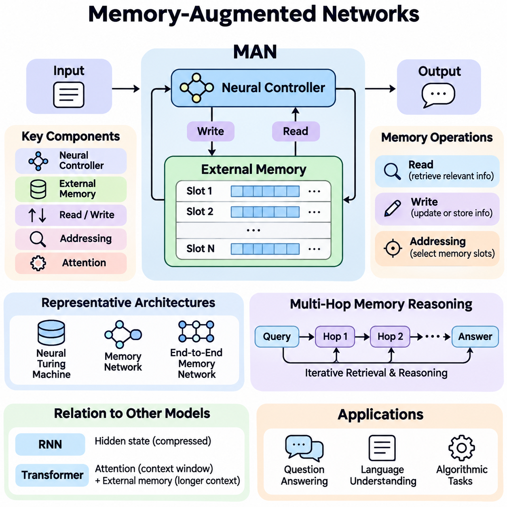
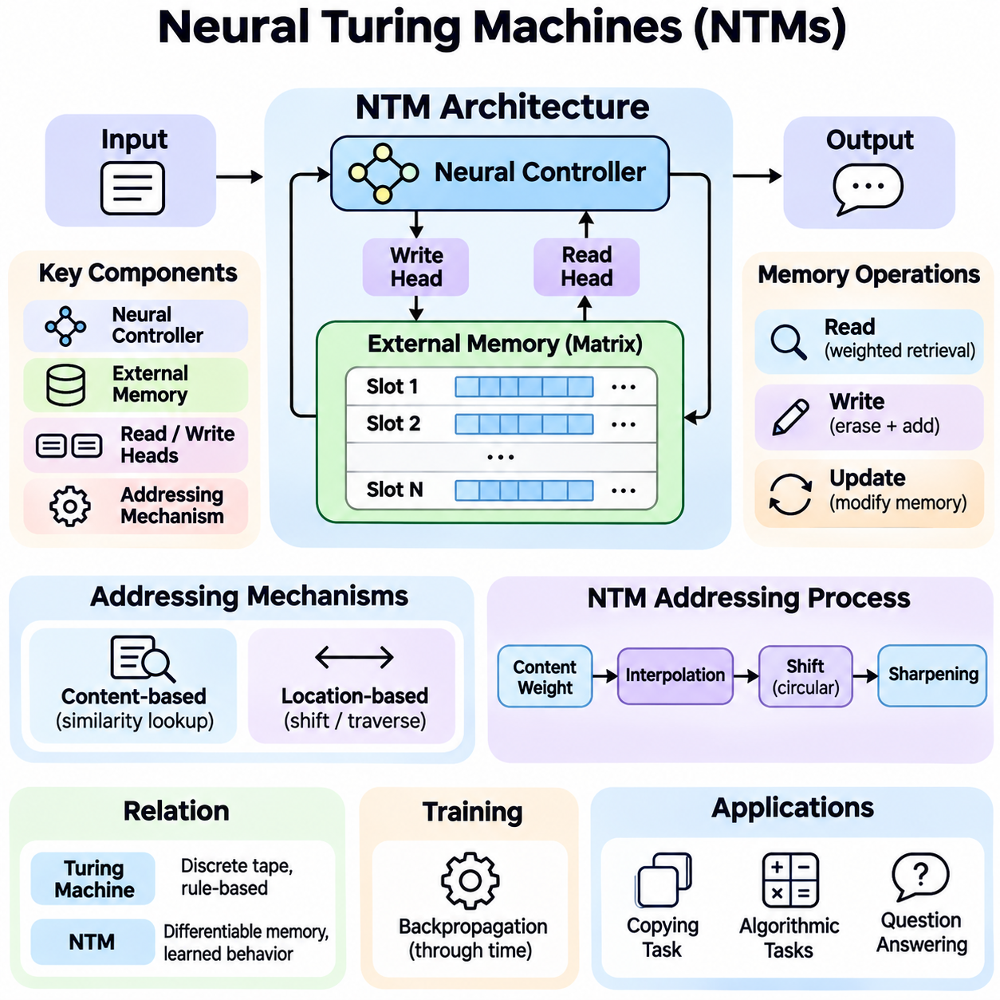
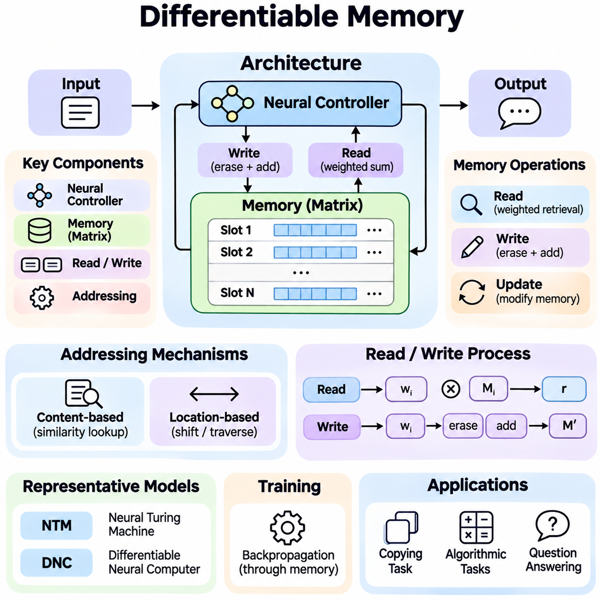
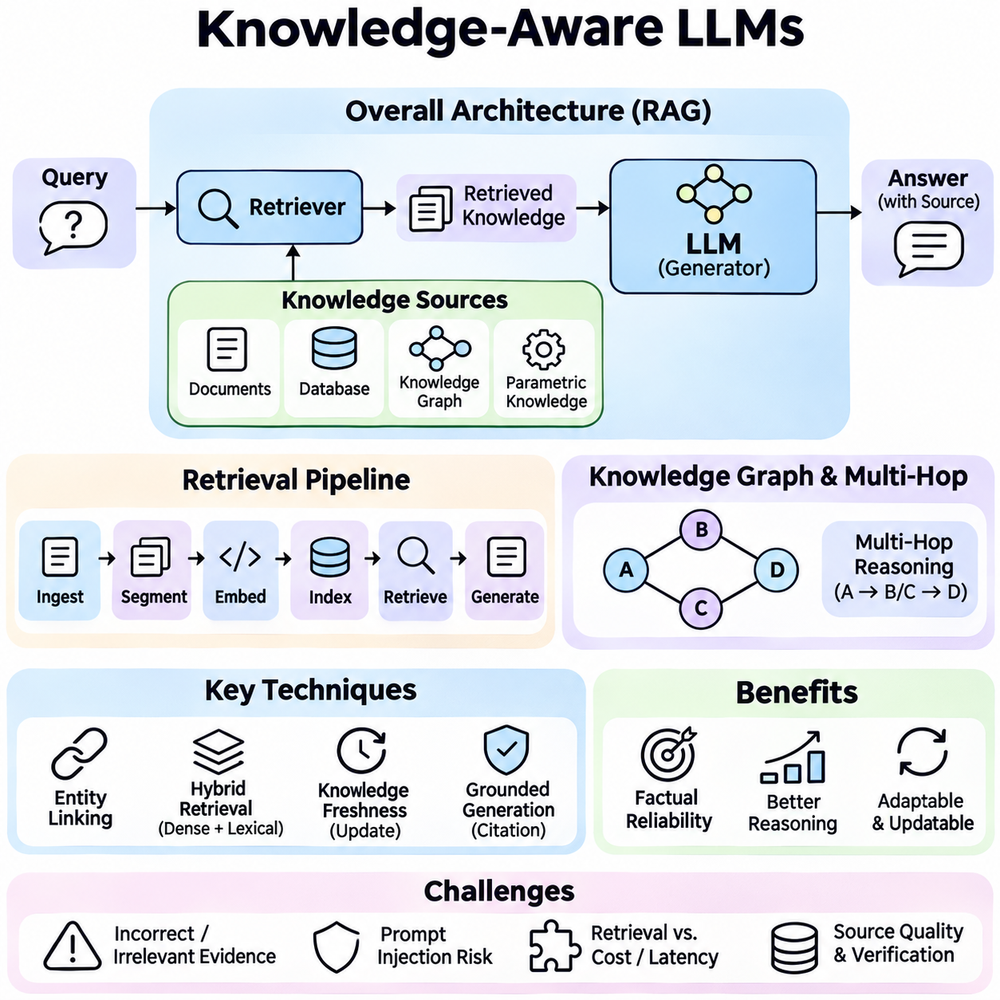
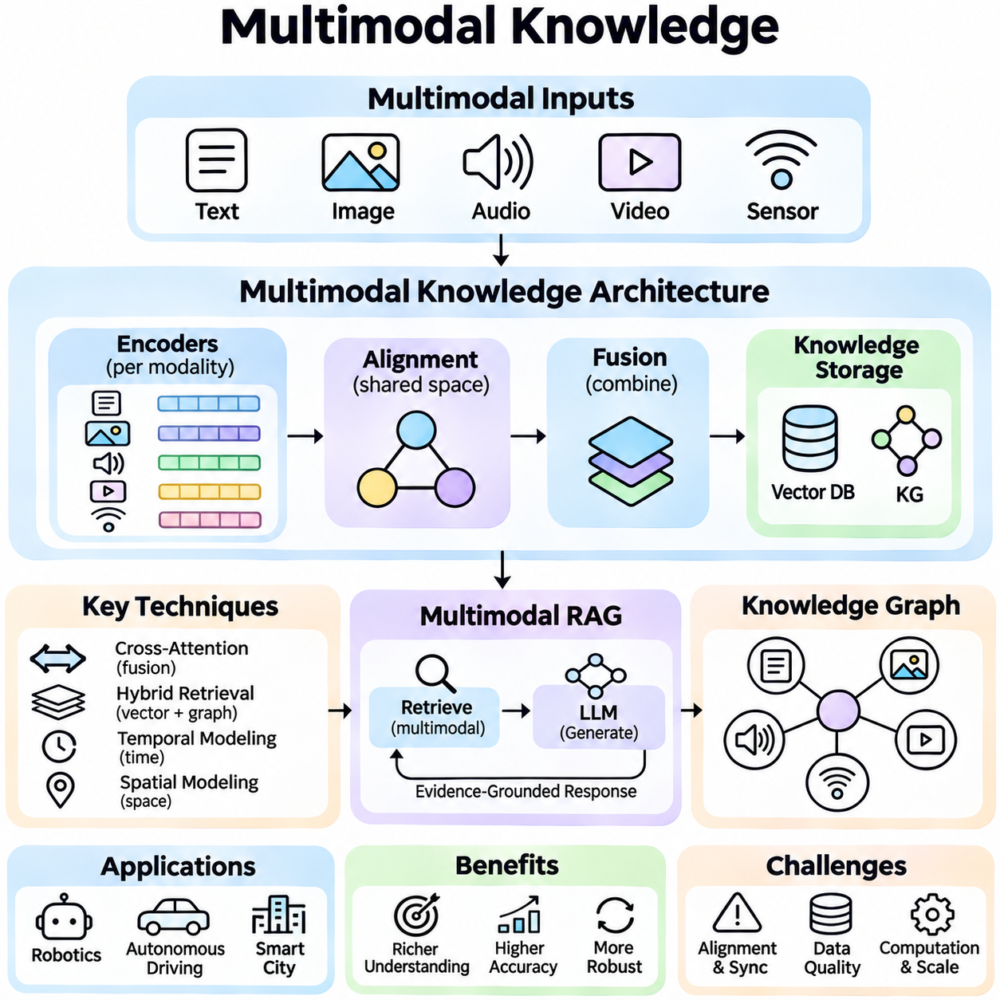
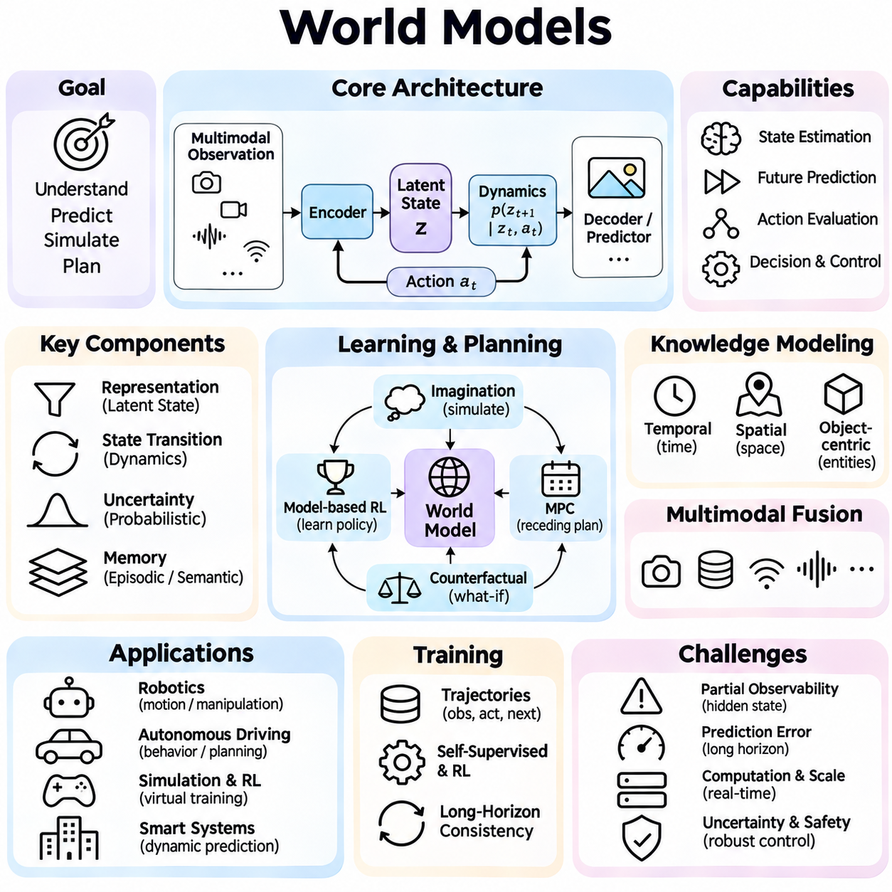

**Volume 37. Memory and Knowledge Systems**

# 06. Advanced Memory and Knowledge AI

## 06.01 Memory Augmented Networks

{width="7.268055555555556in" height="7.268055555555556in"}

Memory-Augmented Networks (MANs) are neural architectures that extend conventional learning systems with an explicit memory mechanism for storing, accessing, and updating information. Unlike traditional neural networks, which primarily encode learned knowledge in model parameters, these architectures maintain additional memory representations that can be accessed during inference. This capability supports reasoning, contextual understanding, and adaptation across complex tasks.

The fundamental motivation behind Memory-Augmented Networks is the limitation of fixed-parameter representations when handling long sequences, changing environments, and information-intensive reasoning. Conventional neural models may struggle to preserve specific details across extended interactions. By introducing an addressable memory structure, a network can retain relevant information and selectively retrieve it when processing new inputs or generating predictions.

A typical Memory-Augmented Network consists of a neural controller, an external or structured memory component, and mechanisms for reading and writing information. The controller processes incoming data and determines how memory should be accessed. The memory component stores representations of observations, facts, or intermediate computational states, while addressing mechanisms identify which stored elements are relevant to the current computational objective.

Memory representations are commonly organized as matrices containing multiple addressable slots. Each slot stores a vector encoding information associated with a particular observation, concept, or computational state. The number of slots determines memory capacity, while vector dimensionality influences representational richness. Effective memory organization requires balancing storage capacity, retrieval accuracy, computational efficiency, and the ability to update information dynamically.

Memory reading enables the controller to retrieve information relevant to the current input or internal state. A query vector is compared with stored memory representations to calculate attention or addressing weights. These weights determine how strongly individual memory slots contribute to the retrieved result. Soft addressing produces a weighted combination of memory vectors, allowing information retrieval to remain differentiable and compatible with gradient-based learning.

Memory writing determines how newly acquired information modifies existing memory contents. Depending on the architecture, writing may involve replacing selected slots, adding new representations, or combining incoming information with previously stored values. Learned gates can regulate the amount of information retained or overwritten. These mechanisms help the network maintain useful historical information while incorporating new observations and reducing unnecessary memory interference.

Attention mechanisms play a central role in many Memory-Augmented Networks because they connect current computational requirements with previously stored information. Content-based addressing identifies memory entries according to representational similarity, while location-based addressing accesses memory through positional relationships. Some architectures combine these approaches to support both semantic retrieval and structured traversal of stored information.

The Neural Turing Machine introduced an influential architecture combining a neural controller with differentiable external memory. Its read and write heads interact with memory through learned addressing operations, enabling the network to perform algorithmic tasks requiring temporary information storage. This architecture demonstrated how neural systems could learn memory-dependent computational procedures rather than relying exclusively on information embedded within network parameters.

Memory Networks and End-to-End Memory Networks provide another important architectural direction, particularly for question answering and language understanding. These models represent supporting facts or contextual statements as memory entries and retrieve relevant information through attention-based operations. Multiple computational hops allow the model to repeatedly examine memory, refine intermediate representations, and combine evidence distributed across different stored statements.

Multi-hop memory reasoning is especially valuable when an answer cannot be obtained from a single memory entry. During successive reasoning steps, the network uses information retrieved from previous steps to construct new queries. This iterative process can connect related facts, resolve dependencies, and identify relevant evidence across several memory locations. However, additional hops increase computational cost and do not automatically guarantee more accurate reasoning.

Memory-Augmented Networks differ from recurrent neural networks in how historical information is represented and accessed. Recurrent architectures compress preceding inputs into evolving hidden states, whereas memory-augmented architectures provide separately addressable storage. This separation can improve access to particular historical observations without requiring every detail to remain encoded in a single hidden representation. Nevertheless, performance depends strongly on memory design and retrieval quality.

The relationship between Memory-Augmented Networks and Transformer architectures is particularly important in modern artificial intelligence. Transformer attention provides flexible access to representations within a context window, while explicit memory augmentation can preserve selected information beyond that immediate context. These approaches can be combined through persistent memory tokens, external memory banks, or recurrent memory mechanisms that extend contextual information across processing segments.

Memory capacity introduces fundamental architectural tradeoffs. Increasing the number of memory slots allows additional information to be stored but may increase addressing complexity, memory consumption, and retrieval latency. Conversely, restricting capacity improves efficiency but can cause important information to be discarded. Memory compression, hierarchical organization, selective retention, and sparse addressing provide possible strategies for managing these competing requirements.

Training Memory-Augmented Networks requires learning both task-specific computations and effective memory operations. Gradient-based optimization can jointly adjust controller parameters, addressing functions, and differentiable memory interactions. Training objectives may include prediction accuracy, reconstruction quality, or successful completion of sequential reasoning tasks. Stable optimization often requires careful initialization, appropriate regularization, and mechanisms that prevent destructive memory updates.

A major difficulty arises when memory addressing becomes ambiguous or unstable. Similar memory entries may receive overlapping attention weights, producing representations that combine unrelated information. Repeated writing may also overwrite useful evidence before it is needed. These problems motivate selective addressing, memory allocation policies, content separation, and consistency constraints that improve retrieval precision and preserve meaningful information across extended computational sequences.

Memory-Augmented Networks support few-shot learning by allowing models to store representations of newly observed examples and reuse them during subsequent predictions. Rather than modifying all network parameters for every unfamiliar task, a model can associate new observations with memory entries and compare incoming examples against those representations. This approach can improve adaptation when training examples are limited, although successful generalization still depends on representation quality.

In natural language processing, memory augmentation supports question answering, dialogue understanding, document reasoning, and contextual information integration. A conversational system can maintain representations of earlier statements and retrieve relevant details when responding to later questions. In document analysis, memory entries can represent passages, entities, or intermediate conclusions, allowing the model to combine evidence across sections that cannot be processed simultaneously.

Memory-Augmented Networks also provide useful mechanisms for reinforcement learning and partially observable environments. An intelligent agent may encounter situations where the current observation does not reveal all information needed for decision-making. By storing previous observations, actions, and environmental outcomes, the agent can construct a more informative internal state. Memory retrieval can therefore support policy selection, temporal reasoning, and adaptation to changing conditions.

Robotics applications demonstrate the practical significance of memory-dependent intelligence. A mobile robot can retain representations of previously observed obstacles, environmental conditions, and navigation events. When similar situations occur, relevant memories may help interpret sensor measurements or improve decisions. Integration with localization, mapping, and control systems requires attention to uncertainty, temporal consistency, computational latency, and the reliability of stored observations.

Knowledge-intensive artificial intelligence systems can combine neural memory with structured representations such as knowledge graphs and semantic databases. Neural memory supports flexible retrieval from learned representations, while structured knowledge resources preserve explicit entities and relationships. Their integration can improve evidence organization and contextual reasoning. However, retrieved associations must be distinguished from verified facts, particularly when decisions depend on accurate knowledge.

Memory-Augmented Networks and retrieval-augmented generation share the principle of accessing information beyond fixed model parameters, but their computational structures are not identical. Memory-augmented models typically learn internal memory interactions as part of neural computation, whereas retrieval-augmented systems commonly retrieve documents or embeddings through separate retrieval infrastructure. Hybrid architectures can combine learned memory access with external retrieval for broader knowledge coverage.

Long-term operation requires memory management strategies that address information relevance, redundancy, and obsolescence. Without controlled updating, accumulated memories may contain conflicting observations or outdated representations. Practical systems can incorporate timestamps, confidence estimates, importance scores, and replacement policies to regulate retention. Such mechanisms are particularly important when memory persists across multiple sessions or interacts with continuously changing environments.

Evaluating Memory-Augmented Networks requires more than measuring final prediction accuracy. Relevant criteria include memory retrieval precision, information retention duration, reasoning consistency, adaptation speed, computational overhead, and robustness under increasing sequence lengths. Controlled experiments can examine how memory capacity, addressing mechanisms, and update policies influence performance. Comparisons with memory-free baselines help establish whether explicit memory provides measurable benefits.

Scalability becomes increasingly important when memory-augmented architectures are deployed in large language models, autonomous agents, and distributed intelligence systems. Efficient implementations may use hierarchical memory, approximate retrieval, sparse attention, or specialized memory allocation. Hardware constraints also influence architectural decisions, particularly when systems operate on edge devices with limited memory bandwidth, processing resources, and strict real-time requirements.

Security and reliability must be considered when memory contains sensitive, incorrect, or adversarial information. Unauthorized memory modification can influence future predictions, while inaccurate stored observations may propagate through repeated retrieval. Access controls, memory provenance, validation mechanisms, and controlled deletion help reduce these risks. Reliable memory augmentation therefore requires governance of stored information as well as effective neural computation.

The broader significance of Memory-Augmented Networks lies in their ability to separate information storage from immediate computation while preserving learned interaction between the two. This architectural principle provides a foundation for systems that remember observations, retrieve contextual evidence, and adapt behavior over time. Continued advances in differentiable memory, neural reasoning, and knowledge integration may enable more capable and efficient intelligent systems.

## 06.02 Neural Turing Machines

{width="7.268055555555556in" height="7.268055555555556in"}

Neural Turing Machines (NTMs) are neural network architectures that combine differentiable computation with an external memory system inspired by the classical Turing machine. They extend conventional neural networks by introducing explicit memory storage and programmable access mechanisms. This design enables models to learn computational procedures involving information retention, sequential manipulation, and algorithmic reasoning through gradient-based optimization.

The fundamental motivation behind Neural Turing Machines is to overcome the limitations of neural networks that store information primarily within fixed model parameters or compressed hidden states. Complex computational tasks often require temporary storage, repeated access, and precise manipulation of intermediate results. NTMs address these requirements by separating the neural controller from an external memory matrix that can be accessed dynamically during computation.

A Neural Turing Machine consists of a neural controller, an external memory matrix, and differentiable read and write heads. The controller receives input information, generates outputs, and produces parameters that determine memory operations. The memory matrix contains addressable storage locations, while the heads retrieve or modify information through learned addressing mechanisms. These components operate together as an integrated computational architecture.

The neural controller functions as the central decision-making component of an NTM. It may be implemented using a feedforward neural network or a recurrent architecture such as an LSTM. At each computational step, the controller processes incoming data and previously retrieved memory information. It then generates output predictions and control signals that determine where memory should be accessed and how stored representations should be modified.

External memory is typically represented as a matrix containing multiple memory locations, each storing a fixed-dimensional vector. The number of locations determines the available storage capacity, while vector dimensionality controls the amount of information represented within each location. Unlike conventional network parameters, memory contents can change during task execution, allowing temporary information to be maintained without permanently modifying learned model weights.

Memory reading is performed through differentiable attention weights distributed across memory locations. A read head produces an addressing distribution that determines the contribution of each memory slot to the retrieved representation. The resulting read vector is calculated as a weighted combination of stored memory vectors. This mechanism allows the controller to retrieve relevant information while preserving differentiability throughout the memory access process.

Memory writing modifies stored information through erase and add operations. The write head generates an addressing distribution, an erase vector, and an addition vector that determine how memory contents are updated. Erasing selectively reduces existing values, while addition introduces new information into selected locations. Because these operations are differentiable, the network can learn effective memory modification strategies through backpropagation.

Content-based addressing allows an NTM to locate memory entries according to their similarity to a generated key vector. The controller produces a query representation, which is compared against stored memory vectors using a similarity function such as cosine similarity. The resulting scores are transformed into normalized addressing weights. This mechanism enables associative memory access without requiring fixed memory addresses or explicitly programmed retrieval rules.

Location-based addressing provides an additional mechanism for accessing memory according to positional relationships. Instead of relying exclusively on content similarity, the model can shift its attention distribution across neighboring memory locations. This capability is important for tasks involving sequential traversal, ordered storage, or repeated computational operations. It allows an NTM to learn structured memory access patterns resembling movements of a classical machine\'s memory head.

The original NTM addressing mechanism combines content-based lookup with location-sensitive operations. Content weights are interpolated with previous addressing weights, followed by a learned circular shift and sharpening operation. These stages allow the model to preserve an existing focus, move to nearby locations, or identify information according to content. Their differentiable formulation supports learning complex addressing behavior without discrete memory selection.

The relationship between Neural Turing Machines and classical Turing machines is primarily architectural rather than computationally identical. Classical Turing machines manipulate symbols on an abstract tape using discrete read and write operations. NTMs instead operate on finite, continuous-valued memory matrices through differentiable addressing. Their purpose is to learn algorithm-like behavior using neural optimization rather than explicitly executing a predetermined symbolic transition program.

Training an NTM typically involves supervised learning with backpropagation through time. The controller, addressing mechanisms, and memory interaction parameters are optimized jointly according to task-specific objectives. During training, the model learns not only how to produce correct outputs but also how to organize temporary information. Successful optimization requires gradients to propagate through sequences of memory operations and controller state transitions.

Copying tasks provide a foundational demonstration of NTM capabilities. In a typical experiment, the model receives a sequence of input vectors followed by a signal requesting reproduction of the sequence. Successful performance requires storing incoming information and retrieving it in the correct order. NTMs can learn memory access procedures that generalize to sequence lengths beyond those encountered during training, although such generalization is not guaranteed.

The repeat-copy task introduces an additional computational requirement by asking the model to reproduce an input sequence multiple times. This task requires the network to remember the original sequence, track repetition counts, and repeatedly traverse stored information. A successful NTM learns coordinated memory writing, sequential reading, and control-state management. These capabilities illustrate how explicit memory can support compositional computational behavior.

Associative recall evaluates whether an NTM can retrieve stored information based on contextual relationships. The network receives a sequence of structured items and must identify the item following a specified query item. This requires recognizing relevant memory content and navigating to a related location. The task demonstrates the interaction between content-based addressing and location-based movement, which together enable more structured retrieval behavior.

Priority sorting provides another example of algorithmic learning with external memory. The model receives items associated with priority values and must output them in the appropriate order. Solving this problem requires retaining multiple inputs and organizing retrieval according to learned priorities. Although an NTM may discover useful sorting strategies, reliable generalization to substantially larger problems remains challenging because learned procedures may depend on training distributions.

A significant advantage of NTMs is their ability to separate learned computational procedures from temporary task-specific information. The controller parameters encode strategies for processing information, while external memory stores values encountered during execution. This distinction allows a trained model to apply similar memory operations to different input sequences. It also provides a conceptual foundation for architectures that combine reusable computational skills with dynamically changing knowledge.

Despite these advantages, Neural Turing Machines present important optimization difficulties. Soft addressing may distribute attention across multiple memory locations, producing interference between unrelated stored values. Repeated write operations can gradually corrupt information, while inaccurate addressing decisions may propagate through subsequent computational steps. These problems become more pronounced when tasks require long sequences of precise memory operations.

Memory capacity and addressing complexity also influence NTM scalability. A conventional implementation may need to evaluate relationships across the entire memory matrix during each access operation. As memory size increases, computational requirements and memory bandwidth consumption can become substantial. Larger memory systems therefore require careful architectural optimization, potentially including sparse addressing, hierarchical organization, or more selective retrieval mechanisms.

The Differentiable Neural Computer (DNC) represents an important extension of the NTM concept. It introduces additional mechanisms for memory allocation, usage tracking, and temporal relationships between stored entries. These capabilities support more structured memory management and navigation through sequences of related information. DNCs demonstrate how differentiable external memory can evolve beyond basic content and location addressing toward richer computational organization.

Neural Turing Machines also provide conceptual connections to modern attention-based architectures. Both approaches use learned weighting mechanisms to select relevant representations, but NTMs explicitly maintain writable external memory during computation. Transformer attention typically operates over representations available within a processing context, whereas NTM memory can be modified through learned read and write operations. These distinctions influence how information persists and how sequential computation is organized.

In natural language processing, NTM-inspired memory mechanisms can support tasks requiring the retention and manipulation of contextual information. Potential applications include multi-step question answering, document understanding, and structured sequence processing. External memory allows intermediate representations to remain accessible during later computations. However, practical effectiveness depends on whether learned memory operations offer advantages over attention-based or retrieval-based alternatives.

Robotics and autonomous systems provide additional opportunities for memory-based computation. An intelligent robot may need to retain observations, action histories, or intermediate planning information while operating in partially observable environments. NTM-inspired mechanisms could support temporal reasoning and task-dependent information retrieval. Real-world deployment nevertheless requires predictable latency, robust memory management, and reliable integration with perception and control systems.

Evaluating Neural Turing Machines requires examining both task performance and learned computational behavior. Relevant measurements include prediction accuracy, sequence-length generalization, memory addressing stability, training convergence, and computational efficiency. Controlled experiments can compare different controller architectures, memory capacities, and addressing strategies. Analysis of memory access patterns may also reveal whether a model has learned reusable procedures or task-specific shortcuts.

The broader significance of Neural Turing Machines lies in demonstrating that neural networks can learn to interact with structured external memory through differentiable operations. Their architecture connects representation learning with algorithmic computation and provides a foundation for research into memory-augmented intelligence. Although practical limitations remain, the principles established by NTMs continue to inform the development of adaptive reasoning systems and advanced neural memory architectures.

## 06.03 Differentiable Memory

{width="7.268055555555556in" height="7.268055555555556in"}

Differentiable Memory is a computational mechanism that enables neural networks to store, retrieve, and update information through operations compatible with gradient-based learning. Unlike conventional memory systems that rely on discrete addressing and explicit programming rules, differentiable memory uses continuous representations and learnable access mechanisms. This allows memory operations to become integrated components of end-to-end trainable neural architectures.

The fundamental motivation behind Differentiable Memory is to overcome the limitations of fixed-parameter neural networks when processing information that requires temporary storage, repeated retrieval, and structured manipulation. Conventional neural models often compress historical information into hidden states, potentially losing important details. Differentiable memory introduces additional storage that can be accessed selectively without requiring every observation to remain encoded in model parameters.

A typical differentiable memory architecture consists of a neural controller, a memory representation, and differentiable read and write mechanisms. The controller processes input information and generates signals governing memory access. The memory component stores vectors representing observations or intermediate computational states. Read and write mechanisms determine which memory locations contribute information and how their contents change during computation.

Memory is commonly represented as a matrix containing multiple addressable slots, each storing a continuous-valued vector. The number of slots determines storage capacity, while vector dimensionality influences the richness of stored representations. During execution, memory contents evolve according to learned update operations. This separation between persistent model parameters and dynamically changing memory allows neural networks to maintain task-specific information.

Differentiability is achieved by replacing hard memory selection with continuous weighting operations. Instead of selecting one location through a discrete index, a model assigns attention weights across multiple memory slots. These weights determine the contribution of each location to a read operation or the magnitude of its modification during writing. Smooth mathematical operations allow gradients to propagate through memory interactions during training.

A differentiable read operation typically computes a weighted sum of memory vectors using an addressing distribution. The controller generates a query or key vector that is compared with stored representations. Similarity scores are converted into normalized attention weights, often using a softmax function. The resulting read vector combines information from relevant locations while preserving a differentiable relationship between queries and retrieved content.

Differentiable writing enables a neural network to modify memory contents through learned update signals. A write operation may generate an addressing distribution, an erase vector, and an addition vector. The erase mechanism selectively reduces existing information, while the addition mechanism introduces new representations. Because these updates are continuous, the network can learn when to preserve information, replace outdated content, or incorporate new observations.

Content-based addressing is a central mechanism in differentiable memory systems. It identifies relevant memory locations by comparing a generated key with stored vectors through similarity measures such as cosine similarity. This approach supports associative retrieval, allowing the model to access information according to semantic or representational relationships rather than fixed positions. Retrieval accuracy depends on the quality of learned representations and addressing functions.

Location-based addressing provides an alternative or complementary approach by accessing memory according to positional relationships. A model may shift an existing attention distribution to neighboring locations or maintain a previously selected position. This mechanism is useful for sequential processing, ordered information storage, and algorithmic tasks requiring structured traversal. Combining content and location addressing supports more flexible memory operations.

Neural Turing Machines introduced an influential implementation of differentiable external memory using neural controllers and learned read and write heads. Their addressing mechanisms combine content similarity, interpolation, positional shifting, and attention sharpening. These operations allow networks to learn procedures such as copying sequences and associative recall. The architecture demonstrates how memory manipulation can be optimized jointly with neural computation.

The Differentiable Neural Computer extends these principles through more sophisticated memory management mechanisms. It introduces memory allocation strategies, usage tracking, and temporal links connecting successive memory writes. These features allow the system to identify available storage locations and navigate relationships between stored representations. Such mechanisms support more structured computation and reduce reliance on simple sequential memory access patterns.

Gradient propagation through memory operations is essential for end-to-end learning. During backpropagation, derivatives flow through read weights, write weights, memory contents, and controller parameters. This enables the optimization process to adjust both information processing and memory management behavior. However, long computational sequences may introduce vanishing gradients, unstable updates, and accumulated errors that complicate training.

Soft addressing creates important tradeoffs between differentiability and precision. Distributing attention across multiple locations provides smooth gradients but can combine unrelated memory contents. Repeated writing with overlapping attention distributions may gradually corrupt stored representations. Sharpening mechanisms, sparse attention, selective allocation, and regularization can reduce interference, although some approaches introduce additional optimization complexity.

Memory allocation determines where new information should be stored and how existing capacity should be reused. Simple architectures may rely entirely on learned addressing distributions, while more advanced systems incorporate usage statistics or allocation policies. Effective allocation prevents unnecessary overwriting and improves information retention. Memory management becomes especially important when the number of stored observations exceeds available memory capacity.

Differentiable memory also supports temporal reasoning by preserving information across multiple computational steps. Stored representations can encode earlier observations, intermediate conclusions, or task-specific states. A controller can retrieve these representations when later decisions depend on previous events. Temporal links and recurrent addressing mechanisms may further support navigation through ordered experiences and reconstruction of relevant event sequences.

In few-shot learning, differentiable memory can store representations of newly encountered examples and retrieve them during subsequent predictions. This enables rapid adaptation without requiring extensive modification of model parameters. A model may associate unfamiliar inputs with memory entries and compare new observations against stored examples. The effectiveness of this approach depends on representation quality, memory allocation, and retrieval consistency.

Natural language processing provides important applications for differentiable memory architectures. Question answering, dialogue modeling, and document reasoning often require information distributed across multiple statements or interaction steps. Memory mechanisms can preserve relevant contextual representations and retrieve them when needed. Multi-step reasoning may repeatedly access memory to combine evidence, although retrieval errors can propagate across successive operations.

Differentiable memory has conceptual connections to Transformer attention mechanisms. Both use learned weighting operations to combine representations, but explicit differentiable memory architectures additionally support controlled writing and persistent storage across computational steps. Transformer models can incorporate memory tokens, recurrent states, or external memory modules to extend contextual processing. These designs provide different tradeoffs in storage capacity, efficiency, and information persistence.

In reinforcement learning, differentiable memory can improve decision-making under partial observability. An agent may need information from previous observations to infer environmental conditions that are not visible at the current moment. Memory representations can preserve action histories, contextual cues, and intermediate state estimates. Learned retrieval allows the policy to incorporate relevant historical information when selecting actions.

Robotics applications illustrate the potential of differentiable memory for autonomous perception and planning. A robot may retain representations of previously detected objects, environmental changes, or navigation events. Memory retrieval can support temporal consistency and context-dependent decisions when sensor observations are incomplete. Practical deployment requires careful consideration of latency, uncertainty, memory reliability, and integration with safety-critical control systems.

Scalability presents a major challenge because dense memory addressing may require comparisons across all stored locations. Increasing memory capacity can raise computational cost, memory bandwidth requirements, and inference latency. Sparse addressing, hierarchical memory, compressed representations, and approximate retrieval offer possible improvements. The appropriate strategy depends on whether the application prioritizes accuracy, storage capacity, real-time performance, or training efficiency.

Evaluation of differentiable memory systems requires examining both task accuracy and memory behavior. Relevant metrics include retrieval precision, retention duration, addressing stability, memory interference, generalization to longer sequences, and computational efficiency. Controlled experiments can compare memory sizes, controller architectures, and update mechanisms. Such evaluations help determine whether explicit memory provides measurable advantages over conventional neural models.

Differentiable memory also introduces reliability and security considerations. Incorrect information may persist through repeated retrieval, while uncontrolled writing can overwrite important representations. Systems handling sensitive information require appropriate access restrictions, retention policies, and mechanisms for correcting or deleting stored content. Reliable operation depends on balancing adaptive memory updates with consistency, traceability, and controlled information management.

The broader significance of Differentiable Memory lies in connecting neural representation learning with explicit information storage and algorithmic computation. By making memory access trainable, these architectures enable models to learn how information should be retained, retrieved, and modified during complex tasks. Continued advances in memory allocation, differentiable addressing, and scalable neural architectures may support more adaptive, efficient, and knowledge-intensive intelligent systems.

## 06.04 Knowledge Aware LLMs

{width="7.268055555555556in" height="7.268055555555556in"}

Knowledge-Aware Large Language Models (Knowledge-Aware LLMs) are language models designed to incorporate explicit knowledge sources into language understanding, reasoning, and generation. While conventional LLMs acquire substantial information through pretraining, their knowledge remains distributed across model parameters and may become outdated or incomplete. Knowledge-aware architectures address these limitations by connecting language generation with structured, retrieved, or dynamically updated information.

The central objective of Knowledge-Aware LLMs is to improve factual reliability, contextual relevance, and reasoning accuracy. A pretrained model can generate fluent responses without necessarily verifying the underlying facts. Knowledge-aware systems introduce mechanisms for retrieving evidence, representing relationships, and validating generated claims. This separation between linguistic capability and accessible knowledge provides greater flexibility when information changes or domain-specific expertise is required.

Knowledge within an LLM can be represented through parametric knowledge, external documents, structured databases, and knowledge graphs. Parametric knowledge is encoded implicitly in learned model weights, while external knowledge can be accessed during inference. Structured representations describe entities, attributes, and relationships explicitly. Combining these sources enables language models to use general linguistic competence alongside information that can be inspected, updated, and independently verified.

Retrieval-Augmented Generation (RAG) is a widely adopted approach for integrating external knowledge with LLMs. A retrieval component identifies relevant documents or passages from a knowledge repository and supplies them as additional context to the language model. The generator then produces responses conditioned on both the user query and retrieved evidence. This architecture allows knowledge repositories to be updated without requiring complete model retraining.

A typical knowledge-aware retrieval pipeline includes document ingestion, text segmentation, embedding generation, indexing, retrieval, and response generation. Source documents are divided into manageable passages and transformed into vector representations for similarity search. At inference time, the query is encoded and compared with indexed content. Retrieved passages are ranked, filtered, and inserted into the model context to support evidence-grounded generation.

Knowledge graphs provide another important mechanism for connecting LLMs with explicit information. A knowledge graph represents entities and relationships through structured nodes and edges. Unlike unstructured documents, graph representations preserve explicit connections between concepts, organizations, events, and attributes. LLMs can use graph retrieval to identify relevant entities, follow relationships, and combine structured evidence with natural language explanations.

Graph-based knowledge integration supports multi-hop reasoning, where answering a question requires traversing several relationships. For example, a model may need to identify an organization, determine its associated projects, and retrieve properties of those projects. Graph traversal can expose intermediate reasoning evidence, while the LLM converts the retrieved relationships into coherent explanations. Reliable operation requires entity disambiguation and careful verification of graph contents.

Entity linking is essential when connecting natural language expressions to structured knowledge resources. The system identifies references to people, places, products, or technical concepts and maps them to corresponding database entities. Ambiguous names and incomplete descriptions can produce incorrect mappings. Contextual embeddings, semantic matching, and entity resolution mechanisms help distinguish similar entities and improve the precision of subsequent knowledge retrieval.

Hybrid retrieval combines dense vector search with sparse lexical matching and structured filtering. Dense retrieval identifies semantically related passages even when exact terminology differs, while lexical retrieval preserves precise keyword matches. Metadata filters can restrict results according to source, date, category, or access permissions. Combining these methods improves coverage and precision, particularly in technical domains containing specialized terminology and exact identifiers.

Knowledge-aware LLMs must distinguish retrieved evidence from instructions that control model behavior. External documents may contain inaccurate statements, irrelevant content, or malicious instructions. Treating retrieved text as authoritative commands creates prompt-injection risks. Secure architectures maintain boundaries between trusted system instructions and untrusted knowledge sources while applying access controls, source validation, and appropriate filtering.

Knowledge freshness is a major advantage of external knowledge integration. Model parameters generally reflect information available during training, whereas connected repositories can incorporate newly published documents, revised regulations, or updated operational records. However, freshness depends on ingestion frequency, indexing delays, and source quality. Version tracking, timestamps, and retrieval policies are necessary to prevent outdated information from being presented as current.

Grounded generation aims to ensure that model responses remain consistent with retrieved evidence. The generator should distinguish directly supported statements from interpretations or uncertain conclusions. Source attribution allows users to inspect supporting documents and evaluate reliability. Nevertheless, citations alone do not guarantee factual correctness, because a model may misunderstand evidence or associate a claim with an unrelated source.

Knowledge-aware reasoning can be implemented through iterative retrieval, where the model performs several rounds of evidence collection. An initial search identifies relevant concepts, and subsequent queries resolve missing relationships or factual dependencies. This process is useful for complex questions requiring information from multiple sources. However, repeated retrieval increases latency and may propagate errors if early assumptions are incorrect.

Domain-specific Knowledge-Aware LLMs are particularly valuable in engineering, healthcare, scientific research, and industrial operations. These environments contain specialized terminology, structured procedures, and frequently updated technical documentation. Connecting LLMs to verified domain repositories can improve contextual accuracy and reduce dependence on memorized facts. High-stakes applications still require independent validation and appropriate human oversight.

Personalized knowledge systems can incorporate user preferences, interaction history, and authorized organizational information. Persistent memory enables an assistant to maintain continuity across sessions, while retrieval mechanisms select context relevant to the current request. Such systems must distinguish durable preferences from temporary observations and ensure that information is stored with appropriate consent. Privacy controls and deletion mechanisms are essential for responsible deployment.

Knowledge integration also introduces important architectural tradeoffs. Larger retrieval contexts may increase evidence coverage but consume more tokens and introduce distracting information. Aggressive filtering reduces computational cost but risks excluding critical evidence. Context compression, reranking, and relevance estimation help balance these competing requirements. System designers must consider retrieval accuracy, generation quality, latency, and operating cost together.

Fine-tuning and external retrieval serve different purposes in knowledge-aware systems. Fine-tuning can improve domain-specific language patterns, reasoning behaviors, and instruction following, while retrieval provides access to identifiable information sources. Updating model weights is not always an efficient method for maintaining frequently changing facts. Hybrid strategies combine behavioral adaptation through training with factual grounding through external knowledge access.

Evaluation of Knowledge-Aware LLMs requires measurements beyond conventional language generation quality. Relevant dimensions include retrieval precision, evidence recall, factual consistency, citation correctness, reasoning accuracy, and response completeness. End-to-end evaluation should determine whether retrieved information actually supports the generated answer. Ablation studies can isolate the contributions of retrieval methods, knowledge graphs, reranking, and model adaptation.

Operational reliability depends on continuous monitoring of both retrieval and generation components. Changes in document collections, embedding models, or indexing strategies may affect system behavior even when the language model remains unchanged. Monitoring pipelines should detect retrieval failures, unsupported claims, latency degradation, and unexpected knowledge conflicts. Versioned datasets and reproducible evaluations support controlled deployment and ongoing improvement.

The broader significance of Knowledge-Aware LLMs lies in transforming language models from primarily parameter-dependent generators into systems capable of consulting and reasoning over explicit knowledge resources. By integrating retrieval, structured representations, evidence validation, and controlled memory, these architectures support more adaptable and transparent intelligence. Future progress will depend on improving knowledge reliability, efficient reasoning, and trustworthy integration with dynamic information environments.

## 06.05 Multimodal Knowledge

{width="7.268055555555556in" height="7.268055555555556in"}

Multimodal Knowledge refers to the representation, integration, retrieval, and reasoning of information across multiple data modalities, including text, images, audio, video, and sensor measurements. Unlike text-centered knowledge systems, multimodal architectures connect complementary forms of evidence to construct richer descriptions of entities, events, and environments. This capability supports intelligent systems that must interpret information beyond language alone.

The fundamental motivation for multimodal knowledge integration is that individual modalities provide incomplete descriptions of reality. Text conveys symbolic relationships, images capture spatial appearance, audio reveals acoustic events, and sensors measure physical conditions. Combining these sources can reduce ambiguity and improve contextual understanding. However, successful integration requires resolving differences in representation, timing, reliability, and semantic meaning.

A multimodal knowledge architecture typically includes modality-specific encoders, representation alignment mechanisms, fusion modules, and knowledge storage components. Each encoder transforms raw input into feature representations suitable for computation. Alignment establishes relationships between corresponding observations, while fusion combines complementary information. The resulting representations can be stored in vector databases, knowledge graphs, or structured memory systems.

Representation learning is central to multimodal knowledge systems because different modalities have distinct statistical properties. Language models process discrete tokens, vision encoders extract spatial features, and audio encoders analyze temporal signals. Contrastive learning can align related observations within a shared embedding space. Such representations allow cross-modal similarity comparisons while preserving useful modality-specific characteristics.

Multimodal alignment determines whether information from different sources refers to the same object, event, or concept. Image regions may correspond to textual descriptions, while spoken instructions may refer to objects detected by cameras. Temporal alignment associates observations recorded at related moments. Incorrect alignment can produce misleading associations, making calibration, synchronization, and confidence estimation essential for reliable knowledge construction.

Knowledge fusion combines information from multiple modalities to support interpretation and decision-making. Early fusion integrates features before higher-level processing, while late fusion combines predictions produced by separate models. Intermediate fusion exchanges information between specialized processing stages. The appropriate strategy depends on computational constraints, modality compatibility, data availability, and the degree of interaction required between information sources.

Cross-attention mechanisms provide a flexible approach to multimodal fusion. Features from one modality serve as queries, while representations from another supply keys and values. This enables a model to identify relevant relationships between language, visual regions, audio segments, or sensor observations. Cross-attention supports context-dependent information exchange, although its computational cost increases with sequence length and representation size.

Multimodal knowledge graphs extend conventional graph structures by connecting entities and relationships with evidence from different modalities. A physical object may be associated with textual attributes, visual observations, acoustic signatures, and sensor measurements. Graph nodes represent entities or events, while edges describe semantic, spatial, or temporal relationships. Such structures support explicit knowledge organization and relationship-based retrieval.

Multimodal retrieval enables queries expressed in one modality to access information stored in another. A textual description may retrieve relevant images, while an image query may identify related documents or recorded events. Shared embedding spaces support semantic similarity search across modalities. Hybrid retrieval can combine vector similarity, metadata constraints, and graph relationships to improve precision when exact evidence is required.

Multimodal Retrieval-Augmented Generation extends conventional RAG by supplying language models with retrieved visual, textual, or other modality-specific evidence. A system may retrieve diagrams, document passages, image descriptions, or sensor summaries relevant to a question. Multimodal generators can interpret supported input formats directly, while other architectures rely on specialized encoders. Evidence quality and provenance remain critical to grounded responses.

Temporal knowledge is particularly important when integrating video, audio, and sequential sensor data. Events unfold over time, and their meaning often depends on ordering, duration, and causal relationships. Temporal encoders and event representations preserve these dependencies. A multimodal system may associate a detected object movement with an acoustic event or sensor change, but temporal coincidence alone does not establish causation.

Spatial knowledge connects observations to physical locations, geometric relationships, and coordinate systems. Images provide appearance information, depth sensors estimate distance, and LiDAR produces geometric measurements. Combining these sources can improve scene understanding and object localization. Accurate spatial integration requires coordinate transformations, sensor calibration, uncertainty modeling, and consistent reference frames.

Multimodal large language models integrate language reasoning with representations derived from images, audio, video, or other data sources. Vision-language models can answer questions about visual content, while broader multimodal models may interpret synchronized information streams. Their effectiveness depends on training coverage, alignment quality, and reasoning capabilities. Fluent explanations do not necessarily imply accurate perception or factual understanding.

Robotics provides an important application of multimodal knowledge because autonomous systems operate through heterogeneous sensors. Cameras, LiDAR, radar, inertial sensors, and natural language instructions contribute different forms of information. Integrated knowledge representations can support object recognition, localization, planning, and interaction. Real-time operation requires efficient fusion, uncertainty-aware reasoning, and reliable handling of missing or conflicting observations.

Multimodal knowledge systems face challenges involving missing modalities, noisy measurements, and contradictory evidence. A camera may fail under poor illumination, while an acoustic sensor may be affected by environmental noise. Robust architectures should estimate source reliability and avoid treating every observation as equally trustworthy. Confidence-weighted fusion, modality dropout during training, and uncertainty estimation can improve resilience.

Evaluation requires examining both individual modality performance and the quality of integrated knowledge. Relevant metrics include cross-modal retrieval accuracy, alignment precision, reasoning consistency, robustness to missing inputs, and computational latency. Benchmark datasets should contain diverse conditions and carefully verified relationships. Controlled ablation experiments can determine whether additional modalities provide measurable benefits rather than unnecessary complexity.

The broader significance of Multimodal Knowledge lies in connecting symbolic understanding with perceptual and physical evidence. By integrating heterogeneous observations into coherent representations, intelligent systems can reason about entities, environments, and events more comprehensively. Continued advances in multimodal alignment, retrieval, knowledge graphs, and foundation models may enable more reliable context-aware AI across digital and physical environments.

## 06.06 World Models

{width="7.268055555555556in" height="7.268055555555556in"}

World Models are computational representations that enable intelligent systems to understand, predict, and simulate the dynamics of their environments. Rather than responding exclusively to immediate observations, an agent equipped with a world model can estimate hidden states, anticipate future events, and evaluate possible actions. These capabilities connect perception, memory, prediction, and decision-making within a unified framework for adaptive intelligence.

The fundamental motivation behind world models is that real-world environments are dynamic, partially observable, and influenced by interactions between agents and physical processes. A single observation rarely provides complete information about the current situation. World models address this limitation by maintaining internal representations of environmental states and learning how those states evolve over time under different conditions and actions.

A typical world model architecture includes an observation encoder, a latent state representation, a dynamics model, and a prediction or reconstruction component. The encoder transforms sensory observations into compact features, while the dynamics model predicts transitions between internal states. A decoder may reconstruct observations or estimate task-relevant outcomes. Together, these components provide a learned approximation of environmental behavior.

Latent state representations are central to efficient world modeling because raw sensory inputs often contain substantial redundancy. Images, audio signals, and sensor measurements can be compressed into lower-dimensional representations that preserve information relevant to prediction and control. A useful latent state should capture important environmental properties while excluding irrelevant variation. Representation quality strongly influences planning accuracy and generalization.

State transition models describe how an environment changes after an action or external event. Given a current state and an action, the model predicts a distribution over possible future states. Deterministic transitions can represent predictable behavior, while stochastic models account for uncertainty and unpredictable disturbances. Accurate transition modeling is essential for evaluating action consequences and supporting reliable sequential decision-making.

World models frequently operate under partial observability, where important environmental variables cannot be measured directly. A belief state summarizes the agent\'s uncertainty about the hidden environment based on previous observations and actions. Recurrent neural networks, state-space models, and probabilistic inference mechanisms can maintain these estimates. This approach enables decisions that depend on historical context rather than isolated sensor readings.

Temporal modeling allows world models to capture relationships between events occurring at different timescales. Short-term predictions may describe immediate object motion, while longer-term forecasts represent behavioral patterns or environmental changes. Recurrent architectures, temporal attention, and hierarchical state representations support these capabilities. However, prediction errors often accumulate as the simulated horizon becomes longer.

Model-based reinforcement learning uses learned world dynamics to improve action selection and reduce dependence on direct environmental interaction. Instead of testing every candidate action in the physical environment, an agent can evaluate possible outcomes through simulated transitions. These internal simulations support planning, policy improvement, and data-efficient learning. Their usefulness depends on the accuracy of the learned dynamics and reward estimates.

Model Predictive Control integrates world models with repeated planning over a limited future horizon. At each decision step, the controller evaluates candidate action sequences using predicted environmental transitions. It executes an initial action, observes the resulting state, and replans using updated information. This receding-horizon strategy reduces the impact of long-term prediction errors while supporting adaptation to changing conditions.

Imagination-based learning enables agents to generate hypothetical experiences using their learned world models. Simulated trajectories can provide additional training information without requiring equivalent real-world interactions. Architectures such as Dreamer use latent dynamics to learn policies from imagined rollouts. However, inaccurate simulations may reinforce incorrect behaviors, making model validation and uncertainty management important.

World models can also support counterfactual reasoning by estimating what might happen under alternative actions or conditions. An autonomous agent may compare the predicted consequences of stopping, accelerating, or changing direction. Such comparisons help evaluate potential decisions before execution. Nevertheless, counterfactual predictions remain model-dependent and should not be interpreted as guaranteed outcomes in unfamiliar situations.

Multimodal world models integrate information from cameras, LiDAR, radar, audio, proprioception, and other sensors to construct richer environmental representations. Each modality provides complementary evidence about objects, motion, geometry, or physical interactions. Sensor fusion and temporal alignment connect these observations within a coherent state estimate. Robust modeling requires accounting for measurement uncertainty, missing observations, and conflicting evidence.

Spatial representations are especially important for world models operating in physical environments. Occupancy grids, geometric maps, object-centric representations, and learned spatial embeddings can describe the arrangement of surrounding entities. Dynamic models extend these representations by predicting object movement and interactions. Combining spatial structure with temporal dynamics supports navigation, manipulation, and environment-aware planning.

Object-centric world models represent environments through entities with properties and relationships rather than treating entire scenes as undifferentiated feature vectors. This structure can improve reasoning about object persistence, interaction, and motion. Relational models and graph neural networks may predict how changes to one object influence others. Such representations can support compositional generalization when familiar objects appear in new configurations.

World models are closely related to memory-augmented architectures because accurate prediction often depends on information accumulated across previous observations. Episodic memory can preserve important experiences, while semantic memory stores reusable environmental knowledge. A world model uses these representations to estimate current conditions and predict future states. Integrating memory with learned dynamics enables more consistent reasoning across extended interactions.

Language-conditioned world models connect natural language instructions with predicted environmental behavior. A language model may specify goals, constraints, or descriptions of desired outcomes, while a dynamics model estimates the consequences of candidate actions. This combination supports instruction-guided planning and interactive simulation. Reliable operation requires grounding language representations in observable states and physically meaningful transitions.

Robotics provides a major application domain for world models because autonomous machines must predict how actions influence physical environments. Mobile robots can estimate obstacle trajectories, anticipate changes in navigable space, and evaluate alternative paths. Manipulation systems may predict object motion, contact outcomes, and grasp stability. Real-world deployment requires low-latency inference, robust state estimation, and integration with conventional safety mechanisms.

Autonomous driving systems can use world models to predict surrounding vehicle behavior, pedestrian movement, and potential traffic conflicts. Learned dynamics may complement tracking, trajectory prediction, and planning modules. However, rare events, uncertain human intentions, and distribution shifts remain difficult to model. Safety-critical decisions therefore require conservative uncertainty handling, independent validation, and reliable fallback behavior.

Training world models typically involves learning from sequences of observations, actions, and resulting states. Objectives may include observation reconstruction, latent transition prediction, reward estimation, and representation consistency. Self-supervised learning can exploit large collections of unlabeled interaction data. Training procedures must balance predictive accuracy with computational efficiency and avoid representations that capture superficial correlations rather than meaningful dynamics.

Uncertainty estimation is essential because world models cannot perfectly represent complex environments. Epistemic uncertainty reflects limited model knowledge, while aleatoric uncertainty describes inherent variability in observations or transitions. Probabilistic predictions, ensembles, and calibrated confidence estimates can help identify unreliable forecasts. Planning systems should reduce reliance on predictions when uncertainty becomes excessive.

Evaluation of world models requires examining predictive accuracy and downstream decision quality. Relevant measurements include trajectory prediction error, state reconstruction quality, long-horizon consistency, planning success, robustness to disturbances, and computational latency. Simulation benchmarks provide controlled testing conditions, while physical experiments reveal deployment limitations. Comparisons should distinguish accurate prediction from improvements in actual task performance.

Scalability presents challenges because detailed world models may require substantial computation to represent complex scenes and simulate multiple possible futures. Hierarchical modeling, compact latent dynamics, selective prediction, and efficient attention mechanisms can reduce processing requirements. Practical architectures must balance prediction fidelity, simulation horizon, memory consumption, and real-time constraints according to application needs.

The broader significance of World Models lies in enabling intelligent systems to reason about how environments change rather than merely recognizing their current appearance. By combining perception, memory, learned dynamics, and planning, these models provide a foundation for predictive and adaptive behavior. Continued advances in representation learning, multimodal prediction, and uncertainty-aware control may support more capable autonomous agents operating in complex physical and digital environments.
