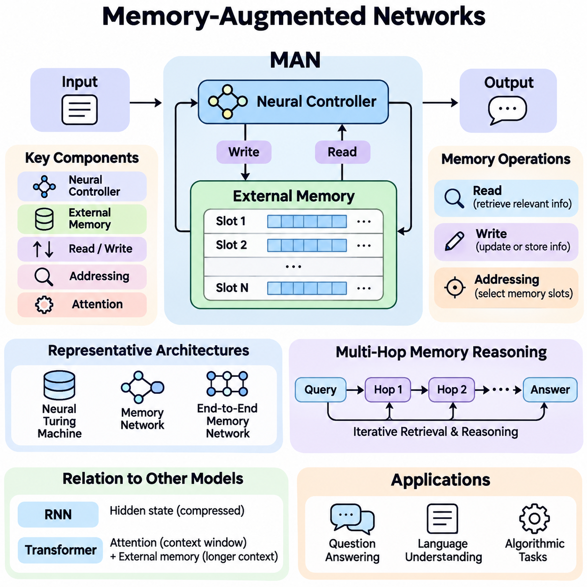
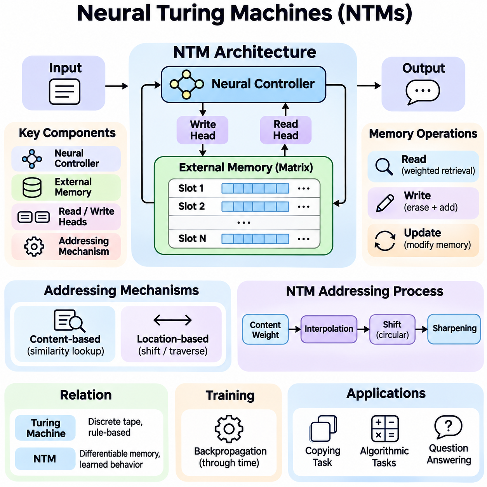
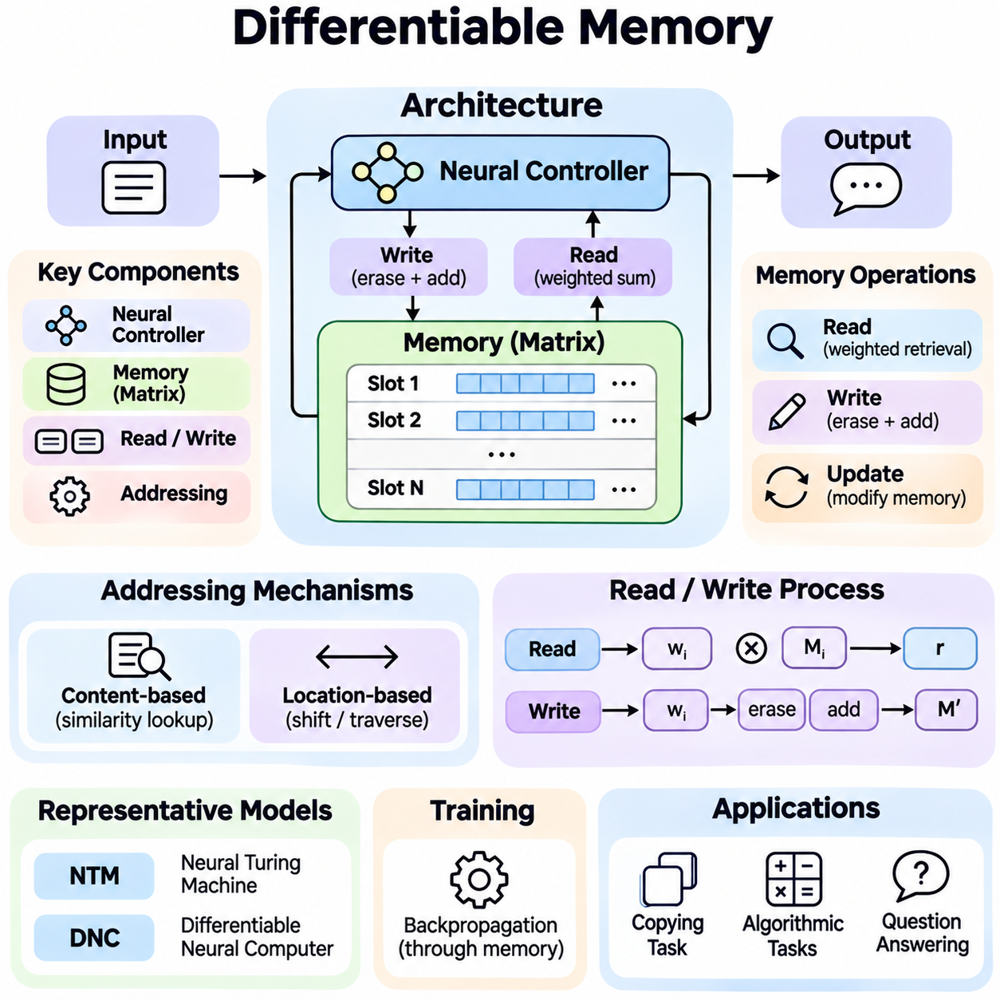
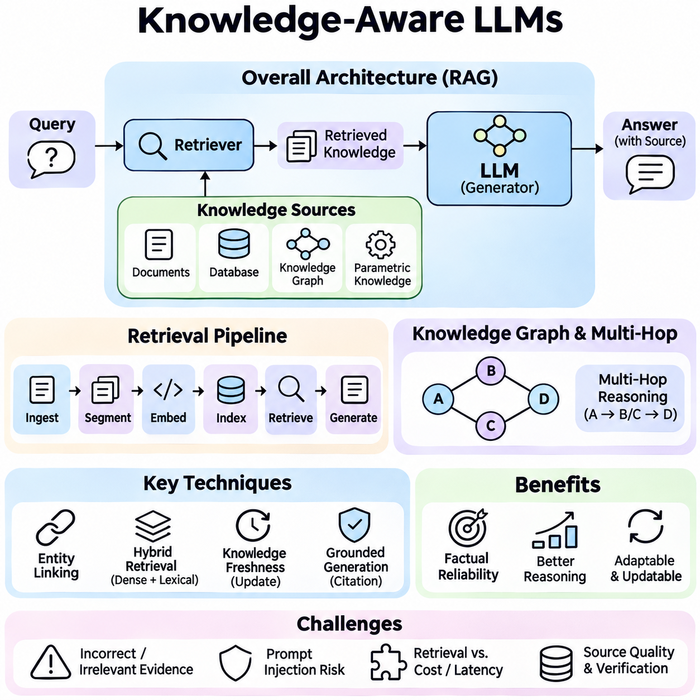
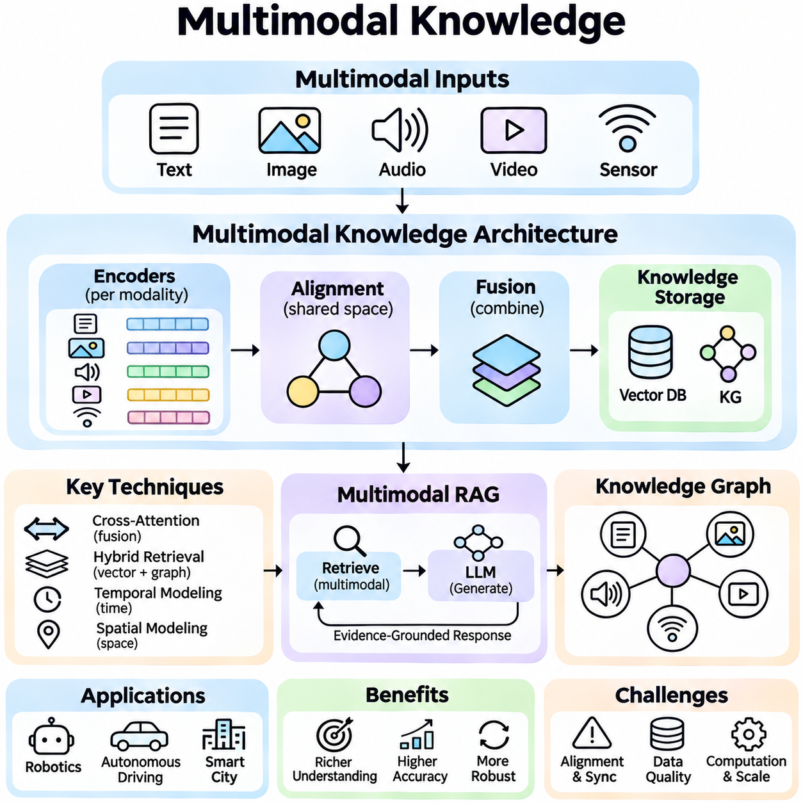
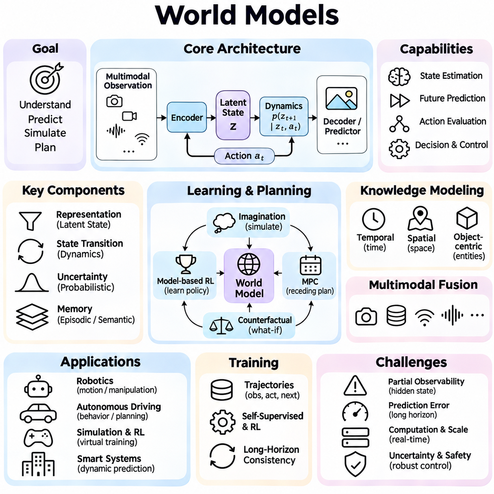

**Volume 37. Memory and Knowledge Systems**

# 06. Advanced Memory and Knowledge AI

## 06.01 Memory Augmented Networks

{width="7.268055555555556in" height="7.268055555555556in"}

메모리 증강 네트워크(Memory-Augmented Networks, MANs)는 정보를 저장하고 접근하며 갱신하기 위한 명시적 메모리 메커니즘(Explicit Memory Mechanism)을 기존 신경망(Neural Network)에 추가한 신경망 아키텍처(Neural Architecture)이다. 학습된 지식을 주로 모델 매개변수(Model Parameters)에 저장하는 전통적인 신경망과 달리, 이러한 아키텍처는 추론(Inference) 과정에서 접근할 수 있는 별도의 메모리 표현(Memory Representation)을 유지한다. 이를 통해 복잡한 작업에서 추론, 문맥 이해(Contextual Understanding), 적응(Adaptation)을 지원한다.

메모리 증강 네트워크(Memory-Augmented Networks)의 근본적인 개발 동기는 긴 시퀀스(Long Sequences), 변화하는 환경(Changing Environments), 방대한 정보를 요구하는 추론 작업에서 고정 매개변수 표현(Fixed-Parameter Representation)이 가지는 한계를 극복하는 것이다. 기존 신경망 모델은 장기간의 상호작용에서 특정 세부 정보를 유지하는 데 어려움을 겪을 수 있다. 주소 지정이 가능한 메모리 구조(Addressable Memory Structure)를 도입하면 관련 정보를 보존하고 새로운 입력을 처리하거나 예측을 생성할 때 필요한 정보를 선택적으로 검색할 수 있다.

일반적인 메모리 증강 네트워크(Memory-Augmented Network)는 신경망 제어기(Neural Controller), 외부 또는 구조화된 메모리 구성요소(External or Structured Memory Component), 정보 읽기 및 쓰기 메커니즘(Read and Write Mechanisms)으로 구성된다. 제어기는 입력 데이터를 처리하고 메모리에 접근하는 방법을 결정한다. 메모리 구성요소는 관측값, 사실, 중간 계산 상태(Intermediate Computational States)의 표현을 저장하며, 주소 지정 메커니즘(Addressing Mechanism)은 현재 계산 목표와 관련된 저장 정보를 식별한다.

메모리 표현(Memory Representation)은 일반적으로 여러 개의 주소 지정 가능한 슬롯(Addressable Slots)을 포함하는 행렬(Matrix) 형태로 구성된다. 각 슬롯은 특정 관측값, 개념 또는 계산 상태와 관련된 정보를 벡터(Vector)로 저장한다. 슬롯의 개수는 메모리 용량(Memory Capacity)을 결정하며, 벡터 차원(Vector Dimensionality)은 표현의 풍부함에 영향을 미친다. 효과적인 메모리 구성에서는 저장 용량, 검색 정확도, 계산 효율성, 동적 정보 갱신 능력 사이의 균형을 고려해야 한다.

메모리 읽기(Memory Reading)는 제어기가 현재 입력이나 내부 상태와 관련된 정보를 검색하는 과정이다. 질의 벡터(Query Vector)를 저장된 메모리 표현과 비교하여 어텐션 가중치(Attention Weights) 또는 주소 지정 가중치(Addressing Weights)를 계산한다. 이러한 가중치는 개별 메모리 슬롯이 검색 결과에 기여하는 정도를 결정한다. 소프트 주소 지정(Soft Addressing)은 메모리 벡터의 가중 결합(Weighted Combination)을 생성하여 정보 검색 과정의 미분 가능성(Differentiability)을 유지하고 경사 기반 학습(Gradient-Based Learning)을 지원한다.

메모리 쓰기(Memory Writing)는 새롭게 획득한 정보가 기존 메모리 내용을 어떻게 변경할 것인지 결정한다. 아키텍처에 따라 선택된 슬롯을 교체하거나 새로운 표현을 추가하고, 입력 정보를 기존 저장 정보와 결합할 수 있다. 학습 가능한 게이트(Learned Gates)는 유지하거나 덮어쓸 정보의 양을 조절한다. 이러한 메커니즘은 불필요한 메모리 간섭(Memory Interference)을 줄이면서 유용한 과거 정보를 보존하고 새로운 관측값을 통합하도록 지원한다.

어텐션 메커니즘(Attention Mechanism)은 현재 계산 요구사항과 이전에 저장된 정보를 연결하기 때문에 많은 메모리 증강 네트워크에서 핵심적인 역할을 수행한다. 내용 기반 주소 지정(Content-Based Addressing)은 표현 간 유사성을 이용하여 메모리 항목을 식별하고, 위치 기반 주소 지정(Location-Based Addressing)은 위치 관계를 이용하여 메모리에 접근한다. 일부 아키텍처는 두 방식을 결합하여 의미 기반 검색(Semantic Retrieval)과 저장 정보의 구조적 탐색(Structured Traversal)을 함께 지원한다.

신경 튜링 머신(Neural Turing Machine, NTM)은 신경망 제어기와 미분 가능한 외부 메모리(Differentiable External Memory)를 결합한 대표적인 아키텍처이다. 읽기 및 쓰기 헤드(Read and Write Heads)는 학습된 주소 지정 연산을 통해 메모리와 상호작용하며, 네트워크가 임시 정보 저장이 필요한 알고리즘 작업(Algorithmic Tasks)을 수행하도록 한다. 이 아키텍처는 신경망이 모델 매개변수에 저장된 정보에만 의존하지 않고 메모리를 활용하는 계산 절차를 학습할 수 있음을 보여주었다.

메모리 네트워크(Memory Networks)와 종단 간 메모리 네트워크(End-to-End Memory Networks)는 특히 질의응답(Question Answering)과 언어 이해(Language Understanding) 분야에서 중요한 아키텍처이다. 이러한 모델은 근거가 되는 사실이나 문맥 문장을 메모리 항목으로 표현하고 어텐션 기반 연산을 통해 관련 정보를 검색한다. 다중 계산 홉(Multiple Computational Hops)은 모델이 메모리를 반복적으로 검토하고 중간 표현을 정교화하며 여러 저장 문장에 분산된 증거를 결합하도록 지원한다.

다중 홉 메모리 추론(Multi-Hop Memory Reasoning)은 하나의 메모리 항목만으로 답을 얻을 수 없는 상황에서 특히 유용하다. 연속적인 추론 단계에서 네트워크는 이전 단계에서 검색한 정보를 활용하여 새로운 질의를 구성한다. 이러한 반복 과정은 관련 사실을 연결하고 의존 관계를 해결하며 여러 메모리 위치에 분산된 증거를 식별할 수 있다. 그러나 홉의 증가로 계산 비용이 높아지며, 추론 정확도가 반드시 향상되는 것은 아니다.

메모리 증강 네트워크(Memory-Augmented Networks)는 과거 정보를 표현하고 접근하는 방식에서 순환 신경망(Recurrent Neural Networks, RNNs)과 차이가 있다. 순환 신경망은 이전 입력을 변화하는 은닉 상태(Hidden States)에 압축하지만, 메모리 증강 아키텍처는 개별적으로 주소를 지정할 수 있는 저장 공간을 제공한다. 이러한 분리는 모든 세부 정보를 하나의 은닉 표현에 유지하지 않고도 특정 과거 관측값에 접근하도록 지원한다. 다만 실제 성능은 메모리 설계와 검색 품질에 크게 좌우된다.

메모리 증강 네트워크와 트랜스포머(Transformer) 아키텍처의 관계는 현대 인공지능에서 특히 중요하다. 트랜스포머의 어텐션(Attention)은 문맥 창(Context Window) 내부의 표현에 유연하게 접근하도록 지원하며, 명시적 메모리 증강(Explicit Memory Augmentation)은 즉각적인 문맥 범위를 넘어 선택된 정보를 보존할 수 있다. 이러한 접근법은 영속적 메모리 토큰(Persistent Memory Tokens), 외부 메모리 뱅크(External Memory Banks), 순환 메모리 메커니즘(Recurrent Memory Mechanisms)을 통해 결합될 수 있다.

메모리 용량(Memory Capacity)은 아키텍처 설계에서 근본적인 절충 관계(Tradeoffs)를 발생시킨다. 메모리 슬롯을 늘리면 더 많은 정보를 저장할 수 있지만 주소 지정 복잡도, 메모리 사용량, 검색 지연시간(Retrieval Latency)이 증가할 수 있다. 반대로 용량을 제한하면 효율성이 향상되지만 중요한 정보가 삭제될 가능성이 있다. 메모리 압축(Memory Compression), 계층적 구성(Hierarchical Organization), 선택적 유지(Selective Retention), 희소 주소 지정(Sparse Addressing)은 이러한 상충 요구사항을 관리하기 위한 전략이다.

메모리 증강 네트워크의 학습(Training)은 작업별 계산 능력과 효과적인 메모리 연산을 동시에 학습해야 한다. 경사 기반 최적화(Gradient-Based Optimization)는 제어기 매개변수, 주소 지정 함수(Addressing Functions), 미분 가능한 메모리 상호작용을 공동으로 조정할 수 있다. 학습 목적에는 예측 정확도, 재구성 품질(Reconstruction Quality), 순차적 추론 작업의 성공적인 수행 등이 포함된다. 안정적인 최적화를 위해서는 적절한 초기화(Initialization), 정규화(Regularization), 파괴적인 메모리 갱신을 방지하는 메커니즘이 필요하다.

메모리 주소 지정(Memory Addressing)이 모호하거나 불안정해질 때 중요한 문제가 발생한다. 유사한 메모리 항목들이 중복된 어텐션 가중치를 받으면 서로 관련 없는 정보가 혼합된 표현이 생성될 수 있다. 반복적인 쓰기 작업 역시 필요한 시점 이전에 유용한 증거를 덮어쓸 수 있다. 이러한 문제를 해결하기 위해 선택적 주소 지정(Selective Addressing), 메모리 할당 정책(Memory Allocation Policies), 내용 분리(Content Separation), 일관성 제약(Consistency Constraints) 등이 활용된다.

메모리 증강 네트워크는 새롭게 관측한 사례의 표현을 저장하고 이후 예측에서 재사용함으로써 소수 샷 학습(Few-Shot Learning)을 지원한다. 익숙하지 않은 작업이 등장할 때마다 모든 신경망 매개변수를 수정하는 대신, 새로운 관측값을 메모리 항목과 연결하고 입력 사례를 저장된 표현과 비교할 수 있다. 이러한 접근법은 학습 사례가 제한된 환경에서 적응 능력을 향상시킬 수 있지만, 성공적인 일반화(Generalization)는 여전히 표현 품질(Representation Quality)에 의존한다.

자연어 처리(Natural Language Processing, NLP)에서 메모리 증강은 질의응답, 대화 이해(Dialogue Understanding), 문서 추론(Document Reasoning), 문맥 정보 통합(Contextual Information Integration)을 지원한다. 대화형 시스템은 이전 발언의 표현을 유지하고 후속 질문에 응답할 때 관련 세부 정보를 검색할 수 있다. 문서 분석에서는 메모리 항목이 문단, 개체(Entity), 중간 결론을 표현하여 동시에 처리하기 어려운 여러 문서 구간의 증거를 결합하도록 지원한다.

메모리 증강 네트워크는 강화학습(Reinforcement Learning)과 부분 관측 환경(Partially Observable Environments)에서도 유용한 메커니즘을 제공한다. 지능형 에이전트(Intelligent Agent)는 현재 관측값만으로 의사결정에 필요한 모든 정보를 확보하지 못할 수 있다. 이전 관측값, 행동, 환경 결과를 저장하면 에이전트는 더욱 풍부한 내부 상태(Internal State)를 구성할 수 있다. 따라서 메모리 검색은 정책 선택(Policy Selection), 시간적 추론(Temporal Reasoning), 변화하는 환경에 대한 적응을 지원한다.

로보틱스(Robotics) 응용은 메모리 기반 지능(Memory-Dependent Intelligence)의 실질적인 중요성을 보여준다. 이동 로봇(Mobile Robot)은 이전에 관측한 장애물, 환경 조건, 주행 이벤트의 표현을 유지할 수 있다. 유사한 상황이 다시 발생하면 관련 메모리가 센서 측정값의 해석이나 의사결정을 개선하는 데 도움을 줄 수 있다. 위치 추정(Localization), 지도 작성(Mapping), 제어 시스템(Control Systems)과 통합할 때는 불확실성(Uncertainty), 시간적 일관성(Temporal Consistency), 계산 지연시간, 저장된 관측값의 신뢰성을 고려해야 한다.

지식 집약형 인공지능 시스템(Knowledge-Intensive AI Systems)은 신경망 메모리(Neural Memory)를 지식 그래프(Knowledge Graphs)나 의미 데이터베이스(Semantic Databases)와 같은 구조화된 표현(Structured Representations)과 결합할 수 있다. 신경망 메모리는 학습된 표현을 통한 유연한 검색을 지원하고, 구조화된 지식 자원은 명시적인 개체와 관계를 보존한다. 이러한 통합은 증거 구성과 문맥 추론을 개선할 수 있지만, 특히 정확한 지식에 의존하는 의사결정에서는 검색된 연관성과 검증된 사실을 구분해야 한다.

메모리 증강 네트워크와 검색 증강 생성(Retrieval-Augmented Generation, RAG)은 고정된 모델 매개변수 외부의 정보에 접근한다는 공통 원칙을 가지지만 계산 구조가 동일하지는 않다. 메모리 증강 모델은 일반적으로 신경망 계산의 일부로 내부 메모리 상호작용을 학습하는 반면, 검색 증강 시스템은 별도의 검색 인프라를 통해 문서나 임베딩(Embeddings)을 검색한다. 하이브리드 아키텍처(Hybrid Architecture)는 학습된 메모리 접근과 외부 검색을 결합하여 더 넓은 지식 범위를 제공할 수 있다.

장기적인 시스템 운영에는 정보의 관련성(Relevance), 중복성(Redundancy), 노후화(Obsolescence)를 관리하는 메모리 관리 전략(Memory Management Strategies)이 필요하다. 갱신을 적절히 제어하지 않으면 축적된 메모리에 서로 충돌하는 관측값이나 오래된 표현이 포함될 수 있다. 실제 시스템에서는 타임스탬프(Timestamps), 신뢰도 추정값(Confidence Estimates), 중요도 점수(Importance Scores), 교체 정책(Replacement Policies)을 활용하여 정보 유지 과정을 조절할 수 있다. 이러한 메커니즘은 여러 세션에 걸쳐 메모리가 지속되거나 변화하는 환경과 상호작용할 때 특히 중요하다.

메모리 증강 네트워크의 평가(Evaluation)는 최종 예측 정확도만 측정하는 것으로 충분하지 않다. 관련 평가 기준에는 메모리 검색 정밀도(Memory Retrieval Precision), 정보 유지 기간(Information Retention Duration), 추론 일관성(Reasoning Consistency), 적응 속도(Adaptation Speed), 계산 오버헤드(Computational Overhead), 시퀀스 길이 증가에 대한 강건성(Robustness)이 포함된다. 통제된 실험을 통해 메모리 용량, 주소 지정 메커니즘, 갱신 정책이 성능에 미치는 영향을 분석할 수 있다. 메모리가 없는 기준 모델(Baseline Models)과의 비교는 명시적 메모리의 실질적인 효과를 확인하는 데 도움이 된다.

확장성(Scalability)은 메모리 증강 아키텍처가 대규모 언어 모델(Large Language Models, LLMs), 자율 에이전트(Autonomous Agents), 분산 지능 시스템(Distributed Intelligence Systems)에 적용될 때 더욱 중요해진다. 효율적인 구현에서는 계층적 메모리(Hierarchical Memory), 근사 검색(Approximate Retrieval), 희소 어텐션(Sparse Attention), 특수 메모리 할당(Specialized Memory Allocation)을 사용할 수 있다. 특히 메모리 대역폭(Memory Bandwidth), 처리 자원, 엄격한 실시간 요구사항이 제한된 엣지 장치(Edge Devices)에서는 하드웨어 제약이 아키텍처 결정에 직접적인 영향을 미친다.

메모리에 민감한 정보, 잘못된 정보, 적대적 정보(Adversarial Information)가 포함될 수 있으므로 보안(Security)과 신뢰성(Reliability)을 반드시 고려해야 한다. 승인되지 않은 메모리 수정은 이후 예측에 영향을 미칠 수 있으며, 부정확한 저장 관측값은 반복적인 검색을 통해 전파될 수 있다. 접근 제어(Access Controls), 메모리 출처 추적(Memory Provenance), 검증 메커니즘(Validation Mechanisms), 통제된 삭제(Controlled Deletion)는 이러한 위험을 줄이는 데 도움이 된다. 따라서 신뢰할 수 있는 메모리 증강은 효과적인 신경망 계산뿐 아니라 저장 정보에 대한 관리 체계도 요구한다.

메모리 증강 네트워크의 광범위한 중요성은 정보 저장(Information Storage)과 즉각적인 계산(Immediate Computation)을 분리하면서도 두 기능 사이의 학습된 상호작용을 유지할 수 있다는 점에 있다. 이러한 아키텍처 원칙은 관측값을 기억하고 문맥적 증거(Contextual Evidence)를 검색하며 시간에 따라 행동을 적응시키는 시스템의 기반을 제공한다. 미분 가능한 메모리(Differentiable Memory), 신경망 추론(Neural Reasoning), 지식 통합(Knowledge Integration)의 지속적인 발전은 더욱 높은 성능과 효율성을 갖춘 지능형 시스템(Intelligent Systems)의 구현을 가능하게 할 것으로 기대된다.

## 06.02 Neural Turing Machines

{width="7.268055555555556in" height="7.268055555555556in"}

신경 튜링 머신(Neural Turing Machines, NTMs)은 고전적인 튜링 머신(Classical Turing Machine)에서 영감을 받은 외부 메모리 시스템(External Memory System)과 미분 가능한 계산(Differentiable Computation)을 결합한 신경망 아키텍처(Neural Network Architecture)이다. 명시적인 메모리 저장 공간과 프로그래밍 가능한 접근 메커니즘(Programmable Access Mechanisms)을 도입하여 기존 신경망을 확장한다. 이러한 설계는 경사 기반 최적화(Gradient-Based Optimization)를 통해 정보 유지, 순차적 조작, 알고리즘 추론(Algorithmic Reasoning)을 포함하는 계산 절차를 학습하도록 지원한다.

신경 튜링 머신(Neural Turing Machines)의 근본적인 개발 동기는 정보를 주로 고정된 모델 매개변수(Fixed Model Parameters)나 압축된 은닉 상태(Compressed Hidden States)에 저장하는 기존 신경망의 한계를 극복하는 것이다. 복잡한 계산 작업에서는 임시 저장(Temporary Storage), 반복적인 접근(Repeated Access), 중간 결과의 정밀한 조작이 필요한 경우가 많다. 신경 튜링 머신은 신경망 제어기(Neural Controller)와 계산 과정에서 동적으로 접근할 수 있는 외부 메모리 행렬(External Memory Matrix)을 분리하여 이러한 요구사항을 해결한다.

신경 튜링 머신은 신경망 제어기(Neural Controller), 외부 메모리 행렬(External Memory Matrix), 미분 가능한 읽기 및 쓰기 헤드(Differentiable Read and Write Heads)로 구성된다. 제어기는 입력 정보를 수신하고 출력을 생성하며 메모리 연산을 결정하는 매개변수를 생성한다. 메모리 행렬에는 주소 지정이 가능한 저장 위치(Addressable Storage Locations)가 포함되며, 읽기 및 쓰기 헤드는 학습된 주소 지정 메커니즘(Addressing Mechanisms)을 통해 정보를 검색하거나 수정한다. 이러한 구성요소는 통합된 계산 아키텍처(Integrated Computational Architecture)로 작동한다.

신경망 제어기(Neural Controller)는 신경 튜링 머신의 중앙 의사결정 구성요소(Central Decision-Making Component)로 기능한다. 제어기는 피드포워드 신경망(Feedforward Neural Network)이나 장단기 메모리(Long Short-Term Memory, LSTM)와 같은 순환 아키텍처(Recurrent Architecture)로 구현할 수 있다. 각 계산 단계에서 제어기는 입력 데이터와 이전에 검색된 메모리 정보를 처리한다. 이후 출력 예측과 제어 신호(Control Signals)를 생성하여 메모리에 접근할 위치와 저장된 표현을 수정하는 방법을 결정한다.

외부 메모리(External Memory)는 일반적으로 여러 메모리 위치(Memory Locations)를 포함하는 행렬로 표현되며, 각 위치에는 고정 차원 벡터(Fixed-Dimensional Vector)가 저장된다. 메모리 위치의 개수는 사용 가능한 저장 용량(Storage Capacity)을 결정하고, 벡터 차원(Vector Dimensionality)은 각 위치에서 표현할 수 있는 정보의 양을 제어한다. 기존 신경망 매개변수와 달리 메모리 내용은 작업 실행 중 변경될 수 있으므로, 학습된 모델 가중치(Model Weights)를 영구적으로 수정하지 않고도 임시 정보를 유지할 수 있다.

메모리 읽기(Memory Reading)는 메모리 위치 전체에 분포된 미분 가능한 어텐션 가중치(Differentiable Attention Weights)를 통해 수행된다. 읽기 헤드(Read Head)는 각 메모리 슬롯이 검색된 표현에 기여하는 정도를 결정하는 주소 지정 분포(Addressing Distribution)를 생성한다. 최종 읽기 벡터(Read Vector)는 저장된 메모리 벡터의 가중 결합(Weighted Combination)으로 계산된다. 이러한 메커니즘은 메모리 접근 과정 전체의 미분 가능성(Differentiability)을 유지하면서 제어기가 관련 정보를 검색하도록 지원한다.

메모리 쓰기(Memory Writing)는 삭제 및 추가 연산(Erase and Add Operations)을 통해 저장된 정보를 수정한다. 쓰기 헤드(Write Head)는 주소 지정 분포(Addressing Distribution), 삭제 벡터(Erase Vector), 추가 벡터(Addition Vector)를 생성하여 메모리 내용이 갱신되는 방식을 결정한다. 삭제 연산은 기존 값을 선택적으로 감소시키고, 추가 연산은 선택된 위치에 새로운 정보를 도입한다. 이러한 연산은 미분 가능하므로 신경망은 역전파(Backpropagation)를 통해 효과적인 메모리 수정 전략을 학습할 수 있다.

내용 기반 주소 지정(Content-Based Addressing)은 신경 튜링 머신이 생성된 키 벡터(Key Vector)와의 유사성에 따라 메모리 항목을 찾도록 지원한다. 제어기는 질의 표현(Query Representation)을 생성하고 코사인 유사도(Cosine Similarity)와 같은 유사도 함수(Similarity Function)를 사용하여 저장된 메모리 벡터와 비교한다. 계산된 유사도 점수는 정규화된 주소 지정 가중치(Normalized Addressing Weights)로 변환된다. 이러한 메커니즘은 고정된 메모리 주소나 명시적으로 프로그래밍된 검색 규칙 없이 연관 메모리 접근(Associative Memory Access)을 가능하게 한다.

위치 기반 주소 지정(Location-Based Addressing)은 위치 관계(Positional Relationships)에 따라 메모리에 접근하는 추가적인 메커니즘을 제공한다. 모델은 내용 유사성에만 의존하지 않고 어텐션 분포(Attention Distribution)를 인접한 메모리 위치로 이동시킬 수 있다. 이러한 기능은 순차적 탐색(Sequential Traversal), 순서가 있는 저장(Ordered Storage), 반복적인 계산 연산에 중요하다. 이를 통해 신경 튜링 머신은 고전적인 계산 장치의 메모리 헤드 이동과 유사한 구조화된 메모리 접근 패턴을 학습할 수 있다.

원래의 신경 튜링 머신 주소 지정 메커니즘(NTM Addressing Mechanism)은 내용 기반 검색(Content-Based Lookup)과 위치 민감 연산(Location-Sensitive Operations)을 결합한다. 내용 기반 가중치는 이전 주소 지정 가중치와 보간(Interpolation)된 후 학습된 순환 이동(Circular Shift)과 선명화 연산(Sharpening Operation)을 거친다. 이러한 단계는 모델이 기존 접근 위치를 유지하거나 인접 위치로 이동하고 내용에 따라 정보를 식별하도록 지원한다. 미분 가능한 수식 구조는 이산적인 메모리 선택 없이 복잡한 주소 지정 동작을 학습할 수 있게 한다.

신경 튜링 머신과 고전적인 튜링 머신(Classical Turing Machines)의 관계는 계산 방식이 완전히 동일하다는 의미보다는 아키텍처적 유사성(Architectural Similarity)에 기반한다. 고전적인 튜링 머신은 추상적인 테이프(Abstract Tape)에서 이산적인 읽기 및 쓰기 연산(Discrete Read and Write Operations)을 통해 기호를 조작한다. 반면 신경 튜링 머신은 미분 가능한 주소 지정을 사용하여 유한한 연속값 메모리 행렬(Finite Continuous-Valued Memory Matrix)을 처리한다. 목적은 미리 정의된 기호 전이 프로그램(Symbolic Transition Program)을 실행하는 대신 신경망 최적화를 통해 알고리즘과 유사한 동작을 학습하는 것이다.

신경 튜링 머신의 학습(Training)은 일반적으로 시간 역전파(Backpropagation Through Time, BPTT)를 이용하는 지도학습(Supervised Learning)으로 수행된다. 제어기, 주소 지정 메커니즘, 메모리 상호작용 매개변수는 작업별 목적 함수(Task-Specific Objectives)에 따라 공동으로 최적화된다. 학습 과정에서 모델은 올바른 출력을 생성하는 방법뿐 아니라 임시 정보를 구성하는 방법도 학습한다. 성공적인 최적화를 위해서는 메모리 연산과 제어기 상태 전이(Controller State Transitions)의 연속적인 과정에서 기울기(Gradients)가 전달되어야 한다.

복사 작업(Copying Tasks)은 신경 튜링 머신의 기능을 보여주는 기본적인 실험이다. 일반적인 실험에서 모델은 입력 벡터 시퀀스(Input Vector Sequence)를 받은 후 해당 시퀀스를 재생성하라는 신호를 수신한다. 성공적인 수행을 위해서는 입력 정보를 저장하고 올바른 순서로 검색해야 한다. 신경 튜링 머신은 학습 중 경험한 길이를 넘어서는 시퀀스에도 일반화(Generalization)할 수 있는 메모리 접근 절차를 학습할 수 있지만, 이러한 일반화가 항상 보장되는 것은 아니다.

반복 복사 작업(Repeat-Copy Task)은 입력 시퀀스를 여러 번 재생성하도록 요구하여 추가적인 계산 능력을 필요로 한다. 이 작업에서는 원본 시퀀스를 기억하고 반복 횟수(Repetition Counts)를 추적하며 저장된 정보를 반복적으로 탐색해야 한다. 성공적인 신경 튜링 머신은 메모리 쓰기, 순차적 읽기(Sequential Reading), 제어 상태 관리(Control-State Management)를 조정하는 방법을 학습한다. 이러한 기능은 명시적 메모리가 조합적 계산 동작(Compositional Computational Behavior)을 지원할 수 있음을 보여준다.

연관 회상(Associative Recall)은 신경 튜링 머신이 문맥적 관계(Contextual Relationships)를 기반으로 저장된 정보를 검색할 수 있는지 평가한다. 신경망은 구조화된 항목(Structured Items)의 시퀀스를 입력받고 지정된 질의 항목 다음에 위치하는 항목을 식별해야 한다. 이를 위해 관련 메모리 내용을 인식하고 연결된 위치로 이동해야 한다. 이 작업은 내용 기반 주소 지정과 위치 기반 이동(Location-Based Movement)의 상호작용을 보여주며, 두 메커니즘의 결합이 더욱 구조화된 검색 동작을 가능하게 한다.

우선순위 정렬(Priority Sorting)은 외부 메모리를 활용하는 알고리즘 학습(Algorithmic Learning)의 또 다른 사례이다. 모델은 우선순위 값(Priority Values)이 연결된 항목들을 입력받고 적절한 순서로 출력해야 한다. 이 문제를 해결하려면 여러 입력을 유지하고 학습된 우선순위에 따라 검색 순서를 구성해야 한다. 신경 튜링 머신은 유용한 정렬 전략(Sorting Strategies)을 발견할 수 있지만, 학습된 절차가 학습 데이터 분포(Training Distributions)에 의존할 수 있으므로 훨씬 큰 문제로의 안정적인 일반화는 여전히 어렵다.

신경 튜링 머신의 중요한 장점은 학습된 계산 절차(Learned Computational Procedures)와 작업별 임시 정보(Task-Specific Temporary Information)를 분리할 수 있다는 점이다. 제어기 매개변수는 정보 처리 전략을 인코딩(Encoding)하고 외부 메모리는 실행 중에 발생하는 값을 저장한다. 이러한 구분을 통해 학습된 모델은 서로 다른 입력 시퀀스에 유사한 메모리 연산을 적용할 수 있다. 또한 재사용 가능한 계산 기술(Reusable Computational Skills)과 동적으로 변화하는 지식(Dynamically Changing Knowledge)을 결합하는 아키텍처의 개념적 기반을 제공한다.

이러한 장점에도 불구하고 신경 튜링 머신은 중요한 최적화 문제(Optimization Difficulties)를 가지고 있다. 소프트 주소 지정(Soft Addressing)은 여러 메모리 위치에 어텐션을 분산시켜 관련 없는 저장 값 사이에 간섭(Interference)을 발생시킬 수 있다. 반복적인 쓰기 연산은 정보를 점진적으로 손상시킬 수 있으며, 부정확한 주소 지정 결정은 이후 계산 단계로 전파될 수 있다. 이러한 문제는 긴 시퀀스에 걸쳐 정밀한 메모리 연산을 수행해야 하는 작업에서 더욱 심각해진다.

메모리 용량(Memory Capacity)과 주소 지정 복잡도(Addressing Complexity)는 신경 튜링 머신의 확장성(Scalability)에도 영향을 미친다. 일반적인 구현에서는 각 메모리 접근 연산마다 전체 메모리 행렬에 대한 관계를 평가해야 할 수 있다. 메모리 크기가 증가하면 계산 요구량과 메모리 대역폭 사용량(Memory Bandwidth Consumption)이 상당히 커질 수 있다. 따라서 대규모 메모리 시스템에서는 희소 주소 지정(Sparse Addressing), 계층적 구성(Hierarchical Organization), 선택적 검색(Selective Retrieval) 등을 포함한 신중한 아키텍처 최적화가 필요하다.

미분 가능한 신경 컴퓨터(Differentiable Neural Computer, DNC)는 신경 튜링 머신 개념을 확장한 중요한 아키텍처이다. 이 구조는 메모리 할당(Memory Allocation), 사용량 추적(Usage Tracking), 저장된 항목 사이의 시간적 관계(Temporal Relationships)를 관리하는 추가 메커니즘을 도입한다. 이러한 기능은 더욱 구조화된 메모리 관리와 관련 정보 시퀀스의 탐색을 지원한다. 미분 가능한 신경 컴퓨터는 기본적인 내용 및 위치 주소 지정을 넘어 더욱 풍부한 계산 구조로 미분 가능한 외부 메모리가 발전할 수 있음을 보여준다.

신경 튜링 머신은 현대적인 어텐션 기반 아키텍처(Attention-Based Architectures)와도 개념적으로 연결된다. 두 접근법 모두 학습된 가중치 메커니즘(Learned Weighting Mechanisms)을 사용하여 관련 표현을 선택하지만, 신경 튜링 머신은 계산 과정에서 쓰기가 가능한 외부 메모리(Writable External Memory)를 명시적으로 유지한다. 트랜스포머 어텐션(Transformer Attention)은 일반적으로 처리 문맥 내에서 사용 가능한 표현을 대상으로 작동하는 반면, 신경 튜링 머신의 메모리는 학습된 읽기 및 쓰기 연산으로 수정될 수 있다. 이러한 차이는 정보의 지속성과 순차적 계산의 구성 방식에 영향을 미친다.

자연어 처리(Natural Language Processing, NLP)에서 신경 튜링 머신에서 영감을 받은 메모리 메커니즘은 문맥 정보의 유지와 조작이 필요한 작업을 지원할 수 있다. 잠재적인 응용 분야에는 다단계 질의응답(Multi-Step Question Answering), 문서 이해(Document Understanding), 구조화된 시퀀스 처리(Structured Sequence Processing)가 포함된다. 외부 메모리는 중간 표현(Intermediate Representations)이 이후 계산 과정에서도 접근 가능하도록 한다. 그러나 실제 효과는 학습된 메모리 연산이 어텐션 기반 또는 검색 기반 대안보다 유리한지에 따라 달라진다.

로보틱스(Robotics)와 자율 시스템(Autonomous Systems)은 메모리 기반 계산(Memory-Based Computation)의 추가적인 응용 가능성을 제공한다. 지능형 로봇(Intelligent Robot)은 부분 관측 환경(Partially Observable Environments)에서 작동하면서 관측값, 행동 이력(Action Histories), 중간 계획 정보(Intermediate Planning Information)를 유지해야 할 수 있다. 신경 튜링 머신에서 영감을 받은 메커니즘은 시간적 추론(Temporal Reasoning)과 작업 의존적 정보 검색(Task-Dependent Information Retrieval)을 지원할 수 있다. 다만 실제 환경에 배포하려면 예측 가능한 지연시간(Predictable Latency), 강건한 메모리 관리(Robust Memory Management), 인식 및 제어 시스템과의 신뢰성 있는 통합이 필요하다.

신경 튜링 머신의 평가(Evaluation)에서는 작업 성능(Task Performance)과 학습된 계산 동작(Learned Computational Behavior)을 모두 검토해야 한다. 관련 측정 지표에는 예측 정확도(Prediction Accuracy), 시퀀스 길이에 대한 일반화(Sequence-Length Generalization), 메모리 주소 지정 안정성(Memory Addressing Stability), 학습 수렴(Training Convergence), 계산 효율성(Computational Efficiency)이 포함된다. 통제된 실험(Controlled Experiments)을 통해 서로 다른 제어기 아키텍처, 메모리 용량, 주소 지정 전략을 비교할 수 있다. 메모리 접근 패턴(Memory Access Patterns)을 분석하면 모델이 재사용 가능한 절차를 학습했는지 또는 특정 작업에만 적용되는 지름길(Task-Specific Shortcuts)을 학습했는지도 파악할 수 있다.

신경 튜링 머신의 광범위한 중요성은 신경망이 미분 가능한 연산(Differentiable Operations)을 통해 구조화된 외부 메모리(Structured External Memory)와 상호작용하는 방법을 학습할 수 있음을 보여주었다는 점에 있다. 이러한 아키텍처는 표현 학습(Representation Learning)과 알고리즘 계산(Algorithmic Computation)을 연결하며 메모리 증강 지능(Memory-Augmented Intelligence) 연구의 기반을 제공한다. 실제 적용에서 여러 한계가 남아 있지만, 신경 튜링 머신이 확립한 원칙은 적응형 추론 시스템(Adaptive Reasoning Systems)과 고급 신경망 메모리 아키텍처(Advanced Neural Memory Architectures)의 발전에 지속적으로 영향을 미치고 있다.

## 06.03 Differentiable Memory

{width="7.268055555555556in" height="7.268055555555556in"}

미분 가능한 메모리(Differentiable Memory)는 신경망(Neural Networks)이 경사 기반 학습(Gradient-Based Learning)과 호환되는 연산을 통해 정보를 저장하고 검색하며 갱신할 수 있도록 하는 계산 메커니즘(Computational Mechanism)이다. 이산적인 주소 지정(Discrete Addressing)과 명시적인 프로그래밍 규칙(Explicit Programming Rules)에 의존하는 기존 메모리 시스템과 달리, 미분 가능한 메모리는 연속적인 표현(Continuous Representations)과 학습 가능한 접근 메커니즘(Learnable Access Mechanisms)을 사용한다. 이를 통해 메모리 연산은 종단 간 학습(End-to-End Training)이 가능한 신경망 아키텍처의 통합된 구성요소가 된다.

미분 가능한 메모리(Differentiable Memory)의 근본적인 개발 동기는 임시 저장(Temporary Storage), 반복적인 검색(Repeated Retrieval), 구조화된 조작(Structured Manipulation)이 필요한 정보를 처리할 때 고정 매개변수 신경망(Fixed-Parameter Neural Networks)이 가지는 한계를 극복하는 것이다. 기존 신경망 모델은 과거 정보를 은닉 상태(Hidden States)에 압축하는 경우가 많으며, 이 과정에서 중요한 세부 정보가 손실될 수 있다. 미분 가능한 메모리는 모든 관측값을 모델 매개변수(Model Parameters)에 인코딩하지 않고도 선택적으로 접근할 수 있는 추가 저장 공간을 제공한다.

일반적인 미분 가능한 메모리 아키텍처(Differentiable Memory Architecture)는 신경망 제어기(Neural Controller), 메모리 표현(Memory Representation), 미분 가능한 읽기 및 쓰기 메커니즘(Differentiable Read and Write Mechanisms)으로 구성된다. 제어기는 입력 정보를 처리하고 메모리 접근을 제어하는 신호를 생성한다. 메모리 구성요소는 관측값이나 중간 계산 상태(Intermediate Computational States)를 나타내는 벡터를 저장한다. 읽기 및 쓰기 메커니즘은 어떤 메모리 위치가 정보 검색에 기여하고 계산 과정에서 저장된 내용이 어떻게 변경되는지 결정한다.

메모리는 일반적으로 여러 개의 주소 지정 가능한 슬롯(Addressable Slots)을 포함하는 행렬(Matrix)로 표현되며, 각 슬롯에는 연속값 벡터(Continuous-Valued Vector)가 저장된다. 슬롯의 개수는 저장 용량(Storage Capacity)을 결정하고, 벡터 차원(Vector Dimensionality)은 저장된 표현의 풍부함에 영향을 미친다. 실행 과정에서 메모리 내용은 학습된 갱신 연산(Learned Update Operations)에 따라 변화한다. 지속적으로 유지되는 모델 매개변수와 동적으로 변화하는 메모리를 분리함으로써 신경망은 작업별 정보(Task-Specific Information)를 유지할 수 있다.

미분 가능성(Differentiability)은 하드 메모리 선택(Hard Memory Selection)을 연속적인 가중치 연산(Continuous Weighting Operations)으로 대체하여 확보된다. 모델은 이산적인 인덱스(Discrete Index)를 통해 하나의 위치를 선택하는 대신 여러 메모리 슬롯에 어텐션 가중치(Attention Weights)를 할당한다. 이러한 가중치는 읽기 연산에서 각 위치의 기여도나 쓰기 과정에서 수정되는 정도를 결정한다. 매끄러운 수학적 연산(Smooth Mathematical Operations)을 사용하면 학습 과정에서 메모리 상호작용을 통해 기울기(Gradients)가 전파될 수 있다.

미분 가능한 읽기 연산(Differentiable Read Operation)은 일반적으로 주소 지정 분포(Addressing Distribution)를 사용하여 메모리 벡터의 가중합(Weighted Sum)을 계산한다. 제어기는 저장된 표현과 비교할 질의 벡터(Query Vector) 또는 키 벡터(Key Vector)를 생성한다. 유사도 점수(Similarity Scores)는 소프트맥스 함수(Softmax Function) 등을 통해 정규화된 어텐션 가중치(Normalized Attention Weights)로 변환된다. 최종 읽기 벡터(Read Vector)는 질의와 검색된 내용 사이의 미분 가능한 관계를 유지하면서 관련 메모리 위치의 정보를 결합한다.

미분 가능한 쓰기(Differentiable Writing)는 학습된 갱신 신호(Learned Update Signals)를 통해 신경망이 메모리 내용을 수정하도록 지원한다. 쓰기 연산은 주소 지정 분포(Addressing Distribution), 삭제 벡터(Erase Vector), 추가 벡터(Addition Vector)를 생성할 수 있다. 삭제 메커니즘(Erase Mechanism)은 기존 정보를 선택적으로 감소시키고, 추가 메커니즘(Addition Mechanism)은 새로운 표현을 도입한다. 이러한 갱신 연산은 연속적이므로 신경망은 정보를 보존하거나 오래된 내용을 교체하고 새로운 관측값을 통합하는 시점을 학습할 수 있다.

내용 기반 주소 지정(Content-Based Addressing)은 미분 가능한 메모리 시스템의 핵심 메커니즘이다. 생성된 키(Key)와 저장된 벡터를 코사인 유사도(Cosine Similarity)와 같은 유사도 척도(Similarity Measures)로 비교하여 관련 메모리 위치를 식별한다. 이러한 접근법은 연관 검색(Associative Retrieval)을 지원하며, 고정된 위치 대신 의미적 관계(Semantic Relationships)나 표현 간 관계(Representational Relationships)에 따라 정보에 접근하도록 한다. 검색 정확도(Retrieval Accuracy)는 학습된 표현과 주소 지정 함수(Addressing Functions)의 품질에 따라 달라진다.

위치 기반 주소 지정(Location-Based Addressing)은 위치 관계(Positional Relationships)에 따라 메모리에 접근하는 대안적 또는 보완적 방법을 제공한다. 모델은 기존 어텐션 분포(Attention Distribution)를 인접한 위치로 이동시키거나 이전에 선택한 위치를 유지할 수 있다. 이러한 메커니즘은 순차적 처리(Sequential Processing), 순서가 있는 정보 저장(Ordered Information Storage), 구조화된 탐색(Structured Traversal)이 필요한 알고리즘 작업(Algorithmic Tasks)에 유용하다. 내용 기반 주소 지정과 위치 기반 주소 지정을 결합하면 더욱 유연한 메모리 연산이 가능해진다.

신경 튜링 머신(Neural Turing Machines, NTMs)은 신경망 제어기와 학습된 읽기 및 쓰기 헤드(Learned Read and Write Heads)를 사용하여 미분 가능한 외부 메모리(Differentiable External Memory)를 구현한 대표적인 아키텍처이다. 주소 지정 메커니즘은 내용 유사도(Content Similarity), 보간(Interpolation), 위치 이동(Positional Shifting), 어텐션 선명화(Attention Sharpening)를 결합한다. 이러한 연산을 통해 신경망은 시퀀스 복사(Sequence Copying)와 연관 회상(Associative Recall) 같은 절차를 학습할 수 있다. 이 아키텍처는 메모리 조작과 신경망 계산을 공동으로 최적화할 수 있음을 보여준다.

미분 가능한 신경 컴퓨터(Differentiable Neural Computer, DNC)는 더욱 정교한 메모리 관리 메커니즘(Memory Management Mechanisms)을 통해 이러한 원칙을 확장한다. 메모리 할당 전략(Memory Allocation Strategies), 사용량 추적(Usage Tracking), 연속적인 메모리 쓰기를 연결하는 시간적 링크(Temporal Links)를 도입한다. 이러한 기능은 사용 가능한 저장 위치를 식별하고 저장된 표현 사이의 관계를 탐색하도록 지원한다. 이를 통해 더욱 구조화된 계산(Structured Computation)이 가능해지며 단순한 순차적 메모리 접근 패턴에 대한 의존도를 줄일 수 있다.

메모리 연산을 통한 기울기 전파(Gradient Propagation)는 종단 간 학습(End-to-End Learning)에 필수적이다. 역전파(Backpropagation) 과정에서 미분값(Derivatives)은 읽기 가중치(Read Weights), 쓰기 가중치(Write Weights), 메모리 내용(Memory Contents), 제어기 매개변수(Controller Parameters)를 통해 전달된다. 이를 통해 최적화 과정은 정보 처리와 메모리 관리 동작을 동시에 조정할 수 있다. 그러나 긴 계산 시퀀스(Long Computational Sequences)에서는 기울기 소실(Vanishing Gradients), 불안정한 갱신(Unstable Updates), 누적 오차(Accumulated Errors)가 발생하여 학습이 어려워질 수 있다.

소프트 주소 지정(Soft Addressing)은 미분 가능성(Differentiability)과 정밀도(Precision) 사이에 중요한 절충 관계(Tradeoffs)를 발생시킨다. 여러 위치에 어텐션을 분산하면 매끄러운 기울기를 확보할 수 있지만 서로 관련 없는 메모리 내용이 혼합될 수 있다. 중복되는 어텐션 분포를 사용하여 반복적으로 쓰기 작업을 수행하면 저장된 표현이 점진적으로 손상될 수 있다. 선명화 메커니즘(Sharpening Mechanisms), 희소 어텐션(Sparse Attention), 선택적 할당(Selective Allocation), 정규화(Regularization)는 간섭을 줄일 수 있지만 일부 접근법은 추가적인 최적화 복잡도를 발생시킨다.

메모리 할당(Memory Allocation)은 새로운 정보를 저장할 위치와 기존 용량을 재사용하는 방법을 결정한다. 단순한 아키텍처는 학습된 주소 지정 분포에 전적으로 의존할 수 있지만, 더욱 발전된 시스템은 사용량 통계(Usage Statistics)나 할당 정책(Allocation Policies)을 통합한다. 효과적인 할당은 불필요한 덮어쓰기(Unnecessary Overwriting)를 방지하고 정보 유지 능력(Information Retention)을 향상시킨다. 저장해야 할 관측값의 수가 사용 가능한 메모리 용량을 초과할 때 메모리 관리의 중요성은 더욱 커진다.

미분 가능한 메모리는 여러 계산 단계에 걸쳐 정보를 보존함으로써 시간적 추론(Temporal Reasoning)을 지원한다. 저장된 표현은 이전 관측값(Earlier Observations), 중간 결론(Intermediate Conclusions), 작업별 상태(Task-Specific States)를 인코딩할 수 있다. 제어기는 이후 의사결정이 과거 사건에 의존할 때 이러한 표현을 검색할 수 있다. 시간적 링크(Temporal Links)와 순환 주소 지정 메커니즘(Recurrent Addressing Mechanisms)은 순서가 있는 경험을 탐색하고 관련 사건 시퀀스를 재구성하는 기능을 추가로 지원할 수 있다.

소수 샷 학습(Few-Shot Learning)에서 미분 가능한 메모리는 새롭게 관측한 사례의 표현을 저장하고 이후 예측 과정에서 검색할 수 있다. 이를 통해 모델 매개변수를 광범위하게 수정하지 않고도 빠른 적응(Rapid Adaptation)이 가능해진다. 모델은 익숙하지 않은 입력을 메모리 항목과 연결하고 새로운 관측값을 저장된 사례와 비교할 수 있다. 이러한 접근법의 효과는 표현 품질(Representation Quality), 메모리 할당(Memory Allocation), 검색 일관성(Retrieval Consistency)에 따라 달라진다.

자연어 처리(Natural Language Processing, NLP)는 미분 가능한 메모리 아키텍처의 중요한 응용 분야이다. 질의응답(Question Answering), 대화 모델링(Dialogue Modeling), 문서 추론(Document Reasoning)은 여러 문장이나 상호작용 단계에 분산된 정보를 필요로 하는 경우가 많다. 메모리 메커니즘은 관련 문맥 표현(Contextual Representations)을 보존하고 필요할 때 검색하도록 지원한다. 다단계 추론(Multi-Step Reasoning)은 증거를 결합하기 위해 메모리에 반복적으로 접근할 수 있지만, 검색 오류(Retrieval Errors)가 연속적인 연산을 통해 전파될 가능성도 있다.

미분 가능한 메모리는 트랜스포머 어텐션 메커니즘(Transformer Attention Mechanisms)과 개념적으로 연결된다. 두 방식 모두 학습된 가중치 연산(Learned Weighting Operations)을 사용하여 표현을 결합하지만, 명시적인 미분 가능 메모리 아키텍처는 제어된 쓰기(Controlled Writing)와 계산 단계 전반에 걸친 지속적인 저장(Persistent Storage)을 추가로 지원한다. 트랜스포머 모델은 메모리 토큰(Memory Tokens), 순환 상태(Recurrent States), 외부 메모리 모듈(External Memory Modules)을 통합하여 문맥 처리를 확장할 수 있다. 이러한 설계는 저장 용량, 효율성, 정보 지속성(Information Persistence)에서 서로 다른 절충 관계를 제공한다.

강화학습(Reinforcement Learning)에서 미분 가능한 메모리는 부분 관측성(Partial Observability)이 존재하는 환경의 의사결정을 개선할 수 있다. 에이전트(Agent)는 현재 시점에서 관측할 수 없는 환경 조건을 추론하기 위해 이전 관측값의 정보가 필요할 수 있다. 메모리 표현은 행동 이력(Action Histories), 문맥 단서(Contextual Cues), 중간 상태 추정값(Intermediate State Estimates)을 보존할 수 있다. 학습된 검색(Learned Retrieval)은 정책(Policy)이 행동을 선택할 때 관련 과거 정보를 활용하도록 지원한다.

로보틱스(Robotics) 응용은 자율 인식(Autonomous Perception)과 계획(Planning)에서 미분 가능한 메모리의 잠재력을 보여준다. 로봇은 이전에 감지한 객체, 환경 변화(Environmental Changes), 주행 이벤트(Navigation Events)의 표현을 유지할 수 있다. 메모리 검색은 센서 관측값이 불완전할 때 시간적 일관성(Temporal Consistency)과 문맥 의존적 의사결정(Context-Dependent Decisions)을 지원할 수 있다. 실제 배포에서는 지연시간(Latency), 불확실성(Uncertainty), 메모리 신뢰성(Memory Reliability), 안전 필수 제어 시스템(Safety-Critical Control Systems)과의 통합을 신중하게 고려해야 한다.

확장성(Scalability)은 밀집 메모리 주소 지정(Dense Memory Addressing)이 저장된 모든 위치에 대한 비교를 요구할 수 있기 때문에 중요한 과제이다. 메모리 용량이 증가하면 계산 비용(Computational Cost), 메모리 대역폭 요구량(Memory Bandwidth Requirements), 추론 지연시간(Inference Latency)이 증가할 수 있다. 희소 주소 지정(Sparse Addressing), 계층적 메모리(Hierarchical Memory), 압축 표현(Compressed Representations), 근사 검색(Approximate Retrieval)은 가능한 개선 방법이다. 적절한 전략은 응용 시스템이 정확도, 저장 용량, 실시간 성능, 학습 효율성 가운데 무엇을 우선하는지에 따라 달라진다.

미분 가능한 메모리 시스템의 평가(Evaluation)에서는 작업 정확도(Task Accuracy)와 메모리 동작(Memory Behavior)을 모두 검토해야 한다. 관련 평가 지표에는 검색 정밀도(Retrieval Precision), 정보 유지 기간(Retention Duration), 주소 지정 안정성(Addressing Stability), 메모리 간섭(Memory Interference), 긴 시퀀스에 대한 일반화(Generalization to Longer Sequences), 계산 효율성(Computational Efficiency)이 포함된다. 통제된 실험(Controlled Experiments)을 통해 메모리 크기, 제어기 아키텍처, 갱신 메커니즘을 비교할 수 있다. 이러한 평가는 명시적 메모리가 기존 신경망 모델보다 측정 가능한 이점을 제공하는지 판단하는 데 도움이 된다.

미분 가능한 메모리는 신뢰성(Reliability)과 보안(Security)에 관한 고려사항도 발생시킨다. 잘못된 정보는 반복적인 검색을 통해 지속될 수 있으며, 제어되지 않은 쓰기(Uncontrolled Writing)는 중요한 표현을 덮어쓸 수 있다. 민감한 정보를 처리하는 시스템에는 적절한 접근 제한(Access Restrictions), 정보 유지 정책(Retention Policies), 저장된 내용을 수정하거나 삭제하는 메커니즘이 필요하다. 신뢰할 수 있는 운영을 위해서는 적응형 메모리 갱신(Adaptive Memory Updates)과 일관성(Consistency), 추적 가능성(Traceability), 통제된 정보 관리(Controlled Information Management) 사이의 균형이 중요하다.

미분 가능한 메모리의 광범위한 중요성은 신경망 표현 학습(Neural Representation Learning)을 명시적인 정보 저장(Explicit Information Storage) 및 알고리즘 계산(Algorithmic Computation)과 연결한다는 점에 있다. 메모리 접근을 학습 가능하게 만들면 이러한 아키텍처는 복잡한 작업에서 정보를 어떻게 유지하고 검색하며 수정해야 하는지 학습할 수 있다. 메모리 할당(Memory Allocation), 미분 가능한 주소 지정(Differentiable Addressing), 확장 가능한 신경망 아키텍처(Scalable Neural Architectures)의 지속적인 발전은 더욱 적응적이고 효율적이며 지식 집약적인 지능형 시스템(Knowledge-Intensive Intelligent Systems)의 구현을 지원할 수 있다.

## 06.04 Knowledge Aware LLMs

{width="7.268055555555556in" height="7.268055555555556in"}

지식 인식 대규모 언어 모델(Knowledge-Aware Large Language Models, Knowledge-Aware LLMs)은 명시적인 지식 자원(Explicit Knowledge Sources)을 언어 이해(Language Understanding), 추론(Reasoning), 생성(Generation) 과정에 통합하도록 설계된 언어 모델이다. 기존 대규모 언어 모델은 사전 학습(Pretraining)을 통해 상당한 정보를 습득하지만, 이러한 지식은 모델 매개변수(Model Parameters)에 분산되어 저장되므로 시간이 지나면 오래되거나 불완전해질 수 있다. 지식 인식 아키텍처(Knowledge-Aware Architectures)는 언어 생성을 구조화된 정보(Structured Information), 검색된 정보(Retrieved Information), 동적으로 갱신되는 정보(Dynamically Updated Information)와 연결하여 이러한 한계를 해결한다.

지식 인식 대규모 언어 모델의 핵심 목표는 사실적 신뢰성(Factual Reliability), 문맥적 관련성(Contextual Relevance), 추론 정확도(Reasoning Accuracy)를 향상시키는 것이다. 사전 학습된 모델(Pretrained Model)은 근거가 되는 사실을 반드시 검증하지 않더라도 유창한 응답을 생성할 수 있다. 지식 인식 시스템은 증거 검색(Evidence Retrieval), 관계 표현(Relationship Representation), 생성된 주장 검증(Claim Validation)을 위한 메커니즘을 도입한다. 언어 처리 능력(Linguistic Capability)과 접근 가능한 지식(Accessible Knowledge)을 분리하면 정보가 변경되거나 특정 분야의 전문 지식이 필요한 상황에서 더욱 높은 유연성을 확보할 수 있다.

대규모 언어 모델 내부의 지식은 매개변수 지식(Parametric Knowledge), 외부 문서(External Documents), 구조화된 데이터베이스(Structured Databases), 지식 그래프(Knowledge Graphs)를 통해 표현할 수 있다. 매개변수 지식은 학습된 모델 가중치(Model Weights)에 암묵적으로 인코딩되지만, 외부 지식은 추론(Inference) 과정에서 접근할 수 있다. 구조화된 표현(Structured Representations)은 개체(Entity), 속성(Attribute), 관계(Relationship)를 명시적으로 기술한다. 이러한 지식 자원을 결합하면 언어 모델은 일반적인 언어 처리 능력과 함께 검사, 갱신, 독립적인 검증이 가능한 정보를 활용할 수 있다.

검색 증강 생성(Retrieval-Augmented Generation, RAG)은 외부 지식을 대규모 언어 모델과 통합하기 위해 널리 사용되는 접근법이다. 검색 구성요소(Retrieval Component)는 지식 저장소(Knowledge Repository)에서 관련 문서나 문단을 식별하고 이를 언어 모델에 추가 문맥(Additional Context)으로 제공한다. 생성기(Generator)는 사용자 질의(User Query)와 검색된 증거(Retrieved Evidence)를 함께 조건으로 사용하여 응답을 생성한다. 이러한 아키텍처에서는 모델 전체를 재학습하지 않고도 지식 저장소를 갱신할 수 있다.

일반적인 지식 인식 검색 파이프라인(Knowledge-Aware Retrieval Pipeline)은 문서 수집(Document Ingestion), 텍스트 분할(Text Segmentation), 임베딩 생성(Embedding Generation), 인덱싱(Indexing), 검색(Retrieval), 응답 생성(Response Generation)으로 구성된다. 원본 문서는 처리하기 적절한 크기의 문단으로 분할되고 유사도 검색(Similarity Search)을 위한 벡터 표현(Vector Representations)으로 변환된다. 추론 시점에는 질의가 인코딩되어 인덱싱된 내용과 비교된다. 검색된 문단은 순위화(Ranking)와 필터링(Filtering)을 거쳐 증거 기반 생성(Evidence-Grounded Generation)을 지원하도록 모델 문맥에 삽입된다.

지식 그래프(Knowledge Graphs)는 대규모 언어 모델을 명시적인 정보와 연결하는 또 다른 중요한 메커니즘이다. 지식 그래프는 구조화된 노드(Nodes)와 엣지(Edges)를 통해 개체와 관계를 표현한다. 비정형 문서(Unstructured Documents)와 달리 그래프 표현(Graph Representations)은 개념, 조직, 사건, 속성 사이의 명시적인 연결을 보존한다. 대규모 언어 모델은 그래프 검색(Graph Retrieval)을 사용하여 관련 개체를 식별하고 관계를 탐색하며 구조화된 증거(Structured Evidence)를 자연어 설명(Natural Language Explanations)과 결합할 수 있다.

그래프 기반 지식 통합(Graph-Based Knowledge Integration)은 질문에 답하기 위해 여러 관계를 탐색해야 하는 다중 홉 추론(Multi-Hop Reasoning)을 지원한다. 예를 들어 모델은 특정 조직을 식별하고 관련 프로젝트를 확인한 다음 해당 프로젝트의 속성을 검색해야 할 수 있다. 그래프 탐색(Graph Traversal)은 중간 추론 증거(Intermediate Reasoning Evidence)를 제공하고, 대규모 언어 모델은 검색된 관계를 일관된 설명으로 변환한다. 신뢰성 있는 작동을 위해서는 개체 중의성 해소(Entity Disambiguation)와 그래프 내용에 대한 신중한 검증이 필요하다.

개체 연결(Entity Linking)은 자연어 표현을 구조화된 지식 자원(Structured Knowledge Resources)과 연결할 때 필수적이다. 시스템은 사람, 장소, 제품, 기술 개념에 대한 언급을 식별하고 이를 데이터베이스의 해당 개체에 매핑(Mapping)한다. 모호한 이름이나 불완전한 설명은 잘못된 매핑을 발생시킬 수 있다. 문맥 임베딩(Contextual Embeddings), 의미적 매칭(Semantic Matching), 개체 식별 및 통합 메커니즘(Entity Resolution Mechanisms)은 유사한 개체를 구분하고 이후 지식 검색의 정밀도(Precision)를 향상시키는 데 도움이 된다.

하이브리드 검색(Hybrid Retrieval)은 밀집 벡터 검색(Dense Vector Search), 희소 어휘 매칭(Sparse Lexical Matching), 구조화된 필터링(Structured Filtering)을 결합한다. 밀집 검색(Dense Retrieval)은 정확한 용어가 다르더라도 의미적으로 관련된 문단을 식별하며, 어휘 검색(Lexical Retrieval)은 정확한 키워드 일치(Exact Keyword Matches)를 유지한다. 메타데이터 필터(Metadata Filters)는 출처, 날짜, 범주, 접근 권한에 따라 결과를 제한할 수 있다. 이러한 방법을 결합하면 특히 전문 용어와 정확한 식별자가 포함된 기술 분야에서 검색 범위(Coverage)와 정밀도를 개선할 수 있다.

지식 인식 대규모 언어 모델은 검색된 증거(Retrieved Evidence)와 모델 동작을 제어하는 지시사항(Instructions)을 구분해야 한다. 외부 문서에는 부정확한 진술, 관련 없는 내용, 악의적인 지시사항(Malicious Instructions)이 포함될 수 있다. 검색된 텍스트를 권한 있는 명령으로 취급하면 프롬프트 인젝션(Prompt Injection) 위험이 발생한다. 안전한 아키텍처(Secure Architectures)는 신뢰할 수 있는 시스템 지시사항(Trusted System Instructions)과 신뢰할 수 없는 지식 자원(Untrusted Knowledge Sources) 사이의 경계를 유지하면서 접근 제어(Access Controls), 출처 검증(Source Validation), 적절한 필터링을 적용한다.

지식 최신성(Knowledge Freshness)은 외부 지식 통합(External Knowledge Integration)의 주요 장점이다. 모델 매개변수는 일반적으로 학습 시점에 사용 가능한 정보를 반영하지만, 연결된 저장소는 새롭게 발행된 문서, 개정된 규정(Revised Regulations), 갱신된 운영 기록(Updated Operational Records)을 통합할 수 있다. 그러나 최신성은 데이터 수집 주기(Ingestion Frequency), 인덱싱 지연(Indexing Delays), 원본 정보의 품질(Source Quality)에 따라 달라진다. 오래된 정보가 현재 정보로 제시되는 것을 방지하려면 버전 추적(Version Tracking), 타임스탬프(Timestamps), 검색 정책(Retrieval Policies)이 필요하다.

근거 기반 생성(Grounded Generation)은 모델 응답이 검색된 증거와 일치하도록 하는 것을 목표로 한다. 생성기는 직접적으로 뒷받침되는 진술(Directly Supported Statements)과 해석(Interpretations) 또는 불확실한 결론(Uncertain Conclusions)을 구분해야 한다. 출처 표시(Source Attribution)는 사용자가 근거 문서를 확인하고 신뢰성을 평가하도록 지원한다. 그러나 인용(Citations) 자체가 사실적 정확성(Factual Correctness)을 보장하지는 않는다. 모델이 증거를 잘못 이해하거나 특정 주장에 관련 없는 출처를 연결할 수 있기 때문이다.

지식 인식 추론(Knowledge-Aware Reasoning)은 여러 차례 증거를 수집하는 반복 검색(Iterative Retrieval)을 통해 구현할 수 있다. 초기 검색은 관련 개념을 식별하고, 이후 질의는 누락된 관계나 사실적 의존성(Factual Dependencies)을 해결한다. 이러한 과정은 여러 출처의 정보가 필요한 복잡한 질문에 유용하다. 그러나 반복적인 검색은 지연시간(Latency)을 증가시키며, 초기 가정이 잘못된 경우 오류가 후속 단계로 전파될 수 있다.

도메인 특화 지식 인식 대규모 언어 모델(Domain-Specific Knowledge-Aware LLMs)은 공학(Engineering), 의료(Healthcare), 과학 연구(Scientific Research), 산업 운영(Industrial Operations)에서 특히 유용하다. 이러한 환경에는 전문 용어(Specialized Terminology), 구조화된 절차(Structured Procedures), 자주 갱신되는 기술 문서(Technical Documentation)가 포함된다. 대규모 언어 모델을 검증된 도메인 지식 저장소(Verified Domain Repositories)에 연결하면 문맥적 정확성을 향상시키고 암기된 사실에 대한 의존도를 줄일 수 있다. 그러나 고위험 응용 분야(High-Stakes Applications)에서는 독립적인 검증(Independent Validation)과 적절한 인간 감독(Human Oversight)이 여전히 필요하다.

개인화된 지식 시스템(Personalized Knowledge Systems)은 사용자 선호도(User Preferences), 상호작용 이력(Interaction History), 접근이 승인된 조직 정보(Authorized Organizational Information)를 통합할 수 있다. 영속적 메모리(Persistent Memory)는 보조 시스템(Assistant)이 여러 세션에 걸쳐 연속성을 유지하도록 하며, 검색 메커니즘은 현재 요청과 관련된 문맥을 선택한다. 이러한 시스템은 장기적으로 유지할 선호도(Durable Preferences)와 일시적인 관측값(Temporary Observations)을 구분하고 적절한 동의(Consent)에 따라 정보를 저장해야 한다. 책임 있는 배포를 위해서는 개인정보 보호 제어(Privacy Controls)와 삭제 메커니즘(Deletion Mechanisms)이 필수적이다.

지식 통합(Knowledge Integration)은 중요한 아키텍처적 절충 관계(Architectural Tradeoffs)도 발생시킨다. 검색 문맥(Retrieval Context)이 커지면 증거 범위(Evidence Coverage)가 확대될 수 있지만 더 많은 토큰(Tokens)을 소비하고 주의를 분산시키는 정보(Distracting Information)를 포함할 수 있다. 공격적인 필터링(Aggressive Filtering)은 계산 비용을 줄이지만 중요한 증거를 제외할 위험이 있다. 문맥 압축(Context Compression), 재순위화(Reranking), 관련성 추정(Relevance Estimation)은 이러한 상충 요구사항의 균형을 유지하는 데 도움이 된다. 시스템 설계자는 검색 정확도, 생성 품질, 지연시간, 운영 비용을 함께 고려해야 한다.

미세 조정(Fine-Tuning)과 외부 검색(External Retrieval)은 지식 인식 시스템에서 서로 다른 목적을 수행한다. 미세 조정은 도메인 특화 언어 패턴(Domain-Specific Language Patterns), 추론 동작(Reasoning Behaviors), 지시사항 수행(Instruction Following)을 개선할 수 있으며, 검색은 식별 가능한 정보 출처(Identifiable Information Sources)에 접근하도록 한다. 자주 변경되는 사실을 유지하기 위해 모델 가중치를 갱신하는 것이 항상 효율적인 방법은 아니다. 하이브리드 전략(Hybrid Strategies)은 학습을 통한 행동 적응(Behavioral Adaptation)과 외부 지식 접근을 통한 사실적 근거 확보(Factual Grounding)를 결합한다.

지식 인식 대규모 언어 모델의 평가(Evaluation)는 기존 언어 생성 품질(Language Generation Quality)을 넘어서는 측정 기준을 요구한다. 관련 평가 차원에는 검색 정밀도(Retrieval Precision), 증거 재현율(Evidence Recall), 사실적 일관성(Factual Consistency), 인용 정확성(Citation Correctness), 추론 정확도(Reasoning Accuracy), 응답 완전성(Response Completeness)이 포함된다. 종단 간 평가(End-to-End Evaluation)는 검색된 정보가 실제로 생성된 응답을 뒷받침하는지 판단해야 한다. 절제 연구(Ablation Studies)는 검색 방법, 지식 그래프, 재순위화, 모델 적응(Model Adaptation)의 개별적인 기여도를 분리하여 분석할 수 있다.

운영 신뢰성(Operational Reliability)은 검색 구성요소와 생성 구성요소에 대한 지속적인 모니터링(Continuous Monitoring)에 의존한다. 문서 집합(Document Collections), 임베딩 모델(Embedding Models), 인덱싱 전략(Indexing Strategies)이 변경되면 언어 모델 자체가 그대로 유지되더라도 시스템 동작에 영향을 미칠 수 있다. 모니터링 파이프라인(Monitoring Pipelines)은 검색 실패(Retrieval Failures), 근거 없는 주장(Unsupported Claims), 지연시간 저하(Latency Degradation), 예상하지 못한 지식 충돌(Knowledge Conflicts)을 감지해야 한다. 버전 관리된 데이터셋(Versioned Datasets)과 재현 가능한 평가(Reproducible Evaluations)는 통제된 배포와 지속적인 개선을 지원한다.

지식 인식 대규모 언어 모델의 광범위한 중요성은 언어 모델을 주로 매개변수에 의존하는 생성기(Parameter-Dependent Generators)에서 명시적인 지식 자원(Explicit Knowledge Resources)을 참조하고 이를 기반으로 추론할 수 있는 시스템으로 발전시킨다는 점에 있다. 검색(Retrieval), 구조화된 표현(Structured Representations), 증거 검증(Evidence Validation), 통제된 메모리(Controlled Memory)를 통합함으로써 이러한 아키텍처는 더욱 적응적이고 투명한 지능(Adaptable and Transparent Intelligence)을 지원한다. 향후 발전은 지식 신뢰성(Knowledge Reliability), 효율적인 추론(Efficient Reasoning), 동적으로 변화하는 정보 환경(Dynamic Information Environments)과의 신뢰할 수 있는 통합을 개선하는 데 달려 있다.

## 06.05 Multimodal Knowledge

{width="7.268055555555556in" height="7.268055555555556in"}

멀티모달 지식(Multimodal Knowledge)은 텍스트(Text), 이미지(Image), 오디오(Audio), 비디오(Video), 센서 측정값(Sensor Measurements)을 포함한 여러 데이터 모달리티(Data Modalities)에 걸쳐 정보를 표현, 통합, 검색하고 추론하는 것을 의미한다. 텍스트 중심 지식 시스템(Text-Centered Knowledge Systems)과 달리 멀티모달 아키텍처(Multimodal Architectures)는 상호 보완적인 증거를 연결하여 개체(Entity), 사건(Event), 환경(Environment)에 대한 더욱 풍부한 설명을 구성한다. 이러한 기능은 언어만으로 표현할 수 없는 정보를 해석해야 하는 지능형 시스템(Intelligent Systems)을 지원한다.

멀티모달 지식 통합(Multimodal Knowledge Integration)의 근본적인 동기는 개별 모달리티(Individual Modalities)가 현실에 대한 불완전한 설명을 제공한다는 점에 있다. 텍스트는 기호적 관계(Symbolic Relationships)를 전달하고, 이미지는 공간적 외형(Spatial Appearance)을 포착하며, 오디오는 음향 사건(Acoustic Events)을 나타내고, 센서는 물리적 조건(Physical Conditions)을 측정한다. 이러한 정보원을 결합하면 모호성(Ambiguity)을 줄이고 문맥 이해(Contextual Understanding)를 향상시킬 수 있다. 그러나 성공적인 통합을 위해서는 표현, 시간, 신뢰성, 의미적 해석(Semantic Meaning)의 차이를 해결해야 한다.

멀티모달 지식 아키텍처(Multimodal Knowledge Architecture)는 일반적으로 모달리티별 인코더(Modality-Specific Encoders), 표현 정렬 메커니즘(Representation Alignment Mechanisms), 융합 모듈(Fusion Modules), 지식 저장 구성요소(Knowledge Storage Components)를 포함한다. 각 인코더는 원시 입력(Raw Input)을 계산에 적합한 특징 표현(Feature Representations)으로 변환한다. 정렬(Alignment)은 서로 대응하는 관측값 사이의 관계를 설정하고, 융합(Fusion)은 상호 보완적인 정보를 결합한다. 결과 표현은 벡터 데이터베이스(Vector Databases), 지식 그래프(Knowledge Graphs), 구조화된 메모리 시스템(Structured Memory Systems)에 저장할 수 있다.

표현 학습(Representation Learning)은 서로 다른 모달리티가 고유한 통계적 특성(Statistical Properties)을 가지기 때문에 멀티모달 지식 시스템의 핵심 요소이다. 언어 모델(Language Models)은 이산 토큰(Discrete Tokens)을 처리하고, 비전 인코더(Vision Encoders)는 공간적 특징(Spatial Features)을 추출하며, 오디오 인코더(Audio Encoders)는 시간적 신호(Temporal Signals)를 분석한다. 대조 학습(Contrastive Learning)은 관련 관측값을 공유 임베딩 공간(Shared Embedding Space)에 정렬할 수 있다. 이러한 표현은 유용한 모달리티별 특성을 유지하면서 교차 모달 유사도 비교(Cross-Modal Similarity Comparison)를 가능하게 한다.

멀티모달 정렬(Multimodal Alignment)은 서로 다른 정보원이 동일한 객체(Object), 사건(Event), 개념(Concept)을 가리키는지 결정한다. 이미지 영역(Image Regions)은 텍스트 설명(Textual Descriptions)에 대응할 수 있으며, 음성 명령(Spoken Instructions)은 카메라가 감지한 객체를 지칭할 수 있다. 시간적 정렬(Temporal Alignment)은 관련된 시점에 기록된 관측값을 연결한다. 잘못된 정렬은 오해를 유발하는 연관 관계(Misleading Associations)를 생성할 수 있으므로 신뢰할 수 있는 지식 구성을 위해 보정(Calibration), 동기화(Synchronization), 신뢰도 추정(Confidence Estimation)이 필수적이다.

지식 융합(Knowledge Fusion)은 여러 모달리티의 정보를 결합하여 해석과 의사결정(Decision-Making)을 지원한다. 초기 융합(Early Fusion)은 상위 수준 처리 이전에 특징을 통합하고, 후기 융합(Late Fusion)은 개별 모델에서 생성된 예측을 결합한다. 중간 융합(Intermediate Fusion)은 특화된 처리 단계 사이에서 정보를 교환한다. 적절한 융합 전략(Fusion Strategy)은 계산 제약(Computational Constraints), 모달리티 호환성(Modality Compatibility), 데이터 가용성(Data Availability), 정보원 사이에 필요한 상호작용 수준에 따라 달라진다.

교차 어텐션 메커니즘(Cross-Attention Mechanisms)은 멀티모달 융합을 위한 유연한 접근법을 제공한다. 한 모달리티의 특징은 질의(Query)로 사용되고, 다른 모달리티의 표현은 키(Key)와 값(Value)을 제공한다. 이를 통해 모델은 언어, 시각 영역(Visual Regions), 오디오 구간(Audio Segments), 센서 관측값 사이의 관련 관계를 식별할 수 있다. 교차 어텐션(Cross-Attention)은 문맥 의존적 정보 교환(Context-Dependent Information Exchange)을 지원하지만, 시퀀스 길이와 표현 크기가 증가하면 계산 비용도 증가한다.

멀티모달 지식 그래프(Multimodal Knowledge Graphs)는 서로 다른 모달리티의 증거를 개체와 관계에 연결하여 기존 그래프 구조를 확장한다. 물리적 객체(Physical Object)는 텍스트 속성(Textual Attributes), 시각적 관측값(Visual Observations), 음향 특징(Acoustic Signatures), 센서 측정값과 연결될 수 있다. 그래프 노드(Graph Nodes)는 개체나 사건을 표현하고, 엣지(Edges)는 의미적 관계(Semantic Relationships), 공간적 관계(Spatial Relationships), 시간적 관계(Temporal Relationships)를 기술한다. 이러한 구조는 명시적인 지식 구성과 관계 기반 검색(Relationship-Based Retrieval)을 지원한다.

멀티모달 검색(Multimodal Retrieval)은 하나의 모달리티로 표현된 질의를 사용하여 다른 모달리티에 저장된 정보에 접근하도록 한다. 텍스트 설명은 관련 이미지를 검색할 수 있으며, 이미지 질의(Image Query)는 관련 문서나 기록된 사건을 식별할 수 있다. 공유 임베딩 공간(Shared Embedding Spaces)은 모달리티 간 의미적 유사도 검색(Semantic Similarity Search)을 지원한다. 하이브리드 검색(Hybrid Retrieval)은 정확한 증거가 필요한 경우 벡터 유사도(Vector Similarity), 메타데이터 제약(Metadata Constraints), 그래프 관계(Graph Relationships)를 결합하여 검색 정밀도(Precision)를 향상시킬 수 있다.

멀티모달 검색 증강 생성(Multimodal Retrieval-Augmented Generation)은 검색된 시각적 증거(Visual Evidence), 텍스트 증거(Textual Evidence), 기타 모달리티별 증거(Modality-Specific Evidence)를 언어 모델에 제공함으로써 기존 검색 증강 생성(RAG)을 확장한다. 시스템은 질문과 관련된 다이어그램(Diagrams), 문서 구절(Document Passages), 이미지 설명(Image Descriptions), 센서 요약(Sensor Summaries)을 검색할 수 있다. 멀티모달 생성기(Multimodal Generators)는 지원되는 입력 형식을 직접 해석할 수 있지만, 다른 아키텍처는 특화된 인코더에 의존한다. 근거 기반 응답(Grounded Responses)을 위해서는 증거 품질(Evidence Quality)과 출처 추적(Provenance)이 여전히 중요하다.

시간적 지식(Temporal Knowledge)은 비디오, 오디오, 순차적 센서 데이터(Sequential Sensor Data)를 통합할 때 특히 중요하다. 사건은 시간에 따라 전개되며, 그 의미는 발생 순서(Ordering), 지속시간(Duration), 인과관계(Causal Relationships)에 의존하는 경우가 많다. 시간적 인코더(Temporal Encoders)와 사건 표현(Event Representations)은 이러한 의존 관계를 보존한다. 멀티모달 시스템은 감지된 객체 움직임(Object Movement)을 음향 사건이나 센서 변화와 연결할 수 있지만, 시간적 동시성(Temporal Coincidence)만으로 인과관계가 성립하는 것은 아니다.

공간적 지식(Spatial Knowledge)은 관측값을 물리적 위치(Physical Locations), 기하학적 관계(Geometric Relationships), 좌표계(Coordinate Systems)와 연결한다. 이미지는 외형 정보를 제공하고, 깊이 센서(Depth Sensors)는 거리를 추정하며, 라이다(LiDAR)는 기하학적 측정값(Geometric Measurements)을 생성한다. 이러한 정보원을 결합하면 장면 이해(Scene Understanding)와 객체 위치 추정(Object Localization)을 개선할 수 있다. 정확한 공간 통합(Spatial Integration)을 위해서는 좌표 변환(Coordinate Transformations), 센서 보정(Sensor Calibration), 불확실성 모델링(Uncertainty Modeling), 일관된 기준 좌표계(Consistent Reference Frames)가 필요하다.

멀티모달 대규모 언어 모델(Multimodal Large Language Models)은 언어 추론(Language Reasoning)을 이미지, 오디오, 비디오 또는 기타 데이터에서 추출한 표현과 통합한다. 비전 언어 모델(Vision-Language Models)은 시각적 내용(Visual Content)에 대한 질문에 답할 수 있으며, 더욱 광범위한 멀티모달 모델은 동기화된 정보 스트림(Synchronized Information Streams)을 해석할 수 있다. 성능은 학습 데이터의 포괄성(Training Coverage), 정렬 품질(Alignment Quality), 추론 능력(Reasoning Capabilities)에 따라 달라진다. 유창한 설명이 반드시 정확한 인식(Accurate Perception)이나 사실적 이해(Factual Understanding)를 의미하지는 않는다.

로보틱스(Robotics)는 자율 시스템(Autonomous Systems)이 이종 센서(Heterogeneous Sensors)를 통해 작동하기 때문에 멀티모달 지식의 중요한 응용 분야이다. 카메라(Cameras), 라이다(LiDAR), 레이더(Radar), 관성 센서(Inertial Sensors), 자연어 명령(Natural Language Instructions)은 서로 다른 형태의 정보를 제공한다. 통합된 지식 표현(Integrated Knowledge Representations)은 객체 인식(Object Recognition), 위치 추정(Localization), 계획(Planning), 상호작용(Interaction)을 지원할 수 있다. 실시간 운영(Real-Time Operation)을 위해서는 효율적인 융합(Efficient Fusion), 불확실성을 고려한 추론(Uncertainty-Aware Reasoning), 누락되거나 충돌하는 관측값에 대한 신뢰성 있는 처리가 필요하다.

멀티모달 지식 시스템은 모달리티 누락(Missing Modalities), 잡음이 포함된 측정값(Noisy Measurements), 상충하는 증거(Contradictory Evidence)와 관련된 문제에 직면한다. 카메라는 조명이 부족한 환경(Poor Illumination)에서 제대로 작동하지 않을 수 있으며, 음향 센서(Acoustic Sensor)는 환경 잡음(Environmental Noise)의 영향을 받을 수 있다. 강건한 아키텍처(Robust Architectures)는 정보원의 신뢰성(Source Reliability)을 추정하고 모든 관측값을 동일하게 신뢰하지 않아야 한다. 신뢰도 가중 융합(Confidence-Weighted Fusion), 학습 중 모달리티 드롭아웃(Modality Dropout), 불확실성 추정(Uncertainty Estimation)은 시스템의 복원력(Resilience)을 향상시킬 수 있다.

멀티모달 지식 시스템의 평가(Evaluation)는 개별 모달리티 성능(Individual Modality Performance)과 통합된 지식의 품질(Integrated Knowledge Quality)을 모두 검토해야 한다. 관련 평가 지표에는 교차 모달 검색 정확도(Cross-Modal Retrieval Accuracy), 정렬 정밀도(Alignment Precision), 추론 일관성(Reasoning Consistency), 입력 누락에 대한 강건성(Robustness to Missing Inputs), 계산 지연시간(Computational Latency)이 포함된다. 벤치마크 데이터셋(Benchmark Datasets)은 다양한 조건과 신중하게 검증된 관계를 포함해야 한다. 통제된 절제 실험(Controlled Ablation Experiments)은 추가 모달리티가 불필요한 복잡성 대신 측정 가능한 이점을 제공하는지 판단할 수 있다.

멀티모달 지식(Multimodal Knowledge)의 광범위한 중요성은 기호적 이해(Symbolic Understanding)를 지각적 증거(Perceptual Evidence) 및 물리적 증거(Physical Evidence)와 연결한다는 점에 있다. 이질적인 관측값(Heterogeneous Observations)을 일관된 표현(Coherent Representations)으로 통합하면 지능형 시스템은 개체, 환경, 사건에 대해 더욱 포괄적으로 추론할 수 있다. 멀티모달 정렬(Multimodal Alignment), 검색(Retrieval), 지식 그래프(Knowledge Graphs), 기반 모델(Foundation Models)의 지속적인 발전은 디지털 환경(Digital Environments)과 물리적 환경(Physical Environments) 전반에서 더욱 신뢰성 높은 문맥 인식 인공지능(Context-Aware AI)의 구현을 가능하게 할 수 있다.

## 06.06 World Models

{width="7.268055555555556in" height="7.268055555555556in"}

월드 모델(World Models)은 지능형 시스템(Intelligent Systems)이 환경의 동적 특성(Environmental Dynamics)을 이해하고 예측하며 시뮬레이션할 수 있도록 하는 계산 표현(Computational Representations)이다. 현재 관측값(Immediate Observations)에만 반응하는 대신, 월드 모델을 갖춘 에이전트(Agent)는 숨겨진 상태(Hidden States)를 추정하고 미래 사건(Future Events)을 예측하며 가능한 행동(Possible Actions)을 평가할 수 있다. 이러한 기능은 인식(Perception), 메모리(Memory), 예측(Prediction), 의사결정(Decision-Making)을 적응형 지능(Adaptive Intelligence)을 위한 통합 프레임워크(Unified Framework)로 연결한다.

월드 모델의 근본적인 개발 동기는 실제 환경(Real-World Environments)이 동적으로 변화하고 부분적으로만 관측 가능하며, 에이전트와 물리적 과정(Physical Processes) 사이의 상호작용에 영향을 받는다는 점에 있다. 단일 관측값(Single Observation)은 현재 상황에 대한 완전한 정보를 제공하기 어렵다. 월드 모델은 환경 상태(Environmental States)의 내부 표현(Internal Representations)을 유지하고, 다양한 조건과 행동에 따라 이러한 상태가 시간에 걸쳐 어떻게 변화하는지 학습함으로써 이러한 한계를 해결한다.

일반적인 월드 모델 아키텍처(World Model Architecture)는 관측 인코더(Observation Encoder), 잠재 상태 표현(Latent State Representation), 동역학 모델(Dynamics Model), 예측 또는 재구성 구성요소(Prediction or Reconstruction Component)를 포함한다. 인코더는 감각 관측값(Sensory Observations)을 압축된 특징(Compact Features)으로 변환하고, 동역학 모델은 내부 상태 사이의 전이(State Transitions)를 예측한다. 디코더(Decoder)는 관측값을 재구성하거나 작업과 관련된 결과(Task-Relevant Outcomes)를 추정할 수 있다. 이러한 구성요소는 함께 환경 동작(Environmental Behavior)에 대한 학습된 근사 모델(Learned Approximation)을 제공한다.

잠재 상태 표현(Latent State Representations)은 원시 센서 입력(Raw Sensory Inputs)에 상당한 중복성(Redundancy)이 포함되는 경우가 많기 때문에 효율적인 월드 모델링(World Modeling)의 핵심 요소이다. 이미지, 오디오 신호(Audio Signals), 센서 측정값(Sensor Measurements)은 예측과 제어(Prediction and Control)에 필요한 정보를 보존하면서 저차원 표현(Lower-Dimensional Representations)으로 압축할 수 있다. 유용한 잠재 상태는 중요하지 않은 변동(Irrelevant Variation)을 제외하면서 핵심적인 환경 속성(Environmental Properties)을 포착해야 한다. 표현 품질(Representation Quality)은 계획 정확도(Planning Accuracy)와 일반화(Generalization)에 큰 영향을 미친다.

상태 전이 모델(State Transition Models)은 행동(Action)이나 외부 사건(External Event)이 발생한 이후 환경이 어떻게 변화하는지 설명한다. 현재 상태(Current State)와 행동이 주어지면 모델은 가능한 미래 상태(Future States)에 대한 확률분포(Probability Distribution)를 예측한다. 결정론적 전이(Deterministic Transitions)는 예측 가능한 동작을 표현하고, 확률적 모델(Stochastic Models)은 불확실성(Uncertainty)과 예측하기 어려운 외란(Unpredictable Disturbances)을 고려한다. 정확한 상태 전이 모델링은 행동의 결과(Action Consequences)를 평가하고 신뢰성 있는 순차적 의사결정(Sequential Decision-Making)을 지원하는 데 필수적이다.

월드 모델은 중요한 환경 변수를 직접 측정할 수 없는 부분 관측성(Partial Observability) 조건에서 작동하는 경우가 많다. 믿음 상태(Belief State)는 이전 관측값(Previous Observations)과 행동을 기반으로 숨겨진 환경에 대한 에이전트의 불확실성을 요약한다. 순환 신경망(Recurrent Neural Networks), 상태 공간 모델(State-Space Models), 확률적 추론 메커니즘(Probabilistic Inference Mechanisms)은 이러한 추정값을 유지할 수 있다. 이 접근법은 개별 센서 측정값(Isolated Sensor Readings)이 아니라 과거 문맥(Historical Context)에 의존하는 의사결정을 가능하게 한다.

시간적 모델링(Temporal Modeling)은 월드 모델이 서로 다른 시간 척도(Timescales)에서 발생하는 사건 사이의 관계를 포착하도록 한다. 단기 예측(Short-Term Predictions)은 즉각적인 객체 움직임(Object Motion)을 설명할 수 있으며, 장기 예측(Long-Term Forecasts)은 행동 패턴(Behavioral Patterns)이나 환경 변화(Environmental Changes)를 표현할 수 있다. 순환 아키텍처(Recurrent Architectures), 시간적 어텐션(Temporal Attention), 계층적 상태 표현(Hierarchical State Representations)은 이러한 기능을 지원한다. 그러나 시뮬레이션 예측 구간(Simulation Horizon)이 길어질수록 예측 오차(Prediction Errors)가 누적되는 경우가 많다.

모델 기반 강화학습(Model-Based Reinforcement Learning)은 학습된 환경 동역학(Learned World Dynamics)을 사용하여 행동 선택(Action Selection)을 개선하고 실제 환경과의 직접적인 상호작용에 대한 의존도를 줄인다. 에이전트는 모든 후보 행동(Candidate Actions)을 물리적 환경에서 시험하는 대신 시뮬레이션된 상태 전이(Simulated Transitions)를 통해 가능한 결과를 평가할 수 있다. 이러한 내부 시뮬레이션(Internal Simulations)은 계획(Planning), 정책 개선(Policy Improvement), 데이터 효율적인 학습(Data-Efficient Learning)을 지원한다. 그 유용성은 학습된 동역학과 보상 추정값(Reward Estimates)의 정확도에 따라 달라진다.

모델 예측 제어(Model Predictive Control, MPC)는 제한된 미래 예측 구간(Limited Future Horizon)에 대한 반복적인 계획을 월드 모델과 통합한다. 각 의사결정 단계에서 제어기(Controller)는 예측된 환경 상태 전이를 사용하여 후보 행동 시퀀스(Candidate Action Sequences)를 평가한다. 이후 첫 번째 행동을 실행하고 결과 상태(Resulting State)를 관측한 다음 갱신된 정보를 사용하여 다시 계획한다. 이러한 이동 예측 구간 전략(Receding-Horizon Strategy)은 장기 예측 오차의 영향을 줄이면서 변화하는 조건에 대한 적응을 지원한다.

상상 기반 학습(Imagination-Based Learning)은 에이전트가 학습된 월드 모델을 사용하여 가상의 경험(Hypothetical Experiences)을 생성하도록 한다. 시뮬레이션된 궤적(Simulated Trajectories)은 동일한 수준의 실제 환경 상호작용 없이도 추가적인 학습 정보를 제공할 수 있다. 드리머(Dreamer)와 같은 아키텍처는 잠재 동역학(Latent Dynamics)을 활용하여 상상된 롤아웃(Imagined Rollouts)으로부터 정책(Policies)을 학습한다. 그러나 부정확한 시뮬레이션은 잘못된 행동을 강화할 수 있으므로 모델 검증(Model Validation)과 불확실성 관리(Uncertainty Management)가 중요하다.

월드 모델은 대안적인 행동이나 조건에서 어떤 일이 발생할 수 있는지 추정함으로써 반사실적 추론(Counterfactual Reasoning)도 지원할 수 있다. 자율 에이전트(Autonomous Agent)는 정지(Stopping), 가속(Accelerating), 방향 변경(Changing Direction)에 따른 예측 결과를 비교할 수 있다. 이러한 비교는 실행 이전에 잠재적인 의사결정을 평가하는 데 도움이 된다. 그러나 반사실적 예측(Counterfactual Predictions)은 모델에 의존하므로 익숙하지 않은 상황에서 보장된 결과로 해석해서는 안 된다.

멀티모달 월드 모델(Multimodal World Models)은 카메라(Cameras), 라이다(LiDAR), 레이더(Radar), 오디오(Audio), 고유수용감각(Proprioception), 기타 센서의 정보를 통합하여 더욱 풍부한 환경 표현(Environmental Representations)을 구성한다. 각 모달리티(Modality)는 객체, 움직임, 기하학적 구조(Geometry), 물리적 상호작용(Physical Interactions)에 대한 상호 보완적인 증거를 제공한다. 센서 융합(Sensor Fusion)과 시간적 정렬(Temporal Alignment)은 이러한 관측값을 일관된 상태 추정값(Coherent State Estimate)으로 연결한다. 강건한 모델링(Robust Modeling)을 위해서는 측정 불확실성(Measurement Uncertainty), 관측값 누락(Missing Observations), 상충하는 증거(Conflicting Evidence)를 고려해야 한다.

공간적 표현(Spatial Representations)은 물리적 환경에서 작동하는 월드 모델에 특히 중요하다. 점유 격자(Occupancy Grids), 기하학적 지도(Geometric Maps), 객체 중심 표현(Object-Centric Representations), 학습된 공간 임베딩(Learned Spatial Embeddings)은 주변 개체의 배치(Arrangement)를 설명할 수 있다. 동적 모델(Dynamic Models)은 객체 움직임과 상호작용을 예측하여 이러한 표현을 확장한다. 공간 구조(Spatial Structure)와 시간적 동역학(Temporal Dynamics)을 결합하면 내비게이션(Navigation), 조작(Manipulation), 환경 인식 계획(Environment-Aware Planning)을 지원할 수 있다.

객체 중심 월드 모델(Object-Centric World Models)은 전체 장면을 구분되지 않은 특징 벡터(Undifferentiated Feature Vectors)로 처리하는 대신 속성(Properties)과 관계(Relationships)를 가진 개체로 환경을 표현한다. 이러한 구조는 객체 지속성(Object Persistence), 상호작용(Interaction), 움직임(Motion)에 대한 추론을 개선할 수 있다. 관계형 모델(Relational Models)과 그래프 신경망(Graph Neural Networks)은 한 객체의 변화가 다른 객체에 미치는 영향을 예측할 수 있다. 이러한 표현은 익숙한 객체가 새로운 구성으로 나타나는 상황에서 조합적 일반화(Compositional Generalization)를 지원할 수 있다.

월드 모델은 정확한 예측을 위해 이전 관측값에서 축적된 정보가 필요한 경우가 많으므로 메모리 증강 아키텍처(Memory-Augmented Architectures)와 밀접하게 관련된다. 일화 메모리(Episodic Memory)는 중요한 경험(Experiences)을 보존하고, 의미 메모리(Semantic Memory)는 재사용 가능한 환경 지식(Environmental Knowledge)을 저장한다. 월드 모델은 이러한 표현을 사용하여 현재 조건을 추정하고 미래 상태를 예측한다. 메모리와 학습된 동역학(Learned Dynamics)을 통합하면 장기간의 상호작용(Extended Interactions)에 걸쳐 더욱 일관된 추론이 가능해진다.

언어 조건부 월드 모델(Language-Conditioned World Models)은 자연어 명령(Natural Language Instructions)을 예측된 환경 동작(Predicted Environmental Behavior)과 연결한다. 언어 모델(Language Model)은 목표(Goals), 제약조건(Constraints), 원하는 결과(Desired Outcomes)에 대한 설명을 제공하고, 동역학 모델(Dynamics Model)은 후보 행동의 결과를 추정할 수 있다. 이러한 결합은 명령 기반 계획(Instruction-Guided Planning)과 상호작용형 시뮬레이션(Interactive Simulation)을 지원한다. 신뢰성 있는 작동을 위해서는 언어 표현(Language Representations)을 관측 가능한 상태(Observable States)와 물리적으로 의미 있는 상태 전이(Physically Meaningful Transitions)에 연결해야 한다.

로보틱스(Robotics)는 자율 기계(Autonomous Machines)가 행동이 물리적 환경에 미치는 영향을 예측해야 하므로 월드 모델의 주요 응용 분야이다. 이동 로봇(Mobile Robots)은 장애물 궤적(Obstacle Trajectories)을 추정하고 주행 가능 공간(Navigable Space)의 변화를 예측하며 대체 경로(Alternative Paths)를 평가할 수 있다. 조작 시스템(Manipulation Systems)은 객체 움직임(Object Motion), 접촉 결과(Contact Outcomes), 파지 안정성(Grasp Stability)을 예측할 수 있다. 실제 환경에 배포하려면 낮은 추론 지연시간(Low-Latency Inference), 강건한 상태 추정(Robust State Estimation), 기존 안전 메커니즘(Conventional Safety Mechanisms)과의 통합이 필요하다.

자율주행 시스템(Autonomous Driving Systems)은 월드 모델을 사용하여 주변 차량의 행동(Surrounding Vehicle Behavior), 보행자 움직임(Pedestrian Movement), 잠재적인 교통 충돌(Potential Traffic Conflicts)을 예측할 수 있다. 학습된 동역학은 추적(Tracking), 궤적 예측(Trajectory Prediction), 계획 모듈(Planning Modules)을 보완할 수 있다. 그러나 드문 사건(Rare Events), 불확실한 인간 의도(Uncertain Human Intentions), 분포 변화(Distribution Shifts)는 여전히 모델링하기 어렵다. 따라서 안전 필수 의사결정(Safety-Critical Decisions)에는 보수적인 불확실성 처리(Conservative Uncertainty Handling), 독립적인 검증(Independent Validation), 신뢰성 있는 대체 동작(Fallback Behavior)이 필요하다.

월드 모델의 학습(Training)은 일반적으로 관측값(Observations), 행동(Actions), 결과 상태(Resulting States)의 시퀀스로부터 학습하는 과정을 포함한다. 학습 목적(Objectives)에는 관측 재구성(Observation Reconstruction), 잠재 상태 전이 예측(Latent Transition Prediction), 보상 추정(Reward Estimation), 표현 일관성(Representation Consistency)이 포함될 수 있다. 자기지도학습(Self-Supervised Learning)은 레이블이 없는 대규모 상호작용 데이터(Unlabeled Interaction Data)를 활용할 수 있다. 학습 절차는 예측 정확도(Predictive Accuracy)와 계산 효율성(Computational Efficiency)의 균형을 유지하고 의미 있는 동역학 대신 피상적인 상관관계(Superficial Correlations)를 포착하는 표현을 피해야 한다.

불확실성 추정(Uncertainty Estimation)은 월드 모델이 복잡한 환경을 완벽하게 표현할 수 없기 때문에 필수적이다. 인식론적 불확실성(Epistemic Uncertainty)은 제한된 모델 지식(Limited Model Knowledge)을 반영하고, 우연적 불확실성(Aleatoric Uncertainty)은 관측값이나 상태 전이에 내재된 변동성(Inherent Variability)을 설명한다. 확률적 예측(Probabilistic Predictions), 앙상블(Ensembles), 보정된 신뢰도 추정값(Calibrated Confidence Estimates)은 신뢰할 수 없는 예측을 식별하는 데 도움이 된다. 계획 시스템(Planning Systems)은 불확실성이 과도하게 증가할 때 해당 예측에 대한 의존도를 낮추어야 한다.

월드 모델의 평가(Evaluation)에서는 예측 정확도(Predictive Accuracy)와 후속 의사결정 품질(Downstream Decision Quality)을 함께 검토해야 한다. 관련 측정 지표에는 궤적 예측 오차(Trajectory Prediction Error), 상태 재구성 품질(State Reconstruction Quality), 장기 예측 일관성(Long-Horizon Consistency), 계획 성공률(Planning Success), 외란에 대한 강건성(Robustness to Disturbances), 계산 지연시간(Computational Latency)이 포함된다. 시뮬레이션 벤치마크(Simulation Benchmarks)는 통제된 시험 조건을 제공하고, 물리적 실험(Physical Experiments)은 실제 배포의 한계를 드러낸다. 비교 평가에서는 정확한 예측 자체와 실제 작업 성능(Actual Task Performance)의 개선을 구분해야 한다.

확장성(Scalability)은 상세한 월드 모델이 복잡한 장면(Complex Scenes)을 표현하고 여러 가능한 미래(Multiple Possible Futures)를 시뮬레이션하기 위해 상당한 계산 자원을 요구할 수 있기 때문에 중요한 과제이다. 계층적 모델링(Hierarchical Modeling), 압축된 잠재 동역학(Compact Latent Dynamics), 선택적 예측(Selective Prediction), 효율적인 어텐션 메커니즘(Efficient Attention Mechanisms)은 처리 요구량을 줄일 수 있다. 실용적인 아키텍처는 응용 분야의 요구사항에 따라 예측 충실도(Prediction Fidelity), 시뮬레이션 예측 구간(Simulation Horizon), 메모리 사용량(Memory Consumption), 실시간 제약조건(Real-Time Constraints)의 균형을 유지해야 한다.

월드 모델(World Models)의 광범위한 중요성은 지능형 시스템이 환경의 현재 모습만 인식하는 것을 넘어 환경이 어떻게 변화하는지 추론할 수 있도록 한다는 점에 있다. 인식(Perception), 메모리(Memory), 학습된 동역학(Learned Dynamics), 계획(Planning)을 결합함으로써 월드 모델은 예측적이고 적응적인 행동(Predictive and Adaptive Behavior)의 기반을 제공한다. 표현 학습(Representation Learning), 멀티모달 예측(Multimodal Prediction), 불확실성을 고려한 제어(Uncertainty-Aware Control)의 지속적인 발전은 복잡한 물리적 환경(Physical Environments)과 디지털 환경(Digital Environments)에서 작동하는 더욱 높은 성능의 자율 에이전트(Autonomous Agents)를 지원할 수 있다.
