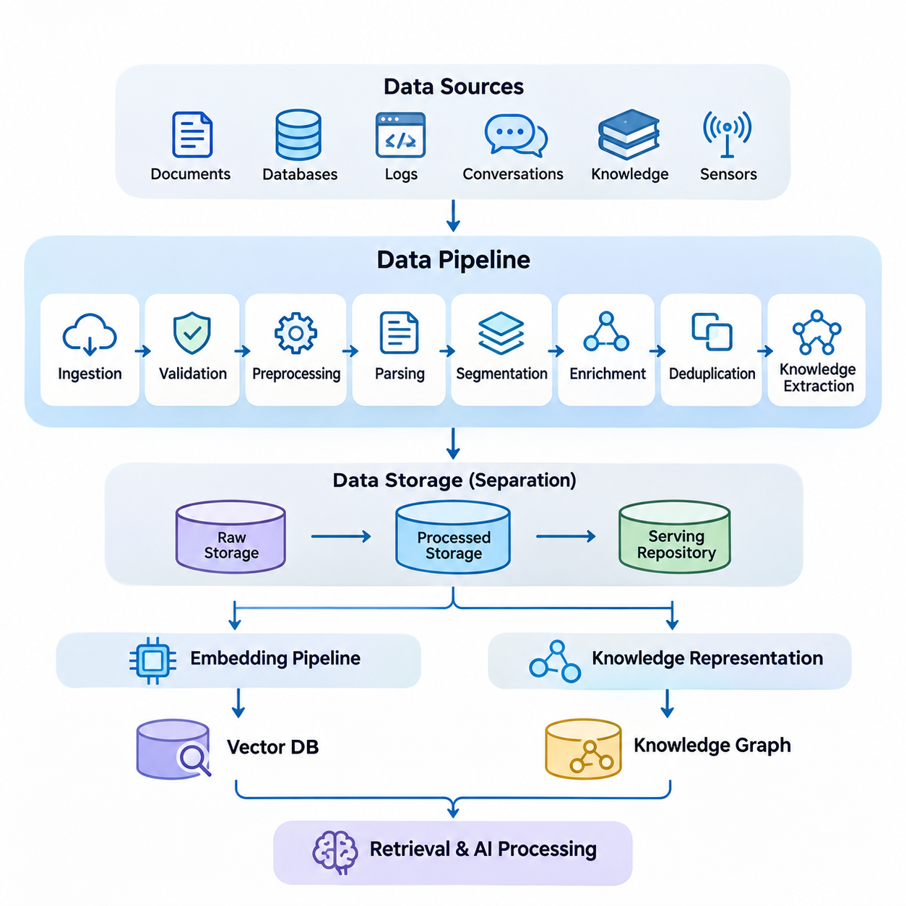
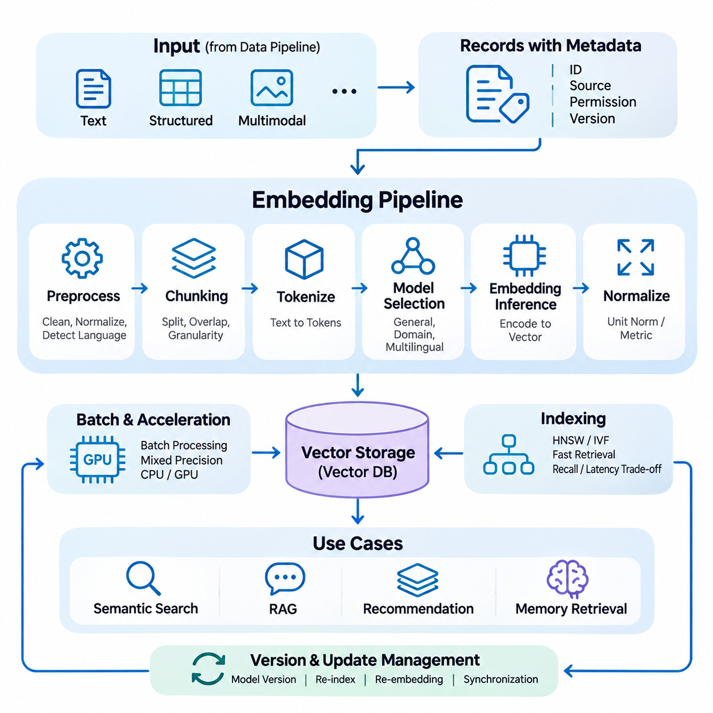
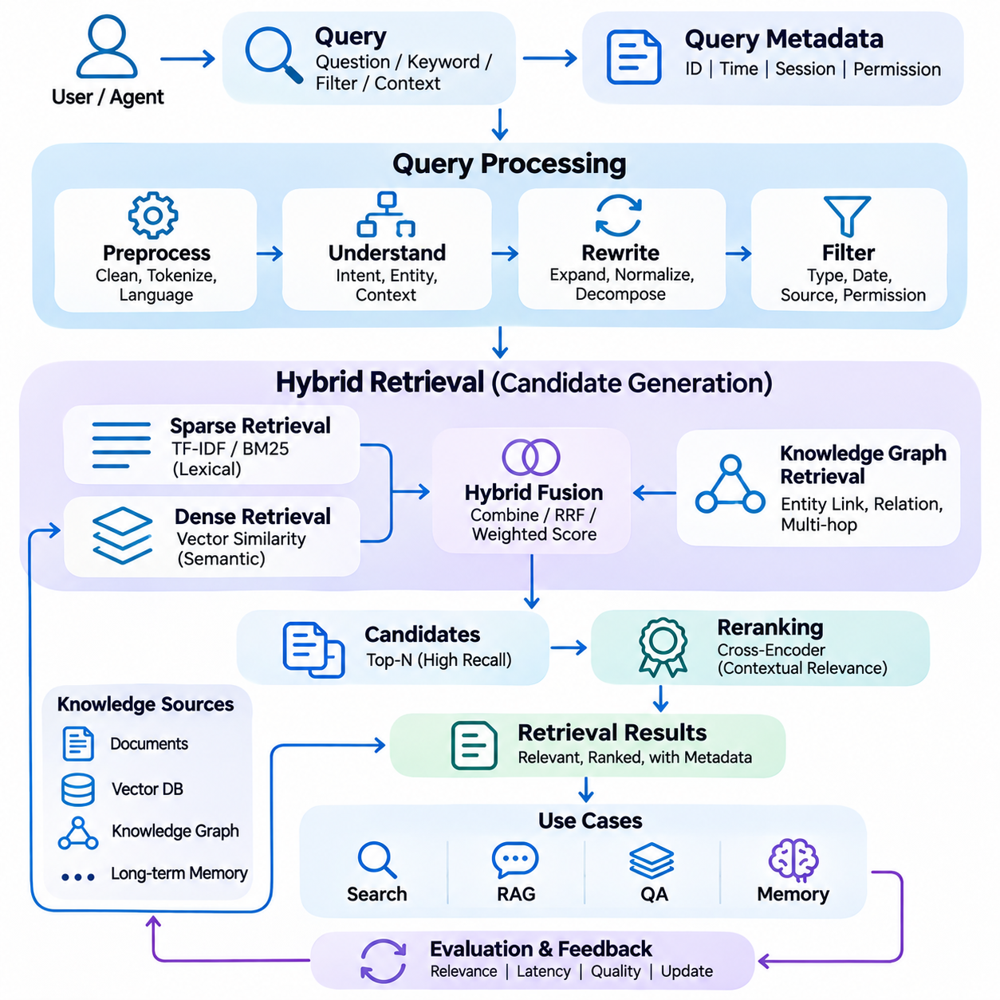
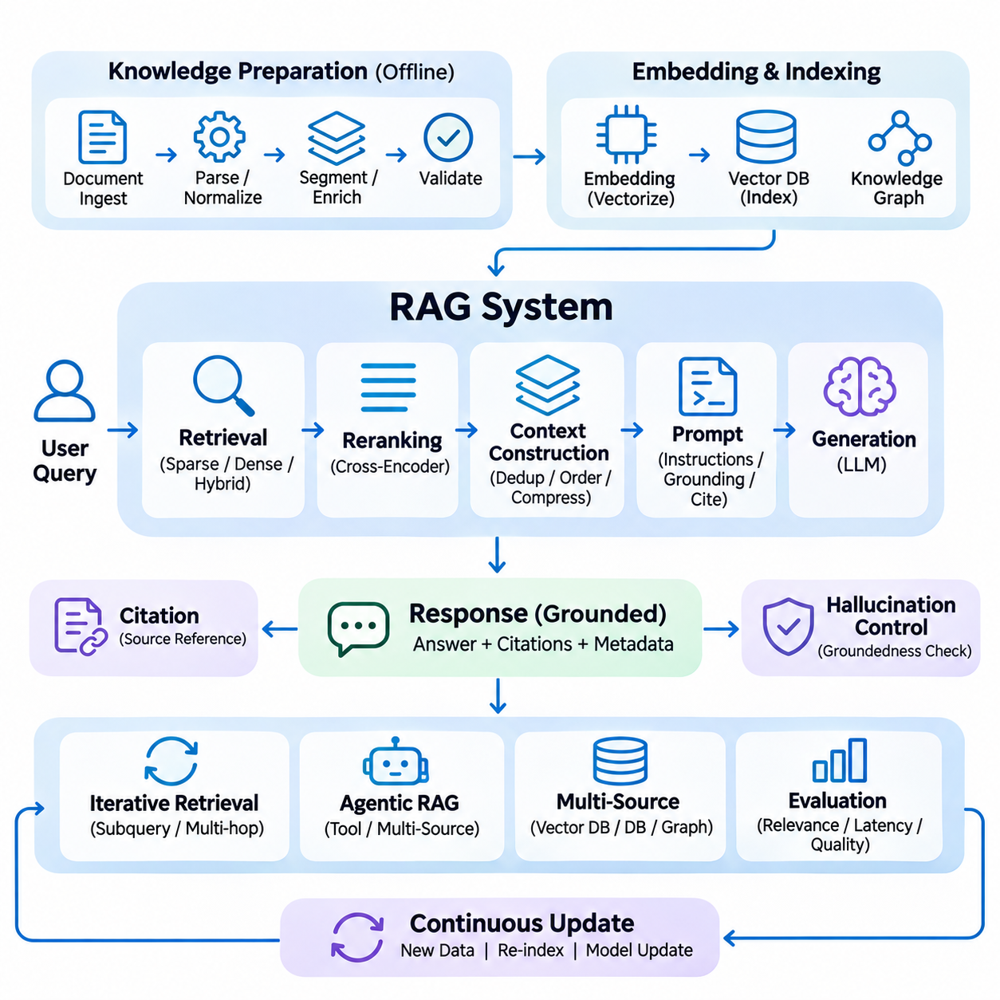
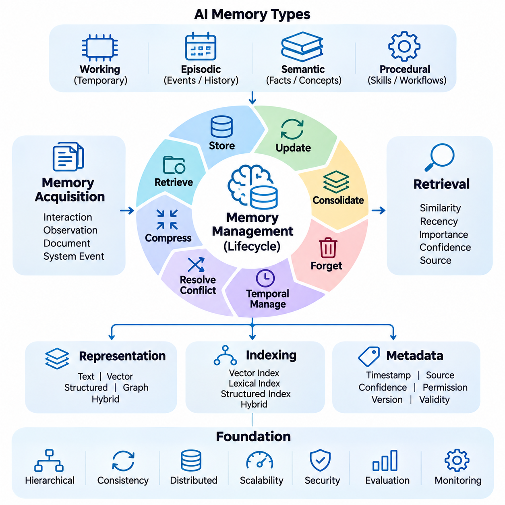
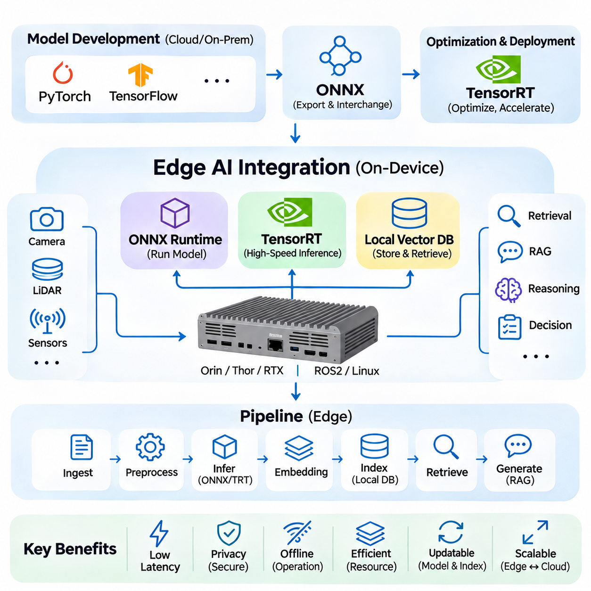
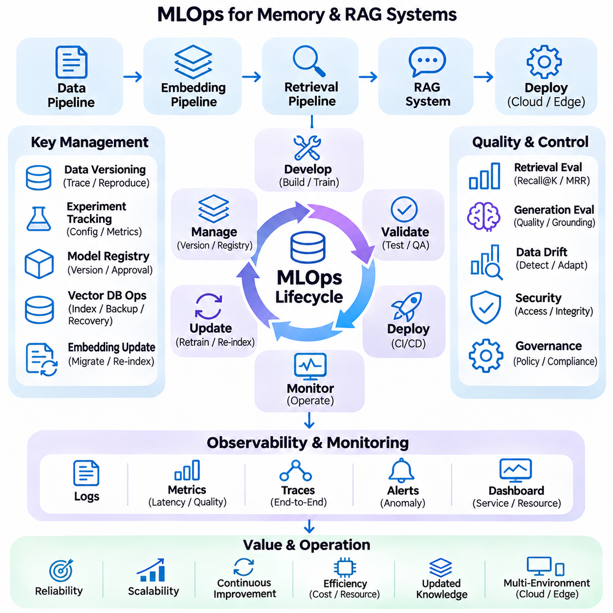

**Volume 37. Memory and Knowledge Systems**


# 07. Engineering and Deployment

## 07.01 Data Pipeline [w/Code]

{width="7.268055555555556in" height="7.268055555555556in"}

A data pipeline provides the engineering foundation for memory and knowledge systems by transforming heterogeneous information into structured, validated, and retrievable resources. Its primary purpose is to establish a reliable flow from raw data acquisition to persistent storage and downstream AI processing. In production environments, the pipeline must maintain data quality, traceability, scalability, and consistency while supporting continuous updates.

Modern memory and knowledge systems receive information from multiple sources, including documents, databases, application logs, conversational histories, knowledge repositories, and sensor streams. These sources differ in structure, format, reliability, and update frequency. A unified data pipeline must accommodate structured records, semi-structured metadata, unstructured text, and multimodal information without losing the contextual relationships required for accurate retrieval.

Data ingestion represents the initial stage of the pipeline, where information enters the processing environment through connectors, APIs, file systems, message queues, or streaming interfaces. Batch ingestion is suitable for large historical datasets, whereas streaming ingestion supports continuously generated events. Hybrid architectures combine both approaches to balance throughput, freshness, and operational complexity across enterprise and real-time applications.

Source identification and metadata acquisition are essential for maintaining information provenance. Each ingested record should preserve its origin, acquisition timestamp, document identifier, access permissions, and relevant version information. These attributes allow downstream components to distinguish authoritative sources from temporary observations and support auditing, filtering, and reproducibility when knowledge representations are updated.

Data validation determines whether incoming information satisfies the structural and semantic requirements of the system. Typical validation operations include schema checking, encoding verification, field completeness analysis, and consistency testing. Invalid records should be isolated for inspection rather than silently discarded. This approach prevents corrupted information from propagating into vector databases, knowledge graphs, and long-term memory repositories.

Preprocessing converts raw information into representations suitable for subsequent analysis. Textual processing may involve character normalization, removal of irrelevant formatting, language identification, and extraction of meaningful content. Structured records may require type conversion and schema alignment. The objective is not simply to simplify the data but to preserve the information necessary for semantic interpretation and reliable retrieval.

Document parsing is particularly important for retrieval-augmented generation systems because source materials frequently contain complex layouts, tables, headings, and embedded references. Parsing mechanisms must recover meaningful reading order while preserving document structure. Incorrect extraction can separate related concepts or combine unrelated passages, reducing retrieval accuracy and increasing the probability of misleading generated responses.

Data segmentation divides large documents or continuous information streams into manageable units for storage and retrieval. Segmentation strategies may follow paragraphs, semantic boundaries, document sections, or fixed token limits. Overlapping segments can preserve contextual continuity, although excessive overlap increases storage requirements and duplicate retrieval results. Appropriate segmentation depends on document structure and downstream query characteristics.

Metadata enrichment extends the original information with additional descriptive attributes, such as topic classifications, entity identifiers, temporal references, and relationships between documents. These attributes enable more precise filtering and context-aware retrieval. Enrichment may be performed through deterministic rules, natural language processing models, or knowledge extraction systems, provided that inferred attributes remain distinguishable from verified source information.

Duplicate detection prevents redundant information from unnecessarily expanding storage and retrieval indexes. Exact duplicates can be identified through cryptographic hashes, while near-duplicates require similarity analysis or content fingerprinting. Deduplication policies must account for document versions because similar records may contain important revisions. Preserving meaningful differences is essential for maintaining accurate and historically consistent knowledge.

Knowledge extraction transforms processed information into entities, attributes, and relationships that can support structured reasoning. Named entity recognition, relation extraction, and semantic classification provide mechanisms for identifying relevant concepts. Extracted knowledge may be stored in relational databases or knowledge graphs, while its original textual context remains available for verification and retrieval-based reasoning.

A production data pipeline commonly separates raw storage, processed storage, and serving-oriented repositories. Raw storage preserves original information for recovery and reprocessing, while processed storage contains normalized and validated records. Serving repositories organize information for efficient downstream access. This separation improves maintainability and allows preprocessing algorithms to evolve without requiring repeated acquisition of original data.

The pipeline must coordinate with embedding generation without tightly coupling every ingestion operation to a particular embedding model. Cleaned and segmented content can be passed to an independent embedding pipeline, which produces numerical representations for vector indexing. Separating these responsibilities allows embedding models, dimensionality, and indexing strategies to change while preserving the underlying source data and associated metadata.

Long-term memory systems introduce additional requirements because stored information may represent user interactions, historical events, learned preferences, or accumulated operational knowledge. The data pipeline must distinguish new observations from modifications to existing memories. Temporal metadata, confidence indicators, and source references help determine whether information should be appended, updated, consolidated, or retained as historical evidence.

Incremental processing improves efficiency by updating only records affected by newly acquired or modified information. Change data capture, event notifications, and scheduled synchronization can identify relevant modifications. Each change must propagate consistently through dependent storage and indexing components. Without coordinated updates, retrieval systems may return outdated embeddings, obsolete metadata, or references to deleted source documents.

Consistency management becomes challenging when the pipeline spans document stores, vector databases, knowledge graphs, and memory repositories. These systems may process updates asynchronously and expose different versions of the same information. Version identifiers, idempotent operations, transactional boundaries where supported, and reconciliation procedures help prevent inconsistent states and support recovery from partial processing failures.

Workflow orchestration coordinates the execution of ingestion, validation, transformation, enrichment, and storage operations. Dependencies between stages must be explicitly managed so that downstream tasks receive complete and validated inputs. Scheduling mechanisms, retry policies, checkpoints, and failure notifications improve operational reliability. Distributed execution can increase throughput when workloads contain independent processing tasks.

Scalability requires the pipeline to accommodate growing document collections, increasing ingestion rates, and more complex transformations. Horizontal scaling distributes workloads across processing workers, while partitioning organizes information by source, tenant, or time period. Queue-based buffering can absorb temporary workload spikes. However, scaling decisions must consider storage bandwidth, network transfer, processing latency, and downstream indexing capacity.

Security and privacy controls must operate throughout the data lifecycle rather than only at the storage layer. Authentication, authorization, encryption, and access logging protect sensitive information during acquisition, processing, and retrieval. Permission metadata should propagate into downstream indexes so that retrieval results respect source-level restrictions. Retention policies and deletion workflows must also address derived representations and cached information.

Data lineage records how information moves through processing stages and how each output relates to its original source. A lineage record may include transformation versions, processing timestamps, validation results, and identifiers of generated artifacts. This traceability supports debugging, compliance reviews, and reproducible experiments. It also allows engineers to identify which knowledge records require regeneration after processing logic changes.

Observability provides continuous insight into pipeline health and processing quality. Operational metrics include ingestion throughput, processing latency, queue depth, failure rates, and resource utilization. Data quality metrics may track missing fields, duplicate ratios, parsing errors, and rejected records. Monitoring these indicators enables engineers to identify bottlenecks and distinguish infrastructure failures from degradation in information quality.

Testing must address both individual transformations and complete processing workflows. Unit tests verify deterministic operations, integration tests examine communication between pipeline components, and end-to-end tests evaluate the movement of representative documents into serving repositories. Regression datasets help detect unintended changes in parsing, segmentation, or metadata extraction. Testing should also cover malformed inputs, partial failures, and recovery procedures.

Deployment strategies should support controlled evolution of pipeline components without disrupting existing knowledge services. Configuration management, containerization, automated validation, and staged releases reduce operational risk. Schema migrations and transformation changes require compatibility planning because stored records may have been produced by earlier software versions. Rollback procedures should preserve recoverability when newly deployed processing logic produces unexpected results.

Edge AI environments introduce constraints involving computation, connectivity, energy consumption, and local storage capacity. A distributed pipeline may preprocess sensor observations or operational records locally before synchronizing selected information with cloud infrastructure. Local buffering enables continued operation during communication interruptions. Synchronization policies must resolve delayed updates and maintain consistency between local memory repositories and centralized knowledge services.

Ultimately, data pipeline engineering determines whether memory and knowledge systems can operate reliably beyond controlled demonstrations. High-quality ingestion, traceable transformations, coordinated updates, and continuous monitoring establish the foundation for embedding pipelines, retrieval services, RAG applications, and persistent AI memory. A well-engineered pipeline converts heterogeneous information into dependable knowledge assets while supporting long-term maintenance, adaptation, and scalable deployment.

데이터 파이프라인(Data Pipeline)은 이기종 정보(Heterogeneous Information)를 구조화되고 검증되며 검색 가능한 자원으로 변환함으로써 메모리 및 지식 시스템(Memory and Knowledge Systems)의 엔지니어링 기반을 제공한다. 주요 목적은 원시 데이터 수집(Raw Data Acquisition)부터 영구 저장(Persistent Storage), 후속 인공지능 처리(Downstream AI Processing)까지 신뢰할 수 있는 데이터 흐름을 구축하는 것이다. 실제 운영 환경에서는 지속적인 갱신을 지원하면서 데이터 품질(Data Quality), 추적 가능성(Traceability), 확장성(Scalability), 일관성(Consistency)을 유지해야 한다.

현대적인 메모리 및 지식 시스템은 문서(Documents), 데이터베이스(Databases), 애플리케이션 로그(Application Logs), 대화 이력(Conversational Histories), 지식 저장소(Knowledge Repositories), 센서 스트림(Sensor Streams) 등 다양한 출처에서 정보를 수집한다. 이러한 데이터 소스(Data Sources)는 구조, 형식, 신뢰성, 갱신 빈도에서 차이를 보인다. 통합 데이터 파이프라인(Unified Data Pipeline)은 정확한 검색에 필요한 문맥적 관계(Contextual Relationships)를 손상하지 않으면서 정형 데이터(Structured Data), 반정형 메타데이터(Semi-Structured Metadata), 비정형 텍스트(Unstructured Text), 멀티모달 정보(Multimodal Information)를 처리해야 한다.

데이터 수집(Data Ingestion)은 커넥터(Connectors), 응용 프로그래밍 인터페이스(Application Programming Interfaces, APIs), 파일 시스템(File Systems), 메시지 큐(Message Queues), 스트리밍 인터페이스(Streaming Interfaces)를 통해 정보가 처리 환경에 유입되는 초기 단계이다. 배치 수집(Batch Ingestion)은 대규모 과거 데이터셋(Historical Datasets)에 적합하며, 스트리밍 수집(Streaming Ingestion)은 지속적으로 생성되는 이벤트를 지원한다. 하이브리드 아키텍처(Hybrid Architecture)는 두 방식을 결합하여 처리량(Throughput), 데이터 최신성(Data Freshness), 운영 복잡성(Operational Complexity)의 균형을 유지한다.

데이터 출처 식별(Source Identification)과 메타데이터 수집(Metadata Acquisition)은 정보 출처 추적성(Data Provenance)을 유지하는 데 필수적이다. 수집된 각 레코드(Record)는 원본 출처, 수집 시각, 문서 식별자(Document Identifier), 접근 권한(Access Permissions), 관련 버전 정보(Version Information)를 보존해야 한다. 이러한 속성은 후속 처리 구성요소가 권위 있는 정보원(Authoritative Sources)과 일시적 관측 정보(Temporary Observations)를 구별하도록 하며, 지식 표현(Knowledge Representation)을 갱신할 때 감사(Auditing), 필터링(Filtering), 재현성(Reproducibility)을 지원한다.

데이터 검증(Data Validation)은 입력 정보가 시스템의 구조적 및 의미적 요구사항(Structural and Semantic Requirements)을 충족하는지 판단한다. 대표적인 검증 작업에는 스키마 검사(Schema Checking), 인코딩 검증(Encoding Verification), 필드 완전성 분석(Field Completeness Analysis), 일관성 검사(Consistency Testing)가 포함된다. 유효하지 않은 레코드는 조용히 삭제하기보다 별도로 격리하여 검사해야 한다. 이러한 접근 방식은 손상된 정보가 벡터 데이터베이스(Vector Databases), 지식 그래프(Knowledge Graphs), 장기 메모리 저장소(Long-Term Memory Repositories)로 전파되는 것을 방지한다.

전처리(Preprocessing)는 원시 정보를 후속 분석에 적합한 표현으로 변환한다. 텍스트 처리(Text Processing)에는 문자 정규화(Character Normalization), 불필요한 서식 제거, 언어 식별(Language Identification), 의미 있는 콘텐츠 추출(Content Extraction)이 포함될 수 있다. 정형 레코드(Structured Records)는 자료형 변환(Type Conversion)과 스키마 정렬(Schema Alignment)이 필요할 수 있다. 전처리의 목적은 단순히 데이터를 간소화하는 것이 아니라 의미적 해석(Semantic Interpretation)과 신뢰할 수 있는 검색에 필요한 정보를 보존하는 것이다.

문서 파싱(Document Parsing)은 검색 증강 생성(Retrieval-Augmented Generation, RAG) 시스템에서 특히 중요하다. 원본 자료에는 복잡한 레이아웃(Layouts), 표(Tables), 제목(Headings), 내장 참조(Embedded References)가 포함되는 경우가 많기 때문이다. 파싱 메커니즘(Parsing Mechanisms)은 문서 구조를 보존하면서 의미 있는 읽기 순서(Reading Order)를 복원해야 한다. 잘못된 추출은 관련 개념을 분리하거나 무관한 문장을 결합하여 검색 정확도(Retrieval Accuracy)를 낮추고 잘못된 생성 응답(Misleading Generated Responses)의 가능성을 증가시킨다.

데이터 분할(Data Segmentation)은 대규모 문서나 연속적인 정보 스트림을 저장과 검색에 적합한 관리 단위로 나누는 과정이다. 분할 전략(Segmentation Strategies)은 문단, 의미적 경계(Semantic Boundaries), 문서 절(Document Sections), 고정 토큰 제한(Fixed Token Limits)을 기준으로 설계할 수 있다. 중첩 세그먼트(Overlapping Segments)는 문맥의 연속성을 보존하지만 과도한 중첩은 저장 공간과 중복 검색 결과를 증가시킨다. 적절한 분할 방식은 문서 구조와 후속 검색 질의(Query)의 특성에 따라 결정된다.

메타데이터 보강(Metadata Enrichment)은 주제 분류(Topic Classification), 개체 식별자(Entity Identifiers), 시간 참조(Temporal References), 문서 간 관계(Relationships Between Documents)와 같은 추가적인 설명 속성을 원본 정보에 부여한다. 이러한 속성은 정밀한 필터링과 문맥 인식 검색(Context-Aware Retrieval)을 가능하게 한다. 보강 작업은 결정론적 규칙(Deterministic Rules), 자연어 처리(Natural Language Processing, NLP) 모델, 지식 추출(Knowledge Extraction) 시스템을 통해 수행할 수 있으며, 추론된 속성은 검증된 원본 정보와 구별되어야 한다.

중복 탐지(Duplicate Detection)는 불필요하게 반복되는 정보가 저장소와 검색 인덱스(Retrieval Indexes)를 확장하는 것을 방지한다. 완전히 동일한 데이터는 암호학적 해시(Cryptographic Hashes)로 식별할 수 있으며, 유사 중복(Near-Duplicates)은 유사도 분석(Similarity Analysis)이나 콘텐츠 지문(Content Fingerprinting)을 활용해야 한다. 중복 제거 정책(Deduplication Policies)은 유사한 레코드에 중요한 수정 사항이 포함될 수 있으므로 문서 버전(Document Versions)을 고려해야 한다. 의미 있는 차이를 보존하는 것은 정확하고 역사적으로 일관된 지식을 유지하는 데 필수적이다.

지식 추출(Knowledge Extraction)은 처리된 정보를 구조적 추론(Structured Reasoning)에 활용할 수 있는 개체(Entities), 속성(Attributes), 관계(Relationships)로 변환한다. 개체명 인식(Named Entity Recognition), 관계 추출(Relation Extraction), 의미 분류(Semantic Classification)는 관련 개념을 식별하는 메커니즘을 제공한다. 추출된 지식은 관계형 데이터베이스(Relational Databases) 또는 지식 그래프(Knowledge Graphs)에 저장할 수 있으며, 원본 텍스트 문맥(Original Textual Context)은 검증과 검색 기반 추론(Retrieval-Based Reasoning)을 위해 유지된다.

운영용 데이터 파이프라인(Production Data Pipeline)은 일반적으로 원시 저장소(Raw Storage), 처리된 데이터 저장소(Processed Storage), 서비스 지향 저장소(Serving-Oriented Repositories)를 분리한다. 원시 저장소는 복구와 재처리를 위해 원본 정보를 보존하고, 처리된 저장소는 정규화되고 검증된 레코드를 관리한다. 서비스 저장소는 효율적인 후속 접근을 위해 정보를 구성한다. 이러한 분리는 유지보수성(Maintainability)을 향상시키고 원본 데이터를 다시 수집하지 않고도 전처리 알고리즘(Preprocessing Algorithms)을 개선할 수 있도록 한다.

데이터 파이프라인은 모든 수집 작업을 특정 임베딩 모델(Embedding Model)에 강하게 결합하지 않으면서 임베딩 생성(Embedding Generation)과 연계되어야 한다. 정제되고 분할된 콘텐츠는 독립적인 임베딩 파이프라인(Embedding Pipeline)으로 전달되어 벡터 인덱싱(Vector Indexing)에 필요한 수치 표현(Numerical Representations)을 생성한다. 이러한 책임 분리(Separation of Responsibilities)는 원본 데이터와 관련 메타데이터를 보존하면서 임베딩 모델, 차원 수(Dimensionality), 인덱싱 전략(Indexing Strategies)을 변경할 수 있게 한다.

장기 메모리 시스템(Long-Term Memory Systems)은 저장된 정보가 사용자 상호작용(User Interactions), 과거 사건(Historical Events), 학습된 선호도(Learned Preferences), 축적된 운영 지식(Accumulated Operational Knowledge)을 나타낼 수 있으므로 추가적인 요구사항이 발생한다. 데이터 파이프라인은 새로운 관측 정보와 기존 메모리의 수정 사항을 구별해야 한다. 시간 메타데이터(Temporal Metadata), 신뢰도 지표(Confidence Indicators), 출처 참조(Source References)는 정보를 추가, 갱신, 통합 또는 과거 증거로 유지할지 판단하는 데 도움을 준다.

증분 처리(Incremental Processing)는 새롭게 수집되거나 수정된 정보의 영향을 받는 레코드만 갱신하여 효율성을 향상시킨다. 변경 데이터 캡처(Change Data Capture, CDC), 이벤트 알림(Event Notifications), 예약 동기화(Scheduled Synchronization)는 관련 변경 사항을 식별할 수 있다. 각 변경 사항은 종속된 저장소와 인덱싱 구성요소에 일관되게 전파되어야 한다. 조정되지 않은 갱신은 오래된 임베딩, 폐기된 메타데이터, 삭제된 원본 문서에 대한 참조를 검색 결과에 남길 수 있다.

일관성 관리(Consistency Management)는 데이터 파이프라인이 문서 저장소(Document Stores), 벡터 데이터베이스(Vector Databases), 지식 그래프(Knowledge Graphs), 메모리 저장소(Memory Repositories)에 걸쳐 구성될 때 더욱 복잡해진다. 이러한 시스템은 갱신을 비동기적으로 처리하며 동일한 정보의 서로 다른 버전을 제공할 수 있다. 버전 식별자(Version Identifiers), 멱등 연산(Idempotent Operations), 지원되는 경우의 트랜잭션 경계(Transactional Boundaries), 조정 절차(Reconciliation Procedures)는 불일치 상태를 방지하고 부분적인 처리 실패로부터 복구하도록 지원한다.

워크플로 오케스트레이션(Workflow Orchestration)은 데이터 수집, 검증, 변환, 보강, 저장 작업의 실행을 조정한다. 각 단계 사이의 의존성(Dependencies)은 후속 작업이 완전하고 검증된 입력을 받도록 명시적으로 관리되어야 한다. 스케줄링 메커니즘(Scheduling Mechanisms), 재시도 정책(Retry Policies), 체크포인트(Checkpoints), 장애 알림(Failure Notifications)은 운영 신뢰성(Operational Reliability)을 향상시킨다. 분산 실행(Distributed Execution)은 독립적인 처리 작업이 포함된 워크로드(Workloads)의 처리량을 증가시킬 수 있다.

확장성(Scalability)은 문서 컬렉션(Document Collections)의 증가, 수집 속도의 상승, 복잡한 변환 작업을 수용할 수 있어야 한다. 수평 확장(Horizontal Scaling)은 여러 처리 작업자(Processing Workers)에게 워크로드를 분산하며, 파티셔닝(Partitioning)은 출처, 테넌트(Tenant), 시간 구간에 따라 정보를 구성한다. 큐 기반 버퍼링(Queue-Based Buffering)은 일시적인 작업량 급증을 흡수할 수 있다. 그러나 확장 설계에서는 저장소 대역폭(Storage Bandwidth), 네트워크 전송(Network Transfer), 처리 지연시간(Processing Latency), 후속 인덱싱 용량(Indexing Capacity)을 함께 고려해야 한다.

보안 및 개인정보 보호 제어(Security and Privacy Controls)는 저장 계층에만 적용되는 것이 아니라 전체 데이터 수명주기(Data Lifecycle)에 걸쳐 작동해야 한다. 인증(Authentication), 인가(Authorization), 암호화(Encryption), 접근 기록(Access Logging)은 수집, 처리, 검색 과정에서 민감한 정보를 보호한다. 권한 메타데이터(Permission Metadata)는 후속 인덱스에도 전달되어 검색 결과가 원본의 접근 제한을 준수하도록 해야 한다. 보존 정책(Retention Policies)과 삭제 워크플로(Deletion Workflows)는 파생 표현(Derived Representations)과 캐시 정보(Cached Information)까지 고려해야 한다.

데이터 계보(Data Lineage)는 정보가 처리 단계를 통과하는 과정과 각 출력이 원본 출처와 어떤 관계를 가지는지 기록한다. 계보 기록(Lineage Record)에는 변환 버전(Transformation Versions), 처리 시각(Processing Timestamps), 검증 결과(Validation Results), 생성된 산출물 식별자(Artifact Identifiers)가 포함될 수 있다. 이러한 추적성은 디버깅(Debugging), 규정 준수 검토(Compliance Reviews), 재현 가능한 실험(Reproducible Experiments)을 지원하며, 처리 로직이 변경된 이후 어떤 지식 레코드를 다시 생성해야 하는지 식별할 수 있도록 한다.

관측 가능성(Observability)은 파이프라인의 상태와 처리 품질에 대한 지속적인 가시성을 제공한다. 운영 지표(Operational Metrics)에는 수집 처리량(Ingestion Throughput), 처리 지연시간(Processing Latency), 큐 깊이(Queue Depth), 장애율(Failure Rates), 자원 사용률(Resource Utilization)이 포함된다. 데이터 품질 지표(Data Quality Metrics)는 누락 필드(Missing Fields), 중복 비율(Duplicate Ratios), 파싱 오류(Parsing Errors), 거부된 레코드(Rejected Records)를 추적할 수 있다. 이러한 지표를 모니터링하면 병목 현상(Bottlenecks)을 식별하고 인프라 장애와 정보 품질 저하를 구별할 수 있다.

테스트(Testing)는 개별 변환 작업과 전체 처리 워크플로를 모두 검증해야 한다. 단위 테스트(Unit Tests)는 결정론적 연산(Deterministic Operations)을 검증하고, 통합 테스트(Integration Tests)는 파이프라인 구성요소 사이의 통신을 검사하며, 종단 간 테스트(End-to-End Tests)는 대표 문서가 서비스 저장소까지 전달되는 과정을 평가한다. 회귀 테스트 데이터셋(Regression Datasets)은 파싱, 분할, 메타데이터 추출에서 의도하지 않은 변경을 탐지한다. 또한 잘못된 입력, 부분 장애, 복구 절차에 대한 테스트도 수행해야 한다.

배포 전략(Deployment Strategies)은 기존 지식 서비스의 운영을 중단하지 않으면서 파이프라인 구성요소를 통제된 방식으로 개선할 수 있어야 한다. 구성 관리(Configuration Management), 컨테이너화(Containerization), 자동 검증(Automated Validation), 단계적 배포(Staged Releases)는 운영 위험을 감소시킨다. 저장된 레코드가 이전 소프트웨어 버전에서 생성되었을 수 있으므로 스키마 마이그레이션(Schema Migration)과 변환 변경에는 호환성 계획(Compatibility Planning)이 필요하다. 롤백 절차(Rollback Procedures)는 새로운 처리 로직에서 예상하지 못한 결과가 발생했을 때 복구 가능성을 보장하도록 설계되어야 한다.

엣지 인공지능(Edge AI) 환경에서는 연산 능력(Computation), 연결성(Connectivity), 에너지 소비(Energy Consumption), 로컬 저장 용량(Local Storage Capacity)에 제약이 발생한다. 분산 데이터 파이프라인(Distributed Data Pipeline)은 센서 관측 정보(Sensor Observations)나 운영 레코드(Operational Records)를 로컬에서 전처리한 후 선택된 정보를 클라우드 인프라(Cloud Infrastructure)와 동기화할 수 있다. 로컬 버퍼링(Local Buffering)은 통신이 중단되어도 운영을 지속할 수 있도록 하며, 동기화 정책(Synchronization Policies)은 지연된 갱신을 조정하고 로컬 메모리 저장소와 중앙 지식 서비스 사이의 일관성을 유지해야 한다.

궁극적으로 데이터 파이프라인 엔지니어링(Data Pipeline Engineering)은 메모리 및 지식 시스템이 통제된 시연 환경을 넘어 실제 운영 환경에서 안정적으로 작동할 수 있는지를 결정한다. 고품질 데이터 수집(High-Quality Ingestion), 추적 가능한 변환(Traceable Transformations), 조정된 갱신(Coordinated Updates), 지속적인 모니터링(Continuous Monitoring)은 임베딩 파이프라인(Embedding Pipelines), 검색 서비스(Retrieval Services), 검색 증강 생성 응용 시스템(RAG Applications), 영구 인공지능 메모리(Persistent AI Memory)의 기반을 형성한다. 잘 설계된 데이터 파이프라인은 이기종 정보를 신뢰할 수 있는 지식 자산(Knowledge Assets)으로 변환하면서 장기적인 유지보수, 적응, 확장 가능한 배포를 지원한다.

## 07.02 Embedding Pipeline [w/Code]

{width="7.268055555555556in" height="7.268055555555556in"}

An embedding pipeline is a fundamental component of modern memory and knowledge systems, transforming textual, structured, and multimodal information into numerical vector representations. These representations capture semantic relationships and enable similarity-based retrieval across large knowledge collections. A production embedding pipeline must provide consistent preprocessing, efficient inference, reliable indexing, and continuous synchronization with evolving information sources.

The primary objective of embedding generation is to map information into a continuous vector space where semantically related items occupy nearby regions. Unlike traditional keyword representations, dense embeddings can capture contextual similarities even when documents use different terminology. This capability supports semantic search, retrieval-augmented generation, recommendation systems, and long-term memory retrieval across heterogeneous knowledge repositories.

Embedding pipelines typically receive validated and normalized content from upstream data processing systems. Each input record contains textual content, document identifiers, source metadata, access permissions, and version information. The embedding pipeline must preserve these attributes while generating vector representations. Maintaining a reliable association between source records and embeddings is essential for traceability, retrieval filtering, and subsequent updates.

Text preparation strongly influences embedding quality because models operate on tokenized representations rather than raw documents. Preprocessing may include Unicode normalization, removal of extraction artifacts, language identification, and correction of malformed text. However, excessive normalization can eliminate technical terminology, numerical values, or contextual distinctions. Therefore, preprocessing policies should preserve information that contributes to semantic meaning.

Document chunking determines the granularity of information represented by each embedding vector. Large documents are commonly divided into passages according to paragraphs, semantic boundaries, or token constraints. Smaller chunks improve retrieval specificity but may lose broader context, while larger chunks preserve continuity at the expense of precision. Chunk size and overlap should be selected through evaluation rather than relying on universal configuration values.

Embedding model selection requires consideration of semantic accuracy, supported languages, vector dimensionality, computational requirements, and inference latency. General-purpose models provide broad coverage, whereas domain-adapted models may better represent specialized terminology. Multilingual models support cross-language retrieval when their training objectives align different languages within a shared representation space. Model selection should reflect actual query distributions and deployment constraints.

Tokenization converts prepared text into discrete units accepted by the embedding model. Different tokenizers produce different sequence lengths, particularly for multilingual documents, mathematical expressions, and specialized technical vocabulary. Inputs exceeding the model context limit must be segmented or truncated according to explicit policies. Silent truncation can discard important evidence and produce embeddings that do not accurately represent the intended content.

Embedding inference transforms token sequences into fixed-dimensional vectors using neural network encoders. Transformer-based architectures commonly generate contextual token representations that are aggregated through pooling mechanisms or specialized output tokens. The resulting vector summarizes aspects of the input\'s semantic content. Although embeddings support similarity comparisons, they cannot guarantee preservation of every factual detail contained in the original information.

Vector normalization is frequently applied to improve consistency across similarity calculations. Unit-length normalization makes cosine similarity equivalent to the dot product for normalized vectors, simplifying some retrieval implementations. However, normalization is not universally optimal because certain models rely on vector magnitude. Similarity metrics and normalization procedures must follow the embedding model\'s intended configuration and be validated against representative retrieval tasks.

Batch processing improves embedding throughput by grouping multiple inputs into inference requests. Efficient batching reduces per-request overhead and improves accelerator utilization, particularly when processing large document collections. Nevertheless, variable sequence lengths can introduce padding inefficiency and memory pressure. Dynamic batching, length-aware grouping, and controlled batch sizes help balance throughput, GPU memory consumption, and processing latency.

Hardware acceleration significantly affects the operational efficiency of embedding pipelines. GPUs can process neural embedding models at high throughput, while CPUs remain practical for smaller workloads or lightweight encoders. Mixed-precision inference may reduce memory usage and improve computational efficiency on supported hardware. Deployment decisions should account for model size, expected request volume, power consumption, and latency requirements.

Once generated, embeddings are associated with stable identifiers and stored in vector databases or specialized similarity indexes. Each vector should retain references to its source document, chunk boundaries, model version, and relevant metadata. Approximate nearest neighbor indexing techniques, including HNSW and IVF, enable efficient retrieval across large collections. Index configuration introduces tradeoffs among search latency, recall, memory consumption, and update complexity.

Embedding version management is critical because vectors produced by different models may occupy incompatible representation spaces. Changes to model architecture, training weights, pooling strategies, or preprocessing procedures can alter similarity relationships. Production systems should record embedding model identifiers and transformation configurations. Model upgrades may require re-embedding stored content and rebuilding indexes before switching retrieval traffic.

Incremental embedding generation reduces unnecessary computation when knowledge repositories evolve. Newly added documents require vector creation, while modified documents require identification and regeneration of affected chunks. Deleted records must be removed from corresponding indexes and associated caches. Content hashes and version identifiers help distinguish unchanged information from material revisions, supporting efficient and reproducible synchronization.

Consistency between source repositories and vector indexes is essential for accurate retrieval. Asynchronous processing can create temporary differences between document content and its indexed representation. Systems may use event queues, versioned records, reconciliation jobs, and controlled index activation to manage these differences. Retrieval services should avoid returning obsolete or unauthorized information during synchronization delays.

Caching can reduce repeated inference costs when identical content or queries appear frequently. Embedding caches commonly use content hashes combined with model and preprocessing versions to identify reusable results. Query embedding caches can improve response latency for repeated searches. Cache invalidation remains necessary whenever models, normalization procedures, or source content change, particularly in systems requiring strict information freshness.

Multimodal embedding pipelines extend representation learning beyond text to images, audio, video, and sensor observations. Specialized encoders transform each modality into numerical representations, while aligned multimodal models enable cross-modal similarity comparisons. However, embeddings from unrelated encoders are not automatically comparable. Cross-modal retrieval requires compatible training objectives, shared representation spaces, or explicitly learned alignment mechanisms.

Knowledge-aware embedding systems may incorporate entity descriptions, graph relationships, and structured attributes into representation generation. These approaches can improve retrieval when semantic meaning depends on relationships that are not explicit in isolated text passages. Knowledge graph embeddings and textual embeddings may be combined through hybrid retrieval architectures. Their integration requires careful evaluation because different representations capture different forms of information.

Long-term memory applications introduce additional challenges involving temporal relevance, evolving preferences, and memory consolidation. Embeddings representing historical interactions should remain connected to timestamps, contextual identifiers, and source evidence. When memories are summarized or updated, their vector representations may require regeneration. Temporal relevance and confidence should generally be handled through retrieval metadata or ranking mechanisms rather than assumed to be encoded completely within vectors.

Embedding quality must be evaluated through downstream retrieval performance rather than geometric properties alone. Common evaluation metrics include Recall\\@K, Mean Reciprocal Rank, and Normalized Discounted Cumulative Gain. Benchmark datasets should contain representative queries, relevant documents, difficult negatives, and domain-specific terminology. Evaluation across multiple languages and document types helps identify weaknesses that aggregate metrics may conceal.

Operational monitoring should track embedding throughput, inference latency, error rates, GPU utilization, queue depth, and indexing delays. Data quality monitoring should identify empty inputs, unexpected vector dimensions, invalid numerical values, and abnormal embedding distributions. Changes in similarity scores or retrieval performance may indicate model drift, preprocessing inconsistencies, or altered input characteristics. Monitoring supports early detection of degradation.

Security requirements extend from source documents to generated vectors and associated metadata. Embeddings can retain sensitive information and should not automatically be treated as anonymous representations. Access controls, encryption, tenant isolation, and retention policies must remain effective throughout processing and storage. Deletion requests should propagate to vectors, indexes, and caches, with verification procedures appropriate to the system\'s privacy requirements.

Edge deployment requires embedding pipelines to operate within limited computational resources, memory capacity, and communication bandwidth. Quantized models, lightweight encoders, and local vector databases can support semantic retrieval without continuous cloud connectivity. Edge systems may generate embeddings locally and synchronize selected records with centralized repositories. Model compatibility and version coordination are necessary to maintain consistent retrieval behavior across distributed environments.

A well-engineered embedding pipeline connects raw knowledge processing with scalable semantic retrieval and persistent AI memory. Its effectiveness depends on coordinated preprocessing, model selection, vector generation, indexing, synchronization, evaluation, and operational monitoring. By preserving traceability and managing representation changes systematically, embedding pipelines provide a reliable foundation for RAG systems, intelligent agents, knowledge integration, and adaptive AI applications.

임베딩 파이프라인(Embedding Pipeline)은 현대적인 메모리 및 지식 시스템(Memory and Knowledge Systems)의 핵심 구성요소로서 텍스트, 정형 데이터(Structured Data), 멀티모달 정보(Multimodal Information)를 수치 벡터 표현(Numerical Vector Representations)으로 변환한다. 이러한 표현은 의미적 관계(Semantic Relationships)를 포착하고 대규모 지식 컬렉션(Knowledge Collections)에서 유사도 기반 검색(Similarity-Based Retrieval)을 가능하게 한다. 운영용 임베딩 파이프라인(Production Embedding Pipeline)은 일관된 전처리(Preprocessing), 효율적인 추론(Inference), 신뢰할 수 있는 인덱싱(Indexing), 지속적으로 변화하는 정보원과의 동기화(Synchronization)를 제공해야 한다.

임베딩 생성(Embedding Generation)의 주요 목적은 의미적으로 관련된 항목들이 서로 가까운 영역에 위치하도록 정보를 연속 벡터 공간(Continuous Vector Space)에 매핑하는 것이다. 기존의 키워드 표현(Keyword Representations)과 달리 밀집 임베딩(Dense Embeddings)은 문서에서 서로 다른 용어를 사용하더라도 문맥적 유사성(Contextual Similarities)을 포착할 수 있다. 이러한 기능은 이기종 지식 저장소(Heterogeneous Knowledge Repositories) 전반에서 의미 검색(Semantic Search), 검색 증강 생성(Retrieval-Augmented Generation, RAG), 추천 시스템(Recommendation Systems), 장기 메모리 검색(Long-Term Memory Retrieval)을 지원한다.

임베딩 파이프라인은 일반적으로 상위 데이터 처리 시스템(Upstream Data Processing Systems)에서 검증되고 정규화된 콘텐츠(Validated and Normalized Content)를 입력받는다. 각 입력 레코드(Input Record)에는 텍스트 콘텐츠(Textual Content), 문서 식별자(Document Identifiers), 출처 메타데이터(Source Metadata), 접근 권한(Access Permissions), 버전 정보(Version Information)가 포함된다. 임베딩 파이프라인은 벡터 표현을 생성하면서 이러한 속성을 보존해야 한다. 원본 레코드와 임베딩 사이의 신뢰할 수 있는 연결 관계를 유지하는 것은 추적 가능성(Traceability), 검색 필터링(Retrieval Filtering), 후속 갱신(Subsequent Updates)에 필수적이다.

텍스트 준비(Text Preparation)는 임베딩 품질(Embedding Quality)에 큰 영향을 미친다. 모델은 원시 문서(Raw Documents)가 아니라 토큰화된 표현(Tokenized Representations)을 처리하기 때문이다. 전처리에는 유니코드 정규화(Unicode Normalization), 추출 과정에서 발생한 불필요한 요소 제거(Removal of Extraction Artifacts), 언어 식별(Language Identification), 잘못된 텍스트 수정(Correction of Malformed Text)이 포함될 수 있다. 그러나 과도한 정규화(Excessive Normalization)는 기술 용어, 수치, 문맥적 차이를 제거할 수 있으므로 의미적 정보(Semantic Information)를 보존하는 전처리 정책이 필요하다.

문서 청킹(Document Chunking)은 각 임베딩 벡터(Embedding Vector)가 표현하는 정보의 세분화 수준(Granularity)을 결정한다. 대규모 문서는 일반적으로 문단, 의미적 경계(Semantic Boundaries), 토큰 제약(Token Constraints)에 따라 여러 구간으로 분할된다. 작은 청크(Chunks)는 검색의 구체성(Retrieval Specificity)을 향상시키지만 넓은 문맥을 잃을 수 있으며, 큰 청크는 연속성을 보존하는 대신 검색 정밀도(Precision)를 낮출 수 있다. 청크 크기(Chunk Size)와 중첩(Overlap)은 보편적인 설정값에 의존하기보다 실제 평가를 통해 결정해야 한다.

임베딩 모델 선택(Embedding Model Selection)에서는 의미적 정확도(Semantic Accuracy), 지원 언어(Supported Languages), 벡터 차원(Vector Dimensionality), 연산 요구사항(Computational Requirements), 추론 지연시간(Inference Latency)을 고려해야 한다. 범용 모델(General-Purpose Models)은 폭넓은 적용 범위를 제공하며, 도메인 적응 모델(Domain-Adapted Models)은 전문 용어를 더 효과적으로 표현할 수 있다. 다국어 모델(Multilingual Models)은 서로 다른 언어를 공유 표현 공간(Shared Representation Space)에 정렬하도록 학습된 경우 언어 간 검색(Cross-Language Retrieval)을 지원한다. 모델 선택은 실제 질의 분포(Query Distributions)와 배포 제약(Deployment Constraints)을 반영해야 한다.

토큰화(Tokenization)는 준비된 텍스트를 임베딩 모델이 처리할 수 있는 이산 단위(Discrete Units)로 변환한다. 서로 다른 토크나이저(Tokenizers)는 특히 다국어 문서(Multilingual Documents), 수학적 표현(Mathematical Expressions), 전문 기술 어휘(Specialized Technical Vocabulary)에 대해 서로 다른 시퀀스 길이(Sequence Lengths)를 생성한다. 모델의 문맥 길이 제한(Context Limit)을 초과하는 입력은 명시적인 정책에 따라 분할하거나 잘라내야 한다. 별도의 알림 없이 수행되는 절단(Silent Truncation)은 중요한 근거 정보를 제거하여 의도한 콘텐츠를 정확하게 표현하지 못하는 임베딩을 생성할 수 있다.

임베딩 추론(Embedding Inference)은 신경망 인코더(Neural Network Encoders)를 사용하여 토큰 시퀀스(Token Sequences)를 고정 차원 벡터(Fixed-Dimensional Vectors)로 변환한다. 트랜스포머 기반 아키텍처(Transformer-Based Architectures)는 일반적으로 문맥적 토큰 표현(Contextual Token Representations)을 생성하고 풀링 메커니즘(Pooling Mechanisms)이나 특수 출력 토큰(Specialized Output Tokens)을 통해 이를 통합한다. 생성된 벡터는 입력의 의미적 콘텐츠를 요약한다. 임베딩은 유사도 비교를 지원하지만 원본 정보에 포함된 모든 사실적 세부사항(Factual Details)의 보존을 보장하지는 않는다.

벡터 정규화(Vector Normalization)는 유사도 계산(Similarity Calculations)의 일관성을 향상시키기 위해 자주 적용된다. 단위 길이 정규화(Unit-Length Normalization)를 적용하면 정규화된 벡터에서 코사인 유사도(Cosine Similarity)와 내적(Dot Product)이 동일해져 일부 검색 구현을 단순화할 수 있다. 그러나 특정 모델은 벡터 크기(Vector Magnitude)를 활용하므로 정규화가 항상 최적의 방법은 아니다. 유사도 측정 기준(Similarity Metrics)과 정규화 절차는 임베딩 모델의 설계 설정을 따르고 대표적인 검색 작업을 통해 검증해야 한다.

배치 처리(Batch Processing)는 여러 입력을 하나의 추론 요청(Inference Request)으로 묶어 임베딩 처리량(Embedding Throughput)을 향상시킨다. 효율적인 배치 구성(Batching)은 요청당 오버헤드(Per-Request Overhead)를 줄이고 특히 대규모 문서 컬렉션을 처리할 때 가속기 활용률(Accelerator Utilization)을 높인다. 그러나 가변적인 시퀀스 길이는 패딩 비효율(Padding Inefficiency)과 메모리 부담(Memory Pressure)을 발생시킬 수 있다. 동적 배칭(Dynamic Batching), 길이 인식 그룹화(Length-Aware Grouping), 배치 크기 제어(Controlled Batch Sizes)는 처리량, GPU 메모리 소비, 처리 지연시간 사이의 균형을 유지하도록 지원한다.

하드웨어 가속(Hardware Acceleration)은 임베딩 파이프라인의 운영 효율성(Operational Efficiency)에 상당한 영향을 미친다. 그래픽 처리 장치(Graphics Processing Units, GPUs)는 신경망 임베딩 모델을 높은 처리량으로 실행할 수 있으며, 중앙처리장치(Central Processing Units, CPUs)는 소규모 작업이나 경량 인코더(Lightweight Encoders)에 실용적이다. 혼합 정밀도 추론(Mixed-Precision Inference)은 지원되는 하드웨어에서 메모리 사용량을 줄이고 연산 효율성을 향상시킬 수 있다. 배포 결정에서는 모델 크기(Model Size), 예상 요청량(Request Volume), 전력 소비(Power Consumption), 지연시간 요구사항(Latency Requirements)을 고려해야 한다.

생성된 임베딩은 안정적인 식별자(Stable Identifiers)와 연결되어 벡터 데이터베이스(Vector Databases) 또는 특수 유사도 인덱스(Specialized Similarity Indexes)에 저장된다. 각 벡터는 원본 문서(Source Document), 청크 경계(Chunk Boundaries), 모델 버전(Model Version), 관련 메타데이터에 대한 참조를 유지해야 한다. 계층적 탐색 가능 소규모 세계(Hierarchical Navigable Small World, HNSW)와 역파일 인덱스(Inverted File Index, IVF)를 포함한 근사 최근접 이웃 인덱싱(Approximate Nearest Neighbor Indexing)은 대규모 컬렉션에서 효율적인 검색을 가능하게 한다. 인덱스 설정(Index Configuration)은 검색 지연시간, 재현율(Recall), 메모리 소비, 갱신 복잡성(Update Complexity) 사이의 절충 관계(Tradeoffs)를 수반한다.

임베딩 버전 관리(Embedding Version Management)는 서로 다른 모델에서 생성된 벡터가 호환되지 않는 표현 공간(Incompatible Representation Spaces)에 위치할 수 있으므로 매우 중요하다. 모델 아키텍처(Model Architecture), 학습 가중치(Training Weights), 풀링 전략(Pooling Strategies), 전처리 절차의 변경은 유사도 관계(Similarity Relationships)를 변화시킬 수 있다. 운영 시스템은 임베딩 모델 식별자(Embedding Model Identifiers)와 변환 설정(Transformation Configurations)을 기록해야 한다. 모델 업그레이드(Model Upgrades)에서는 검색 트래픽(Retrieval Traffic)을 전환하기 전에 저장된 콘텐츠의 재임베딩(Re-Embedding)과 인덱스 재구축(Index Rebuilding)이 필요할 수 있다.

증분 임베딩 생성(Incremental Embedding Generation)은 지식 저장소가 변화할 때 불필요한 연산을 줄인다. 새롭게 추가된 문서는 벡터 생성(Vector Creation)이 필요하며, 수정된 문서는 영향을 받은 청크를 식별하고 다시 생성해야 한다. 삭제된 레코드는 해당 인덱스와 관련 캐시(Caches)에서도 제거되어야 한다. 콘텐츠 해시(Content Hashes)와 버전 식별자(Version Identifiers)는 변경되지 않은 정보와 실질적으로 수정된 정보를 구별하여 효율적이고 재현 가능한 동기화(Reproducible Synchronization)를 지원한다.

원본 저장소(Source Repositories)와 벡터 인덱스(Vector Indexes) 사이의 일관성(Consistency)은 정확한 검색에 필수적이다. 비동기 처리(Asynchronous Processing)는 문서 콘텐츠와 인덱싱된 표현 사이에 일시적인 차이를 발생시킬 수 있다. 시스템은 이벤트 큐(Event Queues), 버전 관리 레코드(Versioned Records), 조정 작업(Reconciliation Jobs), 통제된 인덱스 활성화(Controlled Index Activation)를 사용하여 이러한 차이를 관리할 수 있다. 검색 서비스(Retrieval Services)는 동기화 지연(Synchronization Delays) 중에 오래되거나 접근 권한이 없는 정보가 반환되지 않도록 해야 한다.

캐싱(Caching)은 동일한 콘텐츠나 질의가 반복적으로 나타날 때 중복 추론 비용(Repeated Inference Costs)을 줄일 수 있다. 임베딩 캐시(Embedding Caches)는 일반적으로 콘텐츠 해시와 모델 및 전처리 버전을 결합하여 재사용 가능한 결과를 식별한다. 질의 임베딩 캐시(Query Embedding Caches)는 반복 검색의 응답 지연시간(Response Latency)을 개선할 수 있다. 특히 엄격한 정보 최신성(Information Freshness)이 요구되는 시스템에서는 모델, 정규화 절차, 원본 콘텐츠가 변경될 때 캐시 무효화(Cache Invalidation)가 필요하다.

멀티모달 임베딩 파이프라인(Multimodal Embedding Pipelines)은 텍스트를 넘어 이미지, 오디오, 비디오, 센서 관측 정보(Sensor Observations)까지 표현 학습(Representation Learning)을 확장한다. 특수 인코더(Specialized Encoders)는 각 모달리티(Modality)를 수치 표현으로 변환하며, 정렬된 멀티모달 모델(Aligned Multimodal Models)은 모달리티 간 유사도 비교(Cross-Modal Similarity Comparisons)를 가능하게 한다. 그러나 서로 관련 없는 인코더에서 생성된 임베딩은 자동으로 비교할 수 있는 것이 아니다. 교차 모달 검색(Cross-Modal Retrieval)에는 호환되는 학습 목표(Training Objectives), 공유 표현 공간 또는 명시적으로 학습된 정렬 메커니즘(Alignment Mechanisms)이 필요하다.

지식 인식 임베딩 시스템(Knowledge-Aware Embedding Systems)은 개체 설명(Entity Descriptions), 그래프 관계(Graph Relationships), 구조화된 속성(Structured Attributes)을 표현 생성(Representation Generation)에 통합할 수 있다. 이러한 접근 방식은 의미가 개별 텍스트 구간에 명시되지 않은 관계에 의존할 때 검색 성능을 향상시킬 수 있다. 지식 그래프 임베딩(Knowledge Graph Embeddings)과 텍스트 임베딩(Textual Embeddings)은 하이브리드 검색 아키텍처(Hybrid Retrieval Architectures)를 통해 결합할 수 있다. 서로 다른 표현이 각기 다른 형태의 정보를 포착하므로 통합 과정에서는 신중한 평가가 필요하다.

장기 메모리 응용 시스템(Long-Term Memory Applications)은 시간적 관련성(Temporal Relevance), 변화하는 선호도(Evolving Preferences), 메모리 통합(Memory Consolidation)과 관련된 추가적인 문제를 발생시킨다. 과거 상호작용(Historical Interactions)을 나타내는 임베딩은 타임스탬프(Timestamps), 문맥 식별자(Contextual Identifiers), 출처 근거(Source Evidence)와 연결된 상태를 유지해야 한다. 메모리가 요약되거나 갱신되면 해당 벡터 표현도 다시 생성해야 할 수 있다. 시간적 관련성과 신뢰도(Confidence)는 벡터에 완전히 인코딩되어 있다고 가정하기보다 검색 메타데이터(Retrieval Metadata)나 순위 결정 메커니즘(Ranking Mechanisms)을 통해 처리하는 것이 일반적으로 적절하다.

임베딩 품질(Embedding Quality)은 기하학적 특성(Geometric Properties)만으로 평가하기보다 후속 검색 성능(Downstream Retrieval Performance)을 통해 검증해야 한다. 대표적인 평가 지표(Evaluation Metrics)에는 상위 K개 재현율(Recall\\@K), 평균 역순위(Mean Reciprocal Rank, MRR), 정규화 할인 누적 이득(Normalized Discounted Cumulative Gain, NDCG)이 포함된다. 벤치마크 데이터셋(Benchmark Datasets)은 대표적인 질의, 관련 문서(Relevant Documents), 구별하기 어려운 부정 예제(Hard Negatives), 도메인 특화 용어(Domain-Specific Terminology)를 포함해야 한다. 여러 언어와 문서 유형에 대한 평가는 집계 지표(Aggregate Metrics)가 드러내지 못하는 약점을 식별하는 데 도움이 된다.

운영 모니터링(Operational Monitoring)은 임베딩 처리량(Embedding Throughput), 추론 지연시간(Inference Latency), 오류율(Error Rates), GPU 활용률(GPU Utilization), 큐 깊이(Queue Depth), 인덱싱 지연(Indexing Delays)을 추적해야 한다. 데이터 품질 모니터링(Data Quality Monitoring)은 빈 입력(Empty Inputs), 예상하지 못한 벡터 차원(Unexpected Vector Dimensions), 유효하지 않은 수치(Invalid Numerical Values), 비정상적인 임베딩 분포(Abnormal Embedding Distributions)를 식별해야 한다. 유사도 점수(Similarity Scores)나 검색 성능의 변화는 모델 드리프트(Model Drift), 전처리 불일치(Preprocessing Inconsistencies), 입력 특성 변화(Altered Input Characteristics)를 나타낼 수 있다. 모니터링은 성능 저하를 조기에 탐지하도록 지원한다.

보안 요구사항(Security Requirements)은 원본 문서에서 생성된 벡터와 관련 메타데이터까지 확장된다. 임베딩은 민감한 정보(Sensitive Information)를 유지할 수 있으므로 자동으로 익명화된 표현(Anonymous Representations)으로 간주해서는 안 된다. 접근 제어(Access Controls), 암호화(Encryption), 테넌트 격리(Tenant Isolation), 보존 정책(Retention Policies)은 전체 처리 및 저장 과정에서 유효하게 유지되어야 한다. 삭제 요청(Deletion Requests)은 벡터, 인덱스, 캐시에 전파되어야 하며, 시스템의 개인정보 보호 요구사항(Privacy Requirements)에 적합한 검증 절차(Verification Procedures)가 수반되어야 한다.

엣지 배포(Edge Deployment)에서는 임베딩 파이프라인이 제한된 연산 자원(Computational Resources), 메모리 용량(Memory Capacity), 통신 대역폭(Communication Bandwidth) 내에서 작동해야 한다. 양자화 모델(Quantized Models), 경량 인코더(Lightweight Encoders), 로컬 벡터 데이터베이스(Local Vector Databases)는 지속적인 클라우드 연결(Cloud Connectivity) 없이도 의미 검색(Semantic Retrieval)을 지원할 수 있다. 엣지 시스템(Edge Systems)은 로컬에서 임베딩을 생성하고 선택된 레코드를 중앙 저장소(Centralized Repositories)와 동기화할 수 있다. 분산 환경에서 일관된 검색 동작(Retrieval Behavior)을 유지하려면 모델 호환성(Model Compatibility)과 버전 조정(Version Coordination)이 필요하다.

잘 설계된 임베딩 파이프라인(Well-Engineered Embedding Pipeline)은 원시 지식 처리(Raw Knowledge Processing)를 확장 가능한 의미 검색(Scalable Semantic Retrieval) 및 영구 인공지능 메모리(Persistent AI Memory)와 연결한다. 그 효과는 전처리, 모델 선택, 벡터 생성, 인덱싱, 동기화, 평가, 운영 모니터링의 체계적인 조정에 달려 있다. 추적 가능성(Traceability)을 보존하고 표현의 변화(Representation Changes)를 체계적으로 관리함으로써 임베딩 파이프라인은 검색 증강 생성 시스템(RAG Systems), 지능형 에이전트(Intelligent Agents), 지식 통합(Knowledge Integration), 적응형 인공지능 응용 시스템(Adaptive AI Applications)을 위한 신뢰할 수 있는 기반을 제공한다.

## 07.03 Retrieval Pipeline [w/Code]

{width="7.268055555555556in" height="7.268055555555556in"}

A retrieval pipeline is a fundamental component of memory and knowledge systems, responsible for identifying, ranking, and delivering relevant information from distributed knowledge repositories. It connects user queries with stored documents, vector representations, and structured knowledge. An effective retrieval pipeline must balance semantic relevance, computational efficiency, response latency, and information reliability while supporting continuously evolving knowledge collections.

The retrieval process begins with query acquisition, where a user request or an automated agent instruction enters the system. Queries may contain natural language questions, keywords, structured filters, or contextual references. The pipeline must interpret these inputs consistently and preserve the original information need. Query identifiers, timestamps, session context, and access permissions provide essential metadata for subsequent processing and operational traceability.

Query preprocessing transforms incoming requests into representations suitable for retrieval. Common operations include text normalization, language identification, tokenization, and removal of irrelevant formatting. However, excessive preprocessing may eliminate meaningful distinctions, particularly in technical terminology, numerical expressions, and named entities. Processing policies should therefore preserve the semantic information necessary for accurate document matching.

Query understanding determines the underlying intent and information requirements expressed by a request. Intent classification, entity recognition, and contextual interpretation can identify whether a query seeks factual evidence, conceptual explanations, historical records, or procedural knowledge. In conversational systems, previous interactions may resolve ambiguous references. Such contextual expansion must avoid introducing assumptions that change the user\'s original intent.

Query rewriting improves retrieval effectiveness by transforming ambiguous or incomplete requests into clearer search expressions. Techniques include synonym expansion, terminology normalization, and decomposition of complex questions into smaller subqueries. Multiple query formulations can increase coverage when relevant information uses different vocabulary. However, uncontrolled rewriting may introduce semantic drift and retrieve documents unrelated to the intended question.

Sparse retrieval provides an efficient mechanism for matching queries with documents through lexical representations. Traditional approaches such as TF-IDF and BM25 emphasize term occurrence, document frequency, and lexical relevance. These methods are particularly effective when exact terminology, identifiers, or specialized expressions are important. Their primary limitation is reduced sensitivity to semantic relationships that are not explicitly reflected in shared vocabulary.

Dense retrieval addresses lexical limitations by representing queries and documents as numerical embeddings within a semantic vector space. Similarity calculations identify documents whose representations are close to the query embedding. Approximate nearest neighbor algorithms accelerate this process across large collections. Dense retrieval supports conceptual matching, although its effectiveness depends on embedding quality, domain compatibility, and appropriate similarity metrics.

Hybrid retrieval combines sparse and dense approaches to capture complementary forms of relevance. Lexical retrieval identifies exact terms and identifiers, while semantic retrieval discovers conceptually related information. Candidate lists can be merged using weighted score combinations or rank-based fusion methods such as Reciprocal Rank Fusion. Because different retrieval systems produce scores with different distributions, fusion strategies require careful calibration and evaluation.

Metadata filtering restricts retrieval results according to structured attributes such as document type, publication date, source, language, or access permissions. Filtering can occur before candidate generation or after initial retrieval, depending on index capabilities and performance requirements. Early filtering reduces unnecessary computation, while post-filtering provides flexibility. Security-sensitive permissions must be enforced consistently rather than treated as optional ranking preferences.

Candidate generation retrieves an initial collection of potentially relevant documents from one or more indexes. The objective is to achieve sufficiently high recall without overwhelming downstream ranking components. Candidate pool size influences both retrieval quality and computational cost. A small pool may exclude important evidence, whereas an excessively large pool increases reranking latency and processing requirements without necessarily improving final relevance.

Reranking refines the ordering of retrieved candidates using more computationally intensive relevance models. Cross-encoder architectures jointly process query-document pairs and estimate contextual relevance more precisely than independent embedding comparisons. Reranking can substantially improve result ordering when initial retrieval achieves adequate recall. However, its computational expense requires careful control of candidate counts, sequence lengths, and inference resources.

Knowledge graph retrieval extends document-based search by exploiting structured relationships between entities. Entity linking identifies relevant graph nodes, while neighborhood exploration and path traversal recover connected facts. Graph retrieval is particularly useful when questions require relational evidence or multi-hop reasoning. Combining graph-based results with textual passages can improve contextual completeness, provided that relationships remain grounded in verified knowledge.

Long-term memory retrieval introduces temporal and contextual requirements beyond conventional document search. Relevant memories may depend on recency, interaction history, user preferences, or the circumstances under which information was recorded. Retrieval policies can incorporate temporal decay, importance scores, and contextual similarity. These signals should complement semantic relevance rather than automatically overriding factual accuracy or source reliability.

Context assembly organizes selected retrieval results into a coherent information package for downstream reasoning or generation. Retrieved passages may require deduplication, source grouping, ordering, and token-budget allocation. Preserving document identifiers and citation metadata enables traceability. Context assembly must avoid combining contradictory statements into misleading summaries and should retain sufficient surrounding information for accurate interpretation.

Retrieval pipelines must manage conflicting information when multiple sources describe the same subject differently. Differences may arise from document revisions, outdated records, uncertain observations, or inconsistent knowledge extraction. Source authority, timestamps, provenance, and confidence indicators can guide conflict resolution. When contradictions cannot be resolved reliably, the system should preserve uncertainty rather than presenting unsupported conclusions.

Caching improves retrieval efficiency by reusing query embeddings, candidate lists, or frequently requested results. Cache keys may incorporate normalized queries, retrieval configurations, index versions, and authorization context. Effective caching reduces repeated computation and improves response latency. Nevertheless, invalidation policies must prevent outdated or unauthorized information from remaining accessible after source updates, permission changes, or index modifications.

Distributed retrieval architectures support large knowledge collections by partitioning indexes across multiple storage nodes. Query execution may involve parallel searches, result aggregation, and centralized reranking. Sharding and replication improve scalability and availability but introduce coordination overhead. System designers must balance network latency, load distribution, fault tolerance, and consistency when selecting distributed retrieval strategies.

Retrieval evaluation measures whether the pipeline identifies relevant information and presents it in an appropriate order. Recall\\@K evaluates coverage, Mean Reciprocal Rank emphasizes the position of the first relevant result, and Normalized Discounted Cumulative Gain considers graded relevance across ranked outputs. Evaluation datasets should contain representative queries, relevance judgments, difficult negatives, and domain-specific cases to reveal practical weaknesses.

End-to-end evaluation must also consider the influence of retrieval quality on downstream applications. In retrieval-augmented generation systems, relevant documents do not automatically guarantee accurate generated answers. Evaluation should examine evidence coverage, citation correctness, answer faithfulness, and unsupported claims. Separating retrieval failures from generation failures enables more targeted optimization and prevents misleading conclusions about system performance.

Operational monitoring tracks query throughput, retrieval latency, index availability, cache effectiveness, and ranking performance. Additional indicators include empty-result frequency, candidate distribution, permission-filtering failures, and changes in relevance scores. Monitoring should distinguish infrastructure problems from semantic retrieval degradation. Continuous observation enables early detection of indexing inconsistencies, embedding drift, and workload changes.

Security and privacy must be enforced throughout query processing, candidate generation, reranking, and result delivery. Authorization checks should prevent users or agents from retrieving information outside their permitted scope. Sensitive queries and retrieved records require appropriate logging restrictions and encryption. Retrieval systems must also defend against malicious document content that attempts to manipulate downstream models or override application instructions.

Edge AI retrieval systems operate under constraints involving memory capacity, processing power, connectivity, and response deadlines. Lightweight vector indexes, compact embedding models, and local caches can support retrieval without continuous cloud access. Hybrid edge-cloud architectures may maintain frequently used knowledge locally while accessing centralized repositories when connectivity permits. Synchronization policies must preserve version compatibility and information consistency.

A production retrieval pipeline integrates query understanding, sparse and dense retrieval, metadata filtering, reranking, context assembly, and operational governance into a coordinated architecture. Its reliability depends on accurate indexing, consistent permissions, measurable relevance, and controlled latency. By transforming stored information into accessible and verifiable evidence, retrieval pipelines provide the foundation for RAG systems, intelligent agents, long-term memory, and knowledge-driven AI applications.

검색 파이프라인(Retrieval Pipeline)은 메모리 및 지식 시스템(Memory and Knowledge Systems)의 핵심 구성요소로서 분산된 지식 저장소(Distributed Knowledge Repositories)에서 관련 정보를 식별하고 순위를 결정하며 전달하는 역할을 수행한다. 사용자 질의(User Queries)를 저장된 문서, 벡터 표현(Vector Representations), 구조화된 지식(Structured Knowledge)과 연결한다. 효과적인 검색 파이프라인은 지속적으로 변화하는 지식 컬렉션(Knowledge Collections)을 지원하면서 의미적 관련성(Semantic Relevance), 연산 효율성(Computational Efficiency), 응답 지연시간(Response Latency), 정보 신뢰성(Information Reliability) 사이의 균형을 유지해야 한다.

검색 과정은 사용자 요청(User Request)이나 자동화된 에이전트 명령(Automated Agent Instruction)이 시스템에 입력되는 질의 수집(Query Acquisition) 단계에서 시작된다. 질의에는 자연어 질문(Natural Language Questions), 키워드(Keywords), 구조화된 필터(Structured Filters), 문맥적 참조(Contextual References)가 포함될 수 있다. 파이프라인은 이러한 입력을 일관되게 해석하고 원래의 정보 요구(Information Need)를 보존해야 한다. 질의 식별자(Query Identifiers), 타임스탬프(Timestamps), 세션 문맥(Session Context), 접근 권한(Access Permissions)은 후속 처리와 운영 추적성(Operational Traceability)에 필수적인 메타데이터(Metadata)를 제공한다.

질의 전처리(Query Preprocessing)는 입력된 요청을 검색에 적합한 표현으로 변환한다. 일반적인 작업에는 텍스트 정규화(Text Normalization), 언어 식별(Language Identification), 토큰화(Tokenization), 불필요한 서식 제거(Removal of Irrelevant Formatting)가 포함된다. 그러나 과도한 전처리(Excessive Preprocessing)는 특히 기술 용어(Technical Terminology), 수치 표현(Numerical Expressions), 개체명(Named Entities)에서 의미 있는 차이를 제거할 수 있다. 따라서 처리 정책(Processing Policies)은 정확한 문서 매칭(Document Matching)에 필요한 의미적 정보(Semantic Information)를 보존해야 한다.

질의 이해(Query Understanding)는 요청에 표현된 근본적인 의도(Intent)와 정보 요구사항(Information Requirements)을 판단한다. 의도 분류(Intent Classification), 개체명 인식(Entity Recognition), 문맥 해석(Contextual Interpretation)은 질의가 사실적 근거(Factual Evidence), 개념적 설명(Conceptual Explanations), 과거 기록(Historical Records), 절차적 지식(Procedural Knowledge) 중 무엇을 요구하는지 식별할 수 있다. 대화형 시스템(Conversational Systems)에서는 이전 상호작용(Previous Interactions)을 활용하여 모호한 참조(Ambiguous References)를 해석할 수 있다. 이러한 문맥 확장(Contextual Expansion)은 사용자의 원래 의도를 변경하는 가정을 도입하지 않아야 한다.

질의 재작성(Query Rewriting)은 모호하거나 불완전한 요청을 보다 명확한 검색 표현(Search Expressions)으로 변환하여 검색 효과를 향상시킨다. 대표적인 기법에는 동의어 확장(Synonym Expansion), 용어 정규화(Terminology Normalization), 복잡한 질문을 작은 하위 질의(Subqueries)로 분해하는 방법이 포함된다. 여러 질의 표현(Query Formulations)을 사용하면 관련 정보가 서로 다른 어휘로 기술된 경우 검색 범위를 확대할 수 있다. 그러나 통제되지 않은 재작성은 의미적 드리프트(Semantic Drift)를 발생시켜 원래 질문과 관련 없는 문서를 검색할 수 있다.

희소 검색(Sparse Retrieval)은 어휘적 표현(Lexical Representations)을 통해 질의와 문서를 매칭하는 효율적인 메커니즘을 제공한다. TF-IDF(Term Frequency-Inverse Document Frequency)와 BM25(Best Matching 25) 같은 전통적인 접근 방식은 용어 출현(Term Occurrence), 문서 빈도(Document Frequency), 어휘적 관련성(Lexical Relevance)을 강조한다. 이러한 방법은 정확한 용어, 식별자(Identifiers), 전문적인 표현(Specialized Expressions)이 중요한 경우 특히 효과적이다. 주요 한계는 공통 어휘로 명시적으로 표현되지 않는 의미적 관계(Semantic Relationships)에 대한 민감도가 낮다는 점이다.

밀집 검색(Dense Retrieval)은 질의와 문서를 의미 벡터 공간(Semantic Vector Space)의 수치 임베딩(Numerical Embeddings)으로 표현하여 어휘 기반 검색의 한계를 보완한다. 유사도 계산(Similarity Calculations)은 질의 임베딩(Query Embedding)과 가까운 표현을 가진 문서를 식별한다. 근사 최근접 이웃 알고리즘(Approximate Nearest Neighbor Algorithms)은 대규모 컬렉션에서 이러한 과정을 가속한다. 밀집 검색은 개념적 매칭(Conceptual Matching)을 지원하지만, 그 효과는 임베딩 품질(Embedding Quality), 도메인 호환성(Domain Compatibility), 적절한 유사도 측정 기준(Similarity Metrics)에 따라 달라진다.

하이브리드 검색(Hybrid Retrieval)은 희소 검색과 밀집 검색을 결합하여 상호 보완적인 관련성(Relevance)을 포착한다. 어휘 검색(Lexical Retrieval)은 정확한 용어와 식별자를 식별하고, 의미 검색(Semantic Retrieval)은 개념적으로 관련된 정보를 발견한다. 후보 목록(Candidate Lists)은 가중 점수 결합(Weighted Score Combinations)이나 역순위 융합(Reciprocal Rank Fusion, RRF)과 같은 순위 기반 융합(Rank-Based Fusion) 방법으로 통합할 수 있다. 서로 다른 검색 시스템은 상이한 점수 분포(Score Distributions)를 생성하므로 융합 전략(Fusion Strategies)은 신중한 보정(Calibration)과 평가(Evaluation)가 필요하다.

메타데이터 필터링(Metadata Filtering)은 문서 유형(Document Type), 발행일(Publication Date), 출처(Source), 언어(Language), 접근 권한(Access Permissions)과 같은 구조화된 속성(Structured Attributes)에 따라 검색 결과를 제한한다. 필터링은 인덱스 기능(Index Capabilities)과 성능 요구사항(Performance Requirements)에 따라 후보 생성(Candidate Generation) 이전 또는 초기 검색 이후에 수행할 수 있다. 사전 필터링(Early Filtering)은 불필요한 연산을 줄이고, 사후 필터링(Post-Filtering)은 유연성을 제공한다. 보안과 관련된 접근 권한은 선택적인 순위 결정 기준이 아니라 일관되게 적용되는 필수 제약조건으로 처리해야 한다.

후보 생성(Candidate Generation)은 하나 이상의 인덱스(Indexes)에서 관련성이 있을 가능성이 있는 문서의 초기 집합을 검색한다. 목적은 후속 순위 재조정 구성요소(Downstream Ranking Components)에 과도한 부담을 주지 않으면서 충분히 높은 재현율(Recall)을 확보하는 것이다. 후보 집합 크기(Candidate Pool Size)는 검색 품질(Retrieval Quality)과 연산 비용(Computational Cost)에 모두 영향을 미친다. 후보 집합이 너무 작으면 중요한 근거가 제외될 수 있으며, 지나치게 크면 최종 관련성을 반드시 향상시키지 않으면서 재순위화 지연시간(Reranking Latency)과 처리 요구량(Processing Requirements)을 증가시킨다.

재순위화(Reranking)는 연산 비용이 더 높은 관련성 모델(Relevance Models)을 사용하여 검색된 후보의 순서를 정교하게 조정한다. 교차 인코더 아키텍처(Cross-Encoder Architectures)는 질의와 문서 쌍(Query-Document Pairs)을 공동으로 처리하여 독립적인 임베딩 비교보다 문맥적 관련성(Contextual Relevance)을 정밀하게 추정한다. 초기 검색에서 충분한 재현율이 확보되면 재순위화는 결과 순서(Result Ordering)를 크게 개선할 수 있다. 그러나 높은 연산 비용 때문에 후보 수(Candidate Counts), 시퀀스 길이(Sequence Lengths), 추론 자원(Inference Resources)을 신중하게 제어해야 한다.

지식 그래프 검색(Knowledge Graph Retrieval)은 개체 사이의 구조화된 관계(Structured Relationships)를 활용하여 문서 기반 검색(Document-Based Search)을 확장한다. 개체 연결(Entity Linking)은 관련 그래프 노드(Graph Nodes)를 식별하며, 이웃 탐색(Neighborhood Exploration)과 경로 순회(Path Traversal)는 연결된 사실을 복원한다. 그래프 검색은 관계적 근거(Relational Evidence)나 다중 홉 추론(Multi-Hop Reasoning)이 필요한 질문에서 특히 유용하다. 그래프 기반 결과(Graph-Based Results)를 텍스트 구간(Textual Passages)과 결합하면 문맥적 완전성(Contextual Completeness)을 높일 수 있지만, 관계는 검증된 지식에 근거해야 한다.

장기 메모리 검색(Long-Term Memory Retrieval)은 일반적인 문서 검색을 넘어 시간적 및 문맥적 요구사항(Temporal and Contextual Requirements)을 추가한다. 관련 메모리(Relevant Memories)는 최신성(Recency), 상호작용 이력(Interaction History), 사용자 선호도(User Preferences), 정보가 기록된 상황에 따라 달라질 수 있다. 검색 정책(Retrieval Policies)은 시간적 감쇠(Temporal Decay), 중요도 점수(Importance Scores), 문맥적 유사성(Contextual Similarity)을 반영할 수 있다. 이러한 신호는 의미적 관련성을 보완해야 하며, 사실적 정확성(Factual Accuracy)이나 출처 신뢰성(Source Reliability)보다 자동으로 우선해서는 안 된다.

문맥 구성(Context Assembly)은 선택된 검색 결과를 후속 추론(Downstream Reasoning)이나 생성(Generation)에 활용할 수 있는 일관된 정보 묶음(Information Package)으로 구성한다. 검색된 텍스트 구간은 중복 제거(Deduplication), 출처별 그룹화(Source Grouping), 순서 지정(Ordering), 토큰 예산 할당(Token-Budget Allocation)이 필요할 수 있다. 문서 식별자(Document Identifiers)와 인용 메타데이터(Citation Metadata)를 보존하면 추적 가능성(Traceability)을 확보할 수 있다. 문맥 구성은 상충하는 진술을 오해를 유발하는 요약으로 결합하지 않아야 하며, 정확한 해석을 위한 충분한 주변 정보를 유지해야 한다.

검색 파이프라인은 여러 출처가 동일한 주제를 서로 다르게 설명할 때 충돌하는 정보(Conflicting Information)를 관리해야 한다. 이러한 차이는 문서 개정(Document Revisions), 오래된 기록(Outdated Records), 불확실한 관측(Uncertain Observations), 일관되지 않은 지식 추출(Inconsistent Knowledge Extraction)에서 발생할 수 있다. 출처 권위(Source Authority), 타임스탬프(Timestamps), 정보 출처 추적성(Provenance), 신뢰도 지표(Confidence Indicators)는 충돌 해결(Conflict Resolution)에 활용될 수 있다. 모순을 신뢰할 수 있게 해결하지 못하는 경우에는 근거 없는 결론을 제시하기보다 불확실성(Uncertainty)을 유지해야 한다.

캐싱(Caching)은 질의 임베딩(Query Embeddings), 후보 목록(Candidate Lists), 자주 요청되는 결과를 재사용하여 검색 효율성(Retrieval Efficiency)을 향상시킨다. 캐시 키(Cache Keys)는 정규화된 질의(Normalized Queries), 검색 설정(Retrieval Configurations), 인덱스 버전(Index Versions), 인가 문맥(Authorization Context)을 포함할 수 있다. 효과적인 캐싱은 반복 연산을 줄이고 응답 지연시간(Response Latency)을 개선한다. 그러나 캐시 무효화 정책(Cache Invalidation Policies)은 원본 갱신(Source Updates), 권한 변경(Permission Changes), 인덱스 수정(Index Modifications) 이후 오래되거나 접근 권한이 없는 정보가 계속 제공되지 않도록 해야 한다.

분산 검색 아키텍처(Distributed Retrieval Architectures)는 여러 저장 노드(Storage Nodes)에 인덱스를 분할하여 대규모 지식 컬렉션을 지원한다. 질의 실행(Query Execution)에는 병렬 검색(Parallel Searches), 결과 집계(Result Aggregation), 중앙 집중식 재순위화(Centralized Reranking)가 포함될 수 있다. 샤딩(Sharding)과 복제(Replication)는 확장성(Scalability)과 가용성(Availability)을 향상시키지만 조정 오버헤드(Coordination Overhead)를 발생시킨다. 시스템 설계자는 분산 검색 전략을 선택할 때 네트워크 지연시간(Network Latency), 부하 분산(Load Distribution), 장애 허용성(Fault Tolerance), 일관성(Consistency) 사이의 균형을 고려해야 한다.

검색 평가(Retrieval Evaluation)는 파이프라인이 관련 정보를 식별하고 적절한 순서로 제시하는지 측정한다. 상위 K개 재현율(Recall\\@K)은 관련 정보의 포함 범위를 평가하고, 평균 역순위(Mean Reciprocal Rank, MRR)는 첫 번째 관련 결과의 순위를 강조하며, 정규화 할인 누적 이득(Normalized Discounted Cumulative Gain, NDCG)은 순위 결과 전반의 단계별 관련성(Graded Relevance)을 고려한다. 평가 데이터셋(Evaluation Datasets)은 실제적인 약점을 드러낼 수 있도록 대표 질의(Representative Queries), 관련성 판정(Relevance Judgments), 어려운 부정 예제(Hard Negatives), 도메인 특화 사례(Domain-Specific Cases)를 포함해야 한다.

종단 간 평가(End-to-End Evaluation)는 검색 품질이 후속 응용 시스템(Downstream Applications)에 미치는 영향도 고려해야 한다. 검색 증강 생성 시스템(Retrieval-Augmented Generation Systems)에서는 관련 문서가 검색되었다고 해서 정확한 생성 답변(Generated Answers)이 자동으로 보장되는 것은 아니다. 평가는 근거 포함 범위(Evidence Coverage), 인용 정확성(Citation Correctness), 답변 충실성(Answer Faithfulness), 근거 없는 주장(Unsupported Claims)을 검토해야 한다. 검색 실패(Retrieval Failures)와 생성 실패(Generation Failures)를 구분하면 보다 정밀한 최적화(Targeted Optimization)가 가능하며 시스템 성능에 대한 잘못된 결론을 방지할 수 있다.

운영 모니터링(Operational Monitoring)은 질의 처리량(Query Throughput), 검색 지연시간(Retrieval Latency), 인덱스 가용성(Index Availability), 캐시 효과(Cache Effectiveness), 순위 결정 성능(Ranking Performance)을 추적한다. 추가 지표에는 빈 결과 발생 빈도(Empty-Result Frequency), 후보 분포(Candidate Distribution), 권한 필터링 실패(Permission-Filtering Failures), 관련성 점수 변화(Changes in Relevance Scores)가 포함된다. 모니터링은 인프라 문제(Infrastructure Problems)와 의미 검색 성능 저하(Semantic Retrieval Degradation)를 구별해야 한다. 지속적인 관측(Continuous Observation)은 인덱싱 불일치(Indexing Inconsistencies), 임베딩 드리프트(Embedding Drift), 워크로드 변화(Workload Changes)를 조기에 탐지할 수 있도록 한다.

보안 및 개인정보 보호(Security and Privacy)는 질의 처리(Query Processing), 후보 생성(Candidate Generation), 재순위화(Reranking), 결과 전달(Result Delivery)의 전 과정에서 적용되어야 한다. 인가 검사(Authorization Checks)는 사용자나 에이전트가 허용된 범위(Permitted Scope)를 벗어난 정보를 검색하지 못하도록 해야 한다. 민감한 질의(Sensitive Queries)와 검색된 레코드(Retrieved Records)에는 적절한 로깅 제한(Logging Restrictions)과 암호화(Encryption)가 필요하다. 검색 시스템은 악의적인 문서 콘텐츠(Malicious Document Content)가 후속 모델(Downstream Models)을 조작하거나 애플리케이션 명령(Application Instructions)을 무시하도록 유도하는 공격에도 대응해야 한다.

엣지 인공지능 검색 시스템(Edge AI Retrieval Systems)은 메모리 용량(Memory Capacity), 처리 능력(Processing Power), 연결성(Connectivity), 응답 마감시간(Response Deadlines)의 제약 아래에서 작동한다. 경량 벡터 인덱스(Lightweight Vector Indexes), 소형 임베딩 모델(Compact Embedding Models), 로컬 캐시(Local Caches)는 지속적인 클라우드 접근(Cloud Access) 없이 검색을 지원할 수 있다. 하이브리드 엣지-클라우드 아키텍처(Hybrid Edge-Cloud Architectures)는 자주 사용하는 지식을 로컬에 유지하면서 연결이 가능한 경우 중앙 저장소(Centralized Repositories)에 접근할 수 있다. 동기화 정책(Synchronization Policies)은 버전 호환성(Version Compatibility)과 정보 일관성(Information Consistency)을 보존해야 한다.

운영용 검색 파이프라인(Production Retrieval Pipeline)은 질의 이해(Query Understanding), 희소 검색(Sparse Retrieval), 밀집 검색(Dense Retrieval), 메타데이터 필터링(Metadata Filtering), 재순위화(Reranking), 문맥 구성(Context Assembly), 운영 거버넌스(Operational Governance)를 조정된 아키텍처(Coordinated Architecture)로 통합한다. 신뢰성(Reliability)은 정확한 인덱싱(Accurate Indexing), 일관된 접근 권한(Consistent Permissions), 측정 가능한 관련성(Measurable Relevance), 통제된 지연시간(Controlled Latency)에 달려 있다. 저장된 정보를 접근 가능하고 검증할 수 있는 근거(Accessible and Verifiable Evidence)로 변환함으로써 검색 파이프라인은 검색 증강 생성 시스템(RAG Systems), 지능형 에이전트(Intelligent Agents), 장기 메모리(Long-Term Memory), 지식 기반 인공지능 응용 시스템(Knowledge-Driven AI Applications)의 기반을 제공한다.

## 07.04 RAG Systems [w/Code]

{width="7.268055555555556in" height="7.268055555555556in"}

Retrieval-Augmented Generation (RAG) integrates information retrieval with generative language models to produce responses grounded in external knowledge. Unlike conventional language models that depend primarily on learned parameters, RAG systems retrieve relevant evidence before generating answers. This architecture improves knowledge accessibility, supports information updates, and enables traceable responses while reducing dependence on memorized facts.

A production RAG system consists of interconnected data ingestion, embedding, retrieval, context construction, and generation components. Source documents are processed into searchable representations and stored in appropriate repositories. During inference, user queries trigger retrieval operations that identify relevant information. Selected evidence is then incorporated into the language model input, allowing generated responses to reflect available knowledge.

Knowledge preparation determines the reliability of information available to the RAG system. Documents must undergo parsing, normalization, segmentation, metadata enrichment, and validation before indexing. Poorly extracted tables, missing document relationships, or inconsistent chunk boundaries can degrade retrieval accuracy. Preserving source identifiers, timestamps, and access permissions establishes the foundation for trustworthy evidence selection.

Embedding pipelines transform document passages into numerical representations that support semantic similarity search. Query embeddings are generated using compatible models and compared against indexed document vectors. Embedding dimensionality, normalization, and model version must remain consistent between indexing and retrieval. Domain-specific terminology and multilingual content may require specialized models or additional retrieval strategies.

Retrieval strategies determine which knowledge fragments are supplied to the generation model. Sparse retrieval emphasizes exact terms and identifiers, while dense retrieval captures semantic relationships. Hybrid retrieval combines both approaches to improve coverage across diverse information needs. Metadata filtering restricts results by source, date, document type, or authorization, ensuring that retrieved evidence remains relevant and accessible.

Candidate reranking improves the quality of retrieved information before context construction. Cross-encoder models evaluate query-document relationships more precisely than independent vector similarity calculations. Reranking is particularly valuable when initial retrieval produces many plausible but weakly relevant passages. However, candidate counts and model complexity must be controlled to maintain acceptable inference latency and computational efficiency.

Context construction transforms retrieved passages into a coherent evidence package for the language model. Selected documents may be deduplicated, grouped by source, ordered by relevance, and compressed to satisfy token limits. Source metadata and citation identifiers should remain attached to each passage. Context construction must preserve essential qualifications and avoid removing details necessary for accurate interpretation.

Prompt engineering defines how the language model should interpret retrieved evidence and formulate its response. Instructions may require factual grounding, explicit uncertainty, source attribution, and refusal to invent missing information. The prompt should distinguish trusted application instructions from retrieved document content. Clear separation reduces the risk that malicious or irrelevant passages will override the intended generation behavior.

Generation models synthesize retrieved evidence into coherent answers using their learned language capabilities. The model must distinguish supported statements from assumptions and avoid presenting plausible but unverified details as facts. Retrieved passages may contain incomplete or contradictory information, requiring careful qualification. Reliable generation depends on both the quality of supplied evidence and the model\'s ability to follow grounding instructions.

Citation generation connects statements in the final response to the documents supporting them. Each citation should identify a source passage that directly substantiates the associated claim. Document-level references alone may be insufficient when large sources contain multiple topics or conflicting statements. Citation validation can compare generated claims against retrieved evidence, improving transparency and supporting independent verification.

Hallucination control is a central requirement of production RAG systems. Although retrieval reduces reliance on internal model knowledge, it does not eliminate unsupported generation. Errors may arise from irrelevant passages, incomplete evidence, misleading context, or incorrect synthesis. Groundedness checks, answer verification, and explicit abstention policies help reduce these risks, particularly in applications requiring high factual reliability.

Advanced RAG architectures introduce iterative retrieval to address complex questions. A system may decompose a request into subquestions, retrieve evidence for each component, and refine its search based on intermediate findings. Multi-hop retrieval combines information across several documents or knowledge graph relationships. Such workflows improve coverage but require safeguards against unnecessary iterations, error propagation, and excessive latency.

Agentic RAG extends retrieval-augmented generation by allowing an intelligent agent to select retrieval tools and coordinate multiple information sources. The agent may search vector databases, query structured databases, traverse knowledge graphs, or inspect document repositories. Tool selection should follow explicit permissions and execution constraints. Agentic workflows offer flexibility but introduce additional challenges in planning reliability and operational control.

Long-term memory integration enables RAG systems to retrieve relevant historical interactions, learned preferences, and accumulated operational knowledge. Memory retrieval may combine semantic similarity with temporal relevance, importance, and contextual relationships. Retrieved memories should retain provenance and confidence information. Systems must distinguish historical observations from current facts to prevent outdated memories from influencing present decisions.

Knowledge graph integration strengthens RAG applications requiring structured relationships and multi-hop reasoning. Graph queries can identify connected entities, attributes, and causal or organizational relationships where explicitly represented. Textual retrieval provides supporting explanations and original evidence. Combining graph and document retrieval can improve completeness, although extracted relationships must be validated to avoid propagating incorrect knowledge.

Multimodal RAG extends retrieval and generation beyond textual information. Images, audio recordings, video segments, and sensor observations can be indexed through modality-specific or aligned embedding models. Retrieved multimodal evidence may support visual inspection, technical diagnosis, or operational analysis. Accurate interpretation requires compatible encoders, appropriate preprocessing, and generation models capable of processing the selected modalities.

Evaluation of RAG systems must distinguish retrieval quality from generation quality. Retrieval metrics include Recall\\@K, Mean Reciprocal Rank, and Normalized Discounted Cumulative Gain. Generation evaluation examines answer relevance, factual correctness, evidence faithfulness, and citation accuracy. Separating these dimensions helps engineers identify whether failures originate in document retrieval, context preparation, or language generation.

Benchmark design should reflect realistic application requirements rather than relying exclusively on generic question-answering datasets. Evaluation cases may include ambiguous queries, conflicting documents, outdated information, multilingual terminology, and questions without sufficient evidence. Human evaluation can complement automated scoring when judgments require domain expertise. Regression benchmarks are necessary to detect performance changes after model or index updates.

Operational deployment requires coordinated management of embedding models, retrieval indexes, generation models, and associated configurations. Model versioning, containerization, automated testing, and staged releases reduce deployment risks. Changes to document processing or embeddings may require reindexing. Compatibility checks should prevent production systems from combining representations generated under inconsistent configurations.

Latency optimization is important because RAG inference involves multiple computational stages. Query encoding, candidate retrieval, reranking, context construction, and language generation contribute to overall response time. Caching, parallel retrieval, dynamic batching, and efficient model serving can reduce delays. Optimization must preserve retrieval coverage and answer quality rather than minimizing latency at the expense of factual reliability.

Security and privacy controls must extend across ingestion, retrieval, prompt construction, and generation. Authorization filtering prevents access to restricted documents, while encryption and logging policies protect sensitive information. Retrieved content must be treated as untrusted input to reduce prompt injection risks. Data retention and deletion procedures should also cover embeddings, generated caches, and persistent conversational memory.

Edge AI integration enables RAG capabilities in environments with limited connectivity and computational resources. Compact language models, quantized embedding encoders, and local vector databases can support offline knowledge retrieval. Hybrid edge-cloud architectures distribute processing according to latency, privacy, and hardware constraints. Synchronization mechanisms must maintain consistent knowledge versions while supporting intermittent network availability.

A reliable RAG architecture transforms distributed knowledge into accessible, evidence-based responses through coordinated retrieval and generation. Its effectiveness depends on data quality, retrieval accuracy, context integrity, model behavior, evaluation, and operational governance. By combining external knowledge with generative reasoning, RAG systems provide a practical foundation for enterprise assistants, intelligent agents, long-term memory applications, and knowledge-driven AI services.

검색 증강 생성(Retrieval-Augmented Generation, RAG)은 정보 검색(Information Retrieval)과 생성형 언어 모델(Generative Language Models)을 통합하여 외부 지식(External Knowledge)에 근거한 응답을 생성하는 기술이다. 주로 학습된 매개변수(Learned Parameters)에 의존하는 기존 언어 모델과 달리, RAG 시스템은 답변을 생성하기 전에 관련 근거(Relevant Evidence)를 검색한다. 이러한 아키텍처는 지식 접근성(Knowledge Accessibility)을 향상시키고 정보 갱신(Information Updates)을 지원하며, 기억된 사실(Memorized Facts)에 대한 의존도를 줄이면서 추적 가능한 응답(Traceable Responses)을 가능하게 한다.

운영용 RAG 시스템(Production RAG System)은 상호 연결된 데이터 수집(Data Ingestion), 임베딩(Embedding), 검색(Retrieval), 문맥 구성(Context Construction), 생성(Generation) 구성요소로 이루어진다. 원본 문서(Source Documents)는 검색 가능한 표현(Searchable Representations)으로 처리되어 적절한 저장소(Repositories)에 저장된다. 추론(Inference) 과정에서는 사용자 질의(User Queries)가 검색 작업을 실행하여 관련 정보를 식별한다. 이후 선택된 근거가 언어 모델 입력(Language Model Input)에 통합되어 생성된 응답이 사용 가능한 지식을 반영하도록 한다.

지식 준비(Knowledge Preparation)는 RAG 시스템에서 활용할 수 있는 정보의 신뢰성(Reliability)을 결정한다. 문서는 인덱싱(Indexing) 이전에 파싱(Parsing), 정규화(Normalization), 분할(Segmentation), 메타데이터 보강(Metadata Enrichment), 검증(Validation)을 거쳐야 한다. 잘못 추출된 표(Tables), 누락된 문서 관계(Document Relationships), 일관되지 않은 청크 경계(Chunk Boundaries)는 검색 정확도(Retrieval Accuracy)를 저하시킬 수 있다. 원본 식별자(Source Identifiers), 타임스탬프(Timestamps), 접근 권한(Access Permissions)을 보존하는 것은 신뢰할 수 있는 근거 선택(Evidence Selection)의 기반이 된다.

임베딩 파이프라인(Embedding Pipelines)은 문서 구간(Document Passages)을 의미적 유사도 검색(Semantic Similarity Search)을 지원하는 수치 표현(Numerical Representations)으로 변환한다. 질의 임베딩(Query Embeddings)은 호환 가능한 모델(Compatible Models)을 사용하여 생성되며 인덱싱된 문서 벡터(Indexed Document Vectors)와 비교된다. 임베딩 차원(Embedding Dimensionality), 정규화(Normalization), 모델 버전(Model Version)은 인덱싱과 검색 사이에서 일관되게 유지되어야 한다. 도메인 특화 용어(Domain-Specific Terminology)와 다국어 콘텐츠(Multilingual Content)는 특수 모델(Specialized Models)이나 추가적인 검색 전략(Retrieval Strategies)이 필요할 수 있다.

검색 전략(Retrieval Strategies)은 어떤 지식 조각(Knowledge Fragments)을 생성 모델(Generation Model)에 제공할지 결정한다. 희소 검색(Sparse Retrieval)은 정확한 용어와 식별자(Identifiers)를 강조하고, 밀집 검색(Dense Retrieval)은 의미적 관계(Semantic Relationships)를 포착한다. 하이브리드 검색(Hybrid Retrieval)은 두 접근 방식을 결합하여 다양한 정보 요구사항에 대한 검색 범위(Coverage)를 개선한다. 메타데이터 필터링(Metadata Filtering)은 출처(Source), 날짜(Date), 문서 유형(Document Type), 접근 권한(Authorization)에 따라 결과를 제한하여 검색된 근거가 관련성과 접근 가능성을 유지하도록 한다.

후보 재순위화(Candidate Reranking)는 문맥 구성(Context Construction) 이전에 검색된 정보의 품질을 향상시킨다. 교차 인코더 모델(Cross-Encoder Models)은 독립적인 벡터 유사도 계산(Independent Vector Similarity Calculations)보다 질의와 문서 사이의 관계(Query-Document Relationships)를 정밀하게 평가한다. 재순위화는 초기 검색에서 관련성이 있어 보이지만 실제 관련성은 낮은 문서 구간이 많이 반환되는 경우 특히 유용하다. 그러나 허용 가능한 추론 지연시간(Inference Latency)과 연산 효율성(Computational Efficiency)을 유지하려면 후보 수(Candidate Counts)와 모델 복잡도(Model Complexity)를 제어해야 한다.

문맥 구성(Context Construction)은 검색된 문서 구간을 언어 모델(Language Model)에 제공할 일관된 근거 묶음(Evidence Package)으로 변환한다. 선택된 문서는 중복 제거(Deduplication), 출처별 그룹화(Source Grouping), 관련성 순서 정렬(Relevance Ordering), 토큰 제한(Token Limits)을 충족하기 위한 압축(Compression)을 거칠 수 있다. 원본 메타데이터(Source Metadata)와 인용 식별자(Citation Identifiers)는 각 문서 구간에 연결된 상태로 유지되어야 한다. 문맥 구성 과정에서는 필수적인 단서와 조건을 보존하고 정확한 해석에 필요한 세부사항을 제거하지 않아야 한다.

프롬프트 엔지니어링(Prompt Engineering)은 언어 모델이 검색된 근거를 해석하고 응답을 구성하는 방식을 정의한다. 명령에는 사실적 근거(Factual Grounding), 명시적인 불확실성(Explicit Uncertainty), 출처 표시(Source Attribution), 누락된 정보의 임의 생성 금지 등이 포함될 수 있다. 프롬프트(Prompt)는 신뢰할 수 있는 애플리케이션 명령(Trusted Application Instructions)과 검색된 문서 콘텐츠(Retrieved Document Content)를 구별해야 한다. 이러한 명확한 분리는 악의적이거나 관련성이 없는 문서 구간이 의도된 생성 동작(Generation Behavior)을 변경할 위험을 줄인다.

생성 모델(Generation Models)은 학습된 언어 능력(Learned Language Capabilities)을 활용하여 검색된 근거를 일관된 답변(Coherent Answers)으로 종합한다. 모델은 근거가 뒷받침하는 진술(Supported Statements)과 가정(Assumptions)을 구별해야 하며, 그럴듯하지만 검증되지 않은 세부사항을 사실로 제시하지 않아야 한다. 검색된 문서 구간에는 불완전하거나 상충하는 정보(Contradictory Information)가 포함될 수 있으므로 신중한 조건부 설명(Qualification)이 필요하다. 신뢰할 수 있는 생성(Reliable Generation)은 제공된 근거의 품질과 모델이 근거 기반 명령(Grounding Instructions)을 준수하는 능력에 모두 의존한다.

인용 생성(Citation Generation)은 최종 응답의 진술을 이를 뒷받침하는 문서와 연결한다. 각 인용(Citation)은 관련 주장을 직접 입증하는 원본 문서 구간(Source Passage)을 식별해야 한다. 대규모 원본 문서에 여러 주제나 상충하는 진술이 포함된 경우 문서 수준 참조(Document-Level References)만으로는 충분하지 않을 수 있다. 인용 검증(Citation Validation)은 생성된 주장(Generated Claims)을 검색된 근거와 비교하여 투명성(Transparency)을 높이고 독립적인 검증(Independent Verification)을 지원할 수 있다.

환각 제어(Hallucination Control)는 운영용 RAG 시스템의 핵심 요구사항이다. 검색은 모델 내부 지식(Internal Model Knowledge)에 대한 의존도를 줄이지만 근거 없는 생성(Unsupported Generation)을 완전히 제거하지는 못한다. 오류는 관련성이 낮은 문서 구간(Irrelevant Passages), 불완전한 근거(Incomplete Evidence), 오해를 유발하는 문맥(Misleading Context), 잘못된 정보 종합(Incorrect Synthesis)에서 발생할 수 있다. 근거 일치성 검사(Groundedness Checks), 답변 검증(Answer Verification), 명시적인 답변 보류 정책(Abstention Policies)은 특히 높은 사실적 신뢰성(Factual Reliability)이 요구되는 응용 분야에서 이러한 위험을 줄이는 데 도움이 된다.

고급 RAG 아키텍처(Advanced RAG Architectures)는 복잡한 질문을 처리하기 위해 반복 검색(Iterative Retrieval)을 도입한다. 시스템은 요청을 하위 질문(Subquestions)으로 분해하고 각 구성요소에 대한 근거를 검색한 후 중간 결과(Intermediate Findings)에 따라 검색을 개선할 수 있다. 다중 홉 검색(Multi-Hop Retrieval)은 여러 문서나 지식 그래프 관계(Knowledge Graph Relationships)에 분산된 정보를 결합한다. 이러한 워크플로(Workflows)는 검색 범위를 개선하지만 불필요한 반복(Unnecessary Iterations), 오류 전파(Error Propagation), 과도한 지연시간(Excessive Latency)을 방지하기 위한 보호 장치가 필요하다.

에이전트 기반 RAG(Agentic RAG)는 지능형 에이전트(Intelligent Agent)가 검색 도구(Retrieval Tools)를 선택하고 여러 정보원을 조정할 수 있도록 검색 증강 생성을 확장한다. 에이전트는 벡터 데이터베이스(Vector Databases)를 검색하고, 정형 데이터베이스(Structured Databases)에 질의하며, 지식 그래프(Knowledge Graphs)를 탐색하거나 문서 저장소(Document Repositories)를 조사할 수 있다. 도구 선택(Tool Selection)은 명시적인 접근 권한(Permissions)과 실행 제약조건(Execution Constraints)을 따라야 한다. 에이전트 워크플로(Agentic Workflows)는 유연성을 제공하지만 계획 신뢰성(Planning Reliability)과 운영 제어(Operational Control) 측면에서 추가적인 과제를 발생시킨다.

장기 메모리 통합(Long-Term Memory Integration)은 RAG 시스템이 관련 과거 상호작용(Historical Interactions), 학습된 선호도(Learned Preferences), 축적된 운영 지식(Accumulated Operational Knowledge)을 검색할 수 있도록 한다. 메모리 검색(Memory Retrieval)은 의미적 유사성(Semantic Similarity), 시간적 관련성(Temporal Relevance), 중요도(Importance), 문맥적 관계(Contextual Relationships)를 결합할 수 있다. 검색된 메모리는 정보 출처 추적성(Provenance)과 신뢰도 정보(Confidence Information)를 유지해야 한다. 시스템은 오래된 메모리가 현재의 판단에 영향을 미치지 않도록 과거 관측(Historical Observations)과 현재 사실(Current Facts)을 구별해야 한다.

지식 그래프 통합(Knowledge Graph Integration)은 구조화된 관계(Structured Relationships)와 다중 홉 추론(Multi-Hop Reasoning)이 필요한 RAG 응용 시스템을 강화한다. 그래프 질의(Graph Queries)는 명시적으로 표현된 연결 개체(Connected Entities), 속성(Attributes), 인과적 또는 조직적 관계(Causal or Organizational Relationships)를 식별할 수 있다. 텍스트 검색(Textual Retrieval)은 이를 뒷받침하는 설명과 원본 근거(Original Evidence)를 제공한다. 그래프 검색과 문서 검색을 결합하면 정보의 완전성(Completeness)을 향상시킬 수 있지만, 잘못된 지식의 전파를 방지하기 위해 추출된 관계(Extracted Relationships)를 검증해야 한다.

멀티모달 RAG(Multimodal RAG)는 검색과 생성의 범위를 텍스트 정보 이외의 영역으로 확장한다. 이미지(Images), 오디오 녹음(Audio Recordings), 비디오 구간(Video Segments), 센서 관측 정보(Sensor Observations)는 모달리티별 임베딩 모델(Modality-Specific Embedding Models)이나 정렬된 임베딩 모델(Aligned Embedding Models)을 통해 인덱싱할 수 있다. 검색된 멀티모달 근거(Multimodal Evidence)는 시각적 검사(Visual Inspection), 기술 진단(Technical Diagnosis), 운영 분석(Operational Analysis)을 지원할 수 있다. 정확한 해석에는 호환 가능한 인코더(Compatible Encoders), 적절한 전처리(Preprocessing), 선택된 모달리티를 처리할 수 있는 생성 모델이 필요하다.

RAG 시스템 평가(RAG System Evaluation)는 검색 품질(Retrieval Quality)과 생성 품질(Generation Quality)을 구별해야 한다. 검색 평가 지표(Retrieval Metrics)에는 상위 K개 재현율(Recall\\@K), 평균 역순위(Mean Reciprocal Rank, MRR), 정규화 할인 누적 이득(Normalized Discounted Cumulative Gain, NDCG)이 포함된다. 생성 평가(Generation Evaluation)는 답변 관련성(Answer Relevance), 사실적 정확성(Factual Correctness), 근거 충실성(Evidence Faithfulness), 인용 정확성(Citation Accuracy)을 검토한다. 이러한 평가 차원을 분리하면 오류가 문서 검색, 문맥 준비, 언어 생성 중 어느 단계에서 발생했는지 식별할 수 있다.

벤치마크 설계(Benchmark Design)는 일반적인 질의응답 데이터셋(Question-Answering Datasets)에만 의존하기보다 실제 응용 요구사항(Application Requirements)을 반영해야 한다. 평가 사례(Evaluation Cases)에는 모호한 질의(Ambiguous Queries), 상충하는 문서(Conflicting Documents), 오래된 정보(Outdated Information), 다국어 용어(Multilingual Terminology), 충분한 근거가 없는 질문이 포함될 수 있다. 판단에 도메인 전문성(Domain Expertise)이 필요한 경우 인간 평가(Human Evaluation)는 자동 점수화(Automated Scoring)를 보완할 수 있다. 모델이나 인덱스 갱신 이후의 성능 변화를 탐지하기 위해 회귀 벤치마크(Regression Benchmarks)가 필요하다.

운영 배포(Operational Deployment)에는 임베딩 모델(Embedding Models), 검색 인덱스(Retrieval Indexes), 생성 모델(Generation Models), 관련 설정(Configurations)에 대한 조정된 관리가 필요하다. 모델 버전 관리(Model Versioning), 컨테이너화(Containerization), 자동 테스트(Automated Testing), 단계적 배포(Staged Releases)는 배포 위험(Deployment Risks)을 줄인다. 문서 처리(Document Processing)나 임베딩의 변경은 재인덱싱(Reindexing)을 요구할 수 있다. 호환성 검사(Compatibility Checks)는 일관되지 않은 설정에서 생성된 표현이 운영 시스템에서 혼합되지 않도록 해야 한다.

지연시간 최적화(Latency Optimization)는 RAG 추론(RAG Inference)이 여러 연산 단계로 구성되기 때문에 중요하다. 질의 인코딩(Query Encoding), 후보 검색(Candidate Retrieval), 재순위화(Reranking), 문맥 구성(Context Construction), 언어 생성(Language Generation)은 전체 응답 시간(Overall Response Time)에 영향을 미친다. 캐싱(Caching), 병렬 검색(Parallel Retrieval), 동적 배칭(Dynamic Batching), 효율적인 모델 서빙(Efficient Model Serving)은 지연을 줄일 수 있다. 최적화는 사실적 신뢰성을 희생하면서 지연시간만 최소화하는 것이 아니라 검색 범위(Retrieval Coverage)와 답변 품질(Answer Quality)을 보존해야 한다.

보안 및 개인정보 보호 제어(Security and Privacy Controls)는 데이터 수집(Ingestion), 검색(Retrieval), 프롬프트 구성(Prompt Construction), 생성(Generation)의 모든 단계에 적용되어야 한다. 인가 필터링(Authorization Filtering)은 제한된 문서(Restricted Documents)에 대한 접근을 방지하고, 암호화(Encryption)와 로깅 정책(Logging Policies)은 민감한 정보(Sensitive Information)를 보호한다. 검색된 콘텐츠는 프롬프트 주입 공격(Prompt Injection Attacks)의 위험을 줄이기 위해 신뢰할 수 없는 입력(Untrusted Input)으로 취급해야 한다. 데이터 보존(Data Retention)과 삭제 절차(Deletion Procedures)는 임베딩, 생성 결과 캐시(Generated Caches), 영구 대화 메모리(Persistent Conversational Memory)까지 포함해야 한다.

엣지 인공지능 통합(Edge AI Integration)은 연결성과 연산 자원이 제한된 환경에서 RAG 기능을 제공한다. 소형 언어 모델(Compact Language Models), 양자화 임베딩 인코더(Quantized Embedding Encoders), 로컬 벡터 데이터베이스(Local Vector Databases)는 오프라인 지식 검색(Offline Knowledge Retrieval)을 지원할 수 있다. 하이브리드 엣지-클라우드 아키텍처(Hybrid Edge-Cloud Architectures)는 지연시간(Latency), 개인정보 보호(Privacy), 하드웨어 제약(Hardware Constraints)에 따라 처리를 분산한다. 동기화 메커니즘(Synchronization Mechanisms)은 간헐적인 네트워크 연결(Intermittent Network Availability)을 지원하면서 일관된 지식 버전(Knowledge Versions)을 유지해야 한다.

신뢰할 수 있는 RAG 아키텍처(Reliable RAG Architecture)는 조정된 검색과 생성(Coordinated Retrieval and Generation)을 통해 분산된 지식(Distributed Knowledge)을 접근 가능한 근거 기반 응답(Evidence-Based Responses)으로 변환한다. 그 효과는 데이터 품질(Data Quality), 검색 정확도(Retrieval Accuracy), 문맥 무결성(Context Integrity), 모델 동작(Model Behavior), 평가(Evaluation), 운영 거버넌스(Operational Governance)에 달려 있다. 외부 지식(External Knowledge)과 생성형 추론(Generative Reasoning)을 결합함으로써 RAG 시스템은 기업용 어시스턴트(Enterprise Assistants), 지능형 에이전트(Intelligent Agents), 장기 메모리 응용 시스템(Long-Term Memory Applications), 지식 기반 인공지능 서비스(Knowledge-Driven AI Services)를 위한 실용적인 기반을 제공한다.

## 07.05 Memory Management

{width="7.268055555555556in" height="7.268055555555556in"}

Memory management provides the operational foundation for persistent knowledge and intelligent AI systems by controlling how information is stored, updated, retrieved, consolidated, and removed. Unlike conventional data storage, AI memory must account for semantic relevance, temporal context, and changing information. Effective memory management balances retrieval accuracy, storage efficiency, information consistency, and long-term adaptability.

AI memory architectures commonly distinguish working memory, episodic memory, semantic memory, and procedural memory. Working memory maintains temporary context for ongoing tasks, while episodic memory preserves historical interactions and events. Semantic memory stores generalized facts and concepts, whereas procedural memory represents reusable workflows and operational knowledge. These categories provide complementary mechanisms for intelligent behavior.

Memory acquisition begins when interactions, observations, documents, or system events produce information that may be useful in future operations. Not every observation should become persistent memory. Admission policies evaluate relevance, novelty, reliability, and expected future utility before storage. Selective acquisition prevents unnecessary memory growth and reduces the risk of preserving misleading or redundant information.

Memory representation determines how stored information can be interpreted and retrieved. Textual records preserve original context, vector embeddings support semantic similarity, and structured databases organize explicit attributes. Knowledge graphs capture relationships between entities and events. Hybrid representations combine these approaches, allowing systems to support both flexible semantic retrieval and precise structured reasoning.

Memory metadata provides essential context for interpreting stored knowledge. Each memory record may include timestamps, source identifiers, confidence indicators, access permissions, and version information. Temporal attributes distinguish historical observations from current facts, while provenance supports verification. Metadata also enables filtering, prioritization, and controlled updates across distributed memory repositories.

Memory indexing organizes stored information for efficient retrieval. Vector indexes support semantic matching, lexical indexes identify exact terminology, and structured indexes enable filtering by attributes or relationships. Index selection depends on memory volume, query patterns, and latency requirements. Hybrid indexing improves coverage but introduces synchronization challenges when memory records change or become invalid.

Memory retrieval identifies stored information relevant to the current task, query, or operational context. Similarity scores provide an initial relevance estimate, but additional signals may include recency, importance, confidence, and source authority. Ranking policies should reflect application requirements rather than relying exclusively on embedding similarity. Retrieved memories must remain connected to their original evidence.

Memory updating is necessary when new observations modify existing knowledge. Updates may involve replacing obsolete attributes, appending new events, or preserving multiple versions of conflicting information. Systems should distinguish corrections from temporal changes because historical facts may remain valid for earlier periods. Version control and provenance tracking prevent new information from silently overwriting important evidence.

Memory consolidation combines related observations into more compact and useful representations. Repeated interactions may be summarized into stable preferences, recurring patterns, or generalized knowledge. Consolidation reduces redundancy and improves retrieval efficiency, but excessive summarization can remove important exceptions. Reliable consolidation preserves references to original records and distinguishes inferred conclusions from directly observed facts.

Memory forgetting controls the removal or reduced accessibility of information that is obsolete, irrelevant, redundant, or no longer authorized for retention. Forgetting policies may consider expiration periods, retrieval frequency, importance, and explicit deletion requirements. Automated forgetting must avoid removing information required for compliance or historical reasoning. Deletion should propagate to derived embeddings, indexes, and caches.

Temporal memory management addresses the changing relevance and validity of information over time. Recency-based ranking can prioritize recent observations, while temporal decay reduces the influence of older records. However, age alone does not determine correctness or importance. Systems should distinguish event time, recording time, and validity intervals to support accurate reasoning about historical and current states.

Conflicting memories require explicit resolution mechanisms. Contradictions may result from incorrect observations, changing circumstances, uncertain extraction, or differences between information sources. Resolution policies can consider source reliability, timestamps, confidence, and contextual relevance. When evidence remains insufficient, the system should retain uncertainty rather than merging incompatible statements into unsupported conclusions.

Memory compression reduces storage and processing requirements by representing information more efficiently. Techniques include summarization, deduplication, hierarchical organization, and selective retention of high-value details. Compression can improve scalability and reduce retrieval latency, but it introduces information loss. Evaluation must determine whether compressed memories preserve facts, relationships, and contextual distinctions needed for future tasks.

Hierarchical memory architectures organize information at multiple levels of abstraction. Detailed observations remain available in lower layers, while summaries and generalized concepts occupy higher layers. Retrieval can begin with compact representations and expand into original evidence when necessary. This structure supports efficient navigation across extensive histories while maintaining access to detailed information for verification.

Long-term memory integration enables intelligent agents to maintain continuity across interactions and tasks. Relevant memories may include previous decisions, user preferences, completed operations, and unresolved objectives. Retrieval mechanisms should select context appropriate to the current request without exposing unrelated information. Persistent memory improves continuity only when stored knowledge remains accurate, appropriately scoped, and updateable.

Memory consistency becomes challenging when records are distributed across document stores, vector databases, knowledge graphs, and application caches. Asynchronous updates can create incompatible versions of the same information. Stable identifiers, versioned operations, event-driven synchronization, and reconciliation procedures help maintain coherence. Systems must also prevent retrieval from returning records that have been deleted or superseded.

Memory lifecycle orchestration coordinates acquisition, validation, indexing, retrieval, consolidation, updating, and deletion. Each operation may trigger dependent processing tasks, including embedding regeneration and index synchronization. Workflow checkpoints, retry mechanisms, and failure recovery improve reliability. Explicit lifecycle policies make memory behavior more predictable and support systematic debugging of unexpected retrieval results.

Memory quality evaluation examines whether stored information remains useful, accurate, and accessible. Metrics may include retrieval precision, recall, factual consistency, update correctness, and stale-memory frequency. Evaluation scenarios should include changing facts, contradictory observations, repeated interactions, and deletion requests. Longitudinal testing is particularly important because memory failures may emerge only after extended operation.

Operational monitoring provides visibility into memory growth, retrieval latency, update frequency, storage utilization, and synchronization delays. Additional indicators include duplicate records, failed deletions, unresolved conflicts, and abnormal retrieval patterns. Monitoring helps identify degradation caused by outdated information or ineffective consolidation. Observability also supports capacity planning and maintenance of distributed memory services.

Security and privacy requirements apply throughout the memory lifecycle. Authentication, authorization, encryption, and tenant isolation protect stored information against unauthorized access. Sensitive memories require appropriate retention limits and auditable deletion procedures. Derived representations may preserve confidential information even when original records are removed. Privacy controls must therefore cover embeddings, summaries, indexes, backups, and associated caches.

Edge AI memory management must accommodate limited storage, computation, connectivity, and energy resources. Local memory repositories can retain operational observations and frequently accessed knowledge without continuous cloud communication. Selective synchronization transfers relevant updates to centralized systems when connectivity becomes available. Conflict resolution and version coordination are essential when edge devices operate independently for extended periods.

Adaptive memory systems can modify retention, ranking, and consolidation policies according to observed usage patterns. Frequently useful memories may receive higher retrieval priority, while low-value records may be compressed or archived. Such adaptation requires safeguards against feedback loops that reinforce outdated or incorrect information. Policy changes should be evaluated against long-term accuracy, fairness, and operational stability.

Effective memory management transforms isolated observations into persistent, organized, and verifiable knowledge assets. Its reliability depends on selective acquisition, meaningful representation, controlled updating, consolidation, forgetting, and continuous evaluation. By coordinating these functions across distributed storage and retrieval systems, memory management provides the foundation for adaptive agents, knowledge-driven reasoning, and long-term AI intelligence.

메모리 관리(Memory Management)는 정보의 저장, 갱신, 검색, 통합, 삭제 방식을 제어함으로써 영구 지식(Persistent Knowledge)과 지능형 인공지능 시스템(Intelligent AI Systems)의 운영 기반을 제공한다. 기존 데이터 저장(Conventional Data Storage)과 달리 인공지능 메모리(AI Memory)는 의미적 관련성(Semantic Relevance), 시간적 문맥(Temporal Context), 변화하는 정보를 고려해야 한다. 효과적인 메모리 관리는 검색 정확도(Retrieval Accuracy), 저장 효율성(Storage Efficiency), 정보 일관성(Information Consistency), 장기적 적응성(Long-Term Adaptability) 사이의 균형을 유지한다.

인공지능 메모리 아키텍처(AI Memory Architectures)는 일반적으로 작업 메모리(Working Memory), 일화 메모리(Episodic Memory), 의미 메모리(Semantic Memory), 절차 메모리(Procedural Memory)를 구분한다. 작업 메모리는 진행 중인 작업을 위한 임시 문맥(Temporary Context)을 유지하며, 일화 메모리는 과거 상호작용(Historical Interactions)과 사건(Events)을 보존한다. 의미 메모리는 일반화된 사실(Generalized Facts)과 개념(Concepts)을 저장하고, 절차 메모리는 재사용 가능한 워크플로(Reusable Workflows)와 운영 지식(Operational Knowledge)을 표현한다. 이러한 범주는 지능적 행동(Intelligent Behavior)을 위한 상호 보완적인 메커니즘을 제공한다.

메모리 획득(Memory Acquisition)은 상호작용(Interactions), 관측(Observations), 문서(Documents), 시스템 이벤트(System Events)에서 향후 작업에 유용할 수 있는 정보가 생성될 때 시작된다. 모든 관측 정보가 영구 메모리(Persistent Memory)로 저장되어야 하는 것은 아니다. 메모리 수용 정책(Admission Policies)은 저장 이전에 관련성(Relevance), 신규성(Novelty), 신뢰성(Reliability), 예상되는 미래 활용 가치(Expected Future Utility)를 평가한다. 선택적 획득(Selective Acquisition)은 불필요한 메모리 증가를 방지하고 오해를 유발하거나 중복된 정보가 보존될 위험을 줄인다.

메모리 표현(Memory Representation)은 저장된 정보를 해석하고 검색하는 방식을 결정한다. 텍스트 레코드(Textual Records)는 원래의 문맥(Original Context)을 보존하고, 벡터 임베딩(Vector Embeddings)은 의미적 유사도(Semantic Similarity)를 지원하며, 정형 데이터베이스(Structured Databases)는 명시적인 속성(Explicit Attributes)을 구성한다. 지식 그래프(Knowledge Graphs)는 개체(Entities)와 사건 사이의 관계(Relationships)를 포착한다. 하이브리드 표현(Hybrid Representations)은 이러한 접근 방식을 결합하여 유연한 의미 검색(Semantic Retrieval)과 정밀한 구조적 추론(Structured Reasoning)을 모두 지원한다.

메모리 메타데이터(Memory Metadata)는 저장된 지식을 해석하는 데 필요한 필수 문맥을 제공한다. 각 메모리 레코드(Memory Record)에는 타임스탬프(Timestamps), 출처 식별자(Source Identifiers), 신뢰도 지표(Confidence Indicators), 접근 권한(Access Permissions), 버전 정보(Version Information)가 포함될 수 있다. 시간적 속성(Temporal Attributes)은 과거 관측(Historical Observations)과 현재 사실(Current Facts)을 구별하며, 정보 출처 추적성(Provenance)은 검증(Verification)을 지원한다. 메타데이터는 분산 메모리 저장소(Distributed Memory Repositories)에서 필터링(Filtering), 우선순위 결정(Prioritization), 통제된 갱신(Controlled Updates)도 가능하게 한다.

메모리 인덱싱(Memory Indexing)은 효율적인 검색을 위해 저장된 정보를 구성한다. 벡터 인덱스(Vector Indexes)는 의미적 매칭(Semantic Matching)을 지원하고, 어휘 인덱스(Lexical Indexes)는 정확한 용어를 식별하며, 구조화된 인덱스(Structured Indexes)는 속성이나 관계에 따른 필터링을 가능하게 한다. 인덱스 선택(Index Selection)은 메모리 용량(Memory Volume), 질의 패턴(Query Patterns), 지연시간 요구사항(Latency Requirements)에 따라 달라진다. 하이브리드 인덱싱(Hybrid Indexing)은 검색 범위를 개선하지만 메모리 레코드가 변경되거나 무효화될 때 동기화 문제(Synchronization Challenges)를 발생시킨다.

메모리 검색(Memory Retrieval)은 현재 작업(Task), 질의(Query), 운영 문맥(Operational Context)과 관련된 저장 정보를 식별한다. 유사도 점수(Similarity Scores)는 초기 관련성 추정(Initial Relevance Estimate)을 제공하지만, 추가적인 신호에는 최신성(Recency), 중요도(Importance), 신뢰도(Confidence), 출처 권위(Source Authority)가 포함될 수 있다. 순위 결정 정책(Ranking Policies)은 임베딩 유사도(Embedding Similarity)에만 의존하기보다 응용 시스템의 요구사항(Application Requirements)을 반영해야 한다. 검색된 메모리는 원래의 근거(Original Evidence)와 연결된 상태를 유지해야 한다.

메모리 갱신(Memory Updating)은 새로운 관측 정보가 기존 지식(Existing Knowledge)을 변경할 때 필요하다. 갱신에는 오래된 속성(Obsolete Attributes)의 교체, 새로운 사건(New Events)의 추가, 상충하는 정보(Conflicting Information)의 여러 버전 보존이 포함될 수 있다. 과거 사실(Historical Facts)은 이전 시점에 여전히 유효할 수 있으므로 시스템은 정정(Corrections)과 시간에 따른 변화(Temporal Changes)를 구별해야 한다. 버전 관리(Version Control)와 정보 출처 추적(Provenance Tracking)은 새로운 정보가 중요한 근거를 알리지 않고 덮어쓰는 것을 방지한다.

메모리 통합(Memory Consolidation)은 관련된 관측 정보를 더욱 간결하고 유용한 표현으로 결합한다. 반복적인 상호작용(Repeated Interactions)은 안정적인 선호도(Stable Preferences), 반복 패턴(Recurring Patterns), 일반화된 지식(Generalized Knowledge)으로 요약될 수 있다. 통합은 중복성(Redundancy)을 줄이고 검색 효율성(Retrieval Efficiency)을 향상시키지만, 과도한 요약(Excessive Summarization)은 중요한 예외 사항(Important Exceptions)을 제거할 수 있다. 신뢰할 수 있는 통합은 원본 레코드(Original Records)에 대한 참조를 보존하고 추론된 결론(Inferred Conclusions)과 직접 관측된 사실(Directly Observed Facts)을 구별한다.

메모리 망각(Memory Forgetting)은 오래되었거나 관련성이 낮고, 중복되거나 더 이상 보존 권한이 없는 정보의 삭제 또는 접근 가능성 감소를 제어한다. 망각 정책(Forgetting Policies)은 만료 기간(Expiration Periods), 검색 빈도(Retrieval Frequency), 중요도(Importance), 명시적인 삭제 요구사항(Explicit Deletion Requirements)을 고려할 수 있다. 자동 망각(Automated Forgetting)은 규정 준수(Compliance)나 역사적 추론(Historical Reasoning)에 필요한 정보를 제거하지 않아야 한다. 삭제는 파생 임베딩(Derived Embeddings), 인덱스(Indexes), 캐시(Caches)까지 전파되어야 한다.

시간적 메모리 관리(Temporal Memory Management)는 시간이 흐르면서 변화하는 정보의 관련성(Relevance)과 유효성(Validity)을 처리한다. 최신성 기반 순위 결정(Recency-Based Ranking)은 최근 관측 정보를 우선시할 수 있으며, 시간적 감쇠(Temporal Decay)는 오래된 레코드의 영향력을 줄인다. 그러나 정보의 나이(Age)만으로 정확성(Correctness)이나 중요도(Importance)가 결정되는 것은 아니다. 시스템은 과거 및 현재 상태에 대한 정확한 추론을 지원하기 위해 사건 발생 시각(Event Time), 기록 시각(Recording Time), 유효 기간(Validity Intervals)을 구별해야 한다.

상충하는 메모리(Conflicting Memories)는 명시적인 해결 메커니즘(Resolution Mechanisms)을 필요로 한다. 모순(Contradictions)은 잘못된 관측(Incorrect Observations), 변화하는 상황(Changing Circumstances), 불확실한 정보 추출(Uncertain Extraction), 정보원 사이의 차이(Differences Between Information Sources)에서 발생할 수 있다. 해결 정책(Resolution Policies)은 출처 신뢰성(Source Reliability), 타임스탬프(Timestamps), 신뢰도(Confidence), 문맥적 관련성(Contextual Relevance)을 고려할 수 있다. 근거가 충분하지 않은 경우 시스템은 서로 양립할 수 없는 진술을 근거 없는 결론으로 병합하기보다 불확실성(Uncertainty)을 유지해야 한다.

메모리 압축(Memory Compression)은 정보를 보다 효율적으로 표현하여 저장 및 처리 요구사항(Storage and Processing Requirements)을 줄인다. 대표적인 기법에는 요약(Summarization), 중복 제거(Deduplication), 계층적 구성(Hierarchical Organization), 가치가 높은 세부정보의 선택적 보존(Selective Retention)이 포함된다. 압축은 확장성(Scalability)을 향상시키고 검색 지연시간(Retrieval Latency)을 줄일 수 있지만 정보 손실(Information Loss)을 발생시킨다. 평가는 압축된 메모리가 향후 작업에 필요한 사실(Facts), 관계(Relationships), 문맥적 차이(Contextual Distinctions)를 보존하는지 판단해야 한다.

계층적 메모리 아키텍처(Hierarchical Memory Architectures)는 여러 추상화 수준(Abstraction Levels)에서 정보를 구성한다. 상세한 관측 정보(Detailed Observations)는 하위 계층(Lower Layers)에 유지되며, 요약(Summaries)과 일반화된 개념(Generalized Concepts)은 상위 계층(Higher Layers)에 배치된다. 검색은 간결한 표현(Compact Representations)에서 시작하여 필요할 때 원본 근거(Original Evidence)로 확장할 수 있다. 이러한 구조는 방대한 이력(Extensive Histories)을 효율적으로 탐색하면서 검증을 위한 상세 정보에 대한 접근을 유지하도록 지원한다.

장기 메모리 통합(Long-Term Memory Integration)은 지능형 에이전트(Intelligent Agents)가 상호작용과 작업 전반에서 연속성(Continuity)을 유지하도록 한다. 관련 메모리(Relevant Memories)에는 이전 의사결정(Previous Decisions), 사용자 선호도(User Preferences), 완료된 작업(Completed Operations), 해결되지 않은 목표(Unresolved Objectives)가 포함될 수 있다. 검색 메커니즘(Retrieval Mechanisms)은 관련 없는 정보를 노출하지 않으면서 현재 요청에 적합한 문맥을 선택해야 한다. 영구 메모리(Persistent Memory)는 저장된 지식이 정확하고, 적절한 범위로 제한되며, 갱신 가능한 상태일 때에만 연속성을 향상시킨다.

메모리 일관성(Memory Consistency)은 레코드가 문서 저장소(Document Stores), 벡터 데이터베이스(Vector Databases), 지식 그래프(Knowledge Graphs), 애플리케이션 캐시(Application Caches)에 분산되어 있을 때 관리하기 어려워진다. 비동기 갱신(Asynchronous Updates)은 동일한 정보에 대해 서로 호환되지 않는 버전(Incompatible Versions)을 생성할 수 있다. 안정적인 식별자(Stable Identifiers), 버전 관리 연산(Versioned Operations), 이벤트 기반 동기화(Event-Driven Synchronization), 조정 절차(Reconciliation Procedures)는 일관된 상태(Coherence)를 유지하는 데 도움이 된다. 시스템은 삭제되거나 대체된 레코드가 검색 결과로 반환되는 것도 방지해야 한다.

메모리 수명주기 오케스트레이션(Memory Lifecycle Orchestration)은 획득(Acquisition), 검증(Validation), 인덱싱(Indexing), 검색(Retrieval), 통합(Consolidation), 갱신(Updating), 삭제(Deletion)를 조정한다. 각 작업은 임베딩 재생성(Embedding Regeneration)과 인덱스 동기화(Index Synchronization)를 포함한 종속 처리 작업(Dependent Processing Tasks)을 실행할 수 있다. 워크플로 체크포인트(Workflow Checkpoints), 재시도 메커니즘(Retry Mechanisms), 장애 복구(Failure Recovery)는 신뢰성(Reliability)을 향상시킨다. 명시적인 수명주기 정책(Lifecycle Policies)은 메모리 동작을 예측 가능하게 하고 예상하지 못한 검색 결과에 대한 체계적인 디버깅(Systematic Debugging)을 지원한다.

메모리 품질 평가(Memory Quality Evaluation)는 저장된 정보가 유용하고 정확하며 접근 가능한 상태를 유지하는지 검토한다. 평가 지표(Metrics)에는 검색 정밀도(Retrieval Precision), 재현율(Recall), 사실적 일관성(Factual Consistency), 갱신 정확성(Update Correctness), 오래된 메모리 발생 빈도(Stale-Memory Frequency)가 포함될 수 있다. 평가 시나리오(Evaluation Scenarios)는 변화하는 사실(Changing Facts), 상충하는 관측(Contradictory Observations), 반복적인 상호작용(Repeated Interactions), 삭제 요청(Deletion Requests)을 포함해야 한다. 메모리 오류는 장기간 운영한 이후에만 나타날 수 있으므로 종단적 테스트(Longitudinal Testing)가 특히 중요하다.

운영 모니터링(Operational Monitoring)은 메모리 증가(Memory Growth), 검색 지연시간(Retrieval Latency), 갱신 빈도(Update Frequency), 저장소 활용률(Storage Utilization), 동기화 지연(Synchronization Delays)에 대한 가시성을 제공한다. 추가적인 지표에는 중복 레코드(Duplicate Records), 삭제 실패(Failed Deletions), 해결되지 않은 충돌(Unresolved Conflicts), 비정상적인 검색 패턴(Abnormal Retrieval Patterns)이 포함된다. 모니터링은 오래된 정보나 비효율적인 통합(Ineffective Consolidation)으로 발생하는 성능 저하를 식별하는 데 도움이 된다. 관측 가능성(Observability)은 용량 계획(Capacity Planning)과 분산 메모리 서비스(Distributed Memory Services)의 유지보수도 지원한다.

보안 및 개인정보 보호 요구사항(Security and Privacy Requirements)은 전체 메모리 수명주기(Memory Lifecycle)에 적용된다. 인증(Authentication), 인가(Authorization), 암호화(Encryption), 테넌트 격리(Tenant Isolation)는 저장된 정보를 무단 접근(Unauthorized Access)으로부터 보호한다. 민감한 메모리(Sensitive Memories)에는 적절한 보존 기간 제한(Retention Limits)과 감사 가능한 삭제 절차(Auditable Deletion Procedures)가 필요하다. 파생 표현(Derived Representations)은 원본 레코드가 삭제된 이후에도 기밀 정보(Confidential Information)를 보존할 수 있다. 따라서 개인정보 보호 제어(Privacy Controls)는 임베딩, 요약, 인덱스, 백업(Backups), 관련 캐시까지 포함해야 한다.

엣지 인공지능 메모리 관리(Edge AI Memory Management)는 제한된 저장 공간(Storage), 연산 능력(Computation), 연결성(Connectivity), 에너지 자원(Energy Resources)을 고려해야 한다. 로컬 메모리 저장소(Local Memory Repositories)는 지속적인 클라우드 통신(Cloud Communication) 없이도 운영 관측 정보(Operational Observations)와 자주 접근하는 지식(Frequently Accessed Knowledge)을 유지할 수 있다. 선택적 동기화(Selective Synchronization)는 연결이 가능해졌을 때 관련 갱신 정보를 중앙 시스템(Centralized Systems)으로 전송한다. 엣지 장치(Edge Devices)가 장기간 독립적으로 작동하는 경우 충돌 해결(Conflict Resolution)과 버전 조정(Version Coordination)이 필수적이다.

적응형 메모리 시스템(Adaptive Memory Systems)은 관측된 사용 패턴(Observed Usage Patterns)에 따라 보존(Retention), 순위 결정(Ranking), 통합(Consolidation) 정책을 수정할 수 있다. 자주 유용하게 사용되는 메모리는 더 높은 검색 우선순위(Retrieval Priority)를 부여받을 수 있으며, 가치가 낮은 레코드(Low-Value Records)는 압축되거나 보관(Archived)될 수 있다. 이러한 적응(Adaptation)은 오래되거나 잘못된 정보를 강화하는 피드백 루프(Feedback Loops)를 방지하기 위한 보호 장치가 필요하다. 정책 변경(Policy Changes)은 장기적인 정확성(Long-Term Accuracy), 공정성(Fairness), 운영 안정성(Operational Stability)을 기준으로 평가해야 한다.

효과적인 메모리 관리(Effective Memory Management)는 개별적인 관측 정보(Isolated Observations)를 영구적이고 체계적으로 구성되며 검증 가능한 지식 자산(Persistent, Organized, and Verifiable Knowledge Assets)으로 변환한다. 그 신뢰성(Reliability)은 선택적 획득(Selective Acquisition), 의미 있는 표현(Meaningful Representation), 통제된 갱신(Controlled Updating), 통합(Consolidation), 망각(Forgetting), 지속적인 평가(Continuous Evaluation)에 달려 있다. 분산 저장 및 검색 시스템(Distributed Storage and Retrieval Systems) 전반에서 이러한 기능을 조정함으로써 메모리 관리는 적응형 에이전트(Adaptive Agents), 지식 기반 추론(Knowledge-Driven Reasoning), 장기적 인공지능 지능(Long-Term AI Intelligence)을 위한 기반을 제공한다.

## 07.06 Edge AI Integration

{width="7.268055555555556in" height="7.268055555555556in"}

Edge AI integration enables memory and knowledge systems to operate directly on local devices without depending entirely on centralized cloud infrastructure. By combining optimized inference engines, compact embedding models, and local vector databases, edge platforms can support semantic retrieval and intelligent decision-making near data sources. This architecture reduces communication latency, improves operational continuity, and supports privacy-sensitive applications.

Edge environments introduce constraints involving computational capacity, memory bandwidth, energy consumption, thermal management, and network availability. Unlike cloud servers, embedded platforms must execute AI workloads alongside sensing, communication, and control processes. Effective integration requires careful resource allocation and predictable inference performance. System design must consider both average throughput and worst-case response latency.

The Open Neural Network Exchange (ONNX) format provides a standardized representation for transferring trained neural networks between compatible development and deployment frameworks. Models developed in PyTorch or other supported environments can be exported into ONNX computational graphs. These graphs describe operators, tensor relationships, and model parameters, allowing compatible inference runtimes to execute models without requiring the original training framework.

ONNX integration begins with model export, during which input dimensions, output structures, supported operators, and numerical precision must be defined. Dynamic dimensions may support variable batch sizes or sequence lengths, although some deployment engines benefit from fixed shapes. Exported models should undergo structural validation and numerical comparison against their original implementations to identify conversion errors before deployment.

ONNX Runtime provides an execution environment that supports multiple hardware backends through execution providers. CPU execution offers broad compatibility, while CUDA and TensorRT providers can accelerate supported operations on NVIDIA hardware. Execution provider selection influences latency, memory utilization, and operator compatibility. Unsupported operations may require fallback execution, potentially increasing data transfers and reducing overall performance.

Model optimization can improve edge inference efficiency through graph simplification, operator fusion, constant folding, and reduced numerical precision. Quantization converts model parameters and selected computations into lower-precision representations, reducing memory requirements and potentially improving throughput. However, accuracy degradation varies across architectures and workloads. Optimization must therefore be evaluated using representative inputs and application-specific quality metrics.

TensorRT is an NVIDIA inference optimization framework designed to accelerate neural network execution on supported GPUs. It transforms compatible network representations into optimized execution engines using techniques such as layer fusion, kernel selection, and precision optimization. TensorRT is particularly useful when low latency and high throughput are required. Its effectiveness depends on hardware architecture, model compatibility, and selected optimization profiles.

TensorRT deployment commonly involves converting an ONNX model into an engine configured for the target GPU. Engine construction considers tensor shapes, available memory, numerical precision, and optimization profiles. Dynamic-shape models may require explicit minimum, optimum, and maximum input dimensions. Serialized engines are generally tied to compatibility constraints involving hardware and software versions, making deployment-specific validation essential.

Precision selection is a critical aspect of TensorRT optimization. FP32 provides a conventional numerical baseline, while FP16 can improve throughput and reduce memory consumption on compatible hardware. INT8 quantization may offer additional efficiency but often requires calibration or quantization-aware training. Precision decisions should be based on measured accuracy, latency, and stability rather than assuming that lower precision always produces better results.

Embedding models deployed through ONNX Runtime or TensorRT can generate semantic vectors directly on edge devices. Local embedding generation avoids transferring raw documents or sensor descriptions to remote services. However, preprocessing and tokenization must remain consistent with the model\'s training configuration. Differences in normalization, pooling, or vector dimensions can make locally generated embeddings incompatible with existing indexes.

A local vector database stores embeddings and associated metadata within the edge computing environment. It enables semantic similarity search without continuous network connectivity and supports applications requiring rapid access to operational knowledge. Depending on workload size, implementations may use embedded vector indexes, lightweight database extensions, or dedicated local vector services. Selection should consider storage capacity, update frequency, and retrieval latency.

Local vector indexing commonly relies on exact similarity search or approximate nearest neighbor algorithms. Exact search can be practical for small collections, while HNSW and other approximate indexing techniques improve scalability for larger datasets. Index parameters determine tradeoffs among recall, memory consumption, search latency, and insertion performance. Edge deployments must evaluate these tradeoffs under realistic memory and processing constraints.

Metadata management is essential for reliable local retrieval because vector similarity alone cannot determine document validity or access permissions. Each indexed record should retain source identifiers, timestamps, model versions, and relevant authorization attributes. Metadata filters can restrict retrieval to appropriate operational contexts. Version tracking also enables selective reindexing when documents or embedding models change.

An integrated edge retrieval workflow begins with local data acquisition and preprocessing, followed by embedding inference and vector indexing. When a user or autonomous agent submits a query, the system generates a compatible query embedding and searches the local database. Retrieved passages are ranked and assembled into contextual evidence. A local language model or remote generation service may then produce a response based on the selected information.

Edge-based retrieval-augmented generation combines local vector search with compact language models to support knowledge-driven interaction. Quantized models can reduce memory requirements, although generation latency remains sensitive to model size and hardware capacity. Hybrid architectures may perform retrieval locally while delegating complex generation to cloud infrastructure. Such designs should maintain useful offline behavior when remote services become unavailable.

Distributed edge-cloud memory architectures require synchronization between local knowledge repositories and centralized systems. Edge devices may accumulate observations while disconnected and upload selected updates when communication resumes. Synchronization should preserve stable identifiers, timestamps, and version information. Conflict resolution mechanisms must distinguish newer observations from corrections and prevent obsolete records from overwriting authoritative knowledge.

Memory consistency becomes challenging when different devices generate embeddings using different model versions. Vectors from incompatible representation spaces should not be compared directly without validated alignment. Model updates may require coordinated re-embedding and index rebuilding across edge nodes. Versioned collections and staged migration procedures allow systems to preserve retrieval availability while transitioning between embedding configurations.

Resource scheduling must coordinate embedding inference, vector search, language generation, and other edge workloads. In robotics applications, perception, localization, and motion control may require stricter execution deadlines than knowledge retrieval. GPU memory allocation, CPU scheduling, and workload prioritization should prevent background indexing from interfering with safety-critical processes. Predictable latency is often more important than maximum aggregate throughput.

Operational monitoring should measure inference latency, vector search performance, memory utilization, GPU temperature, power consumption, and synchronization delays. Retrieval quality indicators may include Recall\\@K, empty-result frequency, and index freshness. Monitoring enables engineers to identify resource bottlenecks and distinguish model degradation from infrastructure limitations. Performance measurements should reflect sustained operation rather than short benchmark intervals.

Security and privacy controls remain essential even when knowledge processing occurs locally. Device authentication, encrypted storage, access control, and secure update mechanisms protect embeddings and source documents. Local processing can reduce external data exposure but does not eliminate risks from device compromise or unauthorized access. Deletion policies must also remove sensitive information from local indexes, caches, and synchronized replicas.

Deployment engineering should coordinate ONNX model artifacts, TensorRT engines, tokenizer configurations, embedding versions, and local database schemas. Containerization and automated validation can improve reproducibility across compatible devices. Hardware-specific engine generation and dependency management require careful release planning. Rollback procedures should restore both inference compatibility and access to valid knowledge indexes after failed updates.

Testing should include numerical equivalence checks, inference benchmarks, retrieval accuracy measurements, and end-to-end operational scenarios. ONNX and TensorRT outputs should be compared against reference models within defined tolerances. Local vector search must be evaluated using representative queries and realistic collection sizes. Fault-injection tests should examine network interruptions, storage exhaustion, model-loading failures, and recovery behavior.

Scalable edge integration depends on separating model execution, memory storage, retrieval services, and synchronization logic into maintainable components. Standardized interfaces allow inference backends or vector databases to be replaced without redesigning the entire system. This modularity supports hardware evolution and application-specific optimization. Consistent metadata and model version management preserve interoperability across distributed deployments.

Combining ONNX, TensorRT, and local vector databases provides a practical foundation for autonomous memory and knowledge processing at the edge. ONNX supports model portability, TensorRT accelerates compatible NVIDIA inference workloads, and local vector storage enables low-latency semantic retrieval. Together, these technologies support resilient intelligent agents, robotic platforms, industrial monitoring, and distributed AI systems operating under real-world constraints.

엣지 인공지능 통합(Edge AI Integration)은 중앙 집중형 클라우드 인프라(Centralized Cloud Infrastructure)에 전적으로 의존하지 않고 로컬 장치(Local Devices)에서 메모리 및 지식 시스템(Memory and Knowledge Systems)을 직접 운영할 수 있도록 한다. 최적화된 추론 엔진(Optimized Inference Engines), 경량 임베딩 모델(Compact Embedding Models), 로컬 벡터 데이터베이스(Local Vector Databases)를 결합하면 엣지 플랫폼(Edge Platforms)은 데이터 소스(Data Sources) 가까이에서 의미 검색(Semantic Retrieval)과 지능형 의사결정(Intelligent Decision-Making)을 지원할 수 있다. 이러한 아키텍처는 통신 지연시간(Communication Latency)을 줄이고 운영 연속성(Operational Continuity)을 향상시키며 개인정보 보호가 중요한 응용 분야(Privacy-Sensitive Applications)를 지원한다.

엣지 환경(Edge Environments)은 연산 용량(Computational Capacity), 메모리 대역폭(Memory Bandwidth), 에너지 소비(Energy Consumption), 열 관리(Thermal Management), 네트워크 가용성(Network Availability)과 관련된 제약조건을 가진다. 클라우드 서버(Cloud Servers)와 달리 임베디드 플랫폼(Embedded Platforms)은 센싱(Sensing), 통신(Communication), 제어(Control) 프로세스와 함께 인공지능 워크로드(AI Workloads)를 실행해야 한다. 효과적인 통합에는 신중한 자원 할당(Resource Allocation)과 예측 가능한 추론 성능(Predictable Inference Performance)이 필요하다. 시스템 설계(System Design)는 평균 처리량(Average Throughput)뿐 아니라 최악 조건의 응답 지연시간(Worst-Case Response Latency)도 고려해야 한다.

개방형 신경망 교환 형식(Open Neural Network Exchange, ONNX)은 호환 가능한 개발 및 배포 프레임워크(Development and Deployment Frameworks) 사이에서 학습된 신경망(Trained Neural Networks)을 이전하기 위한 표준화된 표현(Standardized Representation)을 제공한다. 파이토치(PyTorch) 또는 기타 지원되는 환경에서 개발한 모델은 ONNX 연산 그래프(Computational Graphs)로 내보낼 수 있다. 이러한 그래프는 연산자(Operators), 텐서 관계(Tensor Relationships), 모델 매개변수(Model Parameters)를 기술하므로 호환 가능한 추론 런타임(Inference Runtimes)이 원래의 학습 프레임워크 없이 모델을 실행할 수 있도록 한다.

ONNX 통합(ONNX Integration)은 입력 차원(Input Dimensions), 출력 구조(Output Structures), 지원 연산자(Supported Operators), 수치 정밀도(Numerical Precision)를 정의하는 모델 내보내기(Model Export) 과정에서 시작된다. 동적 차원(Dynamic Dimensions)은 가변 배치 크기(Variable Batch Sizes)나 시퀀스 길이(Sequence Lengths)를 지원할 수 있지만 일부 배포 엔진(Deployment Engines)은 고정된 형상(Fixed Shapes)에서 더 높은 효율을 얻는다. 내보낸 모델은 배포 전에 변환 오류(Conversion Errors)를 식별하기 위해 구조적 검증(Structural Validation)과 원본 구현(Original Implementations)에 대한 수치 비교(Numerical Comparison)를 거쳐야 한다.

ONNX 런타임(ONNX Runtime)은 실행 공급자(Execution Providers)를 통해 여러 하드웨어 백엔드(Hardware Backends)를 지원하는 실행 환경(Execution Environment)을 제공한다. 중앙처리장치 실행(CPU Execution)은 폭넓은 호환성을 제공하며, CUDA 및 TensorRT 실행 공급자는 엔비디아(NVIDIA) 하드웨어에서 지원되는 연산을 가속할 수 있다. 실행 공급자의 선택은 지연시간(Latency), 메모리 사용량(Memory Utilization), 연산자 호환성(Operator Compatibility)에 영향을 미친다. 지원되지 않는 연산은 대체 실행(Fallback Execution)이 필요할 수 있으며, 이 과정에서 데이터 전송(Data Transfers)이 증가하고 전체 성능(Overall Performance)이 저하될 수 있다.

모델 최적화(Model Optimization)는 그래프 단순화(Graph Simplification), 연산자 융합(Operator Fusion), 상수 접기(Constant Folding), 수치 정밀도 감소(Reduced Numerical Precision)를 통해 엣지 추론 효율성(Edge Inference Efficiency)을 향상시킬 수 있다. 양자화(Quantization)는 모델 매개변수와 일부 연산을 낮은 정밀도의 표현(Lower-Precision Representations)으로 변환하여 메모리 요구량(Memory Requirements)을 줄이고 처리량(Throughput)을 향상시킬 수 있다. 그러나 정확도 저하(Accuracy Degradation)는 모델 아키텍처와 워크로드에 따라 달라진다. 따라서 최적화는 대표 입력(Representative Inputs)과 응용 분야별 품질 지표(Application-Specific Quality Metrics)를 사용하여 평가해야 한다.

텐서알티(TensorRT)는 지원되는 그래픽처리장치(GPUs)에서 신경망 실행(Neural Network Execution)을 가속하도록 설계된 엔비디아(NVIDIA)의 추론 최적화 프레임워크(Inference Optimization Framework)이다. TensorRT는 계층 융합(Layer Fusion), 커널 선택(Kernel Selection), 정밀도 최적화(Precision Optimization) 등의 기법을 사용하여 호환 가능한 신경망 표현(Network Representations)을 최적화된 실행 엔진(Optimized Execution Engines)으로 변환한다. TensorRT는 낮은 지연시간(Low Latency)과 높은 처리량(High Throughput)이 필요한 환경에서 특히 유용하다. 그 효과는 하드웨어 아키텍처(Hardware Architecture), 모델 호환성(Model Compatibility), 선택된 최적화 프로파일(Optimization Profiles)에 따라 달라진다.

TensorRT 배포(TensorRT Deployment)는 일반적으로 ONNX 모델을 대상 그래픽처리장치(Target GPU)에 맞게 구성된 엔진(Engine)으로 변환하는 과정을 포함한다. 엔진 생성(Engine Construction)은 텐서 형상(Tensor Shapes), 사용 가능한 메모리(Available Memory), 수치 정밀도(Numerical Precision), 최적화 프로파일(Optimization Profiles)을 고려한다. 동적 형상 모델(Dynamic-Shape Models)은 최소 입력 차원(Minimum Input Dimensions), 최적 입력 차원(Optimum Input Dimensions), 최대 입력 차원(Maximum Input Dimensions)을 명시적으로 정의해야 할 수 있다. 직렬화된 엔진(Serialized Engines)은 일반적으로 하드웨어 및 소프트웨어 버전과 관련된 호환성 제약조건(Compatibility Constraints)의 영향을 받으므로 배포 환경별 검증(Deployment-Specific Validation)이 필수적이다.

정밀도 선택(Precision Selection)은 TensorRT 최적화의 핵심 요소이다. FP32는 일반적인 수치 기준선(Numerical Baseline)을 제공하며, FP16은 호환 가능한 하드웨어에서 처리량(Throughput)을 향상시키고 메모리 소비(Memory Consumption)를 줄일 수 있다. INT8 양자화(INT8 Quantization)는 추가적인 효율성을 제공할 수 있지만 보정(Calibration)이나 양자화 인식 학습(Quantization-Aware Training)이 필요한 경우가 많다. 정밀도 결정(Precision Decisions)은 낮은 정밀도가 항상 더 좋은 결과를 제공한다고 가정하기보다 측정된 정확도(Accuracy), 지연시간(Latency), 안정성(Stability)에 근거해야 한다.

ONNX 런타임(ONNX Runtime)이나 TensorRT를 통해 배포된 임베딩 모델(Embedding Models)은 엣지 장치(Edge Devices)에서 직접 의미 벡터(Semantic Vectors)를 생성할 수 있다. 로컬 임베딩 생성(Local Embedding Generation)은 원본 문서(Raw Documents)나 센서 설명(Sensor Descriptions)을 원격 서비스(Remote Services)로 전송할 필요성을 줄인다. 그러나 전처리(Preprocessing)와 토큰화(Tokenization)는 모델의 학습 설정(Training Configuration)과 일관성을 유지해야 한다. 정규화(Normalization), 풀링(Pooling), 벡터 차원(Vector Dimensions)의 차이는 로컬에서 생성된 임베딩을 기존 인덱스(Existing Indexes)와 호환되지 않게 만들 수 있다.

로컬 벡터 데이터베이스(Local Vector Database)는 엣지 컴퓨팅 환경(Edge Computing Environment) 내부에 임베딩(Embeddings)과 관련 메타데이터(Associated Metadata)를 저장한다. 이를 통해 지속적인 네트워크 연결(Network Connectivity) 없이 의미적 유사도 검색(Semantic Similarity Search)을 수행할 수 있으며, 운영 지식(Operational Knowledge)에 대한 빠른 접근이 필요한 응용 시스템을 지원한다. 워크로드 크기(Workload Size)에 따라 임베디드 벡터 인덱스(Embedded Vector Indexes), 경량 데이터베이스 확장 기능(Lightweight Database Extensions), 전용 로컬 벡터 서비스(Dedicated Local Vector Services)를 사용할 수 있다. 기술 선택 시 저장 용량(Storage Capacity), 갱신 빈도(Update Frequency), 검색 지연시간(Retrieval Latency)을 고려해야 한다.

로컬 벡터 인덱싱(Local Vector Indexing)은 일반적으로 정확한 유사도 검색(Exact Similarity Search) 또는 근사 최근접 이웃 알고리즘(Approximate Nearest Neighbor Algorithms)에 의존한다. 정확 검색(Exact Search)은 소규모 데이터 집합(Small Collections)에 적합할 수 있으며, 계층적 탐색 가능 소규모 세계 그래프(Hierarchical Navigable Small World, HNSW)와 기타 근사 인덱싱 기법(Approximate Indexing Techniques)은 대규모 데이터셋의 확장성(Scalability)을 향상시킨다. 인덱스 매개변수(Index Parameters)는 재현율(Recall), 메모리 소비(Memory Consumption), 검색 지연시간(Search Latency), 삽입 성능(Insertion Performance) 사이의 절충관계(Tradeoffs)를 결정한다. 엣지 배포에서는 실제 메모리 및 처리 제약조건(Processing Constraints)에서 이러한 절충관계를 평가해야 한다.

메타데이터 관리(Metadata Management)는 벡터 유사도(Vector Similarity)만으로 문서의 유효성(Document Validity)이나 접근 권한(Access Permissions)을 판단할 수 없기 때문에 신뢰할 수 있는 로컬 검색(Local Retrieval)에 필수적이다. 각 인덱싱된 레코드(Indexed Record)는 출처 식별자(Source Identifiers), 타임스탬프(Timestamps), 모델 버전(Model Versions), 관련 인가 속성(Authorization Attributes)을 유지해야 한다. 메타데이터 필터(Metadata Filters)는 검색을 적절한 운영 문맥(Operational Contexts)으로 제한할 수 있다. 버전 추적(Version Tracking)은 문서나 임베딩 모델이 변경될 때 선택적 재인덱싱(Selective Reindexing)도 가능하게 한다.

통합 엣지 검색 워크플로(Integrated Edge Retrieval Workflow)는 로컬 데이터 획득(Local Data Acquisition)과 전처리(Preprocessing)에서 시작하여 임베딩 추론(Embedding Inference)과 벡터 인덱싱(Vector Indexing)으로 이어진다. 사용자 또는 자율 에이전트(Autonomous Agent)가 질의를 제출하면 시스템은 호환 가능한 질의 임베딩(Query Embedding)을 생성하고 로컬 데이터베이스(Local Database)를 검색한다. 검색된 문서 구간(Retrieved Passages)은 순위화(Ranking)되어 문맥적 근거(Contextual Evidence)로 구성된다. 이후 로컬 언어 모델(Local Language Model)이나 원격 생성 서비스(Remote Generation Service)가 선택된 정보를 기반으로 응답을 생성할 수 있다.

엣지 기반 검색 증강 생성(Edge-Based Retrieval-Augmented Generation, Edge RAG)은 로컬 벡터 검색(Local Vector Search)과 경량 언어 모델(Compact Language Models)을 결합하여 지식 기반 상호작용(Knowledge-Driven Interaction)을 지원한다. 양자화 모델(Quantized Models)은 메모리 요구량(Memory Requirements)을 줄일 수 있지만 생성 지연시간(Generation Latency)은 여전히 모델 크기(Model Size)와 하드웨어 용량(Hardware Capacity)에 민감하다. 하이브리드 아키텍처(Hybrid Architectures)는 검색을 로컬에서 수행하면서 복잡한 생성 작업(Complex Generation)을 클라우드 인프라(Cloud Infrastructure)에 위임할 수 있다. 이러한 설계는 원격 서비스를 사용할 수 없는 상황에서도 유용한 오프라인 동작(Offline Behavior)을 유지해야 한다.

분산 엣지-클라우드 메모리 아키텍처(Distributed Edge-Cloud Memory Architectures)는 로컬 지식 저장소(Local Knowledge Repositories)와 중앙 집중형 시스템(Centralized Systems) 사이의 동기화(Synchronization)가 필요하다. 엣지 장치(Edge Devices)는 연결이 끊긴 동안 관측 정보(Observations)를 축적하고 통신이 복구되면 선택된 갱신 정보(Selected Updates)를 업로드할 수 있다. 동기화는 안정적인 식별자(Stable Identifiers), 타임스탬프(Timestamps), 버전 정보(Version Information)를 보존해야 한다. 충돌 해결 메커니즘(Conflict Resolution Mechanisms)은 새로운 관측(Newer Observations)과 정정(Corrections)을 구별하고 오래된 레코드(Obsolete Records)가 권위 있는 지식(Authoritative Knowledge)을 덮어쓰지 않도록 해야 한다.

메모리 일관성(Memory Consistency)은 서로 다른 장치가 다른 모델 버전(Model Versions)을 사용하여 임베딩을 생성할 때 관리하기 어려워진다. 호환되지 않는 표현 공간(Incompatible Representation Spaces)에 속한 벡터는 검증된 정렬(Validated Alignment) 없이 직접 비교해서는 안 된다. 모델 갱신(Model Updates)은 엣지 노드(Edge Nodes) 전반에서 조정된 재임베딩(Re-Embedding)과 인덱스 재구축(Index Rebuilding)을 요구할 수 있다. 버전별 컬렉션(Versioned Collections)과 단계적 마이그레이션 절차(Staged Migration Procedures)는 임베딩 설정(Embedding Configurations)을 전환하는 동안 검색 가용성(Retrieval Availability)을 유지하도록 한다.

자원 스케줄링(Resource Scheduling)은 임베딩 추론(Embedding Inference), 벡터 검색(Vector Search), 언어 생성(Language Generation), 기타 엣지 워크로드(Edge Workloads)를 조정해야 한다. 로보틱스 응용 분야(Robotics Applications)에서는 인지(Perception), 위치 추정(Localization), 동작 제어(Motion Control)가 지식 검색(Knowledge Retrieval)보다 더 엄격한 실행 마감시간(Execution Deadlines)을 요구할 수 있다. 그래픽처리장치 메모리 할당(GPU Memory Allocation), 중앙처리장치 스케줄링(CPU Scheduling), 워크로드 우선순위 결정(Workload Prioritization)은 백그라운드 인덱싱(Background Indexing)이 안전 필수 프로세스(Safety-Critical Processes)를 방해하지 않도록 해야 한다. 예측 가능한 지연시간(Predictable Latency)은 최대 총처리량(Maximum Aggregate Throughput)보다 중요한 경우가 많다.

운영 모니터링(Operational Monitoring)은 추론 지연시간(Inference Latency), 벡터 검색 성능(Vector Search Performance), 메모리 사용량(Memory Utilization), 그래픽처리장치 온도(GPU Temperature), 전력 소비(Power Consumption), 동기화 지연(Synchronization Delays)을 측정해야 한다. 검색 품질 지표(Retrieval Quality Indicators)에는 상위 K개 재현율(Recall\\@K), 빈 결과 발생 빈도(Empty-Result Frequency), 인덱스 최신성(Index Freshness)이 포함될 수 있다. 모니터링을 통해 엔지니어는 자원 병목(Resource Bottlenecks)을 식별하고 모델 성능 저하(Model Degradation)와 인프라 제약(Infrastructure Limitations)을 구별할 수 있다. 성능 측정(Performance Measurements)은 짧은 벤치마크 구간(Short Benchmark Intervals)이 아니라 지속적인 운영(Sustained Operation)을 반영해야 한다.

보안 및 개인정보 보호 제어(Security and Privacy Controls)는 지식 처리가 로컬에서 이루어지더라도 필수적이다. 장치 인증(Device Authentication), 암호화 저장소(Encrypted Storage), 접근 제어(Access Control), 보안 갱신 메커니즘(Secure Update Mechanisms)은 임베딩과 원본 문서(Source Documents)를 보호한다. 로컬 처리(Local Processing)는 외부 데이터 노출(External Data Exposure)을 줄일 수 있지만 장치 침해(Device Compromise)나 무단 접근(Unauthorized Access)으로 인한 위험을 완전히 제거하지는 못한다. 삭제 정책(Deletion Policies)은 로컬 인덱스(Local Indexes), 캐시(Caches), 동기화된 복제본(Synchronized Replicas)에서도 민감한 정보(Sensitive Information)를 제거해야 한다.

배포 엔지니어링(Deployment Engineering)은 ONNX 모델 산출물(Model Artifacts), TensorRT 엔진(Engines), 토크나이저 설정(Tokenizer Configurations), 임베딩 버전(Embedding Versions), 로컬 데이터베이스 스키마(Local Database Schemas)를 조정해야 한다. 컨테이너화(Containerization)와 자동 검증(Automated Validation)은 호환 가능한 장치 전반에서 재현성(Reproducibility)을 향상시킬 수 있다. 하드웨어별 엔진 생성(Hardware-Specific Engine Generation)과 의존성 관리(Dependency Management)는 신중한 릴리스 계획(Release Planning)을 요구한다. 롤백 절차(Rollback Procedures)는 갱신 실패 이후 추론 호환성(Inference Compatibility)과 유효한 지식 인덱스(Valid Knowledge Indexes)에 대한 접근을 모두 복구해야 한다.

테스트(Testing)에는 수치적 동등성 검사(Numerical Equivalence Checks), 추론 벤치마크(Inference Benchmarks), 검색 정확도 측정(Retrieval Accuracy Measurements), 종단 간 운영 시나리오(End-to-End Operational Scenarios)가 포함되어야 한다. ONNX 및 TensorRT 출력(Outputs)은 정의된 허용 오차(Defined Tolerances) 내에서 기준 모델(Reference Models)과 비교해야 한다. 로컬 벡터 검색(Local Vector Search)은 대표 질의(Representative Queries)와 실제적인 컬렉션 크기(Realistic Collection Sizes)를 사용하여 평가해야 한다. 장애 주입 테스트(Fault-Injection Tests)는 네트워크 중단(Network Interruptions), 저장 공간 고갈(Storage Exhaustion), 모델 로딩 실패(Model-Loading Failures), 복구 동작(Recovery Behavior)을 검토해야 한다.

확장 가능한 엣지 통합(Scalable Edge Integration)은 모델 실행(Model Execution), 메모리 저장(Memory Storage), 검색 서비스(Retrieval Services), 동기화 로직(Synchronization Logic)을 유지보수 가능한 구성요소(Maintainable Components)로 분리하는 데 달려 있다. 표준화된 인터페이스(Standardized Interfaces)를 사용하면 전체 시스템을 다시 설계하지 않고도 추론 백엔드(Inference Backends)나 벡터 데이터베이스(Vector Databases)를 교체할 수 있다. 이러한 모듈성(Modularity)은 하드웨어 발전(Hardware Evolution)과 응용 분야별 최적화(Application-Specific Optimization)를 지원한다. 일관된 메타데이터(Consistent Metadata)와 모델 버전 관리(Model Version Management)는 분산 배포 환경(Distributed Deployments) 전반에서 상호운용성(Interoperability)을 유지한다.

ONNX, TensorRT, 로컬 벡터 데이터베이스(Local Vector Databases)를 결합하면 엣지 환경에서 자율적인 메모리 및 지식 처리(Autonomous Memory and Knowledge Processing)를 위한 실용적인 기반을 구축할 수 있다. ONNX는 모델 이식성(Model Portability)을 지원하고, TensorRT는 호환 가능한 엔비디아 추론 워크로드(NVIDIA Inference Workloads)를 가속하며, 로컬 벡터 저장소(Local Vector Storage)는 저지연 의미 검색(Low-Latency Semantic Retrieval)을 가능하게 한다. 이러한 기술들은 실제 운영 제약조건(Real-World Constraints)에서 동작하는 복원력 있는 지능형 에이전트(Resilient Intelligent Agents), 로봇 플랫폼(Robotic Platforms), 산업 모니터링(Industrial Monitoring), 분산 인공지능 시스템(Distributed AI Systems)을 지원한다.

## 07.07 MLOps

{width="7.268055555555556in" height="7.268055555555556in"}

Machine Learning Operations (MLOps) provides the engineering framework for developing, deploying, monitoring, and maintaining AI models throughout their operational lifecycle. In memory and knowledge systems, MLOps extends beyond conventional model management to include embedding pipelines, retrieval indexes, vector databases, and generative models. Its objective is to ensure reproducibility, reliability, scalability, and continuous improvement across interconnected AI components.

An effective MLOps architecture integrates data engineering, model development, automated testing, deployment orchestration, and operational monitoring. These functions must operate as a coordinated workflow rather than isolated activities. In retrieval-augmented generation systems, changes to one component can influence the behavior of others. Consequently, deployment management must consider the entire knowledge processing pipeline.

Data versioning establishes traceability between source documents, preprocessing procedures, training datasets, and generated embeddings. Each dataset version should preserve its origin, transformation history, validation results, and associated configuration. Reproducible data pipelines allow engineers to reconstruct earlier experiments and investigate unexpected performance changes. Version consistency is particularly important when knowledge repositories evolve continuously.

Experiment tracking records model configurations, training parameters, evaluation results, and computational environments. Embedding models, reranking networks, and language models may require different optimization strategies and benchmarks. Tracking systems should associate each experiment with immutable artifacts and dataset versions. This enables objective comparison between candidate models and supports evidence-based decisions before production deployment.

Model registries provide centralized management of trained and validated model artifacts. Registered models should include version identifiers, framework dependencies, input specifications, evaluation metrics, and deployment status. Approval workflows can distinguish experimental candidates from production-ready releases. Registries also help coordinate compatibility between embedding encoders, retrieval components, and generation models.

Continuous integration automates validation whenever application code, model configurations, or data processing logic changes. Automated tests should verify schema compatibility, preprocessing correctness, embedding dimensions, and retrieval interfaces. Unit tests examine individual components, while integration tests evaluate their interactions. Early detection of incompatibilities reduces the likelihood of failures during production deployment.

Continuous delivery and deployment automate the transition from validated artifacts to operational environments. Deployment pipelines may build containers, package inference runtimes, configure vector services, and execute acceptance tests. Staging environments should reproduce important production characteristics. Controlled release procedures, including canary deployments and rollback mechanisms, reduce the risks associated with replacing active AI components.

Embedding model updates require coordinated management because changes in representation space can invalidate existing vector indexes. Newly generated query embeddings may not be comparable with vectors produced by older encoders. Migration strategies can create parallel indexes, regenerate document embeddings, and gradually redirect retrieval traffic. Version-aware routing preserves service availability while avoiding incompatible similarity calculations.

Vector database operations require lifecycle management for indexing, replication, backup, and recovery. Index configurations influence search latency, memory consumption, and retrieval recall. Rebuilding large indexes may consume substantial computational resources and temporarily affect service performance. Operational procedures should support incremental updates, consistency checks, and controlled restoration after storage or synchronization failures.

Retrieval pipeline monitoring evaluates whether relevant knowledge remains accessible as data and query patterns change. Metrics such as Recall\\@K, Mean Reciprocal Rank, and retrieval latency reveal different aspects of system performance. Query distributions, empty-result rates, and metadata filtering behavior provide additional operational signals. Evaluation should distinguish retrieval degradation from failures in downstream language generation.

Generative model monitoring examines response quality, factual grounding, citation accuracy, and operational efficiency. Changes in retrieved context can alter generated answers even when the language model remains unchanged. Automated evaluation may detect unsupported claims, inconsistent responses, or unexpected output formats. Human review remains valuable for complex cases requiring domain expertise or interpretation of conflicting evidence.

Data drift occurs when production inputs differ from the distributions represented during development and validation. In knowledge systems, drift may involve new terminology, document formats, languages, or changing user questions. Concept drift can also emerge when relationships between information and expected outcomes evolve. Monitoring these changes helps determine when preprocessing, retrieval models, or evaluation datasets require revision.

Observability connects system behavior to measurable operational evidence. Logs, metrics, and distributed traces should capture document ingestion, embedding generation, retrieval execution, reranking, and response generation. Correlation identifiers allow engineers to follow individual requests across services. Comprehensive observability supports latency analysis, failure diagnosis, capacity planning, and identification of bottlenecks in complex AI workflows.

Infrastructure management ensures that computational resources are allocated according to workload requirements. Training pipelines may require high-performance accelerators, while inference services prioritize predictable latency and availability. Container orchestration can manage scaling, resource limits, and service recovery. GPU memory, storage bandwidth, network utilization, and power consumption should be monitored to prevent resource contention.

Edge MLOps introduces additional requirements involving heterogeneous hardware, intermittent connectivity, and constrained computational resources. Models deployed through ONNX Runtime or TensorRT must be validated against target devices and software dependencies. Remote updates should support staged installation, integrity verification, and rollback. Local inference and vector retrieval must remain operational when cloud management services become temporarily unavailable.

Distributed model deployment requires consistency across edge devices, cloud services, and centralized knowledge repositories. Different nodes may operate with different model or index versions during staged upgrades. Compatibility policies should define which combinations are supported. Synchronization mechanisms must preserve data provenance and prevent outdated knowledge from overwriting newer validated information during reconnection.

Security management is an integral part of MLOps rather than a separate deployment activity. Model artifacts, training datasets, credentials, and inference endpoints require access controls and integrity protection. Software supply chain verification reduces exposure to compromised dependencies. Audit logs should record important model updates, configuration changes, and access events, supporting accountability and regulatory compliance.

Governance processes establish responsibility for model approval, deployment authorization, data retention, and operational risk. Documentation should describe intended use, known limitations, evaluation coverage, and dependency requirements. High-impact applications may require additional validation and human oversight before release. Governance must remain connected to technical controls so that documented policies influence actual system behavior.

Cost optimization evaluates the computational and operational resources consumed throughout the AI lifecycle. Training, embedding generation, vector indexing, retrieval, and language generation contribute different cost profiles. Techniques such as batching, caching, quantization, and workload scheduling can improve efficiency. Optimization decisions should consider accuracy, reliability, and service availability alongside infrastructure expenditure.

Reliability engineering prepares AI services for failures involving hardware, networks, storage, and model execution. Health checks, redundancy, retry policies, and graceful degradation help maintain essential functionality. Backup retrieval strategies or smaller fallback models may support continuity during partial outages. Recovery procedures should be tested regularly to ensure that restored services retain compatible models, indexes, and configurations.

Continuous evaluation provides the feedback mechanism required for sustained improvement. Production observations can reveal retrieval failures, outdated knowledge, incorrect answers, and inefficient execution paths. Selected examples may be incorporated into curated evaluation datasets after appropriate validation. Improvement cycles should compare candidate changes against established baselines and verify that gains in one metric do not create regressions elsewhere.

MLOps for memory systems must also coordinate knowledge acquisition, consolidation, updating, and deletion. Changes to persistent memory may trigger embedding regeneration, index synchronization, and cache invalidation. Automated workflows should preserve timestamps, source identifiers, and version relationships. Deletion requests require verification across original records, derived representations, backups, and distributed replicas according to applicable retention policies.

A mature MLOps framework transforms experimental AI components into maintainable production services through automation, measurement, and controlled change. Its success depends on reproducible pipelines, coordinated versioning, continuous evaluation, secure deployment, and operational visibility. By integrating these practices, organizations can operate reliable retrieval, memory, and generative AI systems while adapting to evolving knowledge and infrastructure requirements.

기계학습 운영(Machine Learning Operations, MLOps)은 인공지능 모델(AI Models)의 전체 운영 수명주기(Operational Lifecycle)에 걸쳐 개발(Development), 배포(Deployment), 모니터링(Monitoring), 유지보수(Maintenance)를 수행하기 위한 엔지니어링 프레임워크(Engineering Framework)를 제공한다. 메모리 및 지식 시스템(Memory and Knowledge Systems)에서 MLOps는 기존 모델 관리(Model Management)를 넘어 임베딩 파이프라인(Embedding Pipelines), 검색 인덱스(Retrieval Indexes), 벡터 데이터베이스(Vector Databases), 생성 모델(Generative Models)까지 포함한다. 그 목적은 상호 연결된 인공지능 구성요소 전반에서 재현성(Reproducibility), 신뢰성(Reliability), 확장성(Scalability), 지속적인 개선(Continuous Improvement)을 보장하는 것이다.

효과적인 MLOps 아키텍처(MLOps Architecture)는 데이터 엔지니어링(Data Engineering), 모델 개발(Model Development), 자동화된 테스트(Automated Testing), 배포 오케스트레이션(Deployment Orchestration), 운영 모니터링(Operational Monitoring)을 통합한다. 이러한 기능은 개별적인 활동이 아니라 조정된 워크플로(Coordinated Workflow)로 작동해야 한다. 검색 증강 생성 시스템(Retrieval-Augmented Generation Systems)에서는 하나의 구성요소가 변경되면 다른 구성요소의 동작에도 영향을 미칠 수 있다. 따라서 배포 관리(Deployment Management)는 전체 지식 처리 파이프라인(Knowledge Processing Pipeline)을 고려해야 한다.

데이터 버전 관리(Data Versioning)는 원본 문서(Source Documents), 전처리 절차(Preprocessing Procedures), 학습 데이터셋(Training Datasets), 생성된 임베딩(Generated Embeddings) 사이의 추적성(Traceability)을 확립한다. 각 데이터셋 버전(Dataset Version)은 출처(Origin), 변환 이력(Transformation History), 검증 결과(Validation Results), 관련 설정(Associated Configuration)을 보존해야 한다. 재현 가능한 데이터 파이프라인(Reproducible Data Pipelines)은 엔지니어가 이전 실험을 재구성하고 예상하지 못한 성능 변화를 조사할 수 있도록 한다. 지식 저장소(Knowledge Repositories)가 지속적으로 변화하는 환경에서는 버전 일관성(Version Consistency)이 특히 중요하다.

실험 추적(Experiment Tracking)은 모델 설정(Model Configurations), 학습 매개변수(Training Parameters), 평가 결과(Evaluation Results), 연산 환경(Computational Environments)을 기록한다. 임베딩 모델(Embedding Models), 재순위화 네트워크(Reranking Networks), 언어 모델(Language Models)은 서로 다른 최적화 전략(Optimization Strategies)과 벤치마크(Benchmarks)를 요구할 수 있다. 실험 추적 시스템(Tracking Systems)은 각 실험을 변경 불가능한 산출물(Immutable Artifacts) 및 데이터셋 버전(Dataset Versions)과 연결해야 한다. 이를 통해 후보 모델(Candidate Models)을 객관적으로 비교하고 운영 배포(Production Deployment) 이전에 근거 기반 의사결정(Evidence-Based Decisions)을 지원할 수 있다.

모델 레지스트리(Model Registries)는 학습 및 검증된 모델 산출물(Trained and Validated Model Artifacts)을 중앙에서 관리한다. 등록된 모델(Registered Models)에는 버전 식별자(Version Identifiers), 프레임워크 의존성(Framework Dependencies), 입력 명세(Input Specifications), 평가 지표(Evaluation Metrics), 배포 상태(Deployment Status)가 포함되어야 한다. 승인 워크플로(Approval Workflows)는 실험용 후보(Experimental Candidates)와 운영 준비가 완료된 릴리스(Production-Ready Releases)를 구별할 수 있다. 모델 레지스트리는 임베딩 인코더(Embedding Encoders), 검색 구성요소(Retrieval Components), 생성 모델(Generation Models) 사이의 호환성(Compatibility)을 조정하는 데에도 도움이 된다.

지속적 통합(Continuous Integration, CI)은 애플리케이션 코드(Application Code), 모델 설정(Model Configurations), 데이터 처리 로직(Data Processing Logic)이 변경될 때마다 검증을 자동화한다. 자동화된 테스트(Automated Tests)는 스키마 호환성(Schema Compatibility), 전처리 정확성(Preprocessing Correctness), 임베딩 차원(Embedding Dimensions), 검색 인터페이스(Retrieval Interfaces)를 검증해야 한다. 단위 테스트(Unit Tests)는 개별 구성요소를 검사하고, 통합 테스트(Integration Tests)는 구성요소 사이의 상호작용을 평가한다. 비호환성(Incompatibilities)을 조기에 탐지하면 운영 배포 중 장애가 발생할 가능성을 줄일 수 있다.

지속적 전달 및 배포(Continuous Delivery and Deployment)는 검증된 산출물(Validated Artifacts)을 운영 환경(Operational Environments)으로 전환하는 과정을 자동화한다. 배포 파이프라인(Deployment Pipelines)은 컨테이너(Container) 생성, 추론 런타임(Inference Runtimes) 패키징, 벡터 서비스(Vector Services) 설정, 인수 테스트(Acceptance Tests) 실행을 포함할 수 있다. 스테이징 환경(Staging Environments)은 운영 환경의 주요 특성을 재현해야 한다. 카나리 배포(Canary Deployments)와 롤백 메커니즘(Rollback Mechanisms)을 포함한 통제된 릴리스 절차(Controlled Release Procedures)는 활성 인공지능 구성요소를 교체할 때 발생하는 위험을 줄인다.

임베딩 모델 갱신(Embedding Model Updates)은 표현 공간(Representation Space)의 변화가 기존 벡터 인덱스(Vector Indexes)를 무효화할 수 있으므로 조정된 관리가 필요하다. 새롭게 생성된 질의 임베딩(Query Embeddings)은 이전 인코더(Older Encoders)에서 생성된 벡터와 비교할 수 없을 수 있다. 마이그레이션 전략(Migration Strategies)은 병렬 인덱스(Parallel Indexes)를 생성하고 문서 임베딩(Document Embeddings)을 재생성하며 검색 트래픽(Retrieval Traffic)을 점진적으로 전환할 수 있다. 버전 인식 라우팅(Version-Aware Routing)은 호환되지 않는 유사도 계산(Incompatible Similarity Calculations)을 방지하면서 서비스 가용성(Service Availability)을 유지한다.

벡터 데이터베이스 운영(Vector Database Operations)에는 인덱싱(Indexing), 복제(Replication), 백업(Backup), 복구(Recovery)에 대한 수명주기 관리(Lifecycle Management)가 필요하다. 인덱스 설정(Index Configurations)은 검색 지연시간(Search Latency), 메모리 소비(Memory Consumption), 검색 재현율(Retrieval Recall)에 영향을 미친다. 대규모 인덱스 재구축(Rebuilding Large Indexes)은 상당한 연산 자원(Computational Resources)을 소비하고 일시적으로 서비스 성능(Service Performance)에 영향을 줄 수 있다. 운영 절차(Operational Procedures)는 증분 갱신(Incremental Updates), 일관성 검사(Consistency Checks), 저장소 또는 동기화 장애 이후의 통제된 복원(Controlled Restoration)을 지원해야 한다.

검색 파이프라인 모니터링(Retrieval Pipeline Monitoring)은 데이터와 질의 패턴(Query Patterns)이 변화하더라도 관련 지식(Relevant Knowledge)에 계속 접근할 수 있는지 평가한다. 상위 K개 재현율(Recall\\@K), 평균 역순위(Mean Reciprocal Rank, MRR), 검색 지연시간(Retrieval Latency)과 같은 지표는 시스템 성능(System Performance)의 서로 다른 측면을 보여준다. 질의 분포(Query Distributions), 빈 결과 발생률(Empty-Result Rates), 메타데이터 필터링 동작(Metadata Filtering Behavior)은 추가적인 운영 신호(Operational Signals)를 제공한다. 평가에서는 검색 성능 저하(Retrieval Degradation)와 후속 언어 생성(Downstream Language Generation) 단계의 장애를 구별해야 한다.

생성 모델 모니터링(Generative Model Monitoring)은 응답 품질(Response Quality), 사실적 근거(Factual Grounding), 인용 정확도(Citation Accuracy), 운영 효율성(Operational Efficiency)을 검토한다. 검색된 문맥(Retrieved Context)이 변경되면 언어 모델(Language Model) 자체가 변경되지 않더라도 생성된 답변이 달라질 수 있다. 자동 평가(Automated Evaluation)는 근거 없는 주장(Unsupported Claims), 일관되지 않은 응답(Inconsistent Responses), 예상하지 못한 출력 형식(Unexpected Output Formats)을 탐지할 수 있다. 도메인 전문성(Domain Expertise)이나 상충하는 근거(Conflicting Evidence)의 해석이 필요한 복잡한 사례에서는 인간 검토(Human Review)가 여전히 중요하다.

데이터 드리프트(Data Drift)는 운영 입력(Production Inputs)이 개발 및 검증 과정에서 사용된 데이터 분포(Data Distributions)와 달라질 때 발생한다. 지식 시스템(Knowledge Systems)에서는 새로운 용어(New Terminology), 문서 형식(Document Formats), 언어(Languages), 변화하는 사용자 질문(Changing User Questions)이 드리프트의 원인이 될 수 있다. 개념 드리프트(Concept Drift)는 정보와 예상 결과(Expected Outcomes) 사이의 관계가 변화할 때에도 발생할 수 있다. 이러한 변화를 모니터링하면 전처리(Preprocessing), 검색 모델(Retrieval Models), 평가 데이터셋(Evaluation Datasets)을 언제 수정해야 하는지 판단하는 데 도움이 된다.

관측 가능성(Observability)은 시스템 동작(System Behavior)을 측정 가능한 운영 근거(Measurable Operational Evidence)와 연결한다. 로그(Logs), 지표(Metrics), 분산 추적(Distributed Traces)은 문서 수집(Document Ingestion), 임베딩 생성(Embedding Generation), 검색 실행(Retrieval Execution), 재순위화(Reranking), 응답 생성(Response Generation)을 기록해야 한다. 상관관계 식별자(Correlation Identifiers)를 사용하면 엔지니어가 여러 서비스에 걸쳐 개별 요청(Individual Requests)을 추적할 수 있다. 포괄적인 관측 가능성(Comprehensive Observability)은 지연시간 분석(Latency Analysis), 장애 진단(Failure Diagnosis), 용량 계획(Capacity Planning), 복잡한 인공지능 워크플로의 병목 식별(Bottleneck Identification)을 지원한다.

인프라 관리(Infrastructure Management)는 워크로드 요구사항(Workload Requirements)에 따라 연산 자원(Computational Resources)이 할당되도록 보장한다. 학습 파이프라인(Training Pipelines)은 고성능 가속기(High-Performance Accelerators)를 요구할 수 있지만, 추론 서비스(Inference Services)는 예측 가능한 지연시간(Predictable Latency)과 가용성(Availability)을 우선시한다. 컨테이너 오케스트레이션(Container Orchestration)은 확장(Scaling), 자원 제한(Resource Limits), 서비스 복구(Service Recovery)를 관리할 수 있다. 자원 경합(Resource Contention)을 방지하기 위해 그래픽처리장치 메모리(GPU Memory), 저장소 대역폭(Storage Bandwidth), 네트워크 사용률(Network Utilization), 전력 소비(Power Consumption)를 모니터링해야 한다.

엣지 기계학습 운영(Edge MLOps)은 이기종 하드웨어(Heterogeneous Hardware), 간헐적인 연결성(Intermittent Connectivity), 제한된 연산 자원(Constrained Computational Resources)과 관련된 추가 요구사항을 도입한다. ONNX 런타임(ONNX Runtime)이나 TensorRT를 통해 배포되는 모델은 대상 장치(Target Devices)와 소프트웨어 의존성(Software Dependencies)을 기준으로 검증해야 한다. 원격 갱신(Remote Updates)은 단계적 설치(Staged Installation), 무결성 검증(Integrity Verification), 롤백(Rollback)을 지원해야 한다. 클라우드 관리 서비스(Cloud Management Services)를 일시적으로 사용할 수 없는 상황에서도 로컬 추론(Local Inference)과 벡터 검색(Vector Retrieval)은 계속 작동해야 한다.

분산 모델 배포(Distributed Model Deployment)는 엣지 장치(Edge Devices), 클라우드 서비스(Cloud Services), 중앙 집중형 지식 저장소(Centralized Knowledge Repositories) 전반에서 일관성(Consistency)을 요구한다. 단계적 업그레이드(Staged Upgrades) 중에는 서로 다른 노드(Nodes)가 다른 모델 버전(Model Versions)이나 인덱스 버전(Index Versions)으로 작동할 수 있다. 호환성 정책(Compatibility Policies)은 어떤 조합이 지원되는지 정의해야 한다. 동기화 메커니즘(Synchronization Mechanisms)은 데이터 출처 추적성(Data Provenance)을 보존하고 재연결 과정에서 오래된 지식(Outdated Knowledge)이 새롭게 검증된 정보(Newer Validated Information)를 덮어쓰지 않도록 해야 한다.

보안 관리(Security Management)는 MLOps와 분리된 배포 활동이 아니라 필수적인 구성요소이다. 모델 산출물(Model Artifacts), 학습 데이터셋(Training Datasets), 인증 정보(Credentials), 추론 엔드포인트(Inference Endpoints)에는 접근 제어(Access Controls)와 무결성 보호(Integrity Protection)가 필요하다. 소프트웨어 공급망 검증(Software Supply Chain Verification)은 손상되거나 악의적으로 변경된 의존성(Compromised Dependencies)에 노출될 위험을 줄인다. 감사 로그(Audit Logs)는 중요한 모델 갱신(Model Updates), 설정 변경(Configuration Changes), 접근 이벤트(Access Events)를 기록하여 책임성(Accountability)과 규제 준수(Regulatory Compliance)를 지원해야 한다.

거버넌스 프로세스(Governance Processes)는 모델 승인(Model Approval), 배포 인가(Deployment Authorization), 데이터 보존(Data Retention), 운영 위험(Operational Risk)에 대한 책임을 확립한다. 문서화(Documentation)는 의도된 사용 목적(Intended Use), 알려진 한계(Known Limitations), 평가 범위(Evaluation Coverage), 의존성 요구사항(Dependency Requirements)을 설명해야 한다. 영향도가 높은 응용 분야(High-Impact Applications)에서는 릴리스 이전에 추가 검증(Additional Validation)과 인간 감독(Human Oversight)이 필요할 수 있다. 거버넌스는 문서화된 정책(Documented Policies)이 실제 시스템 동작(Actual System Behavior)에 영향을 미치도록 기술적 제어(Technical Controls)와 연결되어야 한다.

비용 최적화(Cost Optimization)는 인공지능 수명주기(AI Lifecycle) 전반에서 소비되는 연산 및 운영 자원(Computational and Operational Resources)을 평가한다. 학습(Training), 임베딩 생성(Embedding Generation), 벡터 인덱싱(Vector Indexing), 검색(Retrieval), 언어 생성(Language Generation)은 서로 다른 비용 구조(Cost Profiles)를 가진다. 배칭(Batching), 캐싱(Caching), 양자화(Quantization), 워크로드 스케줄링(Workload Scheduling)과 같은 기법은 효율성(Efficiency)을 향상시킬 수 있다. 최적화 결정(Optimization Decisions)은 인프라 비용(Infrastructure Expenditure)뿐 아니라 정확도(Accuracy), 신뢰성(Reliability), 서비스 가용성(Service Availability)도 함께 고려해야 한다.

신뢰성 엔지니어링(Reliability Engineering)은 하드웨어(Hardware), 네트워크(Networks), 저장소(Storage), 모델 실행(Model Execution)에서 발생할 수 있는 장애에 대비하여 인공지능 서비스를 준비한다. 상태 검사(Health Checks), 이중화(Redundancy), 재시도 정책(Retry Policies), 점진적 성능 저하 대응(Graceful Degradation)은 필수 기능(Essential Functionality)을 유지하는 데 도움이 된다. 대체 검색 전략(Backup Retrieval Strategies)이나 소형 대체 모델(Smaller Fallback Models)은 부분적인 서비스 중단(Partial Outages) 중에도 운영 연속성(Continuity)을 지원할 수 있다. 복구 절차(Recovery Procedures)는 복원된 서비스가 호환 가능한 모델(Compatible Models), 인덱스(Indexes), 설정(Configurations)을 유지하는지 확인하기 위해 정기적으로 테스트해야 한다.

지속적인 평가(Continuous Evaluation)는 지속적인 개선(Sustained Improvement)에 필요한 피드백 메커니즘(Feedback Mechanism)을 제공한다. 운영 관측 정보(Production Observations)는 검색 실패(Retrieval Failures), 오래된 지식(Outdated Knowledge), 잘못된 답변(Incorrect Answers), 비효율적인 실행 경로(Inefficient Execution Paths)를 드러낼 수 있다. 선택된 사례(Selected Examples)는 적절한 검증 이후 정제된 평가 데이터셋(Curated Evaluation Datasets)에 포함될 수 있다. 개선 주기(Improvement Cycles)는 후보 변경사항(Candidate Changes)을 기존 기준선(Established Baselines)과 비교하고 하나의 지표에서 얻은 개선이 다른 영역의 성능 회귀(Performance Regressions)를 발생시키지 않는지 검증해야 한다.

메모리 시스템을 위한 MLOps(MLOps for Memory Systems)는 지식 획득(Knowledge Acquisition), 통합(Consolidation), 갱신(Updating), 삭제(Deletion)도 조정해야 한다. 영구 메모리(Persistent Memory)의 변경은 임베딩 재생성(Embedding Regeneration), 인덱스 동기화(Index Synchronization), 캐시 무효화(Cache Invalidation)를 실행할 수 있다. 자동화된 워크플로(Automated Workflows)는 타임스탬프(Timestamps), 출처 식별자(Source Identifiers), 버전 관계(Version Relationships)를 보존해야 한다. 삭제 요청(Deletion Requests)은 적용 가능한 보존 정책(Applicable Retention Policies)에 따라 원본 레코드(Original Records), 파생 표현(Derived Representations), 백업(Backups), 분산 복제본(Distributed Replicas) 전반에서 검증되어야 한다.

성숙한 MLOps 프레임워크(Mature MLOps Framework)는 자동화(Automation), 측정(Measurement), 통제된 변경(Controlled Change)을 통해 실험적인 인공지능 구성요소(Experimental AI Components)를 유지보수 가능한 운영 서비스(Maintainable Production Services)로 전환한다. 그 성공은 재현 가능한 파이프라인(Reproducible Pipelines), 조정된 버전 관리(Coordinated Versioning), 지속적인 평가(Continuous Evaluation), 안전한 배포(Secure Deployment), 운영 가시성(Operational Visibility)에 달려 있다. 이러한 실무 체계(Practices)를 통합함으로써 조직은 변화하는 지식(Evolving Knowledge)과 인프라 요구사항(Infrastructure Requirements)에 적응하면서 신뢰할 수 있는 검색(Retrieval), 메모리(Memory), 생성형 인공지능 시스템(Generative AI Systems)을 운영할 수 있다.
