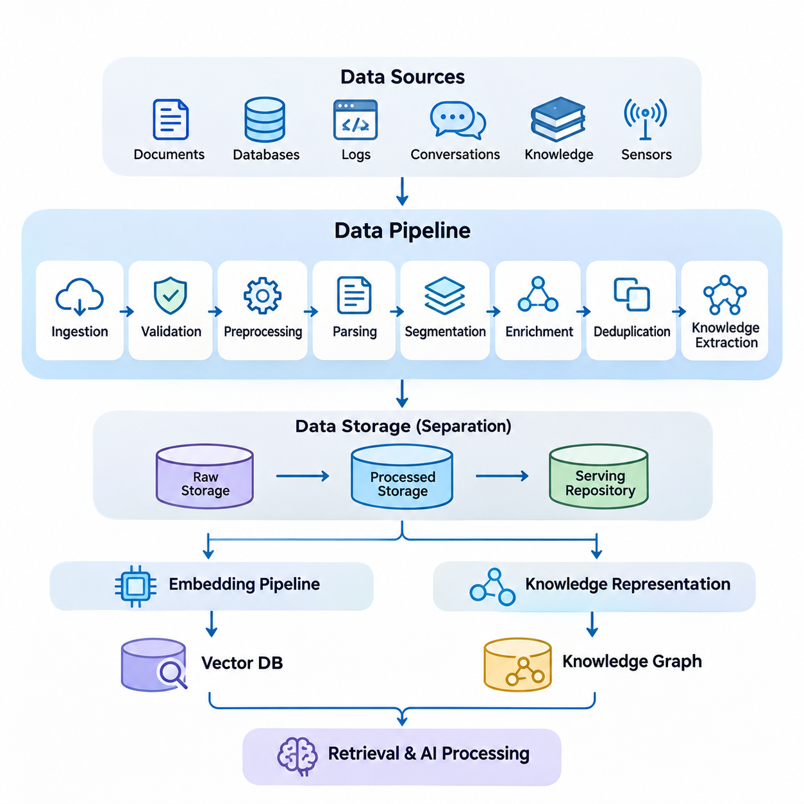
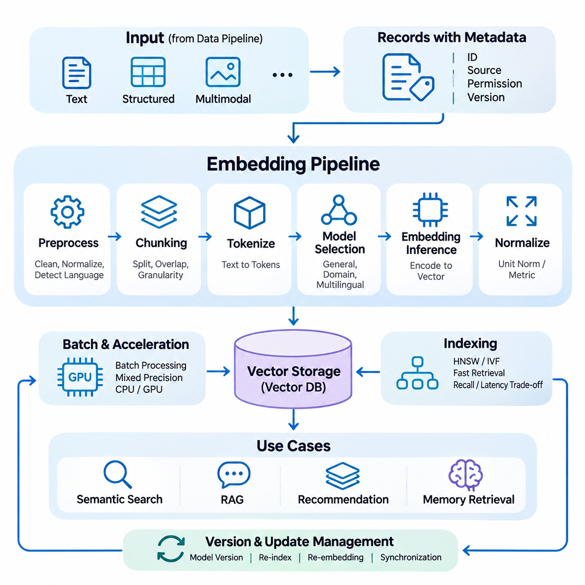
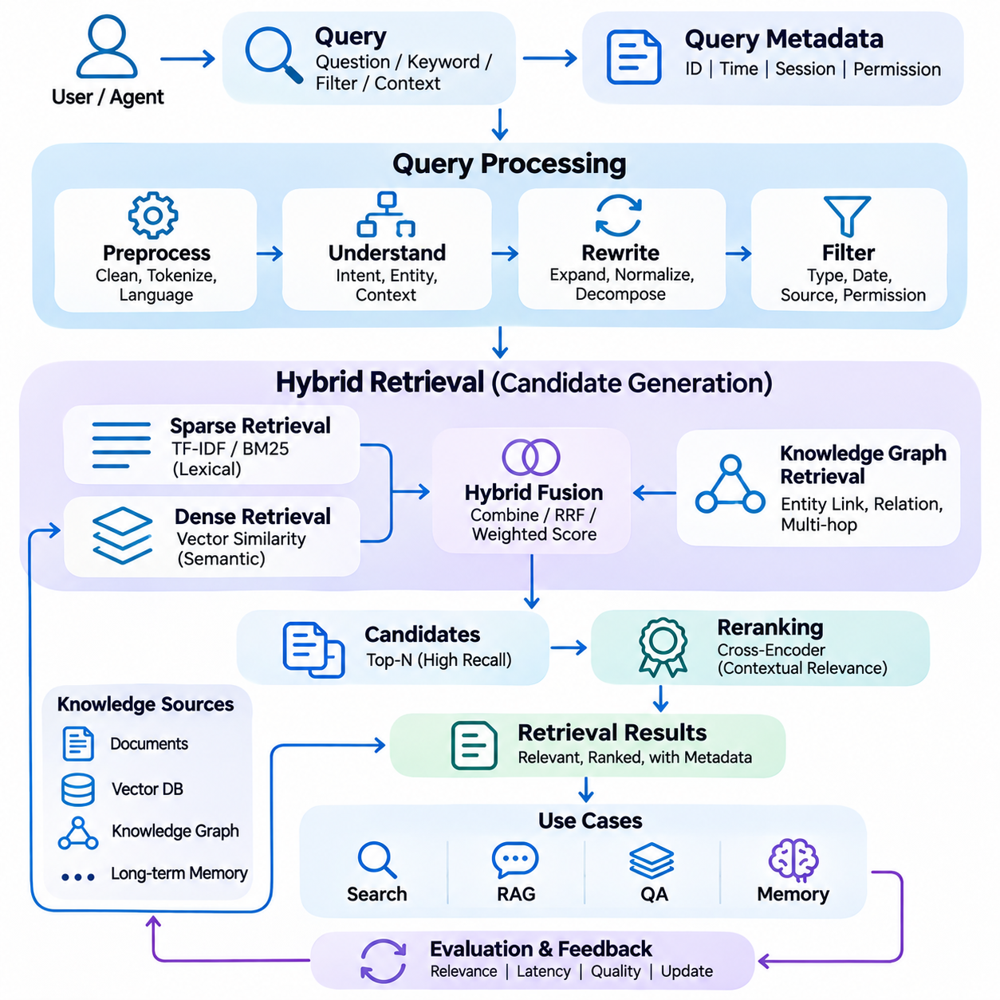
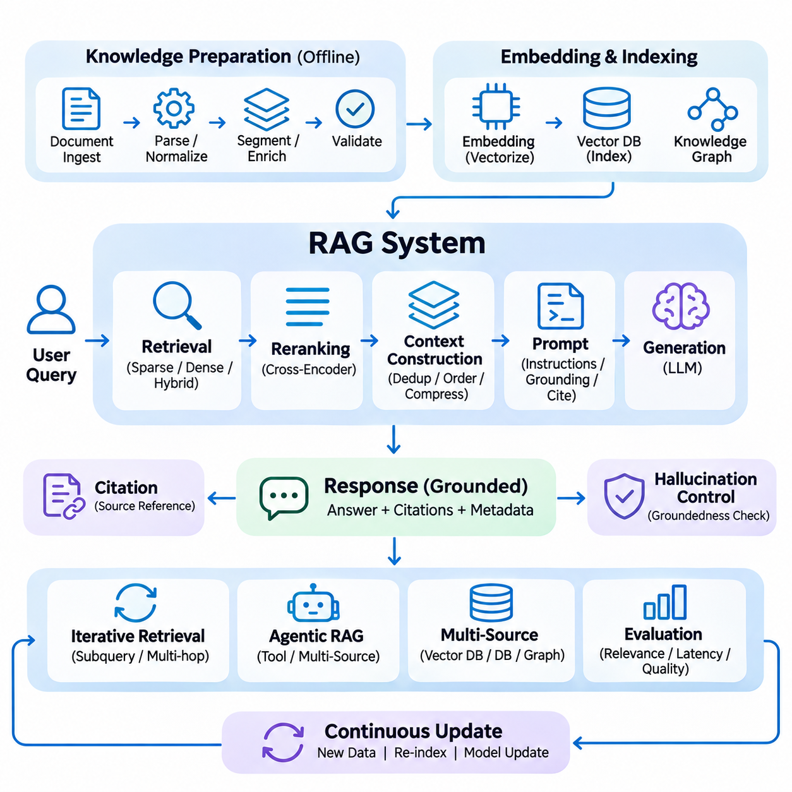
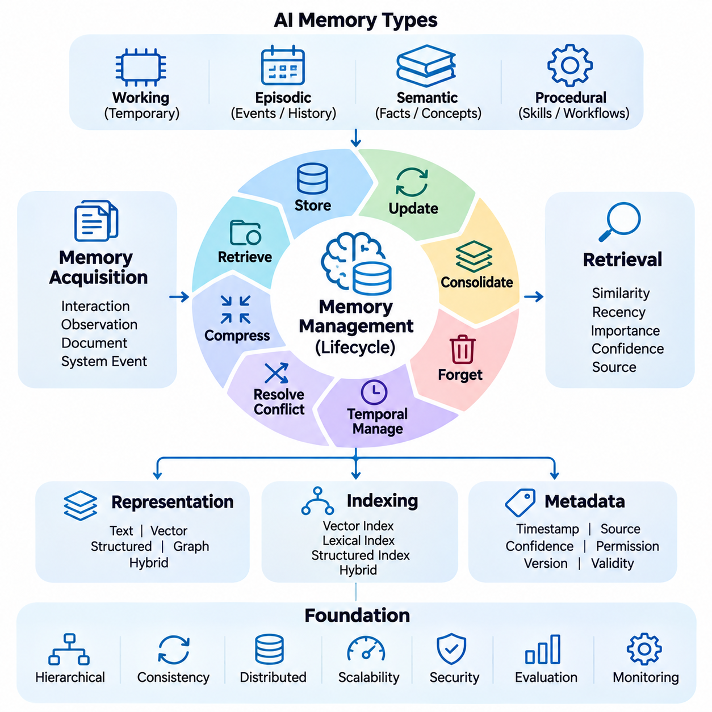
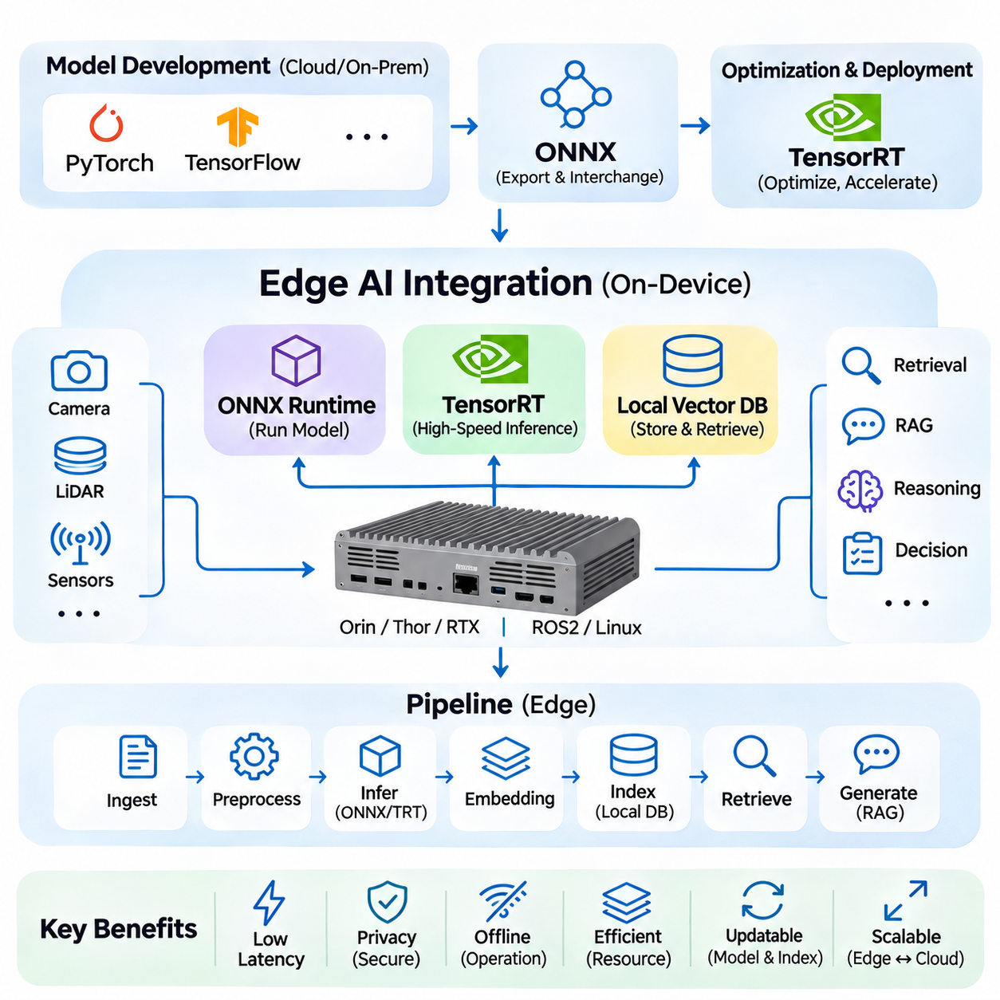
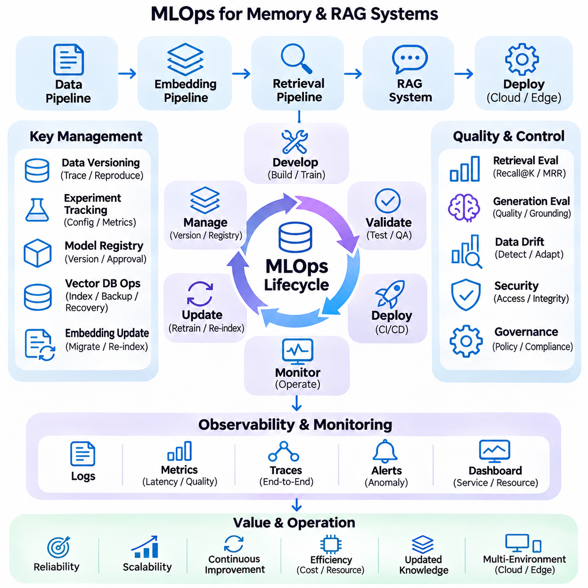

**Volume 37. Memory and Knowledge Systems**

# 07. Engineering and Deployment

## 07.01 Data Pipeline [w/Code]

{width="7.268055555555556in" height="7.268055555555556in"}

A data pipeline provides the engineering foundation for memory and knowledge systems by transforming heterogeneous information into structured, validated, and retrievable resources. Its primary purpose is to establish a reliable flow from raw data acquisition to persistent storage and downstream AI processing. In production environments, the pipeline must maintain data quality, traceability, scalability, and consistency while supporting continuous updates.

Modern memory and knowledge systems receive information from multiple sources, including documents, databases, application logs, conversational histories, knowledge repositories, and sensor streams. These sources differ in structure, format, reliability, and update frequency. A unified data pipeline must accommodate structured records, semi-structured metadata, unstructured text, and multimodal information without losing the contextual relationships required for accurate retrieval.

Data ingestion represents the initial stage of the pipeline, where information enters the processing environment through connectors, APIs, file systems, message queues, or streaming interfaces. Batch ingestion is suitable for large historical datasets, whereas streaming ingestion supports continuously generated events. Hybrid architectures combine both approaches to balance throughput, freshness, and operational complexity across enterprise and real-time applications.

Source identification and metadata acquisition are essential for maintaining information provenance. Each ingested record should preserve its origin, acquisition timestamp, document identifier, access permissions, and relevant version information. These attributes allow downstream components to distinguish authoritative sources from temporary observations and support auditing, filtering, and reproducibility when knowledge representations are updated.

Data validation determines whether incoming information satisfies the structural and semantic requirements of the system. Typical validation operations include schema checking, encoding verification, field completeness analysis, and consistency testing. Invalid records should be isolated for inspection rather than silently discarded. This approach prevents corrupted information from propagating into vector databases, knowledge graphs, and long-term memory repositories.

Preprocessing converts raw information into representations suitable for subsequent analysis. Textual processing may involve character normalization, removal of irrelevant formatting, language identification, and extraction of meaningful content. Structured records may require type conversion and schema alignment. The objective is not simply to simplify the data but to preserve the information necessary for semantic interpretation and reliable retrieval.

Document parsing is particularly important for retrieval-augmented generation systems because source materials frequently contain complex layouts, tables, headings, and embedded references. Parsing mechanisms must recover meaningful reading order while preserving document structure. Incorrect extraction can separate related concepts or combine unrelated passages, reducing retrieval accuracy and increasing the probability of misleading generated responses.

Data segmentation divides large documents or continuous information streams into manageable units for storage and retrieval. Segmentation strategies may follow paragraphs, semantic boundaries, document sections, or fixed token limits. Overlapping segments can preserve contextual continuity, although excessive overlap increases storage requirements and duplicate retrieval results. Appropriate segmentation depends on document structure and downstream query characteristics.

Metadata enrichment extends the original information with additional descriptive attributes, such as topic classifications, entity identifiers, temporal references, and relationships between documents. These attributes enable more precise filtering and context-aware retrieval. Enrichment may be performed through deterministic rules, natural language processing models, or knowledge extraction systems, provided that inferred attributes remain distinguishable from verified source information.

Duplicate detection prevents redundant information from unnecessarily expanding storage and retrieval indexes. Exact duplicates can be identified through cryptographic hashes, while near-duplicates require similarity analysis or content fingerprinting. Deduplication policies must account for document versions because similar records may contain important revisions. Preserving meaningful differences is essential for maintaining accurate and historically consistent knowledge.

Knowledge extraction transforms processed information into entities, attributes, and relationships that can support structured reasoning. Named entity recognition, relation extraction, and semantic classification provide mechanisms for identifying relevant concepts. Extracted knowledge may be stored in relational databases or knowledge graphs, while its original textual context remains available for verification and retrieval-based reasoning.

A production data pipeline commonly separates raw storage, processed storage, and serving-oriented repositories. Raw storage preserves original information for recovery and reprocessing, while processed storage contains normalized and validated records. Serving repositories organize information for efficient downstream access. This separation improves maintainability and allows preprocessing algorithms to evolve without requiring repeated acquisition of original data.

The pipeline must coordinate with embedding generation without tightly coupling every ingestion operation to a particular embedding model. Cleaned and segmented content can be passed to an independent embedding pipeline, which produces numerical representations for vector indexing. Separating these responsibilities allows embedding models, dimensionality, and indexing strategies to change while preserving the underlying source data and associated metadata.

Long-term memory systems introduce additional requirements because stored information may represent user interactions, historical events, learned preferences, or accumulated operational knowledge. The data pipeline must distinguish new observations from modifications to existing memories. Temporal metadata, confidence indicators, and source references help determine whether information should be appended, updated, consolidated, or retained as historical evidence.

Incremental processing improves efficiency by updating only records affected by newly acquired or modified information. Change data capture, event notifications, and scheduled synchronization can identify relevant modifications. Each change must propagate consistently through dependent storage and indexing components. Without coordinated updates, retrieval systems may return outdated embeddings, obsolete metadata, or references to deleted source documents.

Consistency management becomes challenging when the pipeline spans document stores, vector databases, knowledge graphs, and memory repositories. These systems may process updates asynchronously and expose different versions of the same information. Version identifiers, idempotent operations, transactional boundaries where supported, and reconciliation procedures help prevent inconsistent states and support recovery from partial processing failures.

Workflow orchestration coordinates the execution of ingestion, validation, transformation, enrichment, and storage operations. Dependencies between stages must be explicitly managed so that downstream tasks receive complete and validated inputs. Scheduling mechanisms, retry policies, checkpoints, and failure notifications improve operational reliability. Distributed execution can increase throughput when workloads contain independent processing tasks.

Scalability requires the pipeline to accommodate growing document collections, increasing ingestion rates, and more complex transformations. Horizontal scaling distributes workloads across processing workers, while partitioning organizes information by source, tenant, or time period. Queue-based buffering can absorb temporary workload spikes. However, scaling decisions must consider storage bandwidth, network transfer, processing latency, and downstream indexing capacity.

Security and privacy controls must operate throughout the data lifecycle rather than only at the storage layer. Authentication, authorization, encryption, and access logging protect sensitive information during acquisition, processing, and retrieval. Permission metadata should propagate into downstream indexes so that retrieval results respect source-level restrictions. Retention policies and deletion workflows must also address derived representations and cached information.

Data lineage records how information moves through processing stages and how each output relates to its original source. A lineage record may include transformation versions, processing timestamps, validation results, and identifiers of generated artifacts. This traceability supports debugging, compliance reviews, and reproducible experiments. It also allows engineers to identify which knowledge records require regeneration after processing logic changes.

Observability provides continuous insight into pipeline health and processing quality. Operational metrics include ingestion throughput, processing latency, queue depth, failure rates, and resource utilization. Data quality metrics may track missing fields, duplicate ratios, parsing errors, and rejected records. Monitoring these indicators enables engineers to identify bottlenecks and distinguish infrastructure failures from degradation in information quality.

Testing must address both individual transformations and complete processing workflows. Unit tests verify deterministic operations, integration tests examine communication between pipeline components, and end-to-end tests evaluate the movement of representative documents into serving repositories. Regression datasets help detect unintended changes in parsing, segmentation, or metadata extraction. Testing should also cover malformed inputs, partial failures, and recovery procedures.

Deployment strategies should support controlled evolution of pipeline components without disrupting existing knowledge services. Configuration management, containerization, automated validation, and staged releases reduce operational risk. Schema migrations and transformation changes require compatibility planning because stored records may have been produced by earlier software versions. Rollback procedures should preserve recoverability when newly deployed processing logic produces unexpected results.

Edge AI environments introduce constraints involving computation, connectivity, energy consumption, and local storage capacity. A distributed pipeline may preprocess sensor observations or operational records locally before synchronizing selected information with cloud infrastructure. Local buffering enables continued operation during communication interruptions. Synchronization policies must resolve delayed updates and maintain consistency between local memory repositories and centralized knowledge services.

Ultimately, data pipeline engineering determines whether memory and knowledge systems can operate reliably beyond controlled demonstrations. High-quality ingestion, traceable transformations, coordinated updates, and continuous monitoring establish the foundation for embedding pipelines, retrieval services, RAG applications, and persistent AI memory. A well-engineered pipeline converts heterogeneous information into dependable knowledge assets while supporting long-term maintenance, adaptation, and scalable deployment.

## 07.02 Embedding Pipeline [w/Code]

{width="7.268055555555556in" height="7.268055555555556in"}

An embedding pipeline is a fundamental component of modern memory and knowledge systems, transforming textual, structured, and multimodal information into numerical vector representations. These representations capture semantic relationships and enable similarity-based retrieval across large knowledge collections. A production embedding pipeline must provide consistent preprocessing, efficient inference, reliable indexing, and continuous synchronization with evolving information sources.

The primary objective of embedding generation is to map information into a continuous vector space where semantically related items occupy nearby regions. Unlike traditional keyword representations, dense embeddings can capture contextual similarities even when documents use different terminology. This capability supports semantic search, retrieval-augmented generation, recommendation systems, and long-term memory retrieval across heterogeneous knowledge repositories.

Embedding pipelines typically receive validated and normalized content from upstream data processing systems. Each input record contains textual content, document identifiers, source metadata, access permissions, and version information. The embedding pipeline must preserve these attributes while generating vector representations. Maintaining a reliable association between source records and embeddings is essential for traceability, retrieval filtering, and subsequent updates.

Text preparation strongly influences embedding quality because models operate on tokenized representations rather than raw documents. Preprocessing may include Unicode normalization, removal of extraction artifacts, language identification, and correction of malformed text. However, excessive normalization can eliminate technical terminology, numerical values, or contextual distinctions. Therefore, preprocessing policies should preserve information that contributes to semantic meaning.

Document chunking determines the granularity of information represented by each embedding vector. Large documents are commonly divided into passages according to paragraphs, semantic boundaries, or token constraints. Smaller chunks improve retrieval specificity but may lose broader context, while larger chunks preserve continuity at the expense of precision. Chunk size and overlap should be selected through evaluation rather than relying on universal configuration values.

Embedding model selection requires consideration of semantic accuracy, supported languages, vector dimensionality, computational requirements, and inference latency. General-purpose models provide broad coverage, whereas domain-adapted models may better represent specialized terminology. Multilingual models support cross-language retrieval when their training objectives align different languages within a shared representation space. Model selection should reflect actual query distributions and deployment constraints.

Tokenization converts prepared text into discrete units accepted by the embedding model. Different tokenizers produce different sequence lengths, particularly for multilingual documents, mathematical expressions, and specialized technical vocabulary. Inputs exceeding the model context limit must be segmented or truncated according to explicit policies. Silent truncation can discard important evidence and produce embeddings that do not accurately represent the intended content.

Embedding inference transforms token sequences into fixed-dimensional vectors using neural network encoders. Transformer-based architectures commonly generate contextual token representations that are aggregated through pooling mechanisms or specialized output tokens. The resulting vector summarizes aspects of the input\'s semantic content. Although embeddings support similarity comparisons, they cannot guarantee preservation of every factual detail contained in the original information.

Vector normalization is frequently applied to improve consistency across similarity calculations. Unit-length normalization makes cosine similarity equivalent to the dot product for normalized vectors, simplifying some retrieval implementations. However, normalization is not universally optimal because certain models rely on vector magnitude. Similarity metrics and normalization procedures must follow the embedding model\'s intended configuration and be validated against representative retrieval tasks.

Batch processing improves embedding throughput by grouping multiple inputs into inference requests. Efficient batching reduces per-request overhead and improves accelerator utilization, particularly when processing large document collections. Nevertheless, variable sequence lengths can introduce padding inefficiency and memory pressure. Dynamic batching, length-aware grouping, and controlled batch sizes help balance throughput, GPU memory consumption, and processing latency.

Hardware acceleration significantly affects the operational efficiency of embedding pipelines. GPUs can process neural embedding models at high throughput, while CPUs remain practical for smaller workloads or lightweight encoders. Mixed-precision inference may reduce memory usage and improve computational efficiency on supported hardware. Deployment decisions should account for model size, expected request volume, power consumption, and latency requirements.

Once generated, embeddings are associated with stable identifiers and stored in vector databases or specialized similarity indexes. Each vector should retain references to its source document, chunk boundaries, model version, and relevant metadata. Approximate nearest neighbor indexing techniques, including HNSW and IVF, enable efficient retrieval across large collections. Index configuration introduces tradeoffs among search latency, recall, memory consumption, and update complexity.

Embedding version management is critical because vectors produced by different models may occupy incompatible representation spaces. Changes to model architecture, training weights, pooling strategies, or preprocessing procedures can alter similarity relationships. Production systems should record embedding model identifiers and transformation configurations. Model upgrades may require re-embedding stored content and rebuilding indexes before switching retrieval traffic.

Incremental embedding generation reduces unnecessary computation when knowledge repositories evolve. Newly added documents require vector creation, while modified documents require identification and regeneration of affected chunks. Deleted records must be removed from corresponding indexes and associated caches. Content hashes and version identifiers help distinguish unchanged information from material revisions, supporting efficient and reproducible synchronization.

Consistency between source repositories and vector indexes is essential for accurate retrieval. Asynchronous processing can create temporary differences between document content and its indexed representation. Systems may use event queues, versioned records, reconciliation jobs, and controlled index activation to manage these differences. Retrieval services should avoid returning obsolete or unauthorized information during synchronization delays.

Caching can reduce repeated inference costs when identical content or queries appear frequently. Embedding caches commonly use content hashes combined with model and preprocessing versions to identify reusable results. Query embedding caches can improve response latency for repeated searches. Cache invalidation remains necessary whenever models, normalization procedures, or source content change, particularly in systems requiring strict information freshness.

Multimodal embedding pipelines extend representation learning beyond text to images, audio, video, and sensor observations. Specialized encoders transform each modality into numerical representations, while aligned multimodal models enable cross-modal similarity comparisons. However, embeddings from unrelated encoders are not automatically comparable. Cross-modal retrieval requires compatible training objectives, shared representation spaces, or explicitly learned alignment mechanisms.

Knowledge-aware embedding systems may incorporate entity descriptions, graph relationships, and structured attributes into representation generation. These approaches can improve retrieval when semantic meaning depends on relationships that are not explicit in isolated text passages. Knowledge graph embeddings and textual embeddings may be combined through hybrid retrieval architectures. Their integration requires careful evaluation because different representations capture different forms of information.

Long-term memory applications introduce additional challenges involving temporal relevance, evolving preferences, and memory consolidation. Embeddings representing historical interactions should remain connected to timestamps, contextual identifiers, and source evidence. When memories are summarized or updated, their vector representations may require regeneration. Temporal relevance and confidence should generally be handled through retrieval metadata or ranking mechanisms rather than assumed to be encoded completely within vectors.

Embedding quality must be evaluated through downstream retrieval performance rather than geometric properties alone. Common evaluation metrics include Recall\\@K, Mean Reciprocal Rank, and Normalized Discounted Cumulative Gain. Benchmark datasets should contain representative queries, relevant documents, difficult negatives, and domain-specific terminology. Evaluation across multiple languages and document types helps identify weaknesses that aggregate metrics may conceal.

Operational monitoring should track embedding throughput, inference latency, error rates, GPU utilization, queue depth, and indexing delays. Data quality monitoring should identify empty inputs, unexpected vector dimensions, invalid numerical values, and abnormal embedding distributions. Changes in similarity scores or retrieval performance may indicate model drift, preprocessing inconsistencies, or altered input characteristics. Monitoring supports early detection of degradation.

Security requirements extend from source documents to generated vectors and associated metadata. Embeddings can retain sensitive information and should not automatically be treated as anonymous representations. Access controls, encryption, tenant isolation, and retention policies must remain effective throughout processing and storage. Deletion requests should propagate to vectors, indexes, and caches, with verification procedures appropriate to the system\'s privacy requirements.

Edge deployment requires embedding pipelines to operate within limited computational resources, memory capacity, and communication bandwidth. Quantized models, lightweight encoders, and local vector databases can support semantic retrieval without continuous cloud connectivity. Edge systems may generate embeddings locally and synchronize selected records with centralized repositories. Model compatibility and version coordination are necessary to maintain consistent retrieval behavior across distributed environments.

A well-engineered embedding pipeline connects raw knowledge processing with scalable semantic retrieval and persistent AI memory. Its effectiveness depends on coordinated preprocessing, model selection, vector generation, indexing, synchronization, evaluation, and operational monitoring. By preserving traceability and managing representation changes systematically, embedding pipelines provide a reliable foundation for RAG systems, intelligent agents, knowledge integration, and adaptive AI applications.

## 07.03 Retrieval Pipeline [w/Code]

{width="7.268055555555556in" height="7.268055555555556in"}

A retrieval pipeline is a fundamental component of memory and knowledge systems, responsible for identifying, ranking, and delivering relevant information from distributed knowledge repositories. It connects user queries with stored documents, vector representations, and structured knowledge. An effective retrieval pipeline must balance semantic relevance, computational efficiency, response latency, and information reliability while supporting continuously evolving knowledge collections.

The retrieval process begins with query acquisition, where a user request or an automated agent instruction enters the system. Queries may contain natural language questions, keywords, structured filters, or contextual references. The pipeline must interpret these inputs consistently and preserve the original information need. Query identifiers, timestamps, session context, and access permissions provide essential metadata for subsequent processing and operational traceability.

Query preprocessing transforms incoming requests into representations suitable for retrieval. Common operations include text normalization, language identification, tokenization, and removal of irrelevant formatting. However, excessive preprocessing may eliminate meaningful distinctions, particularly in technical terminology, numerical expressions, and named entities. Processing policies should therefore preserve the semantic information necessary for accurate document matching.

Query understanding determines the underlying intent and information requirements expressed by a request. Intent classification, entity recognition, and contextual interpretation can identify whether a query seeks factual evidence, conceptual explanations, historical records, or procedural knowledge. In conversational systems, previous interactions may resolve ambiguous references. Such contextual expansion must avoid introducing assumptions that change the user\'s original intent.

Query rewriting improves retrieval effectiveness by transforming ambiguous or incomplete requests into clearer search expressions. Techniques include synonym expansion, terminology normalization, and decomposition of complex questions into smaller subqueries. Multiple query formulations can increase coverage when relevant information uses different vocabulary. However, uncontrolled rewriting may introduce semantic drift and retrieve documents unrelated to the intended question.

Sparse retrieval provides an efficient mechanism for matching queries with documents through lexical representations. Traditional approaches such as TF-IDF and BM25 emphasize term occurrence, document frequency, and lexical relevance. These methods are particularly effective when exact terminology, identifiers, or specialized expressions are important. Their primary limitation is reduced sensitivity to semantic relationships that are not explicitly reflected in shared vocabulary.

Dense retrieval addresses lexical limitations by representing queries and documents as numerical embeddings within a semantic vector space. Similarity calculations identify documents whose representations are close to the query embedding. Approximate nearest neighbor algorithms accelerate this process across large collections. Dense retrieval supports conceptual matching, although its effectiveness depends on embedding quality, domain compatibility, and appropriate similarity metrics.

Hybrid retrieval combines sparse and dense approaches to capture complementary forms of relevance. Lexical retrieval identifies exact terms and identifiers, while semantic retrieval discovers conceptually related information. Candidate lists can be merged using weighted score combinations or rank-based fusion methods such as Reciprocal Rank Fusion. Because different retrieval systems produce scores with different distributions, fusion strategies require careful calibration and evaluation.

Metadata filtering restricts retrieval results according to structured attributes such as document type, publication date, source, language, or access permissions. Filtering can occur before candidate generation or after initial retrieval, depending on index capabilities and performance requirements. Early filtering reduces unnecessary computation, while post-filtering provides flexibility. Security-sensitive permissions must be enforced consistently rather than treated as optional ranking preferences.

Candidate generation retrieves an initial collection of potentially relevant documents from one or more indexes. The objective is to achieve sufficiently high recall without overwhelming downstream ranking components. Candidate pool size influences both retrieval quality and computational cost. A small pool may exclude important evidence, whereas an excessively large pool increases reranking latency and processing requirements without necessarily improving final relevance.

Reranking refines the ordering of retrieved candidates using more computationally intensive relevance models. Cross-encoder architectures jointly process query-document pairs and estimate contextual relevance more precisely than independent embedding comparisons. Reranking can substantially improve result ordering when initial retrieval achieves adequate recall. However, its computational expense requires careful control of candidate counts, sequence lengths, and inference resources.

Knowledge graph retrieval extends document-based search by exploiting structured relationships between entities. Entity linking identifies relevant graph nodes, while neighborhood exploration and path traversal recover connected facts. Graph retrieval is particularly useful when questions require relational evidence or multi-hop reasoning. Combining graph-based results with textual passages can improve contextual completeness, provided that relationships remain grounded in verified knowledge.

Long-term memory retrieval introduces temporal and contextual requirements beyond conventional document search. Relevant memories may depend on recency, interaction history, user preferences, or the circumstances under which information was recorded. Retrieval policies can incorporate temporal decay, importance scores, and contextual similarity. These signals should complement semantic relevance rather than automatically overriding factual accuracy or source reliability.

Context assembly organizes selected retrieval results into a coherent information package for downstream reasoning or generation. Retrieved passages may require deduplication, source grouping, ordering, and token-budget allocation. Preserving document identifiers and citation metadata enables traceability. Context assembly must avoid combining contradictory statements into misleading summaries and should retain sufficient surrounding information for accurate interpretation.

Retrieval pipelines must manage conflicting information when multiple sources describe the same subject differently. Differences may arise from document revisions, outdated records, uncertain observations, or inconsistent knowledge extraction. Source authority, timestamps, provenance, and confidence indicators can guide conflict resolution. When contradictions cannot be resolved reliably, the system should preserve uncertainty rather than presenting unsupported conclusions.

Caching improves retrieval efficiency by reusing query embeddings, candidate lists, or frequently requested results. Cache keys may incorporate normalized queries, retrieval configurations, index versions, and authorization context. Effective caching reduces repeated computation and improves response latency. Nevertheless, invalidation policies must prevent outdated or unauthorized information from remaining accessible after source updates, permission changes, or index modifications.

Distributed retrieval architectures support large knowledge collections by partitioning indexes across multiple storage nodes. Query execution may involve parallel searches, result aggregation, and centralized reranking. Sharding and replication improve scalability and availability but introduce coordination overhead. System designers must balance network latency, load distribution, fault tolerance, and consistency when selecting distributed retrieval strategies.

Retrieval evaluation measures whether the pipeline identifies relevant information and presents it in an appropriate order. Recall\\@K evaluates coverage, Mean Reciprocal Rank emphasizes the position of the first relevant result, and Normalized Discounted Cumulative Gain considers graded relevance across ranked outputs. Evaluation datasets should contain representative queries, relevance judgments, difficult negatives, and domain-specific cases to reveal practical weaknesses.

End-to-end evaluation must also consider the influence of retrieval quality on downstream applications. In retrieval-augmented generation systems, relevant documents do not automatically guarantee accurate generated answers. Evaluation should examine evidence coverage, citation correctness, answer faithfulness, and unsupported claims. Separating retrieval failures from generation failures enables more targeted optimization and prevents misleading conclusions about system performance.

Operational monitoring tracks query throughput, retrieval latency, index availability, cache effectiveness, and ranking performance. Additional indicators include empty-result frequency, candidate distribution, permission-filtering failures, and changes in relevance scores. Monitoring should distinguish infrastructure problems from semantic retrieval degradation. Continuous observation enables early detection of indexing inconsistencies, embedding drift, and workload changes.

Security and privacy must be enforced throughout query processing, candidate generation, reranking, and result delivery. Authorization checks should prevent users or agents from retrieving information outside their permitted scope. Sensitive queries and retrieved records require appropriate logging restrictions and encryption. Retrieval systems must also defend against malicious document content that attempts to manipulate downstream models or override application instructions.

Edge AI retrieval systems operate under constraints involving memory capacity, processing power, connectivity, and response deadlines. Lightweight vector indexes, compact embedding models, and local caches can support retrieval without continuous cloud access. Hybrid edge-cloud architectures may maintain frequently used knowledge locally while accessing centralized repositories when connectivity permits. Synchronization policies must preserve version compatibility and information consistency.

A production retrieval pipeline integrates query understanding, sparse and dense retrieval, metadata filtering, reranking, context assembly, and operational governance into a coordinated architecture. Its reliability depends on accurate indexing, consistent permissions, measurable relevance, and controlled latency. By transforming stored information into accessible and verifiable evidence, retrieval pipelines provide the foundation for RAG systems, intelligent agents, long-term memory, and knowledge-driven AI applications.

## 07.04 RAG Systems [w/Code]

{width="7.268055555555556in" height="7.268055555555556in"}

Retrieval-Augmented Generation (RAG) integrates information retrieval with generative language models to produce responses grounded in external knowledge. Unlike conventional language models that depend primarily on learned parameters, RAG systems retrieve relevant evidence before generating answers. This architecture improves knowledge accessibility, supports information updates, and enables traceable responses while reducing dependence on memorized facts.

A production RAG system consists of interconnected data ingestion, embedding, retrieval, context construction, and generation components. Source documents are processed into searchable representations and stored in appropriate repositories. During inference, user queries trigger retrieval operations that identify relevant information. Selected evidence is then incorporated into the language model input, allowing generated responses to reflect available knowledge.

Knowledge preparation determines the reliability of information available to the RAG system. Documents must undergo parsing, normalization, segmentation, metadata enrichment, and validation before indexing. Poorly extracted tables, missing document relationships, or inconsistent chunk boundaries can degrade retrieval accuracy. Preserving source identifiers, timestamps, and access permissions establishes the foundation for trustworthy evidence selection.

Embedding pipelines transform document passages into numerical representations that support semantic similarity search. Query embeddings are generated using compatible models and compared against indexed document vectors. Embedding dimensionality, normalization, and model version must remain consistent between indexing and retrieval. Domain-specific terminology and multilingual content may require specialized models or additional retrieval strategies.

Retrieval strategies determine which knowledge fragments are supplied to the generation model. Sparse retrieval emphasizes exact terms and identifiers, while dense retrieval captures semantic relationships. Hybrid retrieval combines both approaches to improve coverage across diverse information needs. Metadata filtering restricts results by source, date, document type, or authorization, ensuring that retrieved evidence remains relevant and accessible.

Candidate reranking improves the quality of retrieved information before context construction. Cross-encoder models evaluate query-document relationships more precisely than independent vector similarity calculations. Reranking is particularly valuable when initial retrieval produces many plausible but weakly relevant passages. However, candidate counts and model complexity must be controlled to maintain acceptable inference latency and computational efficiency.

Context construction transforms retrieved passages into a coherent evidence package for the language model. Selected documents may be deduplicated, grouped by source, ordered by relevance, and compressed to satisfy token limits. Source metadata and citation identifiers should remain attached to each passage. Context construction must preserve essential qualifications and avoid removing details necessary for accurate interpretation.

Prompt engineering defines how the language model should interpret retrieved evidence and formulate its response. Instructions may require factual grounding, explicit uncertainty, source attribution, and refusal to invent missing information. The prompt should distinguish trusted application instructions from retrieved document content. Clear separation reduces the risk that malicious or irrelevant passages will override the intended generation behavior.

Generation models synthesize retrieved evidence into coherent answers using their learned language capabilities. The model must distinguish supported statements from assumptions and avoid presenting plausible but unverified details as facts. Retrieved passages may contain incomplete or contradictory information, requiring careful qualification. Reliable generation depends on both the quality of supplied evidence and the model\'s ability to follow grounding instructions.

Citation generation connects statements in the final response to the documents supporting them. Each citation should identify a source passage that directly substantiates the associated claim. Document-level references alone may be insufficient when large sources contain multiple topics or conflicting statements. Citation validation can compare generated claims against retrieved evidence, improving transparency and supporting independent verification.

Hallucination control is a central requirement of production RAG systems. Although retrieval reduces reliance on internal model knowledge, it does not eliminate unsupported generation. Errors may arise from irrelevant passages, incomplete evidence, misleading context, or incorrect synthesis. Groundedness checks, answer verification, and explicit abstention policies help reduce these risks, particularly in applications requiring high factual reliability.

Advanced RAG architectures introduce iterative retrieval to address complex questions. A system may decompose a request into subquestions, retrieve evidence for each component, and refine its search based on intermediate findings. Multi-hop retrieval combines information across several documents or knowledge graph relationships. Such workflows improve coverage but require safeguards against unnecessary iterations, error propagation, and excessive latency.

Agentic RAG extends retrieval-augmented generation by allowing an intelligent agent to select retrieval tools and coordinate multiple information sources. The agent may search vector databases, query structured databases, traverse knowledge graphs, or inspect document repositories. Tool selection should follow explicit permissions and execution constraints. Agentic workflows offer flexibility but introduce additional challenges in planning reliability and operational control.

Long-term memory integration enables RAG systems to retrieve relevant historical interactions, learned preferences, and accumulated operational knowledge. Memory retrieval may combine semantic similarity with temporal relevance, importance, and contextual relationships. Retrieved memories should retain provenance and confidence information. Systems must distinguish historical observations from current facts to prevent outdated memories from influencing present decisions.

Knowledge graph integration strengthens RAG applications requiring structured relationships and multi-hop reasoning. Graph queries can identify connected entities, attributes, and causal or organizational relationships where explicitly represented. Textual retrieval provides supporting explanations and original evidence. Combining graph and document retrieval can improve completeness, although extracted relationships must be validated to avoid propagating incorrect knowledge.

Multimodal RAG extends retrieval and generation beyond textual information. Images, audio recordings, video segments, and sensor observations can be indexed through modality-specific or aligned embedding models. Retrieved multimodal evidence may support visual inspection, technical diagnosis, or operational analysis. Accurate interpretation requires compatible encoders, appropriate preprocessing, and generation models capable of processing the selected modalities.

Evaluation of RAG systems must distinguish retrieval quality from generation quality. Retrieval metrics include Recall\\@K, Mean Reciprocal Rank, and Normalized Discounted Cumulative Gain. Generation evaluation examines answer relevance, factual correctness, evidence faithfulness, and citation accuracy. Separating these dimensions helps engineers identify whether failures originate in document retrieval, context preparation, or language generation.

Benchmark design should reflect realistic application requirements rather than relying exclusively on generic question-answering datasets. Evaluation cases may include ambiguous queries, conflicting documents, outdated information, multilingual terminology, and questions without sufficient evidence. Human evaluation can complement automated scoring when judgments require domain expertise. Regression benchmarks are necessary to detect performance changes after model or index updates.

Operational deployment requires coordinated management of embedding models, retrieval indexes, generation models, and associated configurations. Model versioning, containerization, automated testing, and staged releases reduce deployment risks. Changes to document processing or embeddings may require reindexing. Compatibility checks should prevent production systems from combining representations generated under inconsistent configurations.

Latency optimization is important because RAG inference involves multiple computational stages. Query encoding, candidate retrieval, reranking, context construction, and language generation contribute to overall response time. Caching, parallel retrieval, dynamic batching, and efficient model serving can reduce delays. Optimization must preserve retrieval coverage and answer quality rather than minimizing latency at the expense of factual reliability.

Security and privacy controls must extend across ingestion, retrieval, prompt construction, and generation. Authorization filtering prevents access to restricted documents, while encryption and logging policies protect sensitive information. Retrieved content must be treated as untrusted input to reduce prompt injection risks. Data retention and deletion procedures should also cover embeddings, generated caches, and persistent conversational memory.

Edge AI integration enables RAG capabilities in environments with limited connectivity and computational resources. Compact language models, quantized embedding encoders, and local vector databases can support offline knowledge retrieval. Hybrid edge-cloud architectures distribute processing according to latency, privacy, and hardware constraints. Synchronization mechanisms must maintain consistent knowledge versions while supporting intermittent network availability.

A reliable RAG architecture transforms distributed knowledge into accessible, evidence-based responses through coordinated retrieval and generation. Its effectiveness depends on data quality, retrieval accuracy, context integrity, model behavior, evaluation, and operational governance. By combining external knowledge with generative reasoning, RAG systems provide a practical foundation for enterprise assistants, intelligent agents, long-term memory applications, and knowledge-driven AI services.

## 07.05 Memory Management

{width="7.268055555555556in" height="7.268055555555556in"}

Memory management provides the operational foundation for persistent knowledge and intelligent AI systems by controlling how information is stored, updated, retrieved, consolidated, and removed. Unlike conventional data storage, AI memory must account for semantic relevance, temporal context, and changing information. Effective memory management balances retrieval accuracy, storage efficiency, information consistency, and long-term adaptability.

AI memory architectures commonly distinguish working memory, episodic memory, semantic memory, and procedural memory. Working memory maintains temporary context for ongoing tasks, while episodic memory preserves historical interactions and events. Semantic memory stores generalized facts and concepts, whereas procedural memory represents reusable workflows and operational knowledge. These categories provide complementary mechanisms for intelligent behavior.

Memory acquisition begins when interactions, observations, documents, or system events produce information that may be useful in future operations. Not every observation should become persistent memory. Admission policies evaluate relevance, novelty, reliability, and expected future utility before storage. Selective acquisition prevents unnecessary memory growth and reduces the risk of preserving misleading or redundant information.

Memory representation determines how stored information can be interpreted and retrieved. Textual records preserve original context, vector embeddings support semantic similarity, and structured databases organize explicit attributes. Knowledge graphs capture relationships between entities and events. Hybrid representations combine these approaches, allowing systems to support both flexible semantic retrieval and precise structured reasoning.

Memory metadata provides essential context for interpreting stored knowledge. Each memory record may include timestamps, source identifiers, confidence indicators, access permissions, and version information. Temporal attributes distinguish historical observations from current facts, while provenance supports verification. Metadata also enables filtering, prioritization, and controlled updates across distributed memory repositories.

Memory indexing organizes stored information for efficient retrieval. Vector indexes support semantic matching, lexical indexes identify exact terminology, and structured indexes enable filtering by attributes or relationships. Index selection depends on memory volume, query patterns, and latency requirements. Hybrid indexing improves coverage but introduces synchronization challenges when memory records change or become invalid.

Memory retrieval identifies stored information relevant to the current task, query, or operational context. Similarity scores provide an initial relevance estimate, but additional signals may include recency, importance, confidence, and source authority. Ranking policies should reflect application requirements rather than relying exclusively on embedding similarity. Retrieved memories must remain connected to their original evidence.

Memory updating is necessary when new observations modify existing knowledge. Updates may involve replacing obsolete attributes, appending new events, or preserving multiple versions of conflicting information. Systems should distinguish corrections from temporal changes because historical facts may remain valid for earlier periods. Version control and provenance tracking prevent new information from silently overwriting important evidence.

Memory consolidation combines related observations into more compact and useful representations. Repeated interactions may be summarized into stable preferences, recurring patterns, or generalized knowledge. Consolidation reduces redundancy and improves retrieval efficiency, but excessive summarization can remove important exceptions. Reliable consolidation preserves references to original records and distinguishes inferred conclusions from directly observed facts.

Memory forgetting controls the removal or reduced accessibility of information that is obsolete, irrelevant, redundant, or no longer authorized for retention. Forgetting policies may consider expiration periods, retrieval frequency, importance, and explicit deletion requirements. Automated forgetting must avoid removing information required for compliance or historical reasoning. Deletion should propagate to derived embeddings, indexes, and caches.

Temporal memory management addresses the changing relevance and validity of information over time. Recency-based ranking can prioritize recent observations, while temporal decay reduces the influence of older records. However, age alone does not determine correctness or importance. Systems should distinguish event time, recording time, and validity intervals to support accurate reasoning about historical and current states.

Conflicting memories require explicit resolution mechanisms. Contradictions may result from incorrect observations, changing circumstances, uncertain extraction, or differences between information sources. Resolution policies can consider source reliability, timestamps, confidence, and contextual relevance. When evidence remains insufficient, the system should retain uncertainty rather than merging incompatible statements into unsupported conclusions.

Memory compression reduces storage and processing requirements by representing information more efficiently. Techniques include summarization, deduplication, hierarchical organization, and selective retention of high-value details. Compression can improve scalability and reduce retrieval latency, but it introduces information loss. Evaluation must determine whether compressed memories preserve facts, relationships, and contextual distinctions needed for future tasks.

Hierarchical memory architectures organize information at multiple levels of abstraction. Detailed observations remain available in lower layers, while summaries and generalized concepts occupy higher layers. Retrieval can begin with compact representations and expand into original evidence when necessary. This structure supports efficient navigation across extensive histories while maintaining access to detailed information for verification.

Long-term memory integration enables intelligent agents to maintain continuity across interactions and tasks. Relevant memories may include previous decisions, user preferences, completed operations, and unresolved objectives. Retrieval mechanisms should select context appropriate to the current request without exposing unrelated information. Persistent memory improves continuity only when stored knowledge remains accurate, appropriately scoped, and updateable.

Memory consistency becomes challenging when records are distributed across document stores, vector databases, knowledge graphs, and application caches. Asynchronous updates can create incompatible versions of the same information. Stable identifiers, versioned operations, event-driven synchronization, and reconciliation procedures help maintain coherence. Systems must also prevent retrieval from returning records that have been deleted or superseded.

Memory lifecycle orchestration coordinates acquisition, validation, indexing, retrieval, consolidation, updating, and deletion. Each operation may trigger dependent processing tasks, including embedding regeneration and index synchronization. Workflow checkpoints, retry mechanisms, and failure recovery improve reliability. Explicit lifecycle policies make memory behavior more predictable and support systematic debugging of unexpected retrieval results.

Memory quality evaluation examines whether stored information remains useful, accurate, and accessible. Metrics may include retrieval precision, recall, factual consistency, update correctness, and stale-memory frequency. Evaluation scenarios should include changing facts, contradictory observations, repeated interactions, and deletion requests. Longitudinal testing is particularly important because memory failures may emerge only after extended operation.

Operational monitoring provides visibility into memory growth, retrieval latency, update frequency, storage utilization, and synchronization delays. Additional indicators include duplicate records, failed deletions, unresolved conflicts, and abnormal retrieval patterns. Monitoring helps identify degradation caused by outdated information or ineffective consolidation. Observability also supports capacity planning and maintenance of distributed memory services.

Security and privacy requirements apply throughout the memory lifecycle. Authentication, authorization, encryption, and tenant isolation protect stored information against unauthorized access. Sensitive memories require appropriate retention limits and auditable deletion procedures. Derived representations may preserve confidential information even when original records are removed. Privacy controls must therefore cover embeddings, summaries, indexes, backups, and associated caches.

Edge AI memory management must accommodate limited storage, computation, connectivity, and energy resources. Local memory repositories can retain operational observations and frequently accessed knowledge without continuous cloud communication. Selective synchronization transfers relevant updates to centralized systems when connectivity becomes available. Conflict resolution and version coordination are essential when edge devices operate independently for extended periods.

Adaptive memory systems can modify retention, ranking, and consolidation policies according to observed usage patterns. Frequently useful memories may receive higher retrieval priority, while low-value records may be compressed or archived. Such adaptation requires safeguards against feedback loops that reinforce outdated or incorrect information. Policy changes should be evaluated against long-term accuracy, fairness, and operational stability.

Effective memory management transforms isolated observations into persistent, organized, and verifiable knowledge assets. Its reliability depends on selective acquisition, meaningful representation, controlled updating, consolidation, forgetting, and continuous evaluation. By coordinating these functions across distributed storage and retrieval systems, memory management provides the foundation for adaptive agents, knowledge-driven reasoning, and long-term AI intelligence.

## 07.06 Edge AI Integration

{width="7.268055555555556in" height="7.268055555555556in"}

Edge AI integration enables memory and knowledge systems to operate directly on local devices without depending entirely on centralized cloud infrastructure. By combining optimized inference engines, compact embedding models, and local vector databases, edge platforms can support semantic retrieval and intelligent decision-making near data sources. This architecture reduces communication latency, improves operational continuity, and supports privacy-sensitive applications.

Edge environments introduce constraints involving computational capacity, memory bandwidth, energy consumption, thermal management, and network availability. Unlike cloud servers, embedded platforms must execute AI workloads alongside sensing, communication, and control processes. Effective integration requires careful resource allocation and predictable inference performance. System design must consider both average throughput and worst-case response latency.

The Open Neural Network Exchange (ONNX) format provides a standardized representation for transferring trained neural networks between compatible development and deployment frameworks. Models developed in PyTorch or other supported environments can be exported into ONNX computational graphs. These graphs describe operators, tensor relationships, and model parameters, allowing compatible inference runtimes to execute models without requiring the original training framework.

ONNX integration begins with model export, during which input dimensions, output structures, supported operators, and numerical precision must be defined. Dynamic dimensions may support variable batch sizes or sequence lengths, although some deployment engines benefit from fixed shapes. Exported models should undergo structural validation and numerical comparison against their original implementations to identify conversion errors before deployment.

ONNX Runtime provides an execution environment that supports multiple hardware backends through execution providers. CPU execution offers broad compatibility, while CUDA and TensorRT providers can accelerate supported operations on NVIDIA hardware. Execution provider selection influences latency, memory utilization, and operator compatibility. Unsupported operations may require fallback execution, potentially increasing data transfers and reducing overall performance.

Model optimization can improve edge inference efficiency through graph simplification, operator fusion, constant folding, and reduced numerical precision. Quantization converts model parameters and selected computations into lower-precision representations, reducing memory requirements and potentially improving throughput. However, accuracy degradation varies across architectures and workloads. Optimization must therefore be evaluated using representative inputs and application-specific quality metrics.

TensorRT is an NVIDIA inference optimization framework designed to accelerate neural network execution on supported GPUs. It transforms compatible network representations into optimized execution engines using techniques such as layer fusion, kernel selection, and precision optimization. TensorRT is particularly useful when low latency and high throughput are required. Its effectiveness depends on hardware architecture, model compatibility, and selected optimization profiles.

TensorRT deployment commonly involves converting an ONNX model into an engine configured for the target GPU. Engine construction considers tensor shapes, available memory, numerical precision, and optimization profiles. Dynamic-shape models may require explicit minimum, optimum, and maximum input dimensions. Serialized engines are generally tied to compatibility constraints involving hardware and software versions, making deployment-specific validation essential.

Precision selection is a critical aspect of TensorRT optimization. FP32 provides a conventional numerical baseline, while FP16 can improve throughput and reduce memory consumption on compatible hardware. INT8 quantization may offer additional efficiency but often requires calibration or quantization-aware training. Precision decisions should be based on measured accuracy, latency, and stability rather than assuming that lower precision always produces better results.

Embedding models deployed through ONNX Runtime or TensorRT can generate semantic vectors directly on edge devices. Local embedding generation avoids transferring raw documents or sensor descriptions to remote services. However, preprocessing and tokenization must remain consistent with the model\'s training configuration. Differences in normalization, pooling, or vector dimensions can make locally generated embeddings incompatible with existing indexes.

A local vector database stores embeddings and associated metadata within the edge computing environment. It enables semantic similarity search without continuous network connectivity and supports applications requiring rapid access to operational knowledge. Depending on workload size, implementations may use embedded vector indexes, lightweight database extensions, or dedicated local vector services. Selection should consider storage capacity, update frequency, and retrieval latency.

Local vector indexing commonly relies on exact similarity search or approximate nearest neighbor algorithms. Exact search can be practical for small collections, while HNSW and other approximate indexing techniques improve scalability for larger datasets. Index parameters determine tradeoffs among recall, memory consumption, search latency, and insertion performance. Edge deployments must evaluate these tradeoffs under realistic memory and processing constraints.

Metadata management is essential for reliable local retrieval because vector similarity alone cannot determine document validity or access permissions. Each indexed record should retain source identifiers, timestamps, model versions, and relevant authorization attributes. Metadata filters can restrict retrieval to appropriate operational contexts. Version tracking also enables selective reindexing when documents or embedding models change.

An integrated edge retrieval workflow begins with local data acquisition and preprocessing, followed by embedding inference and vector indexing. When a user or autonomous agent submits a query, the system generates a compatible query embedding and searches the local database. Retrieved passages are ranked and assembled into contextual evidence. A local language model or remote generation service may then produce a response based on the selected information.

Edge-based retrieval-augmented generation combines local vector search with compact language models to support knowledge-driven interaction. Quantized models can reduce memory requirements, although generation latency remains sensitive to model size and hardware capacity. Hybrid architectures may perform retrieval locally while delegating complex generation to cloud infrastructure. Such designs should maintain useful offline behavior when remote services become unavailable.

Distributed edge-cloud memory architectures require synchronization between local knowledge repositories and centralized systems. Edge devices may accumulate observations while disconnected and upload selected updates when communication resumes. Synchronization should preserve stable identifiers, timestamps, and version information. Conflict resolution mechanisms must distinguish newer observations from corrections and prevent obsolete records from overwriting authoritative knowledge.

Memory consistency becomes challenging when different devices generate embeddings using different model versions. Vectors from incompatible representation spaces should not be compared directly without validated alignment. Model updates may require coordinated re-embedding and index rebuilding across edge nodes. Versioned collections and staged migration procedures allow systems to preserve retrieval availability while transitioning between embedding configurations.

Resource scheduling must coordinate embedding inference, vector search, language generation, and other edge workloads. In robotics applications, perception, localization, and motion control may require stricter execution deadlines than knowledge retrieval. GPU memory allocation, CPU scheduling, and workload prioritization should prevent background indexing from interfering with safety-critical processes. Predictable latency is often more important than maximum aggregate throughput.

Operational monitoring should measure inference latency, vector search performance, memory utilization, GPU temperature, power consumption, and synchronization delays. Retrieval quality indicators may include Recall\\@K, empty-result frequency, and index freshness. Monitoring enables engineers to identify resource bottlenecks and distinguish model degradation from infrastructure limitations. Performance measurements should reflect sustained operation rather than short benchmark intervals.

Security and privacy controls remain essential even when knowledge processing occurs locally. Device authentication, encrypted storage, access control, and secure update mechanisms protect embeddings and source documents. Local processing can reduce external data exposure but does not eliminate risks from device compromise or unauthorized access. Deletion policies must also remove sensitive information from local indexes, caches, and synchronized replicas.

Deployment engineering should coordinate ONNX model artifacts, TensorRT engines, tokenizer configurations, embedding versions, and local database schemas. Containerization and automated validation can improve reproducibility across compatible devices. Hardware-specific engine generation and dependency management require careful release planning. Rollback procedures should restore both inference compatibility and access to valid knowledge indexes after failed updates.

Testing should include numerical equivalence checks, inference benchmarks, retrieval accuracy measurements, and end-to-end operational scenarios. ONNX and TensorRT outputs should be compared against reference models within defined tolerances. Local vector search must be evaluated using representative queries and realistic collection sizes. Fault-injection tests should examine network interruptions, storage exhaustion, model-loading failures, and recovery behavior.

Scalable edge integration depends on separating model execution, memory storage, retrieval services, and synchronization logic into maintainable components. Standardized interfaces allow inference backends or vector databases to be replaced without redesigning the entire system. This modularity supports hardware evolution and application-specific optimization. Consistent metadata and model version management preserve interoperability across distributed deployments.

Combining ONNX, TensorRT, and local vector databases provides a practical foundation for autonomous memory and knowledge processing at the edge. ONNX supports model portability, TensorRT accelerates compatible NVIDIA inference workloads, and local vector storage enables low-latency semantic retrieval. Together, these technologies support resilient intelligent agents, robotic platforms, industrial monitoring, and distributed AI systems operating under real-world constraints.

## 07.07 MLOps

{width="7.268055555555556in" height="7.268055555555556in"}

Machine Learning Operations (MLOps) provides the engineering framework for developing, deploying, monitoring, and maintaining AI models throughout their operational lifecycle. In memory and knowledge systems, MLOps extends beyond conventional model management to include embedding pipelines, retrieval indexes, vector databases, and generative models. Its objective is to ensure reproducibility, reliability, scalability, and continuous improvement across interconnected AI components.

An effective MLOps architecture integrates data engineering, model development, automated testing, deployment orchestration, and operational monitoring. These functions must operate as a coordinated workflow rather than isolated activities. In retrieval-augmented generation systems, changes to one component can influence the behavior of others. Consequently, deployment management must consider the entire knowledge processing pipeline.

Data versioning establishes traceability between source documents, preprocessing procedures, training datasets, and generated embeddings. Each dataset version should preserve its origin, transformation history, validation results, and associated configuration. Reproducible data pipelines allow engineers to reconstruct earlier experiments and investigate unexpected performance changes. Version consistency is particularly important when knowledge repositories evolve continuously.

Experiment tracking records model configurations, training parameters, evaluation results, and computational environments. Embedding models, reranking networks, and language models may require different optimization strategies and benchmarks. Tracking systems should associate each experiment with immutable artifacts and dataset versions. This enables objective comparison between candidate models and supports evidence-based decisions before production deployment.

Model registries provide centralized management of trained and validated model artifacts. Registered models should include version identifiers, framework dependencies, input specifications, evaluation metrics, and deployment status. Approval workflows can distinguish experimental candidates from production-ready releases. Registries also help coordinate compatibility between embedding encoders, retrieval components, and generation models.

Continuous integration automates validation whenever application code, model configurations, or data processing logic changes. Automated tests should verify schema compatibility, preprocessing correctness, embedding dimensions, and retrieval interfaces. Unit tests examine individual components, while integration tests evaluate their interactions. Early detection of incompatibilities reduces the likelihood of failures during production deployment.

Continuous delivery and deployment automate the transition from validated artifacts to operational environments. Deployment pipelines may build containers, package inference runtimes, configure vector services, and execute acceptance tests. Staging environments should reproduce important production characteristics. Controlled release procedures, including canary deployments and rollback mechanisms, reduce the risks associated with replacing active AI components.

Embedding model updates require coordinated management because changes in representation space can invalidate existing vector indexes. Newly generated query embeddings may not be comparable with vectors produced by older encoders. Migration strategies can create parallel indexes, regenerate document embeddings, and gradually redirect retrieval traffic. Version-aware routing preserves service availability while avoiding incompatible similarity calculations.

Vector database operations require lifecycle management for indexing, replication, backup, and recovery. Index configurations influence search latency, memory consumption, and retrieval recall. Rebuilding large indexes may consume substantial computational resources and temporarily affect service performance. Operational procedures should support incremental updates, consistency checks, and controlled restoration after storage or synchronization failures.

Retrieval pipeline monitoring evaluates whether relevant knowledge remains accessible as data and query patterns change. Metrics such as Recall\\@K, Mean Reciprocal Rank, and retrieval latency reveal different aspects of system performance. Query distributions, empty-result rates, and metadata filtering behavior provide additional operational signals. Evaluation should distinguish retrieval degradation from failures in downstream language generation.

Generative model monitoring examines response quality, factual grounding, citation accuracy, and operational efficiency. Changes in retrieved context can alter generated answers even when the language model remains unchanged. Automated evaluation may detect unsupported claims, inconsistent responses, or unexpected output formats. Human review remains valuable for complex cases requiring domain expertise or interpretation of conflicting evidence.

Data drift occurs when production inputs differ from the distributions represented during development and validation. In knowledge systems, drift may involve new terminology, document formats, languages, or changing user questions. Concept drift can also emerge when relationships between information and expected outcomes evolve. Monitoring these changes helps determine when preprocessing, retrieval models, or evaluation datasets require revision.

Observability connects system behavior to measurable operational evidence. Logs, metrics, and distributed traces should capture document ingestion, embedding generation, retrieval execution, reranking, and response generation. Correlation identifiers allow engineers to follow individual requests across services. Comprehensive observability supports latency analysis, failure diagnosis, capacity planning, and identification of bottlenecks in complex AI workflows.

Infrastructure management ensures that computational resources are allocated according to workload requirements. Training pipelines may require high-performance accelerators, while inference services prioritize predictable latency and availability. Container orchestration can manage scaling, resource limits, and service recovery. GPU memory, storage bandwidth, network utilization, and power consumption should be monitored to prevent resource contention.

Edge MLOps introduces additional requirements involving heterogeneous hardware, intermittent connectivity, and constrained computational resources. Models deployed through ONNX Runtime or TensorRT must be validated against target devices and software dependencies. Remote updates should support staged installation, integrity verification, and rollback. Local inference and vector retrieval must remain operational when cloud management services become temporarily unavailable.

Distributed model deployment requires consistency across edge devices, cloud services, and centralized knowledge repositories. Different nodes may operate with different model or index versions during staged upgrades. Compatibility policies should define which combinations are supported. Synchronization mechanisms must preserve data provenance and prevent outdated knowledge from overwriting newer validated information during reconnection.

Security management is an integral part of MLOps rather than a separate deployment activity. Model artifacts, training datasets, credentials, and inference endpoints require access controls and integrity protection. Software supply chain verification reduces exposure to compromised dependencies. Audit logs should record important model updates, configuration changes, and access events, supporting accountability and regulatory compliance.

Governance processes establish responsibility for model approval, deployment authorization, data retention, and operational risk. Documentation should describe intended use, known limitations, evaluation coverage, and dependency requirements. High-impact applications may require additional validation and human oversight before release. Governance must remain connected to technical controls so that documented policies influence actual system behavior.

Cost optimization evaluates the computational and operational resources consumed throughout the AI lifecycle. Training, embedding generation, vector indexing, retrieval, and language generation contribute different cost profiles. Techniques such as batching, caching, quantization, and workload scheduling can improve efficiency. Optimization decisions should consider accuracy, reliability, and service availability alongside infrastructure expenditure.

Reliability engineering prepares AI services for failures involving hardware, networks, storage, and model execution. Health checks, redundancy, retry policies, and graceful degradation help maintain essential functionality. Backup retrieval strategies or smaller fallback models may support continuity during partial outages. Recovery procedures should be tested regularly to ensure that restored services retain compatible models, indexes, and configurations.

Continuous evaluation provides the feedback mechanism required for sustained improvement. Production observations can reveal retrieval failures, outdated knowledge, incorrect answers, and inefficient execution paths. Selected examples may be incorporated into curated evaluation datasets after appropriate validation. Improvement cycles should compare candidate changes against established baselines and verify that gains in one metric do not create regressions elsewhere.

MLOps for memory systems must also coordinate knowledge acquisition, consolidation, updating, and deletion. Changes to persistent memory may trigger embedding regeneration, index synchronization, and cache invalidation. Automated workflows should preserve timestamps, source identifiers, and version relationships. Deletion requests require verification across original records, derived representations, backups, and distributed replicas according to applicable retention policies.

A mature MLOps framework transforms experimental AI components into maintainable production services through automation, measurement, and controlled change. Its success depends on reproducible pipelines, coordinated versioning, continuous evaluation, secure deployment, and operational visibility. By integrating these practices, organizations can operate reliable retrieval, memory, and generative AI systems while adapting to evolving knowledge and infrastructure requirements.
