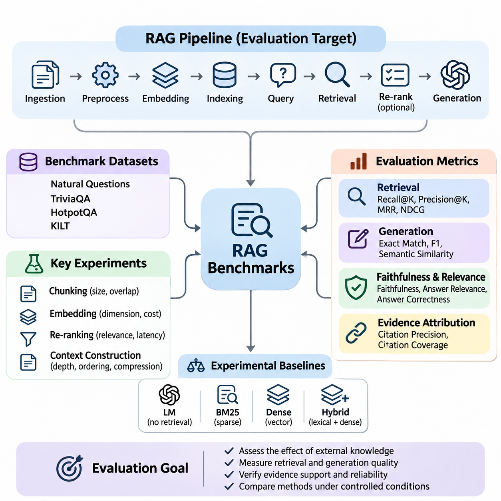
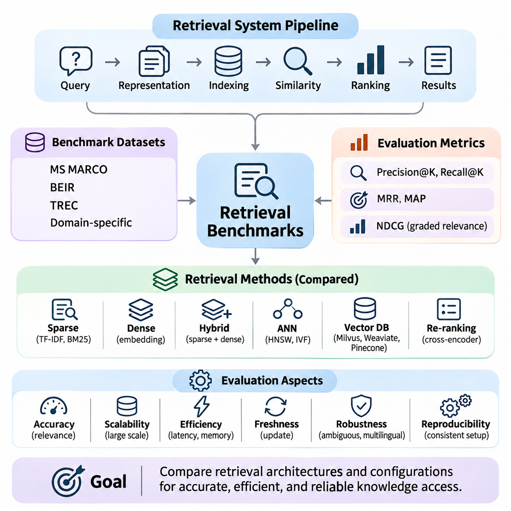
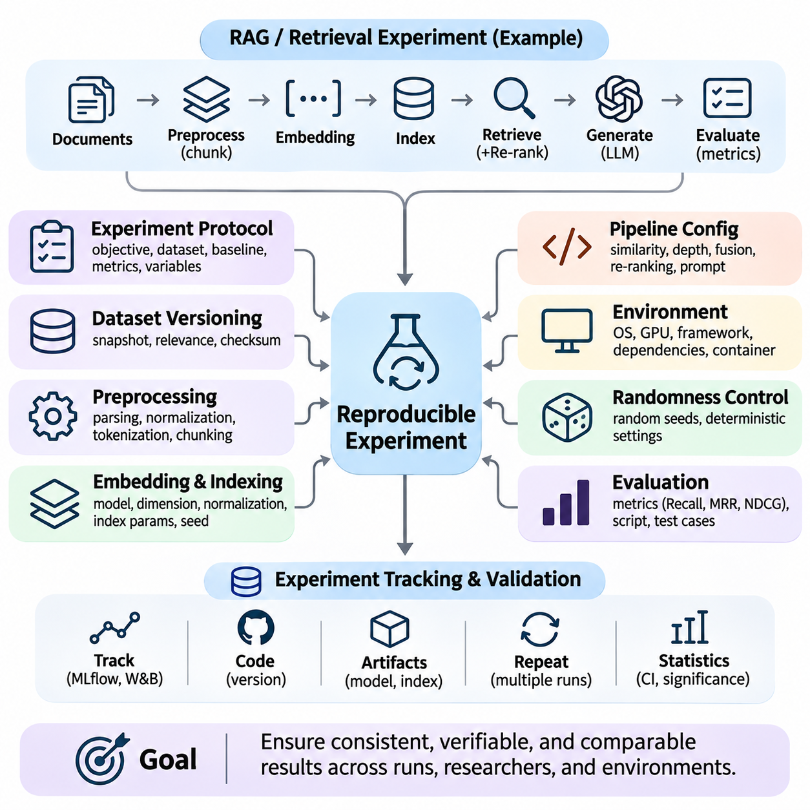
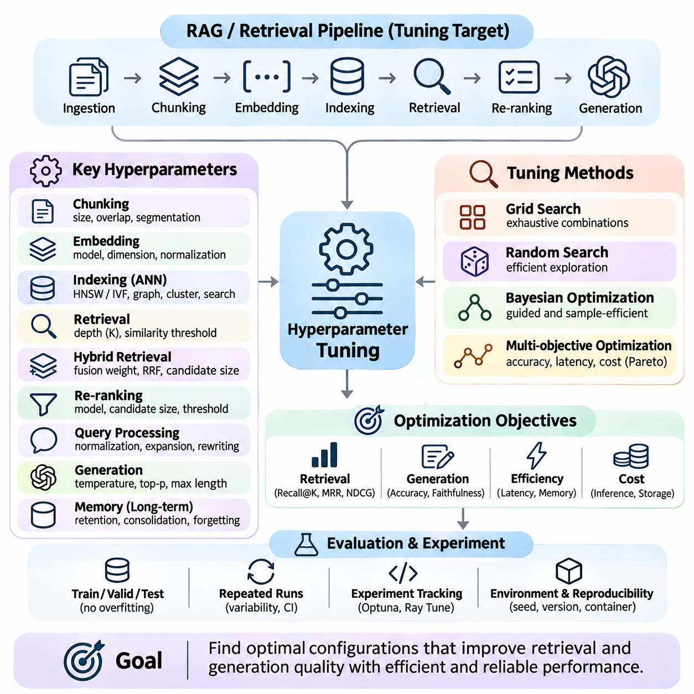
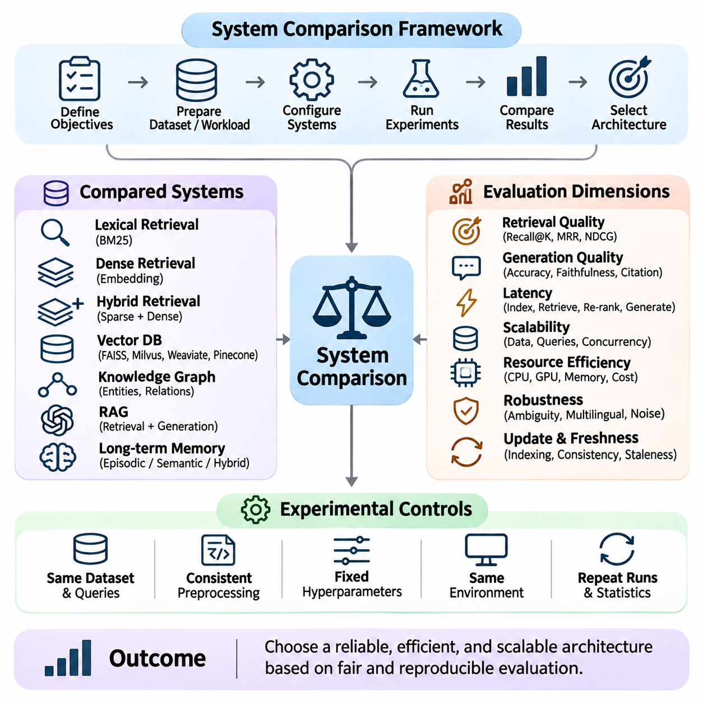

**Volume 37. Memory and Knowledge Systems**


# 08. Experiments and Benchmarks

## 08.01 RAG Benchmarks

{width="7.268055555555556in" height="7.268055555555556in"}

Retrieval-Augmented Generation (RAG) benchmarks provide a systematic framework for evaluating how effectively language models retrieve external knowledge and generate accurate, relevant, and evidence-supported responses. Unlike conventional language model evaluations, RAG benchmarking examines the interaction between retrieval mechanisms, knowledge repositories, context construction, and response generation. Its primary objective is to determine whether external information improves factual reliability and task performance.

A typical RAG system consists of document ingestion, text preprocessing, embedding generation, vector indexing, query processing, retrieval, optional re-ranking, and language model inference. Each component influences the final response, making end-to-end evaluation essential. A benchmark must therefore distinguish retrieval failures from generation failures while measuring the combined performance of the complete pipeline under controlled experimental conditions.

Benchmark datasets generally contain user queries, reference answers, relevant documents, and supporting evidence annotations. These elements establish a measurable relationship between information retrieval and generated responses. Dataset quality depends on representative query distributions, accurate relevance judgments, sufficient domain coverage, and consistent annotation procedures. Poorly constructed datasets can produce misleading conclusions even when evaluation metrics appear statistically reliable.

Widely used evaluation resources include Natural Questions, TriviaQA, HotpotQA, and KILT, although they serve different experimental purposes. Natural Questions emphasizes information seeking, TriviaQA examines factual question answering, and HotpotQA evaluates reasoning across multiple supporting documents. KILT provides a framework connecting knowledge-intensive language tasks with evidence provenance, making it useful for studying retrieval-grounded generation.

Retrieval effectiveness is commonly measured using Recall\\@K, Precision\\@K, Mean Reciprocal Rank, and Normalized Discounted Cumulative Gain. Recall\\@K measures whether relevant evidence appears among the retrieved candidates, while Precision\\@K evaluates the proportion of relevant results. Reciprocal rank emphasizes the position of the first relevant result, whereas NDCG considers graded relevance and ranking quality across multiple retrieved documents.

Generation quality requires additional measurements because successful retrieval does not guarantee a correct answer. Exact Match and token-level F1 can evaluate responses against reference answers, particularly in factual question answering. Semantic similarity metrics provide flexibility when equivalent answers use different wording. However, lexical and semantic agreement alone cannot establish whether generated claims are genuinely supported by retrieved evidence.

Faithfulness measures the degree to which generated statements are supported by the supplied context. Answer relevance evaluates whether the response addresses the original question, while answer correctness examines agreement with verified reference information. These dimensions should be evaluated separately because a response may be relevant but factually incorrect, or factually correct without being supported by the retrieved documents.

Evidence attribution is another essential benchmark dimension. A reliable RAG system should identify which retrieved passages support individual factual claims and avoid presenting unsupported statements as established knowledge. Citation precision measures whether cited passages genuinely support their associated claims, while citation coverage examines how comprehensively claims receive appropriate evidence. These measurements become particularly important in scientific, legal, and enterprise applications.

Experimental baselines are necessary for interpreting benchmark results. A useful comparison includes a language model without retrieval, a conventional sparse retrieval system such as BM25, a dense vector retrieval pipeline, and a hybrid retrieval architecture. Evaluating these alternatives with the same dataset and generation model helps isolate the contribution of external knowledge access and retrieval methodology.

Document chunking introduces significant experimental variation because retrieval systems operate on segmented representations of source materials. Small chunks may improve semantic specificity but fragment important contextual relationships. Large chunks preserve broader information while increasing irrelevant content and token consumption. Benchmark experiments should therefore examine chunk size, overlap, segmentation strategy, and their effects on retrieval coverage and answer quality.

Embedding models also influence benchmark outcomes by determining how queries and documents are represented in vector space. Domain-specific terminology, multilingual expressions, abbreviations, and semantic ambiguity can affect retrieval accuracy. Controlled comparisons should evaluate embedding dimensionality, representation quality, indexing requirements, and computational cost while keeping other pipeline components unchanged whenever possible.

Re-ranking experiments investigate whether additional relevance estimation improves the ordering of retrieved candidates. Cross-encoder models can evaluate query-document relationships more directly than independent embedding similarity, although they introduce computational overhead. Benchmarking should measure improvements in evidence relevance and downstream answer correctness alongside additional latency, memory consumption, and processing cost.

Context construction determines how retrieved information enters the language model. Experiments may compare different retrieval depths, passage ordering strategies, context compression methods, and token budgets. Increasing the number of retrieved passages does not necessarily improve performance because irrelevant or contradictory information may distract generation. Effective benchmarking identifies the context configuration that balances evidence sufficiency with computational efficiency.

Multi-hop reasoning benchmarks evaluate questions requiring information distributed across several documents or knowledge sources. These tasks are particularly challenging because retrieving one relevant passage may be insufficient to establish the final answer. Evaluation should examine whether all necessary supporting facts are retrieved, whether relationships between them are correctly interpreted, and whether the generated conclusion follows logically from the available evidence.

Robustness testing examines system behavior under noisy queries, incomplete documents, conflicting evidence, and changes in terminology. Additional experiments may introduce typographical errors, paraphrased questions, irrelevant passages, or outdated information. A robust RAG system should maintain reasonable retrieval effectiveness, recognize insufficient evidence, and avoid producing confident answers when available sources cannot support a reliable conclusion.

Knowledge freshness introduces another benchmarking requirement for systems connected to frequently updated repositories. Experiments should measure how quickly newly inserted documents become searchable and whether outdated information remains influential after updates. Temporal evaluation can include questions whose correct answers change over time, allowing researchers to assess indexing delays, retrieval consistency, and the ability to prioritize current evidence.

Operational performance must be evaluated alongside answer quality. Important measurements include retrieval latency, generation latency, end-to-end response time, throughput, memory utilization, and computational cost per query. Percentile latency measurements reveal behavior that average response times may conceal. Experiments under concurrent workloads are particularly valuable for identifying bottlenecks in vector databases, re-ranking services, and language model inference.

Ablation studies provide insight into the contribution of individual RAG components. Researchers may disable re-ranking, replace hybrid retrieval with dense retrieval, remove query expansion, or vary context compression while preserving the remaining experimental configuration. Performance differences reveal which mechanisms provide measurable benefits and which introduce unnecessary complexity. Such analysis supports evidence-based architectural optimization rather than relying on isolated benchmark scores.

Statistical reliability requires careful treatment of dataset sampling and experimental variability. Benchmark reports should include sample sizes, evaluation procedures, uncertainty estimates, and repeated measurements where appropriate. Paired comparisons and bootstrap confidence intervals can help determine whether observed performance differences are meaningful. Model versions, document collections, prompts, and retrieval settings must remain traceable throughout the evaluation process.

Domain-specific benchmarking extends general question-answering evaluation into enterprise knowledge management, scientific research, robotics, and industrial systems. These environments often contain specialized terminology, structured records, technical manuals, and heterogeneous document formats. Evaluation datasets should represent realistic operational questions and measure whether the system retrieves authoritative evidence rather than merely producing plausible language.

Security and privacy considerations also affect RAG evaluation. Retrieved documents may contain confidential information, misleading instructions, or content outside the requesting user\'s access permissions. Benchmark scenarios should examine unauthorized information exposure, prompt injection through retrieved passages, and inappropriate reliance on untrusted sources. These tests evaluate whether retrieval-grounded generation preserves system boundaries while maintaining useful responses.

Human evaluation remains important when automated metrics cannot adequately assess technical completeness, reasoning quality, or practical usefulness. Domain experts can examine whether responses preserve critical qualifications, interpret evidence correctly, and communicate uncertainty appropriately. Clear scoring rubrics and agreement measurements help reduce subjective variation, while targeted human review can reveal systematic failures overlooked by automated evaluation.

A comprehensive RAG benchmark ultimately combines retrieval effectiveness, evidence faithfulness, answer correctness, robustness, efficiency, and operational reliability. No single metric adequately represents these interconnected dimensions. By applying controlled experiments, representative datasets, transparent evaluation procedures, and reproducible configurations, researchers can identify architectural weaknesses and develop retrieval-augmented systems that deliver dependable, verifiable, and scalable knowledge-based intelligence.

검색 증강 생성(Retrieval-Augmented Generation, RAG) 벤치마크(Benchmark)는 언어 모델(Language Model)이 외부 지식을 얼마나 효과적으로 검색하고 정확하며 관련성이 높고 근거에 기반한 응답을 생성하는지 평가하기 위한 체계적인 프레임워크(Framework)를 제공한다. 기존 언어 모델 평가와 달리 RAG 벤치마킹(Benchmarking)은 검색 메커니즘(Retrieval Mechanism), 지식 저장소(Knowledge Repository), 문맥 구성(Context Construction), 응답 생성(Response Generation) 사이의 상호작용을 분석한다. 주요 목적은 외부 정보가 사실적 신뢰성과 작업 수행 성능을 실질적으로 개선하는지 판단하는 것이다.

일반적인 RAG 시스템은 문서 수집(Document Ingestion), 텍스트 전처리(Text Preprocessing), 임베딩 생성(Embedding Generation), 벡터 인덱싱(Vector Indexing), 질의 처리(Query Processing), 검색(Retrieval), 선택적 재순위화(Re-Ranking), 언어 모델 추론(Language Model Inference)으로 구성된다. 각 구성 요소는 최종 응답에 영향을 미치므로 종단 간 평가(End-to-End Evaluation)가 필수적이다. 따라서 벤치마크는 검색 실패와 생성 실패를 구분하면서 통제된 실험 조건에서 전체 파이프라인(Pipeline)의 통합 성능을 측정해야 한다.

벤치마크 데이터셋(Benchmark Dataset)은 일반적으로 사용자 질의(User Query), 참조 정답(Reference Answer), 관련 문서(Relevant Document), 근거 주석(Evidence Annotation)을 포함한다. 이러한 요소는 정보 검색과 생성된 응답 사이의 관계를 정량적으로 측정할 수 있는 기반을 제공한다. 데이터셋 품질은 대표성 있는 질의 분포, 정확한 관련성 판단, 충분한 도메인 범위(Domain Coverage), 일관된 주석 절차에 의해 결정된다. 잘못 구성된 데이터셋은 평가 지표가 통계적으로 신뢰할 만하게 나타나더라도 잘못된 결론을 유도할 수 있다.

널리 사용되는 평가 자원에는 자연어 질문(Natural Questions), TriviaQA, HotpotQA, KILT 등이 있으며, 각각 서로 다른 실험 목적을 가진다. Natural Questions는 정보 탐색(Information Seeking)에 중점을 두고, TriviaQA는 사실 기반 질의응답(Factual Question Answering)을 평가하며, HotpotQA는 여러 근거 문서에 걸친 추론(Multi-Hop Reasoning)을 평가한다. KILT는 지식 집약적 언어 작업(Knowledge-Intensive Language Task)과 근거 출처(Evidence Provenance)를 연결하는 평가 프레임워크를 제공하여 검색 기반 생성의 분석에 활용된다.

검색 효과성(Retrieval Effectiveness)은 일반적으로 Recall\\@K, Precision\\@K, 평균 역순위(Mean Reciprocal Rank, MRR), 정규화 할인 누적 이득(Normalized Discounted Cumulative Gain, NDCG)을 사용하여 측정한다. Recall\\@K는 검색된 후보에 관련 근거가 포함되는지를 평가하고, Precision\\@K는 검색 결과 중 관련 문서의 비율을 측정한다. MRR은 첫 번째 관련 결과의 순위를 강조하며, NDCG는 여러 검색 문서의 관련성 등급과 순위 품질을 함께 고려한다.

생성 품질(Generation Quality)은 검색 성공이 반드시 올바른 응답으로 이어지지 않기 때문에 별도의 평가가 필요하다. 완전 일치(Exact Match, EM)와 토큰 수준 F1(Token-Level F1)은 특히 사실 기반 질의응답에서 생성된 응답과 참조 정답을 비교하는 데 활용된다. 의미적 유사도 지표(Semantic Similarity Metric)는 동일한 의미를 서로 다른 표현으로 전달하는 응답을 유연하게 평가한다. 그러나 어휘적 일치와 의미적 일치만으로는 생성된 주장이 검색된 근거에 의해 실제로 뒷받침되는지 확인할 수 없다.

근거 충실도(Faithfulness)는 생성된 문장이 제공된 문맥(Context)에 의해 얼마나 충분히 뒷받침되는지를 측정한다. 응답 관련성(Answer Relevance)은 생성된 응답이 원래 질문을 적절하게 다루는지를 평가하며, 응답 정확성(Answer Correctness)은 검증된 참조 정보와의 일치 여부를 분석한다. 이러한 평가 차원은 서로 구분되어야 한다. 응답이 질문과 관련성이 높더라도 사실적으로 부정확할 수 있으며, 사실적으로 정확하더라도 검색된 문서에 의해 뒷받침되지 않을 수 있기 때문이다.

근거 귀속(Evidence Attribution)은 RAG 벤치마크의 또 다른 핵심 평가 요소이다. 신뢰할 수 있는 RAG 시스템은 개별 사실적 주장을 뒷받침하는 검색 문서를 식별하고, 근거가 없는 내용을 확립된 지식처럼 제시하지 않아야 한다. 인용 정밀도(Citation Precision)는 인용된 문서가 해당 주장을 실제로 뒷받침하는지를 측정하며, 인용 포괄성(Citation Coverage)은 주요 주장에 적절한 근거가 얼마나 충분히 연결되어 있는지를 평가한다. 이러한 지표는 과학, 법률, 기업용 인공지능(Enterprise AI)에서 특히 중요하다.

실험 기준 모델(Baseline)은 벤치마크 결과를 해석하는 데 필수적이다. 유용한 비교 구성에는 검색 기능이 없는 언어 모델, BM25와 같은 기존 희소 검색(Sparse Retrieval) 시스템, 밀집 벡터 검색(Dense Vector Retrieval) 파이프라인, 하이브리드 검색(Hybrid Retrieval) 아키텍처가 포함된다. 동일한 데이터셋과 생성 모델을 사용하여 이러한 대안을 평가하면 외부 지식 접근과 검색 방법론이 성능에 기여하는 정도를 구분할 수 있다.

문서 청킹(Document Chunking)은 검색 시스템이 원본 문서를 분할된 표현으로 처리하기 때문에 중요한 실험 변수를 형성한다. 작은 청크(Chunk)는 의미적 구체성을 높일 수 있지만 중요한 문맥 관계를 분리할 가능성이 있다. 반면 큰 청크는 폭넓은 정보를 유지하지만 불필요한 내용과 토큰 소비량을 증가시킬 수 있다. 따라서 벤치마크 실험에서는 청크 크기(Chunk Size), 중첩(Overlap), 분할 전략(Segmentation Strategy)이 검색 범위와 응답 품질에 미치는 영향을 분석해야 한다.

임베딩 모델(Embedding Model)은 질의와 문서가 벡터 공간(Vector Space)에 표현되는 방식을 결정하여 벤치마크 결과에 영향을 미친다. 도메인 특화 용어(Domain-Specific Terminology), 다국어 표현(Multilingual Expression), 약어(Abbreviation), 의미적 모호성(Semantic Ambiguity)은 검색 정확도를 변화시킬 수 있다. 통제된 비교 실험에서는 가능한 한 다른 파이프라인 구성 요소를 동일하게 유지하면서 임베딩 차원(Embedding Dimensionality), 표현 품질, 인덱싱 요구사항, 계산 비용을 평가해야 한다.

재순위화(Re-Ranking) 실험은 추가적인 관련성 추정(Relevance Estimation)이 검색 후보의 순서를 개선하는지 분석한다. 교차 인코더(Cross-Encoder) 모델은 독립적인 임베딩 유사도보다 질의와 문서 사이의 관계를 직접적으로 평가할 수 있지만 추가적인 계산 부담을 발생시킨다. 따라서 벤치마킹에서는 근거 관련성과 최종 응답 정확도의 개선뿐 아니라 추가 지연시간(Latency), 메모리 사용량(Memory Consumption), 처리 비용(Processing Cost)도 함께 측정해야 한다.

문맥 구성(Context Construction)은 검색된 정보가 언어 모델에 입력되는 방식을 결정한다. 실험에서는 검색 깊이(Retrieval Depth), 문서 배치 순서(Passage Ordering), 문맥 압축(Context Compression), 토큰 예산(Token Budget)을 비교할 수 있다. 검색 문서 수를 증가시키는 것이 반드시 성능 향상으로 이어지지는 않는다. 관련성이 낮거나 서로 모순되는 정보가 생성 과정을 방해할 수 있기 때문이다. 효과적인 벤치마킹은 근거의 충분성과 계산 효율성 사이에서 균형을 이루는 문맥 구성을 식별한다.

다단계 추론(Multi-Hop Reasoning) 벤치마크는 여러 문서 또는 지식 출처에 분산된 정보를 결합해야 하는 질문을 평가한다. 이러한 작업에서는 하나의 관련 문서를 검색하는 것만으로 최종 정답을 도출하기 어려울 수 있다. 따라서 평가는 필요한 모든 근거가 검색되었는지, 근거 사이의 관계가 올바르게 해석되었는지, 생성된 결론이 사용 가능한 정보로부터 논리적으로 도출되었는지를 분석해야 한다.

강건성 시험(Robustness Testing)은 잡음이 포함된 질의, 불완전한 문서, 상충되는 근거, 용어 변화에 대한 시스템 동작을 평가한다. 추가 실험에서는 오탈자(Typographical Error), 바꾸어 표현한 질문(Paraphrased Question), 무관한 문서(Irrelevant Passage), 오래된 정보(Outdated Information)를 도입할 수 있다. 강건한 RAG 시스템은 합리적인 검색 성능을 유지하고 근거 부족을 인식하며, 사용 가능한 정보로 신뢰할 수 있는 결론을 도출할 수 없을 때 확신에 찬 잘못된 응답을 피해야 한다.

지식 최신성(Knowledge Freshness)은 자주 갱신되는 저장소와 연결된 시스템에서 중요한 벤치마킹 요구사항이다. 실험에서는 새롭게 삽입된 문서가 검색 가능해지는 데 필요한 시간과 정보 갱신 이후 오래된 문서가 응답에 미치는 영향을 측정해야 한다. 시간적 평가(Temporal Evaluation)는 정답이 시간에 따라 변경되는 질문을 포함할 수 있으며, 이를 통해 인덱싱 지연(Indexing Delay), 검색 일관성(Retrieval Consistency), 최신 근거를 우선적으로 활용하는 능력을 평가할 수 있다.

운영 성능(Operational Performance)은 응답 품질과 함께 평가해야 한다. 주요 측정 항목에는 검색 지연시간(Retrieval Latency), 생성 지연시간(Generation Latency), 종단 간 응답시간(End-to-End Response Time), 처리량(Throughput), 메모리 사용률(Memory Utilization), 질의당 계산 비용(Computational Cost per Query)이 포함된다. 백분위 지연시간(Percentile Latency)은 평균 응답시간만으로 확인하기 어려운 성능 특성을 보여준다. 동시 요청(Concurrent Workload) 조건의 실험은 벡터 데이터베이스, 재순위화 서비스, 언어 모델 추론의 병목현상(Bottleneck)을 식별하는 데 특히 유용하다.

제거 실험(Ablation Study)은 개별 RAG 구성 요소의 성능 기여도를 분석하는 방법이다. 연구자는 다른 실험 조건을 유지하면서 재순위화를 비활성화하거나, 하이브리드 검색을 밀집 검색으로 대체하거나, 질의 확장(Query Expansion)을 제거하거나, 문맥 압축 수준을 변경할 수 있다. 이러한 성능 차이는 실제로 유용한 메커니즘과 불필요한 복잡성을 유발하는 요소를 구분하는 데 도움이 된다. 이를 통해 개별 벤치마크 점수에 의존하지 않는 근거 기반 아키텍처 최적화(Architecture Optimization)가 가능해진다.

통계적 신뢰성(Statistical Reliability)을 확보하려면 데이터셋 표본 추출(Dataset Sampling)과 실험 변동성(Experimental Variability)을 신중하게 처리해야 한다. 벤치마크 보고서에는 표본 크기(Sample Size), 평가 절차(Evaluation Procedure), 불확실성 추정(Uncertainty Estimation), 필요한 경우 반복 측정 결과를 포함해야 한다. 대응 비교(Paired Comparison)와 부트스트랩 신뢰구간(Bootstrap Confidence Interval)은 관찰된 성능 차이가 의미 있는지를 판단하는 데 도움이 된다. 모델 버전, 문서 집합, 프롬프트, 검색 설정은 평가 전 과정에서 추적 가능해야 한다.

도메인 특화 벤치마킹(Domain-Specific Benchmarking)은 일반적인 질의응답 평가를 기업 지식 관리(Enterprise Knowledge Management), 과학 연구(Scientific Research), 로보틱스(Robotics), 산업 시스템(Industrial System)으로 확장한다. 이러한 환경에는 전문 용어, 구조화된 기록(Structured Record), 기술 매뉴얼(Technical Manual), 다양한 문서 형식이 포함되는 경우가 많다. 평가 데이터셋은 실제 운영 질문을 반영해야 하며, 단순히 그럴듯한 문장을 생성하는 것이 아니라 권위 있는 근거(Authoritative Evidence)를 검색하는 능력을 측정해야 한다.

보안(Security)과 개인정보 보호(Privacy)도 RAG 평가에 영향을 미친다. 검색된 문서에는 기밀 정보(Confidential Information), 오해를 유발하는 지시문(Misleading Instruction), 사용자 접근 권한(Access Permission)을 벗어나는 내용이 포함될 수 있다. 벤치마크 시나리오는 무단 정보 노출(Unauthorized Information Exposure), 검색 문서를 통한 프롬프트 주입(Prompt Injection), 신뢰할 수 없는 출처에 대한 부적절한 의존을 평가해야 한다. 이러한 시험은 검색 기반 생성이 유용한 응답을 유지하면서 시스템의 보안 경계를 준수하는지 확인한다.

인간 평가(Human Evaluation)는 자동화된 지표만으로 기술적 완전성(Technical Completeness), 추론 품질(Reasoning Quality), 실질적 유용성(Practical Usefulness)을 충분히 평가하기 어려울 때 중요하다. 도메인 전문가(Domain Expert)는 응답이 핵심적인 제한 조건을 유지하고 근거를 올바르게 해석하며 불확실성을 적절하게 전달하는지 검토할 수 있다. 명확한 채점 기준(Scoring Rubric)과 평가자 간 일치도(Inter-Annotator Agreement)는 주관적 편차를 줄이고, 집중적인 인간 검토는 자동 평가에서 발견하지 못한 체계적 오류를 식별할 수 있다.

종합적인 RAG 벤치마크는 검색 효과성(Retrieval Effectiveness), 근거 충실도(Evidence Faithfulness), 응답 정확성(Answer Correctness), 강건성(Robustness), 효율성(Efficiency), 운영 신뢰성(Operational Reliability)을 통합한다. 단일 평가 지표만으로는 이러한 상호 연결된 성능 차원을 충분히 표현할 수 없다. 통제된 실험, 대표성 있는 데이터셋, 투명한 평가 절차, 재현 가능한 구성(Reproducible Configuration)을 적용함으로써 연구자는 아키텍처의 취약점을 식별하고 신뢰성, 검증 가능성, 확장성을 갖춘 지식 기반 인공지능(Knowledge-Based Intelligence) 시스템을 개발할 수 있다.

## 08.02 Retrieval Benchmarks

{width="7.268055555555556in" height="7.268055555555556in"}

Retrieval benchmarks provide a systematic methodology for evaluating how effectively information retrieval systems identify, rank, and deliver relevant knowledge from large document collections. Within memory and knowledge systems, retrieval quality directly influences factual accuracy, contextual relevance, and downstream reasoning performance. Benchmarking establishes measurable criteria for comparing retrieval architectures under consistent experimental conditions.

A retrieval system transforms a user query into a ranked collection of documents, passages, or knowledge representations. Its performance depends on query interpretation, document representation, indexing structures, similarity computation, and ranking algorithms. Effective benchmarking evaluates these components individually while examining their combined behavior, allowing researchers to distinguish representation limitations from indexing and ranking failures.

Benchmark datasets typically contain a document corpus, evaluation queries, and relevance judgments connecting queries to appropriate documents. These judgments may be binary, indicating whether a document is relevant, or graded, representing different levels of usefulness. Dataset construction must consider query diversity, corpus characteristics, annotation consistency, and realistic information needs to ensure meaningful experimental conclusions.

Established evaluation collections include MS MARCO, BEIR, TREC datasets, and domain-specific retrieval corpora. MS MARCO supports large-scale passage and document ranking experiments, while BEIR evaluates generalization across heterogeneous retrieval tasks. TREC provides standardized evaluation settings and relevance judgments across multiple tracks. These resources enable controlled comparisons, although differences in datasets and protocols require careful interpretation.

Precision measures the proportion of retrieved documents that are relevant, while recall measures the proportion of relevant documents successfully retrieved. Precision\\@K and Recall\\@K restrict evaluation to the highest-ranked K results, reflecting practical retrieval interfaces and context-limited AI systems. Their interpretation depends on the completeness of relevance judgments, particularly when large collections contain relevant documents that have not been annotated.

Mean Reciprocal Rank evaluates how early the first relevant document appears in a ranked result list. It is especially useful for question-answering systems where locating one authoritative passage may satisfy the information need. Mean Average Precision considers precision across relevant-document positions, providing a broader assessment of ranking effectiveness when multiple relevant documents contribute to retrieval quality.

Normalized Discounted Cumulative Gain evaluates ranking quality by assigning greater importance to highly relevant documents appearing near the beginning of a result list. Its graded relevance formulation is useful when documents differ substantially in informational value. Unlike binary retrieval metrics, NDCG can distinguish between partially relevant and highly relevant results, making it suitable for complex knowledge discovery applications.

Sparse retrieval benchmarks evaluate lexical matching approaches such as TF-IDF and BM25. These methods represent documents using term statistics and typically perform well when queries contain distinctive keywords or exact technical terminology. Experiments should examine vocabulary mismatch, document length variation, rare terminology, and query expansion effects to identify the strengths and limitations of traditional lexical retrieval.

Dense retrieval benchmarks evaluate neural embedding models that map queries and documents into continuous vector spaces. Semantic similarity enables retrieval beyond exact keyword overlap, potentially improving performance on paraphrased questions and conceptually related documents. However, dense retrieval may struggle with precise identifiers, numerical constraints, or specialized terminology, requiring evaluation across diverse query categories.

Hybrid retrieval combines sparse and dense representations to capture complementary lexical and semantic relationships. Benchmark experiments may compare weighted score fusion, reciprocal rank fusion, and alternative candidate aggregation strategies. Performance should be measured across exact-match queries, semantic queries, and mixed information needs to determine whether hybrid architectures provide consistent improvements over individual retrieval methods.

Approximate Nearest Neighbor algorithms introduce another benchmarking dimension by trading exact search guarantees for computational efficiency. Systems based on Hierarchical Navigable Small World graphs, inverted file indexes, or other approximate structures should be evaluated using recall against exact nearest-neighbor results. Index construction time, query latency, memory consumption, and update behavior must accompany retrieval accuracy measurements.

Vector database benchmarks examine the operational characteristics of systems such as Milvus, Weaviate, and Pinecone under comparable workloads. Evaluation should control embedding dimensions, collection sizes, index parameters, filtering conditions, and concurrency levels. Differences in infrastructure configuration and managed-service behavior must be documented to prevent misleading conclusions about database performance.

Re-ranking benchmarks investigate whether secondary ranking models improve the relevance of initially retrieved candidates. Cross-encoders can estimate query-document relevance using joint representations, while lighter ranking methods may offer lower computational costs. Experiments should measure ranking improvements alongside additional inference latency, candidate-set size, and processing requirements to determine whether re-ranking provides practical value.

Scalability experiments examine retrieval behavior as document collections expand from thousands to millions or billions of records. Increasing corpus size affects indexing time, storage requirements, memory utilization, and search latency. A reliable benchmark should measure performance across multiple collection sizes while maintaining consistent query distributions and relevance criteria, revealing how retrieval quality and infrastructure requirements evolve.

Dynamic retrieval benchmarks evaluate systems operating on continuously changing knowledge repositories. Document insertion, deletion, modification, and re-indexing can influence search consistency and information freshness. Experiments should measure update visibility, indexing delay, retrieval stability, and query performance during concurrent modifications, particularly in enterprise systems where knowledge changes frequently.

Robustness evaluation investigates retrieval performance under spelling errors, ambiguous queries, multilingual inputs, incomplete context, and domain shifts. Controlled perturbations help determine whether ranking models depend excessively on surface-level wording. Out-of-domain evaluation is particularly important for neural retrieval systems because strong performance on familiar training distributions does not guarantee reliable generalization to unfamiliar knowledge collections.

Efficiency benchmarks measure query latency, throughput, CPU utilization, GPU utilization, memory footprint, and storage overhead. Average latency should be supplemented with percentile measurements to reveal performance under demanding workloads. Concurrent query experiments and realistic filtering operations help identify infrastructure bottlenecks, enabling researchers to balance retrieval effectiveness against operational cost and response-time requirements.

Reproducible retrieval benchmarking requires consistent datasets, preprocessing procedures, model versions, indexing configurations, and evaluation scripts. Random seeds, hardware specifications, software dependencies, and query execution settings should be recorded. Statistical comparisons across query-level results help establish whether measured improvements are meaningful rather than consequences of sampling variation or uncontrolled experimental conditions.

Domain-specific retrieval evaluation extends benchmarking into scientific literature, enterprise documentation, industrial maintenance, robotics, and autonomous systems. These environments contain structured metadata, specialized vocabulary, numerical specifications, and relationships across multiple information sources. Benchmarks should reflect realistic domain queries and evaluate whether retrieved information is sufficiently accurate, complete, and authoritative for downstream decision-making.

Retrieval benchmarks ultimately support the selection and optimization of knowledge access architectures by connecting relevance quality with computational efficiency and operational reliability. No single metric captures every aspect of retrieval performance. Comprehensive evaluation combines ranking effectiveness, semantic coverage, scalability, freshness, robustness, and reproducibility to establish dependable foundations for retrieval-augmented generation, long-term memory, and intelligent knowledge systems.

검색 벤치마크(Retrieval Benchmark)는 정보 검색 시스템(Information Retrieval System)이 대규모 문서 집합에서 관련 지식을 얼마나 효과적으로 식별하고 순위를 결정하며 제공하는지 평가하기 위한 체계적인 방법론을 제공한다. 메모리 및 지식 시스템(Memory and Knowledge Systems)에서 검색 품질은 사실적 정확성(Factual Accuracy), 문맥 관련성(Contextual Relevance), 후속 추론 성능(Downstream Reasoning Performance)에 직접적인 영향을 미친다. 벤치마킹(Benchmarking)은 일관된 실험 조건에서 검색 아키텍처(Retrieval Architecture)를 비교하기 위한 정량적 평가 기준을 확립한다.

검색 시스템(Retrieval System)은 사용자 질의(User Query)를 문서, 문단 또는 지식 표현(Knowledge Representation)의 순위화된 결과 집합으로 변환한다. 검색 성능은 질의 해석(Query Interpretation), 문서 표현(Document Representation), 인덱싱 구조(Indexing Structure), 유사도 계산(Similarity Computation), 순위화 알고리즘(Ranking Algorithm)에 의해 결정된다. 효과적인 벤치마킹은 이러한 구성 요소를 개별적으로 평가하는 동시에 통합 동작을 분석하여 표현 방식의 한계와 인덱싱 및 순위화 과정에서 발생하는 오류를 구분할 수 있도록 한다.

벤치마크 데이터셋(Benchmark Dataset)은 일반적으로 문서 말뭉치(Document Corpus), 평가 질의(Evaluation Query), 질의와 관련 문서를 연결하는 관련성 판단(Relevance Judgment)으로 구성된다. 관련성 판단은 문서의 관련 여부를 나타내는 이진 방식(Binary Relevance) 또는 유용성 수준을 구분하는 등급 방식(Graded Relevance)으로 표현할 수 있다. 데이터셋 구축에서는 질의 다양성(Query Diversity), 말뭉치 특성(Corpus Characteristics), 주석 일관성(Annotation Consistency), 실제 정보 요구사항(Information Needs)을 고려하여 의미 있는 실험 결과를 확보해야 한다.

대표적인 검색 평가 데이터셋에는 MS MARCO, BEIR, TREC 데이터셋 및 도메인 특화 검색 말뭉치(Domain-Specific Retrieval Corpus)가 포함된다. MS MARCO는 대규모 문단 및 문서 순위화 실험을 지원하며, BEIR은 서로 다른 검색 작업에서 일반화 성능(Generalization Performance)을 평가한다. TREC은 다양한 평가 트랙(Evaluation Track)에 걸쳐 표준화된 실험 환경과 관련성 판단을 제공한다. 이러한 자원은 통제된 비교를 가능하게 하지만, 데이터셋과 평가 절차의 차이를 신중하게 해석해야 한다.

정밀도(Precision)는 검색된 문서 중 관련 문서가 차지하는 비율을 측정하며, 재현율(Recall)은 전체 관련 문서 중 성공적으로 검색된 문서의 비율을 나타낸다. Precision\\@K와 Recall\\@K는 평가 범위를 상위 K개 검색 결과로 제한하여 실제 검색 인터페이스와 문맥 길이가 제한된 인공지능 시스템의 특성을 반영한다. 이러한 지표의 해석은 관련성 판단의 완전성에 영향을 받으며, 특히 대규모 문서 집합에서 관련 문서가 충분히 주석 처리되지 않은 경우 주의가 필요하다.

평균 역순위(Mean Reciprocal Rank, MRR)는 첫 번째 관련 문서가 검색 결과의 얼마나 앞쪽에 나타나는지 평가한다. 이 지표는 하나의 신뢰할 수 있는 문단을 찾는 것만으로 정보 요구를 충족할 수 있는 질의응답 시스템(Question Answering System)에 특히 유용하다. 평균 정밀도 평균(Mean Average Precision, MAP)은 여러 관련 문서의 순위 위치에서 계산한 정밀도를 종합하여, 다수의 관련 문서가 검색 품질에 기여하는 상황에서 보다 폭넓은 순위화 성능을 평가한다.

정규화 할인 누적 이득(Normalized Discounted Cumulative Gain, NDCG)은 관련성이 높은 문서가 검색 결과의 앞부분에 배치될수록 더 큰 가중치를 부여하여 순위화 품질을 평가한다. 등급별 관련성(Graded Relevance)을 활용하는 방식은 문서마다 정보적 가치가 크게 다른 경우에 유용하다. 이진 검색 지표와 달리 NDCG는 부분적으로 관련된 결과와 매우 관련성이 높은 결과를 구분할 수 있으므로 복잡한 지식 탐색(Knowledge Discovery) 응용 분야에 적합하다.

희소 검색(Sparse Retrieval) 벤치마크는 TF-IDF와 BM25 같은 어휘 기반 일치(Lexical Matching) 방법을 평가한다. 이러한 방법은 단어 통계(Term Statistics)를 사용하여 문서를 표현하며, 질의에 구별되는 핵심 단어나 정확한 기술 용어가 포함된 경우 일반적으로 우수한 성능을 보인다. 실험에서는 어휘 불일치(Vocabulary Mismatch), 문서 길이 변화(Document Length Variation), 희귀 용어(Rare Terminology), 질의 확장(Query Expansion)의 영향을 분석하여 기존 어휘 기반 검색의 강점과 한계를 식별해야 한다.

밀집 검색(Dense Retrieval) 벤치마크는 질의와 문서를 연속적인 벡터 공간(Continuous Vector Space)에 매핑하는 신경망 임베딩 모델(Neural Embedding Model)을 평가한다. 의미적 유사도(Semantic Similarity)는 정확한 키워드 일치를 넘어서는 검색을 가능하게 하며, 바꾸어 표현한 질문(Paraphrased Question)이나 개념적으로 관련된 문서의 검색 성능을 개선할 수 있다. 그러나 밀집 검색은 정확한 식별자(Identifier), 수치적 제약조건(Numerical Constraint), 전문 용어 처리에 어려움을 겪을 수 있으므로 다양한 질의 유형에 대한 평가가 필요하다.

하이브리드 검색(Hybrid Retrieval)은 희소 표현(Sparse Representation)과 밀집 표현(Dense Representation)을 결합하여 상호 보완적인 어휘적 관계와 의미적 관계를 활용한다. 벤치마크 실험에서는 가중 점수 융합(Weighted Score Fusion), 역순위 융합(Reciprocal Rank Fusion, RRF), 다양한 후보 결과 통합 전략(Candidate Aggregation Strategy)을 비교할 수 있다. 정확 일치 질의(Exact-Match Query), 의미 기반 질의(Semantic Query), 혼합 정보 요구(Mixed Information Need)에 대한 성능을 측정하여 하이브리드 구조가 개별 검색 방식보다 일관된 개선 효과를 제공하는지 판단해야 한다.

근사 최근접 이웃(Approximate Nearest Neighbor, ANN) 알고리즘은 정확한 검색 보장과 계산 효율성 사이의 절충 관계를 형성하므로 별도의 벤치마킹 차원이 필요하다. 계층적 탐색 가능 소규모 세계 그래프(Hierarchical Navigable Small World, HNSW), 역파일 인덱스(Inverted File Index, IVF) 및 기타 근사 검색 구조는 정확한 최근접 이웃 검색(Exact Nearest Neighbor Search)을 기준으로 재현율을 평가해야 한다. 검색 정확도와 함께 인덱스 구축 시간(Index Construction Time), 질의 지연시간(Query Latency), 메모리 소비량(Memory Consumption), 갱신 동작(Update Behavior)을 측정해야 한다.

벡터 데이터베이스(Vector Database) 벤치마크는 Milvus, Weaviate, Pinecone과 같은 시스템의 운영 특성을 동일한 작업 부하(Workload)에서 평가한다. 평가에서는 임베딩 차원(Embedding Dimension), 데이터 집합 크기(Collection Size), 인덱스 매개변수(Index Parameter), 필터링 조건(Filtering Condition), 동시성 수준(Concurrency Level)을 통제해야 한다. 인프라 구성(Infrastructure Configuration)과 관리형 서비스(Managed Service)의 동작 차이를 명확하게 기록하여 데이터베이스 성능에 대한 잘못된 결론을 방지해야 한다.

재순위화(Re-Ranking) 벤치마크는 2차 순위화 모델(Secondary Ranking Model)이 초기 검색 후보의 관련성을 개선하는지 분석한다. 교차 인코더(Cross-Encoder)는 질의와 문서를 결합한 표현(Joint Representation)을 사용하여 관련성을 추정할 수 있으며, 경량 순위화 방법(Lightweight Ranking Method)은 상대적으로 낮은 계산 비용을 제공할 수 있다. 실험에서는 순위화 성능 향상과 함께 추가 추론 지연시간(Inference Latency), 후보 집합 크기(Candidate Set Size), 처리 요구사항(Processing Requirements)을 측정하여 재순위화의 실질적인 가치를 판단해야 한다.

확장성 실험(Scalability Experiment)은 문서 집합이 수천 개에서 수백만 개 또는 수십억 개의 레코드(Record)로 증가할 때 검색 시스템의 동작을 분석한다. 말뭉치 크기(Corpus Size)가 증가하면 인덱싱 시간(Indexing Time), 저장 공간 요구량(Storage Requirement), 메모리 사용률(Memory Utilization), 검색 지연시간(Search Latency)이 영향을 받는다. 신뢰할 수 있는 벤치마크는 질의 분포와 관련성 기준을 일관되게 유지하면서 여러 데이터 집합 크기에 대한 성능을 측정하여 검색 품질과 인프라 요구사항의 변화를 파악해야 한다.

동적 검색(Dynamic Retrieval) 벤치마크는 지속적으로 변경되는 지식 저장소(Knowledge Repository)에서 동작하는 시스템을 평가한다. 문서 삽입(Document Insertion), 삭제(Deletion), 수정(Modification), 재인덱싱(Re-Indexing)은 검색 일관성(Search Consistency)과 정보 최신성(Information Freshness)에 영향을 미칠 수 있다. 실험에서는 갱신 가시성(Update Visibility), 인덱싱 지연(Indexing Delay), 검색 안정성(Retrieval Stability), 동시 수정(Concurrent Modification) 중 질의 성능을 측정해야 하며, 특히 지식이 자주 변경되는 기업 시스템에서 중요하다.

강건성 평가(Robustness Evaluation)는 철자 오류(Spelling Error), 모호한 질의(Ambiguous Query), 다국어 입력(Multilingual Input), 불완전한 문맥(Incomplete Context), 도메인 변화(Domain Shift)에 대한 검색 성능을 분석한다. 통제된 입력 변형(Controlled Perturbation)은 순위화 모델이 표면적인 단어 표현에 과도하게 의존하는지 판단하는 데 도움이 된다. 분포 외 평가(Out-of-Domain Evaluation)는 신경망 검색 시스템에서 특히 중요하며, 익숙한 학습 데이터 분포에서 높은 성능을 보인다고 해서 새로운 지식 집합에서도 안정적인 일반화가 보장되는 것은 아니다.

효율성 벤치마크(Efficiency Benchmark)는 질의 지연시간(Query Latency), 처리량(Throughput), CPU 사용률(CPU Utilization), GPU 사용률(GPU Utilization), 메모리 점유량(Memory Footprint), 저장 공간 오버헤드(Storage Overhead)를 측정한다. 평균 지연시간(Average Latency)은 높은 작업 부하에서 나타나는 성능 특성을 충분히 보여주지 못하므로 백분위 지연시간(Percentile Latency)을 함께 평가해야 한다. 동시 질의(Concurrent Query) 실험과 실제적인 필터링 작업은 인프라 병목현상(Infrastructure Bottleneck)을 식별하고 검색 효과성과 운영 비용 및 응답시간 요구사항 사이의 균형을 조정하는 데 도움이 된다.

재현 가능한 검색 벤치마킹(Reproducible Retrieval Benchmarking)을 위해서는 일관된 데이터셋, 전처리 절차(Preprocessing Procedure), 모델 버전(Model Version), 인덱싱 구성(Indexing Configuration), 평가 스크립트(Evaluation Script)가 필요하다. 난수 시드(Random Seed), 하드웨어 사양(Hardware Specification), 소프트웨어 의존성(Software Dependency), 질의 실행 설정(Query Execution Setting)을 기록해야 한다. 질의별 결과(Query-Level Result)에 대한 통계적 비교는 측정된 성능 향상이 표본 변동(Sampling Variation)이나 통제되지 않은 실험 조건이 아니라 실제적인 개선에 해당하는지 판단하는 데 도움이 된다.

도메인 특화 검색 평가(Domain-Specific Retrieval Evaluation)는 벤치마킹을 과학 문헌(Scientific Literature), 기업 문서(Enterprise Documentation), 산업 설비 유지보수(Industrial Maintenance), 로보틱스(Robotics), 자율 시스템(Autonomous Systems)으로 확장한다. 이러한 환경에는 구조화된 메타데이터(Structured Metadata), 전문 용어(Specialized Vocabulary), 수치 사양(Numerical Specification), 여러 정보 출처 사이의 관계가 포함된다. 벤치마크는 실제 도메인 질의를 반영하고, 검색된 정보가 후속 의사결정(Downstream Decision-Making)에 필요한 정확성, 완전성, 신뢰성을 충분히 갖추었는지 평가해야 한다.

검색 벤치마크(Retrieval Benchmark)는 관련성 품질(Relevance Quality), 계산 효율성(Computational Efficiency), 운영 신뢰성(Operational Reliability)을 연결하여 지식 접근 아키텍처(Knowledge Access Architecture)의 선정과 최적화를 지원한다. 단일 평가 지표만으로는 검색 성능의 모든 측면을 설명할 수 없다. 종합적인 평가는 순위화 효과성(Ranking Effectiveness), 의미적 포괄성(Semantic Coverage), 확장성(Scalability), 최신성(Freshness), 강건성(Robustness), 재현성(Reproducibility)을 결합하여 검색 증강 생성(Retrieval-Augmented Generation, RAG), 장기 기억(Long-Term Memory), 지능형 지식 시스템(Intelligent Knowledge Systems)을 위한 신뢰할 수 있는 기반을 확립한다.

## 08.03 Reproducibility [w/Code]

{width="7.268055555555556in" height="7.268055555555556in"}

Reproducibility is a fundamental requirement for evaluating memory and knowledge systems because experimental results must remain consistent across repeated executions, independent researchers, and different computing environments. In retrieval-augmented generation, vector databases, and long-term memory architectures, reproducibility ensures that observed improvements originate from actual system changes rather than uncontrolled variations in datasets, model configurations, or execution conditions.

Reproducible experimentation begins with a clearly defined experimental protocol describing the research objective, evaluation dataset, baseline architecture, and performance metrics. Every experiment should specify which variables are modified and which remain constant. This separation allows researchers to attribute performance differences to particular retrieval algorithms, embedding models, memory mechanisms, or knowledge integration strategies without introducing unintended experimental bias.

Dataset versioning is essential because retrieval performance depends directly on the contents and organization of the underlying knowledge collection. Document additions, deletions, preprocessing changes, and annotation revisions can alter benchmark results even when the retrieval model remains unchanged. Reproducible workflows therefore preserve dataset snapshots, document identifiers, relevance judgments, preprocessing configurations, and cryptographic checksums for verifying data integrity.

Preprocessing reproducibility requires consistent document parsing, text normalization, tokenization, segmentation, and metadata extraction. Small differences in whitespace handling, sentence boundaries, or chunk overlap can change embedding representations and retrieval rankings. Experimental records should document preprocessing library versions, chunking algorithms, maximum sequence lengths, and filtering rules so that independent implementations can reconstruct equivalent document representations.

Embedding generation introduces additional reproducibility challenges because neural models depend on specific weights, tokenizers, numerical precision, and inference configurations. Researchers should record model identifiers, exact checkpoint revisions, embedding dimensions, normalization procedures, and batch-processing settings. Even when the same embedding architecture is used, changes in model revisions or numerical execution can produce different vectors and influence similarity search results.

Vector indexing must also be controlled because approximate nearest neighbor algorithms may introduce stochastic behavior during index construction and search. Hierarchical graph construction, clustering initialization, quantization, and parallel processing can affect the resulting search structure. Reproducible benchmarks should preserve index parameters, random seeds, training samples, construction settings, and index snapshots whenever exact reconstruction is necessary.

Randomness management extends beyond setting a single random seed. Experimental pipelines may involve Python random generators, numerical libraries, machine learning frameworks, GPU kernels, and distributed processing components. Each source of randomness should be controlled where supported, while nondeterministic operations must be documented. Deterministic execution settings can improve repeatability, although they may increase computational overhead or remain unavailable for certain operations.

Hardware and software environments influence experimental outcomes through differences in numerical precision, parallel execution, memory allocation, and library implementations. Reproducibility records should include operating system versions, processor architectures, GPU models, accelerator drivers, framework versions, and dependency specifications. Containerized environments can reduce configuration differences, but hardware-dependent behavior and external services may still prevent identical execution.

Retrieval pipeline configurations must be preserved across experimental repetitions. Important parameters include similarity metrics, candidate retrieval depth, metadata filters, query expansion methods, hybrid fusion weights, and re-ranking settings. Changing any of these variables can modify the documents supplied to downstream models. Configuration files and structured experiment manifests provide reliable mechanisms for tracking these dependencies and reconstructing complete retrieval workflows.

Language model generation introduces variability through sampling parameters, model updates, prompt construction, and inference infrastructure. Temperature, top-p sampling, maximum output length, system instructions, and retrieved context ordering should be recorded. Deterministic decoding can reduce output variation, but identical prompts do not always guarantee identical responses across different model versions, hardware environments, or hosted inference services.

Evaluation reproducibility requires stable metric definitions and consistent reference annotations. Recall, Mean Reciprocal Rank, NDCG, answer correctness, and evidence faithfulness must be calculated using clearly documented procedures. Differences in relevance thresholds, token normalization, missing-document handling, or evaluator models can produce incompatible scores. Benchmark implementations should therefore include validated evaluation scripts and representative test cases.

Experiment tracking systems provide centralized records of configurations, datasets, model artifacts, performance metrics, and execution histories. Tools such as MLflow, Weights & Biases, and structured metadata repositories can support systematic comparison across experimental runs. Linking each result to a specific source-code revision and artifact identifier helps researchers identify the exact conditions under which a reported performance improvement was obtained.

Statistical reproducibility requires repeated measurements rather than reliance on a single benchmark execution. Retrieval metrics may vary because of stochastic indexing, sampling procedures, or changing infrastructure conditions. Multiple experimental runs allow researchers to estimate variability and construct confidence intervals. Paired comparisons and significance testing help determine whether observed improvements are robust enough to support architectural conclusions.

Ablation studies require particularly strict reproducibility because their purpose is to isolate the contribution of individual system components. When comparing dense retrieval, hybrid retrieval, re-ranking, or memory augmentation, all unrelated settings should remain unchanged. Shared datasets, identical evaluation queries, controlled computational budgets, and consistent model checkpoints reduce confounding factors and improve the interpretability of experimental differences.

Distributed and cloud-based systems introduce further challenges through asynchronous execution, resource scheduling, network variability, and changing service configurations. Repeated experiments may encounter different cache states, database replicas, or accelerator availability. Reliable benchmarking should distinguish algorithmic performance from infrastructure effects by recording workload conditions, concurrency levels, cache policies, and relevant resource utilization measurements.

Long-term memory systems require reproducibility across sequences of interactions rather than isolated queries. Memory insertion, retrieval, updating, consolidation, and deletion may alter future system behavior. Experimental protocols should preserve interaction histories, memory states, timestamps, and update policies. Restoring a known memory snapshot before each evaluation sequence allows researchers to compare memory architectures without contamination from previous experimental runs.

Knowledge graph integration introduces additional dependencies involving ontology versions, entity identifiers, relation schemas, and reasoning rules. Changes in graph structure or inference procedures can modify retrieved evidence and generated conclusions. Reproducible knowledge experiments should preserve graph snapshots, extraction configurations, entity resolution policies, and reasoning settings to distinguish knowledge evolution from algorithmic performance changes.

Continuous integration and automated testing can strengthen reproducibility by executing standardized benchmark suites whenever retrieval models, indexing procedures, or knowledge pipelines change. Regression tests detect unexpected variations in ranking quality, response correctness, latency, and resource consumption. Automated validation also helps identify incompatible dependencies, missing artifacts, and configuration drift before experimental results are accepted.

Reproducibility ultimately connects scientific validity with practical engineering reliability. A trustworthy memory and knowledge system should produce explainable experimental results that can be independently examined, repeated, and compared. By combining dataset versioning, controlled randomness, environment management, experiment tracking, statistical validation, and automated testing, researchers establish a dependable foundation for evaluating and improving retrieval and knowledge-based AI architectures.

재현성(Reproducibility)은 반복 실행, 독립적인 연구자, 서로 다른 컴퓨팅 환경에서도 실험 결과가 일관되게 유지되어야 하므로 메모리 및 지식 시스템(Memory and Knowledge Systems)을 평가하는 데 필수적인 요구사항이다. 검색 증강 생성(Retrieval-Augmented Generation, RAG), 벡터 데이터베이스(Vector Database), 장기 기억 아키텍처(Long-Term Memory Architecture)에서 재현성은 관찰된 성능 향상이 데이터셋, 모델 구성 또는 실행 조건의 통제되지 않은 변화가 아니라 실제 시스템 개선에서 비롯되었음을 보장하는 데 중요한 역할을 한다.

재현 가능한 실험(Reproducible Experimentation)은 연구 목표, 평가 데이터셋(Evaluation Dataset), 기준 아키텍처(Baseline Architecture), 성능 지표(Performance Metric)를 명확하게 정의한 실험 프로토콜(Experimental Protocol)에서 시작된다. 모든 실험에서는 변경되는 변수와 일정하게 유지되는 변수를 명시해야 한다. 이러한 구분을 통해 연구자는 의도하지 않은 실험 편향(Experimental Bias)을 도입하지 않으면서 검색 알고리즘(Retrieval Algorithm), 임베딩 모델(Embedding Model), 기억 메커니즘(Memory Mechanism), 지식 통합 전략(Knowledge Integration Strategy)에 따른 성능 차이를 분석할 수 있다.

데이터셋 버전 관리(Dataset Versioning)는 검색 성능이 기본 지식 집합(Knowledge Collection)의 내용과 구성에 직접적으로 의존하기 때문에 필수적이다. 문서 추가, 삭제, 전처리 변경, 주석 수정은 검색 모델이 동일하더라도 벤치마크 결과를 변화시킬 수 있다. 따라서 재현 가능한 작업 흐름(Reproducible Workflow)에서는 데이터셋 스냅샷(Dataset Snapshot), 문서 식별자(Document Identifier), 관련성 판단(Relevance Judgment), 전처리 구성(Preprocessing Configuration), 데이터 무결성(Data Integrity)을 검증하기 위한 암호학적 체크섬(Cryptographic Checksum)을 보존해야 한다.

전처리 재현성(Preprocessing Reproducibility)을 확보하려면 문서 파싱(Document Parsing), 텍스트 정규화(Text Normalization), 토큰화(Tokenization), 분할(Segmentation), 메타데이터 추출(Metadata Extraction)을 일관되게 수행해야 한다. 공백 처리, 문장 경계(Sentence Boundary), 청크 중첩(Chunk Overlap)의 작은 차이도 임베딩 표현과 검색 순위를 변경할 수 있다. 따라서 실험 기록에는 전처리 라이브러리 버전, 청킹 알고리즘(Chunking Algorithm), 최대 시퀀스 길이(Maximum Sequence Length), 필터링 규칙(Filtering Rule)을 문서화하여 독립적인 구현에서도 동등한 문서 표현을 재구성할 수 있도록 해야 한다.

임베딩 생성(Embedding Generation)은 신경망 모델(Neural Model)이 특정 가중치(Weight), 토크나이저(Tokenizer), 수치 정밀도(Numerical Precision), 추론 구성(Inference Configuration)에 의존하기 때문에 추가적인 재현성 문제를 발생시킨다. 연구자는 모델 식별자(Model Identifier), 정확한 체크포인트 리비전(Checkpoint Revision), 임베딩 차원(Embedding Dimension), 정규화 절차(Normalization Procedure), 배치 처리 설정(Batch Processing Setting)을 기록해야 한다. 동일한 임베딩 아키텍처를 사용하더라도 모델 버전이나 수치 연산 방식이 변경되면 벡터 표현이 달라지고 유사도 검색(Similarity Search) 결과에 영향을 미칠 수 있다.

벡터 인덱싱(Vector Indexing) 역시 통제되어야 한다. 근사 최근접 이웃(Approximate Nearest Neighbor, ANN) 알고리즘은 인덱스 구축과 검색 과정에서 확률적 동작(Stochastic Behavior)을 나타낼 수 있기 때문이다. 계층적 그래프 구축(Hierarchical Graph Construction), 군집 초기화(Clustering Initialization), 양자화(Quantization), 병렬 처리(Parallel Processing)는 최종 검색 구조에 영향을 줄 수 있다. 재현 가능한 벤치마크에서는 인덱스 매개변수(Index Parameter), 난수 시드(Random Seed), 학습 표본(Training Sample), 구축 설정(Construction Setting)을 보존하고, 정확한 재구성이 필요한 경우 인덱스 스냅샷(Index Snapshot)도 유지해야 한다.

무작위성 관리(Randomness Management)는 단일 난수 시드를 설정하는 것 이상의 작업을 요구한다. 실험 파이프라인(Experimental Pipeline)에는 파이썬 난수 생성기(Python Random Generator), 수치 연산 라이브러리(Numerical Library), 기계학습 프레임워크(Machine Learning Framework), GPU 커널(GPU Kernel), 분산 처리 구성 요소(Distributed Processing Component)가 포함될 수 있다. 지원되는 범위에서 각각의 무작위성 원천을 통제하고 비결정적 연산(Nondeterministic Operation)을 문서화해야 한다. 결정적 실행 설정(Deterministic Execution Setting)은 반복성을 개선할 수 있지만 계산 부담을 증가시키거나 일부 연산에서는 지원되지 않을 수 있다.

하드웨어 및 소프트웨어 환경(Hardware and Software Environment)은 수치 정밀도, 병렬 실행, 메모리 할당, 라이브러리 구현 방식의 차이를 통해 실험 결과에 영향을 미친다. 재현성 기록에는 운영체제 버전(Operating System Version), 프로세서 아키텍처(Processor Architecture), GPU 모델, 가속기 드라이버(Accelerator Driver), 프레임워크 버전(Framework Version), 의존성 명세(Dependency Specification)가 포함되어야 한다. 컨테이너 기반 환경(Containerized Environment)은 구성 차이를 줄일 수 있지만 하드웨어 의존적 동작과 외부 서비스로 인해 완전히 동일한 실행이 보장되지 않을 수 있다.

검색 파이프라인 구성(Retrieval Pipeline Configuration)은 반복 실험 전반에 걸쳐 동일하게 유지되어야 한다. 중요한 매개변수에는 유사도 지표(Similarity Metric), 후보 검색 깊이(Candidate Retrieval Depth), 메타데이터 필터(Metadata Filter), 질의 확장 방법(Query Expansion Method), 하이브리드 융합 가중치(Hybrid Fusion Weight), 재순위화 설정(Re-Ranking Setting)이 포함된다. 이러한 변수 중 하나라도 변경되면 후속 모델에 제공되는 문서가 달라질 수 있다. 구성 파일(Configuration File)과 구조화된 실험 명세서(Structured Experiment Manifest)는 이러한 의존성을 추적하고 전체 검색 작업 흐름을 재구성하는 데 신뢰할 수 있는 수단을 제공한다.

언어 모델 생성(Language Model Generation)은 샘플링 매개변수(Sampling Parameter), 모델 업데이트(Model Update), 프롬프트 구성(Prompt Construction), 추론 인프라(Inference Infrastructure)에 따라 변동성이 발생한다. 온도(Temperature), Top-p 샘플링(Top-p Sampling), 최대 출력 길이(Maximum Output Length), 시스템 지시문(System Instruction), 검색 문맥 순서(Retrieved Context Ordering)를 기록해야 한다. 결정적 디코딩(Deterministic Decoding)은 출력 변동을 줄일 수 있지만 동일한 프롬프트라도 모델 버전, 하드웨어 환경, 호스팅 추론 서비스(Hosted Inference Service)가 다르면 항상 동일한 응답을 보장하지는 않는다.

평가 재현성(Evaluation Reproducibility)을 확보하려면 안정적인 평가 지표 정의(Metric Definition)와 일관된 참조 주석(Reference Annotation)이 필요하다. 재현율(Recall), 평균 역순위(Mean Reciprocal Rank, MRR), 정규화 할인 누적 이득(Normalized Discounted Cumulative Gain, NDCG), 응답 정확성(Answer Correctness), 근거 충실도(Evidence Faithfulness)는 명확하게 문서화된 절차에 따라 계산되어야 한다. 관련성 임계값(Relevance Threshold), 토큰 정규화(Token Normalization), 누락 문서 처리(Missing-Document Handling), 평가 모델(Evaluator Model)의 차이는 서로 비교할 수 없는 점수를 발생시킬 수 있다. 따라서 벤치마크 구현에는 검증된 평가 스크립트(Evaluation Script)와 대표적인 시험 사례(Test Case)가 포함되어야 한다.

실험 추적 시스템(Experiment Tracking System)은 구성 정보, 데이터셋, 모델 산출물(Model Artifact), 성능 지표, 실행 이력(Execution History)을 중앙에서 관리한다. MLflow, Weights & Biases, 구조화된 메타데이터 저장소(Structured Metadata Repository)와 같은 도구는 여러 실험 실행 간의 체계적인 비교를 지원할 수 있다. 각 결과를 특정 소스 코드 리비전(Source-Code Revision)과 산출물 식별자(Artifact Identifier)에 연결하면 연구자는 보고된 성능 향상이 어떤 정확한 조건에서 얻어졌는지 확인할 수 있다.

통계적 재현성(Statistical Reproducibility)은 단일 벤치마크 실행에 의존하지 않고 반복 측정을 수행할 것을 요구한다. 검색 평가 지표는 확률적 인덱싱(Stochastic Indexing), 표본 추출 절차(Sampling Procedure), 인프라 조건 변화에 따라 달라질 수 있다. 여러 차례의 실험 실행을 통해 연구자는 변동성을 추정하고 신뢰구간(Confidence Interval)을 구성할 수 있다. 대응 비교(Paired Comparison)와 유의성 검정(Significance Testing)은 관찰된 성능 향상이 아키텍처에 관한 결론을 뒷받침할 만큼 강건한지 판단하는 데 도움이 된다.

제거 실험(Ablation Study)은 개별 시스템 구성 요소의 기여도를 분리하는 것이 목적이므로 특히 엄격한 재현성이 요구된다. 밀집 검색(Dense Retrieval), 하이브리드 검색(Hybrid Retrieval), 재순위화(Re-Ranking), 기억 증강(Memory Augmentation)을 비교할 때 관련 없는 모든 설정은 변경하지 않아야 한다. 공통 데이터셋(Shared Dataset), 동일한 평가 질의(Evaluation Query), 통제된 계산 예산(Computational Budget), 일관된 모델 체크포인트(Model Checkpoint)는 교란 요인(Confounding Factor)을 줄이고 실험 결과 차이의 해석 가능성(Interpretability)을 높인다.

분산 및 클라우드 기반 시스템(Distributed and Cloud-Based System)은 비동기 실행(Asynchronous Execution), 자원 스케줄링(Resource Scheduling), 네트워크 변동성(Network Variability), 서비스 구성 변경으로 인해 추가적인 재현성 문제를 발생시킨다. 반복 실험에서는 캐시 상태(Cache State), 데이터베이스 복제본(Database Replica), 가속기 가용성(Accelerator Availability)이 서로 다를 수 있다. 신뢰할 수 있는 벤치마킹은 작업 부하 조건(Workload Condition), 동시성 수준(Concurrency Level), 캐시 정책(Cache Policy), 관련 자원 사용률(Resource Utilization)을 기록하여 알고리즘 성능과 인프라 영향을 구분해야 한다.

장기 기억 시스템(Long-Term Memory System)은 개별 질의가 아니라 연속적인 상호작용(Interaction Sequence)에 걸친 재현성이 필요하다. 기억 삽입(Memory Insertion), 검색(Retrieval), 갱신(Updating), 통합(Consolidation), 삭제(Deletion)는 이후 시스템 동작을 변경할 수 있다. 실험 프로토콜은 상호작용 이력(Interaction History), 기억 상태(Memory State), 타임스탬프(Timestamp), 갱신 정책(Update Policy)을 보존해야 한다. 각 평가 시퀀스(Evaluation Sequence)를 시작하기 전에 알려진 기억 스냅샷(Memory Snapshot)을 복원하면 이전 실험 실행의 영향 없이 기억 아키텍처를 비교할 수 있다.

지식 그래프 통합(Knowledge Graph Integration)은 온톨로지 버전(Ontology Version), 개체 식별자(Entity Identifier), 관계 스키마(Relation Schema), 추론 규칙(Reasoning Rule)과 관련된 추가적인 의존성을 발생시킨다. 그래프 구조(Graph Structure) 또는 추론 절차(Inference Procedure)가 변경되면 검색된 근거와 생성된 결론이 달라질 수 있다. 재현 가능한 지식 실험에서는 그래프 스냅샷(Graph Snapshot), 추출 구성(Extraction Configuration), 개체 식별 및 통합 정책(Entity Resolution Policy), 추론 설정(Reasoning Setting)을 보존하여 지식의 변화와 알고리즘 성능 변화를 구분해야 한다.

지속적 통합(Continuous Integration, CI)과 자동화된 시험(Automated Testing)은 검색 모델, 인덱싱 절차, 지식 파이프라인이 변경될 때마다 표준화된 벤치마크 모음(Benchmark Suite)을 실행함으로써 재현성을 강화할 수 있다. 회귀 시험(Regression Test)은 순위화 품질(Ranking Quality), 응답 정확성(Response Correctness), 지연시간(Latency), 자원 소비(Resource Consumption)의 예상하지 못한 변화를 감지한다. 자동화된 검증(Automated Validation)은 실험 결과가 승인되기 전에 호환되지 않는 의존성, 누락된 산출물, 구성 편차(Configuration Drift)를 식별하는 데에도 도움이 된다.

재현성(Reproducibility)은 궁극적으로 과학적 타당성(Scientific Validity)과 실제 엔지니어링 신뢰성(Engineering Reliability)을 연결한다. 신뢰할 수 있는 메모리 및 지식 시스템은 독립적으로 검토하고 반복하며 비교할 수 있는 설명 가능한 실험 결과를 제공해야 한다. 데이터셋 버전 관리(Dataset Versioning), 통제된 무작위성(Controlled Randomness), 환경 관리(Environment Management), 실험 추적(Experiment Tracking), 통계적 검증(Statistical Validation), 자동화된 시험(Automated Testing)을 결합함으로써 연구자는 검색 및 지식 기반 인공지능 아키텍처(Knowledge-Based AI Architecture)를 평가하고 개선하기 위한 신뢰할 수 있는 기반을 확립할 수 있다.

## 08.04 Hyperparameter Tuning [w/Code]

{width="7.268055555555556in" height="7.268055555555556in"}

Hyperparameter tuning is a systematic optimization process used to identify configurations that improve the accuracy, efficiency, and reliability of memory and knowledge systems. In retrieval-augmented generation, vector databases, and long-term memory architectures, hyperparameters influence document representation, similarity search, ranking, and response generation. Effective tuning balances retrieval quality with computational cost, scalability, and operational constraints.

Unlike trainable model parameters, hyperparameters are selected before or during experimentation and control how algorithms operate. Examples include embedding dimensions, document chunk sizes, retrieval depth, similarity thresholds, and indexing configurations. Their effects are often interconnected, meaning that optimizing individual parameters independently may produce inferior results compared with coordinated optimization across the complete retrieval pipeline.

A reliable tuning process begins by defining measurable optimization objectives and identifying the parameters most likely to influence performance. Retrieval experiments commonly optimize Recall\\@K, Mean Reciprocal Rank, and NDCG, while generation-oriented systems additionally consider answer correctness and evidence faithfulness. Latency, memory consumption, and inference cost should be incorporated when evaluating configurations intended for production deployment.

Document chunk size is an important hyperparameter because it determines the granularity of information stored in retrieval indexes. Smaller chunks may improve semantic precision but separate related facts across multiple representations. Larger chunks preserve broader context while increasing irrelevant content and token consumption. Tuning experiments should evaluate chunk size together with overlap, document structure, and retrieval depth.

Chunk overlap controls how much information is repeated between adjacent document segments. Moderate overlap can preserve relationships crossing segmentation boundaries, improving retrieval completeness for complex questions. Excessive overlap, however, increases storage requirements and may introduce redundant evidence into retrieved contexts. Optimal settings depend on document length, information density, and the structure of the underlying knowledge collection.

Embedding-related tuning includes selecting representation models, vector normalization strategies, similarity functions, and dimensionality reduction methods. Cosine similarity, dot product, and Euclidean distance can produce different rankings depending on embedding normalization and model training objectives. Experiments should preserve consistent evaluation datasets while measuring semantic retrieval accuracy, computational overhead, and compatibility with indexing structures.

Approximate nearest neighbor indexes introduce parameters that directly affect search accuracy and efficiency. In HNSW, graph connectivity, construction search breadth, and query search breadth influence index quality, memory usage, and retrieval latency. In IVF-based systems, cluster counts and the number of searched partitions determine the balance between candidate coverage and computational cost. These parameters require coordinated tuning under representative workloads.

Retrieval depth determines how many candidate documents are returned for subsequent processing. Increasing the number of retrieved passages may improve evidence coverage but also introduce irrelevant information and additional processing overhead. Experiments should distinguish initial candidate depth from the number of passages ultimately supplied to the language model. This separation enables independent optimization of retrieval recall and context efficiency.

Hybrid retrieval systems require tuning the relative contributions of sparse and dense retrieval methods. Weighted score fusion combines normalized relevance scores, while reciprocal rank fusion aggregates ranked lists without requiring directly comparable score scales. Fusion weights, rank constants, and candidate pool sizes can influence retrieval effectiveness. Evaluation across lexical, semantic, and mixed queries helps identify configurations that generalize beyond specific query categories.

Re-ranking introduces additional hyperparameters involving candidate-set size, model selection, score thresholds, and final ranking depth. A larger candidate pool may improve the probability of identifying relevant evidence but increases computational requirements. Cross-encoder inference can become a substantial latency component when many passages require evaluation. Tuning should therefore consider ranking improvements relative to the additional cost of secondary relevance estimation.

Query processing parameters influence retrieval through normalization, expansion, rewriting, and semantic interpretation. Query expansion may improve coverage by introducing related terminology, but excessive expansion can reduce precision through semantic drift. Tuning experiments should evaluate how different query transformations affect exact terminology, ambiguous questions, multilingual inputs, and specialized technical expressions under consistent benchmark conditions.

Generation-related hyperparameters become important when retrieval systems are integrated with language models. Temperature, sampling probability, maximum output length, and context allocation influence response consistency and computational cost. Low-temperature configurations may reduce sampling variability, but they do not guarantee factual correctness. Evaluation should examine whether generated claims remain supported by retrieved evidence across different decoding configurations.

Long-term memory architectures introduce parameters governing memory retention, retrieval frequency, consolidation thresholds, and forgetting policies. These settings influence how historical information is stored and reused across interactions. Excessive retention may increase retrieval noise, while aggressive forgetting can eliminate useful knowledge. Sequential evaluation protocols are necessary because memory tuning affects future behavior rather than only individual retrieval results.

Grid search evaluates predefined combinations of hyperparameter values and provides a straightforward experimental baseline. However, computational requirements grow rapidly as the number of parameters increases. Random search samples configurations from specified distributions and can explore large parameter spaces more efficiently when only a subset of parameters strongly influences performance. Both methods require carefully defined search ranges and consistent evaluation procedures.

Bayesian optimization uses previous experimental results to guide the selection of promising configurations. Surrogate models estimate relationships between hyperparameters and objective values, while acquisition functions balance exploration and exploitation. This approach can reduce the number of expensive evaluations required to identify competitive settings. Its effectiveness depends on search-space design, measurement noise, and the computational cost of individual trials.

Multi-objective optimization is essential when retrieval quality, latency, memory consumption, and operational cost must be considered simultaneously. Improving one objective may degrade another, producing configurations that cannot be ranked using a single performance metric. Pareto analysis identifies solutions for which no objective can be improved without worsening another. Deployment requirements determine which tradeoffs are acceptable for a particular application.

Experimental design should separate training, validation, and test datasets to prevent benchmark overfitting. Hyperparameters are selected using validation performance, while final test results should be reserved for unbiased evaluation. Repeated experimentation on the test set can indirectly leak information into configuration decisions. Cross-validation, representative query sampling, and domain-separated evaluation can improve confidence in the generalization of selected configurations.

Automated tuning frameworks can coordinate parameter sampling, experiment execution, metric collection, and optimization history. Tools such as Optuna and Ray Tune support structured search spaces and resource-aware experimentation. Early stopping and successive halving can reduce computational expenditure by terminating unpromising trials. However, fair comparisons require consistent resource budgets and careful handling of incomplete evaluations.

Reproducibility requires recording hyperparameter values, random seeds, dataset versions, software dependencies, hardware configurations, and evaluation procedures. Experiment tracking enables researchers to compare configurations and identify interactions between parameters. Statistical uncertainty should accompany reported improvements, especially when performance differences are small. The selected configuration should be validated through repeated runs and representative deployment workloads.

Hyperparameter tuning ultimately transforms retrieval and memory system optimization into an evidence-driven engineering process. Effective configurations emerge from controlled experimentation rather than isolated parameter adjustments. By combining structured search strategies, multi-objective evaluation, reproducible workflows, and realistic operational constraints, researchers can develop knowledge systems that maintain strong retrieval accuracy, efficient computation, and dependable performance across changing environments.

하이퍼파라미터 튜닝(Hyperparameter Tuning)은 메모리 및 지식 시스템(Memory and Knowledge Systems)의 정확성(Accuracy), 효율성(Efficiency), 신뢰성(Reliability)을 개선하는 최적의 구성을 식별하기 위한 체계적인 최적화 과정(Systematic Optimization Process)이다. 검색 증강 생성(Retrieval-Augmented Generation, RAG), 벡터 데이터베이스(Vector Database), 장기 기억 아키텍처(Long-Term Memory Architecture)에서 하이퍼파라미터는 문서 표현(Document Representation), 유사도 검색(Similarity Search), 순위화(Ranking), 응답 생성(Response Generation)에 영향을 미친다. 효과적인 튜닝은 검색 품질과 계산 비용, 확장성, 운영 제약조건 사이의 균형을 유지한다.

학습 가능한 모델 매개변수(Trainable Model Parameter)와 달리 하이퍼파라미터(Hyperparameter)는 실험 전이나 실험 과정에서 선택되며 알고리즘의 동작 방식을 제어한다. 대표적인 예로 임베딩 차원(Embedding Dimension), 문서 청크 크기(Document Chunk Size), 검색 깊이(Retrieval Depth), 유사도 임계값(Similarity Threshold), 인덱싱 구성(Indexing Configuration)이 있다. 이러한 매개변수의 영향은 서로 연결되어 있으므로 개별 매개변수를 독립적으로 최적화하면 전체 검색 파이프라인(Retrieval Pipeline)을 통합적으로 최적화하는 것보다 낮은 성능을 얻을 수 있다.

신뢰할 수 있는 튜닝 과정은 측정 가능한 최적화 목표(Optimization Objective)를 정의하고 성능에 가장 큰 영향을 미칠 가능성이 있는 매개변수를 식별하는 것에서 시작된다. 검색 실험에서는 일반적으로 Recall\\@K, 평균 역순위(Mean Reciprocal Rank, MRR), 정규화 할인 누적 이득(Normalized Discounted Cumulative Gain, NDCG)을 최적화하며, 생성 중심 시스템(Generation-Oriented System)에서는 응답 정확성(Answer Correctness)과 근거 충실도(Evidence Faithfulness)를 추가로 고려한다. 실제 운영 환경(Production Deployment)을 위한 구성을 평가할 때는 지연시간(Latency), 메모리 소비량(Memory Consumption), 추론 비용(Inference Cost)도 포함해야 한다.

문서 청크 크기(Document Chunk Size)는 검색 인덱스(Retrieval Index)에 저장되는 정보의 세분화 수준(Granularity)을 결정하므로 중요한 하이퍼파라미터이다. 작은 청크(Small Chunk)는 의미적 정밀도(Semantic Precision)를 높일 수 있지만 관련 사실을 여러 표현으로 분리할 수 있다. 큰 청크(Large Chunk)는 넓은 문맥을 보존하지만 불필요한 정보와 토큰 소비량(Token Consumption)을 증가시킨다. 따라서 튜닝 실험에서는 청크 크기를 중첩 범위(Overlap), 문서 구조(Document Structure), 검색 깊이와 함께 평가해야 한다.

청크 중첩(Chunk Overlap)은 인접한 문서 구간 사이에서 반복되는 정보의 양을 제어한다. 적절한 중첩은 분할 경계(Segmentation Boundary)를 가로지르는 관계를 보존하여 복잡한 질문에 대한 검색 완전성(Retrieval Completeness)을 개선할 수 있다. 그러나 과도한 중첩은 저장 공간 요구량(Storage Requirement)을 증가시키고 검색 문맥(Retrieved Context)에 중복 근거(Redundant Evidence)를 포함할 수 있다. 최적의 설정은 문서 길이(Document Length), 정보 밀도(Information Density), 기본 지식 집합(Knowledge Collection)의 구조에 따라 달라진다.

임베딩 관련 튜닝(Embedding-Related Tuning)에는 표현 모델(Representation Model), 벡터 정규화 전략(Vector Normalization Strategy), 유사도 함수(Similarity Function), 차원 축소 방법(Dimensionality Reduction Method)의 선택이 포함된다. 코사인 유사도(Cosine Similarity), 내적(Dot Product), 유클리드 거리(Euclidean Distance)는 임베딩 정규화와 모델 학습 목표에 따라 서로 다른 검색 순위를 생성할 수 있다. 실험에서는 평가 데이터셋을 일관되게 유지하면서 의미 기반 검색 정확도(Semantic Retrieval Accuracy), 계산 부담(Computational Overhead), 인덱싱 구조와의 호환성(Compatibility)을 측정해야 한다.

근사 최근접 이웃(Approximate Nearest Neighbor, ANN) 인덱스에는 검색 정확도와 효율성에 직접적인 영향을 미치는 매개변수가 존재한다. HNSW에서는 그래프 연결성(Graph Connectivity), 구축 탐색 범위(Construction Search Breadth), 질의 탐색 범위(Query Search Breadth)가 인덱스 품질(Index Quality), 메모리 사용량, 검색 지연시간에 영향을 미친다. IVF 기반 시스템에서는 군집 수(Cluster Count)와 검색할 파티션 수(Number of Searched Partitions)가 후보 검색 범위(Candidate Coverage)와 계산 비용 사이의 균형을 결정한다. 이러한 매개변수는 대표적인 작업 부하(Representative Workload)에서 함께 조정해야 한다.

검색 깊이(Retrieval Depth)는 후속 처리(Subsequent Processing)를 위해 반환되는 후보 문서의 수를 결정한다. 검색 문단(Retrieved Passage)의 수를 늘리면 근거 포괄성(Evidence Coverage)이 개선될 수 있지만 관련성이 낮은 정보와 추가 처리 부담도 증가한다. 실험에서는 초기 후보 검색 깊이(Initial Candidate Depth)와 최종적으로 언어 모델(Language Model)에 제공되는 문단 수를 구분해야 한다. 이러한 분리는 검색 재현율(Retrieval Recall)과 문맥 효율성(Context Efficiency)을 독립적으로 최적화할 수 있도록 한다.

하이브리드 검색 시스템(Hybrid Retrieval System)은 희소 검색(Sparse Retrieval)과 밀집 검색(Dense Retrieval)의 상대적 기여도를 조정해야 한다. 가중 점수 융합(Weighted Score Fusion)은 정규화된 관련성 점수(Normalized Relevance Score)를 결합하며, 역순위 융합(Reciprocal Rank Fusion, RRF)은 직접 비교 가능한 점수 척도가 없어도 순위 목록을 통합한다. 융합 가중치(Fusion Weight), 순위 상수(Rank Constant), 후보 집합 크기(Candidate Pool Size)는 검색 효과성(Retrieval Effectiveness)에 영향을 미칠 수 있다. 어휘 기반 질의(Lexical Query), 의미 기반 질의(Semantic Query), 혼합 질의(Mixed Query)에 대한 평가는 특정 질의 유형을 넘어 일반화할 수 있는 구성을 식별하는 데 도움이 된다.

재순위화(Re-Ranking)는 후보 집합 크기(Candidate-Set Size), 모델 선택(Model Selection), 점수 임계값(Score Threshold), 최종 순위 깊이(Final Ranking Depth)와 관련된 추가적인 하이퍼파라미터를 도입한다. 더 큰 후보 집합은 관련 근거를 식별할 가능성을 높일 수 있지만 계산 요구량도 증가시킨다. 많은 문단을 평가해야 하는 경우 교차 인코더 추론(Cross-Encoder Inference)은 상당한 지연시간을 발생시킬 수 있다. 따라서 튜닝에서는 순위화 성능 향상을 2차 관련성 추정(Secondary Relevance Estimation)에 필요한 추가 비용과 함께 고려해야 한다.

질의 처리 매개변수(Query Processing Parameter)는 정규화(Normalization), 확장(Expansion), 재작성(Rewriting), 의미 해석(Semantic Interpretation)을 통해 검색 성능에 영향을 미친다. 질의 확장(Query Expansion)은 관련 용어를 추가하여 검색 범위를 넓힐 수 있지만 과도한 확장은 의미적 표류(Semantic Drift)를 발생시켜 정밀도(Precision)를 감소시킬 수 있다. 튜닝 실험에서는 일관된 벤치마크 조건에서 다양한 질의 변환(Query Transformation)이 정확한 전문 용어, 모호한 질문(Ambiguous Question), 다국어 입력(Multilingual Input), 특수 기술 표현(Specialized Technical Expression)에 미치는 영향을 평가해야 한다.

검색 시스템이 언어 모델(Language Model)과 통합되면 생성 관련 하이퍼파라미터(Generation-Related Hyperparameter)가 중요해진다. 온도(Temperature), 샘플링 확률(Sampling Probability), 최대 출력 길이(Maximum Output Length), 문맥 할당(Context Allocation)은 응답 일관성(Response Consistency)과 계산 비용에 영향을 미친다. 낮은 온도 설정(Low-Temperature Configuration)은 샘플링 변동성(Sampling Variability)을 줄일 수 있지만 사실적 정확성(Factual Correctness)을 보장하지는 않는다. 평가에서는 서로 다른 디코딩 구성(Decoding Configuration)에서 생성된 주장이 검색된 근거에 의해 뒷받침되는지 확인해야 한다.

장기 기억 아키텍처(Long-Term Memory Architecture)에는 기억 보존(Memory Retention), 검색 빈도(Retrieval Frequency), 통합 임계값(Consolidation Threshold), 망각 정책(Forgetting Policy)을 제어하는 매개변수가 추가된다. 이러한 설정은 과거 정보가 저장되고 상호작용 과정에서 재사용되는 방식에 영향을 미친다. 과도한 기억 보존은 검색 잡음(Retrieval Noise)을 증가시킬 수 있으며, 지나치게 적극적인 망각은 유용한 지식을 제거할 수 있다. 기억 튜닝은 개별 검색 결과뿐 아니라 이후 시스템 동작에도 영향을 미치므로 순차적 평가 프로토콜(Sequential Evaluation Protocol)이 필요하다.

격자 탐색(Grid Search)은 미리 정의된 하이퍼파라미터 조합을 평가하는 방법으로, 이해하기 쉬운 실험 기준선(Experimental Baseline)을 제공한다. 그러나 매개변수의 수가 증가하면 계산 요구량이 급격하게 증가한다. 무작위 탐색(Random Search)은 지정된 분포에서 구성을 표본 추출하며, 일부 매개변수만 성능에 큰 영향을 미치는 경우 넓은 매개변수 공간(Parameter Space)을 보다 효율적으로 탐색할 수 있다. 두 방법 모두 신중하게 정의된 탐색 범위(Search Range)와 일관된 평가 절차(Evaluation Procedure)가 필요하다.

베이지안 최적화(Bayesian Optimization)는 이전 실험 결과를 활용하여 유망한 매개변수 구성을 선택한다. 대리 모델(Surrogate Model)은 하이퍼파라미터와 목적함수 값(Objective Value) 사이의 관계를 추정하며, 획득 함수(Acquisition Function)는 탐색(Exploration)과 활용(Exploitation) 사이의 균형을 조정한다. 이러한 접근법은 경쟁력 있는 설정을 찾기 위해 필요한 고비용 평가 횟수를 줄일 수 있다. 효과성은 탐색 공간 설계(Search-Space Design), 측정 잡음(Measurement Noise), 개별 실험의 계산 비용에 따라 달라진다.

다목적 최적화(Multi-Objective Optimization)는 검색 품질, 지연시간, 메모리 소비량, 운영 비용을 동시에 고려해야 하는 경우 필수적이다. 하나의 목표를 개선하면 다른 목표가 악화될 수 있으므로 단일 성능 지표만으로 모든 구성을 평가하기 어렵다. 파레토 분석(Pareto Analysis)은 다른 목표를 악화시키지 않고는 특정 목표를 더 이상 개선할 수 없는 해를 식별한다. 실제 배포 요구사항(Deployment Requirement)은 특정 응용 분야에서 어떤 절충 관계(Tradeoff)를 허용할 수 있는지 결정한다.

실험 설계(Experimental Design)에서는 벤치마크 과적합(Benchmark Overfitting)을 방지하기 위해 학습 데이터셋(Training Dataset), 검증 데이터셋(Validation Dataset), 시험 데이터셋(Test Dataset)을 분리해야 한다. 하이퍼파라미터는 검증 성능(Validation Performance)을 기준으로 선택하고, 최종 시험 결과는 편향되지 않은 평가(Unbiased Evaluation)를 위해 별도로 유지해야 한다. 시험 데이터셋에서 반복적으로 실험하면 구성 결정 과정에 정보가 간접적으로 유출될 수 있다. 교차 검증(Cross-Validation), 대표 질의 표본 추출(Representative Query Sampling), 도메인 분리 평가(Domain-Separated Evaluation)는 선택된 구성의 일반화 성능(Generalization Performance)에 대한 신뢰도를 높일 수 있다.

자동화된 튜닝 프레임워크(Automated Tuning Framework)는 매개변수 표본 추출(Parameter Sampling), 실험 실행(Experiment Execution), 평가 지표 수집(Metric Collection), 최적화 이력(Optimization History)을 통합적으로 관리할 수 있다. Optuna와 Ray Tune 같은 도구는 구조화된 탐색 공간(Structured Search Space)과 자원 인식 실험(Resource-Aware Experimentation)을 지원한다. 조기 종료(Early Stopping)와 연속 반감(Successive Halving)은 가능성이 낮은 실험을 중단하여 계산 비용을 줄일 수 있다. 그러나 공정한 비교를 위해서는 일관된 자원 예산(Resource Budget)과 완료되지 않은 평가(Incomplete Evaluation)에 대한 신중한 처리가 필요하다.

재현성(Reproducibility)을 확보하려면 하이퍼파라미터 값(Hyperparameter Value), 난수 시드(Random Seed), 데이터셋 버전(Dataset Version), 소프트웨어 의존성(Software Dependency), 하드웨어 구성(Hardware Configuration), 평가 절차(Evaluation Procedure)를 기록해야 한다. 실험 추적(Experiment Tracking)은 연구자가 여러 구성을 비교하고 매개변수 사이의 상호작용(Parameter Interaction)을 식별하도록 지원한다. 특히 성능 차이가 작은 경우 보고된 개선 결과에는 통계적 불확실성(Statistical Uncertainty)을 함께 제시해야 한다. 선택된 구성은 반복 실행과 대표적인 운영 작업 부하(Representative Deployment Workload)를 통해 검증해야 한다.

하이퍼파라미터 튜닝(Hyperparameter Tuning)은 궁극적으로 검색 및 기억 시스템 최적화(Retrieval and Memory System Optimization)를 실증적 근거에 기반한 엔지니어링 과정(Evidence-Driven Engineering Process)으로 전환한다. 효과적인 구성은 개별 매개변수를 임의로 조정하는 것이 아니라 통제된 실험(Controlled Experimentation)을 통해 도출된다. 구조화된 탐색 전략(Structured Search Strategy), 다목적 평가(Multi-Objective Evaluation), 재현 가능한 작업 흐름(Reproducible Workflow), 실제 운영 제약조건(Operational Constraint)을 결합함으로써 연구자는 변화하는 환경에서도 높은 검색 정확도(Retrieval Accuracy), 효율적인 계산(Efficient Computation), 안정적인 성능(Dependable Performance)을 유지하는 지식 시스템(Knowledge System)을 개발할 수 있다.

## 08.05 System Comparison

{width="7.268055555555556in" height="7.268055555555556in"}

System comparison provides a structured methodology for evaluating alternative architectures, algorithms, and deployment strategies within memory and knowledge systems. Retrieval engines, vector databases, knowledge graphs, and retrieval-augmented generation pipelines exhibit different performance characteristics. A meaningful comparison examines retrieval accuracy, reasoning support, scalability, latency, resource consumption, and operational reliability under consistent experimental conditions.

The first requirement is establishing comparable evaluation objectives and representative workloads. Systems should process equivalent document collections, query sets, relevance judgments, and operational scenarios whenever technically possible. Differences in preprocessing, embedding models, indexing parameters, or hardware allocation can distort conclusions. A controlled experimental design separates architectural advantages from improvements caused by additional computational resources or favorable configurations.

Traditional lexical retrieval systems such as BM25 provide strong baselines for comparing modern knowledge retrieval architectures. Their effectiveness depends on term matching, document statistics, and ranking functions rather than learned semantic representations. Lexical methods often perform well with exact identifiers and specialized terminology, while dense retrieval can better capture conceptual similarity. Comparisons should evaluate both approaches across diverse query categories.

Dense retrieval systems represent queries and documents as numerical embeddings, enabling similarity searches within continuous vector spaces. Their effectiveness depends on embedding quality, training distribution, normalization, and index configuration. Comparative experiments should examine semantic recall, ranking accuracy, domain transfer, and computational requirements. Strong results on familiar benchmarks do not necessarily indicate equivalent performance on unfamiliar technical or enterprise documents.

Hybrid retrieval architectures combine lexical and semantic methods to improve coverage across heterogeneous information needs. Their performance depends on candidate aggregation, score normalization, fusion weights, and optional re-ranking stages. Comparisons should determine whether hybrid retrieval consistently improves relevance or merely benefits selected query categories. Additional indexing requirements, storage overhead, and query latency must be considered alongside improvements in retrieval effectiveness.

Vector database comparisons examine indexing efficiency, search accuracy, update behavior, filtering capabilities, and distributed scalability. Systems such as FAISS, Milvus, Weaviate, and Pinecone provide different combinations of libraries, database functionality, and managed infrastructure. Fair evaluation requires distinguishing standalone search libraries from complete database services while controlling index types, vector dimensions, hardware resources, and workload characteristics.

Knowledge graph systems provide structured representations of entities, relationships, and semantic constraints. Unlike vector retrieval, graph-based retrieval can explicitly traverse relationships and support multi-hop evidence discovery. Comparative evaluation should consider relation accuracy, graph completeness, query complexity, and reasoning transparency. Graph approaches may offer advantages for structured reasoning but require additional knowledge extraction, entity resolution, and maintenance processes.

Retrieval-augmented generation architectures integrate external knowledge retrieval with language model inference. System comparison must therefore examine both retrieved evidence and generated responses. High retrieval recall does not automatically guarantee factual answers, while fluent generation may conceal missing or incorrect evidence. Evaluation should combine retrieval metrics with answer correctness, faithfulness, citation quality, and the ability to identify insufficient information.

Long-term memory systems introduce additional comparison dimensions because stored information evolves through repeated interactions. Architectures may use episodic memory, semantic memory, vector stores, structured databases, or hierarchical memory representations. Comparative experiments should measure memory retention, retrieval relevance, update consistency, forgetting behavior, and personalization stability. Sequential interaction benchmarks reveal differences that isolated retrieval tests cannot capture.

Latency comparisons should distinguish indexing time, query encoding, candidate retrieval, re-ranking, context preparation, and generation. End-to-end response time reflects the combined effects of these stages, while component-level measurements reveal specific bottlenecks. Median latency alone is insufficient for production evaluation. Tail latency, concurrent requests, cache conditions, and workload variability provide additional evidence about operational responsiveness.

Scalability evaluation investigates how systems behave as document collections, query volumes, and concurrent users increase. Index growth can affect memory consumption, storage requirements, search quality, and update performance. Distributed architectures introduce communication overhead and coordination complexity while enabling larger workloads. Comparisons should examine scaling efficiency under equivalent resource budgets rather than relying exclusively on maximum throughput.

Resource efficiency is another critical dimension because systems with similar retrieval accuracy may require substantially different computational infrastructure. CPU utilization, GPU memory, storage capacity, network bandwidth, and energy consumption influence deployment feasibility. Cost comparisons should include indexing, inference, maintenance, and infrastructure expenses. A configuration achieving slightly higher accuracy may be unsuitable when its operational cost exceeds practical constraints.

Robustness comparisons examine system behavior under ambiguous queries, spelling variations, multilingual inputs, incomplete documents, and distribution shifts. Controlled perturbations can reveal whether performance depends excessively on exact wording or familiar training patterns. Systems should also be tested with conflicting evidence, outdated records, and irrelevant retrieved passages. Reliable architectures maintain useful behavior while expressing uncertainty when available knowledge is insufficient.

Freshness and update consistency become important when knowledge repositories change continuously. Systems differ in how quickly inserted, modified, or deleted information becomes available for retrieval. Benchmarking should measure indexing delay, update visibility, stale-result frequency, and retrieval stability during concurrent modifications. These characteristics are particularly relevant to enterprise knowledge management, operational monitoring, and continuously updated memory systems.

Security and privacy requirements influence architectural suitability beyond conventional accuracy metrics. Comparative evaluation should consider access control, document-level permissions, tenant isolation, encryption, and auditability. Retrieval systems must prevent unauthorized information from appearing in generated responses. Tests involving permission changes, sensitive metadata, and malicious document instructions can reveal vulnerabilities that ordinary relevance benchmarks fail to identify.

Reproducibility is essential for establishing credible system comparisons. Researchers should preserve dataset versions, model checkpoints, software dependencies, index configurations, random seeds, and hardware specifications. Repeated measurements help quantify variability, while statistical tests support interpretation of performance differences. Without consistent experimental controls, apparent architectural superiority may reflect implementation choices or environmental differences rather than genuine system advantages.

Ablation studies provide deeper explanations by isolating individual architectural components. Removing re-ranking, changing embedding models, disabling hybrid fusion, or replacing memory consolidation mechanisms can reveal their contributions to overall performance. Each comparison should preserve unrelated settings and computational budgets. Such experiments clarify whether system complexity produces measurable benefits or introduces unnecessary processing overhead.

Domain-specific comparisons are necessary because retrieval requirements vary across scientific research, healthcare, robotics, manufacturing, and autonomous systems. Technical documents may contain numerical specifications, specialized terminology, temporal dependencies, and structured relationships. Evaluation datasets should reflect realistic tasks and operational consequences. A system optimized for general question answering may perform poorly when exact measurements or authoritative engineering records are required.

Multi-objective evaluation combines accuracy, latency, scalability, reliability, and cost into a broader decision framework. No single architecture dominates every dimension, and tradeoffs depend on application requirements. Pareto analysis can identify configurations offering competitive performance without unnecessary resource consumption. Weighted scoring may support deployment decisions, provided that evaluation priorities and weighting assumptions are explicitly documented.

System comparison ultimately supports evidence-based architecture selection rather than declaring one retrieval or memory technology universally superior. Effective evaluation integrates standardized benchmarks, controlled workloads, component-level analysis, statistical validation, and realistic deployment constraints. By examining both technical performance and operational sustainability, researchers can select knowledge architectures that remain accurate, efficient, maintainable, and dependable as application requirements evolve.

시스템 비교(System Comparison)는 메모리 및 지식 시스템(Memory and Knowledge Systems)에서 대안적인 아키텍처(Architecture), 알고리즘(Algorithm), 배포 전략(Deployment Strategy)을 평가하기 위한 체계적인 방법론을 제공한다. 검색 엔진(Retrieval Engine), 벡터 데이터베이스(Vector Database), 지식 그래프(Knowledge Graph), 검색 증강 생성(Retrieval-Augmented Generation, RAG) 파이프라인은 서로 다른 성능 특성을 나타낸다. 의미 있는 비교를 위해서는 일관된 실험 조건에서 검색 정확도(Retrieval Accuracy), 추론 지원(Reasoning Support), 확장성(Scalability), 지연시간(Latency), 자원 소비(Resource Consumption), 운영 신뢰성(Operational Reliability)을 종합적으로 분석해야 한다.

첫 번째 요구사항은 비교 가능한 평가 목표(Evaluation Objective)와 대표적인 작업 부하(Representative Workload)를 설정하는 것이다. 기술적으로 가능한 경우 시스템은 동일한 문서 집합(Document Collection), 질의 집합(Query Set), 관련성 판단(Relevance Judgment), 운영 시나리오(Operational Scenario)를 처리해야 한다. 전처리(Preprocessing), 임베딩 모델(Embedding Model), 인덱싱 매개변수(Indexing Parameter), 하드웨어 자원 할당(Hardware Allocation)의 차이는 비교 결과를 왜곡할 수 있다. 통제된 실험 설계(Controlled Experimental Design)는 아키텍처 자체의 장점과 추가적인 계산 자원 또는 유리한 구성으로 인해 발생한 성능 향상을 구분한다.

BM25와 같은 전통적인 어휘 기반 검색 시스템(Lexical Retrieval System)은 현대적인 지식 검색 아키텍처(Knowledge Retrieval Architecture)를 비교하기 위한 강력한 기준선(Baseline)을 제공한다. 이러한 시스템의 효과성은 학습된 의미 표현(Learned Semantic Representation)이 아니라 용어 일치(Term Matching), 문서 통계(Document Statistics), 순위화 함수(Ranking Function)에 의존한다. 어휘 기반 방법은 정확한 식별자(Exact Identifier)와 전문 용어(Specialized Terminology)에 우수한 성능을 보이는 경우가 많으며, 밀집 검색(Dense Retrieval)은 개념적 유사성(Conceptual Similarity)을 더 효과적으로 포착할 수 있다. 비교 실험에서는 다양한 질의 유형(Query Category)에 걸쳐 두 접근법을 평가해야 한다.

밀집 검색 시스템(Dense Retrieval System)은 질의와 문서를 수치 임베딩(Numerical Embedding)으로 표현하여 연속적인 벡터 공간(Continuous Vector Space)에서 유사도 검색(Similarity Search)을 수행한다. 검색 효과성은 임베딩 품질(Embedding Quality), 학습 데이터 분포(Training Distribution), 정규화(Normalization), 인덱스 구성(Index Configuration)에 따라 달라진다. 비교 실험에서는 의미적 재현율(Semantic Recall), 순위화 정확도(Ranking Accuracy), 도메인 전이(Domain Transfer), 계산 요구사항(Computational Requirement)을 분석해야 한다. 익숙한 벤치마크에서 우수한 성능을 보인다고 해서 새로운 기술 문서나 기업 문서에서도 동일한 성능이 보장되는 것은 아니다.

하이브리드 검색 아키텍처(Hybrid Retrieval Architecture)는 어휘 기반 방법과 의미 기반 방법을 결합하여 다양한 정보 요구사항(Information Needs)에 대한 검색 범위를 개선한다. 성능은 후보 결과 통합(Candidate Aggregation), 점수 정규화(Score Normalization), 융합 가중치(Fusion Weight), 선택적인 재순위화 단계(Re-Ranking Stage)에 따라 달라진다. 비교 실험에서는 하이브리드 검색이 관련성을 일관되게 개선하는지, 아니면 특정 질의 유형에서만 이점을 제공하는지 판단해야 한다. 검색 효과성의 개선과 함께 추가적인 인덱싱 요구사항, 저장 공간 오버헤드(Storage Overhead), 질의 지연시간(Query Latency)도 고려해야 한다.

벡터 데이터베이스 비교(Vector Database Comparison)는 인덱싱 효율성(Indexing Efficiency), 검색 정확도(Search Accuracy), 갱신 동작(Update Behavior), 필터링 기능(Filtering Capability), 분산 확장성(Distributed Scalability)을 분석한다. FAISS, Milvus, Weaviate, Pinecone과 같은 시스템은 검색 라이브러리(Search Library), 데이터베이스 기능(Database Functionality), 관리형 인프라(Managed Infrastructure)의 서로 다른 조합을 제공한다. 공정한 평가를 위해서는 독립적인 검색 라이브러리와 완전한 데이터베이스 서비스를 구분하고 인덱스 유형(Index Type), 벡터 차원(Vector Dimension), 하드웨어 자원(Hardware Resource), 작업 부하 특성(Workload Characteristic)을 통제해야 한다.

지식 그래프 시스템(Knowledge Graph System)은 개체(Entity), 관계(Relationship), 의미적 제약조건(Semantic Constraint)을 구조화된 형태로 표현한다. 벡터 검색(Vector Retrieval)과 달리 그래프 기반 검색(Graph-Based Retrieval)은 관계를 명시적으로 탐색하고 다중 홉 근거 탐색(Multi-Hop Evidence Discovery)을 지원할 수 있다. 비교 평가에서는 관계 정확도(Relation Accuracy), 그래프 완전성(Graph Completeness), 질의 복잡도(Query Complexity), 추론 투명성(Reasoning Transparency)을 고려해야 한다. 그래프 기반 접근법은 구조화된 추론(Structured Reasoning)에 장점을 제공할 수 있지만 추가적인 지식 추출(Knowledge Extraction), 개체 식별 및 통합(Entity Resolution), 유지보수 과정(Maintenance Process)이 필요하다.

검색 증강 생성 아키텍처(Retrieval-Augmented Generation Architecture)는 외부 지식 검색(External Knowledge Retrieval)과 언어 모델 추론(Language Model Inference)을 통합한다. 따라서 시스템 비교에서는 검색된 근거(Retrieved Evidence)와 생성된 응답(Generated Response)을 모두 분석해야 한다. 높은 검색 재현율(Retrieval Recall)이 반드시 사실적으로 정확한 응답을 보장하는 것은 아니며, 유창한 문장 생성(Fluent Generation)은 누락되거나 잘못된 근거를 감출 수 있다. 평가에서는 검색 지표(Retrieval Metric)와 응답 정확성(Answer Correctness), 충실도(Faithfulness), 인용 품질(Citation Quality), 정보 부족을 식별하는 능력을 결합해야 한다.

장기 기억 시스템(Long-Term Memory System)은 저장된 정보가 반복적인 상호작용(Repeated Interaction)을 통해 변화하므로 추가적인 비교 차원이 필요하다. 아키텍처는 일화 기억(Episodic Memory), 의미 기억(Semantic Memory), 벡터 저장소(Vector Store), 구조화된 데이터베이스(Structured Database), 계층적 기억 표현(Hierarchical Memory Representation)을 사용할 수 있다. 비교 실험에서는 기억 보존(Memory Retention), 검색 관련성(Retrieval Relevance), 갱신 일관성(Update Consistency), 망각 동작(Forgetting Behavior), 개인화 안정성(Personalization Stability)을 측정해야 한다. 순차적 상호작용 벤치마크(Sequential Interaction Benchmark)는 개별 검색 시험에서 확인할 수 없는 차이를 드러낸다.

지연시간 비교(Latency Comparison)에서는 인덱싱 시간(Indexing Time), 질의 인코딩(Query Encoding), 후보 검색(Candidate Retrieval), 재순위화(Re-Ranking), 문맥 준비(Context Preparation), 응답 생성(Generation)을 구분해야 한다. 종단 간 응답시간(End-to-End Response Time)은 이러한 단계의 결합된 영향을 반영하며, 구성 요소별 측정(Component-Level Measurement)은 구체적인 병목현상(Bottleneck)을 식별한다. 운영 환경 평가에서는 중앙값 지연시간(Median Latency)만으로 충분하지 않다. 꼬리 지연시간(Tail Latency), 동시 요청(Concurrent Request), 캐시 조건(Cache Condition), 작업 부하 변동성(Workload Variability)은 운영 응답성(Operational Responsiveness)에 관한 추가적인 근거를 제공한다.

확장성 평가(Scalability Evaluation)는 문서 집합(Document Collection), 질의 처리량(Query Volume), 동시 사용자(Concurrent User)가 증가할 때 시스템이 어떻게 동작하는지 분석한다. 인덱스 증가(Index Growth)는 메모리 소비량(Memory Consumption), 저장 공간 요구량(Storage Requirement), 검색 품질(Search Quality), 갱신 성능(Update Performance)에 영향을 미칠 수 있다. 분산 아키텍처(Distributed Architecture)는 더 큰 작업 부하를 처리할 수 있지만 통신 오버헤드(Communication Overhead)와 조정 복잡도(Coordination Complexity)를 발생시킨다. 비교에서는 최대 처리량(Maximum Throughput)에만 의존하지 않고 동일한 자원 예산(Resource Budget)에서의 확장 효율성(Scaling Efficiency)을 분석해야 한다.

자원 효율성(Resource Efficiency)은 검색 정확도가 유사한 시스템이라도 필요한 계산 인프라(Computational Infrastructure)가 크게 다를 수 있으므로 중요한 비교 차원이다. CPU 사용률(CPU Utilization), GPU 메모리(GPU Memory), 저장 용량(Storage Capacity), 네트워크 대역폭(Network Bandwidth), 에너지 소비(Energy Consumption)는 배포 가능성(Deployment Feasibility)에 영향을 미친다. 비용 비교(Cost Comparison)에는 인덱싱(Indexing), 추론(Inference), 유지보수(Maintenance), 인프라 비용(Infrastructure Expense)이 포함되어야 한다. 정확도가 약간 더 높은 구성이라도 운영 비용이 실제 제약조건을 초과한다면 적합하지 않을 수 있다.

강건성 비교(Robustness Comparison)는 모호한 질의(Ambiguous Query), 철자 변형(Spelling Variation), 다국어 입력(Multilingual Input), 불완전한 문서(Incomplete Document), 분포 변화(Distribution Shift)에 대한 시스템 동작을 분석한다. 통제된 입력 변형(Controlled Perturbation)은 성능이 정확한 단어 표현이나 익숙한 학습 패턴에 지나치게 의존하는지 확인할 수 있다. 시스템은 상충하는 근거(Conflicting Evidence), 오래된 기록(Outdated Record), 관련성이 낮은 검색 문단(Irrelevant Retrieved Passage)에 대해서도 시험해야 한다. 신뢰할 수 있는 아키텍처는 이용 가능한 지식이 충분하지 않을 때 불확실성을 표현하면서 유용한 동작을 유지해야 한다.

최신성(Freshness)과 갱신 일관성(Update Consistency)은 지식 저장소(Knowledge Repository)가 지속적으로 변경되는 환경에서 중요하다. 시스템마다 삽입, 수정, 삭제된 정보가 검색에 반영되는 속도가 다르다. 벤치마킹에서는 인덱싱 지연(Indexing Delay), 갱신 가시성(Update Visibility), 오래된 결과의 발생 빈도(Stale-Result Frequency), 동시 수정(Concurrent Modification) 중 검색 안정성(Retrieval Stability)을 측정해야 한다. 이러한 특성은 기업 지식 관리(Enterprise Knowledge Management), 운영 모니터링(Operational Monitoring), 지속적으로 갱신되는 기억 시스템(Continuously Updated Memory System)에서 특히 중요하다.

보안 및 개인정보 보호 요구사항(Security and Privacy Requirements)은 일반적인 정확도 지표를 넘어 아키텍처의 적합성에 영향을 미친다. 비교 평가에서는 접근 제어(Access Control), 문서 수준 권한(Document-Level Permission), 테넌트 격리(Tenant Isolation), 암호화(Encryption), 감사 가능성(Auditability)을 고려해야 한다. 검색 시스템은 권한이 없는 정보가 생성된 응답에 포함되지 않도록 방지해야 한다. 권한 변경(Permission Change), 민감한 메타데이터(Sensitive Metadata), 악의적인 문서 지시문(Malicious Document Instruction)을 포함한 시험은 일반적인 관련성 벤치마크에서 발견하기 어려운 취약점(Vulnerability)을 드러낼 수 있다.

재현성(Reproducibility)은 신뢰할 수 있는 시스템 비교를 확립하는 데 필수적이다. 연구자는 데이터셋 버전(Dataset Version), 모델 체크포인트(Model Checkpoint), 소프트웨어 의존성(Software Dependency), 인덱스 구성(Index Configuration), 난수 시드(Random Seed), 하드웨어 사양(Hardware Specification)을 보존해야 한다. 반복 측정(Repeated Measurement)은 변동성(Variability)을 정량화하는 데 도움이 되며, 통계적 검정(Statistical Test)은 성능 차이의 해석을 지원한다. 일관된 실험 통제(Experimental Control)가 없다면 겉으로 나타나는 아키텍처의 우수성이 실제 시스템의 장점이 아니라 구현 방식이나 환경 차이를 반영할 수 있다.

제거 실험(Ablation Study)은 개별 아키텍처 구성 요소(Architectural Component)를 분리하여 더욱 깊이 있는 설명을 제공한다. 재순위화를 제거하거나 임베딩 모델을 변경하고 하이브리드 융합(Hybrid Fusion)을 비활성화하거나 기억 통합 메커니즘(Memory Consolidation Mechanism)을 교체하면 각 요소가 전체 성능에 기여하는 정도를 확인할 수 있다. 모든 비교에서는 관련 없는 설정과 계산 예산(Computational Budget)을 동일하게 유지해야 한다. 이러한 실험은 시스템 복잡성(System Complexity)이 측정 가능한 이점을 제공하는지, 아니면 불필요한 처리 부담(Processing Overhead)을 발생시키는지 명확하게 보여준다.

도메인 특화 비교(Domain-Specific Comparison)는 과학 연구(Scientific Research), 의료(Healthcare), 로보틱스(Robotics), 제조(Manufacturing), 자율 시스템(Autonomous Systems)에서 검색 요구사항이 서로 다르기 때문에 필요하다. 기술 문서(Technical Document)에는 수치 사양(Numerical Specification), 전문 용어(Specialized Terminology), 시간적 의존성(Temporal Dependency), 구조화된 관계(Structured Relationship)가 포함될 수 있다. 평가 데이터셋(Evaluation Dataset)은 실제 작업과 운영상 결과(Operational Consequence)를 반영해야 한다. 일반적인 질의응답(General Question Answering)에 최적화된 시스템은 정확한 측정값이나 신뢰할 수 있는 엔지니어링 기록(Authoritative Engineering Record)이 필요한 상황에서 낮은 성능을 보일 수 있다.

다목적 평가(Multi-Objective Evaluation)는 정확도(Accuracy), 지연시간(Latency), 확장성(Scalability), 신뢰성(Reliability), 비용(Cost)을 폭넓은 의사결정 체계(Decision Framework)로 통합한다. 모든 평가 차원에서 우위를 차지하는 단일 아키텍처는 존재하지 않으며, 절충 관계(Tradeoff)는 응용 분야의 요구사항에 따라 달라진다. 파레토 분석(Pareto Analysis)은 불필요한 자원 소비 없이 경쟁력 있는 성능을 제공하는 구성을 식별할 수 있다. 가중 점수화(Weighted Scoring)는 평가 우선순위(Evaluation Priority)와 가중치 가정(Weighting Assumption)을 명확하게 문서화하는 경우 배포 의사결정(Deployment Decision)을 지원할 수 있다.

시스템 비교(System Comparison)의 궁극적인 목적은 특정 검색 기술이나 기억 기술이 보편적으로 우수하다고 선언하는 것이 아니라 실증적 근거에 기반한 아키텍처 선정(Evidence-Based Architecture Selection)을 지원하는 것이다. 효과적인 평가는 표준화된 벤치마크(Standardized Benchmark), 통제된 작업 부하(Controlled Workload), 구성 요소 수준 분석(Component-Level Analysis), 통계적 검증(Statistical Validation), 실제 배포 제약조건(Deployment Constraint)을 통합한다. 기술적 성능(Technical Performance)과 운영 지속 가능성(Operational Sustainability)을 함께 분석함으로써 연구자는 응용 요구사항이 변화하더라도 정확성, 효율성, 유지보수성(Maintainability), 안정성(Dependability)을 유지할 수 있는 지식 아키텍처(Knowledge Architecture)를 선정할 수 있다.
