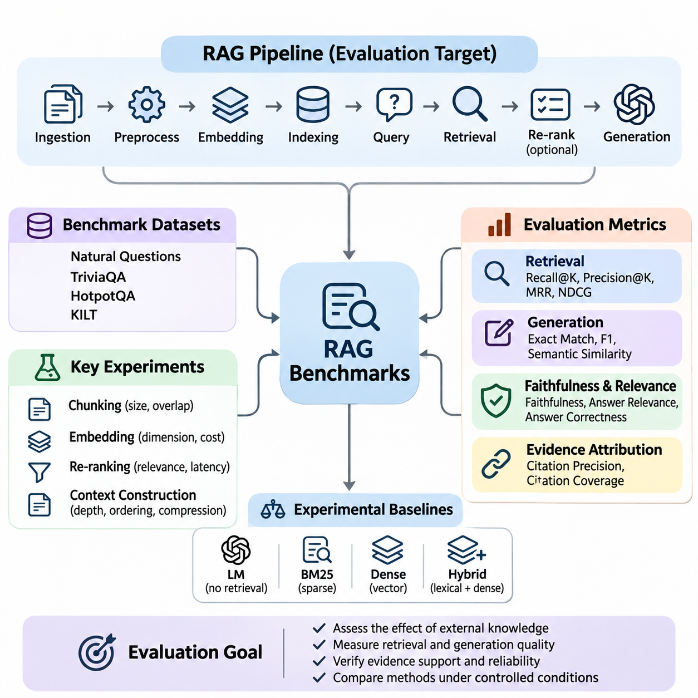
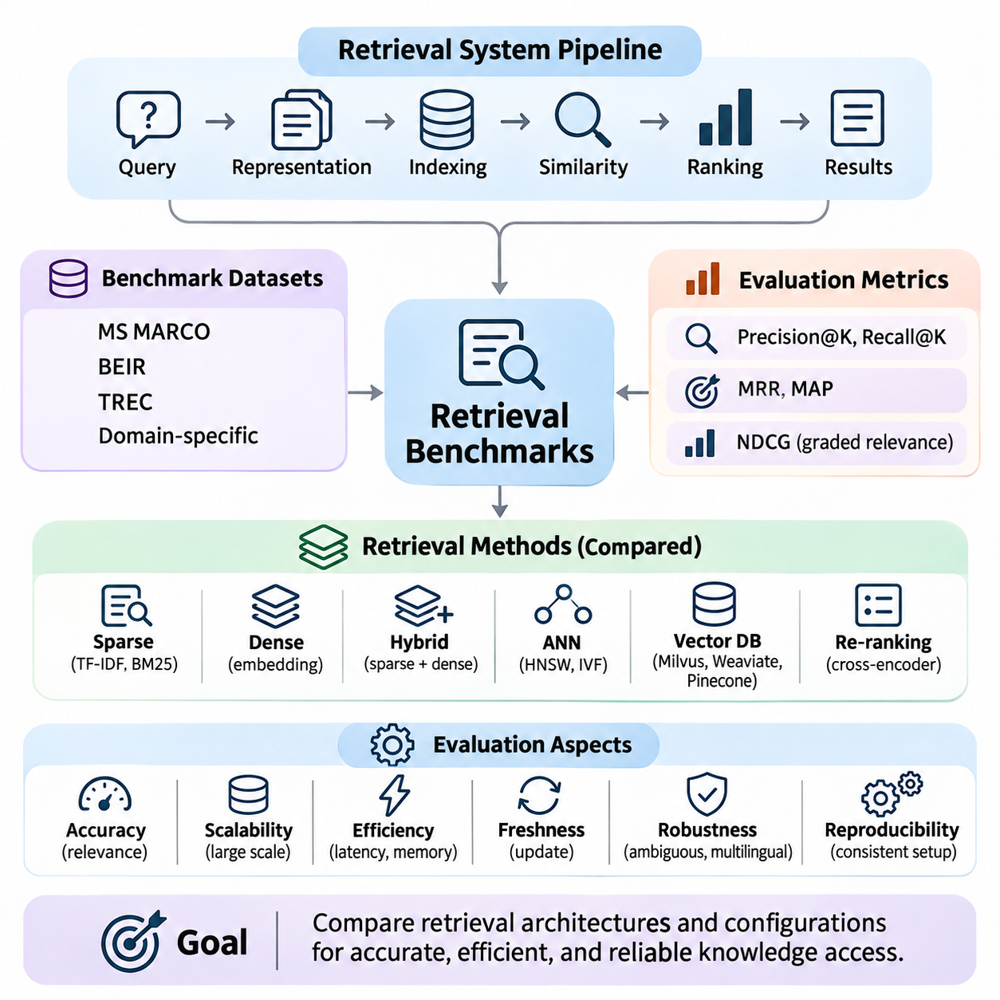
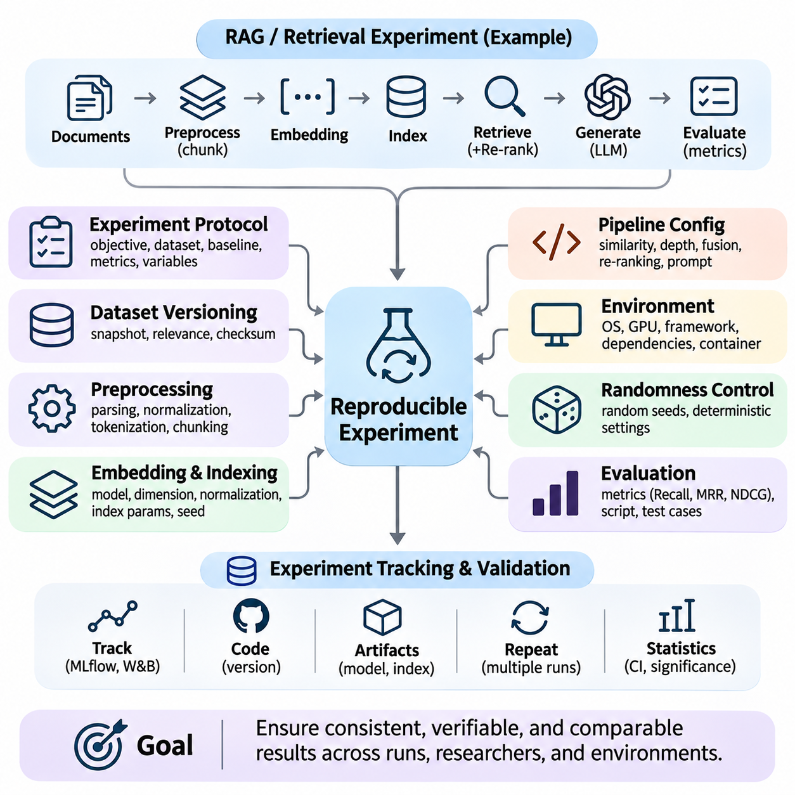
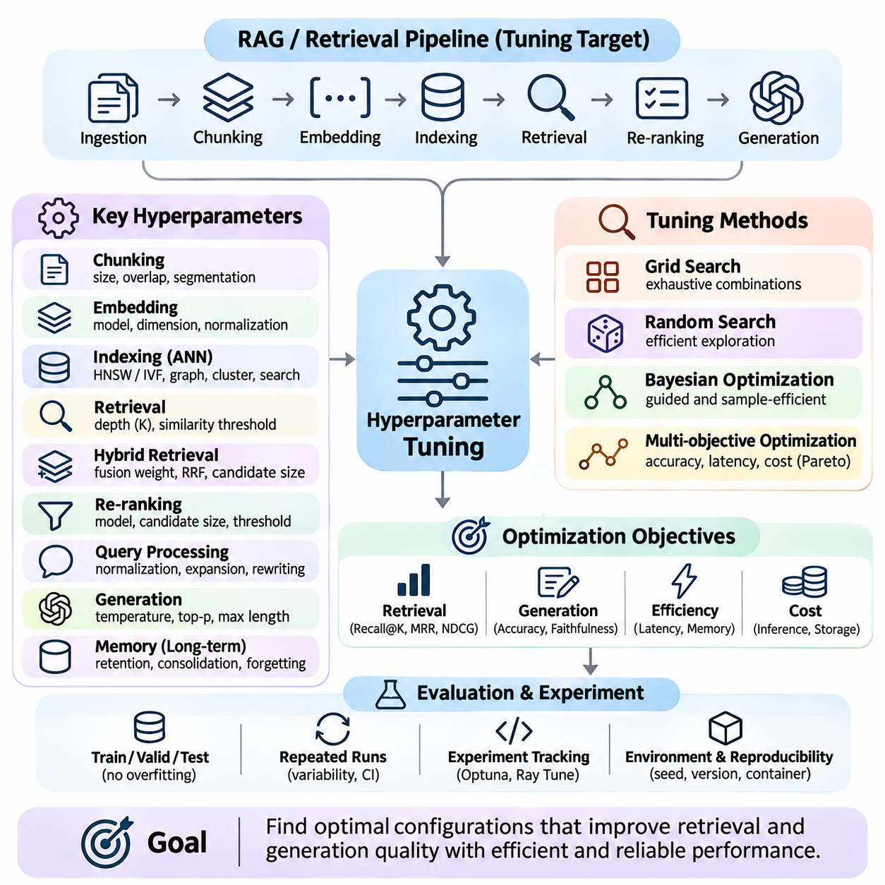
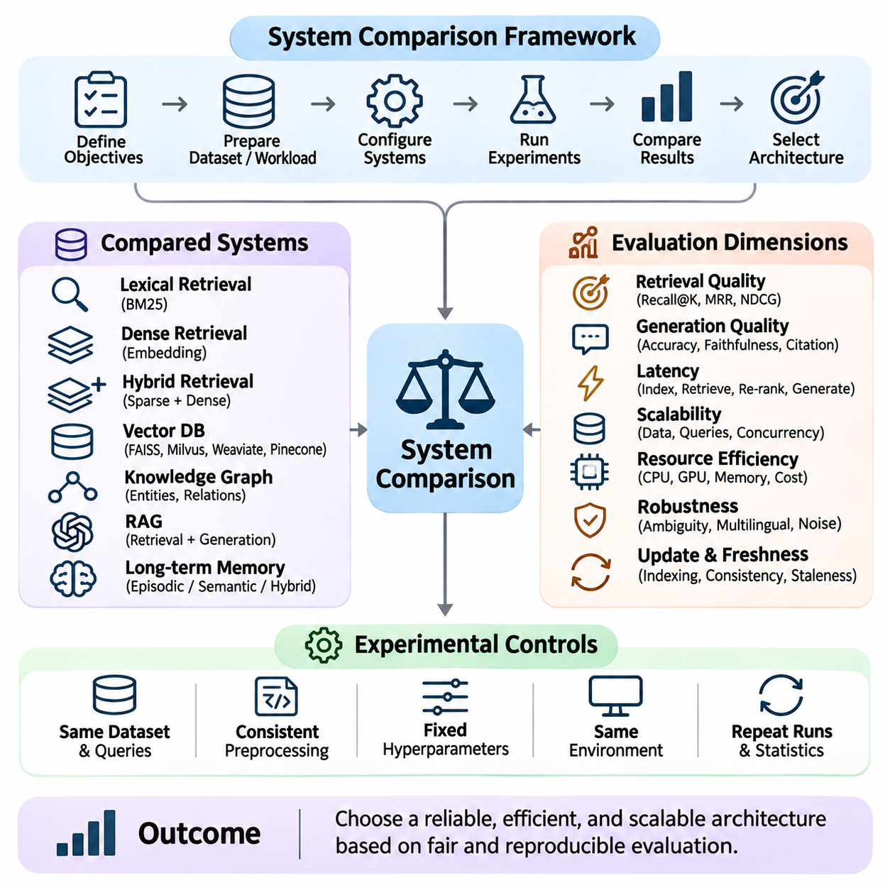

**Volume 37. Memory and Knowledge Systems**

# 08. Experiments and Benchmarks

## 08.01 RAG Benchmarks

{width="7.268055555555556in" height="7.268055555555556in"}

Retrieval-Augmented Generation (RAG) benchmarks provide a systematic framework for evaluating how effectively language models retrieve external knowledge and generate accurate, relevant, and evidence-supported responses. Unlike conventional language model evaluations, RAG benchmarking examines the interaction between retrieval mechanisms, knowledge repositories, context construction, and response generation. Its primary objective is to determine whether external information improves factual reliability and task performance.

A typical RAG system consists of document ingestion, text preprocessing, embedding generation, vector indexing, query processing, retrieval, optional re-ranking, and language model inference. Each component influences the final response, making end-to-end evaluation essential. A benchmark must therefore distinguish retrieval failures from generation failures while measuring the combined performance of the complete pipeline under controlled experimental conditions.

Benchmark datasets generally contain user queries, reference answers, relevant documents, and supporting evidence annotations. These elements establish a measurable relationship between information retrieval and generated responses. Dataset quality depends on representative query distributions, accurate relevance judgments, sufficient domain coverage, and consistent annotation procedures. Poorly constructed datasets can produce misleading conclusions even when evaluation metrics appear statistically reliable.

Widely used evaluation resources include Natural Questions, TriviaQA, HotpotQA, and KILT, although they serve different experimental purposes. Natural Questions emphasizes information seeking, TriviaQA examines factual question answering, and HotpotQA evaluates reasoning across multiple supporting documents. KILT provides a framework connecting knowledge-intensive language tasks with evidence provenance, making it useful for studying retrieval-grounded generation.

Retrieval effectiveness is commonly measured using Recall\\@K, Precision\\@K, Mean Reciprocal Rank, and Normalized Discounted Cumulative Gain. Recall\\@K measures whether relevant evidence appears among the retrieved candidates, while Precision\\@K evaluates the proportion of relevant results. Reciprocal rank emphasizes the position of the first relevant result, whereas NDCG considers graded relevance and ranking quality across multiple retrieved documents.

Generation quality requires additional measurements because successful retrieval does not guarantee a correct answer. Exact Match and token-level F1 can evaluate responses against reference answers, particularly in factual question answering. Semantic similarity metrics provide flexibility when equivalent answers use different wording. However, lexical and semantic agreement alone cannot establish whether generated claims are genuinely supported by retrieved evidence.

Faithfulness measures the degree to which generated statements are supported by the supplied context. Answer relevance evaluates whether the response addresses the original question, while answer correctness examines agreement with verified reference information. These dimensions should be evaluated separately because a response may be relevant but factually incorrect, or factually correct without being supported by the retrieved documents.

Evidence attribution is another essential benchmark dimension. A reliable RAG system should identify which retrieved passages support individual factual claims and avoid presenting unsupported statements as established knowledge. Citation precision measures whether cited passages genuinely support their associated claims, while citation coverage examines how comprehensively claims receive appropriate evidence. These measurements become particularly important in scientific, legal, and enterprise applications.

Experimental baselines are necessary for interpreting benchmark results. A useful comparison includes a language model without retrieval, a conventional sparse retrieval system such as BM25, a dense vector retrieval pipeline, and a hybrid retrieval architecture. Evaluating these alternatives with the same dataset and generation model helps isolate the contribution of external knowledge access and retrieval methodology.

Document chunking introduces significant experimental variation because retrieval systems operate on segmented representations of source materials. Small chunks may improve semantic specificity but fragment important contextual relationships. Large chunks preserve broader information while increasing irrelevant content and token consumption. Benchmark experiments should therefore examine chunk size, overlap, segmentation strategy, and their effects on retrieval coverage and answer quality.

Embedding models also influence benchmark outcomes by determining how queries and documents are represented in vector space. Domain-specific terminology, multilingual expressions, abbreviations, and semantic ambiguity can affect retrieval accuracy. Controlled comparisons should evaluate embedding dimensionality, representation quality, indexing requirements, and computational cost while keeping other pipeline components unchanged whenever possible.

Re-ranking experiments investigate whether additional relevance estimation improves the ordering of retrieved candidates. Cross-encoder models can evaluate query-document relationships more directly than independent embedding similarity, although they introduce computational overhead. Benchmarking should measure improvements in evidence relevance and downstream answer correctness alongside additional latency, memory consumption, and processing cost.

Context construction determines how retrieved information enters the language model. Experiments may compare different retrieval depths, passage ordering strategies, context compression methods, and token budgets. Increasing the number of retrieved passages does not necessarily improve performance because irrelevant or contradictory information may distract generation. Effective benchmarking identifies the context configuration that balances evidence sufficiency with computational efficiency.

Multi-hop reasoning benchmarks evaluate questions requiring information distributed across several documents or knowledge sources. These tasks are particularly challenging because retrieving one relevant passage may be insufficient to establish the final answer. Evaluation should examine whether all necessary supporting facts are retrieved, whether relationships between them are correctly interpreted, and whether the generated conclusion follows logically from the available evidence.

Robustness testing examines system behavior under noisy queries, incomplete documents, conflicting evidence, and changes in terminology. Additional experiments may introduce typographical errors, paraphrased questions, irrelevant passages, or outdated information. A robust RAG system should maintain reasonable retrieval effectiveness, recognize insufficient evidence, and avoid producing confident answers when available sources cannot support a reliable conclusion.

Knowledge freshness introduces another benchmarking requirement for systems connected to frequently updated repositories. Experiments should measure how quickly newly inserted documents become searchable and whether outdated information remains influential after updates. Temporal evaluation can include questions whose correct answers change over time, allowing researchers to assess indexing delays, retrieval consistency, and the ability to prioritize current evidence.

Operational performance must be evaluated alongside answer quality. Important measurements include retrieval latency, generation latency, end-to-end response time, throughput, memory utilization, and computational cost per query. Percentile latency measurements reveal behavior that average response times may conceal. Experiments under concurrent workloads are particularly valuable for identifying bottlenecks in vector databases, re-ranking services, and language model inference.

Ablation studies provide insight into the contribution of individual RAG components. Researchers may disable re-ranking, replace hybrid retrieval with dense retrieval, remove query expansion, or vary context compression while preserving the remaining experimental configuration. Performance differences reveal which mechanisms provide measurable benefits and which introduce unnecessary complexity. Such analysis supports evidence-based architectural optimization rather than relying on isolated benchmark scores.

Statistical reliability requires careful treatment of dataset sampling and experimental variability. Benchmark reports should include sample sizes, evaluation procedures, uncertainty estimates, and repeated measurements where appropriate. Paired comparisons and bootstrap confidence intervals can help determine whether observed performance differences are meaningful. Model versions, document collections, prompts, and retrieval settings must remain traceable throughout the evaluation process.

Domain-specific benchmarking extends general question-answering evaluation into enterprise knowledge management, scientific research, robotics, and industrial systems. These environments often contain specialized terminology, structured records, technical manuals, and heterogeneous document formats. Evaluation datasets should represent realistic operational questions and measure whether the system retrieves authoritative evidence rather than merely producing plausible language.

Security and privacy considerations also affect RAG evaluation. Retrieved documents may contain confidential information, misleading instructions, or content outside the requesting user\'s access permissions. Benchmark scenarios should examine unauthorized information exposure, prompt injection through retrieved passages, and inappropriate reliance on untrusted sources. These tests evaluate whether retrieval-grounded generation preserves system boundaries while maintaining useful responses.

Human evaluation remains important when automated metrics cannot adequately assess technical completeness, reasoning quality, or practical usefulness. Domain experts can examine whether responses preserve critical qualifications, interpret evidence correctly, and communicate uncertainty appropriately. Clear scoring rubrics and agreement measurements help reduce subjective variation, while targeted human review can reveal systematic failures overlooked by automated evaluation.

A comprehensive RAG benchmark ultimately combines retrieval effectiveness, evidence faithfulness, answer correctness, robustness, efficiency, and operational reliability. No single metric adequately represents these interconnected dimensions. By applying controlled experiments, representative datasets, transparent evaluation procedures, and reproducible configurations, researchers can identify architectural weaknesses and develop retrieval-augmented systems that deliver dependable, verifiable, and scalable knowledge-based intelligence.

## 08.02 Retrieval Benchmarks

{width="7.268055555555556in" height="7.268055555555556in"}

Retrieval benchmarks provide a systematic methodology for evaluating how effectively information retrieval systems identify, rank, and deliver relevant knowledge from large document collections. Within memory and knowledge systems, retrieval quality directly influences factual accuracy, contextual relevance, and downstream reasoning performance. Benchmarking establishes measurable criteria for comparing retrieval architectures under consistent experimental conditions.

A retrieval system transforms a user query into a ranked collection of documents, passages, or knowledge representations. Its performance depends on query interpretation, document representation, indexing structures, similarity computation, and ranking algorithms. Effective benchmarking evaluates these components individually while examining their combined behavior, allowing researchers to distinguish representation limitations from indexing and ranking failures.

Benchmark datasets typically contain a document corpus, evaluation queries, and relevance judgments connecting queries to appropriate documents. These judgments may be binary, indicating whether a document is relevant, or graded, representing different levels of usefulness. Dataset construction must consider query diversity, corpus characteristics, annotation consistency, and realistic information needs to ensure meaningful experimental conclusions.

Established evaluation collections include MS MARCO, BEIR, TREC datasets, and domain-specific retrieval corpora. MS MARCO supports large-scale passage and document ranking experiments, while BEIR evaluates generalization across heterogeneous retrieval tasks. TREC provides standardized evaluation settings and relevance judgments across multiple tracks. These resources enable controlled comparisons, although differences in datasets and protocols require careful interpretation.

Precision measures the proportion of retrieved documents that are relevant, while recall measures the proportion of relevant documents successfully retrieved. Precision\\@K and Recall\\@K restrict evaluation to the highest-ranked K results, reflecting practical retrieval interfaces and context-limited AI systems. Their interpretation depends on the completeness of relevance judgments, particularly when large collections contain relevant documents that have not been annotated.

Mean Reciprocal Rank evaluates how early the first relevant document appears in a ranked result list. It is especially useful for question-answering systems where locating one authoritative passage may satisfy the information need. Mean Average Precision considers precision across relevant-document positions, providing a broader assessment of ranking effectiveness when multiple relevant documents contribute to retrieval quality.

Normalized Discounted Cumulative Gain evaluates ranking quality by assigning greater importance to highly relevant documents appearing near the beginning of a result list. Its graded relevance formulation is useful when documents differ substantially in informational value. Unlike binary retrieval metrics, NDCG can distinguish between partially relevant and highly relevant results, making it suitable for complex knowledge discovery applications.

Sparse retrieval benchmarks evaluate lexical matching approaches such as TF-IDF and BM25. These methods represent documents using term statistics and typically perform well when queries contain distinctive keywords or exact technical terminology. Experiments should examine vocabulary mismatch, document length variation, rare terminology, and query expansion effects to identify the strengths and limitations of traditional lexical retrieval.

Dense retrieval benchmarks evaluate neural embedding models that map queries and documents into continuous vector spaces. Semantic similarity enables retrieval beyond exact keyword overlap, potentially improving performance on paraphrased questions and conceptually related documents. However, dense retrieval may struggle with precise identifiers, numerical constraints, or specialized terminology, requiring evaluation across diverse query categories.

Hybrid retrieval combines sparse and dense representations to capture complementary lexical and semantic relationships. Benchmark experiments may compare weighted score fusion, reciprocal rank fusion, and alternative candidate aggregation strategies. Performance should be measured across exact-match queries, semantic queries, and mixed information needs to determine whether hybrid architectures provide consistent improvements over individual retrieval methods.

Approximate Nearest Neighbor algorithms introduce another benchmarking dimension by trading exact search guarantees for computational efficiency. Systems based on Hierarchical Navigable Small World graphs, inverted file indexes, or other approximate structures should be evaluated using recall against exact nearest-neighbor results. Index construction time, query latency, memory consumption, and update behavior must accompany retrieval accuracy measurements.

Vector database benchmarks examine the operational characteristics of systems such as Milvus, Weaviate, and Pinecone under comparable workloads. Evaluation should control embedding dimensions, collection sizes, index parameters, filtering conditions, and concurrency levels. Differences in infrastructure configuration and managed-service behavior must be documented to prevent misleading conclusions about database performance.

Re-ranking benchmarks investigate whether secondary ranking models improve the relevance of initially retrieved candidates. Cross-encoders can estimate query-document relevance using joint representations, while lighter ranking methods may offer lower computational costs. Experiments should measure ranking improvements alongside additional inference latency, candidate-set size, and processing requirements to determine whether re-ranking provides practical value.

Scalability experiments examine retrieval behavior as document collections expand from thousands to millions or billions of records. Increasing corpus size affects indexing time, storage requirements, memory utilization, and search latency. A reliable benchmark should measure performance across multiple collection sizes while maintaining consistent query distributions and relevance criteria, revealing how retrieval quality and infrastructure requirements evolve.

Dynamic retrieval benchmarks evaluate systems operating on continuously changing knowledge repositories. Document insertion, deletion, modification, and re-indexing can influence search consistency and information freshness. Experiments should measure update visibility, indexing delay, retrieval stability, and query performance during concurrent modifications, particularly in enterprise systems where knowledge changes frequently.

Robustness evaluation investigates retrieval performance under spelling errors, ambiguous queries, multilingual inputs, incomplete context, and domain shifts. Controlled perturbations help determine whether ranking models depend excessively on surface-level wording. Out-of-domain evaluation is particularly important for neural retrieval systems because strong performance on familiar training distributions does not guarantee reliable generalization to unfamiliar knowledge collections.

Efficiency benchmarks measure query latency, throughput, CPU utilization, GPU utilization, memory footprint, and storage overhead. Average latency should be supplemented with percentile measurements to reveal performance under demanding workloads. Concurrent query experiments and realistic filtering operations help identify infrastructure bottlenecks, enabling researchers to balance retrieval effectiveness against operational cost and response-time requirements.

Reproducible retrieval benchmarking requires consistent datasets, preprocessing procedures, model versions, indexing configurations, and evaluation scripts. Random seeds, hardware specifications, software dependencies, and query execution settings should be recorded. Statistical comparisons across query-level results help establish whether measured improvements are meaningful rather than consequences of sampling variation or uncontrolled experimental conditions.

Domain-specific retrieval evaluation extends benchmarking into scientific literature, enterprise documentation, industrial maintenance, robotics, and autonomous systems. These environments contain structured metadata, specialized vocabulary, numerical specifications, and relationships across multiple information sources. Benchmarks should reflect realistic domain queries and evaluate whether retrieved information is sufficiently accurate, complete, and authoritative for downstream decision-making.

Retrieval benchmarks ultimately support the selection and optimization of knowledge access architectures by connecting relevance quality with computational efficiency and operational reliability. No single metric captures every aspect of retrieval performance. Comprehensive evaluation combines ranking effectiveness, semantic coverage, scalability, freshness, robustness, and reproducibility to establish dependable foundations for retrieval-augmented generation, long-term memory, and intelligent knowledge systems.

## 08.03 Reproducibility [w/Code]

{width="7.268055555555556in" height="7.268055555555556in"}

Reproducibility is a fundamental requirement for evaluating memory and knowledge systems because experimental results must remain consistent across repeated executions, independent researchers, and different computing environments. In retrieval-augmented generation, vector databases, and long-term memory architectures, reproducibility ensures that observed improvements originate from actual system changes rather than uncontrolled variations in datasets, model configurations, or execution conditions.

Reproducible experimentation begins with a clearly defined experimental protocol describing the research objective, evaluation dataset, baseline architecture, and performance metrics. Every experiment should specify which variables are modified and which remain constant. This separation allows researchers to attribute performance differences to particular retrieval algorithms, embedding models, memory mechanisms, or knowledge integration strategies without introducing unintended experimental bias.

Dataset versioning is essential because retrieval performance depends directly on the contents and organization of the underlying knowledge collection. Document additions, deletions, preprocessing changes, and annotation revisions can alter benchmark results even when the retrieval model remains unchanged. Reproducible workflows therefore preserve dataset snapshots, document identifiers, relevance judgments, preprocessing configurations, and cryptographic checksums for verifying data integrity.

Preprocessing reproducibility requires consistent document parsing, text normalization, tokenization, segmentation, and metadata extraction. Small differences in whitespace handling, sentence boundaries, or chunk overlap can change embedding representations and retrieval rankings. Experimental records should document preprocessing library versions, chunking algorithms, maximum sequence lengths, and filtering rules so that independent implementations can reconstruct equivalent document representations.

Embedding generation introduces additional reproducibility challenges because neural models depend on specific weights, tokenizers, numerical precision, and inference configurations. Researchers should record model identifiers, exact checkpoint revisions, embedding dimensions, normalization procedures, and batch-processing settings. Even when the same embedding architecture is used, changes in model revisions or numerical execution can produce different vectors and influence similarity search results.

Vector indexing must also be controlled because approximate nearest neighbor algorithms may introduce stochastic behavior during index construction and search. Hierarchical graph construction, clustering initialization, quantization, and parallel processing can affect the resulting search structure. Reproducible benchmarks should preserve index parameters, random seeds, training samples, construction settings, and index snapshots whenever exact reconstruction is necessary.

Randomness management extends beyond setting a single random seed. Experimental pipelines may involve Python random generators, numerical libraries, machine learning frameworks, GPU kernels, and distributed processing components. Each source of randomness should be controlled where supported, while nondeterministic operations must be documented. Deterministic execution settings can improve repeatability, although they may increase computational overhead or remain unavailable for certain operations.

Hardware and software environments influence experimental outcomes through differences in numerical precision, parallel execution, memory allocation, and library implementations. Reproducibility records should include operating system versions, processor architectures, GPU models, accelerator drivers, framework versions, and dependency specifications. Containerized environments can reduce configuration differences, but hardware-dependent behavior and external services may still prevent identical execution.

Retrieval pipeline configurations must be preserved across experimental repetitions. Important parameters include similarity metrics, candidate retrieval depth, metadata filters, query expansion methods, hybrid fusion weights, and re-ranking settings. Changing any of these variables can modify the documents supplied to downstream models. Configuration files and structured experiment manifests provide reliable mechanisms for tracking these dependencies and reconstructing complete retrieval workflows.

Language model generation introduces variability through sampling parameters, model updates, prompt construction, and inference infrastructure. Temperature, top-p sampling, maximum output length, system instructions, and retrieved context ordering should be recorded. Deterministic decoding can reduce output variation, but identical prompts do not always guarantee identical responses across different model versions, hardware environments, or hosted inference services.

Evaluation reproducibility requires stable metric definitions and consistent reference annotations. Recall, Mean Reciprocal Rank, NDCG, answer correctness, and evidence faithfulness must be calculated using clearly documented procedures. Differences in relevance thresholds, token normalization, missing-document handling, or evaluator models can produce incompatible scores. Benchmark implementations should therefore include validated evaluation scripts and representative test cases.

Experiment tracking systems provide centralized records of configurations, datasets, model artifacts, performance metrics, and execution histories. Tools such as MLflow, Weights & Biases, and structured metadata repositories can support systematic comparison across experimental runs. Linking each result to a specific source-code revision and artifact identifier helps researchers identify the exact conditions under which a reported performance improvement was obtained.

Statistical reproducibility requires repeated measurements rather than reliance on a single benchmark execution. Retrieval metrics may vary because of stochastic indexing, sampling procedures, or changing infrastructure conditions. Multiple experimental runs allow researchers to estimate variability and construct confidence intervals. Paired comparisons and significance testing help determine whether observed improvements are robust enough to support architectural conclusions.

Ablation studies require particularly strict reproducibility because their purpose is to isolate the contribution of individual system components. When comparing dense retrieval, hybrid retrieval, re-ranking, or memory augmentation, all unrelated settings should remain unchanged. Shared datasets, identical evaluation queries, controlled computational budgets, and consistent model checkpoints reduce confounding factors and improve the interpretability of experimental differences.

Distributed and cloud-based systems introduce further challenges through asynchronous execution, resource scheduling, network variability, and changing service configurations. Repeated experiments may encounter different cache states, database replicas, or accelerator availability. Reliable benchmarking should distinguish algorithmic performance from infrastructure effects by recording workload conditions, concurrency levels, cache policies, and relevant resource utilization measurements.

Long-term memory systems require reproducibility across sequences of interactions rather than isolated queries. Memory insertion, retrieval, updating, consolidation, and deletion may alter future system behavior. Experimental protocols should preserve interaction histories, memory states, timestamps, and update policies. Restoring a known memory snapshot before each evaluation sequence allows researchers to compare memory architectures without contamination from previous experimental runs.

Knowledge graph integration introduces additional dependencies involving ontology versions, entity identifiers, relation schemas, and reasoning rules. Changes in graph structure or inference procedures can modify retrieved evidence and generated conclusions. Reproducible knowledge experiments should preserve graph snapshots, extraction configurations, entity resolution policies, and reasoning settings to distinguish knowledge evolution from algorithmic performance changes.

Continuous integration and automated testing can strengthen reproducibility by executing standardized benchmark suites whenever retrieval models, indexing procedures, or knowledge pipelines change. Regression tests detect unexpected variations in ranking quality, response correctness, latency, and resource consumption. Automated validation also helps identify incompatible dependencies, missing artifacts, and configuration drift before experimental results are accepted.

Reproducibility ultimately connects scientific validity with practical engineering reliability. A trustworthy memory and knowledge system should produce explainable experimental results that can be independently examined, repeated, and compared. By combining dataset versioning, controlled randomness, environment management, experiment tracking, statistical validation, and automated testing, researchers establish a dependable foundation for evaluating and improving retrieval and knowledge-based AI architectures.

## 08.04 Hyperparameter Tuning [w/Code]

{width="7.268055555555556in" height="7.268055555555556in"}

Hyperparameter tuning is a systematic optimization process used to identify configurations that improve the accuracy, efficiency, and reliability of memory and knowledge systems. In retrieval-augmented generation, vector databases, and long-term memory architectures, hyperparameters influence document representation, similarity search, ranking, and response generation. Effective tuning balances retrieval quality with computational cost, scalability, and operational constraints.

Unlike trainable model parameters, hyperparameters are selected before or during experimentation and control how algorithms operate. Examples include embedding dimensions, document chunk sizes, retrieval depth, similarity thresholds, and indexing configurations. Their effects are often interconnected, meaning that optimizing individual parameters independently may produce inferior results compared with coordinated optimization across the complete retrieval pipeline.

A reliable tuning process begins by defining measurable optimization objectives and identifying the parameters most likely to influence performance. Retrieval experiments commonly optimize Recall\\@K, Mean Reciprocal Rank, and NDCG, while generation-oriented systems additionally consider answer correctness and evidence faithfulness. Latency, memory consumption, and inference cost should be incorporated when evaluating configurations intended for production deployment.

Document chunk size is an important hyperparameter because it determines the granularity of information stored in retrieval indexes. Smaller chunks may improve semantic precision but separate related facts across multiple representations. Larger chunks preserve broader context while increasing irrelevant content and token consumption. Tuning experiments should evaluate chunk size together with overlap, document structure, and retrieval depth.

Chunk overlap controls how much information is repeated between adjacent document segments. Moderate overlap can preserve relationships crossing segmentation boundaries, improving retrieval completeness for complex questions. Excessive overlap, however, increases storage requirements and may introduce redundant evidence into retrieved contexts. Optimal settings depend on document length, information density, and the structure of the underlying knowledge collection.

Embedding-related tuning includes selecting representation models, vector normalization strategies, similarity functions, and dimensionality reduction methods. Cosine similarity, dot product, and Euclidean distance can produce different rankings depending on embedding normalization and model training objectives. Experiments should preserve consistent evaluation datasets while measuring semantic retrieval accuracy, computational overhead, and compatibility with indexing structures.

Approximate nearest neighbor indexes introduce parameters that directly affect search accuracy and efficiency. In HNSW, graph connectivity, construction search breadth, and query search breadth influence index quality, memory usage, and retrieval latency. In IVF-based systems, cluster counts and the number of searched partitions determine the balance between candidate coverage and computational cost. These parameters require coordinated tuning under representative workloads.

Retrieval depth determines how many candidate documents are returned for subsequent processing. Increasing the number of retrieved passages may improve evidence coverage but also introduce irrelevant information and additional processing overhead. Experiments should distinguish initial candidate depth from the number of passages ultimately supplied to the language model. This separation enables independent optimization of retrieval recall and context efficiency.

Hybrid retrieval systems require tuning the relative contributions of sparse and dense retrieval methods. Weighted score fusion combines normalized relevance scores, while reciprocal rank fusion aggregates ranked lists without requiring directly comparable score scales. Fusion weights, rank constants, and candidate pool sizes can influence retrieval effectiveness. Evaluation across lexical, semantic, and mixed queries helps identify configurations that generalize beyond specific query categories.

Re-ranking introduces additional hyperparameters involving candidate-set size, model selection, score thresholds, and final ranking depth. A larger candidate pool may improve the probability of identifying relevant evidence but increases computational requirements. Cross-encoder inference can become a substantial latency component when many passages require evaluation. Tuning should therefore consider ranking improvements relative to the additional cost of secondary relevance estimation.

Query processing parameters influence retrieval through normalization, expansion, rewriting, and semantic interpretation. Query expansion may improve coverage by introducing related terminology, but excessive expansion can reduce precision through semantic drift. Tuning experiments should evaluate how different query transformations affect exact terminology, ambiguous questions, multilingual inputs, and specialized technical expressions under consistent benchmark conditions.

Generation-related hyperparameters become important when retrieval systems are integrated with language models. Temperature, sampling probability, maximum output length, and context allocation influence response consistency and computational cost. Low-temperature configurations may reduce sampling variability, but they do not guarantee factual correctness. Evaluation should examine whether generated claims remain supported by retrieved evidence across different decoding configurations.

Long-term memory architectures introduce parameters governing memory retention, retrieval frequency, consolidation thresholds, and forgetting policies. These settings influence how historical information is stored and reused across interactions. Excessive retention may increase retrieval noise, while aggressive forgetting can eliminate useful knowledge. Sequential evaluation protocols are necessary because memory tuning affects future behavior rather than only individual retrieval results.

Grid search evaluates predefined combinations of hyperparameter values and provides a straightforward experimental baseline. However, computational requirements grow rapidly as the number of parameters increases. Random search samples configurations from specified distributions and can explore large parameter spaces more efficiently when only a subset of parameters strongly influences performance. Both methods require carefully defined search ranges and consistent evaluation procedures.

Bayesian optimization uses previous experimental results to guide the selection of promising configurations. Surrogate models estimate relationships between hyperparameters and objective values, while acquisition functions balance exploration and exploitation. This approach can reduce the number of expensive evaluations required to identify competitive settings. Its effectiveness depends on search-space design, measurement noise, and the computational cost of individual trials.

Multi-objective optimization is essential when retrieval quality, latency, memory consumption, and operational cost must be considered simultaneously. Improving one objective may degrade another, producing configurations that cannot be ranked using a single performance metric. Pareto analysis identifies solutions for which no objective can be improved without worsening another. Deployment requirements determine which tradeoffs are acceptable for a particular application.

Experimental design should separate training, validation, and test datasets to prevent benchmark overfitting. Hyperparameters are selected using validation performance, while final test results should be reserved for unbiased evaluation. Repeated experimentation on the test set can indirectly leak information into configuration decisions. Cross-validation, representative query sampling, and domain-separated evaluation can improve confidence in the generalization of selected configurations.

Automated tuning frameworks can coordinate parameter sampling, experiment execution, metric collection, and optimization history. Tools such as Optuna and Ray Tune support structured search spaces and resource-aware experimentation. Early stopping and successive halving can reduce computational expenditure by terminating unpromising trials. However, fair comparisons require consistent resource budgets and careful handling of incomplete evaluations.

Reproducibility requires recording hyperparameter values, random seeds, dataset versions, software dependencies, hardware configurations, and evaluation procedures. Experiment tracking enables researchers to compare configurations and identify interactions between parameters. Statistical uncertainty should accompany reported improvements, especially when performance differences are small. The selected configuration should be validated through repeated runs and representative deployment workloads.

Hyperparameter tuning ultimately transforms retrieval and memory system optimization into an evidence-driven engineering process. Effective configurations emerge from controlled experimentation rather than isolated parameter adjustments. By combining structured search strategies, multi-objective evaluation, reproducible workflows, and realistic operational constraints, researchers can develop knowledge systems that maintain strong retrieval accuracy, efficient computation, and dependable performance across changing environments.

## 08.05 System Comparison

{width="7.268055555555556in" height="7.268055555555556in"}

System comparison provides a structured methodology for evaluating alternative architectures, algorithms, and deployment strategies within memory and knowledge systems. Retrieval engines, vector databases, knowledge graphs, and retrieval-augmented generation pipelines exhibit different performance characteristics. A meaningful comparison examines retrieval accuracy, reasoning support, scalability, latency, resource consumption, and operational reliability under consistent experimental conditions.

The first requirement is establishing comparable evaluation objectives and representative workloads. Systems should process equivalent document collections, query sets, relevance judgments, and operational scenarios whenever technically possible. Differences in preprocessing, embedding models, indexing parameters, or hardware allocation can distort conclusions. A controlled experimental design separates architectural advantages from improvements caused by additional computational resources or favorable configurations.

Traditional lexical retrieval systems such as BM25 provide strong baselines for comparing modern knowledge retrieval architectures. Their effectiveness depends on term matching, document statistics, and ranking functions rather than learned semantic representations. Lexical methods often perform well with exact identifiers and specialized terminology, while dense retrieval can better capture conceptual similarity. Comparisons should evaluate both approaches across diverse query categories.

Dense retrieval systems represent queries and documents as numerical embeddings, enabling similarity searches within continuous vector spaces. Their effectiveness depends on embedding quality, training distribution, normalization, and index configuration. Comparative experiments should examine semantic recall, ranking accuracy, domain transfer, and computational requirements. Strong results on familiar benchmarks do not necessarily indicate equivalent performance on unfamiliar technical or enterprise documents.

Hybrid retrieval architectures combine lexical and semantic methods to improve coverage across heterogeneous information needs. Their performance depends on candidate aggregation, score normalization, fusion weights, and optional re-ranking stages. Comparisons should determine whether hybrid retrieval consistently improves relevance or merely benefits selected query categories. Additional indexing requirements, storage overhead, and query latency must be considered alongside improvements in retrieval effectiveness.

Vector database comparisons examine indexing efficiency, search accuracy, update behavior, filtering capabilities, and distributed scalability. Systems such as FAISS, Milvus, Weaviate, and Pinecone provide different combinations of libraries, database functionality, and managed infrastructure. Fair evaluation requires distinguishing standalone search libraries from complete database services while controlling index types, vector dimensions, hardware resources, and workload characteristics.

Knowledge graph systems provide structured representations of entities, relationships, and semantic constraints. Unlike vector retrieval, graph-based retrieval can explicitly traverse relationships and support multi-hop evidence discovery. Comparative evaluation should consider relation accuracy, graph completeness, query complexity, and reasoning transparency. Graph approaches may offer advantages for structured reasoning but require additional knowledge extraction, entity resolution, and maintenance processes.

Retrieval-augmented generation architectures integrate external knowledge retrieval with language model inference. System comparison must therefore examine both retrieved evidence and generated responses. High retrieval recall does not automatically guarantee factual answers, while fluent generation may conceal missing or incorrect evidence. Evaluation should combine retrieval metrics with answer correctness, faithfulness, citation quality, and the ability to identify insufficient information.

Long-term memory systems introduce additional comparison dimensions because stored information evolves through repeated interactions. Architectures may use episodic memory, semantic memory, vector stores, structured databases, or hierarchical memory representations. Comparative experiments should measure memory retention, retrieval relevance, update consistency, forgetting behavior, and personalization stability. Sequential interaction benchmarks reveal differences that isolated retrieval tests cannot capture.

Latency comparisons should distinguish indexing time, query encoding, candidate retrieval, re-ranking, context preparation, and generation. End-to-end response time reflects the combined effects of these stages, while component-level measurements reveal specific bottlenecks. Median latency alone is insufficient for production evaluation. Tail latency, concurrent requests, cache conditions, and workload variability provide additional evidence about operational responsiveness.

Scalability evaluation investigates how systems behave as document collections, query volumes, and concurrent users increase. Index growth can affect memory consumption, storage requirements, search quality, and update performance. Distributed architectures introduce communication overhead and coordination complexity while enabling larger workloads. Comparisons should examine scaling efficiency under equivalent resource budgets rather than relying exclusively on maximum throughput.

Resource efficiency is another critical dimension because systems with similar retrieval accuracy may require substantially different computational infrastructure. CPU utilization, GPU memory, storage capacity, network bandwidth, and energy consumption influence deployment feasibility. Cost comparisons should include indexing, inference, maintenance, and infrastructure expenses. A configuration achieving slightly higher accuracy may be unsuitable when its operational cost exceeds practical constraints.

Robustness comparisons examine system behavior under ambiguous queries, spelling variations, multilingual inputs, incomplete documents, and distribution shifts. Controlled perturbations can reveal whether performance depends excessively on exact wording or familiar training patterns. Systems should also be tested with conflicting evidence, outdated records, and irrelevant retrieved passages. Reliable architectures maintain useful behavior while expressing uncertainty when available knowledge is insufficient.

Freshness and update consistency become important when knowledge repositories change continuously. Systems differ in how quickly inserted, modified, or deleted information becomes available for retrieval. Benchmarking should measure indexing delay, update visibility, stale-result frequency, and retrieval stability during concurrent modifications. These characteristics are particularly relevant to enterprise knowledge management, operational monitoring, and continuously updated memory systems.

Security and privacy requirements influence architectural suitability beyond conventional accuracy metrics. Comparative evaluation should consider access control, document-level permissions, tenant isolation, encryption, and auditability. Retrieval systems must prevent unauthorized information from appearing in generated responses. Tests involving permission changes, sensitive metadata, and malicious document instructions can reveal vulnerabilities that ordinary relevance benchmarks fail to identify.

Reproducibility is essential for establishing credible system comparisons. Researchers should preserve dataset versions, model checkpoints, software dependencies, index configurations, random seeds, and hardware specifications. Repeated measurements help quantify variability, while statistical tests support interpretation of performance differences. Without consistent experimental controls, apparent architectural superiority may reflect implementation choices or environmental differences rather than genuine system advantages.

Ablation studies provide deeper explanations by isolating individual architectural components. Removing re-ranking, changing embedding models, disabling hybrid fusion, or replacing memory consolidation mechanisms can reveal their contributions to overall performance. Each comparison should preserve unrelated settings and computational budgets. Such experiments clarify whether system complexity produces measurable benefits or introduces unnecessary processing overhead.

Domain-specific comparisons are necessary because retrieval requirements vary across scientific research, healthcare, robotics, manufacturing, and autonomous systems. Technical documents may contain numerical specifications, specialized terminology, temporal dependencies, and structured relationships. Evaluation datasets should reflect realistic tasks and operational consequences. A system optimized for general question answering may perform poorly when exact measurements or authoritative engineering records are required.

Multi-objective evaluation combines accuracy, latency, scalability, reliability, and cost into a broader decision framework. No single architecture dominates every dimension, and tradeoffs depend on application requirements. Pareto analysis can identify configurations offering competitive performance without unnecessary resource consumption. Weighted scoring may support deployment decisions, provided that evaluation priorities and weighting assumptions are explicitly documented.

System comparison ultimately supports evidence-based architecture selection rather than declaring one retrieval or memory technology universally superior. Effective evaluation integrates standardized benchmarks, controlled workloads, component-level analysis, statistical validation, and realistic deployment constraints. By examining both technical performance and operational sustainability, researchers can select knowledge architectures that remain accurate, efficient, maintainable, and dependable as application requirements evolve.
